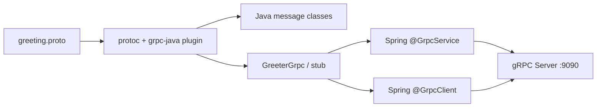

# Spring Boot Starter for gRPC

## 1. Goals and Position in the Spring Ecosystem

The **Spring Boot starter for gRPC** helps a Spring Boot application initialize a gRPC server or client using Spring configuration and beans, instead of manually managing the entire lifecycle of `Server`, `ManagedChannel`, and infrastructure components. gRPC uses HTTP/2 as transport, Protocol Buffers (Protobuf) as the common message format, and defines RPCs via `.proto` contracts.

After this lesson, learners will be able to:

- Distinguish between the gRPC starter, gRPC Java, and the Protobuf code-generation plugin.
- Create a unary RPC contract, generate Java classes, and register a gRPC implementation as a Spring Boot component.
- Configure a gRPC client, invoke RPCs with deadlines, and handle status codes and metadata.
- Understand how to enable TLS, organize interceptors, test, and observe services in a deployment environment.
- Choose the right starter ecosystem and verify version compatibility before integration.

This lesson focuses on Spring Boot integration within the **SPRING_GRPC** service. Streaming, security, and monitoring are covered at the level necessary to deploy real-world applications.

## 2. What Does the Starter Solve?

A plain gRPC Java program typically creates a `ServerBuilder`, registers a `BindableService`, calls `start()`, manages shutdown, and builds a `ManagedChannelBuilder` on the client side. When integrating with Spring Boot, a starter can provide:

| Concern | Typical Starter Role |
| --- | --- |
| Server | Start and stop the gRPC server alongside the application lifecycle; register services discovered through Spring |
| Client | Create, configure, and manage channels/stubs by name or factory |
| Configuration | Map properties/YAML for ports, addresses, TLS, and transport policies |
| Extensibility | Wire interceptors, credentials, health, or observability tools depending on starter capabilities |
| Testing | Support running services under a Spring test context and choosing how the server runs during tests |

**The starter does not replace the Protobuf contract or the code-generation step.** The `protoc` compiler and `protoc-gen-grpc-java` plugin are still required to generate message classes along with base classes/stubs for RPCs.

### Choosing a Starter Ecosystem Before Writing Code

There are two common integration paths:

| Option | Usage | Notes |
| --- | --- | --- |
| **Spring gRPC** from the Spring ecosystem | Use the starters and APIs published for the specific Spring Boot/Spring gRPC version | Artifact names, service registration, and client creation may vary across release lines; check the documentation for the exact version |
| **net.devh gRPC Spring Boot starter** (community) | Use `grpc-server-spring-boot-starter`, `grpc-client-spring-boot-starter`, `@GrpcService`, and `@GrpcClient` | The annotations and configuration below **belong to net.devh** and do not automatically apply to the official Spring gRPC |

The hands-on section chooses **net.devh** to illustrate the complete flow because its integration API is straightforward. When a project adopts the official Spring gRPC, convert all service/client registration code to the corresponding API; do not mix annotations or configuration from both ecosystems and assume they are equivalent.



## 3. Creating a Protobuf Contract and Generating Java Code

Suppose the system has a service that returns greetings. Place the file at `src/main/proto/greeting.proto`:

```proto
syntax = "proto3";

package demo.greeting.v1;

option java_multiple_files = true;
option java_package = "dev.example.greeter.v1";
option java_outer_classname = "GreetingProto";

service Greeter {
  rpc SayHello(HelloRequest) returns (HelloReply);
}

message HelloRequest {
  string name = 1;
}

message HelloReply {
  string message = 1;
}
```

The name `demo.greeting.v1.Greeter` is the gRPC service name on the wire; `java_package` controls the package of the generated Java code. Field numbers (e.g., `name = 1`) are part of the data compatibility contract: **never reuse a removed field number** for a new meaning; declare `reserved` when removing fields in a later version.

Example `build.gradle` (Groovy DSL) configuration for a Spring Boot project using net.devh:

```groovy
plugins {
    id 'java'
    id 'org.springframework.boot' version 'BOOT_VERSION'
    id 'io.spring.dependency-management' version 'DEPENDENCY_MANAGEMENT_VERSION'
    id 'com.google.protobuf' version 'PROTOBUF_PLUGIN_VERSION'
}

def grpcVersion = 'GRPC_VERSION'
def protoVersion = 'PROTOBUF_VERSION'

repositories {
    mavenCentral()
}

dependencies {
    implementation 'org.springframework.boot:spring-boot-starter'
    implementation 'net.devh:grpc-server-spring-boot-starter:STARTER_VERSION'
    implementation 'net.devh:grpc-client-spring-boot-starter:STARTER_VERSION'

    implementation platform('io.grpc:grpc-bom:' + grpcVersion)
    implementation 'io.grpc:grpc-protobuf'
    implementation 'io.grpc:grpc-stub'
    implementation 'com.google.protobuf:protobuf-java:' + protoVersion

    testImplementation 'org.springframework.boot:spring-boot-starter-test'
    testImplementation 'io.grpc:grpc-inprocess'
}

protobuf {
    protoc {
        artifact = 'com.google.protobuf:protoc:' + protoVersion
    }
    plugins {
        grpc {
            artifact = 'io.grpc:protoc-gen-grpc-java:' + grpcVersion
        }
    }
    generateProtoTasks {
        all()*.plugins {
            grpc {}
        }
    }
}
```

The strings `BOOT_VERSION`, `DEPENDENCY_MANAGEMENT_VERSION`, `PROTOBUF_PLUGIN_VERSION`, `GRPC_VERSION`, `PROTOBUF_VERSION`, and `STARTER_VERSION` are **placeholders to replace with actual versions**, not runnable values. Prefer a project-managed BOM/version catalog and check the starter's compatibility matrix against Spring Boot, Java, gRPC, and Protobuf. Some `grpc-java`/JDK combinations also require `compileOnly 'javax.annotation:javax.annotation-api:...'` for annotations in generated code; add it only if you encounter the corresponding compilation error.

Run the Gradle task `generateProto` to generate the message classes and `GreeterGrpc`; the Protobuf plugin also hooks code generation into the Java compilation process. **Do not edit generated Java files**: update the `.proto` contract, then regenerate the code.

## 4. Initializing the Spring Boot Server and Registering a gRPC Service

Standard Spring Boot application:

```java
package dev.example;

import org.springframework.boot.SpringApplication;
import org.springframework.boot.autoconfigure.SpringBootApplication;

@SpringBootApplication
public class GreetingApplication {
    public static void main(String[] args) {
        SpringApplication.run(GreetingApplication.class, args);
    }
}
```

Place the following classes under a package covered by Spring component scanning (here, `dev.example`).

Separate business logic from transport so it can be tested independently:

```java
package dev.example;

import org.springframework.stereotype.Service;

@Service
public class GreetingText {
    public String forName(String name) {
        return "Hello, " + name.trim() + "!";
    }
}
```

Implement the service generated by Protobuf and declare **net.devh**'s `@GrpcService`:

```java
package dev.example;

import dev.example.greeter.v1.GreeterGrpc;
import dev.example.greeter.v1.HelloReply;
import dev.example.greeter.v1.HelloRequest;
import io.grpc.Status;
import io.grpc.stub.StreamObserver;
import net.devh.boot.grpc.server.service.GrpcService;

@GrpcService
public class GreetingGrpcService extends GreeterGrpc.GreeterImplBase {
    private final GreetingText greetingText;

    public GreetingGrpcService(GreetingText greetingText) {
        this.greetingText = greetingText;
    }

    @Override
    public void sayHello(
            HelloRequest request,
            StreamObserver<HelloReply> responseObserver) {

        if (request.getName().isBlank()) {
            responseObserver.onError(
                Status.INVALID_ARGUMENT
                    .withDescription("name must not be blank")
                    .asRuntimeException());
            return;
        }

        HelloReply reply = HelloReply.newBuilder()
            .setMessage(greetingText.forName(request.getName()))
            .build();

        responseObserver.onNext(reply);
        responseObserver.onCompleted();
    }
}
```

For a unary RPC, the normal success path is **one** `onNext(reply)` followed by `onCompleted()`. On error, call `onError(...)` and finish; never call `onNext`/`onCompleted` after `onError`. Do not let business exceptions escape unhandled and accidentally turn into `UNKNOWN`; map errors deliberately to the appropriate `Status`.

Configure `src/main/resources/application.yml` for the development environment:

```yaml
spring:
  application:
    name: greeting-service

grpc:
  server:
    port: 9090
```

The gRPC port is independent of `server.port` in Spring MVC/WebFlux when the application also runs an HTTP server. The gRPC starter typically starts a separate gRPC transport, even though both run in the same Spring Boot process. Therefore, open the correct port in Docker/Kubernetes, firewalls, and HTTP/2-capable ingress.

## 5. Creating a gRPC Client in a Spring Bean

With **net.devh**, a client configuration connecting to a local service:

```yaml
grpc:
  client:
    greeting:
      address: static://localhost:9090
      negotiationType: PLAINTEXT
```

This configuration can sit alongside `grpc.server` when running a demo server and client in a single application; in multi-service systems, place the client section in the calling application. `PLAINTEXT` is only suitable for test environments or connections already protected by controlled infrastructure; for production, configure TLS/mTLS according to your trust model.

```java
package dev.example;

import dev.example.greeter.v1.GreeterGrpc;
import dev.example.greeter.v1.HelloRequest;
import io.grpc.StatusRuntimeException;
import net.devh.boot.grpc.client.inject.GrpcClient;
import org.springframework.stereotype.Service;

import java.util.concurrent.TimeUnit;

@Service
public class GreetingGateway {
    @GrpcClient("greeting")
    private GreeterGrpc.GreeterBlockingStub stub;

    public String greet(String name) {
        HelloRequest request = HelloRequest.newBuilder()
            .setName(name)
            .build();

        try {
            return stub.withDeadlineAfter(800, TimeUnit.MILLISECONDS)
                .sayHello(request)
                .getMessage();
        } catch (StatusRuntimeException ex) {
            // The caller layer decides how to map the error to an application result.
            throw ex;
        }
    }
}
```

The name `greeting` in `@GrpcClient("greeting")` matches the configuration key `grpc.client.greeting`. The stub is created from a channel managed by the starter. Never create a new channel per request: connection/HTTP/2 overhead is high and it defeats connection reuse. Blocking stubs block the current thread; do not call them directly on the event loop of a reactive application. For reactive flows, use asynchronous/future stubs with appropriate bridging mechanisms.

**A deadline belongs to each individual call.** The example above uses 800 ms as an illustrative value, not a default SLA. Choose it based on actual latency requirements, ensuring the total time of nested calls still fits within the outer deadline. If the client cancels or times out, the server should stop cancellable work rather than continuing to consume resources.

## 6. Metadata, Interceptors, and Status Codes

gRPC metadata carries out-of-band information outside the protobuf payload: correlation IDs, tokens, trace context, or small business headers. ASCII headers require valid names, typically lowercase; binary data uses keys ending in `-bin` with a corresponding marshaller.

On the server side, an interceptor can read metadata before forwarding the call to the service. The example below only illustrates extracting a request ID:

```java
package dev.example;

import io.grpc.*;
import net.devh.boot.grpc.server.interceptor.GrpcGlobalServerInterceptor;

@GrpcGlobalServerInterceptor
public class RequestIdInterceptor implements ServerInterceptor {
    private static final Metadata.Key<String> REQUEST_ID =
        Metadata.Key.of("x-request-id", Metadata.ASCII_STRING_MARSHALLER);

    @Override
    public <ReqT, RespT> ServerCall.Listener<ReqT> interceptCall(
            ServerCall<ReqT, RespT> call,
            Metadata headers,
            ServerCallHandler<ReqT, RespT> next) {
        String requestId = headers.get(REQUEST_ID);
        // Attach requestId to gRPC Context or tracing context if needed,
        // do not log tokens or secrets.
        return next.startCall(call, headers);
    }
}
```

The `@GrpcGlobalServerInterceptor` annotation registers a global interceptor in the **net.devh** ecosystem. If metadata needs to be accessed deep inside business logic, use `io.grpc.Context` scoped properly to the RPC lifetime; avoid storing request data in singleton fields or a `ThreadLocal` that is not propagated across asynchronous callbacks. On the client, you can use a `ClientInterceptor` or `MetadataUtils.newAttachHeadersInterceptor(...)` to attach metadata according to application policy.

| gRPC Status | Example | Handling Approach |
| --- | --- | --- |
| `INVALID_ARGUMENT` | Invalid or missing input field | Return validation message; client fixes the request |
| `UNAUTHENTICATED` | Missing or invalid authentication credentials | Check credentials |
| `PERMISSION_DENIED` | Authenticated identity lacks sufficient permissions | Check authorization policy |
| `NOT_FOUND` | Resource not found | Handle non-existent result |
| `DEADLINE_EXCEEDED` | RPC deadline exceeded | Record latency; consider retry if safe |
| `UNAVAILABLE` | Connection or server temporarily unavailable | May retry with backoff and limits |
| `INTERNAL` | Internal error | Log details server-side; do not expose sensitive data |

Read the error code with `Status.fromThrowable(ex).getCode()` or `ex.getStatus().getCode()` for `StatusRuntimeException`. Do not automatically retry every error: RPCs that create orders or payments require an idempotency key or duplicate-processing protection before retrying.

## 7. Streaming and Call Lifecycle

The starter does not change gRPC's four RPC types, because call types are defined in `.proto`:

| RPC Type | Syntax in Service | Main Behavior |
| --- | --- | --- |
| Unary | `rpc SayHello(Req) returns (Res);` | One request, one response |
| Server streaming | `rpc Watch(Req) returns (stream Res);` | One request, multiple responses |
| Client streaming | `rpc Upload(stream Req) returns (Res);` | Multiple requests, one response |
| Bidirectional streaming | `rpc Chat(stream Req) returns (stream Res);` | Two independent message streams |

With streaming, a call can live much longer than a unary call. You must handle cancellation, deadlines, backpressure/flow control, and bounds on the number of messages buffered in memory. When using the asynchronous API, check `isReady()` and the `setOnReadyHandler(...)` callback on `ServerCallStreamObserver` if producing faster than the consumer can read; do not treat `onNext` as a safe blocking send under all conditions.

The Spring Boot integration mindset remains the same: the service implementation is a bean that can inject business components, while channels and transport settings are managed by the starter. However, you must design the stream lifecycle inside the service to abort background work once the client cancels the connection.

## 8. TLS, Environment Configuration, and Operations

Example TLS configuration **using net.devh property names** (certificate paths are illustrative only):

```yaml
grpc:
  server:
    port: 9090
    security:
      enabled: true
      certificateChain: classpath:certs/server.crt
      privateKey: classpath:certs/server.key
  client:
    greeting:
      address: static://grpc.internal.example:9090
      negotiationType: TLS
      security:
        trustCertCollection: classpath:certs/ca.crt
```

Certificates must match the DNS/SAN of the address called by the client; never disable certificate verification to work around connection errors. If mutual authentication is needed, configure the client certificate, private key, and server trust store according to the API of your starter version. In production, secrets should be provisioned via a secrets manager or secure mount; avoid committing private keys to the repository.

Key items to include in deployment design:

- **Discovery and load balancing:** `static://localhost:9090` is for local use only; use DNS/service discovery or an appropriate resolver/load balancer when multiple instances exist.
- **Health/readiness:** gRPC health checking and Spring Boot Actuator HTTP health are two different mechanisms. Only configure Kubernetes gRPC health probes when the server actually exposes the gRPC Health Checking Protocol; if using HTTP probes, target the corresponding HTTP port and endpoint.
- **Metrics/tracing:** measure call counts, status distribution, p50/p95/p99 latency, active streams, and processing duration; configure gRPC, Micrometer/OpenTelemetry instrumentation appropriately rather than assuming the starter emits all metrics out of the box.
- **Resource limits:** set limits on message size, concurrency, deadlines, and stream lifetime based on load; verify the impact of compression and HTTP/2 connection counts.
- **Application shutdown:** ensure servers/channels shut down gracefully via the starter's mechanism, allowing in-flight RPCs to complete within an appropriate grace period.

## 9. Testing and Behavior Verification

### 9.1. Calling the Server from an External Tool

Start the application containing `@GrpcService` and call it using `grpcurl`, referencing the `.proto` file directly so it does not depend on server reflection:

```bash
grpcurl -plaintext \
  -import-path src/main/proto \
  -proto greeting.proto \
  -d '{"name":"Linh"}' \
  localhost:9090 \
  demo.greeting.v1.Greeter/SayHello
```

Expected output:

```json
{
  "message": "Hello, Linh!"
}
```

The `-plaintext` flag only matches the corresponding local configuration; a server with TLS enabled requires appropriate flags and CA trust configuration. When running the command in Windows PowerShell, put it on one line or replace the line-continuation characters with PowerShell syntax.

### 9.2. Fast Service Testing with In-Process gRPC

This test uses an in-memory gRPC transport, verifying protobuf serialization, binding, and status handling without opening a network port. Example with JUnit 5 and the `grpc-inprocess` dependency:

```java
import dev.example.GreetingGrpcService;
import dev.example.GreetingText;
import dev.example.greeter.v1.GreeterGrpc;
import dev.example.greeter.v1.HelloRequest;
import io.grpc.ManagedChannel;
import io.grpc.Server;
import io.grpc.Status;
import io.grpc.StatusRuntimeException;
import io.grpc.inprocess.InProcessChannelBuilder;
import io.grpc.inprocess.InProcessServerBuilder;
import org.junit.jupiter.api.Test;

import static org.junit.jupiter.api.Assertions.*;

class GreetingGrpcServiceTest {
    @Test
    void returnsGreetingAndValidatesName() throws Exception {
        String serverName = InProcessServerBuilder.generateName();
        Server server = InProcessServerBuilder.forName(serverName)
            .directExecutor()
            .addService(new GreetingGrpcService(new GreetingText()))
            .build()
            .start();
        ManagedChannel channel = InProcessChannelBuilder.forName(serverName)
            .directExecutor()
            .build();

        try {
            var stub = GreeterGrpc.newBlockingStub(channel);
            var ok = stub.sayHello(HelloRequest.newBuilder()
                .setName("Linh").build());
            assertEquals("Hello, Linh!", ok.getMessage());

            var error = assertThrows(StatusRuntimeException.class, () ->
                stub.sayHello(HelloRequest.newBuilder().build()));
            assertEquals(Status.Code.INVALID_ARGUMENT,
                error.getStatus().getCode());
        } finally {
            channel.shutdownNow();
            server.shutdownNow();
        }
    }
}
```

This test **does not verify Spring Boot auto-configuration**. Therefore, you still need an integration test running `@SpringBootTest` with real starter configuration, a dynamic port or framework-supported in-process server, and calls through an actual client. The integration test should confirm that the service is registered, properties are bound, interceptors execute, deadlines work, and TLS/credentials function with test certificates.

### 9.3. Scenarios to Verify

1. Valid requests return the expected response; blank names return `INVALID_ARGUMENT`, not `UNKNOWN`.
2. Calling a wrong endpoint or an unavailable server produces an appropriate connection status without hanging indefinitely.
3. RPCs exceeding the deadline produce `DEADLINE_EXCEEDED` and the server halts cancellable work.
4. Metadata/correlation IDs pass through interceptors; tokens do not appear in logs.
5. TLS fails when the CA is untrusted or the hostname is wrong, and succeeds with a valid certificate bundle.
6. With streaming, client mid-stream cancellation does not cause the server to continue emitting indefinitely.

## 10. Common Integration Errors

| Symptom | Possible Cause | How to Check |
| --- | --- | --- |
| Cannot find `GreeterGrpc` | Code generation has not run, `.proto` is in the wrong directory, or the gRPC plugin is not enabled | Check `generateProto` and generated sources |
| `UNIMPLEMENTED` | Wrong package/service/method name or server has not registered the implementation | Compare `demo.greeting.v1.Greeter/SayHello` and `@GrpcService` bean |
| `UNAVAILABLE` | Wrong address/port, missing DNS/TLS, or server not ready | Check endpoint, server logs, handshake, and HTTP/2 ingress |
| `DEADLINE_EXCEEDED` | Deadline too tight, thread starvation, slow backend | Measure latency and compare against SLA and call chain |
| Cannot inject `@GrpcClient` | Wrong channel name, missing client starter, or mixed starter ecosystems | Check bean, starter, and `grpc.client.<name>` |
| Compile error `javax.annotation.Generated` | Missing annotation dependency for a specific generated-code/JDK combination | Add the appropriate annotation API for your toolchain |
| gRPC runs but Actuator health differs | Two separate ports and two different health models | Check the HTTP health endpoint, gRPC health service, and probe config |

## 11. Recommended Implementation Workflow

Start from the `.proto` contract and schema compatibility rules; lock compatible versions of Spring Boot, the starter, Protobuf, and gRPC; generate Java code; implement the service and client as Spring beans; configure deadlines and status mapping; add interceptors, TLS, health, and tracing; and finally test both RPC logic and Spring Boot auto-configuration in a production-like environment.

The core value of the **Spring Boot starter for gRPC** is bringing gRPC into Spring's lifecycle, configuration, and dependency injection. The protocol, Protobuf contract, deadline semantics, status codes, and streaming remain the application's design responsibility; the starter simply provides a consistent integration foundation for implementing them.
