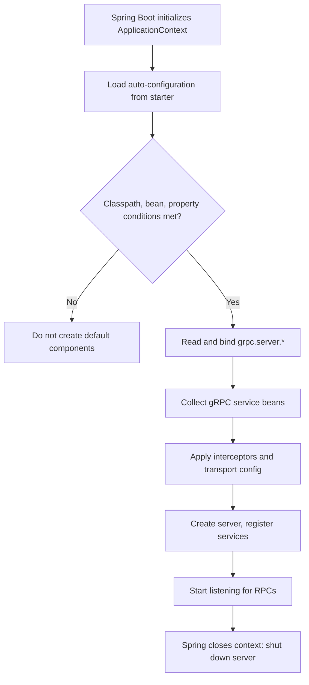

# gRPC Server Auto-Configuration in Spring Boot

## 1. Goals and Scope

In the **SPRING_GRPC** ecosystem, developers define RPCs with Protocol Buffers, generate Java classes, and implement a gRPC server/client for unary or streaming RPCs. **gRPC server auto-configuration** enables Spring Boot to detect available gRPC components, bind configuration, create the server, and manage its lifecycle within the same `ApplicationContext`.

After this lesson, learners will be able to:

- Explain the conditions under which Spring Boot activates gRPC server configuration and why adding a dependency alone is not enough if services are not registered.
- Create a gRPC service as a Spring bean and let the starter automatically register it with the server.
- Distinguish the gRPC port from the HTTP/Actuator port and identify property sources that can override configuration.
- Organize interceptors, TLS, health, lifecycle, and observability for the server.
- Write integration tests to verify that auto-configuration actually exposes RPC endpoints.

**Convention:** Code examples use the community starter **`net.devh:grpc-server-spring-boot-starter`**, with `@GrpcService` and the `grpc.server.*` prefix. Spring also has the **Spring gRPC** project with different starters and APIs. The Spring Boot auto-configuration concepts are similar, but **do not mix annotations, artifact names, or properties between the two ecosystems**. Choose a supported version set and consult the documentation for the chosen version.

## 2. Manual Server Creation vs. Auto-Configuration

In plain gRPC Java, developers can create a `Server` directly:

```java
Server server = ServerBuilder.forPort(9090)
    .addService(new GreetingGrpcService())
    .build()
    .start();

Runtime.getRuntime().addShutdownHook(
    new Thread(server::shutdown)
);
```

The snippet above outlines manual server startup, but does not fully cover Spring dependency injection, TLS, interceptors, health, graceful shutdown, and startup error handling.

When using a starter, the application typically only needs **the `.proto` contract, a Spring-discovered gRPC implementation class, and properties**. The starter handles the server factory and lifecycle. Avoid manually creating `ServerBuilder.forPort(...)` while also enabling the starter's server on the same port, as two servers can contend for the listener.



Three **layers of responsibility** must be kept distinct:

1. **Protobuf code generation:** `protoc` and the gRPC plugin generate message classes, `*Grpc` base classes, and stubs during the build step. Spring Boot does not generate these classes.
2. **Dependency injection:** Spring creates application beans, injects business dependencies, and discovers registered classes.
3. **Server auto-configuration:** The starter uses those beans/properties to build the gRPC server and manage its lifecycle.

Auto-configuration does not automatically decide deadlines, retry policies, authorization, or idempotency for business RPCs.

## 3. Spring Boot's Auto-Configuration Mechanism

### 3.1. What Triggers Configuration Activation?

`@SpringBootApplication` includes enabling auto-configuration. A gRPC starter publishes its auto-configurations for Spring to load. In Spring Boot 3, auto-configurations are typically registered in `META-INF/spring/org.springframework.boot.autoconfigure.AutoConfiguration.imports`; older Boot versions use a different registration mechanism.

A typical auto-configuration may depend on these conditions:

| Concept | Meaning | Troubleshooting Implication |
| --- | --- | --- |
| `@ConditionalOnClass` | Activates when required library classes are present | Missing starter or gRPC dependency |
| `@ConditionalOnMissingBean` | Default bean can back off in favor of an application-provided bean | A custom bean prevents the default configuration from creating one |
| `@ConditionalOnProperty` | Feature can be toggled via a property | Environment configuration has disabled the feature |
| `@ConfigurationProperties` | Binds properties from the environment into a config object | Wrong prefix, invalid value, or overridden by a profile |
| Spring Lifecycle | Starts/stops resources alongside the context | Bean exists, but the server is not listening yet |

This table explains **general Spring Boot mechanisms**; not every starter version uses every annotation or the same bean structure. To inspect the active behavior at runtime, check the condition report and startup logs.

### 3.2. Discovering gRPC Service Implementations

In gRPC Java, an implementation typically extends the `GreeterGrpc.GreeterImplBase` class generated by the gRPC plugin and can be converted into a `ServerServiceDefinition`. With **net.devh**, `@GrpcService` marks a bean so the starter's service registration mechanism recognizes it.

Two common failure cases:

- A class has `@GrpcService` but lies outside `@ComponentScan` scope: Spring never creates the bean, so the server never registers the service.
- A class extends `GreeterImplBase` but is only a plain object or is not registered according to the starter API: the server may start without exposing the expected method.

The actual RPC name is the combination of `package` and `service` in `.proto`, independent of the Java package name of the implementation class.

### 3.3. When Is the Server Ready?

Once the context has the required beans, the starter builds the server and starts it during the lifecycle phase. Some starters use Spring's `SmartLifecycle`; check the exact ordering for your version. If binding the port fails or TLS certificates are invalid, startup can fail.

**Having a gRPC bean does not prove the server is accepting connections.** Verify via port-binding logs and execute an out-of-process RPC, especially before configuring readiness probes.

## 4. Building a Spring Boot gRPC Server Example

### 4.1. Defining the Contract

Place `src/main/proto/greeting.proto`:

```proto
syntax = "proto3";

package demo.greeting.v1;

option java_multiple_files = true;
option java_package = "dev.example.greeter.v1";

service Greeter {
  rpc SayHello(HelloRequest) returns (HelloReply);
}

message HelloRequest {
  string name = 1;
}

message HelloReply {
  string message = 1;
}
```

Here, the wire name is `demo.greeting.v1.Greeter/SayHello`, while the generated Java code lives in `dev.example.greeter.v1`. Keep field numbers unchanged when evolving the schema; when removing fields, mark their numbers and names `reserved` if needed to avoid reusing an old meaning.

### 4.2. Dependencies and Code Generation

Example `build.gradle` skeleton using Groovy DSL:

```groovy
plugins {
    id 'java'
    id 'org.springframework.boot' version 'BOOT_VERSION'
    id 'io.spring.dependency-management' version 'DEPENDENCY_MANAGEMENT_VERSION'
    id 'com.google.protobuf' version 'PROTOBUF_PLUGIN_VERSION'
}

def grpcVersion = 'GRPC_VERSION'
def protobufVersion = 'PROTOBUF_VERSION'
def starterVersion = 'NET_DEVH_STARTER_VERSION'

repositories {
    mavenCentral()
}

dependencies {
    implementation 'org.springframework.boot:spring-boot-starter'
    implementation "net.devh:grpc-server-spring-boot-starter:${starterVersion}"

    implementation platform("io.grpc:grpc-bom:${grpcVersion}")
    implementation 'io.grpc:grpc-protobuf'
    implementation 'io.grpc:grpc-stub'
    implementation "com.google.protobuf:protobuf-java:${protobufVersion}"

    testImplementation 'org.springframework.boot:spring-boot-starter-test'
}

protobuf {
    protoc {
        artifact = "com.google.protobuf:protoc:${protobufVersion}"
    }
    plugins {
        grpc {
            artifact = "io.grpc:protoc-gen-grpc-java:${grpcVersion}"
        }
    }
    generateProtoTasks {
        all()*.plugins {
            grpc {}
        }
    }
}
```

**All strings ending in `_VERSION` are placeholders** that must be replaced with valid versions before building; the snippet cannot run verbatim. Manage these versions via a BOM or version catalog compatible with your JDK, Spring Boot, net.devh, gRPC Java, and Protobuf versions. Depending on the JDK/code-generator combination, generated gRPC Java code may require an API providing `javax.annotation.Generated`; add it only if required by your version set.

After running code generation, the project will have `HelloRequest`, `HelloReply`, and `GreeterGrpc.GreeterImplBase`. Do not edit generated Java files: update `.proto` and regenerate.

### 4.3. Spring Boot Application

```java
package dev.example;

import org.springframework.boot.SpringApplication;
import org.springframework.boot.autoconfigure.SpringBootApplication;

@SpringBootApplication
public class GrpcApplication {
    public static void main(String[] args) {
        SpringApplication.run(GrpcApplication.class, args);
    }
}
```

Place the remaining classes under package `dev.example` so they fall within the default component scan scope.

### 4.4. Turning a gRPC Service into a Spring Bean

```java
package dev.example.grpc;

import dev.example.greeter.v1.GreeterGrpc;
import dev.example.greeter.v1.HelloReply;
import dev.example.greeter.v1.HelloRequest;
import io.grpc.Status;
import io.grpc.stub.StreamObserver;
import net.devh.boot.grpc.server.service.GrpcService;

@GrpcService
public class GreetingGrpcService extends GreeterGrpc.GreeterImplBase {

    @Override
    public void sayHello(
            HelloRequest request,
            StreamObserver<HelloReply> responseObserver) {

        String name = request.getName().trim();

        if (name.isEmpty()) {
            responseObserver.onError(
                Status.INVALID_ARGUMENT
                    .withDescription("name must not be blank")
                    .asRuntimeException());
            return;
        }

        HelloReply reply = HelloReply.newBuilder()
            .setMessage("Hello, " + name + "!")
            .build();

        responseObserver.onNext(reply);
        responseObserver.onCompleted();
    }
}
```

`@GrpcService` in this example **belongs to net.devh**, not a universal gRPC Java annotation. Once Spring detects this bean, the starter registers the gRPC service on the server. Application code does not have to call `server.addService(...)` or `server.start()`.

A successful unary RPC emits one message with `onNext(...)` followed by `onCompleted()`. When calling `onError(...)`, processing must end without sending any further responses. Use `Status.INVALID_ARGUMENT` for invalid input so clients can distinguish it from internal errors.

### 4.5. Environment-Based Configuration

File `src/main/resources/application.yml`:

```yaml
spring:
  application:
    name: greeting-grpc

grpc:
  server:
    port: ${GRPC_SERVER_PORT:9090}
```

Here, `GRPC_SERVER_PORT` (if provided) determines the gRPC port; otherwise, the fallback value is `9090`. When enabling the `dev` profile, you can override it in `application-dev.yml`:

```yaml
grpc:
  server:
    port: 9191
```

Spring Boot configuration sources follow a precedence order: profile files, environment variables, command-line arguments, and other sources. When diagnosing issues, inspect **the actual bound value** rather than reading only one YAML file. Any port change must be synchronized with client configuration and deployment infrastructure.

## 5. Is a gRPC Server the Same as Spring Boot's HTTP Server?

**No.** A single Spring Boot application can run a gRPC server and an HTTP server independently inside the same JVM.

```text
Spring Boot ApplicationContext
|
+-- Spring beans: gRPC services, interceptors, business services
|
+-- gRPC server (net.devh starter)
|   +-- grpc.server.port = 9090
|   +-- HTTP/2 + gRPC
|
+-- HTTP server (only when web stack is present)
    +-- server.port = 8080
    +-- REST / Actuator HTTP endpoints
```

| Property | Typical Scope |
| --- | --- |
| `grpc.server.port` | gRPC port in net.devh |
| `server.port` | HTTP port for Spring Boot Web |
| `management.server.port` | Management HTTP port if Actuator is separated |

Adding only `spring-boot-starter` and the gRPC server starter **does not require** Spring MVC. If the application also includes the web starter, changing `server.port` does not automatically change `grpc.server.port`.

This directly affects Docker/Kubernetes, firewalls, reverse proxies, and ingress: you must open the gRPC port and ensure HTTP/2 or h2c/TLS is supported according to your deployment model. An HTTP app healthy on port 8080 does not prove RPCs are working on port 9090.

## 6. Registering Interceptors via Spring

Server interceptors run before the service implementation, making them suitable for reading metadata, authenticating callers, attaching correlation IDs, measuring latency, or recording RPC status codes. In **net.devh**, `@GrpcGlobalServerInterceptor` registers a `ServerInterceptor` across all managed gRPC services.

Example extracting a request ID from metadata into `io.grpc.Context`:

```java
package dev.example.grpc;

import io.grpc.Context;
import io.grpc.Contexts;
import io.grpc.Metadata;
import io.grpc.ServerCall;
import io.grpc.ServerCallHandler;
import io.grpc.ServerInterceptor;
import net.devh.boot.grpc.server.interceptor.GrpcGlobalServerInterceptor;

@GrpcGlobalServerInterceptor
public class RequestIdInterceptor implements ServerInterceptor {
    public static final Context.Key<String> REQUEST_ID =
        Context.key("grpc-request-id");

    private static final Metadata.Key<String> REQUEST_ID_HEADER =
        Metadata.Key.of(
            "x-request-id",
            Metadata.ASCII_STRING_MARSHALLER
        );

    @Override
    public <ReqT, RespT> ServerCall.Listener<ReqT> interceptCall(
            ServerCall<ReqT, RespT> call,
            Metadata headers,
            ServerCallHandler<ReqT, RespT> next) {

        String incoming = headers.get(REQUEST_ID_HEADER);
        String requestId = incoming == null ? "" : incoming;

        Context context =
            Context.current().withValue(REQUEST_ID, requestId);

        return Contexts.interceptCall(context, call, headers, next);
    }
}
```

Inside a service, read `RequestIdInterceptor.REQUEST_ID.get()` when code runs within the proper gRPC context. For asynchronous code dispatched to another executor, propagate the context explicitly if the execution mechanism does not automatically preserve it.

Key points to keep in mind:

- Client metadata is **not inherently trustworthy**; limit request ID length and avoid logging tokens or secrets.
- Global interceptors apply across many RPCs; per-service interceptors and ordering rules depend on the starter API.
- Pay attention to the ordering of authentication, authorization, tracing, and metrics. Wrong ordering can cause metrics to miss status codes or allow processing before authentication.
- Never store per-RPC metadata in fields of a Spring singleton; use gRPC `Context` or an appropriate tracing context.

Like services, interceptors must be discovered/registered by Spring according to the starter API. If you declare a separate manual `ServerBuilder`, it will not automatically pick up interceptors registered on the starter's server.

## 7. Extending the Server and Resolving Configuration Conflicts

Transport settings such as keepalive, message size, executors, TLS, or service factories may need tuning. Depending on the starter version, these settings are exposed as properties, bean customizers, or other extension points.

**Rule of thumb:** Prefer configuring the **starter-managed server**. Do not spin up a second server just to adjust a setting that can be supplied to the existing factory/builder.

When an auto-configuration uses `@ConditionalOnMissingBean`, a custom bean causes the default bean to back off. However, replacing beans or forcing bean overriding without understanding the dependency graph can prevent the server from starting properly.

Questions to verify before customizing:

1. Does this property or extension point belong to `net.devh` or official Spring gRPC?
2. Does it affect the entire server or a single service?
3. Can it be implemented as an interceptor instead of replacing the server factory?
4. Is the configuration object created before or after the server starts?
5. Does the change require a restart to take effect?

If two implementations register the same full RPC service name, the gRPC server can fail to build or start. The full name comes from `package.service` in Protobuf, not from the Java class name, so changing the Java package alone does not avoid collisions.

## 8. TLS and Securing the gRPC Server

When TLS is required, the starter can bind security properties to the transport. Example **net.devh** configuration for versions supporting these properties:

```yaml
grpc:
  server:
    port: 9090
    security:
      enabled: true
      certificateChain: file:/run/secrets/grpc/tls.crt
      privateKey: file:/run/secrets/grpc/tls.key
```

These paths are illustrative; no real certificate or key is included here. Check your starter version's exact support for `file:`, `classpath:`, CA trust, and client authentication. Never commit real private keys to the repository.

Operating TLS requires:

- A server certificate valid for the DNS/SAN the client connects to.
- Clients trusting the appropriate CA; never disable hostname/CA validation just to make connections work.
- If mTLS is required, configuring client certificates and server-side CA verification policies.
- Clearly defining whether TLS terminates at the ingress/service mesh or at the backend, and ensuring the remaining leg is adequately protected.
- Managing secret/certificate rotation via infrastructure mechanisms and verifying reload/restart behavior according to library capabilities.

TLS protects the transport. **Business-level authentication and authorization** still need to be enforced—for example, via interceptors validating credentials, authorizing per RPC, and avoiding exposure of sensitive metadata.

## 9. Lifecycle, Health, and Reliability

### 9.1. Startup and Shutdown

The starter-managed server typically begins listening after required beans are initialized and stops with the Spring context lifecycle. However, do not assume every starter version shares identical graceful shutdown behavior or wait timeouts for in-flight RPCs.

When running on Kubernetes or similar platforms:

- Transition the instance to not-ready to drain new RPCs before shutting down.
- Allow sufficient time for in-flight unary RPCs to finish within acceptable bounds.
- For streaming RPCs, handle cancellation, stop producers, and release resources.
- Align the application's shutdown timeout with `terminationGracePeriodSeconds` and load balancer policies.

### 9.2. gRPC Health vs. Actuator Health

Actuator typically exposes HTTP health endpoints; the **gRPC Health Checking Protocol** is a distinct gRPC service. Enabling Actuator **does not mean** the server already exposes a gRPC health service.

If using Kubernetes gRPC probes, the server must implement the health service and the probe must target the gRPC port. If using HTTP probes, target the corresponding HTTP management port and path. Readiness should reflect actual ability to serve RPCs, while liveness should be reserved for unrecoverable process states.

### 9.3. Deadlines, Status Codes, and Observability

Auto-configuration does not automatically set all deadlines, retries, or tracing. Operational policies are still needed:

| Signal | What to Measure or Handle |
| --- | --- |
| `OK` and per-method rate | Throughput, traffic distribution |
| `INVALID_ARGUMENT` | Invalid client input |
| `UNAVAILABLE` | Connectivity, server, load balancer, or transport |
| `DEADLINE_EXCEEDED` | Deadline breaches, slow upstream dependencies |
| `CANCELLED` | Client cancellations, early stream termination |
| p50/p95/p99 latency | Track tail latency |
| Active streams, CPU, heap, executor | Resources for streaming and high load |

Metrics, logging, and tracing usually require adding version-matched integrations or instrumentation from gRPC, Micrometer, or OpenTelemetry. Never assume simply adding the starter automatically exports all metrics.

Clients should set deadlines aligned with SLAs; servers should check cancellation/deadlines during long-running work. For RPCs with side effects, retries are safe only if the application implements idempotency or duplicate-execution protection.

## 10. Verifying the Server with Real RPC Calls

After selecting compatible dependency versions, generating code, and starting the application, invoke it with `grpcurl`. Pass the `.proto` contract directly so it does not rely on server reflection:

```bash
grpcurl -plaintext \
  -import-path src/main/proto \
  -proto greeting.proto \
  -d '{"name":"An"}' \
  localhost:9090 \
  demo.greeting.v1.Greeter/SayHello
```

Expected output:

```json
{
  "message": "Hello, An!"
}
```

Also send `{"name":""}` to observe `INVALID_ARGUMENT`. If the server has TLS enabled, adjust the invocation mode and provide the appropriate CA trust; the `-plaintext` flag is only for non-TLS endpoints. On PowerShell, you can put the `grpcurl` command on a single line to avoid line-continuation syntax differences.

Verifying a successful RPC simultaneously demonstrates that:

1. The server bound the endpoint and received the request.
2. The service/method in the Protobuf contract is registered.
3. The request/response messages are serialized and deserialized properly.
4. The Spring-created implementation runs through the starter's server.
5. The status and response are returned over the gRPC transport.

Checking bean existence or startup logs alone does not verify the entire chain.

## 11. Integration Testing Auto-Configuration

A unit test calling `new GreetingGrpcService()` directly only verifies service logic. To test **Spring Boot auto-configuration**, load the Spring context and send an RPC to the starter-created server.

Some **net.devh** versions support an in-process server so tests do not open a TCP port. For versions supporting `inProcessName` and `in-process:`, you can configure it as follows.

Add test dependencies:

```groovy
testImplementation "net.devh:grpc-client-spring-boot-starter:${starterVersion}"
testImplementation 'io.grpc:grpc-inprocess'
```

Example integration test:

```java
package dev.example;

import dev.example.greeter.v1.GreeterGrpc;
import dev.example.greeter.v1.HelloRequest;
import net.devh.boot.grpc.client.inject.GrpcClient;
import org.junit.jupiter.api.Test;
import org.springframework.boot.test.context.SpringBootTest;

import static org.junit.jupiter.api.Assertions.assertEquals;

@SpringBootTest(properties = {
    "grpc.server.port=-1",
    "grpc.server.inProcessName=auto-config-test",
    "grpc.client.test.address=in-process:auto-config-test"
})
class GrpcServerAutoConfigurationTest {
    @GrpcClient("test")
    private GreeterGrpc.GreeterBlockingStub stub;

    @Test
    void registersServiceAndRespondsToRpc() {
        var reply = stub.sayHello(
            HelloRequest.newBuilder().setName("An").build()
        );
        assertEquals("Hello, An!", reply.getMessage());
    }
}
```

In net.devh versions that support it, `grpc.server.port=-1` disables the network listener, `grpc.server.inProcessName` names the in-process server, and the client's `in-process:...` address connects to it. Verify the property names against your installed library version. If the starter does not support in-process mode, run a network integration test using a dynamic port in an isolated environment rather than hardcoding a port that conflicts in CI.

**In-process tests do not verify TCP, HTTP/2 over the network, TLS handshakes, or ingress.** When production uses proxies or TLS, add network integration tests with test certificates and realistic endpoints.

Recommended test expansions:

- Valid requests return `OK`; empty requests return `INVALID_ARGUMENT`.
- Unregistered services or invalid method names return `UNIMPLEMENTED`.
- Interceptors receive metadata; tokens are never logged.
- Deadlines/cancellations and shutdown do not leave the server processing indefinitely.
- Port/profile configurations take effect as expected.
- TLS/mTLS rejects invalid certificates/hostnames and accepts valid certificates.

## 12. Diagnosing Auto-Configuration Issues

Follow this investigation order to avoid misdiagnosing issues:

```text
Dependencies, versions, and classpath
  -> Spring Boot conditions + component scan
    -> server bind, listener, and lifecycle
      -> transport/TLS, method name, metadata, status
        -> business logic
```

| Symptom | Possible Cause | How to Check |
| --- | --- | --- |
| gRPC server does not appear to start | Missing server starter or unsatisfied condition | Dependency tree, Spring Boot condition report, startup logs |
| `GreeterGrpc` is not generated | `protoc-gen-grpc-java` not configured | Check the `generateProto` task and generated sources |
| `UNIMPLEMENTED` | `@GrpcService` outside scan scope, unregistered, wrong RPC name | Check beans and `package/service/method` in `.proto` |
| `UNAVAILABLE` | Wrong address/port, server not ready, TLS or proxy error | Check listener, handshake, ingress, and client config |
| Address already in use | Port conflict with another process or manual server | Check port usage and remove duplicate server config |
| Changed `server.port` but RPC stays on 9090 | Changed HTTP port instead of gRPC port | Check `grpc.server.port` |
| Interceptor does not run | Class outside component scan, wrong annotation/starter ecosystem | Check Spring bean and `@GrpcGlobalServerInterceptor` |
| Right profile but unexpected port | Overridden by environment variable or command line | Inspect effective property value and property source |
| Kubernetes gRPC health probe fails | Missing gRPC health service or wrong port | Check health implementation and probe |
| HTTP Actuator healthy but gRPC fails | Two independent listeners or two health mechanisms | Send an RPC to the actual gRPC endpoint |

### Spring Boot Condition Report

Run the application in development with:

```bash
java -jar app.jar --debug
```

Look for gRPC entries in the **Condition Evaluation Report** to see which conditions matched or were excluded. Class names vary by starter/version. If Spring Boot Actuator is present with the `conditions` endpoint enabled, you can inspect the report according to your system's administrative access policy.

During investigation, answer these questions in order:

1. Are the right starter ecosystem and version on the runtime classpath?
2. Did Spring Boot load the auto-configuration and satisfy its conditions?
3. Does the context contain the gRPC service bean with the right annotation?
4. Which source provides the final `grpc.server.port` value?
5. Is the server listening and registering the full RPC method name?
6. Is the client using the correct hostname, HTTP/2, and TLS mode?

Mixing official Spring gRPC with `net.devh` in the same setup can cause property/annotation mismatches or spin up multiple server managers at once. When switching starter ecosystems, align the entire build, registration, customization, and integration tests.

## 13. Hands-On Exercise and Completion Criteria

Use the `Greeter` application built in Section 4 to complete these steps:

1. Run the gRPC configuration on port 9090 and invoke `SayHello` with `grpcurl`.
2. Set `GRPC_SERVER_PORT=9191`, restart, and verify the RPC works on 9191.
3. If Spring Web is included, change `server.port` to 8081 and observe that gRPC does not change with it.
4. Temporarily remove `@GrpcService` in your practice copy to see the server start without the RPC; restore the annotation afterward.
5. Add the request ID interceptor; send metadata and verify the context holds the corresponding value.
6. Run an integration test that loads the real Spring context rather than instantiating the service manually.
7. Enable TLS in a test environment and test connecting with both valid and invalid CAs.
8. Observe gRPC status codes and latency when sending both valid and invalid requests.

Anyone completing this lesson should be able to explain **what conditions trigger auto-configuration, how services are registered, where the server obtains its configuration, and which layer to inspect when an RPC fails**. They should also understand that automatic startup does not replace architectural decisions around metadata, deadlines, status codes, TLS, streaming, monitoring, and reliability.
