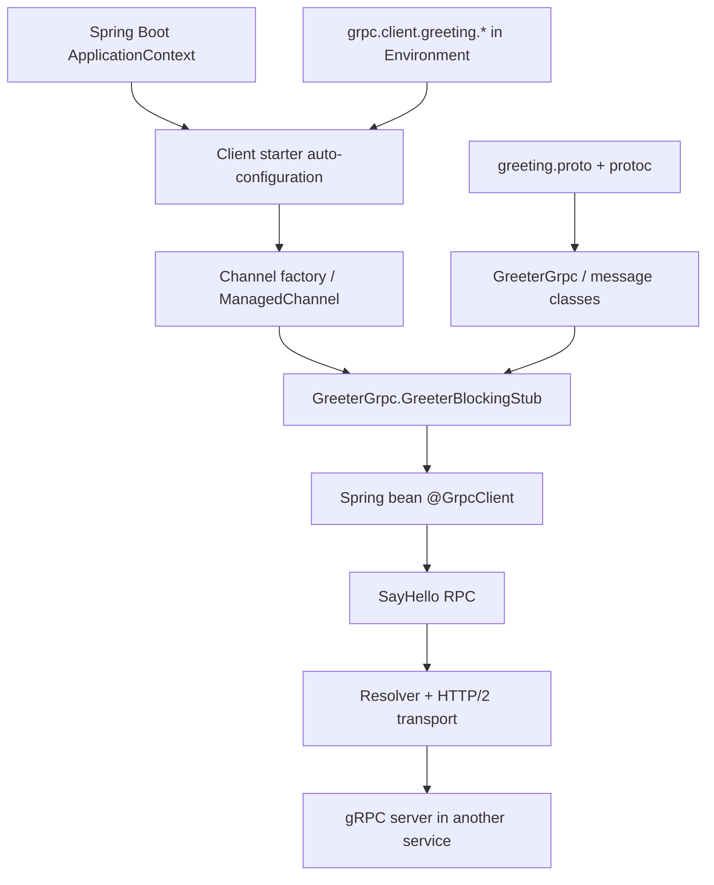

# gRPC Client Auto-Configuration in Spring Boot

## 1. Goals and Context

In the **SPRING_GRPC** module, applications build gRPC services from Protocol Buffers contracts, generate Java code, and implement unary or streaming RPCs. A Spring Boot application acting as a **client** often needs to call one or more other gRPC services. If every connection is managed manually, developers must create `ManagedChannel` instances, configure addresses, TLS, interceptors, deadlines, and close channels aligned with the application lifecycle.

**gRPC client auto-configuration** lets the starter integrate those tasks with Spring Boot's dependency injection and configuration mechanisms. The application declares client names, endpoints, and connection options; the starter provides appropriate channels/stubs to the beans that need them.

Lesson objectives:

- Explain the steps from dependencies and properties to Spring-provided channels and gRPC stubs.
- Distinguish between a channel, a stub, an HTTP/2 connection, and an individual RPC call.
- Integrate blocking, asynchronous, or future stubs into Spring beans and set per-call deadlines.
- Pass metadata, handle status codes and TLS, and consider discovery/load balancing and retries.
- Test client auto-configuration using a Spring Boot context alongside a test gRPC server.
- Diagnose missing beans, wrong client names, connection failures, and configuration that fails to take effect.

**API scope in examples:** uses **`net.devh:grpc-client-spring-boot-starter`**, with the `@GrpcClient` annotation and `grpc.client.<name>.*` configuration. The **Spring gRPC** project in the Spring ecosystem has its own starters and APIs. When switching to Spring gRPC, consult the documentation for the exact version; do not assume `net.devh` annotations or properties apply.

## 2. From Plain gRPC Java to a Spring Boot Client

In plain gRPC Java, a unary call typically starts from a channel:

```java
ManagedChannel channel = ManagedChannelBuilder
    .forAddress("localhost", 9090)
    .usePlaintext()
    .build();

try {
    GreeterGrpc.GreeterBlockingStub stub =
        GreeterGrpc.newBlockingStub(channel);

    HelloReply reply = stub
        .withDeadlineAfter(1, TimeUnit.SECONDS)
        .sayHello(
            HelloRequest.newBuilder().setName("An").build()
        );
} finally {
    channel.shutdown();
}
```

The snippet above only illustrates building a channel and calling an RPC; it does not show full shutdown-await handling. In applications handling many requests, **never create and close a new channel per call**, because doing so incurs high DNS, connection, TLS/HTTP/2, and thread resource overhead.

With a starter, the application uses a named client configuration and requests injection of a stub. The starter creates connection objects according to its policy and ties their lifecycle to the Spring context.



The diagram shows that auto-configuration only manages **client infrastructure**; generating stubs and Java messages from `.proto` is still performed by Protobuf tools during the build.

## 3. Distinguishing Channel, Stub, and RPC

| Component | Responsibility | Lifetime |
| --- | --- | --- |
| `ManagedChannel` | Manages connections, name resolution, load balancing, HTTP/2 transport, TLS, and network resources | Typically reused across many RPCs |
| Blocking stub | Synchronous API; calls block the thread until a result or error arrives | Can be held in a bean; create derived stubs with per-call options |
| Async stub | Callback API using `StreamObserver`; suited for streaming or async processing | Reusable; creating configured variants is cheap |
| Future stub | Asynchronous API returning a future for supported unary RPCs | Reusable; forwards results through async pipelines |
| An RPC | Includes metadata, deadline, request/response, status, and cancellation | Begins and ends individually |

A channel **does not equate to a single fixed TCP connection**. Depending on the resolver/load balancer, a channel can manage multiple subchannels/connections and their states. Connections are often established on demand, so the fact that a client bean was created does not guarantee the server is ready.

gRPC Java stubs are designed to be immutable: `withDeadlineAfter(...)`, `withInterceptors(...)`, and similar `with...` methods return **derived stubs** without mutating the original stub. This allows injecting one shared stub while setting per-call deadlines, metadata, or credentials.

**Threading note:** blocking stubs block the calling thread. In Spring WebFlux or event-loop threads, never invoke a blocking stub directly on the event loop; use the async/future API or offload blocking work to an appropriate executor.

## 4. How Spring Boot Auto-Configures the Client

A typical gRPC client starter performs the following sequence:

1. **Discovered on the classpath.** Spring Boot loads the auto-configuration registered by the starter when class/bean/property conditions match.
2. **Reads configuration.** Properties under `grpc.client.*` are bound to the client configuration object per the starter's API.
3. **Creates channels when needed.** The channel factory uses the client name, address, resolver, security, and options to provide a `ManagedChannel`.
4. **Creates or injects stubs.** With `net.devh`, `@GrpcClient("name")` on a field or supported injection point specifies which named client configuration to use.
5. **Applies extensions.** Interceptors, channel builder customizers, credentials, or load balancing can be attached via the version's extension points.
6. **Manages lifecycle.** Starter-managed channels are closed when the context shuts down, per library policy.

Points where auto-configuration may not run as expected:

| Spring Mechanism | Common Consequence |
| --- | --- |
| `@ConditionalOnClass` | Missing dependency prevents configuration from activating |
| `@ConditionalOnMissingBean` | Application-declared bean replaces or disables default configuration creation |
| `@ConfigurationProperties` | Wrong property name or value prevents client settings from binding properly |
| Component scan | Class needing stub injection is not a Spring bean, so the annotation is ignored |
| Bean post-processing | Starter's `@GrpcClient` injection requires Spring-managed beans, not objects created with `new` |

These are general Spring Boot mechanisms. Actual factory class names, channel creation timing, and condition types vary by starter/version.

## 5. Hands-On: From Protobuf Contract to Client

### 5.1. Defining a Unary RPC

Assume a gRPC server already implements the greeting service. The client side needs the same `greeting.proto` contract:

```proto
syntax = "proto3";

package demo.greeting.v1;

option java_multiple_files = true;
option java_package = "dev.example.greeter.v1";

service Greeter {
  rpc SayHello(HelloRequest) returns (HelloReply);
}

message HelloRequest {
  string name = 1;
}

message HelloReply {
  string message = 1;
}
```

The Protobuf `package` forms the full RPC name `demo.greeting.v1.Greeter/SayHello`. `java_package` controls the package of the generated Java classes. If client and server use incompatible contracts, errors can surface immediately on method invocation or during message deserialization.

In multi-service systems, publish schemas as artifacts or use a shared contract repository so clients and servers update in a controlled manner. Field changes must respect Protobuf compatibility rules, keeping used field numbers intact and marking removed fields `reserved`.

### 5.2. Declaring Gradle Dependencies

Example `build.gradle` (Groovy DSL):

```groovy
plugins {
    id 'java'
    id 'org.springframework.boot' version 'SPRING_BOOT_VERSION'
    id 'io.spring.dependency-management' version 'DEPENDENCY_MANAGEMENT_VERSION'
    id 'com.google.protobuf' version 'PROTOBUF_GRADLE_PLUGIN_VERSION'
}

def grpcVersion = 'GRPC_JAVA_VERSION'
def protobufVersion = 'PROTOBUF_JAVA_VERSION'
def clientStarterVersion = 'NET_DEVH_STARTER_VERSION'

repositories {
    mavenCentral()
}

dependencies {
    implementation 'org.springframework.boot:spring-boot-starter'
    implementation "net.devh:grpc-client-spring-boot-starter:${clientStarterVersion}"

    implementation platform("io.grpc:grpc-bom:${grpcVersion}")
    implementation 'io.grpc:grpc-protobuf'
    implementation 'io.grpc:grpc-stub'
    implementation "com.google.protobuf:protobuf-java:${protobufVersion}"

    testImplementation 'org.springframework.boot:spring-boot-starter-test'
}

protobuf {
    protoc {
        artifact = "com.google.protobuf:protoc:${protobufVersion}"
    }
    plugins {
        grpc {
            artifact = "io.grpc:protoc-gen-grpc-java:${grpcVersion}"
        }
    }
    generateProtoTasks {
        all()*.plugins {
            grpc {}
        }
    }
}
```

Values shaped like `..._VERSION` are **placeholders to replace with compatible versions**, not real versions; the example will not build if left unchanged. Use a project-verified BOM/version catalog and check compatibility across Java, Spring Boot, `net.devh`, gRPC Java, Protobuf, and the Gradle plugin. Depending on the gRPC generator/JDK version, an annotation API dependency providing `javax.annotation.Generated` may be needed.

After code generation (e.g., the Gradle `generateProto` task), Java sources contain `HelloRequest`, `HelloReply`, `GreeterGrpc`, and the stub types. Never modify generated code directly.

### 5.3. Creating the Spring Boot Application

```java
package dev.example.client;

import org.springframework.boot.SpringApplication;
import org.springframework.boot.autoconfigure.SpringBootApplication;

@SpringBootApplication
public class GreeterClientApplication {
    public static void main(String[] args) {
        SpringApplication.run(GreeterClientApplication.class, args);
    }
}
```

Place beans in the same package or subpackages such as `dev.example.client.gateway` so Spring component scanning detects them. An application acting solely as a gRPC client does not require `spring-boot-starter-web`.

### 5.4. Naming the Client and Endpoint

File `src/main/resources/application.yml` for the development environment:

```yaml
spring:
  application:
    name: greeting-client

grpc:
  client:
    greeting:
      address: "${GREETING_GRPC_ADDRESS:static://localhost:9090}"
      negotiationType: PLAINTEXT
```

In the **net.devh** example:

- `greeting` is the **logical client name**, reused in `@GrpcClient("greeting")`.
- `address` specifies the target destination. `static://localhost:9090` is an illustrative address for a development server; production can use DNS or appropriate service discovery.
- `GREETING_GRPC_ADDRESS` lets deployments override the endpoint without changing code.
- `negotiationType: PLAINTEXT` means TLS is disabled in the demo; in production, select appropriate transport security.

With multiple gRPC services, declare multiple client names under `grpc.client`, such as `inventory` and `payment`. Each named client can differ in endpoint, credentials, deadlines, or interceptors. Do not share one name if two backends have incompatible connection policies.

**Distinguish two property groups:** `grpc.server.*` controls the server managed by the server starter, while `grpc.client.<name>.*` controls outbound channels. Spring Web's `server.port` does not determine the gRPC client endpoint.

### 5.5. Injecting a Stub into a Spring Service

```java
package dev.example.client.gateway;

import dev.example.greeter.v1.GreeterGrpc;
import dev.example.greeter.v1.HelloReply;
import dev.example.greeter.v1.HelloRequest;
import io.grpc.StatusRuntimeException;
import net.devh.boot.grpc.client.inject.GrpcClient;
import org.springframework.stereotype.Service;

import java.util.concurrent.TimeUnit;

@Service
public class GreetingGateway {
    @GrpcClient("greeting")
    private GreeterGrpc.GreeterBlockingStub greeter;

    public String greet(String name) {
        HelloRequest request = HelloRequest.newBuilder()
            .setName(name)
            .build();

        try {
            HelloReply reply = greeter
                .withDeadlineAfter(800, TimeUnit.MILLISECONDS)
                .sayHello(request);

            return reply.getMessage();
        } catch (StatusRuntimeException ex) {
            // The application layer will map the status to an appropriate error.
            throw ex;
        }
    }
}
```

`@GrpcClient` is **not** a plain gRPC Java annotation; it is a `net.devh` integration point. Because `GreetingGateway` is a Spring bean, the starter can inject the stub corresponding to `grpc.client.greeting`. If you manually instantiate `new GreetingGateway()`, Spring does not perform injection and the `greeter` field may be `null`.

The `800 ms` deadline is just an example. The actual value should come from SLAs, network latency, and the caller's request time budget. In production apps, externalize deadlines into configuration and apply them per RPC, avoiding a single hardcoded value across all methods regardless of business cost.

**Note:** the returned result is the message sent by the server; the client layer does not need to build transport manually or call `channel.shutdown()` in every method.

## 6. Stub Types and Choosing How to Call

gRPC Java generates three common stub types. The starter can inject the matching stub type if supported by the version and injection mechanism.

| Stub | Call Style | When to Use |
| --- | --- | --- |
| `GreeterGrpc.GreeterBlockingStub` | `sayHello(request)` returns response or throws exception | Synchronous apps, short requests, thread can block |
| `GreeterGrpc.GreeterStub` | `sayHello(request, responseObserver)` | Callbacks, server streaming, client streaming, bidirectional streaming |
| `GreeterGrpc.GreeterFutureStub` | `sayHello(request)` returns a future | Async unary calls and future-pipeline integration |

Example using the async stub for a unary call:

```java
@GrpcClient("greeting")
private GreeterGrpc.GreeterStub asyncGreeter;

public void greetAsync(
        String name,
        StreamObserver<HelloReply> responseObserver) {

    HelloRequest request = HelloRequest.newBuilder()
        .setName(name)
        .build();

    asyncGreeter
        .withDeadlineAfter(800, TimeUnit.MILLISECONDS)
        .sayHello(request, responseObserver);
}
```

`StreamObserver` receives `onNext` followed by `onCompleted` on success, or `onError` on failure. Callbacks must handle exceptions properly; never invoke blocking APIs on an event loop or critical callback without managing an executor.

With **client streaming**, the Java async stub returns a request observer allowing the client to send multiple messages. With **bidirectional streaming**, both sides emit messages independently. Auto-configuration handles creating channels/stubs; the developer still owns thread management, cancellation, flow control, and backpressure, especially when emitting thousands of messages or holding long-lived streams.

## 7. Deadlines, Cancellation, and Timeouts

Clients should specify an explicit **deadline per RPC**:

```java
HelloReply reply = greeter
    .withDeadlineAfter(500, TimeUnit.MILLISECONDS)
    .sayHello(request);
```

The deadline is attached to the derived stub's `CallOptions`; it **does not modify** the shared stub's deadline configuration. When the deadline expires, the client may receive `Status.Code.DEADLINE_EXCEEDED`. If the user cancels the request, the underlying RPC should also be cancelled when possible.

Do not confuse these timeouts:

| Concept | Meaning |
| --- | --- |
| RPC deadline | Time limit to complete a call, including readiness wait and processing |
| Connect/handshake timeout | Timers related to transport establishment, depending on library/configuration |
| Keepalive | Pings to detect unresponsive connections; does not replace RPC deadlines |
| Server-side timeout | Policy for server-side processing and work cancellation; should align with client deadlines |

In a service chain A -> B -> C, total latency must fit within the initial request budget. Setting overly generous new deadlines at each hop can leave downstream services working after the original caller no longer needs the result. With Spring and async gRPC, verify how `io.grpc.Context` and deadlines propagate when work switches executors.

**Retries must be bounded.** `UNAVAILABLE` may be transient, whereas retrying after a timeout can re-execute the previous RPC. RPCs with side effects such as creating orders or charging payments need idempotency keys, a retry budget, backoff/jitter, and an overall deadline cap. Never retry `INVALID_ARGUMENT`, `UNAUTHENTICATED`, or `PERMISSION_DENIED` as transient errors.

## 8. Handling gRPC Status Codes in the Client Layer

A blocking unary call can throw `StatusRuntimeException`. Read the error code via `ex.getStatus().getCode()` or `Status.fromThrowable(ex).getCode()`.

```java
try {
    return greeter
        .withDeadlineAfter(1, TimeUnit.SECONDS)
        .sayHello(request)
        .getMessage();
} catch (StatusRuntimeException ex) {
    switch (ex.getStatus().getCode()) {
        case INVALID_ARGUMENT:
            throw new IllegalArgumentException(
                "Invalid greeting request", ex
            );
        case UNAVAILABLE:
            // Controlled retry can be applied at the appropriate layer.
            throw new IllegalStateException(
                "Greeting service is unavailable", ex
            );
        case DEADLINE_EXCEEDED:
            throw new IllegalStateException(
                "Greeting service timed out", ex
            );
        default:
            throw ex;
    }
}
```

This snippet illustrates **error mapping** and does not implement retries. Do not convert every `StatusRuntimeException` into a generic error that loses the gRPC status/cause; doing so hinders monitoring and retry decisions.

| Status | Common Situation | Recommended Handling |
| --- | --- | --- |
| `INVALID_ARGUMENT` | Invalid request data | Fix input; do not retry the same request |
| `UNAUTHENTICATED` | Missing or invalid credentials | Re-acquire credentials via an authorized flow |
| `PERMISSION_DENIED` | Caller lacks permission | Report authorization error; do not blindly retry |
| `NOT_FOUND` | Resource not found | Handle per business semantics |
| `UNAVAILABLE` | Backend or connection temporarily unavailable | Consider retrying with backoff and limits |
| `DEADLINE_EXCEEDED` | Time budget exhausted | Measure latency; consider retry if safe |
| `CANCELLED` | Call cancelled | Release work; distinguish intentional cancellation |

Also distinguish `UNIMPLEMENTED` (usually caused by an unregistered method/service on the server or mismatched contracts between sides) from `UNAVAILABLE` (usually transport/connectivity related). On errors, log the method, status, duration, and request ID; avoid unnecessarily logging payloads or sensitive tokens.

## 9. Metadata, Interceptors, and Credentials

gRPC metadata consists of key/value pairs attached to a call, carrying request IDs, trace context, or authentication data. Metadata is not part of the protobuf message schema.

### 9.1. Attaching a Request ID to a Single RPC

In gRPC Java, you can build a derived stub with an interceptor attaching metadata for **a single call**:

```java
import io.grpc.Metadata;
import io.grpc.stub.MetadataUtils;

Metadata.Key<String> requestIdKey = Metadata.Key.of(
    "x-request-id",
    Metadata.ASCII_STRING_MARSHALLER
);

Metadata headers = new Metadata();
headers.put(requestIdKey, "req-42");

GreeterGrpc.GreeterBlockingStub callStub = greeter
    .withInterceptors(
        MetadataUtils.newAttachHeadersInterceptor(headers)
    )
    .withDeadlineAfter(800, TimeUnit.MILLISECONDS);

HelloReply reply = callStub.sayHello(request);
```

`withInterceptors(...)` returns a new stub without modifying the injected base stub. For per-request metadata, create an interceptor or `CallCredentials` appropriate for **that request's context**; never attach a request ID to a singleton stub and reuse it across all users.

ASCII key names typically use lowercase; keys for binary data require the `-bin` suffix and an appropriate marshaller. Limit metadata size and avoid sending unnecessary user data.

### 9.2. Global vs. Per-Client Interceptors

A client interceptor can add tracing, correlation IDs, auditing, metrics, or inspect response metadata on status receipt. In **net.devh**, versions may provide global interceptor registration (such as `@GrpcGlobalClientInterceptor`) or per-client interceptor attachment via dedicated configuration/hooks.

Choose the right scope: a tracing interceptor can be global, whereas credentials for a payment service should be configured specifically for the `payment` client. **Interceptor ordering can affect how metadata and status codes are observed**, so verify it in integration tests.

### 9.3. Credentials for Authenticated Calls

Do not put static tokens into `application.yml` or logs. In gRPC Java, `CallCredentials` can attach authentication per RPC; tokens must be fetched/refreshed through a proper mechanism and typically sent over TLS. Transport credentials verify the server's identity; call credentials authenticate the caller. The two layers serve different purposes.

## 10. TLS, mTLS, and Environment-Specific Configuration

In local environments, `PLAINTEXT` enables quick testing. When deploying over untrusted networks, use TLS and verify certificates.

Example **net.devh** client configuration (verify property names against your version):

```yaml
grpc:
  client:
    greeting:
      address: "${GREETING_GRPC_ADDRESS:static://greeter.internal.example:9090}"
      negotiationType: TLS
      security:
        trustCertCollection: file:/run/secrets/grpc/ca.crt
```

The client must trust the CA that signed the server certificate and verify the hostname against the certificate's SAN. DNS address, SNI, and certificate must match; never disable hostname verification or use trust-all in production.

With **mTLS**, in addition to client-side CA trust, the client presents its own certificate/private key and the server configures client authentication. Paths, properties, and certificate reload support vary across starter versions; configure according to your chosen version's documentation.

Environments typically need to be separated:

| Environment | Endpoint | Protection |
| --- | --- | --- |
| Local | `static://localhost:9090` | Can use `PLAINTEXT` for isolated development loops |
| CI integration test | In-process server or ephemeral TCP | Functional testing; add separate TLS tests |
| Staging | Production-like service DNS/ingress | TLS/mTLS with test CA |
| Production | Service DNS/discovery | TLS/mTLS and secret/certificate management |

When going through a proxy or service mesh, clarify where TLS terminates, which hops preserve HTTP/2, and which address the client actually dials. Never assume the backend leg uses TLS just because external ingress uses HTTPS.

## 11. Discovery, Load Balancing, and Channel Lifecycle

A gRPC channel can use a name resolver to translate a logical target into a list of endpoints; a load balancer picks subchannels for RPCs. Support for schemes (such as `static://` or `dns:///`), `round_robin` policies, and service discovery depends on gRPC Java and the specific starter. **Simply adding multiple DNS A records does not mean every client will automatically round-robin by default.**

When designing endpoints:

- Use stable service names; do not hardcode pod IPs.
- Check which resolver is actually activated by each scheme.
- Verify load balancing policies, connection reuse, and handling of unavailable endpoints.
- With HTTP/2 ingress, verify the proxy's connection persistence and traffic distribution behavior.
- Set RPC deadlines, combined with bounded retries and circuit breaking if required by the architecture.

**Channel reuse:** channels can hold costly connections and threads; never instantiate them inside every method. The starter typically manages channel lifecycles by client name. If an application component **manually creates** a channel outside the starter, that component must call `shutdown()`, await termination properly, and use `shutdownNow()` only when forced cancellation is needed.

Channel state can transition through `IDLE`, `CONNECTING`, `READY`, `TRANSIENT_FAILURE`, and `SHUTDOWN`. `READY` indicates connectivity from the channel's perspective, **not that all backend RPCs and dependencies are healthy**. When business readiness checks are needed, send a health RPC or valid probe RPC.

## 12. Testing gRPC Client Auto-Configuration

### 12.1. Unit Tests vs. Integration Tests

A unit test with a mocked stub verifies that `GreetingGateway` maps requests, responses, and statuses as expected. Such a test **does not prove** that Spring read `grpc.client.greeting` or injected the right stub.

An integration test should:

1. Start a test gRPC server exposing a real RPC.
2. Load the Spring Boot context with the gRPC client starter.
3. Let the starter inject the stub into `GreetingGateway`.
4. Send calls through the gateway and assert results/statuses.

If your starter and version support the `in-process:...` target, you can run an in-JVM gRPC Java server to avoid opening network ports.

### 12.2. Example Client Test with an In-Process Server

Add to test dependencies:

```groovy
testImplementation 'io.grpc:grpc-inprocess'
```

Given `GreetingGateway` from Section 5 and a **net.devh starter supporting in-process addresses**, a JUnit 5 illustration:

```java
package dev.example.client;

import dev.example.client.gateway.GreetingGateway;
import dev.example.greeter.v1.GreeterGrpc;
import dev.example.greeter.v1.HelloReply;
import dev.example.greeter.v1.HelloRequest;
import io.grpc.Server;
import io.grpc.inprocess.InProcessServerBuilder;
import io.grpc.stub.StreamObserver;
import org.junit.jupiter.api.AfterAll;
import org.junit.jupiter.api.BeforeAll;
import org.junit.jupiter.api.Test;
import org.springframework.beans.factory.annotation.Autowired;
import org.springframework.boot.test.context.SpringBootTest;

import static org.junit.jupiter.api.Assertions.assertEquals;

@SpringBootTest(properties = {
    "grpc.client.greeting.address=in-process:greeting-client-test"
})
class GreetingClientIntegrationTest {
    private static Server testServer;

    @Autowired
    GreetingGateway gateway;

    @BeforeAll
    static void startServer() throws Exception {
        testServer = InProcessServerBuilder
            .forName("greeting-client-test")
            .directExecutor()
            .addService(new GreeterGrpc.GreeterImplBase() {
                @Override
                public void sayHello(
                        HelloRequest request,
                        StreamObserver<HelloReply> observer) {
                    observer.onNext(
                        HelloReply.newBuilder()
                            .setMessage("Hello, " + request.getName() + "!")
                            .build()
                    );
                    observer.onCompleted();
                }
            })
            .build()
            .start();
    }

    @AfterAll
    static void stopServer() {
        if (testServer != null) {
            testServer.shutdownNow();
        }
    }

    @Test
    void injectsClientAndCallsRealGrpcMethod() {
        assertEquals("Hello, An!", gateway.greet("An"));
    }
}
```

This test assumes `@SpringBootTest` uses `GreeterClientApplication`, `GreetingGateway` is component-scanned, and the net.devh version supports `in-process:<name>`. **A fixed in-process server name is only safe when no other test uses the same name in the same JVM**; parallel test suites must isolate names or use dynamic target allocation supported by the starter.

**Limitation:** the in-process transport verifies the Spring context, stub injection, deadlines, and RPC handling; it does not test TCP/HTTP/2 over the network, proxies, DNS, or TLS. Add at least one network integration test with production-like configuration when those factors matter.

### 12.3. Scenarios to Verify

- The name in `@GrpcClient("greeting")` matches `grpc.client.greeting`.
- Valid RPCs return responses and server errors propagate the right status codes.
- When the server is unavailable, the client does not hang indefinitely thanks to deadlines.
- Metadata or interceptors reach the server side.
- TLS rejects mismatched CAs/hostnames and connects with valid CAs and hostnames.
- With streaming, mid-stream cancellation stops processing on both client and server sides.
- When the `ApplicationContext` closes, starter-managed channels are also released.

## 13. Diagnosing Common Failures

| Symptom | Possible Cause | How to Check |
| --- | --- | --- |
| `@GrpcClient` field is `null` | Class is not a Spring bean, created via `new`, or injection target unsupported by starter | Check component scan and injection mechanism |
| Cannot create client/bean | Missing client starter, version conflict, or auto-configuration not loaded | Runtime classpath, dependency tree, condition report |
| `UNAVAILABLE` | Wrong target/port, DNS, server not ready, proxy or incompatible TLS | Check endpoint, resolver, handshake, transport |
| `UNIMPLEMENTED` | Wrong full service/method name or endpoint unregistered on server | Compare Protobuf contract and server registration |
| `DEADLINE_EXCEEDED` | Slow server, slow network, or deadline too short | Observe per-method and dependency latency |
| `INVALID_ARGUMENT` | Request violates contract constraints | Check validation and payload |
| Missing metadata | Interceptor not attached, derived stub unused, or context lost | Check interceptor chain and client call |
| `PLAINTEXT` fails against TLS server | Mismatched negotiation mode | Align TLS settings and CA trust |
| Client config unchanged | Wrong client name or overridden by higher-priority property source | Inspect effective `grpc.client.<name>.*` and profile |
| App runs but first call fails | Lazy channel connection, backend not ready, or timeout policy | Check readiness and deadlines |
| Channels created continuously, resources grow | Creating a channel per request instead of using factory/stub | Reuse starter-managed channels |

Spring Boot provides the **Condition Evaluation Report** to see why auto-configuration was activated or skipped. In development, you can run:

```bash
java -jar app.jar --debug
```

When inspecting the report, verify the client starter's auto-configuration, the bean receiving the stub injection, and the channel configuration name. Never expose administrative Actuator endpoints or credential metadata outside secure management environments.

A systematic investigation sequence:

```text
Right client starter / versions?
  -> Is the Spring bean created and @GrpcClient processed?
    -> Are client name, address, resolver, and security correct?
      -> Can the channel connect to the server?
        -> Are RPC method, metadata, deadline, and status correct?
```

## 14. Practice and Completion Criteria

Implement a `GreetingGateway` client calling a known `Greeter` server, then perform these steps:

1. Successfully call `SayHello` from a Spring bean using `@GrpcClient("greeting")`.
2. Change `GREETING_GRPC_ADDRESS` to a non-existent endpoint and verify `UNAVAILABLE` or `DEADLINE_EXCEEDED` as appropriate, ensuring the call has a deadline.
3. Reuse the same channel to create derived stubs with two different deadlines and explain why the base stub is not mutated.
4. Attach `x-request-id` per individual RPC and verify the server receives the matching value.
5. Write an integration test with a Spring context proving the starter injected a real stub.
6. Try both blocking and async stubs; identify where blocking the event loop is forbidden.
7. Enable TLS in a test environment; verify CA trust, hostname checks, and handshake status.
8. Record metrics for RPC counts by status, response latency, retry count if retries are used, and active streams when streaming RPCs are present.

Learners who complete this lesson can trace **the chain from `grpc.client.<name>` to `@GrpcClient`, stub, channel, and wire call**, explain why channels should be reused, and distinguish Spring wiring issues from transport, status, or business logic errors.

Auto-configuration helps Spring Boot clients integrate consistently with configuration, beans, and application lifecycles. Even so, developers remain responsible for Protobuf contract compatibility, stub selection, deadlines, metadata, security, cancellation, integration testing, and reliability across inter-service RPCs.
