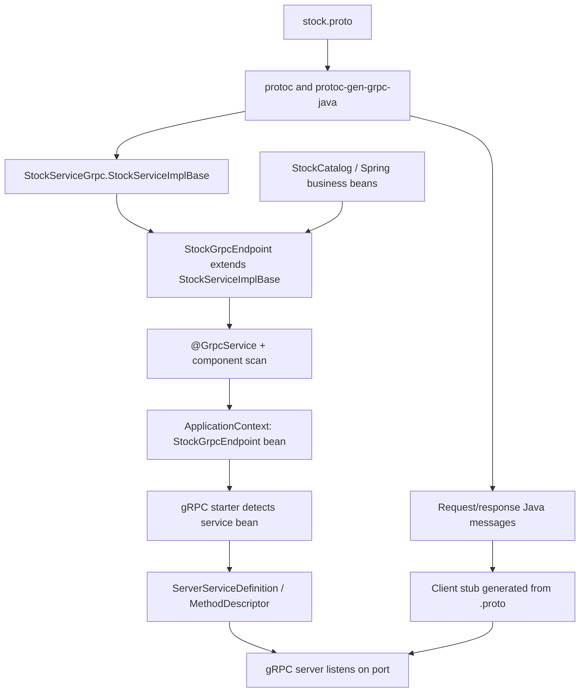
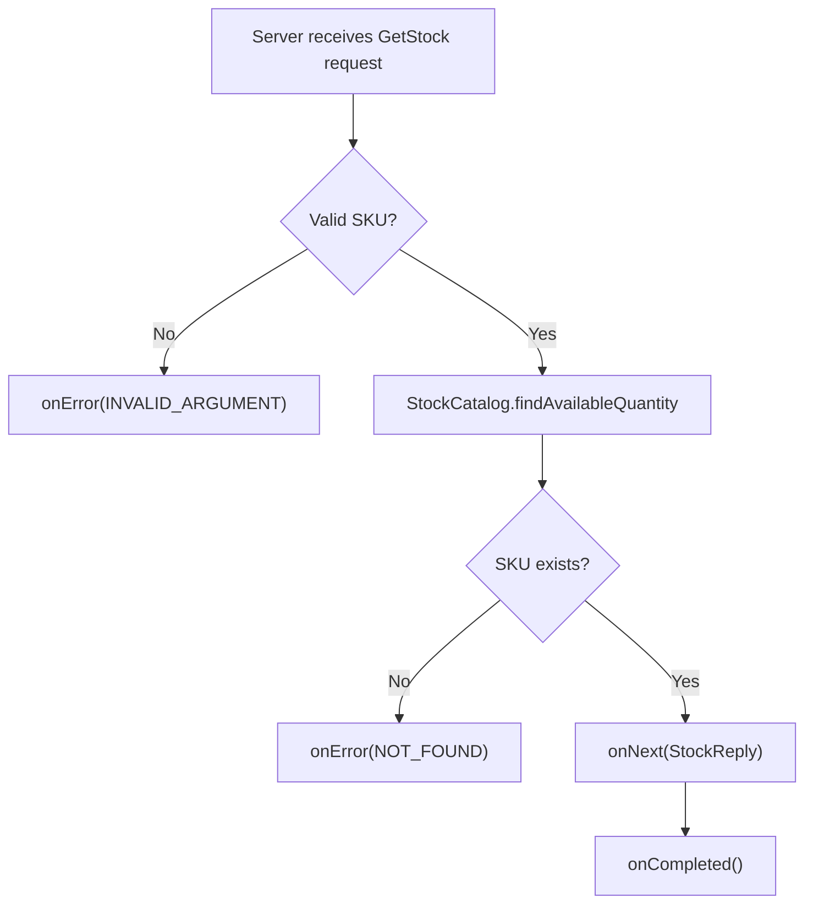

# Registering Services into the Spring ApplicationContext

## 1. What Does Registering a gRPC Service in Spring Boot Mean?

In the **SPRING_GRPC** ecosystem, developers define RPC interfaces with Protocol Buffers, generate Java code, and implement unary or streaming methods. For this service to leverage dependency injection, configuration, and the Spring Boot application lifecycle, the gRPC implementation class must be **registered as a bean in the `ApplicationContext`**. Then, the gRPC integration mechanism can discover the bean and expose the RPC methods on the gRPC server.

These are two related yet distinct steps:

- **Spring bean registration:** Spring knows which class to instantiate, which dependencies to inject, and how to manage the object lifecycle.
- **gRPC service registration with the server:** The gRPC server receives a `ServerServiceDefinition`, learning the wire service/method names and which handler processes requests.

A Java class existing in source code is not necessarily a Spring bean. A Spring bean extending a generated gRPC base class is also not guaranteed to be attached to the server by the starter. Testing must verify that **both steps** occurred.

After this lesson, learners will be able to:

1. Explain the path from `.proto` to `BindableService`, Spring bean, and registered RPC methods.
2. Use the appropriate starter's `@GrpcService` along with component scanning and constructor injection.
3. Choose bean placement, manage singleton state, and separate business logic from the gRPC layer.
4. Use profiles/conditions to control when a service appears and avoid duplicate registrations.
5. Verify beans in `ApplicationContext` and run integration tests that invoke real RPCs.
6. Handle metadata, deadlines, status codes, interceptors, TLS, and streaming issues related to bean lifecycle.

**API scope:** Examples use **`net.devh:grpc-server-spring-boot-starter`** with `net.devh.boot.grpc.server.service.GrpcService`. The **Spring gRPC** project in the Spring ecosystem has different service-bean registration mechanisms and APIs depending on the version. Do not assume `net.devh`'s `@GrpcService` or properties exist in official Spring gRPC.

## 2. From Protobuf Contract to ApplicationContext and gRPC Server

The components collaborate as follows:



Four key objects must be understood:

| Object | Created By | Role |
| --- | --- | --- |
| `StockServiceGrpc.StockServiceImplBase` | gRPC Java code-gen plugin from `.proto` | Base class for the server-side implementation |
| `StockGrpcEndpoint` | Developer | Handles each RPC and delegates to business services |
| `StockGrpcEndpoint` bean | Spring `ApplicationContext` | Object receiving injected dependencies and lifecycle management |
| `ServerServiceDefinition` | gRPC Java via `bindService()` | Binds gRPC service/methods to concrete handlers |

In gRPC Java, the generated base class typically implements `io.grpc.BindableService` and provides `bindService()` to build the service definition. The starter leverages this mechanism to register services when constructing the server.

**Code generated from `.proto` does not automatically become a bean.** The developer must write the implementation and register it using the mechanism required by the active starter.

## 3. Preparing a Concrete gRPC Contract

Suppose an application manages inventory stock quantities. Place `src/main/proto/stock.proto`:

```proto
syntax = "proto3";

package inventory.v1;

option java_multiple_files = true;
option java_package = "dev.example.stock.v1";

service StockService {
  rpc GetStock (GetStockRequest) returns (StockReply);
}

message GetStockRequest {
  string sku = 1;
}

message StockReply {
  string sku = 1;
  int32 quantity = 2;
}
```

After running `protoc` with the Java and gRPC Java plugins, the project contains classes such as `GetStockRequest`, `StockReply`, and `StockServiceGrpc.StockServiceImplBase`.

To practice with **net.devh**, the build requires Spring Boot, the gRPC server starter, and code-generation libraries. A minimal Groovy DSL snippet showing the relevant dependencies:

```groovy
dependencies {
    implementation 'org.springframework.boot:spring-boot-starter'
    implementation "net.devh:grpc-server-spring-boot-starter:NET_DEVH_VERSION"

    implementation platform("io.grpc:grpc-bom:GRPC_JAVA_VERSION")
    implementation 'io.grpc:grpc-protobuf'
    implementation 'io.grpc:grpc-stub'

    testImplementation 'org.springframework.boot:spring-boot-starter-test'
    testImplementation 'io.grpc:grpc-inprocess'
}
```

The strings `NET_DEVH_VERSION` and `GRPC_JAVA_VERSION` are **placeholders** that must be replaced with verified compatible versions before building. Dependencies for `protoc`, `protobuf-java`, and the Gradle/Maven code-generation plugin must also be configured per your project's build system; this snippet focuses only on service registration rather than showing the full build script. Whenever changing Java or Spring Boot versions, verify compatibility across the starter, gRPC Java, and Protobuf. Some toolchains also require an appropriate annotation API dependency for generated Java code.

The full gRPC method name in this example is:

```text
inventory.v1.StockService/GetStock
```

This is the wire name. It is **different** from the Java package `dev.example.stock.v1`, which only controls the package of generated sources.

## 4. Creating the ApplicationContext and Component Scan Scope

An example Spring Boot application:

```java
package dev.example.stock;

import org.springframework.boot.SpringApplication;
import org.springframework.boot.autoconfigure.SpringBootApplication;

@SpringBootApplication
public class StockApplication {
    public static void main(String[] args) {
        SpringApplication.run(StockApplication.class, args);
    }
}
```

`@SpringBootApplication` combines application configuration, auto-configuration, and component scanning. By default, Spring scans the package containing `StockApplication` and its subpackages, for example:

```text
dev.example.stock
├── StockApplication                  -> @SpringBootApplication
├── domain
│   ├── StockCatalog                  -> business interface
│   └── InMemoryStockCatalog          -> @Service
└── grpc
    └── StockGrpcEndpoint             -> @GrpcService
```

If you place the endpoint under `com.other.grpc` without expanding component scanning or importing the configuration, Spring may fail to discover the class. As a result, the server still starts, but `GetStock` is never registered.

**Best practice:** place the application class in the root package of the application, then organize business beans and gRPC adapters in subpackages. When modules or packages must live outside that scan root, configure `@ComponentScan` or import specific beans intentionally and verify the result in integration tests.

## 5. Separating Business Logic into Beans and Injecting into the gRPC Service

A gRPC endpoint should act as an adapter that receives a Protobuf request, delegates to business logic, and returns a Protobuf response. Avoid mixing inventory rules, database queries, authorization, and gRPC mapping inside the same class when they can be cleanly separated.

### 5.1. Business Contract

```java
package dev.example.stock.domain;

import java.util.OptionalInt;

public interface StockCatalog {
    OptionalInt findAvailableQuantity(String sku);
}
```

### 5.2. Spring-Managed Implementation

```java
package dev.example.stock.domain;

import org.springframework.stereotype.Service;

import java.util.Map;
import java.util.OptionalInt;

@Service
public class InMemoryStockCatalog implements StockCatalog {
    private final Map<String, Integer> quantities =
        Map.of("SKU-001", 7, "SKU-002", 12);

    @Override
    public OptionalInt findAvailableQuantity(String sku) {
        Integer quantity = quantities.get(sku);
        return quantity == null
            ? OptionalInt.empty()
            : OptionalInt.of(quantity);
    }
}
```

`@Service` is a Spring stereotype; the class is scanned and instantiated as a bean. Spring can inject this implementation into any bean depending on the `StockCatalog` interface, as long as there is a single candidate or an explicit qualifier configuration.

In real applications, `StockCatalog` might query a database, cache, or upstream service via a gRPC client. Separating this layer allows testing business logic without starting a gRPC server, and makes it easier to apply transactions and retry policies at appropriate boundaries.

### 5.3. gRPC Endpoint with `@GrpcService`

```java
package dev.example.stock.grpc;

import dev.example.stock.domain.StockCatalog;
import dev.example.stock.v1.GetStockRequest;
import dev.example.stock.v1.StockReply;
import dev.example.stock.v1.StockServiceGrpc;
import io.grpc.Status;
import io.grpc.stub.StreamObserver;
import net.devh.boot.grpc.server.service.GrpcService;

import java.util.OptionalInt;

@GrpcService
public class StockGrpcEndpoint
        extends StockServiceGrpc.StockServiceImplBase {

    private final StockCatalog catalog;

    public StockGrpcEndpoint(StockCatalog catalog) {
        this.catalog = catalog;
    }

    @Override
    public void getStock(
            GetStockRequest request,
            StreamObserver<StockReply> responseObserver) {

        String sku = request.getSku().trim();
        if (sku.isEmpty()) {
            responseObserver.onError(
                Status.INVALID_ARGUMENT
                    .withDescription("sku must not be blank")
                    .asRuntimeException());
            return;
        }

        OptionalInt quantity = catalog.findAvailableQuantity(sku);
        if (quantity.isEmpty()) {
            responseObserver.onError(
                Status.NOT_FOUND
                    .withDescription("SKU not found")
                    .asRuntimeException());
            return;
        }

        StockReply reply = StockReply.newBuilder()
            .setSku(sku)
            .setQuantity(quantity.getAsInt())
            .build();

        responseObserver.onNext(reply);
        responseObserver.onCompleted();
    }
}
```

Here, `@GrpcService` is a **net.devh** annotation that tells Spring to detect the endpoint as a bean and tells the starter's gRPC registration mechanism to expose the service. You do not manually instantiate `new StockGrpcEndpoint(...)` in `main()`.

**Constructor injection** makes the `StockCatalog` dependency explicit and allows `final` fields. If the dependency is missing or multiple beans of the same type exist without disambiguation, Spring fails fast at startup. That is a signal to fix wiring configuration, not a reason to instantiate objects manually outside the context.

### 5.4. Server Port Configuration

In `src/main/resources/application.yml` (net.devh):

```yaml
spring:
  application:
    name: stock-grpc

grpc:
  server:
    port: 9090
```

For an application acting solely as a gRPC server, `spring-boot-starter-web` is not required. If a web starter is present, `grpc.server.port` controls the gRPC port while `server.port` typically controls Spring Boot's HTTP server; they are two distinct listeners.

Once component scanning detects the endpoint, the starter obtains the gRPC service definition from the bean and registers it with the server on the configured port. The application does not call `ServerBuilder.forPort(9090).addService(...)` manually.

## 6. When Exactly Does a Bean Become a gRPC Service?

**With net.devh**, annotating the endpoint class with `@GrpcService` is the direct, explicit choice. Marking a gRPC class with plain `@Service` may create a Spring bean, but **does not guarantee** that the net.devh starter recognizes it as a published gRPC service. Conversely, a class marked `@GrpcService` that is excluded by component scanning or conditions will not exist in the context to be registered.

When using **official Spring gRPC**, `BindableService` registration rules are documented by that starter ecosystem. Some mechanisms pick up `BindableService` beans directly or use dedicated registrations/customizers. Never assume annotation names are equivalent across both ecosystems.

| State | Spring Bean Exists? | RPC Available on gRPC Server? |
| --- | --- | --- |
| Implementation class exists but is not annotated/registered | No | No |
| Class created by Spring via `@Service`, but starter expects different gRPC metadata | Yes | Not guaranteed |
| net.devh `@GrpcService` within component scan and startup succeeds | Yes | Normally yes |
| Bean disabled by profile or condition | No | No |
| Two implementations publish the same gRPC service name | Both may exist | Likely fails during server registration/build |

**Do not confuse the Spring bean name with the gRPC service name.** The bean name might be `stockGrpcEndpoint`, whereas the wire gRPC service name remains `inventory.v1.StockService` from `.proto`. Renaming the bean or Java package does not change the RPC name. Two endpoints registering the same service name will collide even if their Spring bean names differ.

### An Extension Point: Conditional Registration

You can toggle a Spring bean per profile for specific environments:

```java
import org.springframework.context.annotation.Profile;
import net.devh.boot.grpc.server.service.GrpcService;

@GrpcService
@Profile("stock-api")
public class StockGrpcEndpoint
        extends StockServiceGrpc.StockServiceImplBase {
    // Annotation illustration only; keep RPC methods as in Section 5.
}
```

This is an **illustrative variant**, not a second class to add alongside the Section 5 implementation. When the `stock-api` profile is inactive, the bean is not created and the corresponding RPC is not registered. The server can still start with other services, so verify the published services before routing traffic to the instance.

Beyond `@Profile`, you can use `@ConditionalOnProperty` for feature flags. However, bean conditions are evaluated at context startup; changing an environment variable while the application is running does not automatically add/remove services. A restart or dedicated reconfiguration mechanism is usually needed.

## 7. Scope and Thread Safety of Spring Beans

By default, Spring creates **singleton beans** per `ApplicationContext`. A single `StockGrpcEndpoint` instance can therefore handle many concurrent RPCs. This has critical consequences:

- Injected fields such as `StockCatalog` are typically shared dependencies.
- Never store the current request, token, request ID, or active `StreamObserver` in mutable singleton fields.
- Never use plain counters without synchronization if updated concurrently across RPCs.
- Any shared cache or state must be designed explicitly for concurrency and consistency.
- Do not arbitrarily switch an endpoint to `prototype` or request scope; the gRPC server expects a stable service definition and lifecycle. Spring MVC's HTTP request scope does not automatically apply to gRPC RPCs.

An **incorrect** example:

```java
@GrpcService
public class UnsafeEndpoint extends SomeGrpc.SomeImplBase {
    private String currentRequestId; // Can be overwritten by another RPC

    // In RPC A: currentRequestId = "A";
    // In RPC B: currentRequestId = "B";
    // RPC A may mistakenly read "B".
}
```

The snippet above illustrates a concurrency bug and is **not a complete implementation**. The proper approach is to use local handler variables for data needed only inside the method, or `io.grpc.Context` when propagating context across interceptors and callbacks.

### Attaching Metadata via gRPC Context

An interceptor can read the `x-request-id` header and attach it to the call's context:

```java
package dev.example.stock.grpc;

import io.grpc.Context;
import io.grpc.Contexts;
import io.grpc.Metadata;
import io.grpc.ServerCall;
import io.grpc.ServerCallHandler;
import io.grpc.ServerInterceptor;
import net.devh.boot.grpc.server.interceptor.GrpcGlobalServerInterceptor;

@GrpcGlobalServerInterceptor
public class RequestIdInterceptor implements ServerInterceptor {
    public static final Context.Key<String> REQUEST_ID =
        Context.key("request-id");

    private static final Metadata.Key<String> HEADER =
        Metadata.Key.of(
            "x-request-id",
            Metadata.ASCII_STRING_MARSHALLER
        );

    @Override
    public <ReqT, RespT> ServerCall.Listener<ReqT> interceptCall(
            ServerCall<ReqT, RespT> call,
            Metadata headers,
            ServerCallHandler<ReqT, RespT> next) {

        String incoming = headers.get(HEADER);
        String requestId = incoming == null ? "" : incoming;

        Context child =
            Context.current().withValue(REQUEST_ID, requestId);

        return Contexts.interceptCall(child, call, headers, next);
    }
}
```

Inside the handler, `RequestIdInterceptor.REQUEST_ID.get()` reads the value bound to the active context. When dispatching work to another executor, propagate the context explicitly; a custom `ThreadLocal` is not guaranteed to survive asynchronous callbacks. Client metadata is not inherently trustworthy: enforce length bounds, validate/sanitize before use, and never log tokens.

## 8. Dependency Injection, Proxies, and Transactions

### 8.1. Separating Business Logic for Testing and Extensibility

Recommended structure:

```text
gRPC Client
    |
    | HTTP/2 + Protobuf
    v
StockGrpcEndpoint (@GrpcService / adapter)
    |
    | Java method + dependency injection
    v
StockCatalog (@Service / business logic)
    |
    +--> Database / Cache / Downstream gRPC Client
```

Placing business rules in `StockCatalog` or dedicated use cases keeps the endpoint independent of persistence details. It also lets other adapters such as REST controllers or message consumers reuse the same logic.

### 8.2. AOP and Transactions

Spring can wrap context-managed beans in proxies—for example, to handle `@Transactional`, security, or instrumentation. For gRPC, keep transactions concise inside the **business service**, where data boundaries are clear:

```java
@Service
public class DatabaseStockCatalog implements StockCatalog {
    private final StockRepository repository;

    public DatabaseStockCatalog(StockRepository repository) {
        this.repository = repository;
    }

    @Override
    @Transactional(readOnly = true)
    public OptionalInt findAvailableQuantity(String sku) {
        return repository.findQuantityBySku(sku);
    }
}
```

This snippet is **illustrative code**, assuming `StockRepository` and Spring transaction infrastructure already exist, so it does not run standalone. The main point is that the gRPC endpoint calls through an injected Spring bean so the transaction interceptor can take effect.

Key considerations:

- Calling `this.someTransactionalMethod()` within the same bean bypasses proxy-based Spring AOP; prefer invoking methods through the injected bean.
- `@Transactional` on a synchronous method does not automatically span asynchronous callbacks.
- Avoid holding a database transaction open across a long-lived streaming RPC unless truly required.
- When wrapping a `BindableService` in a proxy, verify compatibility with your starter version's service discovery/registration mechanism. Do not rely on proxy class names to infer gRPC service names.

## 9. RPC Errors and Bean Responsibility Boundaries

Successful bean registration only proves wiring; the handler must still follow gRPC semantics.

For a unary RPC, the standard completion flow is:



Never call `onCompleted()` after `onError()`. Never emit additional messages after a terminal event has occurred. For unexpected exceptions, log safely on the server side and translate to `Status.INTERNAL` as appropriate; never return stack traces or sensitive details to the client.

| Status Code | Illustrative Case | Notes |
| --- | --- | --- |
| `INVALID_ARGUMENT` | Missing SKU or invalid input | Fix the request before retrying |
| `NOT_FOUND` | Requested SKU does not exist | Valid business outcome in terms of error handling |
| `UNAUTHENTICATED` | Missing or invalid caller identity | Usually handled in an interceptor/security layer |
| `PERMISSION_DENIED` | Caller lacks permission | Do not leak protected data |
| `DEADLINE_EXCEEDED` | Client deadline expired | Long-running handlers should check cancellation |
| `UNAVAILABLE` | Server or transport unavailable | May retry according to idempotency policy |
| `INTERNAL` | Unexpected server error | Inspect logs/tracing to investigate |

In particular, Spring business exceptions do not automatically map to meaningful gRPC status codes. Decide on the mapping strategy in the adapter layer or an error-handling interceptor, then test the contract with a client.

### Streaming and Bean Lifecycle

A singleton endpoint can also implement server streaming, client streaming, or bidirectional streaming if defined in `.proto`. However, each stream needs its own per-call state—never store a `StreamObserver` or stream request buffer in shared bean fields. For long-lived streams, you must:

1. Monitor cancellation and deadlines to stop producers.
2. Avoid unbounded in-memory buffering; respect flow control/backpressure.
3. Cancel background work and release subscriptions and resources when the stream completes or errors.
4. Never assume callbacks always execute on the same fixed thread.

Auto-configuration only registers the implementation; it does not solve per-stream concurrency or lifecycle management.

## 10. Verifying Bean Presence in ApplicationContext

A first diagnostic question is: **Did Spring create the bean?**

Example `@SpringBootTest` checking only that the beans are registered:

```java
package dev.example.stock;

import dev.example.stock.grpc.StockGrpcEndpoint;
import dev.example.stock.domain.StockCatalog;
import org.junit.jupiter.api.Test;
import org.springframework.beans.factory.annotation.Autowired;
import org.springframework.boot.test.context.SpringBootTest;

import static org.junit.jupiter.api.Assertions.assertNotNull;

@SpringBootTest(properties = {
    "grpc.server.port=-1",
    "grpc.server.inProcessName=stock-bean-test"
})
class StockBeanContextTest {
    @Autowired
    private StockGrpcEndpoint grpcEndpoint;

    @Autowired
    private StockCatalog catalog;

    @Test
    void springCreatesGrpcEndpointAndBusinessDependency() {
        assertNotNull(grpcEndpoint);
        assertNotNull(catalog);
    }
}
```

This test example assumes the net.devh version supports configuring an in-process server via `grpc.server.inProcessName` and disabling the network listener via `grpc.server.port=-1`. For versions without support, use an appropriate test server configuration such as a dynamic TCP port. **Testing that a bean exists does not confirm the RPC is registered.** To verify the whole chain, you must invoke an RPC.

### Distinguishing Verification Questions

| Question | Tool / Verification Method |
| --- | --- |
| Does the endpoint bean exist? | `ApplicationContext.getBean(StockGrpcEndpoint.class)` or `@Autowired` |
| Were dependencies injected? | Call a test method and verify behavior; do not `new` the endpoint |
| Was the annotation recognized? | Check the class/bean and matching starter ecosystem |
| Is the RPC method registered on the server? | Call the server with `grpcurl` or a real gRPC client |
| Were properties applied? | Check Spring `Environment`, startup logs, and the active endpoint |
| Did auto-configuration meet its conditions? | Inspect the Spring Boot Condition Evaluation Report |

## 11. Integration Testing Both Spring Bean and gRPC Registration

With **net.devh versions supporting an in-process gRPC server**, you can run `@SpringBootTest` to initialize the real context and then connect using an in-process gRPC Java client.

Prerequisites:

- Include `spring-boot-starter-test` and `io.grpc:grpc-inprocess` in test dependencies.
- `StockGrpcEndpoint` is covered by component scanning.
- The net.devh version supports `grpc.server.inProcessName` and `grpc.server.port=-1`.

JUnit 5 example:

```java
package dev.example.stock;

import dev.example.stock.grpc.StockGrpcEndpoint;
import dev.example.stock.v1.GetStockRequest;
import dev.example.stock.v1.StockReply;
import dev.example.stock.v1.StockServiceGrpc;
import io.grpc.ManagedChannel;
import io.grpc.Status;
import io.grpc.StatusRuntimeException;
import io.grpc.inprocess.InProcessChannelBuilder;
import org.junit.jupiter.api.Test;
import org.springframework.beans.factory.annotation.Autowired;
import org.springframework.boot.test.context.SpringBootTest;

import java.util.concurrent.TimeUnit;

import static org.junit.jupiter.api.Assertions.*;

@SpringBootTest(properties = {
    "grpc.server.port=-1",
    "grpc.server.inProcessName=stock-context-test"
})
class StockGrpcRegistrationTest {
    @Autowired
    private StockGrpcEndpoint endpoint;

    @Test
    void registersSpringBeanAndServesRpc() {
        assertNotNull(endpoint);

        ManagedChannel channel = InProcessChannelBuilder
            .forName("stock-context-test")
            .directExecutor()
            .build();

        try {
            var stub = StockServiceGrpc.newBlockingStub(channel)
                .withDeadlineAfter(2, TimeUnit.SECONDS);

            StockReply reply = stub.getStock(
                GetStockRequest.newBuilder()
                    .setSku("SKU-001")
                    .build()
            );

            assertEquals("SKU-001", reply.getSku());
            assertEquals(7, reply.getQuantity());

            StatusRuntimeException invalid = assertThrows(
                StatusRuntimeException.class,
                () -> stub.getStock(
                    GetStockRequest.newBuilder().build()
                )
            );
            assertEquals(
                Status.Code.INVALID_ARGUMENT,
                invalid.getStatus().getCode()
            );
        } finally {
            channel.shutdownNow();
        }
    }
}
```

This test proves that:

- Spring created the endpoint and its dependencies.
- The starter registered the service definition on the server.
- gRPC Java routed the Protobuf method to the implementation.
- Responses and status codes from a real call were transmitted properly.

In-process names must be isolated if multiple test contexts run concurrently in the same JVM. If the starter version does not support this configuration, use a server bound to a dynamic TCP port in an isolated test environment and connect with a real gRPC client. **The in-process transport does not test HTTP/2 over the network, proxies, or TLS handshakes**; production systems need additional network integration tests to verify those layers.

## 12. Testing with grpcurl and Identifying Error Types

In development, while the server listens on port 9090, you can invoke it directly using the contract:

```bash
grpcurl -plaintext \
  -import-path src/main/proto \
  -proto stock.proto \
  -d '{"sku":"SKU-001"}' \
  localhost:9090 \
  inventory.v1.StockService/GetStock
```

Expected response:

```json
{
  "sku": "SKU-001",
  "quantity": 7
}
```

Calling with `{"sku":""}` should return `INVALID_ARGUMENT`. Calling with a non-existent SKU returns `NOT_FOUND` per the implementation above. The example uses `-plaintext` because the local server does not have TLS configured; with TLS, use the appropriate connection mode and certificates.

If using PowerShell on Windows, put the `grpcurl` command on one line or use PowerShell's line-continuation character instead of Bash's `\`.

When errors occur, isolate the layers:

| Symptom | Layer to Inspect |
| --- | --- |
| Spring fails to find `StockCatalog` | Dependency injection: missing business bean or wrong component scan |
| Spring has the bean, but gRPC method returns `UNIMPLEMENTED` | Service not registered by starter, or client called wrong full method name |
| `UNAVAILABLE` / connection refused | Wrong port, server not listening, network, or TLS/HTTP/2 |
| Server startup error `Address already in use` | Port conflict with another process or manually created server |
| `INVALID_ARGUMENT` | Service ran and rejected invalid input |
| `DEADLINE_EXCEEDED` | RPC deadline expired; investigate latency and cancellation |
| Behavior differs across environments | Profiles, property sources, bean conditions, TLS, or deployment |

Do not automatically assume `UNIMPLEMENTED` always means a missing bean: the same status occurs when client and server contracts diverge on package, service, or method names.

## 13. Pitfalls to Avoid in Real Applications

### 13.1. Registering Two Beans for the Same Service

If two classes both implement `inventory.v1.StockService` and both are discovered/registered, the server may fail with a duplicate service name error. This collision occurs on the **gRPC service name**, not necessarily on the Spring bean name.

When multiple implementations are needed across environments, use profiles/conditions so only one is active, or split them into separate processes/servers. If multiple API versions must coexist simultaneously, declare distinct Protobuf service/package names according to an appropriate versioning strategy.

### 13.2. Confusing `@Service` with `@GrpcService`

`@Service` tells Spring to create a business bean. In the `net.devh` ecosystem illustrated here, `@GrpcService` tells the starter that this is a gRPC endpoint to register. Never assume putting `@Service` on any class extending a gRPC base class automatically publishes the RPC.

When using official Spring gRPC or another starter, choose the exact `BindableService` registration mechanism supported by that ecosystem.

### 13.3. Using `new` Instead of Injection

Undesirable example:

```java
StockGrpcEndpoint endpoint =
    new StockGrpcEndpoint(new InMemoryStockCatalog());
```

This object is created outside Spring, so it receives none of the expected bean lifecycle management, proxies, or starter registration. Direct instantiation is fine in pure unit tests, but should not replace Spring wiring at runtime.

### 13.4. Manually Creating a Duplicate Server Alongside the Starter

When using auto-configuration, do not create an extra `ServerBuilder.forPort(9090)` in `main()`. When you need to tune interceptors, keepalive, TLS, or message size, use the extension points or properties published by your starter/version for the server it manages.

### 13.5. Storing Per-RPC Data in a Singleton

Any per-request state must live in local variables, context, or objects scoped to the RPC/stream. Sharing a `StreamObserver` or authentication info via mutable bean fields can leak data across callers.

### 13.6. Neglecting TLS, Health, and Monitoring

Successfully registering a service does not mean it is production-ready. Verify:

- TLS/mTLS has valid certificates, hostnames, and trust chains; never commit private keys.
- Authentication/authorization interceptors use appropriate metadata and status codes.
- Deadlines and cancellation are supported, especially in streaming RPCs.
- Health/readiness genuinely checks RPC serving capability; the gRPC Health Checking Protocol differs from HTTP Actuator health.
- Metrics/traces capture request counts by method/status, p95/p99 latency, active streams, and resource health.
- Spring context shutdown aligns with the termination grace period granted by the container/orchestrator.

## 14. Practice Exercises

Using the `StockService` above, perform these steps in order:

1. Start Spring Boot, invoke `GetStock` for `SKU-001` using `grpcurl`, and verify quantity equals 7.
2. Verify `ApplicationContext` contains both `StockGrpcEndpoint` and `StockCatalog` beans.
3. Temporarily move `StockGrpcEndpoint` to a package outside the scan scope in a practice branch; observe the method is no longer registered, then restore it.
4. Use `@Profile` to toggle the endpoint on/off and observe the difference between *bean does not exist* and *server is not running*.
5. Add a second implementation with the same gRPC service name in a test environment and observe the registration error; remove the duplicate.
6. Send an empty SKU, a non-existent SKU, and a valid SKU; compare `INVALID_ARGUMENT`, `NOT_FOUND`, and `OK`.
7. Add a request ID interceptor; verify two concurrent RPCs do not read each other's metadata.
8. Run the Spring context and in-process RPC integration test; when deploying with TLS, add network tests using a test certificate bundle.

You can self-assess with three questions: **Which class is the Spring bean? Which mechanism turns the bean into a gRPC service on the server? How do you verify that both the bean and the RPC are actually working?** If you can answer these questions and run the tests, you understand the principles of registering services into `Spring ApplicationContext`.

With **SPRING_GRPC**, Spring handles creating and wiring Java components, while gRPC handles method definitions, Protobuf message transport, and terminating calls with status codes. Organizing services as Spring beans enables reusing dependency injection and configuration/lifecycle rules, yet publishing endpoints, securing access, handling streaming, and maintaining reliability still require explicit design and verification.
