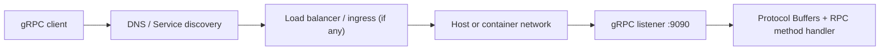
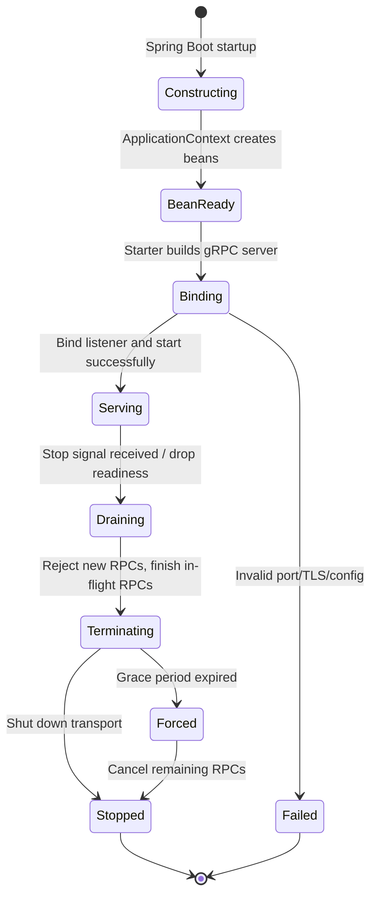
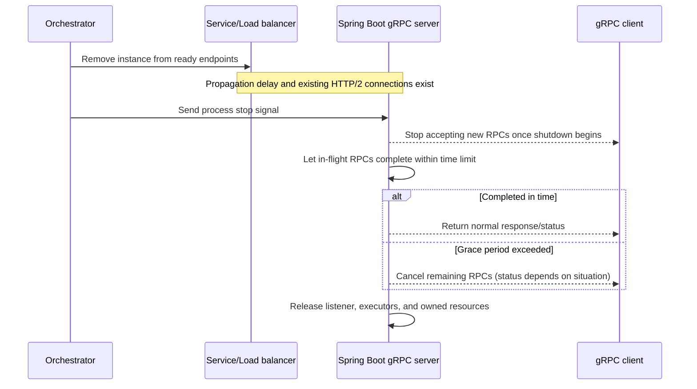

# Port Configuration and Server Lifecycle in Spring Boot gRPC

## 1. Lesson Objectives

When developing with **SPRING_GRPC**, a Spring Boot application can expose a gRPC server based on Protocol Buffers contracts, generated Java code, and unary or streaming methods. For the server to reliably serve clients, developers need to know **which port is open**, **when the server starts**, **how to stop accepting new RPCs**, and **how to drain or release in-flight calls**.

This lesson focuses on two core topics in the **Spring Boot integration** chapter:

- **Port configuration:** identifying the gRPC listening port and bind address, configuring by profile and environment, distinguishing the gRPC port from HTTP/Actuator ports, and mapping ports through containers or Kubernetes.
- **Server lifecycle:** understanding when Spring creates beans, starts the gRPC listener, transitions to ready, performs graceful shutdown, force-stops on timeout, and releases resources.

After completing this lesson, you will be able to configure and operate a gRPC server without confusing Spring bean state with network socket state; diagnose errors such as `Address already in use`, `UNAVAILABLE`, and `DEADLINE_EXCEEDED`; and design shutdown procedures suited for both unary and streaming RPCs.

**Illustrative API ecosystem:** `net.devh:grpc-server-spring-boot-starter`, using `@GrpcService` and `grpc.server.*`. The **Spring gRPC** project in the Spring ecosystem has its own starters and extension points. Use the exact properties and lifecycle contract from the documentation of the version your project selects; do not assume all starters share identical property names.

## 2. Port, Listener, and Endpoint Are Distinct Concepts

For a gRPC server, distinguish these concepts:

| Concept | Meaning | Example |
| --- | --- | --- |
| Bind address | Network interface address the process listens on | `127.0.0.1` or a container network interface |
| Bind port | TCP port opened by the gRPC transport | `9090` |
| Client target | Name/address the client requests to connect to | `dns:///stock-grpc.internal:50051` |
| Mapped/forwarded port | External port forwarded by proxy/container to the listener | `localhost:50051 -> container:9090` |
| gRPC service/method | RPC name over HTTP/2 after a connection succeeds | `demo.probe.v1.ProbeService/Ping` |

**A server listening successfully on `localhost:9090` does not mean other machines can connect.** Binding to loopback only accepts connections from that host; binding to the required network interface and configuring firewall/port mappings are necessary for external clients to reach it.

Likewise, knowing the right port does not guarantee RPC calls will succeed: both sides must also agree on HTTP/2, TLS, service/method names from `.proto`, metadata, and security policies.



### Valid Ports and Special Values

Standard TCP ports are integers from **1 to 65535**. Low ports may be restricted by OS privileges. When choosing an application port, prefer configuration-managed ports rather than hardcoding them in Java code.

Some starter versions allow special values for testing, such as `0` (OS assigns an available ephemeral port) or `-1` (disables the TCP listener when using an in-process server). **These are conventions specific to each starter/version**, not universal TCP rules; check the documentation and how to retrieve the actual port before relying on them in tests.

## 3. Distinguishing the gRPC Port from Spring Boot's HTTP Ports

Within a single Spring Boot application, multiple listeners can coexist:

```text
Spring Boot process / ApplicationContext
|
+-- Business beans and gRPC service implementations
|
+-- Starter-managed gRPC server
|    +-- HTTP/2 + gRPC
|    +-- grpc.server.port = 9090 (net.devh example)
|
+-- Spring MVC / WebFlux HTTP server, if web starter is present
|    +-- REST endpoints
|    +-- server.port = 8080
|
+-- Actuator HTTP management server, if configured separately
     +-- management.server.port = 8081
```

| Property | Controls | When It Applies |
| --- | --- | --- |
| `grpc.server.port` | `net.devh` gRPC server port | Corresponding gRPC server starter is present |
| `server.port` | Spring Boot HTTP web server port | Servlet/reactive web stack is present |
| `management.server.port` | Separate Actuator HTTP management port | Actuator is present and separate management port is enabled |

If an application only includes `spring-boot-starter` and the gRPC server starter, Spring MVC is **not required** to serve gRPC. Conversely, adding `spring-boot-starter-web` means one process can run **two separate listeners** on different ports.

Example configuration with both HTTP and gRPC:

```yaml
server:
  port: 8080

grpc:
  server:
    port: 9090

management:
  server:
    port: 8081
```

Never assign both an independent gRPC listener and an HTTP listener to the same TCP address/port. If HTTP and gRPC clients must share one public port, you need a **shared-listener architecture or a protocol-aware proxy/ingress**; simply changing `server.port` does not make two servers share a socket.

## 4. Configuring `grpc.server.port` by Environment

With **net.devh**, `src/main/resources/application.yml` can declare:

```yaml
spring:
  application:
    name: probe-grpc

grpc:
  server:
    port: ${GRPC_SERVER_PORT:9090}
```

Spring's `${GRPC_SERVER_PORT:9090}` syntax prefers the `GRPC_SERVER_PORT` configuration value if set, falling back to `9090` otherwise. Ensure environment variable names follow Spring Boot relaxed binding and deployment conventions; prefer one consistent name across CI/CD and infrastructure.

You can also define profile-specific settings, e.g., `application-dev.yml`:

```yaml
grpc:
  server:
    port: 9191
```

When the `dev` profile is active, values in the profile file participate in property resolution. However, configuration sources like command-line arguments, environment variables, and deployment configs have a defined **precedence order**. Whenever the actual port differs from expectations, trace which source bound the effective value into the starter.

Example override via startup arguments:

```bash
java -jar app.jar --grpc.server.port=9292
```

Distinguish changing configuration **before application startup** from changing environment variables **after the listener has bound**. Typically, changing the port after startup requires a restart or an explicitly supported server-reinitialization mechanism; do not assume Spring automatically moves an active listener to a new port when a property changes.

### Bind Address vs. Public Address

Port is only half of an endpoint. The bind address decides which network interface accepts connections. Some starters expose a property for the bind address; check the property name and default for your version.

Common scenarios to keep in mind:

- **Local development:** binding to loopback is sensible if only local access from the developer machine is desired.
- **Containers:** the process usually must bind to the container network interface so Kubernetes Services or Docker port mappings can reach it; binding only to `127.0.0.1` inside a container can block connections from outside the container.
- **Production:** the address clients dial is typically a Kubernetes Service DNS name, load balancer, or ingress, not the server's internal bind address.
- **Security:** never expose gRPC ports unnecessarily; broad binding must be paired with firewalls, network policies, TLS, and authorization.

## 5. Self-Contained gRPC Server Example with Spring Boot

### 5.1. Protocol Buffers Contract

Place `src/main/proto/probe.proto`:

```proto
syntax = "proto3";

package demo.probe.v1;

option java_multiple_files = true;
option java_package = "dev.example.probe.v1";

service ProbeService {
  rpc Ping(PingRequest) returns (PingReply);
}

message PingRequest {
  string value = 1;
}

message PingReply {
  string value = 1;
}
```

After generating code with `protoc` and `protoc-gen-grpc-java`, the application has `PingRequest`, `PingReply`, `ProbeServiceGrpc.ProbeServiceImplBase`, and client stubs. **Server lifecycle and Protobuf code generation are two separate processes**: Spring Boot does not automatically generate Java classes from `.proto`.

### 5.2. Gradle Dependencies Skeleton

Example `build.gradle` with Groovy DSL:

```groovy
plugins {
    id 'java'
    id 'org.springframework.boot' version 'SPRING_BOOT_VERSION'
    id 'io.spring.dependency-management' version 'DEPENDENCY_MANAGEMENT_VERSION'
    id 'com.google.protobuf' version 'PROTOBUF_PLUGIN_VERSION'
}

def grpcVersion = 'GRPC_JAVA_VERSION'
def protobufVersion = 'PROTOBUF_VERSION'
def starterVersion = 'NET_DEVH_STARTER_VERSION'

repositories {
    mavenCentral()
}

dependencies {
    implementation 'org.springframework.boot:spring-boot-starter'
    implementation "net.devh:grpc-server-spring-boot-starter:${starterVersion}"

    implementation platform("io.grpc:grpc-bom:${grpcVersion}")
    implementation 'io.grpc:grpc-protobuf'
    implementation 'io.grpc:grpc-stub'
    implementation "com.google.protobuf:protobuf-java:${protobufVersion}"

    testImplementation 'org.springframework.boot:spring-boot-starter-test'
}

protobuf {
    protoc {
        artifact = "com.google.protobuf:protoc:${protobufVersion}"
    }
    plugins {
        grpc {
            artifact = "io.grpc:protoc-gen-grpc-java:${grpcVersion}"
        }
    }
    generateProtoTasks {
        all()*.plugins {
            grpc {}
        }
    }
}
```

All values ending in `_VERSION` are **placeholders** and will not run unless replaced. Before building, choose compatible versions of Spring Boot, Java, net.devh, gRPC Java, Protobuf, and the code-gen plugin; prefer using a project-managed BOM/version catalog. Some Java/gRPC generator combinations may require an API providing `javax.annotation.Generated` to compile generated code.

### 5.3. Application and gRPC Service Bean

Spring Boot application:

```java
package dev.example;

import org.springframework.boot.SpringApplication;
import org.springframework.boot.autoconfigure.SpringBootApplication;

@SpringBootApplication
public class ProbeApplication {
    public static void main(String[] args) {
        SpringApplication.run(ProbeApplication.class, args);
    }
}
```

Implementation:

```java
package dev.example.probe;

import dev.example.probe.v1.PingReply;
import dev.example.probe.v1.PingRequest;
import dev.example.probe.v1.ProbeServiceGrpc;
import io.grpc.Status;
import io.grpc.stub.StreamObserver;
import net.devh.boot.grpc.server.service.GrpcService;

@GrpcService
public class ProbeGrpcService
        extends ProbeServiceGrpc.ProbeServiceImplBase {

    @Override
    public void ping(
            PingRequest request,
            StreamObserver<PingReply> responseObserver) {

        String value = request.getValue().trim();
        if (value.isEmpty()) {
            responseObserver.onError(
                Status.INVALID_ARGUMENT
                    .withDescription("value must not be blank")
                    .asRuntimeException());
            return;
        }

        PingReply reply = PingReply.newBuilder()
            .setValue("pong: " + value)
            .build();

        responseObserver.onNext(reply);
        responseObserver.onCompleted();
    }
}
```

`@GrpcService` in the example is a **net.devh** annotation. Because the class resides under package `dev.example`, `@SpringBootApplication`'s default component scan discovers it. The starter collects service beans, builds the server, and registers `demo.probe.v1.ProbeService/Ping`. Do not add `ServerBuilder.forPort(9090)` in `main()` when letting the starter manage the server.

To verify the listener is active, invoke it with `grpcurl` using the contract:

```bash
grpcurl -plaintext \
  -import-path src/main/proto \
  -proto probe.proto \
  -d '{"value":"ready"}' \
  localhost:9090 \
  demo.probe.v1.ProbeService/Ping
```

Expected output:

```json
{
  "value": "pong: ready"
}
```

The command uses `-plaintext` for a local setup without TLS. If the server uses TLS, the client must verify the appropriate certificate. On PowerShell, put the command on a single line or adjust line-continuation characters for PowerShell syntax.

## 6. Server Lifecycle Stages

An application using a gRPC starter typically goes through this sequence:



The diagram shows an **operational model**; it does not imply every starter exposes identically named states or callbacks.

### 6.1. Beans Are Created Before the Listener Starts

Spring Boot builds the `ApplicationContext`, processes auto-configuration, and registers gRPC beans and business dependencies. Then, the starter starts the server according to its version's lifecycle integration.

In some starter ecosystems, server management hooks into Spring's `SmartLifecycle`. Consequently:

- **Bean existence** does not guarantee the listener has bound yet.
- **An open socket** does not guarantee all backend dependencies and business RPCs are ready.
- **Printed application logs** do not prove clients can invoke the right RPC.

To confirm startup, perform a real RPC call or a readiness check reflecting actual gRPC serving capability.

### 6.2. When Can Clients Connect?

Once binding succeeds, the OS has allocated the TCP port to the server. Successful TCP connections can still yield gRPC errors due to TLS/HTTP/2, RPC names, or metadata. On the client side, `ManagedChannel` often connects lazily on demand, so the existence of a client bean does not prove a connection has been established.

In Spring Boot, do not equate the gRPC server listening with the moment Spring emits `ApplicationReadyEvent`; if you rely on this event to coordinate readiness, check the lifecycle ordering of your specific starter. A real readiness check should verify essential service dependencies as well.

### 6.3. Port Bind Failures

If another process already holds the address/port, the server can fail during `bind` with a message such as `Address already in use`. When that happens, Spring Boot may fail to start the application.

Real-world causes:

1. Port `9090` is already used by another process.
2. Two gRPC servers were created in the same app—one manually and one via the starter.
3. The target network interface does not exist or lacks permissions.
4. Profile/deployment config causes two independent servers to bind the same port.
5. Invalid TLS or transport settings cause startup failure even though the port is free.

The proper fix is to identify **the bind address, effective port, and process owning the listener**. Never change ports arbitrarily in production if clients or ingress still route to the old port.

## 7. How Does Spring Manage the Server Lifecycle?

Auto-configuration binds gRPC resources to the Spring context. As the app starts, the starter creates and starts the server; when the context closes, the starter's lifecycle manager stops the server and releases the resources it owns.

### Do Not Shut Down the Starter's Server Inside a Business Bean

Avoid writing `@PreDestroy` in a business bean to manually stop a starter-managed `Server`, because:

- Spring and starter shutdown ordering can be disrupted.
- Starter graceful shutdown settings may be bypassed.
- Streams and interceptors may be torn down while other beans are still using them.
- The server may be stopped multiple times from different places, complicating diagnostics.

To adjust shutdown policy, check the **official extension points or properties of your starter version**, rather than grabbing the server directly and imposing custom lifecycle calls.

### Starter-Managed Server vs. Manual Server

In plain gRPC Java, shutdown API semantics look like this:

```java
server.shutdown(); // Stop accepting new calls; give in-flight RPCs a chance to finish.

if (!server.awaitTermination(20, TimeUnit.SECONDS)) {
    server.shutdownNow(); // Force-cancel any remaining calls.
}
```

This is **illustrative code for a manually managed server**, not code to copy into an app already using a starter. `shutdown()` requests graceful shutdown, `shutdownNow()` forces termination; `awaitTermination(...)` blocks waiting for termination and can be interrupted, so real apps must handle `InterruptedException` properly.

Do not treat `20 seconds` in the example as a Spring or gRPC default. The grace period must come from SLAs, maximum allowed RPC duration, and the shutdown budget granted by your infrastructure.

## 8. Graceful Shutdown and In-Flight Requests

**Graceful shutdown** lets the server stop accepting new work and gives in-flight RPCs a bounded window to complete. In distributed systems, stopping the server from accepting new connections, stopping the load balancer from sending traffic, and handling client retries must all be designed together.



The diagram shows the desired sequence. **Dropping readiness alone does not strictly guarantee zero new RPCs arrive**: load balancers have propagation delays, clients may hold persistent HTTP/2 connections, or callers may connect directly. Both server and client must behave safely when shutdown signals arrive.

### Unary RPCs

For short unary RPCs, the goal is usually to let nearly finished calls return their response within the grace window. For calls exceeding client deadlines or shutdown windows, the server should abort cancellable work to avoid wasting CPU and upstream resources.

On the client side, `DEADLINE_EXCEEDED` does not guarantee the server did not execute side effects. When retrying operations such as order creation, inventory deduction, or payment capture, protect them with idempotency keys or duplicate-execution guards.

### Streaming RPCs

Server streaming, client streaming, and bidirectional streaming can last minutes or hours. Waiting unconditionally for every stream to finish naturally could prevent the process from ever stopping.

Additional design measures are needed:

- Bound maximum stream duration and require clients to reconnect when needed.
- Monitor cancellation, deadlines, and `StreamObserver` state.
- Cancel producers, subscriptions, or background tasks when a stream finishes, errors, or is cancelled by the client.
- Stop emitting new messages after the stream has terminated.
- Respect flow control/backpressure; never buffer unbounded messages to "flush everything" during shutdown.

In gRPC Java, `ServerCallStreamObserver` supports cancellation callbacks and readiness checks. The short snippet below illustrates **registering a cancel callback** inside a streaming method that already receives `responseObserver`:

```java
if (responseObserver instanceof ServerCallStreamObserver<?> observer) {
    observer.setOnCancelHandler(() -> {
        // Cancel the stream producer task or subscription for this call.
        // Do not store request state in a singleton field of @GrpcService.
    });
}
```

This is an **illustrative snippet**, not a complete service. In real implementations, manage per-stream producer tasks and synchronize terminal events with cancellation; never assume callbacks always run on the same thread. Specifically, on older Java versions without `instanceof` pattern matching, use standard casting syntax.

## 9. Combining Readiness and Liveness

When running in containers/orchestrators, distinguish:

| Signal | Question It Answers | What It Should Reflect |
| --- | --- | --- |
| Liveness | Is the process stuck in an unrecoverable state? | Process/runtime health |
| Readiness | Can this instance currently accept valid RPCs? | gRPC listener and essential dependencies |
| gRPC health service | What status does the gRPC health protocol report? | Per-service status if implemented |
| Spring Boot Actuator health | What do Spring Boot `HealthIndicator`s report? | Health over the HTTP/management endpoint |

**gRPC Health Checking Protocol** and **Spring Boot Actuator HTTP health** are two separate mechanisms. Simply enabling Actuator does not prove a gRPC health method is registered.

A TCP probe only confirms the port accepts TCP connections; it does not prove RPCs work or required services are ready. If using a Kubernetes `grpc` readiness probe, the server must genuinely support the gRPC Health Checking Protocol and the probe must target the right port. TLS models, proxies, and probe limitations must be verified against your runtime infrastructure.

During shutdown, transitioning readiness to unready tells infrastructure to stop routing new traffic to the instance. **Do not use liveness to temporarily mark "draining"** if doing so causes the orchestrator to kill the process before the desired grace period finishes.

## 10. Port Mapping in Docker and Kubernetes

### 10.1. Docker: Host Port vs. Container Port

Suppose the gRPC server inside the container listens on `9090`; you can map it:

```bash
docker run --rm -p 50051:9090 my-grpc-image
```

Here, a host client dials `localhost:50051`, while the process inside the container still binds `9090`. The command assumes `my-grpc-image` is built and the app inside listens on an appropriate network interface; `-p` **does not automatically change `grpc.server.port`**.

If the app binds only `127.0.0.1` inside the container, the port mapping may not be reachable from the host as expected. Verify both the bind address and the mapped port.

### 10.2. Kubernetes: containerPort, Service Port, targetPort

Suppose a pod runs gRPC on `9090` and a Kubernetes Service exposes it internally on `50051`. Relevant Deployment excerpt:

```yaml
apiVersion: apps/v1
kind: Deployment
metadata:
  name: probe-grpc
spec:
  replicas: 2
  selector:
    matchLabels:
      app: probe-grpc
  template:
    metadata:
      labels:
        app: probe-grpc
    spec:
      terminationGracePeriodSeconds: 45
      containers:
        - name: probe-grpc
          image: registry.example/probe-grpc:1.0
          ports:
            - name: grpc
              containerPort: 9090
          env:
            - name: GRPC_SERVER_PORT
              value: "9090"
```

Service definition:

```yaml
apiVersion: v1
kind: Service
metadata:
  name: probe-grpc
spec:
  selector:
    app: probe-grpc
  ports:
    - name: grpc
      protocol: TCP
      port: 50051
      targetPort: 9090
```

This is a **port-mapping illustration**, omitting readiness/liveness probes, security, valid images, resource limits, and full production configuration.

- `containerPort: 9090` documents the container port; by itself it does not make the Java server open a port.
- `GRPC_SERVER_PORT=9090` is passed to the app, assuming Spring configuration reads this variable.
- `Service port: 50051` is the port in-cluster clients dial.
- `targetPort: 9090` is the destination port on the pod.
- `terminationGracePeriodSeconds: 45` is the pod-level cap; actual shutdown duration also depends on hooks, runtime, and starter behavior.

When adding ingress or a mesh, verify gRPC/HTTP2 support, TLS termination, and proxy timeouts. An app receiving RPCs via a Service port can still suffer `UNAVAILABLE` if ingress misconfigures the protocol.

### 10.3. Drain Sequence in Kubernetes

Target workflow:

1. Stop or reduce pod selection for new RPCs via readiness and endpoint updates.
2. Allow infrastructure time to synchronize routing if required by the deployment topology.
3. On SIGTERM, Spring closes the context and the starter initiates server shutdown.
4. In-flight RPCs get a chance to complete; long streams receive cancellation or controlled termination.
5. Once the shutdown budget expires, remaining RPCs may be force-terminated.
6. Monitor `UNAVAILABLE`, `CANCELLED`, and `DEADLINE_EXCEEDED` rates around rolling updates.

Implementation details depend on the orchestrator, load balancer, starter, and how long clients hold connections. Never slap a long `sleep` into `preStop` just to feel "graceful" without understanding SIGTERM ordering, readiness propagation, and your actual grace budget.

## 11. How Does TLS Affect the Listener and Startup?

A gRPC server can open a TCP port yet fail TLS handling if the certificate, private key, or trust configuration is wrong. With net.devh, a common TLS configuration example is:

```yaml
grpc:
  server:
    port: 9090
    security:
      enabled: true
      certificateChain: file:/run/secrets/grpc/tls.crt
      privateKey: file:/run/secrets/grpc/tls.key
```

Paths are illustrative only. Property names, `file:`/`classpath:` support, and mTLS options must be verified against your starter version. Never commit real private keys.

Distinguish three failure modes:

1. **Bind failure:** the server failed to open the listener, usually due to port/interface conflicts or server config.
2. **TLS handshake failure:** the TCP socket may be open, but client/server disagree on TLS, certificate/hostname/CA, or protocol version.
3. **Post-handshake RPC failure:** method names, metadata, authorization, deadlines, or business logic produce other status codes.

The gRPC port does not change automatically when TLS is enabled, but clients must switch to TLS connections with the proper trust chain. With mTLS, the server also validates client certificates; when a proxy terminates TLS, clarify which hops are encrypted and which peer is actually authenticated.

## 12. Deadlines, Status Codes, and Server Lifecycle

Client-side errors during server start/stop are not all identical:

| Situation | Status Client May Observe | How to Analyze |
| --- | --- | --- |
| No listener on port yet | `UNAVAILABLE` or connection error mapped to status | Check address/port and server startup |
| Server starting while client already calls | `UNAVAILABLE` or `DEADLINE_EXCEEDED` depending on timing/options | Readiness and client deadline |
| Server draining when new RPC arrives | `UNAVAILABLE` or another status per transport/timing | Routing, GOAWAY, retry policy |
| In-flight RPC cancelled by client | `CANCELLED` on client or cancelled context signal on server | Cancel producer, release resources |
| RPC exceeds deadline | `DEADLINE_EXCEEDED` | Measure latency, stop excess work |
| Service/method not registered | `UNIMPLEMENTED` | Check `.proto` and service beans |
| Server receives invalid request | `INVALID_ARGUMENT` | Validation in handler |

This table lists **possible statuses**, not a guaranteed single code for every shutdown order or proxy protocol. Classification must rely on logs, status codes, timestamps, and connection state at the time of failure.

Deadlines should be set on the client per RPC, for example:

```java
ProbeServiceGrpc.ProbeServiceBlockingStub callStub =
    stub.withDeadlineAfter(750, TimeUnit.MILLISECONDS);

PingReply reply = callStub.ping(
    PingRequest.newBuilder().setValue("ready").build()
);
```

This snippet assumes `stub` has already been created/injected. `withDeadlineAfter` creates a derived stub without mutating the shared stub. Deadlines cap how long the caller waits, **without automatically guaranteeing server-side work stops immediately**. For long-running work, the server must check cancellation and stop upstream/background tasks accordingly.

## 13. Observing Startup and Shutdown

For reliable operations, do not merely watch whether "the process is alive." Collect:

| Signal | Purpose |
| --- | --- |
| Startup/bind events and actual port | Detect wrong port or missing listener |
| RPC rates by method and status | Spot errors during rolling deployments |
| p50/p95/p99 latency | Detect latency spikes and tail latency |
| Active RPCs/streams count | Track remaining calls during drain |
| `UNAVAILABLE` and `DEADLINE_EXCEEDED` | Detect routing/transport failures and timeouts |
| TLS handshake errors | Investigate certificate/trust/hostname mismatches |
| Elapsed time from shutdown signal to process exit | Tune the grace period |
| CPU, heap, executors, connection counts | Catch leaked resources |

Depending on the starter version, add Micrometer, OpenTelemetry, or gRPC interceptors/instrumentation to emit full metrics/traces; do not assume all metrics appear automatically just by adding the starter.

When logging:

- Log the environment/profile, configured port, and necessary endpoint details.
- Never log private keys, tokens, sensitive data, or full protobuf payloads without good reason.
- Use request IDs/tracing context to correlate client and server logs; metadata must be propagated via interceptors or tracing instrumentation.
- Distinguish Spring context startup logs from actual server port-bind logs; if multiple servers exist, log names and ports explicitly.

## 14. Systematic Port and Lifecycle Testing

### 14.1. Verifying with a Real RPC

Start the demo on `9090` and invoke `Ping`. Then set `GRPC_SERVER_PORT=9191` and restart: the client must switch to `9191`. When changing ports, verify the old port is no longer held by the new app instance; the old port could still be held by another process, so check the process owner too.

On Windows, inspect TCP listeners with PowerShell:

```powershell
Get-NetTCPConnection -State Listen -LocalPort 9090
```

This command only confirms the OS has a listener on that port; **it does not prove the listener belongs to the intended gRPC service** and does not test TLS or Protobuf. For end-to-end verification, invoke an RPC.

### 14.2. Integration Testing with the Spring Context

A plain test calling `new ProbeGrpcService()` only tests business logic. To test auto-configuration, boot the Spring Boot test context and connect a gRPC channel to the service registered by the starter.

If your net.devh version supports `inProcessName`, you can use a test setup like:

```java
@SpringBootTest(properties = {
    "grpc.server.port=-1",
    "grpc.server.inProcessName=probe-test"
})
class ProbeRegistrationTest {
    // Create InProcessChannelBuilder.forName("probe-test").
    // Call ProbeServiceGrpc.newBlockingStub(channel).ping(...).
    // Verify response/status and shut down the channel when the test finishes.
}
```

This snippet is a **test skeleton**, not a standalone runnable test class. It verifies bean registration and calls, but **does not test TCP binding or port mapping** because the in-process transport bypasses the network. Both `-1` and `inProcessName` must be supported by your starter version.

To verify **real ports and lifecycle**, write a network integration test or smoke test that opens a listener, sends an RPC over TCP, triggers a controlled shutdown, and verifies the port is released. Avoid sharing one hardcoded port across parallel CI tests.

### 14.3. Test Scenario Matrix

| Scenario | Expected Outcome |
| --- | --- |
| Start with valid, free port | Listener opens; valid RPC returns `OK` |
| Port already in use | Startup fails with a clear bind error; no false readiness |
| Port overridden via profile/ENV | Listener uses effective config; client reaches target |
| Change `server.port` with web server present | gRPC port still follows `grpc.server.port` |
| `@GrpcService` not registered | Server may run, but missing RPC returns `UNIMPLEMENTED` |
| Stop server during in-flight unary RPC | Completes within grace period if time suffices and supported |
| Stop server while long stream is active | Does not hang forever; proper cancellation and resource cleanup |
| TLS enabled, plaintext client | Connection/RPC fails; does not fall back to plaintext |
| Rolling update with two replicas | New requests shift to ready replica; error rate stays within target |

## 15. Symptom-Based Troubleshooting

| Symptom | Common Cause | Diagnostic Step |
| --- | --- | --- |
| `Address already in use` | Port already bound, or duplicate manual server created | Identify process on port; check starter and server builders |
| Spring context has bean, but port is closed | Server not started, auto-config excluded, or bind failure | Startup logs, condition report, effective properties |
| `UNAVAILABLE` | Wrong host/port, server not ready, proxy/TLS mismatch | TCP listener, hostname, TLS handshake, gRPC call |
| Host client cannot reach container | Loopback bind inside container or missing port mapping | Bind address, Docker/Kubernetes Service/`targetPort` |
| `UNIMPLEMENTED` | Service not registered or wrong gRPC method name | `.proto`, `@GrpcService` bean, full RPC name |
| gRPC port ignores `server.port` changes | `server.port` is Spring's HTTP port | Check `grpc.server.port` |
| Port differs from `application.yml` | Overridden by profile/ENV/command line | Inspect Spring's effective configuration |
| Shutdown hangs indefinitely | Long stream not stopping, background tasks uncancelled | Active streams, cancellation, shutdown grace |
| Frequent client errors during deploy | Drain/routing out of sync, deadline too short | Readiness, endpoint propagation, retry policy |
| Health probe OK but RPCs broken | Probe does not test gRPC handler or dependencies | Check gRPC health service and real RPC calls |
| TLS handshake fails after cert rotation | Trust/SAN/SNI/cert chain mismatch | Server/client certs and TLS termination point |

To inspect why auto-configuration ran or backed off, start Spring Boot in development with:

```bash
java -jar app.jar --debug
```

Examine the **Condition Evaluation Report** and gRPC-related logs; exact auto-configuration and server-lifecycle class names depend on your starter/version. The condition report explains bean creation, while listener status must be verified separately.

## 16. Practice Exercise

Using the `ProbeService/Ping` example, run a clearly observable series of experiments:

1. Start Spring Boot on port `9090`; use `grpcurl` to send `{"value":"ready"}` and verify `pong: ready`.
2. Override the port to `9191` via an environment variable, restart, update the client address, and verify the new connection.
3. If Spring Web is present, keep gRPC on `9191` while changing HTTP `server.port`; verify the two independent listeners.
4. Have another test process occupy port `9191`, observe the gRPC startup failure, then free the port and restart.
5. Run inside Docker with `-p 50051:9191`, compare host/container ports, and verify the bind address.
6. Build a unary RPC simulating bounded slow work, send a stop signal, and measure whether it finishes within the graceful shutdown budget.
7. With a streaming RPC, simulate client cancellation and verify the producer stops, active streams drop, and resources are released.
8. Test TLS in a staging/test environment; distinguish bind errors, handshake errors, and method/status errors.
9. In Kubernetes (if available), observe readiness, Service endpoints, elapsed time from SIGTERM to pod termination, and `UNAVAILABLE` rate during a rolling update.

You have mastered this topic when you can explain: **Which configuration source determines the port? Where does the server actually bind? When does it start accepting RPCs? When does it stop accepting new RPCs? How are in-flight calls handled?** These answers form the foundation for running testable, operable gRPC services with Spring Boot.

With **SPRING_GRPC**, port configuration connects Protobuf contracts and service beans to the real network, while the server lifecycle aligns startup and shutdown with Spring Boot and underlying infrastructure. Designing both properly preserves availability, reliability, and observability for both unary and streaming RPCs in production.
