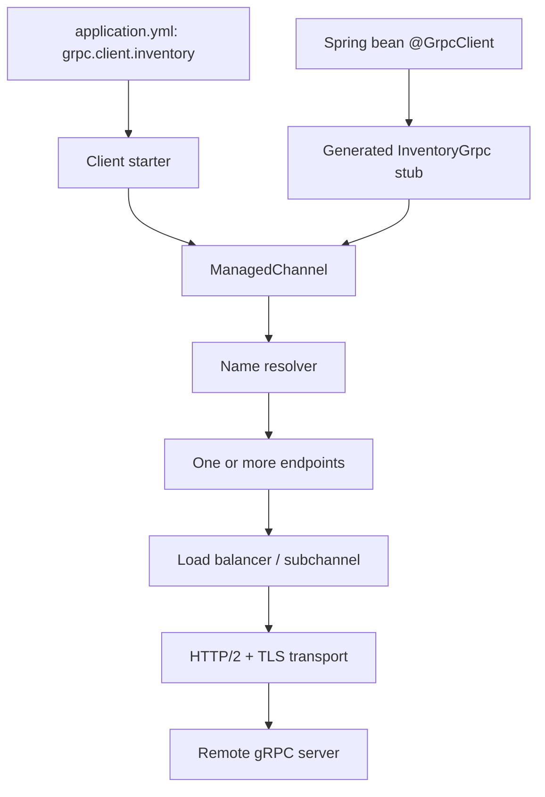
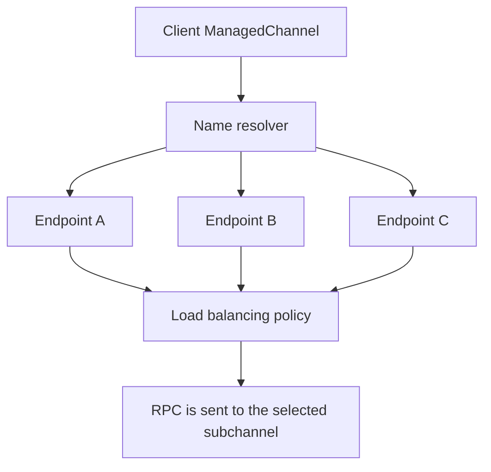

# Configuring Channels to Remote Servers in Spring Boot gRPC

## 1. Why Configure Channels to Remote Servers?

In **SPRING_GRPC**, a service frequently calls multiple other gRPC services over the network: an order service calls inventory, payment calls fraud detection, or an API gateway calls specialized backends. The caller needs a **channel** to locate endpoints, establish HTTP/2 transport, apply TLS, and send RPCs to remote servers.

In gRPC Java, a channel is typically represented by `ManagedChannel`. When using a Spring Boot starter, the application can declare a named client and target in configuration; the starter creates and manages the channel, then provides stubs to Spring beans.

This lesson focuses on configuring **channels to remote servers**:

- Selecting an appropriate target and address scheme: static address, DNS, or service discovery.
- Declaring multiple named channels and injecting the matching stubs.
- Choosing plaintext vs. TLS, configuring trust certificates, and verifying server identity.
- Understanding resolvers, load balancing, channel reuse, and connection timing.
- Testing connectivity from the application to remote servers and diagnosing network errors.

Examples use **`net.devh:grpc-client-spring-boot-starter`**, with the `grpc.client.<name>.*` prefix and `@GrpcClient`. Official Spring gRPC has its own client configuration; follow the documentation for your exact version rather than copying `net.devh` properties.

## 2. Channel, Target, and Stub

Three concepts are often confused:

| Component | Role | Example |
| --- | --- | --- |
| Target | Logical address the client wants to connect to | `static://inventory.internal:9090` |
| Channel (`ManagedChannel`) | Manages name resolution, connections/subchannels, transport, and state | Channel named `inventory` in Spring configuration |
| Stub | Type-safe API generated from Protobuf to call methods on the channel | `InventoryGrpc.InventoryBlockingStub` |

A channel is not a single TCP socket permanently bound to one server. It is a connection-management abstraction: a resolver can resolve a target into one or more addresses; a load balancer picks an appropriate subchannel; the transport establishes and reuses HTTP/2 connections.

A stub is the RPC client class generated from a `.proto` contract. It uses the configured channel to execute methods. A single channel can serve many RPCs and multiple stubs; you never need a new channel per request.



**A channel can be created before any network connection succeeds.** Many implementations connect lazily or establish transport on demand. Therefore, Spring successfully injecting a stub does not prove the remote server is alive. Send an RPC or health check to verify serviceability.

## 3. Naming Clients and Configuring Targets

### 3.1. A Remote Server with a Static Address

With the `net.devh` starter, you can declare in `src/main/resources/application.yml`:

```yaml
grpc:
  client:
    inventory:
      address: "static://inventory.internal:9090"
      negotiationType: TLS
```

In this configuration:

- `inventory` is the logical channel/client name.
- `address` is the target the channel uses.
- `static://inventory.internal:9090` is an illustrative static address using the starter's static scheme.
- `negotiationType: TLS` requires a secure connection; trust certificates must be configured if the environment uses a private CA.

The name `inventory` is reused when injecting a stub via `@GrpcClient("inventory")`. If the annotation name does not match the configuration key, the client may miss the expected endpoint or options.

Never set `localhost` for a service running in another container or machine unless `localhost` actually points to that remote host. In Docker/Kubernetes, `localhost` inside a container usually refers to that container/pod itself.

### 3.2. Using Environment Variables per Deployment

Avoid hardcoding production endpoints in source code. You can use Spring placeholders:

```yaml
grpc:
  client:
    inventory:
      address: "${INVENTORY_GRPC_ADDRESS:static://localhost:9090}"
      negotiationType: PLAINTEXT
```

The default value above is strictly for local development. In staging/production, provide `INVENTORY_GRPC_ADDRESS` with the actual DNS or service address and select appropriate TLS settings. When the environment variable is unset, Spring uses the value after `:`; this is convenient locally, but take care so production does not accidentally run plaintext.

You can separate profiles:

```yaml
# application-local.yml
grpc:
  client:
    inventory:
      address: "static://localhost:9090"
      negotiationType: PLAINTEXT
```

```yaml
# application-prod.yml
grpc:
  client:
    inventory:
      address: "dns:///inventory-grpc.internal:9090"
      negotiationType: TLS
      security:
        trustCertCollection: file:/run/secrets/grpc/inventory-ca.crt
```

Property names in the example belong to `net.devh`; verify your exact version for supported resource formats and security fields. Never store real private keys or tokens in committed configuration files.

### 3.3. Calling Multiple Remote Servers from One Application

Each backend should have its own client name when endpoints or security policies differ:

```yaml
grpc:
  client:
    inventory:
      address: "dns:///inventory-grpc.internal:9090"
      negotiationType: TLS
    payment:
      address: "dns:///payment-grpc.internal:9090"
      negotiationType: TLS
    fraud:
      address: "dns:///fraud-grpc.internal:9090"
      negotiationType: TLS
```

The client name represents the **logical role** of the remote service, not necessarily a Java class name or Protobuf package. That way, endpoints can change via deployment config without touching business code.

Never share a single channel just because services happen to listen on the same port. Each channel needs the target, trust policy, resolver, and connection policy tailored to its remote service.

## 4. Injecting Stubs by Channel Name

Assume Protobuf generated `InventoryGrpc.InventoryBlockingStub`. A Spring gateway can inject the stub:

```java
package dev.example.order.gateway;

import dev.example.inventory.v1.GetStockRequest;
import dev.example.inventory.v1.InventoryGrpc;
import dev.example.inventory.v1.StockReply;
import io.grpc.StatusRuntimeException;
import net.devh.boot.grpc.client.inject.GrpcClient;
import org.springframework.stereotype.Service;

import java.util.concurrent.TimeUnit;

@Service
public class InventoryGateway {
    @GrpcClient("inventory")
    private InventoryGrpc.InventoryBlockingStub inventoryStub;

    public StockReply getStock(String sku) {
        GetStockRequest request = GetStockRequest.newBuilder()
            .setSku(sku)
            .build();

        try {
            return inventoryStub
                .withDeadlineAfter(700, TimeUnit.MILLISECONDS)
                .getStock(request);
        } catch (StatusRuntimeException ex) {
            // The application layer decides how to map the status.
            throw ex;
        }
    }
}
```

`@GrpcClient("inventory")` is a `net.devh` integration annotation. It tells the starter to inject a stub backed by the client configured under the name `inventory`. Because the gateway is a Spring bean, the starter's injection mechanism applies; do not manually instantiate `new InventoryGateway()` at runtime.

This snippet illustrates a blocking stub. The call blocks the thread until a response or error arrives. If the gateway is called from a WebFlux event loop, do not call a blocking stub directly on the event loop; use an async/future stub or offload blocking calls to a dedicated executor.

### Multiple Stubs from One Channel

One channel can back multiple stub types for the same service:

- `InventoryBlockingStub` for synchronous calls.
- `InventoryStub` for callbacks and streaming.
- `InventoryFutureStub` for future-based unary RPCs.

gRPC stubs are typically immutable. Methods such as `withDeadlineAfter(...)` return a derived stub with updated `CallOptions` without mutating the injected base stub. This is how you apply per-RPC deadlines while reusing the channel.

## 5. Choosing Target Schemes and Name Resolvers

A target is more than a `host:port` string. The scheme tells gRPC which address resolution mechanism to use.

| Scheme/Target | Meaning | When to Use |
| --- | --- | --- |
| `static://host:port` | `net.devh` starter's static resolver | A single fixed endpoint, local dev, or simple environments |
| `dns:///host:port` | gRPC Java's DNS name resolver | Service with a DNS name, potentially returning multiple addresses |
| `in-process:name` | In-JVM connection via in-process transport if supported by starter | Integration testing |
| Custom target | Resolver provided by library/infrastructure | Service discovery or specialized routing |

Supported schemes depend on the starter and resolvers available on the runtime classpath. Never assume any valid URI is automatically recognized.

### 5.1. Static Targets

`static://inventory.internal:9090` fits when the client always dials a single known endpoint. It is simple, easy to test, and minimizes discovery dependencies. However, when backends change IPs or scale across multiple instances, ensure the resolver/endpoint stays updated; never hardcode ephemeral pod IPs in source code.

### 5.2. DNS Targets

`dns:///inventory-grpc.internal:9090` instructs the DNS resolver to resolve the hostname. In Kubernetes, an internal Service DNS name stays stable even as backing pods change. Still, DNS results, TTLs, caching, and how the client reacts to endpoint updates depend on the resolver and runtime.

DNS returning multiple addresses **does not automatically mean** the client is round-robin load balancing. gRPC Java also needs a suitable load balancing policy; defaults and service-config support vary by version. When load distribution is required, verify the actual policy with integration/load tests.

### 5.3. Service Discovery

If using Spring Cloud Discovery, Kubernetes DNS, or another registry, clarify which component translates a service name into an endpoint list. Some setups require a dedicated resolver/customizer or integration library; simply adding a discovery dependency does not guarantee gRPC channels automatically use the registry.

Before selecting a resolver, check:

1. Is the logical target stable across instance restarts?
2. Does the resolver return one or multiple addresses?
3. How does the client refresh its endpoint list when pods change?
4. Which policy does the load balancer use to pick endpoints?
5. When one endpoint fails, does the channel fail over to another?
6. How is backend health/readiness reflected in routing?

## 6. TLS and Remote Server Verification

When a channel traverses an untrusted network, TLS is required to encrypt transport and verify server identity. With `net.devh`, an example trust certificate collection configuration is:

```yaml
grpc:
  client:
    inventory:
      address: "dns:///inventory-grpc.internal:9090"
      negotiationType: TLS
      security:
        trustCertCollection: file:/run/secrets/grpc/inventory-ca.crt
```

The path `file:/run/secrets/grpc/inventory-ca.crt` is illustrative only. The CA file must be mounted with proper read permissions at runtime. Check property names and resource loader rules for your exact `net.devh` version.

### What Does TLS Perform?

1. Client and server negotiate TLS over the transport.
2. Client verifies the certificate chain against the trusted CA.
3. Client checks the hostname represented by the certificate, typically via SAN.
4. After the handshake, gRPC exchanges metadata and Protobuf messages over the encrypted connection.

If the client dials `inventory-grpc.internal` but the certificate lacks a matching SAN, the connection can fail even when the CA is trusted. Never disable hostname verification or use trust-all to mask certificate errors; fix the DNS/SAN or trust chain instead.

### mTLS and Call Credentials

One-way TLS primarily lets the client verify the server. When the server must also verify the client, use **mutual TLS (mTLS)**: the client presents its certificate/key and the server validates it against a trust policy. Client certificate and private key properties vary by starter version; consult the documentation before configuring.

Also distinguish:

- **Transport credentials:** protect the connection and verify peers at the TLS layer.
- **Call credentials:** per-RPC authentication credentials, typically attached via `CallCredentials` or an auth interceptor.
- **Authorization:** decides whether the caller may invoke a method or resource, usually enforced by the server.

Never embed bearer tokens in channel addresses or logs. Metadata containing tokens must be protected and transmitted only over encrypted transport.

### PLAINTEXT Is Only for Appropriate Networks

`negotiationType: PLAINTEXT` is useful for local development or isolated test networks. Never use it as the default for production traffic over untrusted networks. If a proxy terminates TLS, confirm whether the hop from the proxy to the backend is encrypted and authenticated.

## 7. Deadlines, Retries, and Connection Lifecycle

### Deadlines Belong to RPCs, Not Channel Lifetimes

A channel can be reused long-term, while each RPC should carry its own deadline. Example:

```java
InventoryGrpc.InventoryBlockingStub call =
    inventoryStub.withDeadlineAfter(700, TimeUnit.MILLISECONDS);

StockReply reply = call.getStock(request);
```

A deadline caps how long the caller waits for a result. It does not automatically guarantee the remote server stops working once the client times out; the server must observe cancellation/deadlines and abort cancellable work.

In an order -> inventory -> database chain, the inventory call's deadline must fit within the remaining time budget of the order request. Never set overly generous per-hop deadlines that cause end-to-end latency to exceed the SLA.

### Retries Must Be Safe

`UNAVAILABLE` can be a transient error due to server restarts, unready endpoints, or dropped connections. However, if a client times out after the server already executed a side effect before the response arrived, retrying could execute the business operation twice.

Only retry when:

- The RPC is idempotent or carries an idempotency key.
- The error code is retryable under a defined policy.
- Attempts are capped with exponential backoff and jitter.
- Total retry duration stays within the caller's deadline.
- Metrics exist to detect retry storms.

Never retry indefinitely, and never retry input errors like `INVALID_ARGUMENT` or authorization errors like `PERMISSION_DENIED`.

### Channel and Connection Reuse

Channels should live for the lifetime of the application or logical client and be reused across many RPCs. Never create a new channel per method call and never close the channel after each response.

When the starter creates a channel, the starter manages its lifecycle and closes it when the Spring context shuts down according to its version behavior. If an application manually creates a channel outside the starter, the application is responsible for calling `shutdown()`, awaiting termination, and force-closing if necessary.

A channel can be in `IDLE`, `CONNECTING`, `READY`, `TRANSIENT_FAILURE`, or `SHUTDOWN` state. Do not use channel state as the sole business health check: `READY` does not guarantee all methods or backend dependencies are working.

## 8. Load Balancing and Multiple Remote Instances

When a service has multiple replicas, the client needs to know which endpoints can accept requests. Two models are common:

**External proxy/load balancer:** the channel connects to a load balancer hostname or virtual IP. The load balancer picks backends according to its policy. Ensure the proxy supports gRPC/HTTP2 and preserves metadata, deadlines, and status codes.

**Client-side load balancing:** the resolver returns an endpoint list to the gRPC client; the client-side load balancer selects a subchannel per RPC. This requires a compatible resolver and policy.



The diagram illustrates client-side resolution conceptually. Not every target or starter enables this model automatically. With the DNS resolver, verify the service config and load-balancing policy; with Kubernetes Services, understand whether traffic is balanced at the TCP layer or the gRPC layer and how long-lived HTTP/2 connections behave.

Things to verify when multiple replicas exist:

- Does DNS/the resolver return the expected endpoint list?
- How does the resolver refresh when endpoints change?
- What is the default policy, and is your desired policy supported?
- Does the channel evict failing subchannels or fail over to healthy endpoints?
- Does a long-lived HTTP/2 connection pin traffic to a single backend?
- Do health/readiness states affect the endpoint list?

## 9. Customizing Channels and Interceptors

Sometimes you need a client interceptor to attach trace context, request IDs, auth metadata, or metrics. Some `net.devh` versions support registering global client interceptors, per-client interceptors, or channel customizers. Use the extension points documented for your version; never create a second channel just to attach an interceptor.

Plain gRPC Java example for a derived stub with request ID metadata:

```java
Metadata.Key<String> requestIdKey = Metadata.Key.of(
    "x-request-id",
    Metadata.ASCII_STRING_MARSHALLER
);

Metadata headers = new Metadata();
headers.put(requestIdKey, "order-847");

InventoryGrpc.InventoryBlockingStub callStub = inventoryStub
    .withInterceptors(
        MetadataUtils.newAttachHeadersInterceptor(headers)
    )
    .withDeadlineAfter(700, TimeUnit.MILLISECONDS);

StockReply reply = callStub.getStock(request);
```

This snippet attaches metadata to a call using a derived stub. For request IDs or tokens that vary per caller, never store values in a singleton interceptor in a way that leaks data across requests. Use per-call context/credentials and control interceptor ordering.

### Keepalive and Message Limits

Channels may require tuning keepalive, inbound message size, metadata size, executors, or other transport parameters. Enable tuning only for measured operational needs:

- Keepalive detects dead connections, though pinging too aggressively can trigger server/proxy rate limits.
- Keepalive does not replace RPC deadlines or health checks.
- Message size limits protect memory; align them with valid application protobuf sizes.
- Raising limits excessively increases memory pressure risk.
- Executors must handle concurrency without thread starvation.

Exact properties/customizers vary by starter and version. Start with defaults, measure under realistic load, then tune one parameter at a time while watching metrics.

## 10. Testing Channels to Remote Servers

### 10.1. Smoke Testing with grpcurl

If the remote server publishes the `inventory.proto` contract, you can test it directly:

```bash
grpcurl \
  -import-path src/main/proto \
  -proto inventory.proto \
  -d '{"sku":"SKU-001"}' \
  inventory-grpc.internal:9090 \
  inventory.v1.Inventory/GetStock
```

The command omits `-plaintext` because the example assumes the endpoint uses TLS by default. If a private CA is required, pass the appropriate CA trust option to `grpcurl`; never skip certificate verification. For local plaintext test endpoints, pass `-plaintext`.

Smoke testing separates DNS/TCP/TLS issues from RPC method issues, though it does not prove Spring Boot injected the right channel.

### 10.2. Integration Testing via the Spring Boot Client

A solid integration test should:

1. Load the Spring Boot context with `grpc-client-spring-boot-starter`.
2. Configure a test target supported by the client starter, such as an in-process server when appropriate.
3. Inject the gateway or stub just like in production.
4. Execute an RPC and verify the response/status.
5. Shut down the test server and channels in proper order.

For TCP tests, use dynamic ports or an isolated test container/server to avoid port collisions in parallel CI runs. In-process tests do not verify DNS, TLS handshakes, network proxies, or port mappings; production systems therefore still need network integration tests covering those layers.

### 10.3. Testing TLS and Endpoint Discovery

In staging/test environments:

- Valid certificate, matching hostname, and trusted CA: RPC succeeds.
- Untrusted CA: handshake fails.
- SAN mismatch against hostname: peer verification fails.
- DNS pointing to a non-existent endpoint: resolver/connectivity error is recorded.
- One of several replicas stops: observe the resolver/load balancer shifting traffic per policy.
- Server restart or rolling update: client handles retries/cancellation according to deadlines and idempotency.

Never use production credentials or private keys in test suites; use dedicated certificates and secrets for test environments.

## 11. Diagnosing Remote Connection Errors

| Symptom | Common Cause | Investigation Path |
| --- | --- | --- |
| Stub injection fails | Wrong `@GrpcClient` name, missing starter, or bean not managed by Spring | Check bean, dependencies, and client name |
| `UNAVAILABLE` | Wrong host/port, DNS, server down, proxy, or firewall | Check target, DNS lookup, TCP reachability, and server logs |
| `UNAUTHENTICATED` | Missing or invalid credentials | Check token/call credentials and auth policy |
| TLS handshake failure | CA, certificate chain, SAN, SNI, or negotiation mismatch | Inspect certificate and exact hostname dialed by client |
| `UNIMPLEMENTED` | Method/service missing on server or contract mismatch | Compare package/service/method in `.proto` |
| `DEADLINE_EXCEEDED` | Slow backend or deadline too short | Measure latency, dependencies, and deadline budget |
| Client only hits one replica | Resolver/policy not distributing or channel/proxy pins connection | Inspect endpoint list, load-balancing policy, and proxy |
| Fails only inside container | Misused `localhost`, DNS, or network policy | Verify address inside container network namespace |
| New config has no effect | Overridden by profile/ENV/command line, or channel already created | Check effective properties and lifecycle restart |

Investigate in this order:

1. **Client name:** Does `@GrpcClient("inventory")` match `grpc.client.inventory`?
2. **Target:** Are scheme, hostname, and port correct from the app's runtime environment?
3. **Resolver:** Is the scheme supported at runtime and does DNS resolve?
4. **Transport:** Do plaintext/TLS, HTTP/2, CA, and hostname align?
5. **RPC:** Did the server register the exact full method name, metadata, and status?
6. **Timing:** Is the deadline sufficient for network and backend latency?
7. **Routing:** With multiple replicas, do the resolver and load balancer pick healthy endpoints?

## 12. Practice Exercise

Use a Spring Boot application calling two simulated remote gRPC services, `inventory` and `payment`:

1. Configure two client names with local targets on different ports; inject each stub into a separate gateway.
2. Switch `inventory.address` to a DNS target and verify the resolver resolves the hostname properly.
3. Test a target with an invalid port, observe the connection error, and verify the RPC enforces a deadline.
4. Switch `inventory` to TLS with a test CA; test a valid certificate, wrong CA, and mismatched hostname.
5. Configure multiple test endpoints and verify that a load-balancing policy actually takes effect rather than relying solely on DNS returning multiple IPs.
6. Attach request ID/tracing metadata per RPC and verify the server receives the expected context.
7. Run an integration test through the Spring context to verify channel/stub injection; add a network test to verify TLS and DNS.
8. Observe status codes, latency, retry counts, and selected endpoints when one replica stops.

Learners who finish this lesson can explain **how a target resolves to endpoints, how channels are reused, how TLS verifies remote servers, and how resolvers/load balancers influence backend selection**. These skills help Spring Boot applications connect to remote gRPC servers securely, configurably per environment, and resiliently as backends change.
