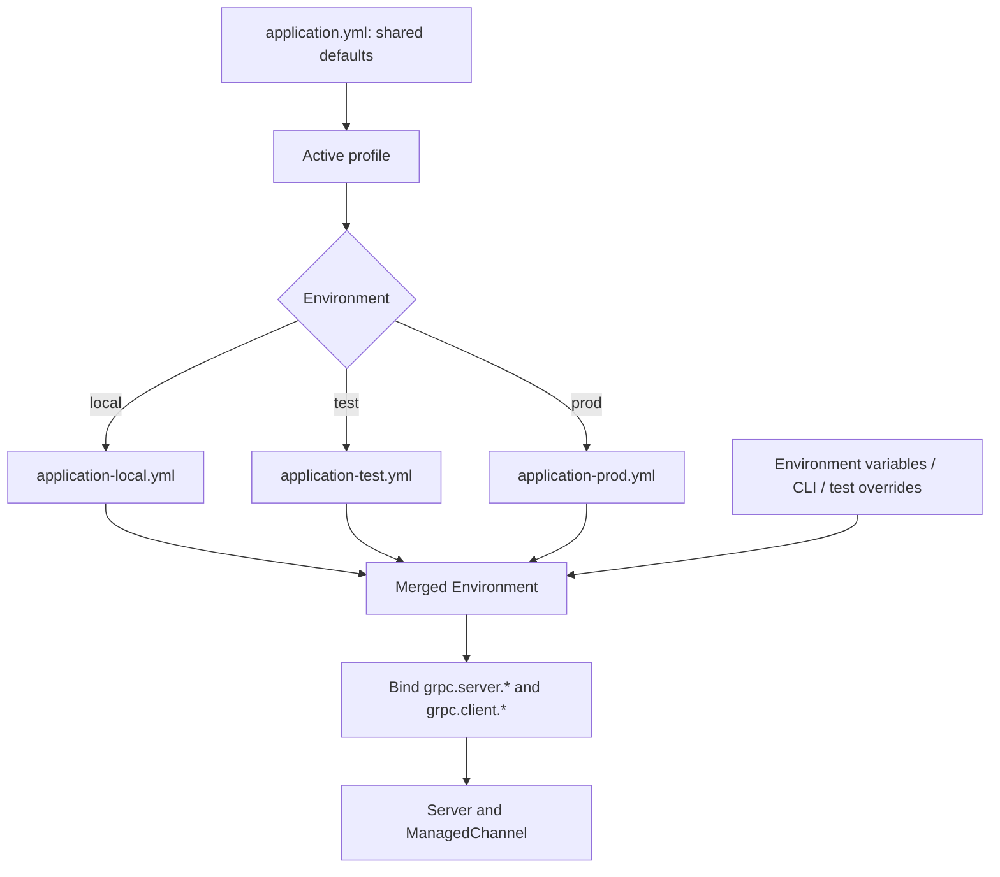

# Profiles for Local, Test, and Production in Spring Boot gRPC

## 1. Goals and Scope

A **SPRING_GRPC** application typically runs across multiple environments: local for development, test for integration verification, and production for serving live traffic. Each environment may use different ports, remote targets, TLS certificates, secrets, and operational policies.

Spring Boot **profiles** let you select environment-specific configuration without modifying code or building separate artifacts. For gRPC, profiles typically control:

- The gRPC server's port and listener properties.
- Each gRPC client's target, resolver, and endpoint.
- Whether to use plaintext in an isolated local network or TLS/mTLS in production.
- How connections are tested: in-process server vs. TCP server.
- Stubbed/mock beans dedicated to local/test versus real beans in production.

This lesson focuses on organizing profiles and controlling gRPC configuration per environment. Examples use **`net.devh:grpc-server-spring-boot-starter`** and **`net.devh:grpc-client-spring-boot-starter`**, with the `grpc.server.*` and `grpc.client.<name>.*` prefixes. If your project uses official Spring gRPC, check the property names and extension points for that exact version.

## 2. Profiles and How Spring Boot Merges Configuration

Spring Boot loads shared settings from `application.yml` and active profile settings from files such as `application-local.yml`, `application-test.yml`, or `application-prod.yml`. Profile-specific settings can override shared values. Higher-precedence sources such as environment variables, command-line arguments, and test property sources can also override effective values.



Distinguish the following:

- **Profiles select configuration**; they do not create servers or clients by themselves. Starters, auto-configuration, and service beans must still be present.
- **`@Profile` selects Java beans or configuration classes** based on active profiles.
- **Property sources decide the final value.** If the port differs from a YAML file, check active profiles and overriding sources.
- Multiple profiles can be active simultaneously, though you should avoid combining conflicting profiles such as `local` and `prod`.
- Never set `spring.profiles.active` inside a profile-specific file such as `application-prod.yml`. Select the profile via runtime environment, command line, or top-level configuration.

## 3. Organizing application.yml and Profiles

### 3.1. Shared Configuration

Keep only truly shared defaults in `application.yml`:

```yaml
spring:
  application:
    name: inventory-grpc
```

Do not place local endpoints, plaintext defaults, production certificates, or environment-specific secrets here. That prevents production from accidentally inheriting local targets or insecure transport settings.

### 3.2. Local: application-local.yml

Suppose the application's server listens on port 9090, while another inventory server runs locally on port 9091:

```yaml
grpc:
  server:
    port: 9090
  client:
    inventory:
      address: "static://localhost:9091"
      negotiationType: PLAINTEXT
```

This configuration assumes the inventory server has been started separately. If the client calls a server in the same application, the target must match that server's port; if calling another container, use the container/service hostname instead of `localhost`.

Plaintext is suitable only for loopback or isolated development networks. Never use local settings as production defaults.

### 3.3. Test: application-test.yml

If integration tests run client and server inside the same JVM, you can use the in-process transport when supported by the starter:

```yaml
grpc:
  server:
    port: -1
    inProcessName: inventory-test
  client:
    inventory:
      address: "in-process:inventory-test"
```

In `net.devh` versions that support it, `port: -1` disables the TCP listener and `inProcessName` names the in-memory server; the client uses the matching in-process target. This configuration is strictly for tests, never real deployments.

Verify exact property names and the in-process scheme against your starter version. If unsupported, use a TCP test server with a dynamic port allocated by the test environment and pass the actual target to the client. Avoid hardcoding a fixed port when CI runs tests in parallel.

### 3.4. Production: application-prod.yml

Production typically needs a deployment-provided port, server TLS, and TLS for client connections to the remote inventory service:

```yaml
grpc:
  server:
    port: ${GRPC_SERVER_PORT:9090}
    security:
      enabled: true
      certificateChain: file:${GRPC_SERVER_CERT_PATH}
      privateKey: file:${GRPC_SERVER_KEY_PATH}
  client:
    inventory:
      address: ${INVENTORY_GRPC_TARGET}
      negotiationType: TLS
      security:
        trustCertCollection: file:${INVENTORY_GRPC_CA_PATH}
```

Placeholders are supplied via environment variables or deployment secret mounts. There are no defaults for certificates, private keys, CAs, or remote targets: if required configuration is missing, the application should fail fast on startup so misconfigurations are caught early.

The `file:` paths and property names are `net.devh` examples; verify them against your exact version. Private keys must never be committed to the repository or written to logs. Mount secrets with minimal read permissions and maintain a certificate rotation process.

## 4. Activating Profiles at Runtime

Select a profile via command-line argument:

```bash
java -jar inventory-grpc.jar --spring.profiles.active=local
```

Or via environment variable on Linux/macOS:

```bash
SPRING_PROFILES_ACTIVE=prod java -jar inventory-grpc.jar
```

In PowerShell:

```powershell
$env:SPRING_PROFILES_ACTIVE = "local"
java -jar inventory-grpc.jar
```

In Docker/Kubernetes, profiles are commonly passed via environment variables or deployment manifests:

```yaml
env:
  - name: SPRING_PROFILES_ACTIVE
    value: "prod"
  - name: GRPC_SERVER_PORT
    value: "9090"
```

This is a container spec excerpt, not a complete Deployment. The `prod` profile only selects the configuration file; `GRPC_SERVER_CERT_PATH`, `GRPC_SERVER_KEY_PATH`, `INVENTORY_GRPC_TARGET`, and `INVENTORY_GRPC_CA_PATH` must still be supplied from appropriate secrets/configs.

Never bake `SPRING_PROFILES_ACTIVE=prod` into a Docker image if the same image is deployed to local, test, and staging environments. Let the deployment environment choose the profile so the artifact remains reusable.

## 5. Using @Profile for Environment-Specific Beans

YAML files suit ports, targets, and starter properties. When Java behavior needs to vary per environment, use `@Profile`.

Example stubbed bean strictly for local use:

```java
@Configuration
@Profile("local")
public class LocalInventoryConfiguration {
    @Bean
    InventoryLookup localInventoryLookup() {
        return sku -> OptionalInt.of(5);
    }
}
```

Production implementation backed by a real repository:

```java
@Configuration
@Profile("prod")
public class ProductionInventoryConfiguration {
    @Bean
    InventoryLookup productionInventoryLookup(
            InventoryRepository repository) {
        return repository::findAvailableQuantity;
    }
}
```

Both configurations provide the same `InventoryLookup` bean type, yet only the one matching the active profile is loaded. If no matching profile is active, Spring fails at startup with a missing dependency error. That is usually safer than silently using a fake implementation in production.

Never use `@Profile` to mask missing security configuration. TLS, trust stores, and production targets must be configured explicitly; missing required variables must never fall back to plaintext.

## 6. How Profiles Control the gRPC Server and Client

### Server

With `net.devh`, `grpc.server.*` controls the server managed by the server starter:

| Config Group | Local | Test | Production |
| --- | --- | --- | --- |
| Port | Fixed convenient port | In-process or dynamic TCP port | Deployment-assigned port |
| TLS | Plaintext allowed on loopback | In-process or test certificates | TLS/mTLS per trust policy |
| Bind address | Loopback if local-only | Test-internal | Appropriate container/network interface |
| Health | Manual checks acceptable | Assertions in tests | Readiness and gRPC health if implemented |
| Logging | Detailed for development | Enough for diagnostics | Controlled, no sensitive data leaked |

Property names and field support vary by starter/version. Do not assume all starters share the same configuration schema.

### Client

The `grpc.client.<name>.*` prefix lets a single application configure multiple remote clients. For example, `inventory` and `payment` with separate endpoints and trust policies:

```yaml
grpc:
  client:
    inventory:
      address: ${INVENTORY_GRPC_TARGET}
      negotiationType: TLS
      security:
        trustCertCollection: file:${INVENTORY_GRPC_CA_PATH}
    payment:
      address: ${PAYMENT_GRPC_TARGET}
      negotiationType: TLS
      security:
        trustCertCollection: file:${PAYMENT_GRPC_CA_PATH}
```

You do not need separate Java `@Profile` classes per remote service when only targets or CA paths differ; profile/environment properties usually suffice. Only create separate bean configurations when behavior or extension points differ.

A gateway can use a stable client name independent of the environment:

```java
@Service
public class InventoryGateway {
    @GrpcClient("inventory")
    private InventoryGrpc.InventoryBlockingStub stub;

    public StockReply getStock(String sku) {
        return stub.withDeadlineAfter(700, TimeUnit.MILLISECONDS)
            .getStock(GetStockRequest.newBuilder()
                .setSku(sku)
                .build());
    }
}
```

Business code does not need to know whether it is running locally or in production. The profile decides the target and transport used by the channel. The `@GrpcClient` annotation here belongs to `net.devh`; official Spring gRPC has its own client injection mechanism.

## 7. Combining Profiles, Profile Groups, and Property Precedence

Spring Boot allows activating multiple profiles, such as `prod,observability`. When multiple profile files define the same property, profile order and property source precedence determine the final value. This is helpful for separating environment settings from feature flags, but dangerous if `local` and `prod` are enabled together.

Practical guidelines:

- Choose one primary environment profile: `local`, `test`, `staging`, or `prod`.
- Use profile groups when one profile should activate additional functional configurations.
- Never declare `spring.profiles.active` inside a profile-specific file.
- Never put plaintext fallback defaults for production in shared configuration.
- Avoid defining the same property in multiple places without a clear reason.
- Log the active profile and resolved endpoints, but never log secrets.
- For mandatory production targets/certificates, omit defaults that could cause the app to silently connect to local endpoints.

Example profile group declared in base configuration:

```yaml
spring:
  profiles:
    group:
      production:
        - prod
        - observability
```

When started with `--spring.profiles.active=production`, Spring activates the profiles in the group. Define the group in base configuration, not inside a profile-specific file activated by that same group.

Exact precedence can be affected by test property sources, command-line arguments, system properties, and environment variables. When troubleshooting, inspect the effective bound value and its property source rather than guessing from filenames alone.

## 8. Testing Profile-Based Configuration

### 8.1. Selecting a Test Profile

Spring Test lets you choose profiles when building the test context:

```java
@SpringBootTest
@ActiveProfiles("test")
class InventoryGrpcIntegrationTest {
    // Inject gateway/stub and call RPC over the test transport.
}
```

The test loads `application-test.yml` alongside shared configuration. If using an in-process server, verify the starter supports that target and server name. If the test needs TLS, use dedicated test certificates instead of disabling certificate verification.

### 8.2. Verifying What Actually Matters

Do not merely assert that the Spring context starts. Verify:

1. The `test` profile is actually active.
2. Server port/transport values match the test configuration.
3. Client targets point to the test server, never accidentally hitting production.
4. RPCs execute and return expected responses/statuses.
5. Test servers and channels are released after tests finish.
6. No production secrets or credentials exist in the test context.

In-process tests verify Spring wiring, stubs, and RPC handlers, but do not test DNS, TCP, TLS handshakes, or proxies. Therefore, if production uses TLS or service discovery, add network integration tests or staging smoke tests.

### 8.3. Checking Effective Values

When a profile is selected yet the endpoint is wrong, inspect:

- `Environment.getActiveProfiles()` to confirm active profiles.
- Merged values of `grpc.client.inventory.address` and `grpc.server.port`.
- Which property source supplied the final value.
- Whether environment variables or command-line arguments overrode the profile file.

Spring Boot Actuator can expose `env` or `configprops` endpoints if enabled, but restrict access strictly since those endpoints can reveal configuration details. Never expose administrative endpoints or secret values to the public Internet.

## 9. Diagnosing Common Failures

| Symptom | Possible Cause | Resolution |
| --- | --- | --- |
| Works locally, `UNAVAILABLE` in production | Wrong production target, DNS/network policy, or port mapping | Check resolved target, DNS, and reachability from the pod |
| TLS handshake error in production | Mismatched CA, SAN, certificate chain, or TLS termination | Check certificate and trust policy for that exact endpoint |
| Test hits local or production server by mistake | Test profile not active or property overridden | Check active profiles and effective target |
| No gRPC listener in tests | Test config disables TCP listener while test uses TCP channel | Use in-process target or enable an appropriate test TCP port |
| Port ignores profile setting | Profile file not loaded or overridden by env/CLI | Check active profiles and property sources |
| Production accidentally uses plaintext | Inherited shared default | Remove plaintext fallback; explicitly configure TLS in `prod` |
| Spring fails to create business bean | `@Profile` does not match active profiles | Check annotations and active profiles |
| Multiple beans of the same type | Multiple profiles/configs create implementations or profiles overlap | Pick clear profiles or use qualifiers/conditions |
| Profile group does not work | Group declared in the wrong file or wrong profile activated | Place group in base config and check active profiles |

## 10. Deployment Checklist

1. Reserve `application.yml` for the application name and truly shared defaults.
2. Put local endpoints and loopback plaintext settings in `application-local.yml`.
3. Put in-process or test-server targets in `application-test.yml`.
4. Put remote targets, TLS, and mandatory secret paths in `application-prod.yml`.
5. Select the profile from the runtime environment, never hardcoded in the artifact.
6. Run integration tests with `@ActiveProfiles("test")`, confirming clients never target the wrong environment.
7. Before deploying, verify production environment variables/secrets are provisioned and certificates are valid.
8. After deploying, smoke-test RPCs over the real DNS/port/TLS path and monitor status codes and latency.

Profiles must make the active environment and its corresponding gRPC connection policy unmistakable. Local prioritizes fast iteration, test prioritizes isolation and reproducibility, and production prioritizes stable endpoints, TLS, secret management, and observability. Service and client code can stay identical; environment configuration determines how channels and transports are constructed.
