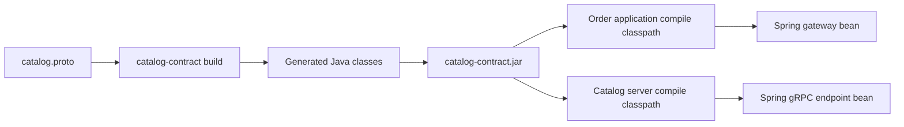

# Beans Depending on Generated Types in Spring Boot gRPC

## 1. How Do Generated Types Enter Spring Beans?

In **SPRING_GRPC**, Protocol Buffers contracts are compiled into Java classes. A Spring Boot application uses those classes to represent requests/responses, invoke RPCs via stubs, or implement services by extending generated base classes. When a Spring bean uses these types, it has a **compile-time dependency** on generated code; if it calls a remote gRPC server, it also needs a stub bound to a runtime channel.

Distinguish three concerns:

1. **Code generation:** `protoc` and the gRPC Java plugin generate message classes, service base classes, and client stubs.
2. **Java dependency:** the application module needs the generated classes on its compile classpath to resolve imports and method signatures.
3. **Spring dependency injection:** Spring creates application beans, and the gRPC starter provides stubs or registers service implementations according to the starter's mechanism.

A generated type does not automatically become a Spring bean just because it was generated or sits on the classpath. A message such as `ProductRequest` is a data object; a stub such as `CatalogBlockingStub` is a client API bound to a channel; only a service implementation extending `CatalogImplBase` is registered as an endpoint.

This lesson focuses on organizing these dependencies in the Spring `ApplicationContext`, injecting stubs and registering services, module boundaries, and common errors.

**Illustrative APIs:** `net.devh:grpc-client-spring-boot-starter` and `net.devh:grpc-server-spring-boot-starter`, using `@GrpcClient` and `@GrpcService`. If your project uses official Spring gRPC, replace the integration points with the corresponding version's API.

## 2. Common Generated Types

From a single `catalog.proto` file, the plugin can generate several kinds of Java types:

| Generated Type | Role | How It Is Used in Spring |
| --- | --- | --- |
| `ProductRequest`, `ProductReply` | Protobuf messages for requests/responses | Instantiated per method call and passed/received over RPC |
| `CatalogGrpc.CatalogBlockingStub` | Synchronous client stub | Injected into a gateway bean via the starter |
| `CatalogGrpc.CatalogStub` | Asynchronous/streaming client stub | Injected when callbacks or streaming are needed |
| `CatalogGrpc.CatalogFutureStub` | Future-based client stub for supported unary RPCs | Injected when a future API is needed |
| `CatalogGrpc.CatalogImplBase` | Base class for server-side method implementations | Concrete subclass becomes the gRPC service bean |
| Method descriptors | Describe RPC names and types at runtime | Used by generated code; typically not registered as Spring beans |

A generated type is a **Java type you can import and use**, not a Spring component. Specifically:

- Never put `@Component` on a generated message class.
- Never declare a singleton bean for `ProductRequest` or `ProductReply`.
- Never construct a stub via internal constructors or hold a separate `ManagedChannel` when the starter already manages channels.
- Never edit generated sources; update the `.proto` contract and regenerate code.

## 3. Protobuf Contract and Generated Java Names

Example `src/main/proto/catalog.proto`:

```proto
syntax = "proto3";

package catalog.v1;

option java_package = "dev.example.catalog.v1";
option java_multiple_files = true;

service Catalog {
  rpc GetProduct(ProductRequest) returns (ProductReply);
}

message ProductRequest {
  string sku = 1;
}

message ProductReply {
  bool found = 1;
  string sku = 2;
  string name = 3;
}
```

With `java_multiple_files = true`, messages are typically generated as top-level Java classes in package `dev.example.catalog.v1`, such as:

- `dev.example.catalog.v1.ProductRequest`
- `dev.example.catalog.v1.ProductReply`
- `dev.example.catalog.v1.CatalogGrpc`

Without `java_multiple_files`, messages may be nested inside an outer class generated by `protoc`. Always derive Java packages and class names from the actual Protobuf options rather than guessing from the filename.

Two namespaces serve different purposes:

| Declaration | Purpose |
| --- | --- |
| `package catalog.v1;` | Service/method name on the gRPC wire |
| `option java_package = "...";` | Java package of generated sources |
| `option java_multiple_files = true;` | Layout of generated message classes in Java |

The full RPC name in this example is `catalog.v1.Catalog/GetProduct`; it does not change when you change the Java package. When changing the `.proto` package/service, evaluate compatibility and update clients and servers accordingly.

## 4. Generated Code Must Be on the Compile Classpath

Spring cannot inject a Java type that the application module cannot compile against. Before considering `ApplicationContext`, generated sources or an artifact containing generated classes must be wired into the build.

A Gradle module can declare the core runtime libraries:

```groovy
dependencies {
    implementation platform("io.grpc:grpc-bom:GRPC_VERSION")
    implementation "com.google.protobuf:protobuf-java:PROTOBUF_VERSION"
    implementation "io.grpc:grpc-protobuf"
    implementation "io.grpc:grpc-stub"

    implementation "net.devh:grpc-client-spring-boot-starter:NET_DEVH_VERSION"
}
```

Strings like `*_VERSION` are placeholders to replace with compatible versions. The Protobuf plugin and `protoc-gen-grpc-java` configuration must generate sources before the Java compile step. The snippet above only highlights relevant dependencies, not a complete build script.

Two module layouts are common:

**Generate code in the same module:** the application module holds `.proto`, the plugin generates Java files into a build-managed source set, and beans import generated types directly.

**Use a dedicated contract module:** a `catalog-contract` module generates and packages classes into a JAR; client/server modules depend on that JAR. This suits multiple applications sharing one contract.



When using a separate contract artifact, clients and servers must coordinate schema versions per release policy. Avoid both depending on a generated JAR and regenerating the same package/classes inside the application module, as that causes duplicate classes or unpredictable runtime classloading.

## 5. Client Beans Depending on a Generated Stub

On the client side, a Spring bean typically acts as a gateway. The gateway converts business data into a Protobuf request, calls the generated stub, and maps the response into types expected by the rest of the application.

Channel configuration in the `net.devh` example:

```yaml
grpc:
  client:
    catalog:
      address: "static://catalog.internal:9090"
      negotiationType: TLS
```

The name `catalog` is the client name. It must match the name in `@GrpcClient("catalog")`.

Bean example:

```java
package dev.example.order.gateway;

import dev.example.catalog.v1.CatalogGrpc;
import dev.example.catalog.v1.ProductReply;
import dev.example.catalog.v1.ProductRequest;
import io.grpc.StatusRuntimeException;
import net.devh.boot.grpc.client.inject.GrpcClient;
import org.springframework.stereotype.Service;

import java.util.Optional;
import java.util.concurrent.TimeUnit;

@Service
public class CatalogGateway {
    @GrpcClient("catalog")
    private CatalogGrpc.CatalogBlockingStub catalogStub;

    public Optional<Product> findProduct(String sku) {
        ProductRequest request = ProductRequest.newBuilder()
            .setSku(sku)
            .build();

        try {
            ProductReply reply = catalogStub
                .withDeadlineAfter(600, TimeUnit.MILLISECONDS)
                .getProduct(request);

            if (!reply.getFound()) {
                return Optional.empty();
            }

            return Optional.of(
                new Product(reply.getSku(), reply.getName())
            );
        } catch (StatusRuntimeException ex) {
            throw ex;
        }
    }
}
```

`Product` is an application domain type, not a generated Protobuf message. The example assumes it is already defined in the business module. Mapping responses to domain objects reduces coupling between the rest of the application and the wire schema.

Key points to understand:

- `@GrpcClient("catalog")` is a `net.devh` integration annotation, not a Spring Framework or plain gRPC Java annotation.
- `CatalogBlockingStub` is a generated type, while the runtime instance is created/bound by the starter to the configured channel.
- `CatalogGateway` is a Spring bean thanks to `@Service`; the starter processes injection on that bean.
- Never instantiate `new CatalogGateway()` at runtime, because objects created outside Spring do not receive injection.
- Never create a new channel per call. Reuse the starter-managed stub/channel and create derived stubs for per-call deadlines/options.

If the gateway runs inside a WebFlux event loop, never invoke a blocking stub directly on the event loop. Use an async/future stub or offload blocking work to an appropriate executor.

## 6. Server Beans Extending a Generated Service Base Class

On the server side, extend the generated base class to implement methods declared in `.proto`. The concrete implementation is registered as both a Spring bean and a gRPC service.

Example:

```java
package dev.example.catalog.endpoint;

import dev.example.catalog.application.ProductCatalog;
import dev.example.catalog.domain.Product;
import dev.example.catalog.v1.CatalogGrpc;
import dev.example.catalog.v1.ProductReply;
import dev.example.catalog.v1.ProductRequest;
import io.grpc.Status;
import io.grpc.stub.StreamObserver;
import net.devh.boot.grpc.server.service.GrpcService;

import java.util.Optional;

@GrpcService
public class CatalogGrpcEndpoint
        extends CatalogGrpc.CatalogImplBase {

    private final ProductCatalog productCatalog;

    public CatalogGrpcEndpoint(ProductCatalog productCatalog) {
        this.productCatalog = productCatalog;
    }

    @Override
    public void getProduct(
            ProductRequest request,
            StreamObserver<ProductReply> responseObserver) {

        String sku = request.getSku().trim();
        if (sku.isEmpty()) {
            responseObserver.onError(
                Status.INVALID_ARGUMENT
                    .withDescription("sku must not be blank")
                    .asRuntimeException());
            return;
        }

        Optional<Product> product = productCatalog.findBySku(sku);
        if (product.isEmpty()) {
            responseObserver.onNext(
                ProductReply.newBuilder().setFound(false).build()
            );
            responseObserver.onCompleted();
            return;
        }

        Product value = product.get();
        ProductReply reply = ProductReply.newBuilder()
            .setFound(true)
            .setSku(value.sku())
            .setName(value.name())
            .build();

        responseObserver.onNext(reply);
        responseObserver.onCompleted();
    }
}
```

Here `CatalogGrpcEndpoint` is both the concrete Spring bean and the gRPC service implementation. `CatalogImplBase` is only the generated base class; you do not register it as a separate bean. Constructor injection keeps business dependencies explicit and makes the endpoint easier to test.

For unary RPCs, the handler emits one response via `onNext()` and finishes with `onCompleted()`. On error, call `onError()` and emit no further terminal events. Generated messages are built per call; never hold a shared mutable builder in a singleton endpoint field.

## 7. Message Types Are Not Beans and Must Not Hold Singleton State

Protobuf Java messages are immutable value objects once built. They work well as method parameters, local variables, or return values. However, the builder used to construct a message is mutable; never share a builder across concurrent RPCs.

Recommended pattern:

```java
ProductRequest request = ProductRequest.newBuilder()
    .setSku(sku)
    .build();
```

Pattern to avoid in singleton beans:

```java
// Never share a mutable builder across multiple calls.
private final ProductRequest.Builder sharedBuilder =
    ProductRequest.newBuilder();
```

If multiple requests mutate the same builder concurrently, fields can be overwritten or mixed up. Creating a fresh builder per call is simple and safe.

Similarly, never inject a `ProductReply` or `ProductRequest` as a singleton bean just to "reuse" it. Messages represent per-invocation data, not Spring-managed dependencies. When defaults are needed, use a factory or build a fresh message from a builder.

## 8. Module Boundaries and Generated Artifact Compatibility

When multiple Spring services share generated types, a dedicated contract module keeps code generation consistent:

- Only one module is responsible for generating and publishing the contract artifact.
- Clients and servers declare dependencies on the selected contract version.
- Never let multiple modules independently generate the same packages/classes from different `.proto` copies.
- Upgrade contract versions in a controlled manner; verify wire compatibility before deploying skewed versions.
- Never edit generated sources to add Spring annotations or business logic.

If generated types need custom annotations or application-specific behavior, create adapter/domain types or configure the generator appropriately; never edit generated files directly because changes are wiped on regeneration.

Generated message types should also not become the entire domain model when wire schemas and business logic evolve on different lifecycles. Gateways and endpoints can translate between Protobuf DTOs and domain objects to reduce coupling.

## 9. Testing Dependencies on Generated Types

Test across layers:

| Test Type | What It Proves | What It Does Not Prove |
| --- | --- | --- |
| Compile/code generation | `.proto` generates expected classes and module imports compile | Spring injected stubs or registered endpoints |
| Mapping unit test | Bean converts domain <-> Protobuf properly | Real channel/transport works |
| Spring context test | Beans are created and Spring dependencies injected | RPCs are routed through the server |
| gRPC integration test | Generated stub invokes the right service/method and receives status/response | Production DNS/TLS/proxies if using in-process |
| Network test | Channel, TLS, and remote endpoint work over test network | Large-scale production load behavior |

For client beans using `@GrpcClient`, integration tests should load the Spring context and call through the real gateway. Use an in-process server if supported by the starter/version; otherwise spin up a test server on a dynamic TCP port. Never use hardcoded ports in parallel CI runs.

For server beans, tests must confirm both that Spring created the implementation and that the gRPC server registered the method. Simply verifying `@Autowired CatalogGrpcEndpoint` succeeds does not prove the method is bound; invoke the RPC using a generated stub to verify the full path.

## 10. Diagnosing Common Failures

| Symptom | Fault Layer | How to Check |
| --- | --- | --- |
| `ProductRequest` or `CatalogGrpc` missing at compile time | Code generation / compile classpath | Check `.proto`, plugin, generated sources, and contract dependency |
| `package dev.example.catalog.v1 does not exist` | Generated Java package differs from import | Compare `java_package`, `java_multiple_files`, and actual package |
| Client bean/stub not injected | Spring/starter wiring | Check if bean is in `ApplicationContext`, starter present, `@GrpcClient` name matches property |
| Stub exists but RPC returns `UNAVAILABLE` | Channel/transport | Check target, DNS, port, TLS, and server readiness |
| RPC returns `UNIMPLEMENTED` | Service registration or contract | Check endpoint registration and full service/method name |
| Duplicate classes across modules | Module dependencies / code generation | Use a single source of generated artifacts per package/version |
| Request builder produces corrupted data under concurrency | State management in bean | Create local builders per RPC; never share mutable builders |
| Spring fails to create endpoint | Component scan / annotation | Check starter-matching `@GrpcService`, scan scope, and business dependency beans |
| Compiles cleanly, context fails at startup | Spring dependency injection | Inspect constructor dependencies, conditions, and bean ambiguity |

Investigating in order separates compile-time issues from runtime issues:

1. Are generated sources built and present on the compile classpath?
2. Do imports match `java_package` and class layout options?
3. Is the application bean created by Spring?
4. Are stubs/services registered using the right starter API for your version?
5. Can the channel connect to the remote server?
6. Do the RPC method, request schema, and status match?

## 11. Implementation Workflow

1. Define `.proto` and align on `java_package` and wire service/package names.
2. Generate code in the same module or publish a dedicated contract artifact.
3. Declare dependencies so generated types appear on the compile classpath.
4. Treat message classes as plain data; instantiate a fresh builder per request.
5. Inject generated stubs into gateway beans via the client starter mechanism.
6. Extend generated service base classes and register concrete endpoint beans via the server starter mechanism.
7. Map between Protobuf messages and domain types at adapter boundaries when appropriate.
8. Verify compilation, Spring context startup, and a real RPC integration test.

The core principle is that **generated types supply the contract and Java APIs; Spring manages the beans using those types; and the gRPC starter connects stubs/services to channels/servers**. Keeping these three responsibilities clear prevents treating messages as beans, mismanaging channel lifecycles, or confusing compile-time issues with runtime dependency injection failures.
