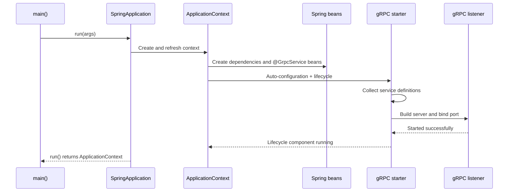

# Starting the gRPC Server with Spring Boot

## 1. Goals and Scope

In the **SPRING_GRPC** ecosystem, a Spring Boot application provides RPCs defined with Protocol Buffers. When the application starts, the gRPC server must be created, receive service implementations, bind to an address/port, and start accepting HTTP/2 requests. When the application stops, the server must stop accepting new calls and release resources.

Proper integration means **tying the gRPC server lifecycle to the `ApplicationContext` lifecycle**:

- Spring creates business beans and gRPC endpoints.
- The gRPC starter collects registered services and builds the server.
- The server starts listening during the lifecycle phase managed by the starter.
- When the Spring context closes, the starter stops the server and releases transport resources.

This lesson focuses on the startup sequence, when the server becomes ready, avoiding duplicate startups, handling bind errors, and coordinating shutdown. Examples use **`net.devh:grpc-server-spring-boot-starter`** with `@GrpcService`; official Spring gRPC has its own API and lifecycle integration, so consult the documentation for your exact version.

## 2. Startup Sequence from SpringApplication to gRPC Listener

When `SpringApplication.run(...)` is called, Spring Boot initializes the `Environment`, loads configuration, creates the `ApplicationContext`, and refreshes it. During that process, the gRPC starter's auto-configuration registers the components needed to build the server.

Overview flow:



Stages to distinguish:

1. **Load configuration:** Spring reads `application.yml`, profiles, environment variables, and other property sources.
2. **Create beans:** Spring instantiates business dependencies, interceptors, and service implementations per component scanning and conditions.
3. **Prepare server:** the starter gathers gRPC service definitions and transport configuration to build the server.
4. **Bind and start:** the server opens the listener on the configured address/port. If binding fails, startup may fail.
5. **Application ready:** Spring Boot finishes remaining startup steps and publishes corresponding events.

The diagram depicts a typical integration model. Internal callback ordering and specific lifecycle classes depend on the starter/version; consult the documentation for your actual dependency.

## 3. Registering Services So the Starter Can Start the Server

The starter can only register services it recognizes. With **net.devh**, an endpoint is typically a Spring bean annotated with `@GrpcService` that extends the base class generated by the gRPC Java plugin.

Example contract:

```proto
syntax = "proto3";

package demo.status.v1;

option java_multiple_files = true;
option java_package = "dev.example.status.v1";

service StatusService {
  rpc Check(CheckRequest) returns (CheckReply);
}

message CheckRequest {
  string component = 1;
}

message CheckReply {
  string state = 1;
}
```

Implementation:

```java
package dev.example.status;

import dev.example.status.v1.CheckReply;
import dev.example.status.v1.CheckRequest;
import dev.example.status.v1.StatusServiceGrpc;
import io.grpc.Status;
import io.grpc.stub.StreamObserver;
import net.devh.boot.grpc.server.service.GrpcService;

@GrpcService
public class StatusGrpcService
        extends StatusServiceGrpc.StatusServiceImplBase {

    @Override
    public void check(
            CheckRequest request,
            StreamObserver<CheckReply> responseObserver) {

        String component = request.getComponent().trim();
        if (component.isEmpty()) {
            responseObserver.onError(
                Status.INVALID_ARGUMENT
                    .withDescription("component must not be blank")
                    .asRuntimeException());
            return;
        }

        CheckReply reply = CheckReply.newBuilder()
            .setState("available: " + component)
            .build();

        responseObserver.onNext(reply);
        responseObserver.onCompleted();
    }
}
```

`@GrpcService` is a `net.devh` annotation. The class must also lie within the application's component scan scope or be registered through the corresponding Spring mechanism. The generated base class provides the service definition; the concrete bean is the implementation the starter adds to the server.

Spring Boot application:

```java
package dev.example;

import org.springframework.boot.SpringApplication;
import org.springframework.boot.autoconfigure.SpringBootApplication;

@SpringBootApplication
public class StatusApplication {
    public static void main(String[] args) {
        SpringApplication.run(StatusApplication.class, args);
    }
}
```

Never manually call `new StatusGrpcService()`, `ServerBuilder.addService(...)`, or `server.start()` inside `main()` when using a starter-managed server. Creating a second server can bind the same port twice or register the same service twice.

## 4. Server Lifecycle vs. Spring Lifecycle

Spring provides mechanisms to manage components that must start and stop with the context, including the `Lifecycle` and `SmartLifecycle` contracts. gRPC starters typically integrate the server into this mechanism or an equivalent lifecycle abstraction.

In the `SmartLifecycle` model, Spring's lifecycle processor calls `start()` on auto-starting components during context refresh. When the context closes, it invokes `stop()` in reverse lifecycle order. Some implementations provide callbacks to signal asynchronous shutdown completion.

This yields key benefits:

- The server starts after required Spring components have been created.
- Startup failures propagate cleanly back to Spring Boot instead of being swallowed inside an ad-hoc thread.
- The server stops when the context closes, including during normal JVM shutdown hooks.
- Start/stop ordering can be coordinated via lifecycle phases if supported by the starter.

Do not rely on internal class names or hardcoded phase numbers without verifying your starter version. What you can rely on is that **the starter owns the server and ties its lifecycle to the context**.

### Why Not Start the Server in `@PostConstruct`?

`@PostConstruct` runs during individual bean initialization. If you manually create and start a server there:

- Other beans may not be initialized yet.
- The starter's service discovery, interceptors, and transport customizations may not have been applied yet.
- The manual server will not automatically receive the starter's shutdown lifecycle.
- Another context refresh or test context could spin up a duplicate server.

Likewise, never use `ApplicationRunner` or `ApplicationReadyEvent` to start a server already managed by the starter. Those hooks are meant for application tasks after startup, not for running a parallel lifecycle.

## 5. Distinguishing ApplicationEvents from gRPC Server State

Spring Boot publishes several events during startup. These events are useful for logging, metrics, or coordinating tasks, though they do not all carry the same meaning:

| Event | Approximate Timing | Appropriate Use |
| --- | --- | --- |
| `ApplicationStartingEvent` | Very early, before context creation | Bootstrap logging; do not expect beans to exist |
| `ApplicationEnvironmentPreparedEvent` | Environment is prepared | Inspecting profiles and property sources |
| `ApplicationContextInitializedEvent` | Context created, before bean definitions are fully loaded | Bootstrap customization |
| `ApplicationPreparedEvent` | Context prepared, before refresh | Context preparation tasks |
| `ApplicationStartedEvent` | Context refreshed, before application runners | Observing application after context refresh |
| `ApplicationReadyEvent` | Runners complete; application reports ready | Signal that application startup has completed |
| `ContextClosedEvent` | Context is closing | Observing shutdown progress |

With starters using auto-start lifecycles during refresh, the gRPC listener has typically started before `ApplicationStartedEvent`. Still, verify the behavior of your specific starter/version rather than treating this event as a universal guarantee across all gRPC integrations.

`ApplicationReadyEvent` also does not replace an RPC health check. A process may have emitted the ready event while a backend dependency for a specific method remains down. Readiness must reflect actual ability to serve traffic.

## 6. Minimal Startup Configuration and Prerequisites

With `net.devh`, basic local server configuration:

```yaml
spring:
  application:
    name: status-grpc

grpc:
  server:
    port: 9090
```

Before startup, ensure:

- The server starter dependency is on the runtime classpath and compatible with Spring Boot and the JDK.
- Generated service classes have been compiled from `.proto`.
- Implementation beans are component-scanned and registered via the matching starter API.
- The port is free and the bind address suits the runtime environment.
- If TLS is enabled, certificates and private keys exist, are readable, and are configured properly.
- Dependencies required by services initialize cleanly.

You can use an environment variable for the port:

```yaml
grpc:
  server:
    port: ${GRPC_SERVER_PORT:9090}
```

If the application includes Spring Web, `server.port` sets the HTTP port while `grpc.server.port` sets `net.devh`'s gRPC port. Both listeners can run concurrently in the same process; never attempt to share a single TCP port without an explicitly designed shared-listener or proxy architecture.

## 7. Startup Failures: When Must the Application Abort?

A server that cannot bind or construct its transport properly must never report itself as ready. Common startup failures:

| Symptom | Cause | Resolution |
| --- | --- | --- |
| `Address already in use` | Port already occupied by another process or second server | Check listeners and remove duplicate server creation |
| Service implementation not found | Bean outside component scan, missing `@GrpcService`, or wrong starter annotation | Check beans and full RPC service name |
| Generated class missing | Code generation not run or contract module missing from classpath | Check `.proto`, plugin, and dependencies |
| Cannot read private key/certificate | Wrong secret mount or insufficient file permissions | Verify file paths and permissions |
| Dependency injection failure | Missing business bean or ambiguous candidates | Check constructor dependencies, qualifiers, and profiles |
| Port bound to wrong interface | Bind address incompatible with network/container | Check listener address and network namespace |

If the listener is essential for the instance to serve requests, startup must fail loudly when it cannot start. Never catch startup exceptions and leave the process alive without a server, because load balancers may route traffic to an unserviceable instance.

In multi-role deployments, an application might intentionally disable the gRPC server under a specific profile. In that case, disabling the server must be an explicit profile/config decision, never an accidental side effect of a swallowed exception.

## 8. Readiness: Has the Server Started and Can It Serve?

There are at least three distinct states:

1. **Spring context created beans:** dependency injection is complete.
2. **gRPC listener bound:** transport can accept connections.
3. **Service ready for business logic:** essential dependencies, data stores, and security policies meet requirements.

Do not conflate these three states. A TCP probe only proves the listener accepts connections; a gRPC health service can report per-service status; a business RPC probes deeper, though operations with side effects should never be used as health probes.

The **gRPC Health Checking Protocol** is a dedicated service. Spring Boot Actuator health is typically an HTTP endpoint. Enabling Actuator does not automatically register a gRPC health service on the server.

In Kubernetes or similar orchestrators:

- Readiness probes decide whether an instance receives new traffic.
- Liveness probes decide whether a process is wedged and needs restarting.
- If using gRPC probes, the server must expose the health checking protocol and the probe must target the right port.
- Readiness may check essential dependencies, though it should avoid marking the entire process unhealthy over a temporary failure in a non-critical side dependency.

When a service exposes multiple RPCs with different dependency requirements, per-service health status distinguishes serving capability better than a single process-wide flag.

## 9. Shutdown and Resource Cleanup

When the Spring context closes, the starter must stop the server. In plain gRPC Java, shutdown semantics look like this:

```java
server.shutdown(); // Stop accepting new RPCs and let in-flight calls finish.

if (!server.awaitTermination(20, TimeUnit.SECONDS)) {
    server.shutdownNow(); // Force-cancel remaining calls.
}
```

This is an example for a manually managed server, not code to add to an app using a starter. The starter is responsible for shutting down the server it creates; verify graceful timeouts and shutdown ordering for your version.

A sound shutdown workflow includes:

1. Taking the instance out of readiness so infrastructure stops routing new traffic to it.
2. Closing the Spring context so the server lifecycle enters shutdown.
3. Giving in-flight unary RPCs a chance to complete within the grace period.
4. Instructing long-lived streams to finish or cancel per designed policy.
5. Once the grace period expires, cancelling remaining RPCs and releasing transport/executors.
6. Recording shutdown duration and cancelled call counts to tune operations.

Never hold a `Server` reference inside a business bean and call `shutdown()` from `@PreDestroy` when the starter owns the lifecycle. That can stop the server out of order or stop it multiple times.

### Streaming Requires Cancellation Handling

Streaming RPCs can outlive process shutdown budgets. Endpoints must monitor cancellation, deadlines, and terminal events; when a client cancels or the server begins shutting down, cancel producers/subscriptions and free resources.

Never store an RPC's `StreamObserver` in a shared mutable field on a singleton service. Each stream owns its own state; message emission must stop after `onCompleted()` or `onError()`. Graceful shutdown cannot wait forever for every stream to finish on its own.

## 10. Testing Startup Timing and Service Registration

A unit test instantiating a service with `new` only verifies handler logic. To test startup with Spring Boot, initialize the context and send an RPC through the starter-managed server.

An integration test should verify:

- `ApplicationContext` initializes cleanly.
- The service bean is discovered.
- The server starts via the starter's lifecycle.
- A generated client stub can invoke the method.
- Status codes and responses are accurate.
- When the context closes, test listeners and channels are released.

Conceptual Spring Boot test skeleton:

```java
@SpringBootTest(properties = {
    "grpc.server.port=0"
})
class GrpcStartupIntegrationTest {

    @Test
    void applicationContextStartsWithGrpcServer() {
        // Inject a generated stub or create a test channel
        // targeting the port allocated by the test server.
        // Invoke the RPC and assert response/status.
    }
}
```

This snippet is an illustrative skeleton; how you retrieve the allocated port when configuring `0` depends on the starter/version. Some `net.devh` versions provide an annotation or bean to access the local server port. If using an in-process server, verify that `inProcessName` and its matching target are supported by that version.

**In-process tests do not verify TCP, HTTP/2 over the network, TLS handshakes, or ingress.** When those matter in production, add network integration tests using dynamic ports and test certificates. Never use hardcoded ports in parallel CI test runs.

## 11. Observing Startup and Layered Troubleshooting

When the app starts yet clients cannot invoke RPCs, check in order:

```text
Build / generated classes
    -> Spring bean discovery
        -> gRPC server factory and lifecycle
            -> bind address / port / TLS
                -> service registration
                    -> RPC method / status / business dependency
```

| Symptom | What to Check |
| --- | --- |
| Compile failure | Generated sources, Protobuf plugin, and contract dependency |
| Context refresh failure | Bean wiring, auto-configuration conditions, profiles |
| Missing bind/start logs | Lifecycle components and server configuration |
| `Address already in use` | Port owner and duplicate server initialization |
| TCP connects, yet `UNIMPLEMENTED` | Unregistered service/method or wrong full method name |
| `UNAVAILABLE` | Listener, DNS, network, TLS, or server readiness |
| `DEADLINE_EXCEEDED` | Slow backend, deadline, and cancellation |
| Process ready, yet health RPC fails | Health service unregistered or flawed readiness logic |

What to observe:

- Timestamps for context refresh start, server start success, and application ready.
- Effective port/address, without logging certificates, private keys, or secrets.
- RPC counts by method/status and latency.
- Active stream counts, cancellations, and errors around shutdown.
- Elapsed time from SIGTERM to process exit.

Internal logger/class names differ across starters and versions. Rely on the library's startup logs and integrated metrics/instrumentation rather than coupling to undocumented internal class names as stable APIs.

## 12. Deployment Workflow

1. Put compatible server starter and generated code on the runtime classpath.
2. Register concrete gRPC implementations as Spring beans using the starter's API.
3. Provide required listener/TLS configuration before context refresh.
4. Let the starter create and start the server via its lifecycle; never manually start the server in `main`, `@PostConstruct`, or runners.
5. Verify the listener and invoke a real RPC before treating the instance as ready.
6. Configure readiness/health aligned with services and essential dependencies.
7. When stopping, drop readiness first, let the starter lifecycle shut down the server, and cap drain duration.
8. Test startup failures, active RPC handling, and shutdown with in-flight calls and active streams.

In **SPRING_GRPC**, starting the server with Spring Boot coordinates the `ApplicationContext`, generated service implementations, the gRPC starter, and the transport. When the starter owns the lifecycle, the server starts and stops consistently with the application; readiness, deadlines, cancellation, and graceful shutdown still require deliberate design and testing against operational requirements.
