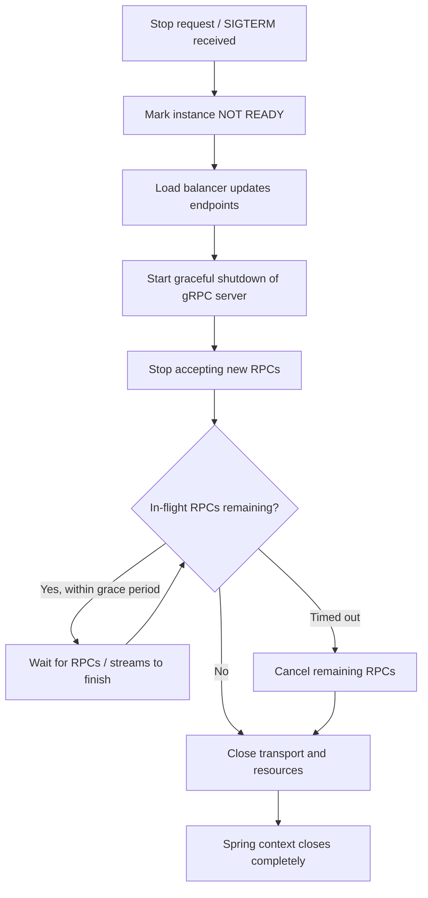

# Graceful Server Shutdown in Spring Boot gRPC

## 1. Why Is Graceful Shutdown Needed?

In **SPRING_GRPC**, a gRPC server may be handling hundreds of RPCs when the Spring Boot process receives a stop signal. If the process terminates abruptly, in-flight calls can be severed, clients receive transport errors, streams are dropped, and background work is left uncleaned.

**Graceful shutdown** is the process of stopping acceptance of new work, giving in-flight RPCs a bounded window to finish, then force-stopping any remaining calls and releasing resources.

This lesson focuses on:

- The relationship between the Spring `ApplicationContext` and the gRPC server lifecycle.
- Differences between `shutdown()`, `shutdownNow()`, and awaiting server termination.
- Draining traffic before closing the listener, especially in multi-replica deployments.
- Handling unary RPCs, streaming RPCs, cancellation, and deadlines.
- Coordinating SIGTERM, Kubernetes termination grace periods, and Spring timeouts.
- Testing, observing, and diagnosing shutdown behavior.

Integration examples use **`net.devh:grpc-server-spring-boot-starter`** with a starter-managed server. Official Spring gRPC has its own version-specific lifecycle contract. Use the exact API of the active starter; never assume every starter exposes the same property to control graceful timeouts.

## 2. Two Phases of a Shutdown

A controlled server shutdown distinguishes **drain** from **termination**:

1. **Drain:** mark the instance unready so infrastructure stops routing new traffic to it; the server begins rejecting new RPCs per its shutdown mechanism.
2. **Termination:** wait for active RPCs to finish within a grace period; once expired, cancel remaining RPCs, close transport, and release resources.

Overview flow:



Both phases can overlap depending on integration and infrastructure. For example, an orchestrator begins removing the pod from endpoint lists while the app is closing its server. What matters is having an **overall time budget** and knowing which step owns each action.

Never treat graceful shutdown as "sleep for a fixed duration and exit." A fixed sleep neither proves traffic was drained nor guarantees RPCs finished.

## 3. shutdown() and shutdownNow() in gRPC Java

The `io.grpc.Server` API provides two shutdown methods with distinct semantics:

| API | Behavior | When to Use |
| --- | --- | --- |
| `shutdown()` | Initiates orderly shutdown: stops accepting new RPCs, lets existing RPCs finish | First graceful step |
| `awaitTermination(timeout, unit)` | Waits for the server to terminate within a time limit | Waiting for drain completion |
| `shutdownNow()` | Requests cancellation of remaining RPCs and faster server stop | When the grace period expires or emergency stop is needed |

The following example illustrates managing a **manually created server** in gRPC Java:

```java
server.shutdown();

try {
    if (!server.awaitTermination(20, TimeUnit.SECONDS)) {
        server.shutdownNow();
        server.awaitTermination(5, TimeUnit.SECONDS);
    }
} catch (InterruptedException ex) {
    server.shutdownNow();
    Thread.currentThread().interrupt();
}
```

In this example, the server gets up to 20 seconds to complete graceful shutdown; if still unfinished, it requests cancellation and waits up to 5 more seconds. These numbers are illustrative, not gRPC or Spring defaults.

**For a Spring starter-managed server, do not copy this snippet into another bean to stop the same server again.** The starter owns the server instance and its lifecycle. Configure or extend the starter's own lifecycle via its documented API. Call `shutdown()` directly only when the application genuinely creates and owns the `Server`.

`shutdownNow()` is a last resort. Depending on timing and connection state, clients may receive `CANCELLED`, `UNAVAILABLE`, or a transport error. Never assume every client receives the exact same status.

## 4. Spring Closing the gRPC Server via ApplicationContext

When the Spring `ApplicationContext` closes, Spring stops lifecycle-managed components. Some gRPC starters integrate the server with `Lifecycle` or `SmartLifecycle`; exact mechanics depend on the version.

With a lifecycle component, Spring calls `stop()` when closing the context. If the component supports asynchronous callbacks, it signals shutdown completion once the server stops. Stop order can be influenced by lifecycle phases and bean dependencies.

Typical flow:

1. The application receives a request to close the context.
2. Spring starts stopping lifecycle components in coordinated order.
3. The gRPC starter initiates server shutdown.
4. The server stops accepting new RPCs and waits for in-flight RPCs per the starter's policy.
5. The starter finishes stopping; Spring proceeds to close remaining beans and the context.

Key points to remember:

- Service beans should never shut down the starter-owned server themselves.
- Never create a manual server in `@PostConstruct`, `ApplicationRunner`, or `ApplicationReadyEvent` when the starter already manages one.
- Never call `shutdownNow()` from a business bean's `@PreDestroy` just to "make sure the server stopped."
- Never assume closing the context cancels all downstream work unless handlers propagate cancellation to those tasks.

If you need to adjust drain duration, check the documentation and extension points of your specific starter. Never guess property names such as `grpc.server.shutdown-timeout` without verifying version support.

## 5. Spring Boot Timeouts vs. gRPC-Specific Timeouts

Spring Boot includes several shutdown settings related to lifecycles and web servers. Distinguish them:

| Setting / Concept | Scope |
| --- | --- |
| `spring.lifecycle.timeout-per-shutdown-phase` | Maximum time Spring waits for a lifecycle phase to stop |
| `server.shutdown=graceful` | Graceful shutdown of Spring Boot's embedded web server |
| gRPC server shutdown policy | Stops accepting RPCs and waits/cancels running RPCs per starter/implementation |
| `terminationGracePeriodSeconds` | Overall time budget Kubernetes grants for pod termination |

Example Spring lifecycle timeout configuration:

```yaml
spring:
  lifecycle:
    timeout-per-shutdown-phase: 25s
```

This property controls how long Spring waits for a lifecycle phase; **it does not define the entire gRPC drain policy by itself**. Likewise, `server.shutdown=graceful` applies to Spring Boot's embedded web server; it does not automatically imply the gRPC starter shares the same mechanism or timeout.

Verify three independent limits:

- The timeout the gRPC starter uses when stopping the server.
- The timeout Spring allows each lifecycle phase to finish stopping components.
- The grace period granted by the container/orchestrator before force-killing the process.

If an inner timeout exceeds an outer timeout, the process may be killed before gRPC finishes draining. Conversely, an overly short inner timeout cancels RPCs even though the pod still had time left.

## 6. Draining Traffic Before Stopping the Listener

In multi-replica systems, a server must not wait until its socket closes before signaling it is no longer taking traffic. Load balancers and service discovery need time to update endpoints.

A common deployment sequence:

1. Transition the instance's readiness to refuse traffic.
2. Allow the endpoint controller/load balancer time to propagate the change.
3. Start graceful shutdown of the server.
4. Let accepted RPCs complete within the time budget.
5. Cancel remaining RPCs when the grace period expires.
6. Close the context and exit the process.

The delay between steps 1 and 3 must reflect actual routing propagation times, not an arbitrary guess. HTTP/2 connections can be long-lived; already-connected clients can keep opening new RPCs until the server enters shutdown or the transport sends appropriate close frames.

### Readiness vs. Liveness

- **Readiness:** should this instance be selected for new requests?
- **Liveness:** is the process alive and healthy enough to keep running?

While draining, transition readiness to unready while keeping the process alive to finish in-flight RPCs. If liveness fails as soon as draining starts, the orchestrator may restart or kill the pod prematurely.

When using Spring Boot's Availability API, you can update the application's readiness state, for example:

```java
AvailabilityChangeEvent.publish(
    applicationContext,
    ReadinessState.REFUSING_TRAFFIC
);
```

This updates Spring Boot's readiness state. It only takes effect with infrastructure/probes configured to inspect that state; **it does not automatically update the gRPC Health Checking Protocol** unless the server's health service is wired to application availability.

The gRPC Health Checking Protocol and Actuator HTTP health are two separate mechanisms. If using gRPC health probes, ensure the health service reports `NOT_SERVING` for the appropriate services during drain.

## 7. Kubernetes, SIGTERM, and the Termination Budget

When Kubernetes terminates a pod, containers typically receive SIGTERM and get a grace window before SIGKILL. `terminationGracePeriodSeconds` is the total budget, which also includes any `preStop` hook execution time.

Example relevant configuration excerpt:

```yaml
spec:
  terminationGracePeriodSeconds: 45
  containers:
    - name: grpc-service
      image: example/grpc-service:1.0
      ports:
        - name: grpc
          containerPort: 9090
```

This is an illustrative excerpt, not a complete Deployment. If a `preStop` hook exists, include its runtime inside the same 45-second budget. Never add a long `sleep` without measuring endpoint propagation time and remaining drain time.

### Budgeting Shutdown Time

For example:

- 5 seconds for readiness/endpoint propagation.
- 25 seconds for gRPC graceful drain.
- 5 seconds for forced shutdown and resource cleanup.
- Remaining margin for Spring context shutdown and runtime exit.

The sum must stay below the orchestrator's grace period, leaving safety margin for scheduling and cleanup. These numbers are planning examples only; measure real system timings before finalizing.

If the process receives SIGKILL or the node loses power, shutdown hooks are not guaranteed to run. Graceful shutdown therefore reduces errors during normal stops, but never replaces durability, idempotency, or crash recovery.

## 8. Handling In-Flight RPCs

### Unary RPCs

Unary calls are usually short and can finish within the grace period. The server should:

- Rely on reasonable client deadlines so requests do not run indefinitely.
- Check cancellation/deadlines during long tasks or upstream calls.
- Avoid starting new side effects once a request is cancelled if detectable.
- Design operations with side effects to be idempotent in case clients retry after transport errors.

If the server wrote data yet had not sent the response before disconnection, the client cannot tell whether the operation completed. Therefore, `UNAVAILABLE` or timeouts never prove the business operation did not run. For order creation, stock deduction, or payments, use idempotency keys or deduplication guards.

### Server Streaming

Server streaming can keep an RPC open for long periods. During shutdown:

- Stop generating new data for draining streams.
- Allow streams to complete naturally if within the grace period and completion criteria apply.
- On cancellation, stop producers, schedulers, and subscriptions, and release buffers.
- Never call `onNext()` after `onCompleted()` or `onError()`.

### Client Streaming and Bidirectional Streaming

In client streaming and bidirectional streaming, both sides can send messages independently. Define a clear stream termination policy: the client stops sending, the server finishes responding, or one side cancels the call on shutdown.

Never keep a call's `StreamObserver` in a mutable field on a singleton service. State must belong strictly to the individual call/stream and be released upon terminal events or cancellation.

## 9. Detecting Client Cancellation and Releasing Background Tasks

In gRPC Java, the server can use `ServerCallStreamObserver` to detect client cancellation. Illustrative snippet inside a streaming handler:

```java
if (responseObserver instanceof ServerCallStreamObserver<?> serverObserver) {
    serverObserver.setOnCancelHandler(() -> {
        // Cancel the producer or subscription belonging to this stream.
        // Release buffers/resources for this call.
    });
}
```

This is an illustrative snippet, not a complete service. The handler must manage the per-stream producer and terminal state. If work runs on another executor or calls downstream services, the cancel callback should propagate cancellation to those components as well.

Key principles:

- Use local variables or per-call state objects; never share state across RPCs.
- Cancel scheduled tasks, reactive subscriptions, or futures when a call is cancelled.
- Close resources like cursors, file streams, or subscriptions in cleanup paths.
- Ensure cleanup is safe when cancellation callbacks and completion callbacks race.
- Never block gRPC threads in a loop waiting for shutdown.

Cancellation is a signal for the application to stop working; it does not automatically abort every background task spawned by the handler. Each downstream layer must honor cancellation or enforce its own timeouts.

## 10. Testing Graceful Shutdown

Unit tests on handlers do not prove shutdown lifecycles work. Test at the Spring context and network levels.

### 10.1. Testing Spring Context Closure

An integration test should:

1. Start the Spring context with the gRPC server.
2. Invoke a successful RPC to confirm the server bound and registered the service.
3. Call `context.close()` or let the test context close in a controlled manner.
4. Verify the server stops accepting new RPCs and releases resources.
5. If an RPC is in flight, verify it completes within the grace period or is cancelled within bounds.

Never merely assert that `ApplicationContext` closed; that does not prove sockets were released or streams were cleaned up.

### 10.2. Testing with an In-Flight RPC

Create a test RPC whose completion time you control, such as a handler waiting on a latch or test signal. Then:

- Start the RPC and confirm the server received the call.
- Close the context while the call is in flight.
- Release the latch before the grace period ends and verify the response is returned.
- Repeat without releasing the latch, verifying forced shutdown/cancellation happens within the bound.
- Verify cleanup callbacks ran and no background tasks remain.

Use test timeouts to keep CI from hanging if lifecycle shutdown stalls.

### 10.3. Process/Container-Level Testing

To test real SIGTERM handling, run the app in a separate process or container:

- Send SIGTERM using your environment's mechanism.
- Record the timestamp when shutdown begins.
- Send new RPCs during the drain phase and observe the server rejecting/refusing calls per policy.
- Track in-flight RPCs and process exit time.
- Verify the process exits before the termination grace period expires.
- Verify the port/listener is released.

In-process tests do not verify OS signals, TCP, HTTP/2, load balancers, or Kubernetes endpoint propagation. Those require separate network/deployment tests.

## 11. Observability and Diagnostics

During deployments or restarts, monitor:

| Signal | What to Observe |
| --- | --- |
| Readiness transition | Exact moment the instance stops accepting new traffic |
| Active RPCs/streams | Number of calls still open when drain starts |
| RPC statuses | `CANCELLED`, `UNAVAILABLE`, `DEADLINE_EXCEEDED` around shutdown |
| Shutdown duration | Elapsed time from SIGTERM to process exit |
| Forced shutdown count | Number of RPCs cancelled after grace period expiry |
| Resource cleanup | Whether executors, subscriptions, cursors, or connections linger |
| Retry rate | Whether synchronized client retries overload remaining replicas |

Common failure scenarios:

| Symptom | Possible Cause | Resolution |
| --- | --- | --- |
| Pod gets SIGKILLed before finishing drain | Grace period shorter than hook + shutdown total | Recompute budget and measure actual timings |
| New RPCs still reach stopping pod | Slow readiness propagation or long-lived HTTP/2 connections | Drain earlier; check load balancer and server shutdown |
| Process hangs and refuses to exit | Unterminated stream/background task or lifecycle stop never signals completion | Inspect active calls, cancellation, and lifecycle callbacks |
| Clients see elevated `UNAVAILABLE` during rollout | Replica stops before routing updates or aggressive retries | Coordinate readiness, drain, and retry budgets |
| RPC side effect executes twice | Client retries after response is lost mid-shutdown | Use idempotency keys and deduplication |
| Cleanup runs twice | Multiple owners closing the same resource | Establish one lifecycle owner and make cleanup idempotent |

Never log tokens, private keys, or sensitive payloads while diagnosing. Use request IDs/trace IDs to correlate client and server logs, and log exact timestamps for drain start, forced shutdown start, and process exit.

## 12. Implementation Checklist

1. Identify whether the server is created and owned by the gRPC starter or by application code.
2. Use the starter's lifecycle to stop the server; never introduce a duplicate shutdown path.
3. Transition readiness to refuse traffic before closing the listener if infrastructure needs time to update endpoints.
4. Initiate graceful shutdown and wait for in-flight RPCs within an explicit bound.
5. Propagate cancellation to stream producers and downstream tasks.
6. Force-shutdown remaining calls and release resources once the grace period expires.
7. Set Spring lifecycle timeouts and orchestrator termination grace periods higher than the total required drain/cleanup budget.
8. Test context closure, in-flight RPCs, cancelled streams, and SIGTERM across networks/containers.
9. Monitor shutdown duration, RPC statuses, and force-cancelled call counts after every rollout.

In **SPRING_GRPC**, graceful server shutdown coordinates the gRPC server lifecycle, Spring `ApplicationContext`, client deadlines/cancellation, and orchestration infrastructure. When every RPC has bounded duration, streams clean up deterministically, and the server has a single lifecycle owner, deployments and restarts minimize disruption and prevent resource leaks.
