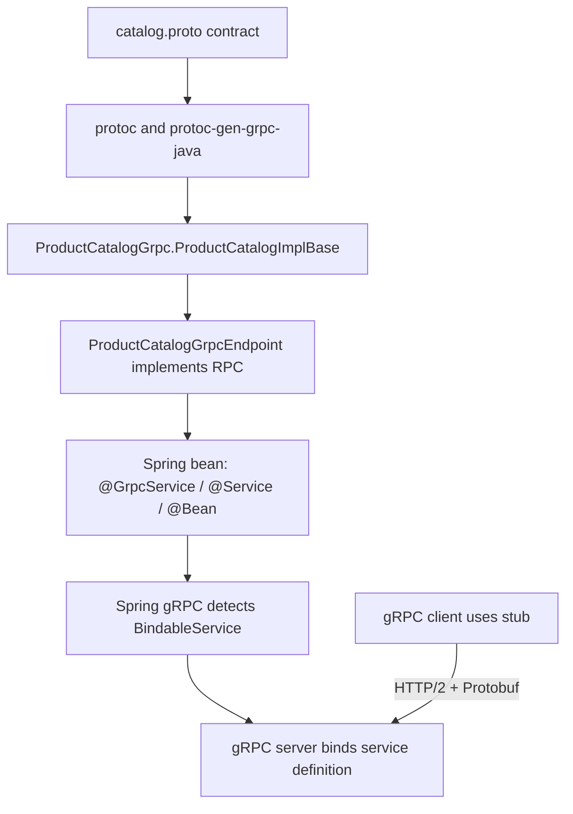

# Registering a gRPC Service Bean in Spring

## Lesson Objectives

After this lesson, you will be able to:

1. Explain why a Java class implementing an RPC is not enough on its own to be served by a gRPC server.
2. Create an implementation class from Java code generated by Protocol Buffers and register that class as a Spring bean.
3. Choose between registering with `@GrpcService`, `@Service`, or `@Bean` in **official Spring gRPC**.
4. Verify that the service appears in the Spring context and can be called over the network.
5. Identify common errors related to component scanning, duplicate registration, server configuration, and gRPC status mapping.

**Context:** In the Spring ecosystem, gRPC enables applications to make remote procedure calls based on a Protocol Buffers contract. Java code generated from `.proto` provides the base class for the server and stubs for the client. Spring manages lifecycle, dependency injection, and the registration of service implementation objects onto the gRPC server. This is the foundational step before expanding to streaming RPCs, metadata, deadlines, interceptors, TLS, integration testing, and performance and reliability monitoring.

> **Library Scope:** This lesson uses Spring gRPC developed by the Spring project, with the `org.springframework.grpc.server.service.GrpcService` annotation and automatic detection of `io.grpc.BindableService`. Some legacy projects use the community starter `net.devh:grpc-*-spring-boot-starter`, which has the `net.devh.boot.grpc.server.service.GrpcService` annotation; do not mix packages, configurations, and registration approaches between these two ecosystems.

## 1. How Does Spring Register a gRPC Service?

In gRPC Java, a service can be attached to a server if it implements the `io.grpc.BindableService` interface. When compiling a `.proto` contract, the gRPC Java code generator typically produces an `XxxGrpc.XxxImplBase` class that already implements this interface. You extend the base class, override the RPC methods, and let Spring manage that instance as a bean.

In a Spring Boot application with the corresponding Spring gRPC server infrastructure, **`BindableService` beans** are discovered and bound to the gRPC server. In typical cases, you do not need to manually register each method on `ServerBuilder`.



| Component | Responsibility | Key Takeaway |
| --- | --- | --- |
| `.proto` | Defines service names, RPCs, messages, and data types | Shared contract between server and client |
| `XxxGrpc.XxxImplBase` | Server-side base class generated by the gRPC Java plugin | Implements `BindableService` |
| `@Service` | Marks a Spring component for component scan discovery | Sufficient for registration if the bean implements `BindableService` |
| Spring's `@GrpcService` | Marks a service bean and supports configuration such as per-service interceptors | **Not required** for every `BindableService` bean |
| `@Bean` | Declares a bean via a method in Spring configuration | Useful when conditional service instantiation is needed |
| gRPC server | Opens a port/transport and routes requests to service definitions | Requires active server dependencies and auto-configuration |

Note that there are **two separate steps**: (1) putting the implementation into the `ApplicationContext`; (2) letting the gRPC server infrastructure bind that implementation. If you only instantiate the object with `new` outside Spring, Spring will not detect it automatically. If the Spring context has the bean but the application lacks an appropriate server factory/transport, there is still no gRPC port for clients to call.

## 2. Preparing the Spring gRPC Application

The examples use Java and Spring Boot with the official gRPC server starter. When creating a project with [Spring Initializr](https://start.spring.io/), you can select the **gRPC** dependency and configure Protobuf code generation. For projects using Spring Boot 4.x and its corresponding dependency management, the server component is typically:

```xml
<!-- Dependency snippet in pom.xml; the version is managed by Spring Boot. -->
<dependency>
    <groupId>org.springframework.boot</groupId>
    <artifactId>spring-boot-starter-grpc-server</artifactId>
</dependency>
```

To generate Java messages and gRPC stubs from `.proto`, the build must configure the Protocol Buffers compiler and the gRPC Java plugin. With Maven on Spring Boot 4.x, a common configuration is the `io.github.ascopes:protobuf-maven-plugin` plugin inside `<build><plugins>`. If using Gradle, you can use the `com.google.protobuf` plugin and declare the `grpc` plugin. Exact configuration and versions depend on your project's BOM; check the [Spring Boot gRPC documentation](https://docs.spring.io/spring-boot/reference/io/grpc.html).

Assume the following source structure:

```text
src/main/
  proto/catalog.proto
  java/com/example/catalog/CatalogApplication.java
  java/com/example/catalog/ProductLookup.java
  java/com/example/catalog/grpc/ProductCatalogGrpcEndpoint.java
```

The Java classes in `com.example.catalog.proto` below are **generated** from `.proto`; do not write them by hand. The Spring Boot main class package should be `com.example.catalog` (or a parent package) so that component scanning covers `com.example.catalog.grpc`.

## 3. Creating the Protocol Buffers Contract

File `src/main/proto/catalog.proto`:

```proto
syntax = "proto3";

package catalog.v1;

option java_package = "com.example.catalog.proto";
option java_multiple_files = true;

service ProductCatalog {
  rpc GetProduct(GetProductRequest) returns (GetProductReply);
}

message GetProductRequest {
  string product_id = 1;
}

message GetProductReply {
  string product_id = 1;
  string name = 2;
  int64 price_cents = 3;
}
```

After code generation, we get types such as `ProductCatalogGrpc`, `GetProductRequest`, and `GetProductReply`. Inside `ProductCatalogGrpc` is `ProductCatalogImplBase`, while the `GetProduct` RPC corresponds to the Java method `getProduct(...)`. The full name used on the wire is `catalog.v1.ProductCatalog/GetProduct`; the `catalog.v1` prefix comes from the `package` declaration in the `.proto` file, not `java_package`.

## 4. Building a Business Layer for the gRPC Endpoint to Call

The gRPC layer should handle request/response conversion and status mapping, while business logic lives in a separate Spring bean. The following hardcoded data example lets you practice without needing a database yet.

File `src/main/java/com/example/catalog/ProductLookup.java`:

```java
package com.example.catalog;

import java.util.Map;
import java.util.Optional;

import org.springframework.stereotype.Service;

@Service
public class ProductLookup {

    private final Map<String, Product> products = Map.of(
            "sku-1", new Product("sku-1", "Mechanical keyboard", 1_250_000L),
            "sku-2", new Product("sku-2", "Wireless mouse", 390_000L));

    public Optional<Product> findById(String productId) {
        return Optional.ofNullable(products.get(productId));
    }

    public record Product(String id, String name, long priceCents) {
    }
}
```

Here, `ProductLookup` is registered with `@Service` and then injected via **constructor injection** into the gRPC endpoint. `price_cents` is just the smallest currency unit in this example; real systems must clearly define currency and monetary rules in the contract.

## 5. First Registration Approach: Using `@GrpcService`

File `src/main/java/com/example/catalog/grpc/ProductCatalogGrpcEndpoint.java`:

```java
package com.example.catalog.grpc;

import com.example.catalog.ProductLookup;
import com.example.catalog.proto.GetProductReply;
import com.example.catalog.proto.GetProductRequest;
import com.example.catalog.proto.ProductCatalogGrpc;
import io.grpc.Status;
import io.grpc.stub.StreamObserver;
import org.springframework.grpc.server.service.GrpcService;

@GrpcService
public class ProductCatalogGrpcEndpoint
        extends ProductCatalogGrpc.ProductCatalogImplBase {

    private final ProductLookup productLookup;

    public ProductCatalogGrpcEndpoint(ProductLookup productLookup) {
        this.productLookup = productLookup;
    }

    @Override
    public void getProduct(GetProductRequest request,
                           StreamObserver<GetProductReply> observer) {
        String id = request.getProductId().trim();

        if (id.isEmpty()) {
            observer.onError(Status.INVALID_ARGUMENT
                    .withDescription("product_id must not be empty")
                    .asRuntimeException());
            return;
        }

        var found = productLookup.findById(id);
        if (found.isEmpty()) {
            observer.onError(Status.NOT_FOUND
                    .withDescription("Product not found: " + id)
                    .asRuntimeException());
            return;
        }

        ProductLookup.Product product = found.get();
        GetProductReply reply = GetProductReply.newBuilder()
                .setProductId(product.id())
                .setName(product.name())
                .setPriceCents(product.priceCents())
                .build();

        observer.onNext(reply);
        observer.onCompleted();
    }
}
```

**Why is a single annotation enough?** `org.springframework.grpc`'s `@GrpcService` is also a Spring service stereotype, so component scanning puts the object into the context. Because the class extends `ProductCatalogImplBase` (a `BindableService`), Spring gRPC recognizes it and binds its definition to the server. Spring injects `ProductLookup` via the constructor just like with regular beans.

A unary RPC completes **exactly once**: the success path calls `onNext(reply)` followed by `onCompleted()`; the error path calls `onError(...)` and `return`. Do not continue calling `onNext`/`onCompleted` after `onError`. The `INVALID_ARGUMENT` status code is appropriate for requests missing an identifier, and `NOT_FOUND` is appropriate when the product does not exist. Avoid throwing arbitrary Java exceptions and assuming they automatically become clear business statuses.

File `src/main/java/com/example/catalog/CatalogApplication.java`:

```java
package com.example.catalog;

import org.springframework.boot.SpringApplication;
import org.springframework.boot.autoconfigure.SpringBootApplication;

@SpringBootApplication
public class CatalogApplication {
    public static void main(String[] args) {
        SpringApplication.run(CatalogApplication.class, args);
    }
}
```

When the application uses the default Netty gRPC server from the starter, the gRPC server typically listens on port **9090**. You can change it with `spring.grpc.server.port`, for example:

```yaml
spring:
  grpc:
    server:
      port: 9091
```

`spring.grpc.server.port` applies to the native gRPC server; if running gRPC under a servlet container, port configuration depends on the web server (`server.port`) and HTTP/2. Do not confuse the gRPC port with Spring MVC's HTTP REST port.

## 6. Second Registration Approach: `@Service` or `@Bean`

`@GrpcService` is convenient when you want to attach gRPC-specific metadata directly to the class, especially per-service interceptors. However, in official Spring gRPC, **any bean implementing `BindableService` can be registered**. Therefore, a class annotated with `@Service` also works:

```java
import org.springframework.stereotype.Service;

@Service
public class ProductCatalogGrpcEndpoint
        extends ProductCatalogGrpc.ProductCatalogImplBase {
    // Keep constructor and getProduct(...) as in the example above.
}
```

If you want custom instantiation logic, you can remove both `@Service` and `@GrpcService` from the implementation and declare it via `@Bean`:

```java
package com.example.catalog.grpc;

import com.example.catalog.ProductLookup;
import io.grpc.BindableService;
import org.springframework.context.annotation.Bean;
import org.springframework.context.annotation.Configuration;

@Configuration(proxyBeanMethods = false)
public class CatalogGrpcConfiguration {

    @Bean
    BindableService productCatalogGrpcService(ProductLookup lookup) {
        return new ProductCatalogGrpcEndpoint(lookup);
    }
}
```

**The two snippets above are alternatives**, do not add them simultaneously to an application that already uses `@GrpcService`. In particular, if you leave `@GrpcService` on `ProductCatalogGrpcEndpoint` while also creating a bean via `@Bean`, Spring may end up with two instances both binding the service name `catalog.v1.ProductCatalog`, leading to registration conflicts. When using `@Bean`, the implementation class must **not** carry a stereotype annotation that would cause component scanning to create it automatically.

Choose the approach based on your needs:

| Registration Approach | Best When | Notes |
| --- | --- | --- |
| `@GrpcService` on the class | Standard approach, or needing per-service interceptors | Import the correct `org.springframework.grpc.server.service.GrpcService` |
| `@Service` on the class | You only need Spring to manage a `BindableService` | Cannot configure per-service interceptors via this annotation |
| `@Bean` in configuration | You want custom instantiation, conditions/profiles, or an existing library class | Avoid duplicate registration and keep the return type as `BindableService` |

For example, suppose you only want to register `ProductCatalog` in certain environments. In the **`@Bean` approach**, you can add `@ConditionalOnProperty(name = "app.grpc.catalog.enabled", havingValue = "true", matchIfMissing = true)` to the `productCatalogGrpcService` method, and set `app.grpc.catalog.enabled=false` in environments where you do not want to expose this RPC. This condition controls the bean's existence and therefore also controls whether the server discovers the service. Similarly, you can use `@Profile` if you want to activate it by Spring profile.

### When There Are Multiple gRPC Servers in One Application

By default, available `BindableService` beans are attached to the gRPC servers managed by Spring gRPC. If you run both a native server and an in-process server, do not assume the two servers expose different sets of RPCs by default. When separation is needed, Spring gRPC provides `ServerServiceDefinitionFilter` combined with server factory configuration to select which services are bound to each server. This is an advanced configuration step; the basic requirement remains providing a unique `BindableService` bean for each service contract on each corresponding server.

## 7. Attaching an Interceptor to a Registered Service

One advantage of `@GrpcService` is declaring interceptors that apply **only** to that bean. For example, suppose you want to log the RPC name when a client calls ProductCatalog:

```java
package com.example.catalog.grpc;

import io.grpc.Metadata;
import io.grpc.ServerCall;
import io.grpc.ServerCallHandler;
import io.grpc.ServerInterceptor;
import java.util.logging.Logger;
import org.springframework.stereotype.Component;

@Component
public class RpcLoggingInterceptor implements ServerInterceptor {
    private static final Logger LOG =
            Logger.getLogger(RpcLoggingInterceptor.class.getName());

    @Override
    public <ReqT, RespT> ServerCall.Listener<ReqT> interceptCall(
            ServerCall<ReqT, RespT> call,
            Metadata headers,
            ServerCallHandler<ReqT, RespT> next) {
        LOG.info(() -> "gRPC call: "
                + call.getMethodDescriptor().getFullMethodName());
        return next.startCall(call, headers);
    }
}
```

Change the annotation on the implementation to:

```java
@GrpcService(interceptors = RpcLoggingInterceptor.class)
public class ProductCatalogGrpcEndpoint
        extends ProductCatalogGrpc.ProductCatalogImplBase {
    // ...
}
```

`RpcLoggingInterceptor` is a Spring bean, so Spring gRPC can retrieve the right interceptor to attach to the service. To apply an interceptor to **all** services, declare a `ServerInterceptor` bean with `@GlobalServerInterceptor` instead of listing it on each `@GrpcService`. Interceptors are typically used for metadata handling, authentication, correlation IDs, deadlines, logging, and observability metrics; do not stuff all that logic into the `getProduct` method.

In production environments, avoid logging payloads or sensitive metadata. The example above logs only the RPC name to demonstrate the interceptor attachment point.

## 8. Verifying That the Service Is Registered

### 8.1. Checking the Bean in the Spring Context

Create the following test (requires Spring Boot test dependencies and JUnit/AssertJ):

```java
package com.example.catalog;

import io.grpc.BindableService;
import org.junit.jupiter.api.Test;
import org.springframework.beans.factory.annotation.Autowired;
import org.springframework.boot.test.context.SpringBootTest;
import org.springframework.context.ApplicationContext;

import static org.assertj.core.api.Assertions.assertThat;

@SpringBootTest(properties = "spring.grpc.server.port=0")
class GrpcBeanRegistrationTest {

    @Autowired
    ApplicationContext context;

    @Test
    void catalogServiceIsPresent() {
        var services = context.getBeansOfType(BindableService.class).values();

        assertThat(services).anySatisfy(service ->
                assertThat(service.bindService()
                        .getServiceDescriptor()
                        .getName())
                        .isEqualTo("catalog.v1.ProductCatalog"));
    }
}
```

This test confirms that the bean exists and publishes the expected gRPC service descriptor. It does **not replace** tests that actually invoke the RPC. `spring.grpc.server.port=0` lets the native server pick an ephemeral port during tests, avoiding conflicts with other running applications.

### 8.2. Calling the Real RPC with `grpcurl`

After starting the application on the default port 9090, you can invoke it with `grpcurl`. The following command passes the `.proto` file directly, so it does not depend on server reflection being enabled:

```bash
grpcurl -plaintext \
  -import-path src/main/proto \
  -proto catalog.proto \
  -d '{"productId":"sku-1"}' \
  localhost:9090 catalog.v1.ProductCatalog/GetProduct
```

Expected output:

```json
{
  "productId": "sku-1",
  "name": "Mechanical keyboard",
  "priceCents": "1250000"
}
```

`int64` can be represented as a **JSON string** according to ProtoJSON rules, so `priceCents` above is `"1250000"`. Some client tools may format it differently; the logical value remains 1,250,000.

Testing missing or non-existent data errors:

```bash
grpcurl -plaintext -import-path src/main/proto -proto catalog.proto \
  -d '{"productId":""}' localhost:9090 catalog.v1.ProductCatalog/GetProduct

grpcurl -plaintext -import-path src/main/proto -proto catalog.proto \
  -d '{"productId":"sku-999"}' localhost:9090 catalog.v1.ProductCatalog/GetProduct
```

The expected gRPC statuses are `INVALID_ARGUMENT` and `NOT_FOUND`, respectively. If you changed the port in `application.yml`, replace `localhost:9090` accordingly. `-plaintext` is only suitable when the server uses an unencrypted connection, such as in development. With TLS, the client must configure the appropriate secure connection.

If you want to run `grpcurl ... list` without passing `-proto`, the server must support gRPC Reflection; with Spring gRPC, this requires the optional `io.grpc:grpc-services` dependency and appropriate reflection configuration. **The absence of reflection** does not mean the service is unregistered.

## 9. Common Errors and How to Diagnose Them

| Symptom | Possible Cause | How to Check / Fix |
| --- | --- | --- |
| Test cannot find the `BindableService` bean | Implementation is outside component scan, missing stereotype, or `@Bean` config not loaded | Place `@SpringBootApplication` in a parent package; check conditions/profiles and annotation imports |
| Bean is in context but client cannot connect (`UNAVAILABLE`) | gRPC server is not running, wrong port/host, TLS mismatch, or missing server transport | Check starter dependency, startup logs, `spring.grpc.server.port`, and TLS configuration |
| Client connects but RPC returns `UNIMPLEMENTED` | Wrong `package.Service/Method` name, service not bound, or matching method not overridden | Compare RPC name in `.proto` with bean's descriptor; verify `bindService()` |
| Startup fails with duplicate gRPC service name | Two `BindableService` beans provide the same service descriptor | Choose only **one** registration method; check both component scan and `@Bean` definitions |
| Java code lacks `ProductCatalogGrpc` | gRPC Java stubs not generated, plugin misconfigured, or generated sources package not recognized | Check the proto compilation step and `java_package` |
| `@GrpcService` not recognized or wrong import | Using community starter annotation or incompatible dependency | Use `org.springframework.grpc.server.service.GrpcService` with official Spring gRPC |
| `@GrpcService(interceptors=...)` does not work | Interceptor is not a bean, wrong type used, or scope misconfigured | Register the interceptor with Spring; distinguish global vs. per-service interceptors |

**Effective debugging workflow:** first confirm that the `.proto` file generates `*Grpc` as expected; next confirm Spring has the `BindableService` bean; next inspect `bindService().getServiceDescriptor().getName()`; finally check the port, transport, and actual request. This sequence helps pinpoint the failing layer.

## 10. Hands-On Exercises

1. Add a `ListProducts(ListProductsRequest) returns (ListProductsReply)` RPC to `catalog.proto`; update the implementation and verify that **the same bean** provides both `GetProduct` and `ListProducts`.
2. Try replacing `@GrpcService` with `@Service` and re-run `GrpcBeanRegistrationTest`. Explain why the service is still discovered.
3. Switch to the `@Bean` approach; test toggling it with `app.grpc.catalog.enabled`. Observe the number of `BindableService` beans and the result of calling the RPC from a client.
4. Attach `RpcLoggingInterceptor` specifically to ProductCatalog; add another service and prove that the interceptor logs only for ProductCatalog.
5. Intentionally move the endpoint outside component scan or declare two duplicate beans, then analyze the error and restore the proper registration.

### Self-Check Questions

- Why is `ProductCatalogGrpc.ProductCatalogImplBase` different from `ProductCatalogGrpc.ProductCatalogBlockingStub`? Which one is used on the server and which on the client?
- Why is Spring's `@GrpcService` not mandatory to register a `BindableService`?
- What is the difference between a **bean existing in `ApplicationContext`** and an **RPC being reachable through the gRPC server**?
- How do you avoid duplicate service registration when using both component scanning and `@Bean` configuration?
- When receiving `UNIMPLEMENTED` even though the gRPC connection succeeded, what should you check first?

## References

- [Spring gRPC — gRPC Server](https://docs.spring.io/spring-grpc/reference/server.html): `BindableService` discovery mechanism, server factories, interceptors, and filtering.
- [Spring gRPC — `@GrpcService` API](https://docs.spring.io/spring-grpc/reference/api/java/org/springframework/grpc/server/service/GrpcService.html): optional annotation and per-service interceptor configuration.
- [Spring Boot — gRPC](https://docs.spring.io/spring-boot/reference/io/grpc.html): starter, Protobuf code generation, server configuration, and testing.
- [Protocol Buffers — ProtoJSON](https://protobuf.dev/programming-guides/json/): how Protobuf messages map to JSON, including `int64` fields.

**Expected outcome:** You have a Spring bean implementing `BindableService` from `.proto`-generated code, bound by the gRPC server as service `catalog.v1.ProductCatalog`; clients can call `GetProduct` and receive valid data or meaningful gRPC statuses. This serves as the foundation for building more complex Spring gRPC services.
