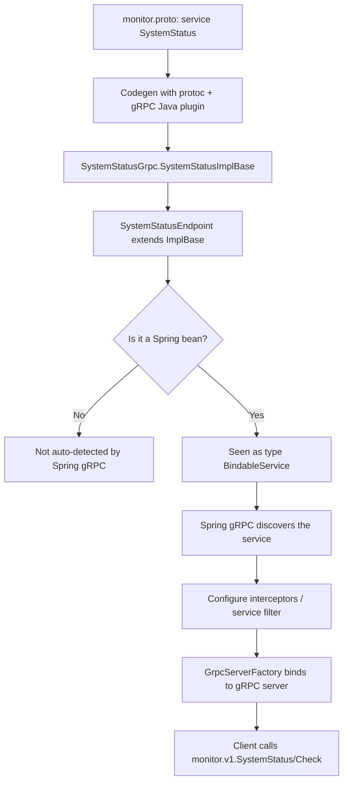

# Annotations and Service Discovery Mechanisms

## Learning Objectives

When developing **SPRING_GRPC** services, you use Protocol Buffers to define RPC contracts, generate Java code, and implement servers and clients for both unary and streaming RPCs. A foundational question is: **How does Spring find the implementation, and what causes an RPC to actually appear on the gRPC server?**

After this lesson, you will be able to:

1. Distinguish between a **gRPC service**, a **Spring bean**, and a **gRPC server**.
2. Explain the role of the `io.grpc.BindableService` interface in the discovery mechanism.
3. Register a service using `@GrpcService`, `@Service`, or `@Bean` and understand when to choose each.
4. Distinguish the `@GrpcService` annotation in **official Spring gRPC** from similarly named annotations in community libraries.
5. Attach interceptors at the service or global scope; recognize issues with component scanning, bean conditions, duplicate registration, and per-server filtering.
6. Independently verify two steps: **the service is a bean in the Spring context** and **the RPC is exposed by the server**.

> **Version Scope:** Examples use the official Spring gRPC ecosystem with Spring Boot and a gRPC server starter (such as Spring Boot 4.x). In this document, `@GrpcService` refers to `org.springframework.grpc.server.service.GrpcService`, not the annotation from the `net.devh` starter.

## 1. At What Level Does Spring Discover a Service?

In a gRPC Java application, three concepts are easily confused:

| Concept | Example | Role |
| --- | --- | --- |
| gRPC contract | `service SystemStatus { rpc Check(...); }` in `.proto` | Defines service names, RPCs, and messages exchanged between client and server |
| Server-side implementation | `SystemStatusGrpc.SystemStatusImplBase` extended by `SystemStatusEndpoint` | Provides logic for handling each RPC; the implementation supports `bindService()` |
| Spring bean | `SystemStatusEndpoint` instance created and managed by Spring | The object that Spring gRPC infrastructure can find in `ApplicationContext` |
| gRPC server | gRPC server running on Netty, servlet, or in-process | Accepts HTTP/2 connections or in-process calls, routing to bound services |

A Java class with a method named `check` does not automatically become a gRPC endpoint. For gRPC Java, the key interface is:

```java
package io.grpc;

public interface BindableService {
    ServerServiceDefinition bindService();
}
```

The snippet above describes the **core contract** of the interface, not a file you need to create. With the `protoc-gen-grpc-java` code generator plugin, the `SystemStatusGrpc.SystemStatusImplBase` class generated from `.proto` already implements `BindableService`. When you extend that class and override the RPC methods, your implementation object is also a `BindableService`.

**Spring gRPC discovery rule:** when server infrastructure is configured, Spring gRPC looks for **Spring beans of type `BindableService`** and binds their corresponding service definitions to the server. The `@GrpcService` annotation is a convenient way to create a bean and attach service-specific configuration; it is **not a mandatory requirement** for every gRPC service. This mechanism is described in [Spring gRPC — gRPC Server](https://docs.spring.io/spring-grpc/reference/server.html).



Key point: a bean existing in `ApplicationContext` does not guarantee that clients can connect. The application still needs a working server factory/transport, the right port or address, and if TLS is enabled, the client must complete the TLS handshake successfully.

## 2. What Does Each Annotation Do?

### 2.1. Spring gRPC's `@GrpcService`

Exact import:

```java
import org.springframework.grpc.server.service.GrpcService;
```

In official Spring gRPC, `@GrpcService` is an annotation that can be placed on a **class** or a **bean factory method**. It is meta-annotated with the corresponding Spring annotations (`@Service` and `@Bean`), so it can be used to declare a bean while also providing gRPC metadata:

```java
@GrpcService
public class SystemStatusEndpoint
        extends SystemStatusGrpc.SystemStatusImplBase {
    // RPC implementations.
}
```

Three commonly used attributes:

| `@GrpcService` Attribute | Meaning | Default Value |
| --- | --- | --- |
| `interceptors` | List of `ServerInterceptor` bean **types** applied specifically to this service | Empty array |
| `interceptorNames` | List of interceptor **bean names** applied specifically to this service | Empty array |
| `blendWithGlobalInterceptors` | Allows blending per-service interceptors with global interceptors in Spring order; if `false`, global interceptors run before per-service ones | `false` |

This annotation should only be placed on a bean that is actually a `BindableService`. It does not turn a plain Java class, a REST `@Controller`, or a client stub into a gRPC server implementation.

### 2.2. `@Service` and `@Component`

These are standard Spring stereotype annotations. When a class implements `BindableService` and is picked up by component scanning, **`@Service` is sufficient**:

```java
import org.springframework.stereotype.Service;

@Service
public class SystemStatusEndpoint
        extends SystemStatusGrpc.SystemStatusImplBase {
    // RPC implementations.
}
```

As far as registering a bean in the context goes, `@Component` works as well; `@Service` conveys business intent more clearly. If you do not need gRPC-specific metadata, you are not required to add `@GrpcService`.

### 2.3. `@Bean` in `@Configuration`

You can also create a `BindableService` using a factory method:

```java
import io.grpc.BindableService;
import org.springframework.context.annotation.Bean;
import org.springframework.context.annotation.Configuration;

@Configuration(proxyBeanMethods = false)
class GrpcEndpointConfiguration {

    @Bean
    BindableService systemStatusEndpoint(HealthProbe probe) {
        return new SystemStatusEndpoint(probe);
    }
}
```

This is an **alternative** to placing a stereotype annotation on the class: in the `@Bean` variant, remove `@Service`/`@GrpcService` from `SystemStatusEndpoint` to avoid creating two beans providing the same gRPC service. Declaring the return type as `BindableService` helps both Spring and human readers recognize that this bean belongs to the bindable service group.

You can also place `@GrpcService(interceptors = ...)` **on the factory method** when you need per-service interceptor configuration; `@GrpcService` on a method acts as a bean declaration thanks to the `@Bean` meta-annotation.

### 2.4. Do Not Confuse with the Community Starter

| Ecosystem | Service Annotation | Mechanism to Remember |
| --- | --- | --- |
| **Official Spring gRPC** | `org.springframework.grpc.server.service.GrpcService` | Can discover any `BindableService` bean; the annotation is optional for extra configuration |
| **net.devh starter** | `net.devh.boot.grpc.server.service.GrpcService` | Different library and registration infrastructure; guides for this ecosystem do not automatically apply to official Spring gRPC |

When reading examples online, check the **import lines**, dependencies, and starter documentation before copying annotations, property names, or interceptor configuration.

## 3. Complete Example: Discovering a Service with Unary and Server Streaming

Scenario: an application exposes the status of a system component. Clients can fetch the status once via a unary RPC, or receive multiple consecutive records via a server streaming RPC. Both RPCs belong to **the same `BindableService` bean**.

### 3.1. Declaring the Contract

Located at `src/main/proto/monitor.proto`:

```proto
syntax = "proto3";

package monitor.v1;
option java_package = "com.example.monitor.proto";
option java_multiple_files = true;

service SystemStatus {
  rpc Check(CheckRequest) returns (CheckResponse);
  rpc Watch(WatchRequest) returns (stream CheckResponse);
}

message CheckRequest {
  string component = 1;
}

message WatchRequest {
  string component = 1;
  int32 samples = 2;
}

message CheckResponse {
  string component = 1;
  string state = 2;
}
```

After configuring `protoc` and `protoc-gen-grpc-java` in the build and compiling, the types `SystemStatusGrpc`, `CheckRequest`, `CheckResponse`, and `WatchRequest` are generated in the `com.example.monitor.proto` package. In a Spring Boot 4.x application, the server starter can be declared as follows (the codegen plugin configuration must still be present in the project):

```xml
<dependency>
    <groupId>org.springframework.boot</groupId>
    <artifactId>spring-boot-starter-grpc-server</artifactId>
</dependency>
```

There is no need to write `SystemStatusGrpc` by hand. The RPCs in `.proto` generate the base class, client stubs, and service descriptor needed to route calls such as `monitor.v1.SystemStatus/Check`.

### 3.2. Independent Business Bean

`src/main/java/com/example/monitor/HealthProbe.java`:

```java
package com.example.monitor;

import org.springframework.stereotype.Service;

@Service
public class HealthProbe {

    public String stateOf(String component) {
        // Mock data for this lesson. In production, this could query a health check.
        return "UP";
    }
}
```

### 3.3. Implementation Discovered by Component Scanning

`src/main/java/com/example/monitor/rpc/SystemStatusEndpoint.java`:

```java
package com.example.monitor.rpc;

import com.example.monitor.HealthProbe;
import com.example.monitor.proto.CheckRequest;
import com.example.monitor.proto.CheckResponse;
import com.example.monitor.proto.SystemStatusGrpc;
import com.example.monitor.proto.WatchRequest;
import io.grpc.Status;
import io.grpc.stub.StreamObserver;
import org.springframework.grpc.server.service.GrpcService;

@GrpcService
public class SystemStatusEndpoint
        extends SystemStatusGrpc.SystemStatusImplBase {

    private final HealthProbe healthProbe;

    public SystemStatusEndpoint(HealthProbe healthProbe) {
        this.healthProbe = healthProbe;
    }

    @Override
    public void check(CheckRequest request,
                      StreamObserver<CheckResponse> observer) {
        String component = request.getComponent().trim();
        if (component.isEmpty()) {
            observer.onError(Status.INVALID_ARGUMENT
                    .withDescription("component must not be empty")
                    .asRuntimeException());
            return;
        }

        observer.onNext(responseFor(component));
        observer.onCompleted();
    }

    @Override
    public void watch(WatchRequest request,
                      StreamObserver<CheckResponse> observer) {
        String component = request.getComponent().trim();
        int samples = request.getSamples();
        if (component.isEmpty() || samples < 1 || samples > 5) {
            observer.onError(Status.INVALID_ARGUMENT
                    .withDescription("component is required; samples must be between 1 and 5")
                    .asRuntimeException());
            return;
        }

        // Synchronous, bounded streaming for illustration; no time-based sampling yet.
        for (int i = 0; i < samples; i++) {
            observer.onNext(responseFor(component));
        }
        observer.onCompleted();
    }

    private CheckResponse responseFor(String component) {
        return CheckResponse.newBuilder()
                .setComponent(component)
                .setState(healthProbe.stateOf(component))
                .build();
    }
}
```

This is server streaming according to the contract, though it emits consecutive messages immediately so we can focus on **the service registration mechanism**. When implementing long-lived streams, you should add call cancellation handling, deadlines, backpressure, scheduling, and avoid blocking gRPC threads with long-running operations.

Place the startup class in the parent package to scan both `com.example.monitor` and `com.example.monitor.rpc`:

```java
package com.example.monitor;

import org.springframework.boot.SpringApplication;
import org.springframework.boot.autoconfigure.SpringBootApplication;

@SpringBootApplication
public class MonitorApplication {
    public static void main(String[] args) {
        SpringApplication.run(MonitorApplication.class, args);
    }
}
```

Assuming the project has an appropriate server transport, Spring performs the following steps:

1. Component scanning discovers `SystemStatusEndpoint` because it has `@GrpcService`.
2. Spring creates the `HealthProbe` bean and injects it into the endpoint constructor.
3. Spring gRPC discovers the endpoint bean of type `BindableService`.
4. `bindService()` provides the `monitor.v1.SystemStatus` descriptor and the `Check`, `Watch` methods.
5. The server factory binds the definition to the configured server; clients can call the RPCs.

**The bean name does not determine the gRPC service name.** Spring may name the bean `systemStatusEndpoint`, while the gRPC name on the wire comes from `package monitor.v1` and `service SystemStatus` in the `.proto` file.

## 4. Choosing the Annotation and Registration Location

You can switch between the three approaches below. **Enable only one approach for the same implementation at a time.**

| Practical Requirement | Appropriate Approach | Reason |
| --- | --- | --- |
| Endpoint you wrote, want it clearly marked as a gRPC service | `@GrpcService` on the class | Discovered by component scanning, easy to add metadata and per-service interceptors |
| Endpoint only needs to be present in the Spring context | `@Service` on the class | Still satisfies the `BindableService` bean condition |
| Need custom instantiation, conditional/profile control, or wrapping a library object | `@Bean` in `@Configuration` | Allows explicit factory logic, conditions, and dependencies |
| Bean created from a factory method but needs per-service interceptors | `@GrpcService` on the factory method | Combines bean declaration with service-specific configuration |

### Enabling or Disabling an Endpoint via Configuration

When implementing the `@Bean` variant, you can use `@ConditionalOnProperty`:

```java
package com.example.monitor.rpc;

import com.example.monitor.HealthProbe;
import io.grpc.BindableService;
import org.springframework.boot.autoconfigure.condition.ConditionalOnProperty;
import org.springframework.context.annotation.Bean;
import org.springframework.context.annotation.Configuration;

@Configuration(proxyBeanMethods = false)
public class RpcEndpointConfig {

    @Bean
    @ConditionalOnProperty(
            name = "app.grpc.status-enabled",
            havingValue = "true",
            matchIfMissing = true)
    BindableService systemStatusEndpoint(HealthProbe probe) {
        return new SystemStatusEndpoint(probe);
    }
}
```

In **this variant**, the `SystemStatusEndpoint` class does not have `@GrpcService` or `@Service`. With the configuration:

```yaml
app:
  grpc:
    status-enabled: false
```

Spring will not create the endpoint bean above from this configuration, so Spring gRPC will not automatically discover that endpoint either. If another source still registers the same service, it can still appear; therefore, audit all bean sources.

Note that `@Profile`, `@ConditionalOnProperty`, and component scanning all control **whether the bean exists**; they do not change the `.proto` contract.

## 5. Where Are Interceptors Attached?

After finding a `BindableService`, Spring gRPC infrastructure can configure `ServerInterceptor`s before producing the final `ServerServiceDefinition`. Interceptors let you handle cross-cutting concerns such as metadata, authentication, tracing, logging, deadline enforcement, and metrics without repeating logic in every RPC.

### 5.1. Per-Service Interceptor

```java
package com.example.monitor.rpc;

import io.grpc.Metadata;
import io.grpc.ServerCall;
import io.grpc.ServerCallHandler;
import io.grpc.ServerInterceptor;
import org.slf4j.Logger;
import org.slf4j.LoggerFactory;
import org.springframework.stereotype.Component;

@Component
public class RpcNameLogInterceptor implements ServerInterceptor {

    private static final Logger log =
            LoggerFactory.getLogger(RpcNameLogInterceptor.class);

    @Override
    public <ReqT, RespT> ServerCall.Listener<ReqT> interceptCall(
            ServerCall<ReqT, RespT> call,
            Metadata headers,
            ServerCallHandler<ReqT, RespT> next) {
        log.info("RPC invoked: {}",
                call.getMethodDescriptor().getFullMethodName());
        return next.startCall(call, headers);
    }
}
```

Then update the annotation on the endpoint:

```java
@GrpcService(interceptors = RpcNameLogInterceptor.class)
public class SystemStatusEndpoint
        extends SystemStatusGrpc.SystemStatusImplBase {
    // Keep constructor, check, watch, and responseFor as before.
}
```

Spring retrieves the interceptor from the bean context rather than creating a fresh instance for each call. If there are multiple interceptors, `interceptors` accepts a list of classes, while `interceptorNames` accepts a list of bean names. When both are declared simultaneously, those specified by **type** are evaluated before those specified by **name**; per-service interceptors run in the order listed.

### 5.2. Globally Applied Interceptor

For an interceptor shared across multiple services, declare Spring gRPC's `@GlobalServerInterceptor`:

```java
import io.grpc.ServerInterceptor;
import org.springframework.context.annotation.Bean;
import org.springframework.context.annotation.Configuration;
import org.springframework.core.annotation.Order;
import org.springframework.grpc.server.GlobalServerInterceptor;

@Configuration(proxyBeanMethods = false)
class GlobalGrpcInterceptors {

    @Bean
    @Order(100)
    @GlobalServerInterceptor
    ServerInterceptor globalRpcLogger() {
        return new RpcNameLogInterceptor();
    }
}
```

**Choose one scope:** if an interceptor is already attached globally, do not also list the same interceptor in an endpoint's `interceptors` unless you intentionally want it to execute twice. For global interceptors, `@Order` controls ordering; by default, global interceptors run before per-service interceptors. Set `blendWithGlobalInterceptors = true` on `@GrpcService` if you need to interleave both groups by Spring order.

In the configuration example above, `RpcNameLogInterceptor` was declared with `@Component` in Section 5.1. When switching to the global `@Bean` approach, **remove `@Component` from the interceptor class** to avoid accidentally creating two beans; the two snippets are alternatives.

**Operational impact:** interceptors do not replace TLS; TLS is configured at the transport/server level. Metadata and deadlines belong to each RPC's context. In real systems, avoid logging access tokens, personal data, or payloads containing sensitive information.

## 6. Is a Bean Bound to Every Server?

An application may run multiple gRPC server factories, such as Netty for external traffic and in-process for testing or internal communication. By default, Spring gRPC binds available `BindableService` beans to **every configured gRPC server**. If you only want certain services to appear on a specific server, you need filtering.

Spring gRPC provides `ServerServiceDefinitionFilter`. The following example illustrates a filter that excludes `SystemStatus` from the server factory to which the filter is attached:

```java
import org.springframework.context.annotation.Bean;
import org.springframework.context.annotation.Configuration;
import org.springframework.grpc.server.ServerServiceDefinitionFilter;

@Configuration(proxyBeanMethods = false)
class GrpcServiceFilters {

    @Bean
    ServerServiceDefinitionFilter skipSystemStatus() {
        return (definition, factory) ->
                !definition.getServiceDescriptor()
                        .getName()
                        .equals("monitor.v1.SystemStatus");
    }
}
```

Filtering occurs **after the bean has been discovered**. With `InProcessGrpcServerFactory`, filter beans can be picked up automatically; for other server factories, Spring gRPC documentation instructs using `GrpcServerFactoryCustomizer` to attach the filter to the factory. Therefore, simply adding a filter bean should not be assumed to apply the same filtering policy to every server type automatically.

If a service is in the Spring context but not bound due to a filter, clients will be unable to call that service on the filtered server. This differs from the case where component scanning never creates the bean in the first place.

## 7. Verifying Discovery

### 7.1. Checking the List of `BindableService` Beans

The following Spring context test checks bean discovery. Use AssertJ and JUnit with the appropriate test starter:

```java
package com.example.monitor;

import io.grpc.BindableService;
import org.junit.jupiter.api.Test;
import org.springframework.beans.factory.annotation.Autowired;
import org.springframework.boot.test.context.SpringBootTest;
import org.springframework.context.ApplicationContext;

import static org.assertj.core.api.Assertions.assertThat;

@SpringBootTest(properties = "spring.grpc.server.port=0")
class GrpcServiceDiscoveryTest {

    @Autowired
    ApplicationContext context;

    @Test
    void systemStatusIsDiscoverable() {
        var services = context.getBeansOfType(BindableService.class);

        assertThat(services.values()).anySatisfy(service -> {
            String name = service.bindService()
                    .getServiceDescriptor().getName();
            assertThat(name).isEqualTo("monitor.v1.SystemStatus");
        });
    }
}
```

This test answers the question: **Is there a `BindableService` bean providing the expected descriptor?** It does not verify that an active gRPC port is listening, that the transport is configured properly, that interceptors execute as expected, or that the RPC is bound on each server factory.

### 7.2. Calling the RPC from a Client

In a Spring Boot configuration using the Netty starter, gRPC typically listens on port `9090` unless you changed `spring.grpc.server.port`. After starting the application, use `grpcurl` with the `.proto` definition:

```bash
grpcurl -plaintext \
  -import-path src/main/proto \
  -proto monitor.proto \
  -d '{"component":"billing"}' \
  localhost:9090 monitor.v1.SystemStatus/Check
```

Expected response:

```json
{
  "component": "billing",
  "state": "UP"
}
```

Server streaming is also discovered within **that same service**, without needing to register an additional bean:

```bash
grpcurl -plaintext \
  -import-path src/main/proto \
  -proto monitor.proto \
  -d '{"component":"billing","samples":3}' \
  localhost:9090 monitor.v1.SystemStatus/Watch
```

The client receives three consecutive messages and then the stream completes. Use `-plaintext` only when the server does not have TLS enabled. If the application uses servlet gRPC, HTTP/2 must be enabled and you use the web server's `server.port` rather than the default native `spring.grpc.server.port`. Passing `.proto` directly means **gRPC Reflection is not required**. If you want `grpcurl list` without `-proto`, the server must expose the Reflection service (typically via the optional `io.grpc:grpc-services` dependency).

### 7.3. Integration Testing Without Port Conflicts

With the Netty server, you can set `spring.grpc.server.port=0` in `@SpringBootTest`, then retrieve the actual port using `@LocalGrpcServerPort` (from Spring Boot's gRPC testing support) to create a client. Another option is adding `io.grpc:grpc-inprocess` alongside `spring-grpc-test` to call through an in-process server. Both approaches verify the client → server path, which is more useful than checking beans alone when you need to verify interceptors, responses, gRPC statuses, and timeouts.

## 8. Common Errors

| Symptom | Possible Explanation | How to Resolve |
| --- | --- | --- |
| `ApplicationContext` has no `BindableService` bean | Implementation lacks a stereotype/`@Bean`, is outside component scan, or bean was excluded by condition/profile | Check `@SpringBootApplication` package, `@Service`/`@GrpcService`, `@Configuration`, `@ConditionalOnProperty`, `@Profile` |
| Class has `@GrpcService` but serves no RPCs | Class is not a `BindableService` or server factory is not active | Extend the right `*ImplBase`; check server dependencies and transport |
| Compiler cannot find `*Grpc` | Code generation has not run or `java_package` differs from import | Check `.proto`, the `protoc-gen-grpc-java` plugin, and generated sources |
| Startup reports service is already registered | Multiple beans return the same service descriptor | Remove duplicate registration between stereotype and `@Bean`; check for duplicate implementations |
| Bean exists but client gets `UNIMPLEMENTED` | Wrong RPC name or service was not bound on the target server | Check `package.Service/Method`, `bindService()`, and `ServerServiceDefinitionFilter` |
| Client gets `UNAVAILABLE` | Cannot reach the right server/port/TLS endpoint | Check server startup, `spring.grpc.server.port`, `server.port`, HTTP/2, and TLS |
| Interceptor does not run | Interceptor bean was not created, wrong annotation imported, or wrong scope configured | Review `@GrpcService(interceptors=...)`, `@GlobalServerInterceptor`, and ordering |
| `@GrpcService` annotation is incompatible | Mixing official Spring gRPC with `net.devh` sample code | Match package imports with the starter ecosystem in use |

To diagnose quickly, follow the chain: **Java code generated → `BindableService` bean present → correct descriptor → service bound on target server → client able to call over transport**. Each step answers a distinct question, helping you avoid tweaking annotations when the real issue lies in networking or server filtering.

## 9. Production Design Considerations

- **Bean lifecycle:** Spring typically creates services as singletons. Multiple RPCs may be handled concurrently; keep per-request state in local variables and ensure shared dependencies are thread-safe.
- **Unary and streaming:** Spring discovers beans the same way for both. The difference lies in the RPC method signature and how `StreamObserver` is used, especially stream completion, call cancellation, and deadlines.
- **Statuses:** When input is invalid, return `INVALID_ARGUMENT`; on business or infrastructure errors, map to appropriate gRPC statuses. Do not let arbitrary exceptions leak internal details to clients.
- **Metadata and interceptors:** Use interceptors for cross-cutting concerns across multiple RPCs, such as correlation IDs, authentication, tracing, and metrics. Check interceptor scope to avoid double execution or missed services.
- **TLS:** Configured on the server transport; service discovery annotations do not enable TLS automatically. Ensure clients use the matching connection mode.
- **Observability:** Use Micrometer/Actuator and observability interceptors to track error rates, RPC latency, and streams; do not rely solely on logs inside individual methods.
- **Contract changes:** After renaming `package`, `service`, or `rpc` in `.proto`, regenerate code and update clients. Renaming the Java bean does not automatically change the RPC name on the wire.

## 10. Practice and Self-Check Questions

### Exercises

1. Create `SystemStatusEndpoint` with `@GrpcService`, run `GrpcServiceDiscoveryTest`, and call both `Check` and `Watch`.
2. Replace `@GrpcService` with `@Service`; check the bean count and descriptor name before and after. Explain why both RPCs still work.
3. Switch to the `@Bean` variant with `@ConditionalOnProperty`, toggle `app.grpc.status-enabled` on and off, and observe the beans as well as RPC call results.
4. Attach `RpcNameLogInterceptor` specifically to `SystemStatus`, create another simple gRPC service, and compare the result with `@GlobalServerInterceptor`.
5. Intentionally register the endpoint twice via both `@GrpcService` and `@Bean`, record the startup error, and then restore a single registration mechanism.
6. If the application has two server factories, configure a filter so that only one factory binds `monitor.v1.SystemStatus`; verify that **the bean still exists** even though one server does not expose this RPC.

### Self-Check Questions

- What general condition allows Spring gRPC to discover an implementation even without `@GrpcService`?
- Why is a class annotated with `@GrpcService` that does not implement `BindableService` not a valid server endpoint?
- How does `@GrpcService` on a class differ from `@GrpcService` on a factory method?
- Where do the Spring bean name and the gRPC fully qualified service name come from?
- How does `@GlobalServerInterceptor` differ in scope from `@GrpcService(interceptors=...)`?
- A bean appears in `ApplicationContext` but the client receives `UNIMPLEMENTED`: what steps should you investigate?
- When moving from unary to server streaming within the same service, do you need to add a new service registration annotation?

## References

- [Spring gRPC — gRPC Server](https://docs.spring.io/spring-grpc/reference/server.html): `BindableService` discovery, server factories, filtering, and interceptors.
- [Spring gRPC — `@GrpcService` API](https://docs.spring.io/spring-grpc/reference/api/java/org/springframework/grpc/server/service/GrpcService.html): annotation placement and interceptor attributes.
- [Spring gRPC — `GlobalServerInterceptor` API](https://docs.spring.io/spring-grpc/reference/api/java/org/springframework/grpc/server/GlobalServerInterceptor.html): annotation marking global interceptors.
- [Spring Boot — gRPC](https://docs.spring.io/spring-boot/reference/io/grpc.html): server starter, transport, code generation, reflection, testing, and observability.
- [gRPC Java — `BindableService`](https://grpc.github.io/grpc-java/javadoc/io/grpc/BindableService.html): gRPC Java's service binding contract.

**Expected outcome:** Learners understand that Spring gRPC discovers **Spring beans implementing `BindableService`**, can create beans via `@GrpcService`, `@Service`, or `@Bean`, know when interceptors/filters are needed, and can verify both bean discovery and RPC invocation through the server.
