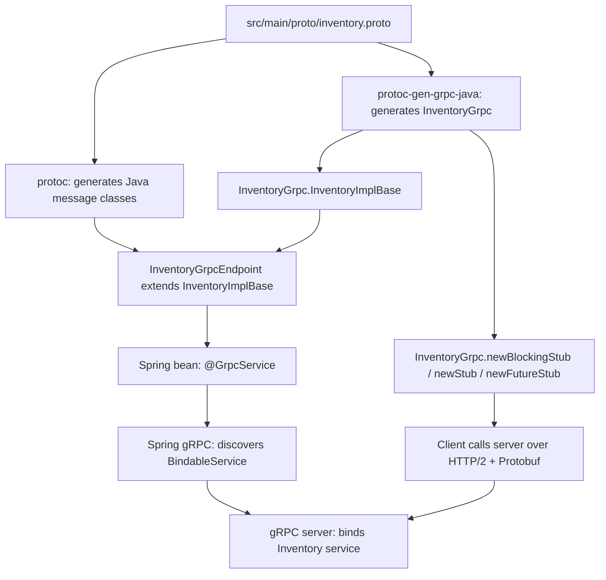

# Extending the Generated Service Base

## Lesson Objectives

In the **SPRING_GRPC** module, the Protocol Buffers contract is the source of truth for service names, RPCs, and messages. From that contract, code generation tools produce Java classes for the server to implement RPCs and for the client to invoke them. This lesson focuses on the core server-side task: **extending the generated service base class, overriding the right RPC methods, and providing the implementation as a Spring bean**.

After this lesson, you will be able to:

1. Distinguish between message code generated by `protoc` and gRPC service/stub code generated by `protoc-gen-grpc-java`.
2. Identify the `XxxGrpc.XxxImplBase` class and the method signatures to override from a `.proto` contract.
3. Implement unary, server streaming, client streaming, and bidirectional streaming on the same service base.
4. Complete `StreamObserver` following the proper success or error rules; map errors to appropriate `Status` codes.
5. Register the implementation as a Spring bean and verify that its descriptor is exposed through the gRPC server.
6. Recognize risks when modifying `.proto`, editing generated code, using the wrong stub, blocking threads, or handling streaming unsafely.

> **Context:** Examples use gRPC Java and official Spring gRPC with `org.springframework.grpc.server.service.GrpcService`. Code in the generated directory is produced by the build and may vary slightly depending on the `grpc-java` version, but the rules for extending `*ImplBase`, implementing RPCs, and using `StreamObserver` remain the core foundation.

## 1. What Is the Generated Service Base?

Suppose a contract defines `service Inventory` and RPC `GetStock`. During the build, two groups of Java code are generated:

- **Protocol Buffers Java**: message classes such as `StockQuery`, `StockReply`, builders, parsers, and serialization logic.
- **gRPC Java**: the `InventoryGrpc` class containing the service descriptor, client stub factory methods, and the server base class `InventoryGrpc.InventoryImplBase`.

`InventoryImplBase` provides a server-side service skeleton and implements `io.grpc.BindableService`, allowing gRPC to obtain a `ServerServiceDefinition` via `bindService()`. That class does not carry your business logic. Its default RPC methods typically return `UNIMPLEMENTED` until you override them.



| Component | Where Is It? | Who Uses It? |
| --- | --- | --- |
| `StockQuery`, `StockReply` | Generated from `message` in `.proto` | Both client and server |
| `InventoryGrpc.InventoryImplBase` | Generated by the gRPC Java plugin | **Server** extends it to override RPCs |
| `InventoryGrpc.newBlockingStub(channel)` | Factory method generated in `InventoryGrpc` | **Client** calls supported RPC types in blocking mode |
| `InventoryGrpc.newStub(channel)` | Factory method generated in `InventoryGrpc` | **Client** calls asynchronous RPCs, including streaming |
| `InventoryGrpc.newFutureStub(channel)` | Factory method generated in `InventoryGrpc` | **Client** calls unary RPCs returning a future |
| `InventoryGrpcEndpoint` | Application code you write | Managed by Spring and executed by the gRPC server |

Some newer `grpc-java` versions also generate an `AsyncService` interface and helper methods to bind services through that interface. **Do not rely on internal details of the generated class**: check the generated API in your project's version and extend `InventoryImplBase` as guided by gRPC Java.

## 2. A `.proto` Contract Illustrating All Four RPC Types

Create the file `src/main/proto/inventory.proto`:

```proto
syntax = "proto3";

package inventory.v1;

option java_package = "com.example.inventory.proto";
option java_multiple_files = true;

service Inventory {
  // Unary: one request -> one response.
  rpc GetStock(StockQuery) returns (StockReply);

  // Server streaming: one request -> multiple responses.
  rpc SubscribeStock(StockSubscription) returns (stream StockReply);

  // Client streaming: multiple requests -> one response.
  rpc CountQueries(stream StockQuery) returns (CountReply);

  // Bidirectional streaming: multiple requests <-> multiple responses.
  rpc DuplexLookup(stream StockQuery) returns (stream StockReply);
}

message StockQuery {
  string sku = 1;
}

message StockSubscription {
  string sku = 1;
  int32 samples = 2;
}

message StockReply {
  string sku = 1;
  int32 quantity = 2;
}

message CountReply {
  int32 accepted = 1;
}
```

Here, the **gRPC service name** is `inventory.v1.Inventory` because `package inventory.v1` defines the protocol-level namespace. `java_package` only determines the Java package of the generated classes. These two values can differ and must not be confused when invoking with `grpcurl`.

### Code Generation Prerequisites

The project requires the Protocol Buffers compiler (`protoc`) and the gRPC Java plugin (`protoc-gen-grpc-java`), with versions compatible with the `protobuf-java` and `grpc-java` libraries. Maven and Gradle have different configuration mechanisms; in a Spring Boot project, you should use the build and dependency management provided by a project initialized from Spring Initializr. To run the server in a Spring Boot version with the official gRPC starter, configure the corresponding server dependency, for example:

```xml
<!-- A dependency in pom.xml; does not replace the codegen plugin configuration. -->
<dependency>
    <groupId>org.springframework.boot</groupId>
    <artifactId>spring-boot-starter-grpc-server</artifactId>
</dependency>
```

After a compilation pass with proper code generation configured, the project will contain generated classes such as:

```text
com.example.inventory.proto.StockQuery
com.example.inventory.proto.StockSubscription
com.example.inventory.proto.StockReply
com.example.inventory.proto.CountReply
com.example.inventory.proto.InventoryGrpc
com.example.inventory.proto.InventoryGrpc.InventoryImplBase
```

**Do not edit generated code directly**: when the build regenerates from `.proto`, manual edits will be lost. If you need to add behavior, create a separate implementation class and extend the base class.

## 3. Reading the Method Signatures in the Generated Base

For the contract above, the methods to override have the following equivalent signatures (parameter names may vary by plugin version):

```java
// Unary
public void getStock(
        StockQuery request,
        StreamObserver<StockReply> responseObserver);

// Server streaming
public void subscribeStock(
        StockSubscription request,
        StreamObserver<StockReply> responseObserver);

// Client streaming
public StreamObserver<StockQuery> countQueries(
        StreamObserver<CountReply> responseObserver);

// Bidirectional streaming
public StreamObserver<StockQuery> duplexLookup(
        StreamObserver<StockReply> responseObserver);
```

These are **illustrative signatures** for reference, not four standalone Java methods to place outside a class. In your implementation, use `@Override` and preserve the exact parameter and return types.

| RPC Type | Server Java Method Return Type | How Requests Are Received | How Responses Are Sent |
| --- | --- | --- | --- |
| Unary | `void` | `request` parameter | Send one message via `responseObserver` |
| Server streaming | `void` | `request` parameter | Send multiple messages via `responseObserver` |
| Client streaming | `StreamObserver<Request>` | `onNext` calls on the observer you return | Send response via `responseObserver` when the stream ends |
| Bidirectional streaming | `StreamObserver<Request>` | `onNext` calls on the observer you return | Can send responses incrementally via `responseObserver` |

Note that `StreamObserver<T>` belongs to the `io.grpc.stub` package. For unary RPCs, do not return `StockReply` directly from `getStock`: the gRPC runtime expects you to pass the response to the observer. For client/bidirectional streaming, the returned object is the **request-receiving observer**, while the passed-in observer is the channel for **sending responses**.

## 4. Separating Business Logic from the gRPC Endpoint Class

The example uses hardcoded inventory data to focus on inheritance. Create `src/main/java/com/example/inventory/StockReader.java`:

```java
package com.example.inventory;

import java.util.Map;
import java.util.OptionalInt;
import org.springframework.stereotype.Service;

@Service
public class StockReader {

    private final Map<String, Integer> quantities = Map.of(
            "sku-100", 24,
            "sku-200", 7);

    public OptionalInt findQuantity(String sku) {
        Integer quantity = quantities.get(sku);
        return quantity == null
                ? OptionalInt.empty()
                : OptionalInt.of(quantity);
    }
}
```

This is a Spring bean holding pure read-only, immutable data. In a real system, the equivalent class typically calls a repository, cache, or another service; under high concurrent RPC load, pay close attention to thread safety, timeouts, and using asynchronous APIs where appropriate.

## 5. Extending `InventoryImplBase` and Implementing RPCs

Create `src/main/java/com/example/inventory/grpc/InventoryGrpcEndpoint.java`:

```java
package com.example.inventory.grpc;

import com.example.inventory.StockReader;
import com.example.inventory.proto.CountReply;
import com.example.inventory.proto.InventoryGrpc;
import com.example.inventory.proto.StockQuery;
import com.example.inventory.proto.StockReply;
import com.example.inventory.proto.StockSubscription;
import io.grpc.Context;
import io.grpc.Status;
import io.grpc.StatusRuntimeException;
import io.grpc.stub.StreamObserver;
import org.springframework.grpc.server.service.GrpcService;

@GrpcService
public class InventoryGrpcEndpoint
        extends InventoryGrpc.InventoryImplBase {

    private final StockReader stockReader;

    public InventoryGrpcEndpoint(StockReader stockReader) {
        this.stockReader = stockReader;
    }

    // 1. Unary RPC
    @Override
    public void getStock(StockQuery request,
                         StreamObserver<StockReply> responseObserver) {
        try {
            StockReply reply = snapshot(request.getSku());
            responseObserver.onNext(reply);
            responseObserver.onCompleted();
        } catch (StatusRuntimeException ex) {
            responseObserver.onError(ex);
        }
    }

    // 2. Server streaming RPC
    @Override
    public void subscribeStock(
            StockSubscription request,
            StreamObserver<StockReply> responseObserver) {
        int samples = request.getSamples();
        if (samples < 1 || samples > 5) {
            responseObserver.onError(Status.INVALID_ARGUMENT
                    .withDescription("samples must be between 1 and 5")
                    .asRuntimeException());
            return;
        }

        final StockReply reply;
        try {
            reply = snapshot(request.getSku());
        } catch (StatusRuntimeException ex) {
            responseObserver.onError(ex);
            return;
        }

        // Demo sends a finite number of records without creating a long-lived subscription.
        for (int i = 0; i < samples; i++) {
            if (Context.current().isCancelled()) {
                return;
            }
            responseObserver.onNext(reply);
        }
        if (!Context.current().isCancelled()) {
            responseObserver.onCompleted();
        }
    }

    // 3. Client streaming RPC
    @Override
    public StreamObserver<StockQuery> countQueries(
            StreamObserver<CountReply> responseObserver) {
        return new StreamObserver<>() {
            private int accepted;
            private boolean terminated;

            @Override
            public void onNext(StockQuery request) {
                if (terminated) {
                    return;
                }
                try {
                    snapshot(request.getSku()); // Only validate SKU.
                    accepted++;
                } catch (StatusRuntimeException ex) {
                    terminated = true;
                    responseObserver.onError(ex);
                }
            }

            @Override
            public void onError(Throwable cause) {
                // Client or transport terminated the stream with an error.
                terminated = true;
            }

            @Override
            public void onCompleted() {
                if (terminated) {
                    return;
                }
                terminated = true;
                responseObserver.onNext(CountReply.newBuilder()
                        .setAccepted(accepted)
                        .build());
                responseObserver.onCompleted();
            }
        };
    }

    // 4. Bidirectional streaming RPC
    @Override
    public StreamObserver<StockQuery> duplexLookup(
            StreamObserver<StockReply> responseObserver) {
        return new StreamObserver<>() {
            private boolean terminated;

            @Override
            public void onNext(StockQuery request) {
                if (terminated) {
                    return;
                }
                try {
                    responseObserver.onNext(snapshot(request.getSku()));
                } catch (StatusRuntimeException ex) {
                    terminated = true;
                    responseObserver.onError(ex);
                }
            }

            @Override
            public void onError(Throwable cause) {
                terminated = true;
            }

            @Override
            public void onCompleted() {
                if (terminated) {
                    return;
                }
                terminated = true;
                responseObserver.onCompleted();
            }
        };
    }

    // Shared helper for all four RPCs; do not edit generated files.
    private StockReply snapshot(String sku) {
        if (sku == null || sku.isBlank()) {
            throw Status.INVALID_ARGUMENT
                    .withDescription("sku must not be empty")
                    .asRuntimeException();
        }

        var quantity = stockReader.findQuantity(sku);
        if (quantity.isEmpty()) {
            throw Status.NOT_FOUND
                    .withDescription("SKU not found: " + sku)
                    .asRuntimeException();
        }

        return StockReply.newBuilder()
                .setSku(sku)
                .setQuantity(quantity.getAsInt())
                .build();
    }
}
```

In the example, all four RPCs share the same `StockReader`; this shows that a **generated service base can group multiple RPC methods with different communication patterns**. `@GrpcService` creates a Spring bean for the implementation, and Spring gRPC locates the `BindableService` bean and binds the service definition to the server. In official Spring gRPC, `@Service` or a `@Bean` returning `BindableService` can also be used for registration. Do not register the same endpoint via multiple mechanisms simultaneously, as this easily creates two beans exposing the same gRPC service name.

### 5.1. Analyzing the Unary RPC

The `getStock` method receives **one** `StockQuery` and sends **one** `StockReply`:

```text
Client -- StockQuery(sku="sku-100") --> Server
Client <-- StockReply(sku="sku-100", quantity=24) -- Server
                                  onCompleted()
```

- Success: `responseObserver.onNext(reply)` **once**, followed by `responseObserver.onCompleted()`.
- Error: `responseObserver.onError(status.asRuntimeException())`, then exit the processing path.
- Never call `onCompleted()` or send another response after `onError()`.

`Status.INVALID_ARGUMENT` is used for an empty `sku`, and `Status.NOT_FOUND` is used when the SKU does not exist. `snapshot` intentionally throws an exception, and the gRPC method **catches and forwards that exception to the observer** so the client receives the proper gRPC status. When adding database access, you should also classify timeouts, dependency errors, and unexpected failures; do not return raw internal exceptions to the client.

### 5.2. Analyzing the Server Streaming RPC

`subscribeStock` receives a `StockSubscription` containing `sku` and the message count `samples`. The server sends multiple records before completing:

```text
Client -- StockSubscription(sku="sku-100", samples=3) --> Server
Client <-- StockReply(quantity=24) -- Server
Client <-- StockReply(quantity=24) -- Server
Client <-- StockReply(quantity=24) -- Server
Client <-- onCompleted() -- Server
```

The example emits three identical snapshots to demonstrate **stream structure**, not a real-time inventory update mechanism. In production, long-lived streaming must handle flow control, backpressure, request cancellation, deadlines, observer writability, and resource cleanup. If the client cancels, `Context.current().isCancelled()` allows stopping early; this is a simple check and does not cover every asynchronous scenario.

### 5.3. Analyzing the Client Streaming RPC

For `countQueries`, when the client opens the RPC, the server returns a **`StreamObserver<StockQuery>`** to receive each message:

```text
Client -- StockQuery(sku="sku-100") --> Server.onNext(...)
Client -- StockQuery(sku="sku-200") --> Server.onNext(...)
Client -- half-close -----------------> Server.onCompleted()
Client <-- CountReply(accepted=2) ---- Server.responseObserver.onNext(...)
Client <-- RPC completed ------------- Server.responseObserver.onCompleted()
```

Here, `CountQueries` **counts how many queries have an existing SKU**, without mutating inventory. The `accepted` and `terminated` state fields are declared **inside each call's observer**, preventing concurrent RPCs from sharing a counter. If a request is invalid, the example terminates the entire RPC with an error status. Do not continue sending `CountReply` after sending an error.

### 5.4. Analyzing the Bidirectional Streaming RPC

For `duplexLookup`, both directions are streams. The server returns an observer to receive `StockQuery` messages and can emit a `StockReply` right after each request:

```text
Client -- StockQuery("sku-100") --> Server
Client <-- StockReply(24) ----------- Server
Client -- StockQuery("sku-200") --> Server
Client <-- StockReply(7) ------------ Server
Client -- half-close ---------------> Server
Client <-- onCompleted() ----------- Server
```

This is a paired request-response example for readability; bidirectional streaming **does not require** the number of responses to match the number of requests, nor does it require immediate replies. In real systems, receiving and sending in both directions can happen independently. Never assume any thread can call `responseObserver.onNext` concurrently: you must synchronize or serialize writes when multiple sources push results.

## 6. Connecting the Implementation to the Spring Application

Create the startup class in the parent package `com.example.inventory` so component scanning sees both `StockReader` and `InventoryGrpcEndpoint`:

```java
package com.example.inventory;

import org.springframework.boot.SpringApplication;
import org.springframework.boot.autoconfigure.SpringBootApplication;

@SpringBootApplication
public class InventoryApplication {
    public static void main(String[] args) {
        SpringApplication.run(InventoryApplication.class, args);
    }
}
```

Example native gRPC port configuration:

```yaml
spring:
  grpc:
    server:
      port: 9091
```

Property names and transport types must match the starter version in use. With a native gRPC server such as Netty, `spring.grpc.server.port` sets the RPC port. If the application serves gRPC using a servlet server, port and HTTP/2 settings depend on the web server configuration; do not mechanically apply native port assumptions.

Sequence from Spring Boot startup:

1. Spring instantiates the `StockReader` bean.
2. Component scanning creates the `InventoryGrpcEndpoint` bean and injects `StockReader` via the constructor.
3. Spring gRPC detects the `InventoryGrpcEndpoint` bean as a `BindableService`.
4. `bindService()`, provided by the generated code, builds the descriptor and registers the four overridden RPC handlers.
5. The gRPC server factory binds the definition to the server; clients can call `inventory.v1.Inventory/GetStock` once the port/transport is ready.

Note that Spring **having the bean** and clients **being able to call it over the network** are two separate outcomes. If the gRPC transport is not running, TLS configuration mismatches, or the service is filtered out by `ServerServiceDefinitionFilter`, the bean can still exist while the endpoint remains unreachable on the expected server.

## 7. Testing the RPCs and Inspecting the Descriptor

### 7.1. Unary with `grpcurl`

With the example port `9091` and a non-TLS server in development, run from the project root directory:

```bash
grpcurl -plaintext \
  -import-path src/main/proto \
  -proto inventory.proto \
  -d '{"sku":"sku-100"}' \
  localhost:9091 inventory.v1.Inventory/GetStock
```

Expected output:

```json
{
  "sku": "sku-100",
  "quantity": 24
}
```

The command provides `.proto` directly so `grpcurl` knows the message descriptors; server reflection does not need to be enabled. If you call `grpcurl list` without `.proto`, the server must enable the reflection service separately. Only use `-plaintext` when the server truly does not use TLS.

### 7.2. Server Streaming with `grpcurl`

```bash
grpcurl -plaintext \
  -import-path src/main/proto \
  -proto inventory.proto \
  -d '{"sku":"sku-200","samples":3}' \
  localhost:9091 inventory.v1.Inventory/SubscribeStock
```

The client will receive three `StockReply` messages with `quantity: 7`, and then the stream ends normally. If `samples` is `0` or `6`, the result is gRPC status `INVALID_ARGUMENT`. If `sku` does not exist, the result is `NOT_FOUND`.

### 7.3. Client Streaming and Bidirectional Streaming with a Java Client

Because these two RPC types send multiple requests, they are more convenient with an asynchronous stub:

```java
// channel is a configured ManagedChannel; CLIENT-side snippet.
InventoryGrpc.InventoryStub asyncStub = InventoryGrpc.newStub(channel);

StreamObserver<CountReply> responses = new StreamObserver<>() {
    @Override
    public void onNext(CountReply value) {
        System.out.println("Accepted: " + value.getAccepted());
    }

    @Override
    public void onError(Throwable error) {
        System.err.println("RPC error: " + error.getMessage());
    }

    @Override
    public void onCompleted() {
        System.out.println("CountQueries completed");
    }
};

StreamObserver<StockQuery> requests = asyncStub.countQueries(responses);
requests.onNext(StockQuery.newBuilder().setSku("sku-100").build());
requests.onNext(StockQuery.newBuilder().setSku("sku-200").build());
requests.onCompleted();
```

This is a **client-side snippet**; you will need imports for `InventoryGrpc`, `CountReply`, `StockQuery`, and `StreamObserver`, as well as creating and closing the `ManagedChannel`. The client does not extend `InventoryImplBase`; the client uses the generated stub. For `duplexLookup`, the client similarly calls `asyncStub.duplexLookup(responseObserver)` to obtain the request-sending observer while handling incoming callbacks.

### 7.4. Checking the Bean in the Spring Context

You can write a test to verify the **service discovery** stage:

```java
package com.example.inventory;

import io.grpc.BindableService;
import org.junit.jupiter.api.Test;
import org.springframework.beans.factory.annotation.Autowired;
import org.springframework.boot.test.context.SpringBootTest;
import org.springframework.context.ApplicationContext;

import static org.assertj.core.api.Assertions.assertThat;

@SpringBootTest(properties = "spring.grpc.server.port=0")
class InventoryServiceRegistrationTest {

    @Autowired
    ApplicationContext context;

    @Test
    void generatedServiceBaseIsBoundByBean() {
        var services = context.getBeansOfType(BindableService.class).values();
        assertThat(services).anySatisfy(service ->
                assertThat(service.bindService()
                        .getServiceDescriptor()
                        .getName())
                        .isEqualTo("inventory.v1.Inventory"));
    }
}
```

This test confirms that the bean exists and has the right descriptor; `spring.grpc.server.port=0` requests a random port when using a native server that supports this option. This test does **not replace** integration tests that call RPCs through a real server. When testing statuses, metadata, deadlines, interceptors, or TLS, you need integration tests via stubs against an appropriate native or in-process server.

## 8. Important Rules for `StreamObserver`

| Rule | Why Must You Follow It? |
| --- | --- |
| A successful unary call sends one response, then `onCompleted()` | Fulfils the RPC's `returns (Response)` contract |
| On error, call `onError(...)` and stop sending data | `onError` is a terminal event; nothing more may be sent |
| Do not call `onCompleted()` twice | Sending multiple terminal events breaks the RPC lifecycle |
| `onNext(...)` is only valid before a terminal event | A client with a closed stream cannot accept further messages |
| For client/bidi streaming, create per-call observers and state | Prevents mixing data across concurrent requests |
| Do not block gRPC callbacks for long with slow I/O | Avoids tying up RPC processing threads and hurting throughput |
| For long-lived streams, monitor cancellation/deadlines and backpressure | Avoids sending excessive data or holding resources after the client leaves |
| Do not share a `StreamObserver` across RPCs | An observer belongs to the lifecycle and context of a single RPC |

**Deadlines and cancellation:** RPCs can expire when a client sets a deadline, or be cancelled before completion. When implementing asynchronous streams, propagate cancellation information to background work and cancel tasks immediately when the client is no longer receiving data. For advanced flow control, see `ServerCallStreamObserver` and its `isReady()`, `setOnReadyHandler(...)` methods in the gRPC Java documentation instead of calling `onNext` continuously in a tight loop.

**Thread safety:** A Spring-managed endpoint instance usually has singleton scope and handles multiple RPCs concurrently. Do not store `accepted`, `terminated`, `request`, or `responseObserver` in mutable fields on the singleton. In the example, streaming state fields live inside the anonymous observer, which is created fresh for each call. If a stream emits responses from multiple threads, you must serialize writes to the same observer.

## 9. Common Errors When Extending the Generated Base

| Symptom | Common Cause | How to Fix |
| --- | --- | --- |
| Cannot find `InventoryGrpc` or `StockReply` | Code generation not configured/run; `java_package` differs from imported package | Check `.proto`, `protoc-gen-grpc-java` plugin, generated sources, and dependency versions |
| `@Override` reports method does not exist | Name, casing, or signature differs from generated file; `.proto` edited without regenerating code | Open the project's generated API, compare names from `.proto`, regenerate code |
| Client receives `UNIMPLEMENTED` | Method not overridden, wrong implementation bound, or wrong service/method called | Check `*ImplBase`, `package.Service/Method` name, and bound descriptor |
| Client receives `UNKNOWN` instead of business status | Throwing an exception out of the handler without mapping to `Status` | Call `responseObserver.onError(Status...asRuntimeException())` and stop processing |
| Client hangs waiting for unary/streaming | Forgot `onCompleted()` or failed to close the stream after finishing data | Ensure success ends with `onCompleted()` and errors with `onError()` |
| Exception after calling `onError()` | Method continues calling `onNext` or `onCompleted` | `return` immediately in the error branch; track terminal state when needed |
| Server cannot find implementation | Spring bean not created or implementation is outside component scan | Add `@GrpcService`/`@Service`, configure `@Bean` properly, and check packages |
| Startup fails with duplicate service registration | Two beans both provide `inventory.v1.Inventory` | Use only one registration method; avoid combining stereotype and `@Bean` |
| Code runs but throughput is low | Long blocking work in callbacks; stream sends without flow control | Offload slow work, apply deadlines, cancellation, and backpressure |
| Rebuild wipes out RPC handling logic | Edited the generated class directly | Keep logic in a subclass under `src/main/java` |

An effective debugging sequence is: **check `.proto` → generate code → verify `@Override` methods → verify `BindableService` bean → check service descriptor → call via stub or `grpcurl`**. This separates contract errors, implementation errors, Spring context issues, and transport errors.

## 10. Hands-On Exercises

1. **Add a unary RPC** `GetAllStocks(Empty) returns (StockList)` to `Inventory`. Update `.proto`, regenerate code, and override the corresponding method in `InventoryGrpcEndpoint`. Compare the newly generated classes.
2. **Test the default implementation**: temporarily remove `@Override` from `getStock` and call `GetStock`. Explain why the client receives `UNIMPLEMENTED`, then restore the method.
3. **Error handling**: send an empty `sku` and an `sku` not in the map; note the difference between `INVALID_ARGUMENT` and `NOT_FOUND`.
4. **Verify streaming**: call `SubscribeStock` with `samples=3`; then try `samples=0` and `samples=6`. Ensure no messages are sent after a terminal event.
5. **Isolate RPC state**: run two concurrent client-streaming `CountQueries` calls with different query counts; explain why the two counters do not interfere with each other.
6. **Contract change**: rename `service Inventory` to `WarehouseInventory`, regenerate code, see how the `*Grpc` class name changes, and update the implementation/client. Do not make this rename in a live production system without an API compatibility plan.
7. **Spring integration**: remove `@GrpcService`, register the same implementation using a `@Bean` of type `BindableService`, and re-run the descriptor test. Ensure only one instance is registered per gRPC service name.

### Self-Check Questions

- Why should you not put business logic directly into the generated `InventoryGrpc.java`?
- Distinguish the roles of `InventoryGrpc.InventoryImplBase` and `InventoryGrpc.InventoryStub`.
- Why does `getStock` return `void` even though the `.proto` contract declares `returns (StockReply)`?
- Why does `countQueries` return `StreamObserver<StockQuery>` while `getStock` does not?
- What happens if a method calls `onError()` and then calls `onCompleted()`?
- When multiple concurrent RPCs hit the same singleton endpoint, where should per-RPC state variables live?
- Why is testing `getBeansOfType(BindableService.class)` not enough to guarantee that clients can call the RPC successfully?
- How does changing `package inventory.v1` differ from changing `java_package` in its impact on clients and Java code?

## References

- [gRPC Java — Basics Tutorial](https://grpc.io/docs/languages/java/basics/): RPC definitions, generated bases, and implementing streaming types.
- [gRPC Java — Generated Code Reference](https://grpc.io/docs/languages/java/generated-code/): generated message classes, stubs, and server-side APIs.
- [gRPC Java — StreamObserver](https://grpc.github.io/grpc-java/javadoc/io/grpc/stub/StreamObserver.html): stream lifecycle rules and terminal methods.
- [gRPC Java — BindableService](https://grpc.github.io/grpc-java/javadoc/io/grpc/BindableService.html): how a service provides a `ServerServiceDefinition`.
- [Spring gRPC — gRPC Server](https://docs.spring.io/spring-grpc/reference/server.html): how Spring discovers `BindableService` beans and binds them to the gRPC server.
- [Spring Boot — gRPC](https://docs.spring.io/spring-boot/reference/io/grpc.html): server starter, transport configuration, code generation, and integration testing.

**Expected outcome:** From the `inventory.proto` contract, learners generate `InventoryGrpc.InventoryImplBase`, build `InventoryGrpcEndpoint extends InventoryGrpc.InventoryImplBase` covering all four RPC types, register it as a Spring bean, verify the `inventory.v1.Inventory` service descriptor, and invoke the RPCs with contract-compliant responses and statuses.
