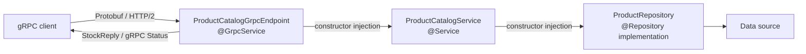

# Injecting Service Dependencies

## Lesson Objectives

In **SPRING_GRPC**, a gRPC endpoint is usually only responsible for receiving Protocol Buffers messages, converting data, calling business logic, and returning a response or gRPC status. Operations like looking up products, accessing databases, calling other services, or checking permissions should be separated into dependencies managed by Spring. This lesson walks through **dependency injection (DI)** when building a gRPC server in the Spring ecosystem, from a simple unary RPC to a server streaming RPC.

After this lesson, you will be able to:

1. Explain how Spring injects dependencies into a gRPC service bean.
2. Use **constructor injection** to wire `@GrpcService` to business classes, repositories, and configuration.
3. Define the responsibilities of the gRPC endpoint, application service, and persistence layer.
4. Select the right bean when multiple implementations share the same type using `@Qualifier` or `@Primary`.
5. Test the gRPC layer with mocked dependencies and verify bean creation in the Spring context.
6. Avoid mistakes such as manually instantiating dependencies with `new`, missing component scanning, circular dependencies, unsafe shared state, and calling external systems without deadlines.

> **Libraries Used:** Examples apply to **official Spring gRPC** with `org.springframework.grpc.server.service.GrpcService` and Java classes generated by `protoc` and `protoc-gen-grpc-java`. The community `net.devh` starter has similarly named annotations, but its packages and configuration can differ; stick consistently to one library ecosystem.

## 1. Why Does a gRPC Endpoint Need Dependency Injection?

If you instantiate a repository directly inside the endpoint, every time you change storage mechanisms or write tests, you have to modify or refactor the RPC handling class. Constructor injection lets the endpoint depend only on the behavior it needs; Spring is responsible for finding, creating, and providing the appropriate beans.



| Component | What It Should Do | What It Should Avoid |
| --- | --- | --- |
| `.proto` and generated code | Define RPC contracts, messages, `*Grpc` classes | Containing database access or business logic |
| gRPC endpoint | Validate requests, call application services, map domain objects to Protobuf, complete `StreamObserver` | Managing database connections directly or holding mutable per-RPC state in a singleton |
| Application service | Coordinate business workflows, validation rules, transactions | Depending directly on `StreamObserver` if business logic does not need to know about gRPC |
| Repository / gateway | Provide data access or external integrations | Deciding gRPC statuses for every situation |
| Spring container | Instantiate beans, resolve dependencies, manage lifecycles and configuration | Automatically managing objects manually instantiated with `new` outside the container |

In a Spring Boot application, `@GrpcService` makes the endpoint discoverable as a Spring bean, while the generated base `XxxGrpc.XxxImplBase` implements `BindableService`, allowing Spring gRPC infrastructure to attach the RPCs to the server. **DI happens when Spring creates beans**, before any request arrives; RPC invocations occur later, once the server is running. A single endpoint singleton instance can handle many concurrent RPCs, so how dependencies are structured directly impacts correctness and reliability.

## 2. Preparing the gRPC Contract and Generated Code

Let's build a product catalog management example. Clients have two operations: fetching a single product via a **unary RPC** and reading a bounded list via a **server streaming RPC**.

Create `src/main/proto/catalog.proto`:

```proto
syntax = "proto3";

package catalog.v1;

option java_package = "com.example.catalog.proto";
option java_multiple_files = true;

service ProductCatalog {
  rpc GetProduct(GetProductRequest) returns (ProductReply);
  rpc ListProducts(ListProductsRequest) returns (stream ProductReply);
}

message GetProductRequest {
  string product_id = 1;
}

message ListProductsRequest {
  int32 limit = 1;
}

message ProductReply {
  string product_id = 1;
  string name = 2;
  int64 price_cents = 3;
}
```

The build must be configured with the Protocol Buffers compiler and the gRPC Java plugin to generate `ProductCatalogGrpc`, `GetProductRequest`, `ListProductsRequest`, and `ProductReply`. A Spring Boot example using the official server starter can declare the following dependency if supported by the Boot/BOM version:

```xml
<dependency>
    <groupId>org.springframework.boot</groupId>
    <artifactId>spring-boot-starter-grpc-server</artifactId>
</dependency>
```

The server dependency **does not replace the entire code generation configuration**; you still need the appropriate build plugin or feature to process `.proto`. When the build succeeds, the server base is `ProductCatalogGrpc.ProductCatalogImplBase` in the Java package `com.example.catalog.proto`. This class implements `BindableService` and contains the methods to override. Place your handwritten logic under `src/main/java`; do not modify generated code because it can be regenerated on every build.

## 3. Designing Spring-Managed Dependencies

We build the chain `ProductCatalogGrpcEndpoint → ProductCatalogService → ProductRepository`. To let the example run without an external database, the repository is implemented with hardcoded data.

### 3.1. Domain Model: Business Data Independent of Protobuf

File `src/main/java/com/example/catalog/domain/Product.java`:

```java
package com.example.catalog.domain;

public record Product(String id, String name, long priceCents) {
}
```

`Product` is a Java record representing business data. It has no dependency on gRPC or `StreamObserver`, making the business layer reusable if you later add REST, batch jobs, or message consumers. The `priceCents` field is only an illustrative smallest currency unit; real systems must define explicit currencies and rounding rules.

### 3.2. Repository Interface

File `src/main/java/com/example/catalog/repository/ProductRepository.java`:

```java
package com.example.catalog.repository;

import com.example.catalog.domain.Product;
import java.util.List;
import java.util.Optional;

public interface ProductRepository {
    Optional<Product> findById(String id);
    List<Product> findAll();
}
```

Depending on an interface lets you swap `InMemoryProductRepository` for a JPA repository, JDBC, or an external system gateway. There is no need for the interface to extend any gRPC type.

### 3.3. Repository Bean

File `src/main/java/com/example/catalog/repository/InMemoryProductRepository.java`:

```java
package com.example.catalog.repository;

import com.example.catalog.domain.Product;
import java.util.List;
import java.util.Map;
import java.util.Optional;
import org.springframework.stereotype.Repository;

@Repository
public class InMemoryProductRepository implements ProductRepository {

    private final Map<String, Product> data = Map.of(
            "sku-101", new Product("sku-101", "Keyboard", 890_000L),
            "sku-102", new Product("sku-102", "Wireless mouse", 420_000L),
            "sku-103", new Product("sku-103", "Headphones", 1_150_000L));

    @Override
    public Optional<Product> findById(String id) {
        return Optional.ofNullable(data.get(id));
    }

    @Override
    public List<Product> findAll() {
        return List.copyOf(data.values());
    }
}
```

The `@Repository` annotation is a Spring stereotype. Component scanning creates the `InMemoryProductRepository` bean, which can then be injected wherever a constructor parameter of type `ProductRepository` is declared. Because the map is initialized once and never mutated, the example has no write contention across RPCs. If you switch to a mutable map or cache, you must ensure thread safety yourself.

### 3.4. Application Service Receiving the Repository via Constructor

File `src/main/java/com/example/catalog/application/ProductCatalogService.java`:

```java
package com.example.catalog.application;

import com.example.catalog.domain.Product;
import com.example.catalog.repository.ProductRepository;
import java.util.Comparator;
import java.util.List;
import java.util.Optional;
import org.springframework.stereotype.Service;

@Service
public class ProductCatalogService {

    private final ProductRepository repository;

    public ProductCatalogService(ProductRepository repository) {
        this.repository = repository;
    }

    public Optional<Product> findById(String productId) {
        return repository.findById(productId);
    }

    public List<Product> listFirst(int limit) {
        return repository.findAll().stream()
                .sorted(Comparator.comparing(Product::id))
                .limit(limit)
                .toList();
    }
}
```

Spring automatically resolves `ProductRepository` when instantiating `ProductCatalogService`. Because there is **only one public constructor**, modern Spring does not require `@Autowired`. The dependency is assigned to a `final` field, making the code clear to read and easy to replace with a fake/mock in tests. `ProductCatalogService` has no knowledge that requests arrive over gRPC; therefore, business rules or `@Transactional` can live in the service without placing transaction boundaries in the transport layer.

## 4. Injecting the Application Service into the gRPC Endpoint

File `src/main/java/com/example/catalog/grpc/ProductCatalogGrpcEndpoint.java`:

```java
package com.example.catalog.grpc;

import com.example.catalog.application.ProductCatalogService;
import com.example.catalog.domain.Product;
import com.example.catalog.proto.GetProductRequest;
import com.example.catalog.proto.ListProductsRequest;
import com.example.catalog.proto.ProductCatalogGrpc;
import com.example.catalog.proto.ProductReply;
import io.grpc.Context;
import io.grpc.Status;
import io.grpc.stub.StreamObserver;
import org.springframework.grpc.server.service.GrpcService;

@GrpcService
public class ProductCatalogGrpcEndpoint
        extends ProductCatalogGrpc.ProductCatalogImplBase {

    private final ProductCatalogService catalogService;

    public ProductCatalogGrpcEndpoint(ProductCatalogService catalogService) {
        this.catalogService = catalogService;
    }

    @Override
    public void getProduct(GetProductRequest request,
                           StreamObserver<ProductReply> responses) {
        String id = request.getProductId().trim();
        if (id.isEmpty()) {
            responses.onError(Status.INVALID_ARGUMENT
                    .withDescription("product_id must not be empty")
                    .asRuntimeException());
            return;
        }

        var product = catalogService.findById(id);
        if (product.isEmpty()) {
            responses.onError(Status.NOT_FOUND
                    .withDescription("Product not found: " + id)
                    .asRuntimeException());
            return;
        }

        responses.onNext(toProto(product.get()));
        responses.onCompleted();
    }

    @Override
    public void listProducts(ListProductsRequest request,
                             StreamObserver<ProductReply> responses) {
        int limit = request.getLimit();
        if (limit < 1 || limit > 50) {
            responses.onError(Status.INVALID_ARGUMENT
                    .withDescription("limit must be between 1 and 50")
                    .asRuntimeException());
            return;
        }

        for (Product product : catalogService.listFirst(limit)) {
            if (Context.current().isCancelled()) {
                return;
            }
            responses.onNext(toProto(product));
        }
        if (!Context.current().isCancelled()) {
            responses.onCompleted();
        }
    }

    private ProductReply toProto(Product product) {
        return ProductReply.newBuilder()
                .setProductId(product.id())
                .setName(product.name())
                .setPriceCents(product.priceCents())
                .build();
    }
}
```

**The injection point is the constructor `ProductCatalogGrpcEndpoint(ProductCatalogService catalogService)`.** When Spring creates the endpoint bean, it locates the bean of type `ProductCatalogService` and passes it into the constructor. As a result, the endpoint does not need to call `new ProductCatalogService(...)` and does not need to know whether the underlying repository is in-memory or backed by a database.

Both `getProduct` and `listProducts` share the same dependency; the injection mechanism does not depend on whether an RPC is unary or streaming. The difference lies in the message count and the `StreamObserver` lifecycle:

| Case | Result Emission Rule |
| --- | --- |
| Unary success | `onNext(reply)` once, then `onCompleted()` |
| Unary not found | `onError(Status.NOT_FOUND...)`, do not send `onCompleted()` |
| Invalid request | `onError(Status.INVALID_ARGUMENT...)`, stop processing |
| Server streaming success | Multiple `onNext(reply)` calls, then one `onCompleted()` |
| Client cancelled stream | Stop emitting data and release resources upon cancellation signal |

In this example, the product list is tiny so items can be emitted consecutively. For long-lived streaming, you must handle backpressure, `ServerCallStreamObserver.isReady()`, cancellation, deadlines, and avoid blocking gRPC threads with slow I/O. If the repository can throw infrastructure errors, map exceptions through an appropriate gRPC error-handling layer (such as a centralized error handler) so the server does not leak stack traces to clients. `Status.UNAVAILABLE` can reflect a temporarily unavailable dependency; `INTERNAL` is for unexpected server errors after logging internally.

## 5. How Does Spring Build the Dependency Graph?

Create the startup class `src/main/java/com/example/catalog/CatalogApplication.java`:

```java
package com.example.catalog;

import org.springframework.boot.SpringApplication;
import org.springframework.boot.autoconfigure.SpringBootApplication;

@SpringBootApplication
public class CatalogApplication {
    public static void main(String[] args) {
        SpringApplication.run(CatalogApplication.class, args);
    }
}
```

Because the startup class sits in the `com.example.catalog` package, default component scanning covers all subpackages:

```text
com.example.catalog
├── CatalogApplication.java
├── domain/Product.java
├── repository/ProductRepository.java
├── repository/InMemoryProductRepository.java       (@Repository)
├── application/ProductCatalogService.java         (@Service)
└── grpc/ProductCatalogGrpcEndpoint.java           (@GrpcService)
```

When Spring Boot starts successfully, a typical sequence is:

1. Component scanning identifies classes with stereotypes and bean configurations.
2. Spring creates `InMemoryProductRepository` and uses that bean when creating `ProductCatalogService`.
3. Spring creates `ProductCatalogGrpcEndpoint`, passing `ProductCatalogService` into the constructor.
4. Spring gRPC infrastructure discovers the endpoint bean of type `BindableService` and binds the `catalog.v1.ProductCatalog` service descriptor to the configured server.
5. When a client calls an RPC, the handler uses the previously injected dependencies.

Exact initialization order is determined by Spring from the dependency graph; you do not need `@DependsOn` to manually enforce ordering for this constructor injection chain. If a required dependency has no bean, Spring typically **fails at startup**; this is beneficial because configuration mistakes are caught early.

### Bean Scope and Concurrency Safety

The Spring beans above have singleton scope by default. That means **multiple gRPC calls can share the same instance of the endpoint, service, and repository**. `final` fields referencing dependencies are completely fine; however, mutable fields such as `currentRequest`, `StreamObserver`, `acceptedCount`, or `transactionId` must not be stored on the singleton endpoint. Use method-local variables per call or create a dedicated observer per stream.

If a dependency genuinely needs per-request data, pass that data through method parameters; do not assume servlet-based Spring `@RequestScope` automatically applies to every gRPC call. RPC metadata, authentication info, and deadlines should be handled via gRPC contexts/interceptors or an appropriate abstraction rather than stored in a singleton field.

## 6. Constructor, Field, or Setter Injection?

Spring supports several DI styles, but in gRPC endpoints you should prefer **constructor injection**:

```java
@GrpcService
public class ProductCatalogGrpcEndpoint
        extends ProductCatalogGrpc.ProductCatalogImplBase {

    private final ProductCatalogService catalogService;

    public ProductCatalogGrpcEndpoint(ProductCatalogService catalogService) {
        this.catalogService = catalogService;
    }
}
```

| Injection Style | Example | Assessment |
| --- | --- | --- |
| Constructor | `ProductCatalogGrpcEndpoint(ProductCatalogService service)` | **Recommended** for required dependencies: immutable, easy to test, missing beans fail fast |
| Field | `@Autowired private ProductCatalogService service;` | Works, but hides dependencies, prevents `final`, and makes instantiation harder in unit tests without Spring |
| Setter | `@Autowired void setCatalogService(...)` | Useful for mutable configuration or special optional dependencies, but the object exists in an incomplete state before injection |

You do not need `@Autowired` on the **single** constructor of a Spring component. If a class has multiple constructors, you must explicitly specify which constructor to inject or redesign to remove ambiguity. Do not confuse `@GrpcService` with an injection annotation: `@GrpcService` declares the bean and service metadata; the constructor is where Spring resolves dependencies.

## 7. When Multiple Beans Implement the Same Interface

When an application has two repositories or multiple pricing policies, injecting by interface can throw **`NoUniqueBeanDefinitionException`** because Spring does not know which implementation to pick.

Suppose there is a standalone interface:

```java
public interface PricePolicy {
    long calculate(long basePriceCents);
}
```

And two implementations:

```java
import org.springframework.stereotype.Component;

@Component("retailPricePolicy")
class RetailPricePolicy implements PricePolicy {
    @Override
    public long calculate(long basePriceCents) {
        return basePriceCents;
    }
}

@Component("partnerPricePolicy")
class PartnerPricePolicy implements PricePolicy {
    @Override
    public long calculate(long basePriceCents) {
        return basePriceCents * 9 / 10;
    }
}
```

In the class that needs a policy, request the exact bean with `@Qualifier` on the **constructor parameter**:

```java
import org.springframework.beans.factory.annotation.Qualifier;

public PricingService(
        @Qualifier("retailPricePolicy") PricePolicy pricePolicy) {
    this.pricePolicy = pricePolicy;
}
```

This is a **constructor excerpt** from a `PricingService` class with a `private final PricePolicy pricePolicy;` field, not a complete class. In real code, register this class in the Spring context with `@Service` or `@Bean` like the previous services. You can place `@Primary` on one implementation when you want it to serve as the default choice everywhere that interface is injected; `@Qualifier` is suitable when a specific use case requires an explicit selection.

**Selection rule:** only use `@Qualifier` when there genuinely are multiple beans or an explicit strategy must be named; if you can design an unambiguous dependency, a clean constructor remains easier to read. Do not resolve bean conflicts by arbitrarily renaming beans.

### When You Want to Create a Dependency via `@Bean`

Not every dependency is a class you can annotate with `@Service` or `@Repository`. If you use a third-party library client, a factory, or an object requiring complex setup, you can provide the bean using `@Configuration`:

```java
import org.springframework.context.annotation.Bean;
import org.springframework.context.annotation.Configuration;

@Configuration(proxyBeanMethods = false)
public class CatalogInfrastructureConfig {

    @Bean
    ProductRepository productRepository() {
        return new InMemoryProductRepository();
    }
}
```

**This is an alternative** to placing `@Repository` on `InMemoryProductRepository`: when using this approach, **remove `@Repository`** from the implementation to avoid creating two beans of the same type. Upstream dependencies remain unchanged because they still inject `ProductRepository`. Similarly, `ProductCatalogService` or the endpoint can be created via `@Bean`, as long as the Spring context only has one gRPC service bound per RPC service name.

### Avoiding Circular Dependencies

Bad design example:

```text
ProductCatalogGrpcEndpoint  --> ProductCatalogService
          ^                            |
          |____________________________|
```

If `ProductCatalogService` also injects `ProductCatalogGrpcEndpoint`, the two constructors require each other and Spring cannot construct the dependency graph normally. The fix is to extract a shared interface or common bean holding the shared logic so dependencies flow in one direction. Do not use `@Lazy` merely to mask a circular dependency caused by poor layering.

## 8. Injecting Dependencies When a gRPC Service Calls Another gRPC Service

An application service sometimes has to make RPC calls to an inventory, payment, or identity service. In that case, the dependency can be a **generated client stub** or a gateway wrapping the stub.


With official Spring gRPC, let **Spring manage the channel/stub or gateway** using the APIs for your library version. Avoid creating a new `ManagedChannel` inside every RPC handler method: channels are typically reusable resources that require TLS configuration, interceptors, and proper lifecycle shutdown. A gateway wrapping the stub keeps remote call mechanics out of the endpoint, making unit testing convenient:

```java
// Sketch of the gateway's role, not the complete channel configuration.
public interface InventoryGateway {
    int availableQuantity(String sku);
}

@Service
public class OrderApplicationService {
    private final InventoryGateway inventory;

    public OrderApplicationService(InventoryGateway inventory) {
        this.inventory = inventory;
    }

    public boolean canReserve(String sku, int requested) {
        return inventory.availableQuantity(sku) >= requested;
    }
}
```

An `InventoryGateway` implementation can inject a client stub provided by Spring configuration. **Deadlines are per-RPC requirements**: when using a gRPC Java blocking stub, derive a stub with a deadline for that call using `stub.withDeadlineAfter(..., TimeUnit.MILLISECONDS)` and invoke the method; do not turn a single request's timeout into shared mutable state. Distinguish `DEADLINE_EXCEEDED`, `UNAVAILABLE`, `CANCELLED`, and business errors before deciding to retry. For streaming, consider how to propagate cancellation and manage backpressure. TLS, auth metadata, and tracing are typically configured at the channel/interceptor level.

Remote calls can fail even when Spring successfully injects the bean. **DI only guarantees dependency wiring at Spring runtime**; it does not promise that the remote service is online or will respond within the deadline.

## 9. Testing Dependency Injection and RPC Behavior

### 9.1. Unit Testing the Endpoint with Mocked Dependencies

Unit tests do not need to start a gRPC server. We create a mock `ProductCatalogService`, inject it into the endpoint's constructor, and verify that the gRPC observer receives the expected response. Example using JUnit 5, Mockito, and `grpc-stub`:

```java
package com.example.catalog.grpc;

import com.example.catalog.application.ProductCatalogService;
import com.example.catalog.domain.Product;
import com.example.catalog.proto.GetProductRequest;
import com.example.catalog.proto.ProductReply;
import io.grpc.stub.StreamObserver;
import java.util.Optional;
import org.junit.jupiter.api.Test;
import org.junit.jupiter.api.extension.ExtendWith;
import org.mockito.InjectMocks;
import org.mockito.Mock;
import org.mockito.junit.jupiter.MockitoExtension;

import static org.mockito.ArgumentMatchers.argThat;
import static org.mockito.Mockito.never;
import static org.mockito.Mockito.verify;
import static org.mockito.Mockito.when;

@ExtendWith(MockitoExtension.class)
class ProductCatalogGrpcEndpointTest {

    @Mock
    ProductCatalogService catalogService;

    @Mock
    StreamObserver<ProductReply> responses;

    @InjectMocks
    ProductCatalogGrpcEndpoint endpoint;

    @Test
    void getProductUsesInjectedService() {
        when(catalogService.findById("sku-101"))
                .thenReturn(Optional.of(
                        new Product("sku-101", "Keyboard", 890_000L)));

        var request = GetProductRequest.newBuilder()
                .setProductId("sku-101")
                .build();

        endpoint.getProduct(request, responses);

        verify(catalogService).findById("sku-101");
        verify(responses).onNext(argThat(reply ->
                reply.getProductId().equals("sku-101")
                        && reply.getPriceCents() == 890_000L));
        verify(responses).onCompleted();
        verify(responses, never()).onError(org.mockito.ArgumentMatchers.any());
    }
}
```

In this example, Mockito instantiates the endpoint directly and passes mocks into the constructor, so **no Spring context is needed**. Without constructor DI, substituting the application service with a mock would be more awkward. To test `NOT_FOUND` or `INVALID_ARGUMENT`, pass a mock observer and verify that `onError` receives a `StatusRuntimeException` with the expected status code.

### 9.2. Verifying That the Spring Context Wires All Dependencies

The unit test above does not verify `@Repository`, `@Service`, `@GrpcService`, and component scanning. A Spring Boot context test checks real wiring:

```java
package com.example.catalog;

import com.example.catalog.application.ProductCatalogService;
import com.example.catalog.grpc.ProductCatalogGrpcEndpoint;
import io.grpc.BindableService;
import org.junit.jupiter.api.Test;
import org.springframework.beans.factory.annotation.Autowired;
import org.springframework.boot.test.context.SpringBootTest;
import org.springframework.context.ApplicationContext;

import static org.assertj.core.api.Assertions.assertThat;

@SpringBootTest(properties = "spring.grpc.server.port=0")
class CatalogWiringTest {

    @Autowired
    ApplicationContext context;

    @Test
    void createsGrpcEndpointWithItsDependencies() {
        assertThat(context.getBean(ProductCatalogService.class)).isNotNull();
        assertThat(context.getBean(ProductCatalogGrpcEndpoint.class)).isNotNull();

        assertThat(context.getBeansOfType(BindableService.class).values())
                .anySatisfy(service -> assertThat(
                        service.bindService().getServiceDescriptor().getName())
                        .isEqualTo("catalog.v1.ProductCatalog"));
    }
}
```

With a native gRPC server, `spring.grpc.server.port=0` lets the OS pick a dynamic port during tests if the transport supports it. This test verifies **the bean graph and descriptor**, not that a client can successfully call the RPC over the network. When you need to test deadlines, metadata, interceptors, TLS, or network errors, write an integration test using generated stubs against a suitable native or in-process server.

### 9.3. Testing with `grpcurl`

Suppose the application runs a native Netty server on port `9090` without TLS enabled in development. You can pass the `.proto` file directly so you do not depend on server reflection:

```bash
grpcurl -plaintext \
  -import-path src/main/proto \
  -proto catalog.proto \
  -d '{"productId":"sku-101"}' \
  localhost:9090 catalog.v1.ProductCatalog/GetProduct
```

Expected ProtoJSON response:

```json
{
  "productId": "sku-101",
  "name": "Keyboard",
  "priceCents": "890000"
}
```

According to ProtoJSON rules, `int64` is typically represented as a string in JSON. If you pass an empty `productId`, the RPC returns `INVALID_ARGUMENT`; if you pass `sku-999`, it returns `NOT_FOUND`.

Testing the streaming RPC:

```bash
grpcurl -plaintext \
  -import-path src/main/proto \
  -proto catalog.proto \
  -d '{"limit":2}' \
  localhost:9090 catalog.v1.ProductCatalog/ListProducts
```

The client receives two `ProductReply` messages and then the stream finishes; results are sorted by ID in `ProductCatalogService`. If you change `spring.grpc.server.port`, update the address in the command. When using a TLS server, do not pass `-plaintext`; configure the proper authentication and certificates instead.

## 10. Common Errors and How to Resolve Them

| Symptom | Cause | Resolution |
| --- | --- | --- |
| `NoSuchBeanDefinitionException` or `UnsatisfiedDependencyException` on startup | Missing stereotype or `@Bean`; implementation lies outside component scan | Check `@SpringBootApplication` package, `@Service`, `@Repository`, `@GrpcService`, and bean configuration |
| `NoUniqueBeanDefinitionException` | Multiple beans implement the same interface | Use `@Qualifier`, `@Primary`, or split into specialized interfaces |
| Injected field is `null` when method runs | Endpoint instantiated with `new` outside Spring, or field injection used in a unit test without starting context | Let Spring manage the endpoint; prefer constructor injection |
| Startup fails with circular dependency | `Endpoint → Service → Endpoint` or a cycle across multiple beans | Make dependencies unidirectional and extract shared logic into a separate bean |
| Endpoint bean exists but client gets `UNIMPLEMENTED` | Method not overridden, service not bound on server, or wrong RPC name called | Check generated base, `catalog.v1.ProductCatalog` descriptor, factory/filter configuration |
| Client receives `UNAVAILABLE` | Cannot connect to server, wrong port/host/TLS, or downstream closed connection | Check transport, startup logs, channel, TLS, and remote dependency health |
| Startup reports duplicate service definition | Same `BindableService` registered via both stereotype and `@Bean` | Keep only one bean per implementation/service name on that server |
| Two RPCs mix data with each other | Storing request or observer in a mutable singleton field | Use local variables or per-RPC state objects |
| Streaming is slow or holds resources too long | Blocking I/O in callbacks, ignoring deadlines/cancellation and flow control | Offload long tasks, enforce limits, and apply cancellation/backpressure |
| Unit tests are hard to run because full Spring startup is needed | Endpoint instantiates too many dependencies or holds too much business logic | Extract application service, repository/gateway; use constructor injection with mocks |

### Quick Diagnosis Checklist

1. Check that `ProductCatalogGrpc` and messages were properly generated from `.proto`.
2. Verify that the `@GrpcService` endpoint is covered by component scanning and actually implements `BindableService`.
3. Check that there is exactly **one** bean for each injected dependency, or resolve ambiguity cleanly.
4. Confirm `getProduct` calls `ProductCatalogService` properly and the repository returns expected data.
5. Verify the service descriptor and that the native/servlet server bound it; finally test invoking the RPC with a stub or `grpcurl`.

## 11. Hands-On Exercises

1. Replace `InMemoryProductRepository` with a `JdbcProductRepository` annotated with `@Repository`. Ensure `ProductCatalogService` needs no constructor signature change. If both implementations remain active, resolve the conflict with `@Qualifier` or a profile.
2. Add a `ProductPricingService` and inject it into `ProductCatalogService` to compute the final price. Keep pricing formulas out of `ProductCatalogGrpcEndpoint`.
3. Write a unit test verifying `NOT_FOUND` when mocking `ProductCatalogService.findById()` to return `Optional.empty()`. Verify that the observer receives the expected gRPC status and never receives `onCompleted()`.
4. Add a configuration filter `catalog.max-list-size` to the application service or endpoint via `@ConfigurationProperties`. Test valid values and out-of-range values, checking for `INVALID_ARGUMENT`.
5. Add an `InventoryGateway` so `ProductCatalogService` calls another gRPC service. Create a fake gateway in a unit test to verify behavior without network calls; in the real implementation, set a deadline on the client stub.
6. Send multiple concurrent `GetProduct` and `ListProducts` requests to verify that the singleton endpoint does not store per-request temporary data in shared fields.

### Self-Check Questions

- Why is constructor injection better suited than field injection for required dependencies of a gRPC endpoint?
- What is the difference between the business bean `ProductCatalogService` and the generated `ProductCatalogGrpc.ProductCatalogImplBase`?
- Why can instantiating `ProductCatalogGrpcEndpoint` with `new` outside Spring lead to missing dependencies?
- If two `ProductRepository` beans coexist, how can Spring choose the right implementation for a specific use case?
- Why should a repository not throw `StatusRuntimeException` directly for every data-access error?
- How does the endpoint's singleton lifecycle affect where you store `StreamObserver` and per-RPC streaming state?
- Why does successful DI not guarantee that a remote gRPC dependency is available or meets its deadline?
- What two different things do a Mockito unit test and a channel-based integration test verify?

## References

- [Spring Framework — Dependency Injection](https://docs.spring.io/spring-framework/reference/core/beans/dependencies/factory-collaborators.html): constructor DI, setter DI, and how Spring resolves dependencies.
- [Spring Framework — Autowired Collaborators](https://docs.spring.io/spring-framework/reference/core/beans/annotation-config/autowired.html): constructor rules and multiple beans of the same type.
- [Spring gRPC — gRPC Server](https://docs.spring.io/spring-grpc/reference/server.html): `BindableService` bean discovery, service registration, and interceptors.
- [Spring Boot — gRPC](https://docs.spring.io/spring-boot/reference/io/grpc.html): starter, server transport, code generation, and testing.
- [gRPC Java — Basics Tutorial](https://grpc.io/docs/languages/java/basics/): generated bases, server implementations, and RPC types.
- [gRPC Java — StreamObserver](https://grpc.github.io/grpc-java/javadoc/io/grpc/stub/StreamObserver.html): response stream lifecycle and terminal events.

**Expected outcome:** A Spring gRPC endpoint extending the generated `ProductCatalogImplBase`, receiving `ProductCatalogService` via constructor injection, accessing data through a `ProductRepository` bean, serving `GetProduct`/`ListProducts` according to the Protocol Buffers contract, and testable both independently with mocks and within the Spring context. This provides the foundation for adding metadata, deadlines, statuses, interceptors, TLS, integration tests, and performance monitoring for reliable gRPC systems.
