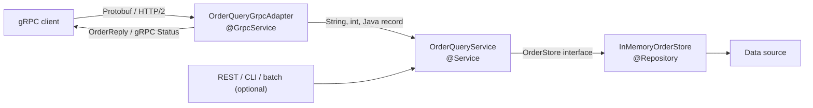

# Separating the Application Service from the gRPC Adapter

## Lesson Objectives

When developing **SPRING_GRPC**, we use Protocol Buffers to define RPC contracts, generate Java code, and implement servers or clients for unary and streaming RPCs. In the Spring ecosystem, a gRPC implementation class is managed by Spring as a bean; however, **just because a class is a Spring bean does not mean all business logic belongs in that class**.

This lesson focuses on **separating the application service from the gRPC adapter**: the adapter receives and returns data according to the gRPC contract, while the application service coordinates use cases using gRPC-independent Java types. This separation improves business logic reuse, speeds up testing, makes switching transports easier, and keeps concerns such as metadata, deadlines, statuses, interceptors, TLS, and reliability in their proper layers.

After this lesson, you will be able to:

1. Distinguish the responsibilities of the gRPC adapter, application service, domain, and repository/gateway.
2. Design dependency directions so the application service **does not import** Protobuf classes, `StreamObserver`, or `io.grpc.Status`.
3. Implement a unary RPC and a server streaming RPC from the same business use case.
4. Convert requests/responses at the communication boundary and map business errors to gRPC statuses.
5. Wire dependencies in Spring using constructor injection while keeping per-RPC state independent.
6. Test the application service without a gRPC server; test the adapter without booting the entire application.

> **Scope:** Examples use **official Spring gRPC** (`org.springframework.grpc.server.service.GrpcService`) and gRPC Java. The community starter with `net.devh.boot.grpc.server.service.GrpcService` uses different packages and configuration; do not mix the two guides.

## 1. Why Separate the Two Layers?

Suppose `OrderQuery` takes an order ID, reads data from storage, and returns order details. If everything is written inside the `getOrder(...)` method of a class extending `OrderQueryGrpc.OrderQueryImplBase`, that code will simultaneously depend on:

- gRPC protocol: Protobuf messages, `StreamObserver`, `Status`, metadata, and deadlines.
- Business rules: order validation, search criteria, visibility policies, and access control.
- Infrastructure: databases, caches, HTTP clients, or another gRPC service.

When a change happens in any of these areas, the same class must be edited and retested. For example, adding a REST API for order lookup could force you to duplicate all the logic written in the gRPC endpoint. Layer separation solves this by placing each responsibility in a controllable boundary.



**Dependency direction:** the transport adapter depends on the application service; the application service depends on storage or gateway interfaces; infrastructure implementations fulfill those interfaces. Imports never point backward from the application service to the adapter.

| Layer | Primary Responsibility | What It May Know | What It Should Not Contain |
| --- | --- | --- | --- |
| gRPC adapter | Receive requests, map types, invoke use cases, return messages or gRPC statuses | Protobuf, generated service base, `StreamObserver`, `Status` | SQL, business transactions, complex pricing policies |
| Application service | Coordinate use cases, validate business inputs, call repositories/gateways | Domain models, Java records, application interfaces | `io.grpc.*`, `GetOrderRequest`, `OrderReply` |
| Domain | Represent core data and business rules | Transport-independent Java types | HTTP/gRPC metadata, serialization |
| Repository/gateway | Access data sources or external services | Storage technology, infrastructure clients | Directly deciding how to reply to `StreamObserver` |

Spring still manages the beans for the adapter, application service, and repository. The `@GrpcService` annotation puts the adapter into the context; the server's ability to bind the service comes from the generated base class implementing `BindableService`. `@Service` and `@Repository` are standard Spring stereotypes.

## 2. Recognizing Signs of Mixed Responsibilities

The following snippet illustrates an **anti-pattern**. It is only meant to demonstrate the problem, not code you should use:

```java
@GrpcService
public class OrderQueryGrpcAdapter extends OrderQueryGrpc.OrderQueryImplBase {
    @Override
    public void getOrder(GetOrderRequest request,
                         StreamObserver<OrderReply> responses) {
        // Mixed in one method: input parsing, DB query, business logic,
        // Protobuf mapping, security, and gRPC error handling.
        var order = jdbcTemplate.queryForObject(
                "select * from orders where id = ?",
                rowMapper,
                request.getOrderId());
        if (!order.isVisible()) {
            responses.onError(Status.PERMISSION_DENIED.asRuntimeException());
            return;
        }
        responses.onNext(OrderReply.newBuilder() /* mapping */.build());
        responses.onCompleted();
    }
}
```

With this structure, business tests must know about gRPC and databases; changing a query or switching protocols touches the endpoint. The goal of this lesson is to move lookup operations and use-case rules into a dedicated class so the adapter stays short, readable, and easy to verify at its boundary.

## 3. Protobuf Contract Used in the Example

Let's build an order query service with two RPCs:

- `GetOrder`: unary, fetches one order by ID.
- `ListOrders`: server streaming, returns orders belonging to a customer up to a count limit.

File `src/main/proto/order_query.proto`:

```proto
syntax = "proto3";

package orders.v1;

option java_package = "com.example.orders.proto";
option java_multiple_files = true;

service OrderQuery {
  rpc GetOrder(GetOrderRequest) returns (OrderReply);
  rpc ListOrders(ListOrdersRequest) returns (stream OrderReply);
}

message GetOrderRequest {
  string order_id = 1;
}

message ListOrdersRequest {
  string customer_id = 1;
  int32 limit = 2;
}

message OrderReply {
  string order_id = 1;
  string customer_id = 2;
  int64 total_cents = 3;
  string state = 4;
}
```

The build needs `protoc` and `protoc-gen-grpc-java` to generate Java messages and `OrderQueryGrpc.OrderQueryImplBase`. When using Spring Boot with the official gRPC server starter and appropriate BOM, the server dependency is typically declared as:

```xml
<dependency>
    <groupId>org.springframework.boot</groupId>
    <artifactId>spring-boot-starter-grpc-server</artifactId>
</dependency>
```

The dependency above is the **server runtime**; the build still needs Protobuf/gRPC Java code generation configured for `.proto` according to your project version. Do not write or directly edit generated classes because the next code generation pass may overwrite them.

Note that there are two namespaces: `orders.v1.OrderQuery` is the service name on the wire, whereas `com.example.orders.proto` is the Java package of generated code. The adapter imports classes from the Java package; clients use the wire service name when calling with tools like `grpcurl`.

## 4. Designing gRPC-Independent Models and Data Ports

### 4.1. Java Record Representing Business Results

File `src/main/java/com/example/orders/domain/OrderSummary.java`:

```java
package com.example.orders.domain;

public record OrderSummary(
        String orderId,
        String customerId,
        long totalCents,
        String state) {
}
```

This record does not import Protobuf. If `OrderReply` changes on the transport side, we may only need to update the mapper in the adapter without necessarily changing `OrderSummary`. In practice, the domain can use enums and value objects for money and IDs; this example uses simple types to focus on layering.

### 4.2. Order Access Interface

File `src/main/java/com/example/orders/application/OrderStore.java`:

```java
package com.example.orders.application;

import com.example.orders.domain.OrderSummary;
import java.util.List;
import java.util.Optional;

public interface OrderStore {
    Optional<OrderSummary> findById(String orderId);
    List<OrderSummary> findByCustomerId(String customerId, int limit);
}
```

The application service depends on the **behavior** of `OrderStore`, not on SQL, JPA, or gRPC stubs. Its implementation can live in the persistence layer and be supplied by Spring via constructor injection.

### 4.3. In-Memory Repository for Practice

File `src/main/java/com/example/orders/infrastructure/InMemoryOrderStore.java`:

```java
package com.example.orders.infrastructure;

import com.example.orders.application.OrderStore;
import com.example.orders.domain.OrderSummary;
import java.util.Comparator;
import java.util.List;
import java.util.Map;
import java.util.Optional;
import org.springframework.stereotype.Repository;

@Repository
public class InMemoryOrderStore implements OrderStore {

    private final Map<String, OrderSummary> orders = Map.of(
            "ord-1001", new OrderSummary("ord-1001", "cus-1", 250_000L, "PAID"),
            "ord-1002", new OrderSummary("ord-1002", "cus-1", 510_000L, "NEW"),
            "ord-1003", new OrderSummary("ord-1003", "cus-2", 135_000L, "PAID"));

    @Override
    public Optional<OrderSummary> findById(String orderId) {
        return Optional.ofNullable(orders.get(orderId));
    }

    @Override
    public List<OrderSummary> findByCustomerId(String customerId, int limit) {
        return orders.values().stream()
                .filter(order -> order.customerId().equals(customerId))
                .sorted(Comparator.comparing(OrderSummary::orderId))
                .limit(limit)
                .toList();
    }
}
```

The map is immutable data shared across RPCs, suitable for demos. When using a database, filtering and limits should happen directly in the query to avoid loading all records into memory. A production list query also needs explicit pagination or cursor support for large datasets.

## 5. Application Service Containing Only Use-Case Logic

### 5.1. A gRPC-Independent Business Error

File `src/main/java/com/example/orders/application/OrderNotFoundException.java`:

```java
package com.example.orders.application;

public class OrderNotFoundException extends RuntimeException {
    public OrderNotFoundException(String orderId) {
        super("Order not found: " + orderId);
    }
}
```

`OrderNotFoundException` is an application error. Do not make this exception extend `StatusRuntimeException`, as doing so would couple the application service directly to the transport. The adapter decides which error maps to `NOT_FOUND` in gRPC; another REST adapter can map it to HTTP 404 while reusing the same application service.

### 5.2. Coordinating Query Operations

File `src/main/java/com/example/orders/application/OrderQueryService.java`:

```java
package com.example.orders.application;

import com.example.orders.domain.OrderSummary;
import java.util.List;
import org.springframework.stereotype.Service;

@Service
public class OrderQueryService {

    private static final int MAX_LIST_LIMIT = 50;

    private final OrderStore orderStore;

    public OrderQueryService(OrderStore orderStore) {
        this.orderStore = orderStore;
    }

    public OrderSummary getOrder(String orderId) {
        if (orderId == null || orderId.isBlank()) {
            throw new IllegalArgumentException("orderId must not be empty");
        }

        return orderStore.findById(orderId)
                .orElseThrow(() -> new OrderNotFoundException(orderId));
    }

    public List<OrderSummary> listOrders(String customerId, int limit) {
        if (customerId == null || customerId.isBlank()) {
            throw new IllegalArgumentException("customerId must not be empty");
        }
        if (limit < 1 || limit > MAX_LIST_LIMIT) {
            throw new IllegalArgumentException("limit must be between 1 and 50");
        }

        return orderStore.findByCustomerId(customerId, limit);
    }
}
```

This is an **application service independent of Protobuf and gRPC**: there is no `GetOrderRequest`, `OrderReply`, `StreamObserver`, `Status`, `ServerCall`, or metadata. It accepts plain Java types, calls `OrderStore`, and returns domain records or collections. Validation of use-case inputs lives in the service so every adapter shares the same rules, not just gRPC.

In this example, `limit=0` is treated as invalid. If an API wants `0` to mean "use default", that convention must be defined in the contract and handled consistently. Proto3 does not distinguish an omitted `int32` scalar from the default value `0` unless explicit field presence is designed in; therefore, do not accidentally impose an unspecified default.

> **Example Security Note:** The client-supplied `orderId` and `customerId` are solely for practicing layer separation. A real order-query API must obtain the verified identity from the security mechanism and enforce ownership/access checks in the application service or a policy called from it. Never allow querying arbitrary orders just because the client knows an ID; to avoid leaking whether a record exists, sometimes returning the same error for non-existent and unauthorized resources is preferred.

## 6. gRPC Adapter Converting Data and Errors at the Boundary

Create `src/main/java/com/example/orders/grpc/OrderQueryGrpcAdapter.java`:

```java
package com.example.orders.grpc;

import com.example.orders.application.OrderNotFoundException;
import com.example.orders.application.OrderQueryService;
import com.example.orders.domain.OrderSummary;
import com.example.orders.proto.GetOrderRequest;
import com.example.orders.proto.ListOrdersRequest;
import com.example.orders.proto.OrderQueryGrpc;
import com.example.orders.proto.OrderReply;
import io.grpc.Context;
import io.grpc.Status;
import io.grpc.stub.StreamObserver;
import java.util.List;
import org.slf4j.Logger;
import org.slf4j.LoggerFactory;
import org.springframework.grpc.server.service.GrpcService;

@GrpcService
public class OrderQueryGrpcAdapter
        extends OrderQueryGrpc.OrderQueryImplBase {

    private static final Logger log =
            LoggerFactory.getLogger(OrderQueryGrpcAdapter.class);

    private final OrderQueryService application;

    public OrderQueryGrpcAdapter(OrderQueryService application) {
        this.application = application;
    }

    @Override
    public void getOrder(GetOrderRequest request,
                         StreamObserver<OrderReply> responses) {
        final OrderReply reply;
        try {
            OrderSummary order = application.getOrder(request.getOrderId());
            reply = toProto(order);
        } catch (IllegalArgumentException ex) {
            responses.onError(Status.INVALID_ARGUMENT
                    .withDescription(ex.getMessage())
                    .asRuntimeException());
            return;
        } catch (OrderNotFoundException ex) {
            responses.onError(Status.NOT_FOUND
                    .withDescription(ex.getMessage())
                    .asRuntimeException());
            return;
        } catch (RuntimeException ex) {
            log.error("GetOrder failed", ex);
            responses.onError(Status.INTERNAL
                    .withDescription("Unable to process request")
                    .asRuntimeException());
            return;
        }

        responses.onNext(reply);
        responses.onCompleted();
    }

    @Override
    public void listOrders(ListOrdersRequest request,
                           StreamObserver<OrderReply> responses) {
        final List<OrderReply> replies;
        try {
            replies = application.listOrders(
                            request.getCustomerId(), request.getLimit())
                    .stream()
                    .map(this::toProto)
                    .toList();
        } catch (IllegalArgumentException ex) {
            responses.onError(Status.INVALID_ARGUMENT
                    .withDescription(ex.getMessage())
                    .asRuntimeException());
            return;
        } catch (RuntimeException ex) {
            log.error("ListOrders failed", ex);
            responses.onError(Status.INTERNAL
                    .withDescription("Unable to process request")
                    .asRuntimeException());
            return;
        }

        // Bounded list example; production streaming needs flow control.
        for (OrderReply reply : replies) {
            if (Context.current().isCancelled()) {
                return;
            }
            responses.onNext(reply);
        }
        if (!Context.current().isCancelled()) {
            responses.onCompleted();
        }
    }

    private OrderReply toProto(OrderSummary order) {
        return OrderReply.newBuilder()
                .setOrderId(order.orderId())
                .setCustomerId(order.customerId())
                .setTotalCents(order.totalCents())
                .setState(order.state())
                .build();
    }
}
```

The adapter handles transport concerns: extracting data from the Protobuf request, calling the application service, converting `OrderSummary` into a Protobuf response, and deciding the gRPC status corresponding to the result or error. The application service does not know whether it is being called via a unary RPC or a gRPC stream.

In `getOrder`, the adapter **prepares the response before calling `onNext`**. Thus, errors from the application or mapper are handled before emitting any message. After emitting the response successfully, the method calls `onCompleted()`. Never send any further `onNext` or `onCompleted` after `onError`.

In `listOrders`, the application returns a bounded list; the adapter converts it into a list of Protobuf messages before starting to stream. This works for a small demo. For large data streams, do not buffer everything in RAM; design the application to iterate in pages/chunks or return an appropriate stream abstraction and build an adapter that handles flow control, cancellation, and deadlines.

### Cross-Layer Error Mapping Table

| In Application Service | In gRPC Adapter | Meaning on Client Side |
| --- | --- | --- |
| Returns valid `OrderSummary` | `onNext(reply)` then `onCompleted()` | Unary succeeded |
| Returns valid `List<OrderSummary>` | Multiple `onNext(reply)` then `onCompleted()` | Server streaming succeeded |
| `IllegalArgumentException` from intentional validation | `Status.INVALID_ARGUMENT` | Invalid request data |
| `OrderNotFoundException` | `Status.NOT_FOUND` | Requested resource not found |
| Unclassified unexpected error | Log on server, return `Status.INTERNAL` with safe message | Server failed to process |
| Classified remote dependency error | Map by explicit policy, e.g., `UNAVAILABLE` | Temporary infrastructure error; not always safe to retry blindly |

Do not assume every `RuntimeException` is an input error. Only map exceptions **defined by the application contract**; programming bugs or system errors must not be turned into `INVALID_ARGUMENT`. Also never send stack traces, SQL, tokens, or internal details to clients via `Status.withDescription(...)`.

The example uses `IllegalArgumentException` for simplicity. In larger projects, define dedicated use-case exceptions such as `InvalidOrderQueryException` so you do not accidentally misclassify an `IllegalArgumentException` thrown by a library or bug. Even when adopting centralized error handling, keep status mapping in the gRPC-layer adapter/interceptor rather than introducing `Status` into the application service.

## 7. Registering Spring Beans and Running the Server

Place the `@SpringBootApplication` class in the parent package so component scanning covers `application`, `infrastructure`, and `grpc`:

```java
package com.example.orders;

import org.springframework.boot.SpringApplication;
import org.springframework.boot.autoconfigure.SpringBootApplication;

@SpringBootApplication
public class OrderApplication {
    public static void main(String[] args) {
        SpringApplication.run(OrderApplication.class, args);
    }
}
```

Illustrative file structure:

```text
src/main/
├── proto/order_query.proto
└── java/com/example/orders/
    ├── OrderApplication.java
    ├── domain/OrderSummary.java
    ├── application/OrderStore.java
    ├── application/OrderNotFoundException.java
    ├── application/OrderQueryService.java
    ├── infrastructure/InMemoryOrderStore.java
    └── grpc/OrderQueryGrpcAdapter.java
```

Spring creates `InMemoryOrderStore` from `@Repository`, injects it into `OrderQueryService` from `@Service`, and then injects the service into `OrderQueryGrpcAdapter` from `@GrpcService`. When the server factory is active, Spring gRPC discovers the adapter as a `BindableService` and binds the `orders.v1.OrderQuery` service descriptor.

If using the Netty/native gRPC server from the corresponding starter, you can configure the port, for example:

```yaml
spring:
  grpc:
    server:
      port: 9091
```

When serving gRPC through a servlet/HTTP server, the port and HTTP/2 depend on `server.port` and web transport settings; do not assume the native port applies in every environment. Spring beans being created successfully only proves the dependency graph is valid—it does not prove clients can reach the server or that TLS settings match.

## 8. Rules to Keep Clean in Real Implementations

### 8.1. Do Not Couple the Application Service to gRPC Context

When clients pass metadata (tokens, locale, correlation ID) over gRPC, **reading metadata** should happen in an interceptor or adapter, passing only the necessary data into the use case via independent Java types. For example:

```java
// Pure Java type in the application layer.
public record CallerIdentity(String subjectId, String tenantId) {
}

// Extended application service API:
public OrderSummary getOrder(String orderId, CallerIdentity caller) {
    // Verify that the caller is authorized to access the order before returning data.
    // Depends on policy / repository, does not import io.grpc.Metadata.
}
```

The snippet above only illustrates an **extended signature**, not a complete method to copy into the existing class without adding a body and dependencies. `CallerIdentity` must come from a **verified** identity, not by copying an unverified `customerId` from the request and trusting it. An interceptor can authenticate metadata and construct a context object, while authorization to view a specific order usually needs to be checked inside the use case or policy. Never store identity in a shared mutable field on a singleton `@GrpcService`.

### 8.2. Deadlines and Cancellation Should Be Propagated in Business Terms

`Context.current()` and `Deadline` belong to gRPC. The adapter can observe call cancellation, yet the application service should not be forced to import `io.grpc.Context` if you want to reuse the use case from REST/CLI. You can pass a small application-defined abstraction such as a timeout budget or cancellation signal when genuinely needed.

```text
gRPC call deadline
        |
        v
Adapter observes deadline / cancellation
        |
        v
Application service receives timeout budget or pure Java deadline
        |
        v
Repository / remote gateway applies appropriate timeout
```

Do not set a deadline only on the client while letting calls from the application service to the database or downstream gRPC clients run indefinitely. When downstream systems may stall, configure timeouts on repositories/clients, propagate cancellation sensibly, and stop unnecessary work once a call is cancelled. If using a generated client stub inside a gateway, set per-call deadlines on the stub via `withDeadlineAfter(...)` rather than mutating shared state across requests.

### 8.3. Transactions and Streaming Have Different Lifecycles

If you need to query data inside a transaction, the application service can use `@Transactional(readOnly = true)` for a snapshot method. However, **never keep a database transaction or connection open across a long-lived streaming RPC**. For large streams, design paged fetches, consistent snapshots, or asynchronous streams with explicit resource lifecycles.

In the demo, `listOrders(...)` fetches at most 50 items and closes the business scope before the adapter begins emitting messages. In production, choosing between a `List` and an iterator/publisher should be based on dataset size, backpressure, and cancellation handling.

### 8.4. One Singleton Bean Serves Many Concurrent RPCs

`OrderQueryGrpcAdapter` and `OrderQueryService` are Spring singletons by default. Each RPC has its own `request` and `StreamObserver`; **do not** store them in mutable singleton fields. `final OrderQueryService application` is a normal shared dependency. Repositories must be thread-safe or properly managed by the framework. If multiple threads call `onNext` on the same observer, writes must be serialized; never assume `StreamObserver` is thread-safe.

### 8.5. Interceptors, TLS, and Observability Belong in Their Own Layers

gRPC interceptors can validate metadata, authenticate connections, attach correlation IDs, and record metrics before/after RPCs. TLS is configured at the transport/channel level, not in the application service. Observability should distinguish total RPC duration from use-case execution and repository query time; that way, when gRPC slows down, you can pinpoint serialization, networking, database, or downstream causes.

The goal of this architecture is to keep the application service understandable while still allowing the adapter to enforce gRPC policies like statuses, metadata, deadlines, and flow control. You do not need to turn every class into an interface; only introduce abstractions where there is a clear contract or an infrastructure dependency that needs swapping.

## 9. Testing Each Layer Independently

### 9.1. Testing the Application Service Without gRPC

Because `OrderQueryService` imports neither Protobuf nor gRPC, you can supply a fake/in-memory repository and verify business behavior with JUnit/AssertJ:

```java
package com.example.orders.application;

import com.example.orders.infrastructure.InMemoryOrderStore;
import org.junit.jupiter.api.Test;

import static org.assertj.core.api.Assertions.assertThat;
import static org.assertj.core.api.Assertions.assertThatThrownBy;

class OrderQueryServiceTest {

    private final OrderQueryService service =
            new OrderQueryService(new InMemoryOrderStore());

    @Test
    void getExistingOrder() {
        var order = service.getOrder("ord-1001");
        assertThat(order.customerId()).isEqualTo("cus-1");
        assertThat(order.totalCents()).isEqualTo(250_000L);
    }

    @Test
    void rejectOutOfRangeLimit() {
        assertThatThrownBy(() -> service.listOrders("cus-1", 100))
                .isInstanceOf(IllegalArgumentException.class);
    }

    @Test
    void missingOrderHasDomainError() {
        assertThatThrownBy(() -> service.getOrder("ord-9999"))
                .isInstanceOf(OrderNotFoundException.class);
    }
}
```

This is a pure Java unit test: it does not boot Spring, open ports, or create channels. It verifies validation, queried data, and application errors; changing the Protobuf schema does not automatically force this test to change.

### 9.2. Testing the gRPC Adapter with a Mocked Application Service

The adapter must prove that `OrderSummary` maps to `OrderReply` and business errors map to the right statuses. Mockito/JUnit lets you instantiate the adapter with a mock `OrderQueryService` without starting a server:

```java
package com.example.orders.grpc;

import com.example.orders.application.OrderNotFoundException;
import com.example.orders.application.OrderQueryService;
import com.example.orders.domain.OrderSummary;
import com.example.orders.proto.GetOrderRequest;
import com.example.orders.proto.OrderReply;
import io.grpc.Status;
import io.grpc.stub.StreamObserver;
import org.junit.jupiter.api.Test;
import org.mockito.ArgumentCaptor;

import static org.assertj.core.api.Assertions.assertThat;
import static org.mockito.ArgumentMatchers.any;
import static org.mockito.ArgumentMatchers.argThat;
import static org.mockito.Mockito.mock;
import static org.mockito.Mockito.never;
import static org.mockito.Mockito.verify;
import static org.mockito.Mockito.when;

class OrderQueryGrpcAdapterTest {

    private final OrderQueryService application = mock(OrderQueryService.class);
    private final OrderQueryGrpcAdapter adapter =
            new OrderQueryGrpcAdapter(application);

    @SuppressWarnings("unchecked")
    private StreamObserver<OrderReply> observer() {
        return (StreamObserver<OrderReply>) mock(StreamObserver.class);
    }

    @Test
    void mapsSuccessToProtobuf() {
        var responses = observer();
        when(application.getOrder("ord-1001")).thenReturn(
                new OrderSummary("ord-1001", "cus-1", 250_000L, "PAID"));

        adapter.getOrder(GetOrderRequest.newBuilder()
                .setOrderId("ord-1001").build(), responses);

        verify(responses).onNext(argThat(reply ->
                reply.getOrderId().equals("ord-1001")
                        && reply.getTotalCents() == 250_000L));
        verify(responses).onCompleted();
        verify(responses, never()).onError(any());
    }

    @Test
    void mapsNotFoundToGrpcStatus() {
        var responses = observer();
        when(application.getOrder("ord-9999"))
                .thenThrow(new OrderNotFoundException("ord-9999"));

        adapter.getOrder(GetOrderRequest.newBuilder()
                .setOrderId("ord-9999").build(), responses);

        var error = ArgumentCaptor.forClass(Throwable.class);
        verify(responses).onError(error.capture());
        assertThat(Status.fromThrowable(error.getValue()).getCode())
                .isEqualTo(Status.Code.NOT_FOUND);
        verify(responses, never()).onNext(any());
        verify(responses, never()).onCompleted();
    }
}
```

This test focuses on the gRPC boundary; it does not verify SQL, transactions, TLS, or a live listening server. When you need to test interceptors, deadlines, metadata, and networking, add integration tests using generated stubs with an in-process or native server.

### 9.3. Verifying Spring Wiring and Service Descriptor

You can use a Spring Boot context test to verify that Spring created all required beans and discovered the gRPC service:

```java
package com.example.orders;

import com.example.orders.application.OrderQueryService;
import com.example.orders.grpc.OrderQueryGrpcAdapter;
import io.grpc.BindableService;
import org.junit.jupiter.api.Test;
import org.springframework.beans.factory.annotation.Autowired;
import org.springframework.boot.test.context.SpringBootTest;
import org.springframework.context.ApplicationContext;

import static org.assertj.core.api.Assertions.assertThat;

@SpringBootTest(properties = "spring.grpc.server.port=0")
class OrderGrpcWiringTest {

    @Autowired
    ApplicationContext context;

    @Test
    void createsAdapterAndApplicationService() {
        assertThat(context.getBean(OrderQueryService.class)).isNotNull();
        assertThat(context.getBean(OrderQueryGrpcAdapter.class)).isNotNull();

        assertThat(context.getBeansOfType(BindableService.class).values())
                .anySatisfy(service -> assertThat(
                        service.bindService().getServiceDescriptor().getName())
                        .isEqualTo("orders.v1.OrderQuery"));
    }
}
```

With a native gRPC server that supports dynamic ports, `spring.grpc.server.port=0` avoids port conflicts during tests. This test verifies beans and descriptors; to prove the real transport works, call the RPC using a generated client stub or `grpcurl`. If there are multiple server factories or service filters, verify that the service is bound to the target server.

## 10. Calling the RPC Externally with `grpcurl`

After starting the application with the native server configured on port `9091` and **without TLS** in development, run from the project root containing `src/main/proto/order_query.proto`:

```bash
grpcurl -plaintext \
  -import-path src/main/proto \
  -proto order_query.proto \
  -d '{"orderId":"ord-1001"}' \
  localhost:9091 orders.v1.OrderQuery/GetOrder
```

Expected ProtoJSON response:

```json
{
  "orderId": "ord-1001",
  "customerId": "cus-1",
  "totalCents": "250000",
  "state": "PAID"
}
```

According to ProtoJSON rules, `int64` fields are represented as **JSON strings**, even though they are `long` in Java. Trying an empty `orderId` returns `INVALID_ARGUMENT`; `ord-9999` returns `NOT_FOUND`.

Calling server streaming:

```bash
grpcurl -plaintext \
  -import-path src/main/proto \
  -proto order_query.proto \
  -d '{"customerId":"cus-1","limit":2}' \
  localhost:9091 orders.v1.OrderQuery/ListOrders
```

The client receives two `OrderReply` messages for `ord-1001` and `ord-1002` in order, then the stream ends. `grpcurl` uses the `.proto` file directly so it does not require server reflection. To use `grpcurl list` without passing `.proto`, you must add and enable the appropriate Reflection service. With TLS, do not use `-plaintext`; configure trust and certificates matching the server.

## 11. Architectural Decisions and Common Mistakes

| Situation | Cause / Risk | How to Handle |
| --- | --- | --- |
| Application service takes `GetOrderRequest` as a parameter | Use case depends on generated messages and transport schema | Convert in the adapter; use case accepts Java/domain types or dedicated commands |
| Application service calls `responseObserver.onError(...)` | Business logic is coupled directly to the gRPC lifecycle | Throw intentional application exceptions; adapter maps them to `Status` |
| Adapter runs SQL queries or calls multiple downstreams directly | Mixes transport and business processing; hard to test | Move coordination to the application service and storage details to repositories/gateways |
| Endpoint calls `new OrderQueryService(...)` | Bypasses Spring DI, hard to swap dependencies in tests | Use constructor injection and Spring-managed beans |
| Bean not found at startup | Component lies outside scan or lacks stereotype/configuration | Place startup class in a parent package; check `@Service`, `@Repository`, `@GrpcService` |
| Multiple `OrderStore` beans of the same type | Spring does not know which implementation to inject | Choose `@Qualifier`, `@Primary`, or profile/condition configuration |
| Client receives `UNIMPLEMENTED` | Wrong service/method, not overridden, or adapter not bound | Check generated base, `bindService()`, and server factory/filters |
| Client receives `INTERNAL` on backend failure | Unclassified backend error | Log internally and apply intentional mapping; never expose stack traces to clients |
| Customer data leaked when `orderId` is known | Missing access-control check in the use case | Pass trusted identity and enforce per-resource authorization |
| Streaming uses too much RAM or blocks threads | Adapter buffers large datasets without backpressure | Paginate, handle flow control, cancellation/deadlines, and async sources |
| RPC is slow despite a short adapter | Repository or remote gateway has high latency | Set timeouts, propagate deadlines, and record per-layer metrics |
| Tests rely solely on `@SpringBootTest` | Every failure requires booting the full server to reproduce | Test application service with plain Java, adapter with mocks, integration with stubs |

### Boundaries Worth Keeping Stable

As you add `CreateOrder`, `CancelOrder`, client streaming, or bidirectional streaming RPCs, the same layering principles hold. The adapter receives message streams and translates them into use-case inputs; the application service defines business behavior; repositories/gateways perform I/O; the adapter handles response protocol rules. For long-lived streams, you may need an application-owned asynchronous abstraction or callback mechanism, without turning `StreamObserver` into a core domain type.

Do not create excessive classes or interfaces merely to satisfy a formal architectural template. A small service can start with adapter → application service → repository; only extract separate mappers, policies, or gateways when justified by complexity, multiple call sites, or independent testing/swapping needs.

## 12. Hands-On Exercises

1. **Separate code:** Write a version of `OrderQueryGrpcAdapter` with direct data-lookup logic. Then move all queries and use-case validation into `OrderQueryService`; compare the number of gRPC imports in the application layer before and after.
2. **Add a state filter:** Add a rule so `listOrders` only returns orders in state `PAID`. Verify the rule with a unit test **without** starting Spring or gRPC; leave the adapter's Protobuf mapping untouched.
3. **Try a REST adapter:** Create a REST controller that reuses `OrderQueryService.getOrder` and maps `OrderNotFoundException` to HTTP 404. Ensure the application service still imports neither HTTP nor gRPC.
4. **Error mapping:** Add an `InvalidOrderQueryException`, replace `IllegalArgumentException` for validation errors intentionally raised by the use case, and update the `INVALID_ARGUMENT` mapping in the adapter.
5. **Security check:** Design `CallerIdentity` and enforce that only the order owner or an authorized role can view an order. The identity source must come from authentication, not from a self-declared `customerId` in the request.
6. **Scale up data:** Replace `InMemoryOrderStore` with a repository returning thousands of orders. Design pagination, flow control, and cancellation so the entire result set is not held in RAM during the stream.
7. **End-to-end test:** Create an integration test with an in-process or native server, invoke `GetOrder` via a generated stub, and verify `NOT_FOUND`, deadlines, and an interceptor attaching a correlation ID metadata header.

### Self-Check Questions

- Why should the application service return `OrderSummary` instead of Protobuf's `OrderReply`?
- Which layer decides to return gRPC `NOT_FOUND`, which layer throws `OrderNotFoundException`, and why?
- When adding an HTTP REST endpoint, which parts of the logic can be reused unchanged?
- Where should `@Transactional` be placed, and why must you be cautious with transactions spanning streaming RPCs?
- If a gRPC client cancels a call mid-stream, which layer directly detects gRPC cancellation and how do you propagate its effect to business logic?
- Why does a Spring bean being injected successfully not prove that downstream RPCs will respond within deadline?
- What is the difference between an application service unit test, an adapter unit test, and an integration test with a gRPC server?
- When does using a separate interface for a repository/gateway add real value, and when does it only add unnecessary complexity?

## References

- [Spring gRPC — gRPC Server](https://docs.spring.io/spring-grpc/reference/server.html): how Spring discovers `BindableService` beans and attaches them to the gRPC server.
- [Spring Framework — Dependency Injection](https://docs.spring.io/spring-framework/reference/core/beans/dependencies/factory-collaborators.html): constructor injection and organizing bean dependencies.
- [Spring Framework — Transaction Management](https://docs.spring.io/spring-framework/reference/data-access/transaction.html): transaction boundaries in the application layer.
- [gRPC Java — Basics Tutorial](https://grpc.io/docs/languages/java/basics/): implementing unary/server streaming RPCs and generated base classes.
- [gRPC Java — StreamObserver](https://grpc.github.io/grpc-java/javadoc/io/grpc/stub/StreamObserver.html): sending responses and terminal stream events.
- [gRPC — Deadlines](https://grpc.io/docs/guides/deadlines/): time budgets and propagation across RPCs.
- [Protocol Buffers — ProtoJSON](https://protobuf.dev/programming-guides/json/): mapping `int64` and Protobuf data types to JSON.

**Expected outcome:** Learners build `OrderQueryGrpcAdapter` dedicated to gRPC communication, `OrderQueryService` containing transport-independent use cases, and `OrderStore` providing data access, while testing each layer and invoking `orders.v1.OrderQuery/GetOrder` or `/ListOrders` with appropriate gRPC statuses. This structure sets the stage for streaming, metadata, deadlines, interceptors, TLS, integration testing, and reliable system monitoring.
