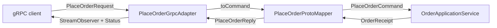

# Mapping Protobuf DTOs to Domain Commands

## Lesson Objectives

In the **SPRING_GRPC** module, Protocol Buffers describes the data exchange contract and gRPC generates Java code for clients and servers to call unary or streaming RPCs. The request object generated from `.proto` is a **DTO at the communication boundary**; the input to business logic should be a clearly named **domain/application command** independent of transport.

This lesson guides you through designing that boundary in a Spring gRPC application: receiving `PlaceOrderRequest`, validating data structure, converting it into an immutable `PlaceOrderCommand`, calling the application service, and converting the result back to Protobuf. These principles also apply when handling metadata, deadlines, statuses, interceptors, TLS, integration testing, and RPC reliability observability.

After this lesson, you will be able to:

1. Distinguish between a **Protobuf DTO**, an **application command**, a **domain model**, and a **response DTO**.
2. Write a mapper that properly handles `repeated`, `optional`, `oneof`, proto3 defaults, and `google.protobuf.Timestamp`.
3. Shield the application layer from dependencies on `com.google.protobuf.*` and `io.grpc.*`.
4. Separate communication-boundary validation from business-rule validation.
5. Map domain/validation errors to gRPC statuses without making the application service aware of `StreamObserver`.
6. Write unit tests for mappers and adapters as well as Spring wiring/RPC path tests.

> **Technology Scope:** Examples use official Spring gRPC (`org.springframework.grpc.server.service.GrpcService`), gRPC Java, and Java 17+ (records, sealed interfaces, switch expressions). Packages and configuration in the community `net.devh` starter may differ.

## 1. Protobuf DTOs and Domain Commands Serve Two Different Purposes

Protobuf DTOs are generated from an external contract. They are optimized for **wire format**, schema compatibility, serialization/deserialization, field numbers, and cross-language support. A command describes **an action the application must perform**, using data types and invariants suited to business logic.

For example, a user places an order via RPC. `PlaceOrderRequest` carries customer info, product lines, and delivery choice. `PlaceOrderCommand` expresses the intent to "place an order" in pure Java without knowing whether the request arrived over gRPC, REST, or an internal job.



| Aspect | Protobuf DTO | Application Command |
| --- | --- | --- |
| Origin | Generated from `.proto` | Application-defined Java type |
| Field naming | Suited to public schema and wire compatibility | Suited to use-case semantics |
| Presence | `hasXxx()` for messages/`optional`/`oneof`; plain proto3 scalars have defaults | Can use `Optional`, custom types, or application invariants |
| Collections | `ProtocolStringList` / `List` from generated API | `List.copyOf(...)`, immutable value objects |
| Time | `google.protobuf.Timestamp` | `java.time.Instant` |
| Errors | gRPC status at the adapter | Application exceptions/results |
| Coupling | Knows gRPC/Protobuf | Does not import gRPC/Protobuf |

**Dependency flow should go from the adapter into the application service.** The application service can accept commands from multiple different adapters; a domain command is not a "renamed Protobuf object" and should not contain `StreamObserver`, `Metadata`, or `StatusRuntimeException`.

## 2. The `.proto` Contract for the PlaceOrder Example

Create `src/main/proto/checkout.proto`:

```proto
syntax = "proto3";

package checkout.v1;

import "google/protobuf/timestamp.proto";

option java_package = "com.example.checkout.proto";
option java_multiple_files = true;

service Checkout {
  rpc PlaceOrder(PlaceOrderRequest) returns (PlaceOrderReply);
}

message PlaceOrderRequest {
  string customer_id = 1;
  repeated OrderLineMessage lines = 2;

  // Distinguishes "not sent" from "sent empty string".
  optional string coupon_code = 3;

  // Only one of the two fulfillment options can be chosen.
  oneof fulfillment {
    string shipping_address = 4;
    string pickup_store_id = 5;
  }

  // Message fields have presence even without optional.
  google.protobuf.Timestamp requested_at = 6;
}

message OrderLineMessage {
  string sku = 1;
  int32 quantity = 2;
}

enum OrderState {
  ORDER_STATE_UNSPECIFIED = 0;
  ORDER_STATE_ACCEPTED = 1;
}

message PlaceOrderReply {
  string order_id = 1;
  OrderState state = 2;
  google.protobuf.Timestamp accepted_at = 3;
}
```

The classes expected to be generated in `com.example.checkout.proto` are: `CheckoutGrpc`, `PlaceOrderRequest`, `PlaceOrderReply`, `OrderLineMessage`, and `OrderState`. gRPC Java code also provides `CheckoutGrpc.CheckoutImplBase` for the server and stubs for the client.

You must configure `protoc`, the `protoc-gen-grpc-java` plugin, and runtime dependencies matching your project version. With Spring Boot using the official gRPC starter, the server dependency looks like:

```xml
<dependency>
    <groupId>org.springframework.boot</groupId>
    <artifactId>spring-boot-starter-grpc-server</artifactId>
</dependency>
```

This is only the server-side dependency. **Generating code from `.proto` still requires the corresponding plugin/build setup**. Do not edit generated classes to add business logic or validation, because that code is regenerated on build.

### Meaning of Each Field

| Field | Protobuf Form | What the Mapper Must Decide |
| --- | --- | --- |
| `customer_id` | `string` without explicit presence | Whether empty strings are valid; normalization and length limits |
| `lines` | `repeated OrderLineMessage` | Whether the list is non-empty, line count limit, valid `sku`/`quantity` |
| `coupon_code` | `optional string` | Absent vs. present but empty |
| `fulfillment` | `oneof` | Exactly one option required; validate the chosen option's value |
| `requested_at` | `Timestamp` message | Absent vs. valid timestamp; convert to `Instant` |
| `state` in response | Enum | Map from domain state to schema enum; never use arbitrary numeric values |

In proto3, `getCustomerId()` returns `""` if not sent, and `getQuantity()` returns `0` if not sent. **You cannot tell whether the client sent those scalars using getters alone.** If business logic needs to distinguish an absent field from a field set to its default value, design the contract with `optional`, wrapper messages, or `oneof` from the start.

## 3. Defining Protobuf-Independent Commands and Results

A clean approach for Java 17+ uses `record`s, immutable collections, and a dedicated type for fulfillment variants.

File `src/main/java/com/example/checkout/application/PlaceOrderCommand.java`:

```java
package com.example.checkout.application;

import java.time.Instant;
import java.util.List;
import java.util.Objects;
import java.util.Optional;

public record PlaceOrderCommand(
        String customerId,
        List<Line> lines,
        Optional<String> couponCode,
        Fulfillment fulfillment,
        Optional<Instant> requestedAt) {

    public PlaceOrderCommand {
        Objects.requireNonNull(customerId, "customerId");
        lines = List.copyOf(lines);
        Objects.requireNonNull(couponCode, "couponCode");
        Objects.requireNonNull(fulfillment, "fulfillment");
        Objects.requireNonNull(requestedAt, "requestedAt");
    }

    public record Line(String sku, int quantity) {
    }

    public sealed interface Fulfillment permits Shipping, Pickup {
    }

    public record Shipping(String address) implements Fulfillment {
    }

    public record Pickup(String storeId) implements Fulfillment {
    }
}
```

The types inside the command are pure Java: no `com.google.protobuf.*` imports and no `io.grpc.*` imports. `List.copyOf(lines)` creates an immutable copy so callers cannot mutate the list after creating the command.

File `src/main/java/com/example/checkout/application/OrderReceipt.java`:

```java
package com.example.checkout.application;

import java.time.Instant;

public record OrderReceipt(
        String orderId,
        State state,
        Instant acceptedAt) {

    public enum State {
        ACCEPTED
    }
}
```

`OrderReceipt` represents the use-case result. The adapter decides how to represent it as `PlaceOrderReply`, a REST response, or a message broker event; the application service does not decide wire format.

### Is a Command a Domain Entity?

Not necessarily. `PlaceOrderCommand` expresses **the input to a use case**, whereas `Order` (if present) would be a domain entity/aggregate holding long-lived state. In a large application, the application service translates commands into operations on domain aggregates. The record structure here suffices for the example without forcing every entity to be an immutable record.

## 4. Boundary Validation Errors

Create a small exception for the mapper to signal structurally invalid requests.

File `src/main/java/com/example/checkout/grpc/InvalidOrderRequestException.java`:

```java
package com.example.checkout.grpc;

public class InvalidOrderRequestException extends RuntimeException {
    public InvalidOrderRequestException(String message) {
        super(message);
    }
}
```

This exception lives in the adapter package because it is used for **DTO validation right at the boundary**. The application service does not need to depend on this error type. In the example, the adapter converts it to `Status.INVALID_ARGUMENT`. Never throw `StatusRuntimeException` directly from a domain command.

Validation split should be intentional:

- **Communication boundary:** required strings, request format and size, item counts, type conversion, `oneof` branch presence, and `Timestamp` structure.
- **Application/domain:** inventory availability, order limits, view/place permissions, customer status, transactions, and business rules.
- **Infrastructure:** database or downstream RPC availability, timeouts, and network errors.

A rule like "`quantity > 0`" can often be checked right in the adapter to reject bad requests early; the application/domain must still protect critical invariants in case other adapters invoke the same use case.

## 5. Writing the Protobuf Mapper on the gRPC Side

File `src/main/java/com/example/checkout/grpc/PlaceOrderProtoMapper.java`:

```java
package com.example.checkout.grpc;

import com.example.checkout.application.OrderReceipt;
import com.example.checkout.application.PlaceOrderCommand;
import com.example.checkout.proto.OrderLineMessage;
import com.example.checkout.proto.OrderState;
import com.example.checkout.proto.PlaceOrderReply;
import com.example.checkout.proto.PlaceOrderRequest;
import com.google.protobuf.Timestamp;
import java.time.DateTimeException;
import java.time.Instant;
import java.util.ArrayList;
import java.util.List;
import java.util.Optional;
import org.springframework.stereotype.Component;

@Component
public class PlaceOrderProtoMapper {

    public PlaceOrderCommand toCommand(PlaceOrderRequest request) {
        String customerId = requiredText(
                request.getCustomerId(), "customer_id", 80);

        if (request.getLinesCount() < 1 || request.getLinesCount() > 100) {
            throw invalid("lines must have between 1 and 100 items");
        }

        List<PlaceOrderCommand.Line> lines =
                new ArrayList<>(request.getLinesCount());

        for (int i = 0; i < request.getLinesCount(); i++) {
            OrderLineMessage line = request.getLines(i);
            String sku = requiredText(
                    line.getSku(), "lines[" + i + "].sku", 80);

            if (line.getQuantity() < 1 || line.getQuantity() > 1000) {
                throw invalid("lines[" + i
                        + "].quantity must be between 1 and 1000");
            }
            lines.add(new PlaceOrderCommand.Line(
                    sku, line.getQuantity()));
        }

        Optional<String> couponCode = Optional.empty();
        if (request.hasCouponCode()) {
            couponCode = Optional.of(requiredText(
                    request.getCouponCode(), "coupon_code", 40));
        }

        PlaceOrderCommand.Fulfillment fulfillment =
                switch (request.getFulfillmentCase()) {
                    case SHIPPING_ADDRESS ->
                            new PlaceOrderCommand.Shipping(
                                    requiredText(request.getShippingAddress(),
                                            "shipping_address", 300));
                    case PICKUP_STORE_ID ->
                            new PlaceOrderCommand.Pickup(
                                    requiredText(request.getPickupStoreId(),
                                            "pickup_store_id", 80));
                    case FULFILLMENT_NOT_SET ->
                            throw invalid("A fulfillment option must be selected");
                };

        Optional<Instant> requestedAt = request.hasRequestedAt()
                ? Optional.of(toInstant(request.getRequestedAt()))
                : Optional.empty();

        return new PlaceOrderCommand(
                customerId, lines, couponCode, fulfillment, requestedAt);
    }

    public PlaceOrderReply toReply(OrderReceipt receipt) {
        OrderState state = switch (receipt.state()) {
            case ACCEPTED -> OrderState.ORDER_STATE_ACCEPTED;
        };

        return PlaceOrderReply.newBuilder()
                .setOrderId(receipt.orderId())
                .setState(state)
                .setAcceptedAt(toTimestamp(receipt.acceptedAt()))
                .build();
    }

    private static String requiredText(
            String raw, String name, int maxLength) {
        String value = raw.trim();
        if (value.isEmpty() || value.length() > maxLength) {
            throw invalid(name + " must be between 1 and "
                    + maxLength + " characters");
        }
        return value;
    }

    private static Instant toInstant(Timestamp timestamp) {
        if (timestamp.getNanos() < 0
                || timestamp.getNanos() > 999_999_999) {
            throw invalid("requested_at has invalid nanos");
        }

        try {
            return Instant.ofEpochSecond(
                    timestamp.getSeconds(), timestamp.getNanos());
        } catch (DateTimeException | ArithmeticException ex) {
            throw invalid("requested_at is outside the supported time range");
        }
    }

    private static Timestamp toTimestamp(Instant instant) {
        return Timestamp.newBuilder()
                .setSeconds(instant.getEpochSecond())
                .setNanos(instant.getNano())
                .build();
    }

    private static InvalidOrderRequestException invalid(String message) {
        return new InvalidOrderRequestException(message);
    }
}
```

The mapper is a stateless Spring bean that holds no per-request mutable state. Local variables `lines`, `couponCode`, and `requestedAt` are created per `toCommand` call, making it safe for concurrent RPCs.

### 5.1. Why Is `hasCouponCode()` Needed?

For `optional string coupon_code`:

| Client Sends | `request.hasCouponCode()` | `request.getCouponCode()` | Domain Meaning |
| --- | --- | --- | --- |
| Does not send `coupon_code` | `false` | `""` | `Optional.empty()` |
| Sends `coupon_code: ""` | `true` | `""` | Invalid request per example policy |
| Sends `coupon_code: "WELCOME"` | `true` | `"WELCOME"` | `Optional.of("WELCOME")` |

If the mapper only checked `getCouponCode().isBlank()` and ignored it, it would conflate "no code applied" with "intentionally sent an empty code." In another system, both cases might be treated identically; however, **that should be an explicit business decision**, not an accidental side effect of proto3 defaults.

### 5.2. Why Switch on `oneof`?

`getFulfillmentCase()` tells you exactly which option was sent. If you call `getShippingAddress()` when the client chose `pickup_store_id`, the unset branch's getter still returns the default empty string. "Guessing which branch was chosen" via getters is unreliable.

Using `oneof` guarantees the message represents at most one choice; the example mapper also requires **at least one** choice and checks for meaningful text. The command turns that choice into `Shipping` or `Pickup`, sparing the application service from checking two inconsistent nullable fields.

### 5.3. Mapping `repeated` with Bounds Checks

A `repeated` list in the generated API exposes methods like `getLinesCount()` and `getLines(i)`. Do not pass `OrderLineMessage` straight into the application service, as that would couple the domain to generated code. The mapper constructs each `Line(sku, quantity)` after validation.

Limits of 100 lines and 1,000 units/line are **illustrative policies**. Production systems need transport-level request size limits, use-case business limits, and must avoid unbounded algorithms/collections on huge requests. If you later add client streaming, map per message or per chunk while enforcing total resource bounds instead of buffering an unbounded stream in memory.

### 5.4. `Timestamp` and Time Zones

`google.protobuf.Timestamp` represents an absolute point in time as seconds and nanoseconds since the Unix epoch. `Instant` is the matching Java type for such a point in time:

```java
Instant instant = Instant.ofEpochSecond(
        protoTimestamp.getSeconds(),
        protoTimestamp.getNanos());

Timestamp protoTimestamp = Timestamp.newBuilder()
        .setSeconds(instant.getEpochSecond())
        .setNanos(instant.getNano())
        .build();
```

Do not map directly to `LocalDateTime` without a time zone, because `LocalDateTime` does not identify a unique instant globally. If the contract needs "scheduled time in local time zone," define the time zone and DST rules explicitly.

In the sample code, the mapper checks nanoseconds and values representable by Java `Instant`. **If you must strictly enforce the Timestamp range specified by Protobuf (years 0001–9999), add specification-compliant validation or use the validator utilities in `protobuf-java-util`**. This validation is distinct from a business rule like "order timestamp cannot be too far in the future."

### 5.5. Bidirectional Enum Mapping

The enum in `PlaceOrderReply` is part of the public contract; the enum in `OrderReceipt` reflects application state. Explicit mapping via `switch` lets the compiler remind you to update it when the domain adds a new state.

If an RPC accepts an **enum in the request**, do not trust ordinal numbers or blindly call `Enum.valueOf` by name. In proto3, an undeclared enum value can appear as `UNRECOGNIZED` in Java, or have the `..._UNSPECIFIED = 0` value. The mapper must explicitly decide how to handle it: reject with `INVALID_ARGUMENT`, apply an intentional default, or support new values when deploying forward/backward-compatible changes.

## 6. Application Service Performing Only Business Work

To keep the example independent of a database, create a service that generates temporary receipts in memory. The goal is to demonstrate that the application service only accepts Java commands and returns Java results; **this is not yet a durable order-persistence or production idempotency mechanism**.

File `src/main/java/com/example/checkout/application/OrderApplicationService.java`:

```java
package com.example.checkout.application;

import java.time.Clock;
import java.util.concurrent.atomic.AtomicLong;
import org.springframework.stereotype.Service;

@Service
public class OrderApplicationService {

    private final Clock clock;
    private final AtomicLong sequence = new AtomicLong(1000);

    public OrderApplicationService(Clock clock) {
        this.clock = clock;
    }

    public OrderReceipt place(PlaceOrderCommand command) {
        // Demo rule: maximum total quantity in an order is 20.
        long totalUnits = command.lines().stream()
                .mapToLong(PlaceOrderCommand.Line::quantity)
                .sum();

        if (totalUnits > 20) {
            throw new OrderLimitExceededException(
                    "Total quantity exceeds limit of 20");
        }

        return new OrderReceipt(
                "ord-" + sequence.incrementAndGet(),
                OrderReceipt.State.ACCEPTED,
                clock.instant());
    }
}
```

File `src/main/java/com/example/checkout/application/OrderLimitExceededException.java`:

```java
package com.example.checkout.application;

public class OrderLimitExceededException extends RuntimeException {
    public OrderLimitExceededException(String message) {
        super(message);
    }
}
```

Register `Clock` as a bean so time can be fixed in tests. File `src/main/java/com/example/checkout/config/TimeConfiguration.java`:

```java
package com.example.checkout.config;

import java.time.Clock;
import org.springframework.context.annotation.Bean;
import org.springframework.context.annotation.Configuration;

@Configuration(proxyBeanMethods = false)
public class TimeConfiguration {

    @Bean
    Clock applicationClock() {
        return Clock.systemUTC();
    }
}
```

The application service does not call `request.getLinesList()`, does not construct `PlaceOrderReply`, and knows nothing about `StreamObserver`. The "maximum 20 total units" rule lives in the application layer because it must apply whether the customer places an order from REST, a batch job, or gRPC.

In a real project, the service can inject `OrderRepository`, policies, inventory gateways, and transaction boundaries; when persisting orders, ensure order creation has consistency, idempotency keys, and proper retry policies. `AtomicLong` here is purely for simple demonstration and does not maintain stable IDs across multiple instances or server restarts.

## 7. gRPC Adapter Coordinating the Mapper and Application Service

File `src/main/java/com/example/checkout/grpc/PlaceOrderGrpcAdapter.java`:

```java
package com.example.checkout.grpc;

import com.example.checkout.application.OrderApplicationService;
import com.example.checkout.application.OrderLimitExceededException;
import com.example.checkout.application.OrderReceipt;
import com.example.checkout.application.PlaceOrderCommand;
import com.example.checkout.proto.CheckoutGrpc;
import com.example.checkout.proto.PlaceOrderReply;
import com.example.checkout.proto.PlaceOrderRequest;
import io.grpc.Status;
import io.grpc.stub.StreamObserver;
import org.slf4j.Logger;
import org.slf4j.LoggerFactory;
import org.springframework.grpc.server.service.GrpcService;

@GrpcService
public class PlaceOrderGrpcAdapter
        extends CheckoutGrpc.CheckoutImplBase {

    private static final Logger log =
            LoggerFactory.getLogger(PlaceOrderGrpcAdapter.class);

    private final PlaceOrderProtoMapper mapper;
    private final OrderApplicationService application;

    public PlaceOrderGrpcAdapter(
            PlaceOrderProtoMapper mapper,
            OrderApplicationService application) {
        this.mapper = mapper;
        this.application = application;
    }

    @Override
    public void placeOrder(PlaceOrderRequest request,
                           StreamObserver<PlaceOrderReply> responses) {
        final PlaceOrderReply reply;
        try {
            PlaceOrderCommand command = mapper.toCommand(request);
            OrderReceipt receipt = application.place(command);
            reply = mapper.toReply(receipt);
        } catch (InvalidOrderRequestException ex) {
            responses.onError(Status.INVALID_ARGUMENT
                    .withDescription(ex.getMessage())
                    .asRuntimeException());
            return;
        } catch (OrderLimitExceededException ex) {
            responses.onError(Status.FAILED_PRECONDITION
                    .withDescription(ex.getMessage())
                    .asRuntimeException());
            return;
        } catch (RuntimeException ex) {
            log.error("PlaceOrder processing failed", ex);
            responses.onError(Status.INTERNAL
                    .withDescription("Unable to process order")
                    .asRuntimeException());
            return;
        }

        responses.onNext(reply);
        responses.onCompleted();
    }
}
```

The unary processing path is:

1. The gRPC runtime decodes bytes into `PlaceOrderRequest` and calls `placeOrder(...)`.
2. The mapper validates DTO structure and builds `PlaceOrderCommand`.
3. The application service executes the use case and returns `OrderReceipt` or throws an application error.
4. The mapper builds `PlaceOrderReply` according to the public schema.
5. The adapter emits one response then `onCompleted()`, or one `onError(...)` with the appropriate gRPC status.

The adapter acts as an **anti-corruption boundary** between the transport contract and the application model. Mapping logic can live in a small helper or a standalone component; use a separate component when mapping logic becomes complex—handling `oneof`, timestamps, collections, or reuse across multiple RPC methods.

### Error Mapping and `StreamObserver` Terminal Behavior

| Error or Outcome | Source | Adapter Behavior |
| --- | --- | --- |
| Valid DTO, use case succeeds | Mapper + application service | One `onNext(reply)` then `onCompleted()` |
| Empty required field, bad quantity, missing fulfillment | Mapper | `INVALID_ARGUMENT` |
| Violates use-case unit limit | Application service | `FAILED_PRECONDITION` in the demo policy |
| Unexpected server error | Repository, mapper, or bug | Log on server, return `INTERNAL` with safe message |
| Client cancelled / deadline exceeded | gRPC runtime/context | Stop work, release resources; do not try to send more responses |
| Downstream RPC unavailable | Gateway/infrastructure | Classify intentionally; possibly `UNAVAILABLE`, do not auto-retry every error |

`onError(...)` and `onCompleted()` are terminal events; after either one, do not continue calling `onNext(...)`. Never include SQL details, access tokens, stack traces, or sensitive data in `Status.withDescription(...)`.

In production, validation and business errors typically use an exception hierarchy, error codes, or structured result types. The key rule is that **deciding the status belongs to the adapter**; the application service stays independent of `io.grpc.Status`.

## 8. Spring Creating Beans and Binding the gRPC Service

Place the startup class in the parent package `com.example.checkout`:

```java
package com.example.checkout;

import org.springframework.boot.SpringApplication;
import org.springframework.boot.autoconfigure.SpringBootApplication;

@SpringBootApplication
public class CheckoutApplication {
    public static void main(String[] args) {
        SpringApplication.run(CheckoutApplication.class, args);
    }
}
```

Illustrative code structure:

```text
src/main/
├── proto/checkout.proto
└── java/com/example/checkout/
    ├── CheckoutApplication.java
    ├── application/PlaceOrderCommand.java
    ├── application/OrderReceipt.java
    ├── application/OrderApplicationService.java
    ├── application/OrderLimitExceededException.java
    ├── config/TimeConfiguration.java
    └── grpc/
        ├── InvalidOrderRequestException.java
        ├── PlaceOrderProtoMapper.java
        └── PlaceOrderGrpcAdapter.java
```

Spring discovers the `@Component` mapper, `@Service` application service, `@Configuration` providing `Clock`, and `@GrpcService` adapter. Constructor injection ensures the adapter receives the right mapper and application bean. Because `CheckoutGrpc.CheckoutImplBase` implements `BindableService`, Spring gRPC infrastructure can bind the endpoint to the server.

Do not both annotate the adapter with `@GrpcService` and declare a `@Bean` returning the same implementation, as two instances both exposing `checkout.v1.Checkout` can cause duplicate registration errors. If using `@Bean` for conditional adapter creation, remove the bean-creating stereotype from the class.

For a native gRPC server, configure a practice port:

```yaml
spring:
  grpc:
    server:
      port: 9091
```

This property applies to native servers and the matching starter version. When serving gRPC over a servlet transport, the port and HTTP/2 belong to the web server (`server.port`), requiring appropriate transport configuration. Having a `BindableService` bean alone does not prove clients can connect over the network.

## 9. How Do Metadata, Identity, and Deadlines Enter a Command?

A mapper should not blindly copy every field or request metadata header into a command. Only business-meaningful data should become part of the command.

- **Auth metadata:** an interceptor or adapter extracts identity from a verified token and converts it into a Java type like `CallerIdentity`. Never trust a self-declared `customer_id` from the client as proof of authorization.
- **Deadlines:** gRPC `Context`/`Deadline` live in the adapter. If the use case needs a time budget, translate it into a Java abstraction such as `Instant deadline` or `Duration remainingBudget` and configure timeouts on repositories/gateways. Never store deadlines in singleton fields.
- **Correlation IDs and traces:** propagate via the appropriate context/tracing mechanism; only include them in the command if they are business data that must be persisted.
- **TLS:** secures the transport/channel, not a domain command field; the mapper must never assume a request is trustworthy simply because Protobuf decoded it successfully.
- **Status:** returned by the adapter. Domain commands do not carry `Status.Code`.
- **Streaming RPCs:** the mapper can produce commands per message or per batch; the application decides whether to accumulate, execute incrementally, or commit at stream end. Never accumulate unbounded data into a single command.

One way to extend the use case when access control is needed:

```java
// Pure Java model example, used when real authentication is in place.
public record CallerIdentity(String subjectId, String tenantId) {}

// The API can be designed as:
// OrderReceipt place(PlaceOrderCommand command, CallerIdentity caller)
```

`CallerIdentity` must be constructed from a verified principal, not by taking `subjectId` straight from unverified metadata or a client-populated field. If per-customer/per-resource authorization is required, the application service or domain policy must enforce it using trusted identity data.

## 10. Testing the Mapper: The Most Error-Prone Boundaries

### 10.1. Testing Successful Mapping with `optional`, `oneof`, and `Timestamp`

File `src/test/java/com/example/checkout/grpc/PlaceOrderProtoMapperTest.java`:

```java
package com.example.checkout.grpc;

import com.example.checkout.application.PlaceOrderCommand;
import com.example.checkout.proto.OrderLineMessage;
import com.example.checkout.proto.PlaceOrderRequest;
import com.google.protobuf.Timestamp;
import java.time.Instant;
import org.junit.jupiter.api.Test;

import static org.assertj.core.api.Assertions.assertThat;
import static org.assertj.core.api.Assertions.assertThatThrownBy;

class PlaceOrderProtoMapperTest {

    private final PlaceOrderProtoMapper mapper = new PlaceOrderProtoMapper();

    @Test
    void mapsOptionalOneofAndTimestamp() {
        var request = PlaceOrderRequest.newBuilder()
                .setCustomerId("cus-10")
                .addLines(OrderLineMessage.newBuilder()
                        .setSku("sku-1")
                        .setQuantity(2))
                .setCouponCode("WELCOME")
                .setPickupStoreId("store-hcm")
                .setRequestedAt(Timestamp.newBuilder()
                        .setSeconds(1_700_000_000L)
                        .setNanos(123_000_000))
                .build();

        var command = mapper.toCommand(request);

        assertThat(command.customerId()).isEqualTo("cus-10");
        assertThat(command.lines())
                .containsExactly(new PlaceOrderCommand.Line("sku-1", 2));
        assertThat(command.couponCode()).contains("WELCOME");
        assertThat(command.fulfillment())
                .isEqualTo(new PlaceOrderCommand.Pickup("store-hcm"));
        assertThat(command.requestedAt())
                .contains(Instant.ofEpochSecond(
                        1_700_000_000L, 123_000_000));
    }

    @Test
    void absentOptionalRemainsAbsent() {
        var request = PlaceOrderRequest.newBuilder()
                .setCustomerId("cus-10")
                .addLines(OrderLineMessage.newBuilder()
                        .setSku("sku-1")
                        .setQuantity(1))
                .setShippingAddress("123 Main Street")
                .build();

        assertThat(mapper.toCommand(request).couponCode()).isEmpty();
        assertThat(mapper.toCommand(request).requestedAt()).isEmpty();
    }

    @Test
    void explicitlyEmptyCouponIsRejected() {
        var request = PlaceOrderRequest.newBuilder()
                .setCustomerId("cus-10")
                .addLines(OrderLineMessage.newBuilder()
                        .setSku("sku-1")
                        .setQuantity(1))
                .setShippingAddress("123 Main Street")
                .setCouponCode("")
                .build();

        assertThatThrownBy(() -> mapper.toCommand(request))
                .isInstanceOf(InvalidOrderRequestException.class)
                .hasMessageContaining("coupon_code");
    }
}
```

These tests need no Spring context, gRPC server, or database. A mapper should be deterministic for a given request; having no mutable state keeps unit tests simple and concurrency-safe.

### 10.2. Additional Test Cases Table

| Input | Expected Result |
| --- | --- |
| `customer_id` empty or whitespace-only | `InvalidOrderRequestException` |
| `lines` empty or more than 100 items | Validation error before calling application |
| `quantity = 0`, negative, or over 1000 | Error referencing the corresponding line index |
| No field selected in `fulfillment` | Error indicating missing fulfillment option |
| `pickup_store_id` selected but empty | Validation error, not accepted merely because `oneof` is set |
| `coupon_code` not sent | `Optional.empty()` |
| `coupon_code = ""` sent | Error per example policy |
| `requested_at` not sent | `Optional.empty()` |
| `requested_at.nanos` outside 0–999,999,999 | Validation error |
| Response mapping with state ACCEPTED | `ORDER_STATE_ACCEPTED` and matching timestamp |

**Note on bounds:** The length checks above use `String.length()`, which counts UTF-16 code units in Java. If the public contract specifies limits in **UTF-8 bytes** or Unicode code points, use the matching measurement consistently across client and server. For fields like SKU or ID, also apply appropriate business formatting/normalization rules.

### 10.3. Unit Testing Adapter Error-to-Status Mapping

No server startup is needed to test that the adapter calls the mapper and returns errors properly. Example using Mockito:

```java
package com.example.checkout.grpc;

import com.example.checkout.application.OrderApplicationService;
import com.example.checkout.proto.PlaceOrderReply;
import com.example.checkout.proto.PlaceOrderRequest;
import io.grpc.Status;
import io.grpc.stub.StreamObserver;
import org.junit.jupiter.api.Test;
import org.mockito.ArgumentCaptor;

import static org.assertj.core.api.Assertions.assertThat;
import static org.mockito.Mockito.*;

class PlaceOrderGrpcAdapterTest {

    @Test
    @SuppressWarnings("unchecked")
    void invalidRequestBecomesInvalidArgument() {
        var application = mock(OrderApplicationService.class);
        var adapter = new PlaceOrderGrpcAdapter(
                new PlaceOrderProtoMapper(), application);
        var responses = (StreamObserver<PlaceOrderReply>)
                mock(StreamObserver.class);

        adapter.placeOrder(PlaceOrderRequest.getDefaultInstance(), responses);

        var errors = ArgumentCaptor.forClass(Throwable.class);
        verify(responses).onError(errors.capture());
        assertThat(Status.fromThrowable(errors.getValue()).getCode())
                .isEqualTo(Status.Code.INVALID_ARGUMENT);
        verify(responses, never()).onNext(any());
        verify(responses, never()).onCompleted();
        verifyNoInteractions(application);
    }
}
```

This test verifies the communication boundary, while testing `OrderApplicationService` with `Clock.fixed(...)` can verify the 20-unit business limit and the timestamp obtained from the clock. A Spring context test verifies that the `Clock`, mapper, service, and adapter beans exist; an integration test via generated stubs verifies server RPC binding, transport, metadata, and deadlines.

## 11. Testing with `grpcurl`

After starting the native non-TLS gRPC application on `localhost:9091`, invoke the unary RPC from the project root:

```bash
grpcurl -plaintext \
  -import-path src/main/proto \
  -proto checkout.proto \
  -d '{"customerId":"cus-10","lines":[{"sku":"sku-1","quantity":2}],"couponCode":"WELCOME","pickupStoreId":"store-hcm"}' \
  localhost:9091 checkout.v1.Checkout/PlaceOrder
```

Example response (ID and timestamp change on each call):

```json
{
  "orderId": "ord-1001",
  "state": "ORDER_STATE_ACCEPTED",
  "acceptedAt": "2026-11-19T01:00:00Z"
}
```

This is the **ProtoJSON** form of `Timestamp` (an RFC 3339 string). The `orderId` and `acceptedAt` values merely illustrate response shape; they do not represent a fixed runtime timestamp. Because `-proto checkout.proto` is passed, the command does not require server Reflection.

If you omit `fulfillment` or send `quantity:0`, the RPC returns `INVALID_ARGUMENT`. If you send a line with `quantity:21` (exceeding the use case's 20-unit limit while valid to the mapper), the RPC returns `FAILED_PRECONDITION`. When TLS is enabled, omit `-plaintext` and configure appropriate trust/certificates; never put sensitive data into test payloads or logs casually.

## 12. Common Design Mistakes

| Symptom | Why Is It a Problem? | How to Fix |
| --- | --- | --- |
| Application service takes `PlaceOrderRequest` directly | Business layer depends on schema and generated code | Adapter maps request to `PlaceOrderCommand` |
| Domain command contains `Timestamp`/`ByteString`/`Status` | Couples domain to Protobuf/gRPC | Convert to `Instant`, `byte[]`/value objects, and application errors |
| Not checking `hasCouponCode()` | Loses distinction between "absent" and "present but empty" | Use presence APIs from generated code |
| Reading `oneof` via individual getters | Can mistake an unset branch for an empty string | Switch on `getFulfillmentCase()` |
| Passing `getLinesList()` straight into the service | Leaks message types and may skip validation | Map each line to a record/value object |
| Using `LocalDateTime` for `Timestamp` | Loses UTC instant semantics | Use `Instant`, attach time zone only for display |
| Using `Enum.ordinal()`/field numbers to map enums | Fragile when enum schema evolves | Map explicitly by name/meaning |
| Mapper returns `INVALID_ARGUMENT` directly for every business failure | Mixes protocol with policy | Mapper throws structured exception, adapter maps status, service enforces business rules |
| Mapper or adapter stores request in a singleton field | Concurrent RPCs can overwrite state | Use local variables and immutable commands |
| Collecting an entire client stream into an unbounded list | High memory usage, hard to manage deadlines/cancellation | Map per message/chunk, bound resources, and handle backpressure |
| Copying identity from client request without verification | Allows unauthorized data access | Extract identity from trusted authentication and enforce authorization |
| Editing generated Java files to add mapping | Edits lost when build regenerates code | Put mappers in a separate adapter package |

### Schema Evolution Compatibility Notes

- Keep **field numbers** and their semantics stable once a public schema is in use. When removing a field, consider `reserved` for both numbers and names to prevent accidental reuse.
- New fields should have behavior compatible with older clients/servers. With proto3 scalars lacking presence, default values can blur "not sent" and "sent `0`."
- When adding a `oneof` branch or enum value, update mappers and design fallbacks. Do not assume every unknown value is an infrastructure error.
- Do not blindly bundle breaking public schema changes with business invariant changes; test compatibility with both older and newer clients.
- When running multiple versions simultaneously, consider mapping into a stable command and handling transport variations in the adapter.

## 13. Hands-On Exercises

1. Add `optional string promotion_channel = 7;` to `PlaceOrderRequest`. Add a new field to the command and write tests distinguishing omitted from empty string.
2. Add a new `oneof fulfillment` option, such as an automated locker pickup point, then update the sealed interface and mapper switch. Explain why the application service does not need to know Protobuf field names.
3. Replace `Instant` on `requestedAt` with a domain value object if business rules require a valid time window; validate timestamps too far in the future.
4. Let a client send `lines` with duplicate SKUs. Explicitly decide whether to reject, merge quantities, or preserve them; put the logic in the right layer and write tests.
5. Create a REST controller accepting a JSON request with a different schema from Protobuf and mapping it into **the same** `PlaceOrderCommand` to reuse `OrderApplicationService`.
6. Add `CallerIdentity` from verified metadata. Add a test where a client spoofs `customerId` without permission to place the order.
7. Write a test verifying that `OrderLimitExceededException` is mapped by the adapter to `FAILED_PRECONDITION`, without exposing the Java exception to the client.
8. If adding client streaming to accept multiple order lines, bound total line count/bytes and release resources on deadline expiration; explain how to map a request stream into batched commands.

### Self-Check Questions

- Why should generated Protobuf messages stop at the transport boundary rather than passing deep into the domain?
- What is the difference between `getCouponCode()` and `hasCouponCode()`?
- Why is `getFulfillmentCase()` more reliable than checking individual string getters in a `oneof`?
- For `google.protobuf.Timestamp`, when do you choose `Instant` and when do you also need `ZoneId`?
- Why should you use `List.copyOf(...)` when constructing a command with collections?
- What errors should the mapper catch versus what rules must the application service protect?
- When a command arrives via HTTP or batch instead of gRPC, which parts of the code can be reused?
- If a client sends an unknown enum value, how should the mapper handle it?
- Why does successful validation not guarantee that downstream calls will finish before the deadline?

## References

- [Protocol Buffers — Proto3 Language Guide](https://protobuf.dev/programming-guides/proto3/): field presence, `optional`, `oneof`, enums, repeated fields, and schema compatibility rules.
- [Protocol Buffers — Field Presence](https://protobuf.dev/programming-guides/field_presence/): distinguishing implicit and explicit presence.
- [Protocol Buffers — Well-Known Types: Timestamp](https://protobuf.dev/reference/protobuf/google.protobuf/#timestamp): timestamp definition and valid range.
- [Protocol Buffers — ProtoJSON](https://protobuf.dev/programming-guides/json/): JSON field names, enums, timestamps, and scalar representations.
- [gRPC Java — Generated Code Reference](https://grpc.io/docs/languages/java/generated-code/): generated classes, service bases, and stub types.
- [Spring gRPC — gRPC Server](https://docs.spring.io/spring-grpc/reference/server.html): how Spring discovers `BindableService` beans and binds endpoints.
- [Spring Framework — Dependency Injection](https://docs.spring.io/spring-framework/reference/core/beans/dependencies/factory-collaborators.html): constructor injection, bean separation, and dependency contracts.
- [gRPC — Deadlines](https://grpc.io/docs/guides/deadlines/): deadlines and cancellation when invoking RPCs.

**Expected outcome:** Learners can translate a Protocol Buffers-generated `PlaceOrderRequest` into an immutable Java `PlaceOrderCommand`, properly handling `repeated`, `optional`, `oneof`, and `Timestamp`; the application service receives the command without depending on gRPC; the adapter maps `OrderReceipt` to responses and errors to gRPC statuses. This design provides a clean foundation for adding streaming, metadata authentication, deadlines, integration testing, and performance/reliability observability in Spring gRPC.
