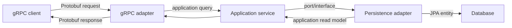

# Do Not Put Persistence Entities in the Proto Contract

## Lesson Objectives

In **SPRING_GRPC**, a Protocol Buffers contract describes the data that clients and servers exchange over RPC. On the Spring side, data is converted into Java types for business processing and persistence access. A critical design decision is **never using a persistence entity structure as the Protobuf contract**.

This lesson focuses on the boundary between the public schema, the application model, and the storage structure. Through an order-query example, you will design a Protobuf response independent of the JPA entity, map the entity to an application read model, and then convert the read model into the message generated from `.proto`.

After this lesson, you will be able to:

1. Explain why a JPA entity and a Protobuf message serve two different purposes.
2. Recognize the risks of copying database table structures and persistence relationships into a proto contract.
3. Design response messages containing only the data that is necessary and authorized to expose.
4. Map a JPA entity to an application read model inside the persistence adapter.
5. Map the read model to a Protobuf DTO inside the gRPC adapter.
6. Handle lazy relationships, fetch plans, sensitive data, and compatible schema changes.
7. Test the mapping and verify that the contract does not depend on persistence.

> **Scope:** Examples use official Spring gRPC, gRPC Java, and Spring Data JPA. The `GrpcService` annotation in the examples belongs to the `org.springframework.grpc.server.service` package. Community starters have different packages and configurations.

## 1. A Persistence Entity Is Not a Public API

A **persistence entity** describes how the application stores and reads data. With JPA, an entity typically carries annotations such as `@Entity`, `@Id`, `@Column`, `@ManyToOne`, `@OneToMany`, and `@Version`; it may contain lazy relationships, audit fields, or internal data.

A **Protobuf message** describes data sent over a wire contract. Field numbers, field types, presence, enums, and compatibility rules directly affect deployed clients. The schema must remain stable across the API lifecycle, even if the backend changes databases or table layouts.

Because gRPC methods declare Protobuf types, Java entities are not referenced directly in RPC signatures. The real risk is designing messages as 1:1 mirrors of entities, using entities as serialization sources without explicit mapping, or letting the adapter/application layer depend on ORM entities and relationships.

| Persistence Entity | Protobuf Contract |
| --- | --- |
| Serves ORM and storage | Serves inter-system communication |
| Has internal keys, version, audit fields, and relationships | Has only fields needed by the use case and approved for exposure |
| May have proxies and lazy associations | Independent data message with no ORM lifecycle |
| Evolves with database schema and storage model | Evolves according to API compatibility rules |
| May contain private/internal data | Contains only data approved for sharing |
| May have bidirectional links or large object graphs | Should have a finite, explicit message structure |
| May depend on JPA/Hibernate | Independent of any persistence framework |

**Principle:** the persistence adapter converts entities into application models; the gRPC adapter converts application models into Protobuf messages. Never let an entity cross the persistence boundary.



## 2. What Happens When You Copy Entities into a Proto Contract?

Suppose an orders table has an entity with database keys, customer, order lines, internal notes, and audit info. If the response is designed column-by-column after the entity, the following problems quickly arise.

### 2.1. Database Changes Force API Changes

The database might switch keys from integers to UUIDs, split out an address table, or store statuses using different codes. If the public proto contract mirrors those fields, persistence changes pressure the API and clients to change even when business meaning stays the same.

An API can publish a stable `order_number` while the backend uses numeric keys, UUIDs, or composite keys. Clients have no need to know the internal key strategy.

### 2.2. Internal Data Leaks

Entities may contain emails, phone numbers, staff notes, moderation flags, internal risk scores, versions, or audit information. Putting every entity field into the response can expose data the client is not authorized to see.

The contract must be an **allowlist**: every exposed field needs a business justification and an access policy. Never follow a rule of "whatever the entity has, the API returns."

### 2.3. ORM Relationships Do Not Equal Message Structure

An entity may reference `CustomerEntity`, while customer references a list of orders. Converting that graph into nested messages can become recursive, duplicate data, or grow huge. JPA proxies and lazy collections can also trigger queries when accessed during mapping.

A Protobuf message should express what the client needs, such as `customer_display_name` and a bounded list of `OrderLineReply`. There is rarely a reason to return the entire customer profile or every related association.

### 2.4. Serialization Can Trigger Unexpected Errors or Queries

If a mapper or serializer accesses a lazy association after the persistence context closes, the application can throw `LazyInitializationException`. If the persistence context stays open, iterating over collections can trigger N+1 queries or load excessive data. A large entity graph also inflates payloads and RPC latency.

The persistence adapter should define a fetch plan and convert into a read model inside the proper transaction scope. Returning a read model to the application layer ensures entities and proxies never escape the persistence boundary.

## 3. Designing the Protobuf Contract Around the Use Case

Suppose a client only needs to look up an order and display customer info, total amount, state, and order lines. The contract does not need to expose internal IDs, `@Version`, internal notes, or the full customer entity.

File `src/main/proto/order_query.proto`:

```proto
syntax = "proto3";

package orders.v1;

option java_package = "com.example.orders.proto";
option java_multiple_files = true;

service OrderQuery {
  rpc GetOrder(GetOrderRequest) returns (OrderReply);
}

message GetOrderRequest {
  string order_number = 1;
}

message OrderReply {
  string order_number = 1;
  string customer_display_name = 2;
  repeated OrderLineReply lines = 3;
  int64 total_cents = 4;
  OrderState state = 5;
}

message OrderLineReply {
  string sku = 1;
  string display_name = 2;
  int32 quantity = 3;
  int64 unit_price_cents = 4;
}

enum OrderState {
  ORDER_STATE_UNSPECIFIED = 0;
  ORDER_STATE_NEW = 1;
  ORDER_STATE_PAID = 2;
  ORDER_STATE_CANCELLED = 3;
}
```

The contract above represents **one order-read use case**. It exposes only the public order number, customer display name, permitted order lines, total amount, and API-defined state.

| Protobuf Field | Reason to Exist | Should Not Be Taken Directly From |
| --- | --- | --- |
| `order_number` | Order identifier used in the API | Internal database key unless it is the public identifier |
| `customer_display_name` | Display info needed by the client | The entire `CustomerEntity` |
| `lines` | List of order lines | The entire ORM association graph |
| `total_cents` | Total amount in agreed smallest currency unit | Unnormalized internal formulas/storage types |
| `state` | Public order state | Uncontrolled persistence enum values |
| No `internal_note`, `version`, `created_by` | Not needed for this use case | Internal or sensitive fields |

### Field Numbers Are Part of the Contract

Once clients use a schema, you must never arbitrarily change field numbers or reuse numbers from deleted fields. When removing a field, declare `reserved` for both its number and name. Adding new fields requires sensible default semantics so older clients continue to work.

Do not number fields according to database column order. Field numbers are long-lived wire-level identifiers, not entity property positions.

## 4. What Can a Persistence Entity Contain?

To make the boundary clear, look at a simplified JPA model. The following class is an internal persistence example; it **must not be used as a field type in a proto contract**.

File `OrderEntity.java`:

```java
@Entity
@Table(name = "orders")
public class OrderEntity {

    @Id
    private Long id;                       // Internal key

    @Column(name = "order_number", nullable = false, unique = true)
    private String orderNumber;            // Public identifier

    @ManyToOne(fetch = FetchType.LAZY)
    @JoinColumn(name = "customer_id")
    private CustomerEntity customer;       // ORM relationship

    @OneToMany(mappedBy = "order", fetch = FetchType.LAZY)
    private List<OrderLineEntity> lines = new ArrayList<>();

    @Enumerated(EnumType.STRING)
    private PersistenceOrderState state;

    private long totalCents;

    @Version
    private long version;                  // Optimistic locking

    private String internalNote;           // Internal

    private String createdBy;              // Audit
    private Instant createdAt;

    protected OrderEntity() {
    }

    // Getters and constructors for persistence omitted.
}
```

`CustomerEntity` may have email, address, phone number, and other orders; `OrderLineEntity` may point back to the order. These fields may be required for persistence, yet have no reason to appear automatically in responses. Lazy relationships also mean reading an entity is not equivalent to a single simple query.

Do not blindly apply Lombok `@Data` to entities with bidirectional relationships: `toString`, `equals`, or `hashCode` can traverse associations, create infinite loops, or trigger lazy loading. This is a persistence modeling concern and should never be solved by exposing that graph through the API.

## 5. Creating a JPA-Independent Application Read Model

The application layer needs just enough data to execute the use case and build the response. You can define plain Java records:

File `OrderView.java`:

```java
public record OrderView(
        String orderNumber,
        String customerDisplayName,
        List<OrderLineView> lines,
        long totalCents,
        OrderStatus status) {

    public OrderView {
        lines = List.copyOf(lines);
    }
}

public record OrderLineView(
        String sku,
        String displayName,
        int quantity,
        long unitPriceCents) {
}

public enum OrderStatus {
    NEW,
    PAID,
    CANCELLED
}
```

This read model is query data, not necessarily a domain aggregate. It contains no `OrderEntity`, `CustomerEntity`, `PersistentCollection`, Hibernate proxy, or JPA annotation. If the use case only needs certain fields, the read model should contain only those fields.

Define the port in the application layer:

File `OrderQueryPort.java`:

```java
public interface OrderQueryPort {
    Optional<OrderView> findByOrderNumber(String orderNumber);
}
```

The application service uses the port and returns the read model:

File `OrderQueryService.java`:

```java
@Service
public class OrderQueryService {

    private final OrderQueryPort orderQueryPort;

    public OrderQueryService(OrderQueryPort orderQueryPort) {
        this.orderQueryPort = orderQueryPort;
    }

    public OrderView getOrder(String orderNumber) {
        if (orderNumber == null || orderNumber.isBlank()) {
            throw new IllegalArgumentException("order_number must not be empty");
        }

        return orderQueryPort.findByOrderNumber(orderNumber.trim())
                .orElseThrow(() ->
                        new OrderNotFoundException(orderNumber));
    }
}
```

`OrderQueryService` knows nothing about `OrderEntity`, `JpaRepository`, Protobuf messages, or gRPC statuses. It takes a public identifier, calls the port, and returns `OrderView`. When swapping databases or adding another adapter, the use case needs no changes as long as the port preserves its semantics.

## 6. Mapping Entities to Read Models Inside the Persistence Adapter

The persistence adapter is the only place in this example that knows about JPA entities. With Spring Data JPA, `@EntityGraph` can be used to load the associations needed for this query.

Spring Data repository file:

```java
public interface SpringDataOrderRepository
        extends JpaRepository<OrderEntity, Long> {

    @EntityGraph(attributePaths = {"customer", "lines"})
    Optional<OrderEntity> findByOrderNumber(String orderNumber);
}
```

File `JpaOrderQueryAdapter.java`:

```java
@Repository
public class JpaOrderQueryAdapter implements OrderQueryPort {

    private final SpringDataOrderRepository repository;

    public JpaOrderQueryAdapter(SpringDataOrderRepository repository) {
        this.repository = repository;
    }

    @Override
    @Transactional(readOnly = true)
    public Optional<OrderView> findByOrderNumber(String orderNumber) {
        return repository.findByOrderNumber(orderNumber)
                .map(this::toView);
    }

    private OrderView toView(OrderEntity entity) {
        List<OrderLineView> lines = entity.getLines().stream()
                .map(line -> new OrderLineView(
                        line.getSku(),
                        line.getDisplayName(),
                        line.getQuantity(),
                        line.getUnitPriceCents()))
                .toList();

        return new OrderView(
                entity.getOrderNumber(),
                entity.getCustomer().getDisplayName(),
                lines,
                entity.getTotalCents(),
                mapStatus(entity.getState()));
    }

    private OrderStatus mapStatus(PersistenceOrderState state) {
        return switch (state) {
            case NEW -> OrderStatus.NEW;
            case PAID -> OrderStatus.PAID;
            case CANCELLED -> OrderStatus.CANCELLED;
        };
    }
}
```

This is the key takeaway of the lesson: `toView(...)` reads the required fields and constructs a new Java object **before leaving the persistence boundary**. `OrderView` holds no references to `OrderEntity` or Hibernate-managed collections.

`@EntityGraph` in the example instructs Spring Data to load `customer` and `lines` for the query; the actual SQL execution depends on the provider and mappings. For large datasets, inspect query plans, SQL statement counts, join sizes, and pagination. You can replace this with a JPQL projection or DTO projection to select only the needed columns. Never set `EAGER` globally just to dodge lazy-loading exceptions.

`@Transactional(readOnly = true)` keeps the persistence context alive during mapping. When the method returns, the application receives only `Optional<OrderView>`. Never return `OrderEntity` and expect the gRPC adapter to access associations later; doing so risks lazy-loading errors or unexpected queries.

## 7. Mapping the Read Model to Protobuf in the gRPC Adapter

The persistence adapter has produced `OrderView`. The gRPC adapter then converts the read model into a message matching the public contract.

File `OrderProtoMapper.java`:

```java
@Component
public class OrderProtoMapper {

    public OrderReply toProto(OrderView view) {
        return OrderReply.newBuilder()
                .setOrderNumber(view.orderNumber())
                .setCustomerDisplayName(view.customerDisplayName())
                .addAllLines(view.lines().stream()
                        .map(this::toProto)
                        .toList())
                .setTotalCents(view.totalCents())
                .setState(toProto(view.status()))
                .build();
    }

    private OrderLineReply toProto(OrderLineView line) {
        return OrderLineReply.newBuilder()
                .setSku(line.sku())
                .setDisplayName(line.displayName())
                .setQuantity(line.quantity())
                .setUnitPriceCents(line.unitPriceCents())
                .build();
    }

    private OrderState toProto(OrderStatus status) {
        return switch (status) {
            case NEW -> OrderState.ORDER_STATE_NEW;
            case PAID -> OrderState.ORDER_STATE_PAID;
            case CANCELLED -> OrderState.ORDER_STATE_CANCELLED;
        };
    }
}
```

This mapper never receives an entity. As a result, if persistence changes `PersistenceOrderState.PAID` to a numeric code or stores `"P"` in the database, only the persistence adapter needs to handle that change. If the public API adds a new state, the mapper is forced to be reviewed alongside the schema change.

Simplified gRPC endpoint:

File `OrderQueryGrpcAdapter.java`:

```java
@GrpcService
public class OrderQueryGrpcAdapter
        extends OrderQueryGrpc.OrderQueryImplBase {

    private final OrderQueryService service;
    private final OrderProtoMapper mapper;

    public OrderQueryGrpcAdapter(
            OrderQueryService service,
            OrderProtoMapper mapper) {
        this.service = service;
        this.mapper = mapper;
    }

    @Override
    public void getOrder(
            GetOrderRequest request,
            StreamObserver<OrderReply> responses) {
        try {
            OrderView view = service.getOrder(request.getOrderNumber());
            responses.onNext(mapper.toProto(view));
            responses.onCompleted();
        } catch (OrderNotFoundException ex) {
            responses.onError(Status.NOT_FOUND
                    .withDescription("Order not found")
                    .asRuntimeException());
        } catch (IllegalArgumentException ex) {
            responses.onError(Status.INVALID_ARGUMENT
                    .withDescription(ex.getMessage())
                    .asRuntimeException());
        } catch (RuntimeException ex) {
            responses.onError(Status.INTERNAL
                    .withDescription("Unable to query order")
                    .asRuntimeException());
        }
    }
}
```

This snippet illustrates the mapping boundary, not a complete production-grade error handler. In production, unexpected exceptions must be logged with a correlation ID on the server without returning internal details to clients; avoid overly broad catches if they mask programming bugs. Error mapping can be moved to a shared interceptor or exception mapper when multiple services share the same policy.

**End-to-end data flow:**

1. The Protobuf request is decoded by the gRPC runtime.
2. The adapter calls `OrderQueryService` with `orderNumber`.
3. The application service calls `OrderQueryPort`.
4. The persistence adapter queries the entity and maps it to `OrderView`.
5. The application service returns `OrderView`.
6. The gRPC mapper builds `OrderReply`.
7. The adapter sends the response and completes the RPC.

At no step does `OrderEntity` enter `.proto` or the application service.

## 8. Rules to Uphold When Both Contract and Persistence Evolve

| Change | Where to Handle | Impact on Protobuf |
| --- | --- | --- |
| Change database key from `Long` to `UUID` | Entity/repository/persistence adapter | None, as long as public `order_number` keeps its semantics |
| Split customer or address tables | Persistence adapter and read model | Only changes if public data returned to clients changes |
| Add `internal_note` or `created_by` | Persistence entity | Do not add to response if clients are not allowed to see it |
| Change persistence enum from string to integer | Persistence adapter | Mapper continues mapping to meaningful public enum |
| Add public field needed by clients | `.proto`, mapper, and contract tests | Add new field number, compatible with older clients |
| Remove a published public field | Schema contract/versioning | Reserve field number and name; never reuse |
| Add a new lazy relationship | Persistence fetch plan | Do not automatically add nested messages to API |

### Do Not Equate Field Names and Types

For example, the entity has `id: Long`, while the API has `order_number: string`. The mapper translates from internal keys to public identifiers. Never change the API to `int64 id` just because the entity uses `Long`; likewise, do not couple clients to how the database generates keys.

### Do Not Expose Entire Relationship Graphs

If `OrderEntity` links to `CustomerEntity`, the contract might only need `customer_display_name`. If clients need to view customer profiles, consider a dedicated use case/API with explicit authorization rather than embedding the full customer graph in every order response.

### Do Not Rely on Enum Ordinals

Never use `enum.ordinal()` to generate Protobuf enum values or store positional mappings. Java enum ordering can change; Protobuf field numbers are long-term contracts. Use explicit `switch` statements based on state semantics.

### Control Sensitive Fields

Every response field must answer three questions: which client needs it, is that client authorized to view it, and does the field need long-term API stability? Fields such as email, address, payment info, internal notes, and audit identities require explicit policies. Explicit DTOs/mappers make allowlist reviews straightforward.

## 9. Testing to Prove the Boundary Is Intact

### 9.1. Unit Testing the Protobuf Mapper

Construct an entity-free `OrderView` and verify the mapping:

```java
class OrderProtoMapperTest {

    private final OrderProtoMapper mapper = new OrderProtoMapper();

    @Test
    void mapsOnlyPublicOrderFields() {
        var view = new OrderView(
                "ORD-2026-001",
                "Nguyen Van A",
                List.of(new OrderLineView(
                        "SKU-1", "Keyboard", 2, 450_000L)),
                900_000L,
                OrderStatus.PAID);

        OrderReply reply = mapper.toProto(view);

        assertThat(reply.getOrderNumber()).isEqualTo("ORD-2026-001");
        assertThat(reply.getCustomerDisplayName()).isEqualTo("Nguyen Van A");
        assertThat(reply.getLinesCount()).isEqualTo(1);
        assertThat(reply.getTotalCents()).isEqualTo(900_000L);
        assertThat(reply.getState()).isEqualTo(OrderState.ORDER_STATE_PAID);
    }
}
```

This test requires no Spring context, database, or gRPC server. It verifies the mapping between the application read model and the public contract.

### 9.2. Testing the Persistence Adapter

Test the persistence adapter against a test database (e.g., Testcontainers or H2 where appropriate) to verify:

- Querying by `orderNumber` returns the right entity.
- `customer` and `lines` are loaded according to the expected fetch plan.
- The adapter constructs `OrderView` with the right fields.
- `OrderView` contains no entity/proxy or ORM collection.
- No unexpected N+1 queries occur when loading multiple orders.

Do not rely solely on mocked repositories to conclude a JPA fetch plan is correct; lazy loading and actual SQL must be verified at the persistence layer.

### 9.3. Verifying the gRPC Contract and Wiring

An integration test can boot the native Spring gRPC server on a dynamic port or use an in-process server, invoke via a generated stub, and inspect `OrderReply`. This test proves the real transport path; it complements mapper and persistence adapter unit tests rather than replacing them.

You can verify that the service descriptor is `orders.v1.OrderQuery` and that the contract contains only designed fields. When modifying `.proto`, review descriptors and field numbers to avoid accidentally removing or reusing numbers.

### 9.4. What Should Not Be Tested Only by Snapshots

A response snapshot shows current fields, but it may not catch newly added internal fields later on. Review `.proto` like a public API, verify authorization, and add explicit assertions that sensitive fields are never returned. Explicit mapping ensures persistence changes do not automatically leak into responses.

## 10. Common Errors and How to Resolve Them

| Symptom | Cause | Resolution |
| --- | --- | --- |
| Client receives unnecessary internal fields | Proto schema mirrors the entire entity | Design messages by use case and allowlist |
| `LazyInitializationException` | Mapper accesses associations after persistence context closes | Map entity to read model inside transaction with an explicit fetch plan |
| Unexpected surge of queries | Iterating lazy collections/customers per entity causes N+1 | Use `@EntityGraph`, projections, or intentionally tuned queries |
| Oversized or recursive payload | Mirroring bidirectional relationship graphs as nested messages | Return only needed data, bound collections, and use separate APIs for other resources |
| DB schema change forces client updates | Contract depends directly on persistence fields/IDs | Keep public identifiers and Protobuf schemas independent |
| Wrong enum when ordering changes | Using ordinal or internal numbers as public enums | Map explicitly by meaning |
| Default field value mistaken for omitted | Using proto3 scalars without explicit presence | Use `optional`/message/`oneof` when presence distinction is needed |
| Private info appears in response | Mapper automatically copies all properties | Use explicit mapping and review access controls |
| Mapper tests must boot the database | Mapper accepts entities or repositories | gRPC mapper accepts application read models; test persistence mapping separately |
| Older clients break after field number change | Reused numbers or changed meaning of published fields | Preserve field numbers; reserve deleted numbers/names; follow schema evolution |

## 11. Hands-On Exercises

1. **Leak check:** Add `internalNote`, `createdBy`, and `version` to `OrderEntity`. Prove that none of these fields appear in `OrderView` or `OrderReply`.
2. **Swap persistence:** Change the entity primary key from `Long` to `UUID` while keeping `order_number` unchanged. Update only the persistence adapter and its tests; the client contract stays untouched.
3. **Lazy loading:** Remove `@EntityGraph`, run the integration test, and observe the queries or mapping errors. Restore an intentional fetch plan or switch to a projection.
4. **Add a public field:** Add `delivery_estimate` to the proto. Pick a new field number, update the read model/mapper, and verify older clients can still read the existing fields.
5. **Authorization:** Add verified caller identity and return orders only for the authorized tenant/customer. Never use `customer_id` in the request as proof of authentication.
6. **Enum mapping:** Add a new persistence state. Decide whether that state should appear in the public enum or map to a broader public state; never use ordinals.
7. **Projection:** Replace the entity fetch with a JPQL/DTO projection selecting only the columns needed for `OrderView`; compare query counts and data payload read.
8. **Streaming:** Add an RPC listing orders by customer. Design limits, pagination, and response DTOs without returning `OrderEntity` or holding a transaction open for the duration of the stream.

### Self-Check Questions

- Why should a Protobuf message not be created by copying every field of a JPA entity?
- What is the difference between `OrderEntity`, `OrderView`, and `OrderReply`?
- Why should an entity be mapped to a read model before leaving the transaction?
- What problem does `@EntityGraph` solve, and what cost can it introduce?
- Why can `order_number` be a more stable public identifier than a database key?
- When removing a field from `.proto`, why must you reserve both its field number and name?
- Who is responsible for deciding which fields are allowed to be returned to clients?
- If an internal column is added to an entity, why should the gRPC response not change automatically?
- How do you test persistence mapping and Protobuf mapping separately?

## References

- [Protocol Buffers — Proto3 Language Guide](https://protobuf.dev/programming-guides/proto3/): messages, field numbers, enums, and schema compatibility rules.
- [Protocol Buffers — Updating A Message Type](https://protobuf.dev/programming-guides/proto3/#updating): adding/removing fields and reserving field numbers.
- [Spring Data JPA — EntityGraph](https://docs.spring.io/spring-data/jpa/reference/jpa/query-methods.html): defining fetch plans for associations in queries.
- [Hibernate ORM — Fetching](https://docs.jboss.org/hibernate/orm/current/userguide/html_single/Hibernate_User_Guide.html#fetching): lazy/eager fetching and relationship query costs.
- [Spring gRPC — gRPC Server](https://docs.spring.io/spring-grpc/reference/server.html): how Spring discovers `BindableService` beans and binds services to the server.
- [gRPC Java — Generated Code Reference](https://grpc.io/docs/languages/java/generated-code/): generated service bases, messages, and client stubs.

**Expected outcome:** The public Protobuf contract is designed around the use case, persistence entities stay confined to the persistence layer, the persistence adapter converts entities into application read models, and the gRPC adapter converts read models into Protobuf responses. As a result, database changes, ORM associations, or internal fields never automatically alter the API or leak data to clients.
