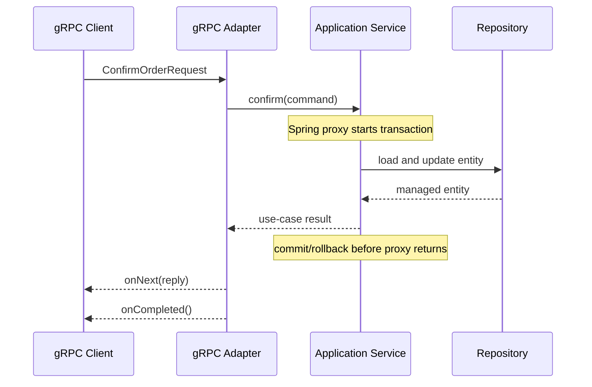

# Handling Transactions in RPC Handlers

## Lesson Objectives

In **SPRING_GRPC**, a gRPC handler receives a Protobuf request, calls business logic, and sends a response via `StreamObserver`. When business logic reads or modifies data using Spring Data JPA, an important question arises: **where does a transaction begin and end relative to the RPC lifecycle?**

This lesson focuses on placing transaction boundaries properly for RPC handlers: the transaction belongs to the use case/application service, commits or rolls back before the adapter sends a success result, and never keeps a database transaction open across a long-lived streaming RPC.

After this lesson, you will be able to:

1. Place `@Transactional` on the application service called from a gRPC adapter.
2. Explain when a transaction commits or rolls back relative to `onNext` and `onCompleted`.
3. Map business errors, persistence errors, and concurrency conflicts to appropriate gRPC statuses.
4. Design short transactions for unary, server streaming, client streaming, and bidirectional streaming RPCs.
5. Avoid bugs caused by swallowing exceptions too early, self-invocation, lazy entities, and transactions not propagating across threads.
6. Test commit/rollback behavior at the service layer and through the gRPC server.

> **Scope:** Examples use official Spring gRPC, Spring transaction management, and Spring Data JPA. `@GrpcService` is `org.springframework.grpc.server.service.GrpcService`. With other starters, annotation packages and server configuration may differ.

## 1. The Transaction Boundary Belongs in the Use Case

An RPC typically flows through these steps: the gRPC runtime decodes the request, the adapter validates transport data, the application service executes the use case, the persistence layer reads/writes, and the adapter converts the result into a Protobuf response.

A transaction should wrap **one consistent business unit of work**. For write RPCs, the application service is the right place to open the transaction: it knows which database operations must succeed together or roll back together. The adapter only coordinates the protocol and translates errors into gRPC statuses.



The key mechanism is that the application service is invoked through a Spring transactional proxy. When the method call goes through the proxy, Spring starts a transaction, executes the method, and then commits on success or rolls back according to the rules. Only after the proxy finishes committing does control return to the adapter.

| Layer | Transaction Responsibility |
| --- | --- |
| gRPC adapter | Never hold a transaction for the entire transport lifecycle; invoke the use case and map results/errors |
| Application service | Define the atomic business boundary; declare `@Transactional` |
| Repository | Execute data operations within the active transaction |
| Database/transaction manager | Commit or roll back changes according to persistence configuration |

An RPC is not automatically a single transaction. If a handler calls multiple application services, each service may start its own transaction depending on propagation. When multiple operations must be atomic together, create a single use-case method that coordinates them inside **one transaction**.

## 2. Unary Write RPC Example

Let's build a use case that confirms a pending order. When confirmation succeeds, the order state is updated. If business preconditions fail or writing fails, the client receives a gRPC error status instead of a false success response.

### 2.1. Protobuf Contract

File `src/main/proto/order_command.proto`:

```proto
syntax = "proto3";

package orders.v1;

option java_package = "com.example.orders.proto";
option java_multiple_files = true;

service OrderCommand {
  rpc ConfirmOrder(ConfirmOrderRequest) returns (ConfirmOrderReply);
}

message ConfirmOrderRequest {
  string order_number = 1;
}

message ConfirmOrderReply {
  string order_number = 1;
  string state = 2;
}
```

The build must generate Java messages and `OrderCommandGrpc.OrderCommandImplBase` using `protoc` and `protoc-gen-grpc-java`. Since this example focuses on transactions, the build configuration is omitted. The server uses the matching Spring gRPC starter and a configured transport.

### 2.2. Entity and Repository

The entity holds state and an optimistic lock version:

```java
@Entity
@Table(name = "orders")
public class OrderEntity {

    @Id
    private Long id;

    @Column(name = "order_number", nullable = false, unique = true)
    private String orderNumber;

    @Enumerated(EnumType.STRING)
    private OrderState state;

    @Version
    private long version;

    protected OrderEntity() {
    }

    public String getOrderNumber() {
        return orderNumber;
    }

    public OrderState getState() {
        return state;
    }

    public void confirm() {
        if (state != OrderState.PENDING) {
            throw new OrderNotConfirmableException(orderNumber);
        }
        state = OrderState.CONFIRMED;
    }
}
```

`@Version` lets JPA detect certain concurrent update conflicts. If two transactions read the same version and both update it, the losing transaction fails on commit with an optimistic locking exception. The entity is abbreviated for this lesson; constructors, enums, and persistence getters/setters should be completed per project needs.

Repository:

```java
public interface OrderRepository
        extends JpaRepository<OrderEntity, Long> {

    Optional<OrderEntity> findByOrderNumber(String orderNumber);
}
```

### 2.3. Application Service Owns the Transaction

`ConfirmOrderCommand.java` is a pure Java command:

```java
public record ConfirmOrderCommand(String orderNumber) {
}
```

File `OrderCommandService.java`:

```java
@Service
public class OrderCommandService {

    private final OrderRepository repository;

    public OrderCommandService(OrderRepository repository) {
        this.repository = repository;
    }

    @Transactional
    public ConfirmOrderResult confirm(ConfirmOrderCommand command) {
        if (command.orderNumber() == null
                || command.orderNumber().isBlank()) {
            throw new IllegalArgumentException("orderNumber must not be empty");
        }

        OrderEntity order = repository
                .findByOrderNumber(command.orderNumber().trim())
                .orElseThrow(() ->
                        new OrderNotFoundException(command.orderNumber()));

        order.confirm();

        // Entity is managed; JPA dirty checking writes changes on commit.
        return new ConfirmOrderResult(
                order.getOrderNumber(),
                order.getState().name());
    }
}
```

When Spring invokes `confirm` through the bean proxy:

1. The transaction manager begins a transaction.
2. The repository loads the entity; the entity becomes managed in the persistence context.
3. `order.confirm()` mutates state on the managed entity.
4. The method returns the Java result.
5. Spring flushes and commits the transaction before the proxy call returns the result to the caller.

You do not need to call `repository.save(order)` for an entity loaded and still managed within the same JPA transaction; dirty checking detects the changes. You may call `save` if your project convention prefers it, as long as you understand transaction and managed state and avoid redundant operations.

`ConfirmOrderResult` and the exceptions are application types, independent of Protobuf and gRPC:

```java
public record ConfirmOrderResult(String orderNumber, String state) {
}

public class OrderNotFoundException extends RuntimeException {
    public OrderNotFoundException(String orderNumber) {
        super("Order not found: " + orderNumber);
    }
}

public class OrderNotConfirmableException extends RuntimeException {
    public OrderNotConfirmableException(String orderNumber) {
        super("Order is not in a confirmable state: " + orderNumber);
    }
}
```

### 2.4. Adapter Sends the Response After the Transaction Completes

The `@GrpcService` adapter does not need to open a transaction itself:

```java
@GrpcService
public class OrderCommandGrpcAdapter
        extends OrderCommandGrpc.OrderCommandImplBase {

    private final OrderCommandService service;

    public OrderCommandGrpcAdapter(OrderCommandService service) {
        this.service = service;
    }

    @Override
    public void confirmOrder(
            ConfirmOrderRequest request,
            StreamObserver<ConfirmOrderReply> responses) {

        final ConfirmOrderResult result;
        try {
            // Call goes through Spring proxy; returns here only after commit.
            result = service.confirm(
                    new ConfirmOrderCommand(request.getOrderNumber()));
        } catch (IllegalArgumentException ex) {
            responses.onError(Status.INVALID_ARGUMENT
                    .withDescription(ex.getMessage())
                    .asRuntimeException());
            return;
        } catch (OrderNotFoundException ex) {
            responses.onError(Status.NOT_FOUND
                    .withDescription("Order not found")
                    .asRuntimeException());
            return;
        } catch (OrderNotConfirmableException ex) {
            responses.onError(Status.FAILED_PRECONDITION
                    .withDescription("Order cannot be confirmed in its current state")
                    .asRuntimeException());
            return;
        } catch (ObjectOptimisticLockingFailureException ex) {
            responses.onError(Status.ABORTED
                    .withDescription("Order was just updated by another request")
                    .asRuntimeException());
            return;
        } catch (RuntimeException ex) {
            responses.onError(Status.INTERNAL
                    .withDescription("Unable to confirm order")
                    .asRuntimeException());
            return;
        }

        // Send success only after the service transaction has committed.
        responses.onNext(ConfirmOrderReply.newBuilder()
                .setOrderNumber(result.orderNumber())
                .setState(result.state())
                .build());
        responses.onCompleted();
    }
}
```

The example needs imports for `io.grpc.Status`, `io.grpc.stub.StreamObserver`, and `org.springframework.orm.ObjectOptimisticLockingFailureException`. Log unexpected errors on the server with a correlation ID; never send SQL, stack traces, or internal details in the status description.

### 2.5. Why Not Put the Transaction on the Handler?

Do not write code like this:

```java
// Do not use this approach for a unary write handler.
@Transactional
public void confirmOrder(
        ConfirmOrderRequest request,
        StreamObserver<ConfirmOrderReply> responses) {
    // Call repository, then onNext/onCompleted right here.
}
```

If the transaction wraps the handler method itself, `onNext` and `onCompleted` are called **before the method returns**. The transaction interceptor only commits after the target method finishes. If the commit fails after the client has already received a success response, the client believes the order was confirmed even though the database rolled back.

Placing the transaction in the application service fixes this ordering: the service proxy returns only after committing, and then the adapter emits the success response. If commit fails, the exception thrown by the proxy is caught by the adapter and mapped to a gRPC status.

## 3. Rollback Rules and Error Mapping

With Spring's default declarative transaction behavior:

- `RuntimeException` and `Error` trigger a rollback.
- Checked exceptions do not roll back by default; declare `rollbackFor` if a checked exception must trigger a rollback.
- If you catch an exception inside a transactional method and return a "failure" value normally, Spring may treat the method as having completed normally and commit.
- If an error is handled inside the method yet still requires rollback, either let an exception exit the transaction boundary or explicitly mark the transaction rollback-only by design.

Example with a checked exception:

```java
@Transactional(rollbackFor = PaymentRejectedException.class)
public PaymentResult capturePayment(CapturePaymentCommand command)
        throws PaymentRejectedException {
    // Update data and invoke business steps inside the transaction.
}
```

Do not catch all exceptions inside the application service, log them, and return an empty result. That hides failures and can commit partial changes. Let meaningful exceptions exit the transactional method so the transaction manager decides rollback; the adapter handles translating exceptions into gRPC statuses.

| Situation | Appropriate gRPC Status | Notes |
| --- | --- | --- |
| Malformed request / missing required field | `INVALID_ARGUMENT` | Input error in adapter or validation |
| Order not found | `NOT_FOUND` | Do not leak sensitive data in description |
| Order is in a state that forbids confirmation | `FAILED_PRECONDITION` | State must change before retrying |
| Optimistic lock conflict | `ABORTED` | Client may re-read state and retry use case per policy |
| Database/downstream temporarily unavailable | `UNAVAILABLE` | Retry only if the operation and idempotency allow |
| Unexpected error | `INTERNAL` | Log details on server, return safe message |

An exception may be wrapped by Spring in another persistence exception depending on the provider and flush/commit timing. Inspect the cause chain or use an appropriate shared exception handler; do not assume every commit failure throws one exact class.

## 4. Transaction Propagation and Common Spring Pitfalls

### 4.1. Multiple Business Steps Needing One Transaction

If confirming an order requires updating the order, recording a payment, and decrementing inventory in the same database, coordinate them in a single transactional application service method:

```java
@Service
public class ConfirmOrderUseCase {

    private final OrderRepository orders;
    private final PaymentRepository payments;
    private final InventoryRepository inventory;

    public ConfirmOrderUseCase(
            OrderRepository orders,
            PaymentRepository payments,
            InventoryRepository inventory) {
        this.orders = orders;
        this.payments = payments;
        this.inventory = inventory;
    }

    @Transactional
    public ConfirmOrderResult execute(ConfirmOrderCommand command) {
        OrderEntity order = orders.findByOrderNumber(command.orderNumber())
                .orElseThrow(() ->
                        new OrderNotFoundException(command.orderNumber()));

        inventory.reserve(order.getSku(), order.getQuantity());
        payments.record(order.getOrderNumber(), command.paymentReference());
        order.confirm();

        return new ConfirmOrderResult(
                order.getOrderNumber(), order.getState().name());
    }
}
```

All repositories participate in the same transaction manager and default `REQUIRED` transaction propagation. If any step throws a runtime exception before commit, all database changes in the transaction roll back together. The called repositories/services must use the right datasource/transaction manager; if there are multiple databases or transaction managers, configure propagation and consistency explicitly.

### 4.2. `REQUIRED` Is the Default—It Does Not Always Create a New Transaction

`@Transactional` defaults to `REQUIRED` propagation: join an existing transaction if present, otherwise create a new one. Thus, when an adapter calls a transactional application service, repositories normally join that transaction.

Do not use `REQUIRES_NEW` just to "make sure there is a transaction." It creates an independent transaction and can commit partially even if the outer transaction rolls back. Use it only when business requirements genuinely demand an independent commit, such as intentional audit logging whose consequences are understood.

### 4.3. Self-Invocation Bypasses the Proxy

In default proxy mode, calling a `@Transactional` method from another method **on the same instance** bypasses the proxy:

```java
@Service
public class OrderService {

    public void handle() {
        updateOrder(); // self-invocation: does not trigger the transaction proxy
    }

    @Transactional
    public void updateOrder() {
        // ...
    }
}
```

The simple fix is to place the transaction on a public method of a bean called from another bean, or split the use case into a separate service. Never rely on the annotation if the actual call does not pass through the proxy.

### 4.4. Do Not Swallow Exceptions Before the Transaction Interceptor

The transaction interceptor must see the exception to apply rollback rules. If the application service catches the error, logs it, and returns normally, the transaction may commit. Catching the exception in the adapter **after the proxy call returns** is the right place to translate it into a gRPC status.

### 4.5. Calling Remote Services Inside a Database Transaction

A JPA transaction cannot automatically roll back a gRPC call, HTTP request, or email that already succeeded. Holding a database transaction open while waiting on downstream services also holds locks and connections longer.

When you need to coordinate database state with external messages/events, consider the **transactional outbox** pattern: write the business change and an outbox record in the same transaction, then after commit a separate publisher sends the event and handles retries/idempotency. Never call an external service inside a transaction assuming a database rollback will undo side effects on the other system.

## 5. Transactions Across Streaming RPC Types

A unary RPC has finite request and response messages, so it typically maps to one short transaction. Streaming has a longer lifecycle and multiple messages, so you should never assume "one stream = one transaction."

### 5.1. Server Streaming: Reading by Page/Chunk

For server streaming, the application service can read one page inside a read-only transaction, return materialized DTOs, and then the adapter emits messages **outside the transaction**:

```java
@Service
public class OrderReadService {

    private final OrderRepository repository;

    public OrderReadService(OrderRepository repository) {
        this.repository = repository;
    }

    @Transactional(readOnly = true)
    public List<OrderSummary> fetchPage(String customerId, int page, int size) {
        return repository.findSummaries(customerId,
                PageRequest.of(page, size)).getContent();
    }
}
```

The adapter loops page by page:

```java
int page = 0;
while (!Context.current().isCancelled()) {
    List<OrderSummary> batch =
            readService.fetchPage(customerId, page, 100);

    if (batch.isEmpty()) {
        break;
    }

    for (OrderSummary order : batch) {
        if (Context.current().isCancelled()) {
            return;
        }
        responses.onNext(mapper.toProto(order));
    }

    page++;
}
if (!Context.current().isCancelled()) {
    responses.onCompleted();
}
```

Each call to `fetchPage` passes through the Spring proxy and ends its read-only transaction before the adapter emits the batch. For large datasets, keep page sizes reasonable; cursor/keyset pagination is often better than offset pagination when data changes frequently. Returned read models must be materialized inside the transaction—never return JPA entities or lazy streams for the adapter to traverse after the transaction closes.

### 5.2. Client Streaming: Explicitly Choose All-or-Nothing vs. Per-Item

With client streaming, the server receives multiple messages before knowing the stream has completed. There are two distinct business models:

| Model | Transaction | Consequence |
| --- | --- | --- |
| **All-or-nothing** for a small bounded batch | Buffer a bounded number of messages; when the client half-closes, call one transactional application service for the entire batch | One business error rolls back the whole batch; must bound item count and payload size |
| **Commit per message/chunk** | Each message or chunk invokes a separate transactional method | Partial commits may occur before the stream errors; response/protocol must report per-item results and support idempotency |

Never hold a transaction open while waiting for the client to send the next message. Clients may send slowly, drop connections, or never half-close; a long transaction holds connections and locks unnecessarily. If all-or-nothing is required for large datasets, use a staging/batch workflow with explicit states and a finalize step rather than buffering unboundedly in RAM or holding a transaction open for the entire stream.

### 5.3. Bidirectional Streaming: Short Transactions per Command

With bidirectional streaming, requests and responses can interleave asynchronously. A common pattern is invoking a separate application service with a short transaction for each valid command, then returning a corresponding acknowledgment. This produces multiple independent commits rather than a single transaction for the whole stream.

If the client requires "all commands succeed together or fail together," you must define a batch/finalize protocol with size limits, idempotency, and result reporting. Never implicitly promise stream-wide atomicity when the server actually commits per message.

### 5.4. Transactions Do Not Propagate Across Threads Automatically

Traditional Spring transactions are bound to the current thread. If a handler offloads work to an executor, scheduler, or another callback, do not assume the transaction from the initial gRPC thread automatically exists on the worker thread. Invoke a **transactional Spring bean** on the executing thread to open a transaction there; pass the necessary data/commands, never managed JPA entities across threads.

## 6. Notes on Read-Only, Flushing, and Optimistic Locking

- `@Transactional(readOnly = true)` expresses read intent and can help persistence providers optimize; it does not replace authorization and is not an absolute security barrier preventing all writes.
- JPA typically flushes changes before commit according to flush mode. Constraint violations or optimistic locking errors may surface only at flush/commit—meaning after the application service method body has already produced its local return value.
- Because the proxy commits before returning to the adapter, commit errors can still be caught by the adapter and mapped to a status; the adapter must never emit a success response before the proxy call completes.
- `@Version` helps detect concurrent updates, but does not automatically solve every race condition. For workflows requiring locks or conditional updates, use appropriate query/update strategies and bounded retries.
- Retrying a write command is safe only when designed for idempotency. If a client times out after the server committed but the response was lost, the client may resend the same RPC. Use request/idempotency keys and store results to prevent duplicate effects.

## 7. Testing Transactions at the Right Boundary

### 7.1. Testing Preconditions and Rollback

An integration test with a Spring context and test database should verify both rejecting invalid states and rolling back when an error occurs **after an entity was modified**. For example, fixture `ORD-1001` is already `CONFIRMED`, while `ORD-1002` is `PENDING`:

```java
import org.springframework.transaction.PlatformTransactionManager;
import org.springframework.transaction.support.TransactionTemplate;

@SpringBootTest
class OrderCommandServiceTransactionTest {

    @Autowired
    OrderCommandService service;

    @Autowired
    OrderRepository repository;

    @Autowired
    PlatformTransactionManager transactionManager;

    @Test
    void rejectsOrderThatIsAlreadyConfirmed() {
        // Fixture ORD-1001 is already CONFIRMED and committed before the test.
        assertThat(repository.findByOrderNumber("ORD-1001"))
                .get()
                .extracting(OrderEntity::getState)
                .isEqualTo(OrderState.CONFIRMED);

        assertThatThrownBy(() -> service.confirm(
                new ConfirmOrderCommand("ORD-1001")))
                .isInstanceOf(OrderNotConfirmableException.class);

        assertThat(repository.findByOrderNumber("ORD-1001"))
                .get()
                .extracting(OrderEntity::getState)
                .isEqualTo(OrderState.CONFIRMED);
    }

    @Test
    void rollsBackWhenFailureOccursAfterEntityWasChanged() {
        TransactionTemplate tx = new TransactionTemplate(transactionManager);

        assertThatThrownBy(() -> tx.executeWithoutResult(status -> {
            OrderEntity order = repository.findByOrderNumber("ORD-1002")
                    .orElseThrow();
            order.confirm();
            // Simulate a subsequent write step failing in the same transaction.
            throw new IllegalStateException("simulated later-step failure");
        })).isInstanceOf(IllegalStateException.class);

        assertThat(repository.findByOrderNumber("ORD-1002"))
                .get()
                .extracting(OrderEntity::getState)
                .isEqualTo(OrderState.PENDING);
    }
}
```

This test uses `TransactionTemplate` to demonstrate transaction manager rollback after a managed entity changed state. In tests directly verifying `@Transactional` on the application service, call the bean through the Spring proxy and do not place `@Transactional` on the test method itself if an outer test transaction would obscure commit/rollback timing; use committed fixtures and re-read after the service call completes.

### 7.2. Testing Commit Failures Before the Adapter Sends a Response

A gRPC integration test should invoke the server via a generated stub, trigger a commit failure (e.g., optimistic lock conflict or constraint violation), and verify that the client receives an error status and never receives a success response. Adapter unit tests that merely mock the service cannot prove commit timing because mocks do not run Spring's transaction interceptor.

Another useful test is verifying that retrying a request with the same idempotency key does not create an order or payment twice.

### 7.3. Testing That Streaming Does Not Hold a Transaction Open Throughout

You can instrument the transaction manager or repository to verify that each page/chunk is read inside its own transaction and that the transaction finishes before the adapter emits the batch. For client streaming, also test the case where the client sends an error before half-closing to ensure the batch was not committed under an all-or-nothing model.

## 8. Common Errors

| Symptom | Cause | Resolution |
| --- | --- | --- |
| Client receives success but database rolls back | Adapter sends response before the handler's transaction commits | Put the transaction in the application service; send response after the proxy call returns |
| Database changed even though RPC returned an error | Exception caught and swallowed inside transactional method | Let the error exit the transaction or intentionally mark rollback-only |
| `@Transactional` has no effect | Self-invocation, call bypasses Spring proxy, or bean created with `new` | Invoke through the Spring bean proxy; check public methods and proxy config |
| Transaction lost in async work | Thread-bound transaction does not propagate to other threads | Open a transaction inside a bean invoked on the worker thread |
| Streaming RPC holds connections/locks for too long | One transaction spans the entire stream | Use short transactions per page/chunk or per command |
| `LazyInitializationException` when sending response | Entity/proxy returned outside transaction before mapping | Map to DTO/read model before the transaction ends |
| Error appears only at commit | Flush/constraint/optimistic lock occurs at transaction end | Catch errors around the transactional proxy call in the adapter; log root cause |
| Retry creates duplicate changes | Client times out after commit and resends write request | Implement idempotency keys and persist outcomes |
| Remote service acted but DB rolled back | Database transaction does not cover external system side effects | Use outbox/saga or appropriate compensating workflow |
| Tests fail to observe real commits | Test method itself wraps an outer transaction | Manage fixture/test transactions separately and invoke via Spring proxy |

## 9. Hands-On Exercises

1. Add a `CancelOrder` RPC and a `@Transactional` application service. Define which states allow cancellation and which return `FAILED_PRECONDITION`.
2. Add `@Version` to the entity, simulate two concurrent requests updating the same order, and map the conflict to `ABORTED`.
3. Write an integration test where a database constraint fails at commit. Verify the client does not receive a success response prior to the commit failure.
4. Convert `ListOrders` to paged server streaming. Verify that the read-only transaction ends after each page before the adapter emits messages.
5. Build a client-streaming importer accepting up to 500 lines using an all-or-nothing model. Reject oversized batches and invoke the transactional application service only when the client half-closes.
6. Try the per-chunk commit model, then disconnect the client mid-stream. Record which chunks committed and design idempotency so the client can resume safely.
7. Add a downstream gRPC call to a use case. Measure transaction duration and move the side effect to an outbox if a synchronous result is not needed inside the transaction.

### Self-Check Questions

- Why should a transaction finish before the adapter calls `onNext` and `onCompleted`?
- If a commit fails after the application service method body already returned a value, where does the exception surface?
- Does Spring roll back by default on checked or unchecked exceptions?
- Why can catching an exception and returning a normal error result cause the transaction to commit?
- How does `REQUIRED` differ from `REQUIRES_NEW`?
- Why can self-invocation prevent `@Transactional` from being applied?
- Why should you not keep a JPA transaction open while waiting for client-streaming messages?
- How do you handle retries when a client times out after the server already committed?
- Can a database transaction roll back a gRPC call already sent to another system?

## References

- [Spring Framework — Declarative Transaction Management](https://docs.spring.io/spring-framework/reference/data-access/transaction/declarative.html): proxies, `@Transactional`, and transaction boundaries.
- [Spring Framework — Transaction Propagation](https://docs.spring.io/spring-framework/reference/data-access/transaction/declarative/tx-propagation.html): `REQUIRED`, `REQUIRES_NEW`, and propagation semantics.
- [Spring Data JPA — Transactionality](https://docs.spring.io/spring-data/jpa/reference/jpa/transactions.html): transactions in repositories and services/facades.
- [Spring Framework — Transaction-bound Events](https://docs.spring.io/spring-framework/reference/data-access/transaction/event.html): handling events by transaction phase.
- [gRPC — Deadlines](https://grpc.io/docs/guides/deadlines/): deadlines, timeouts, and cancellation.
- [gRPC Java — StreamObserver](https://grpc.github.io/grpc-java/javadoc/io/grpc/stub/StreamObserver.html): response stream lifecycle and terminal events.

**Expected outcome:** Unary write RPCs invoke a transactional application service; Spring commits or rolls back before the adapter sends a response; errors map to semantically accurate gRPC statuses. For streaming RPCs, transactions are scoped per page/chunk/command with explicit atomicity, idempotency, and cancellation rules, avoiding keeping database transactions open across the entire stream lifecycle.
