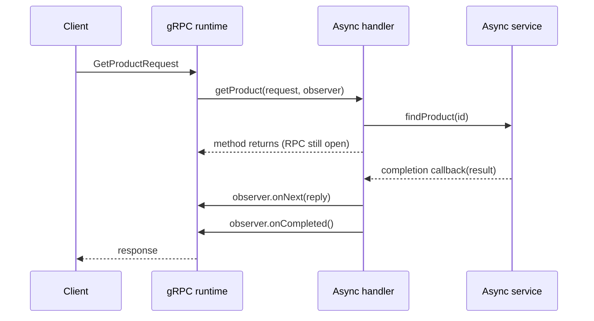

# Async Handlers and Callbacks

## Lesson Objectives

In **SPRING_GRPC**, a server handler may have to wait on a database, an HTTP client, or another gRPC service. If the handler calls a blocking API, the application worker is held while waiting. With an **async handler**, the gRPC method accepts the request, starts or attaches to an asynchronous operation, and completes the RPC via a callback once the result is ready.

This lesson focuses on implementing asynchronous handlers in gRPC Java and Spring: using `CompletionStage`/`CompletableFuture`, handling callbacks, preserving gRPC `Context`, mapping errors, handling cancellation, and managing the `StreamObserver` lifecycle.

After this lesson, you will be able to:

1. Distinguish the generated service base method signature from the moment an RPC actually completes.
2. Write a unary handler that returns immediately and sends its response inside a callback.
3. Handle both synchronous errors when starting an operation and asynchronous errors when it completes.
4. Choose executors for callbacks and blocking work; avoid arbitrary use of the common pool.
5. Propagate gRPC `Context`, deadlines, and cancellation across thread boundaries.
6. Ensure every RPC emits a single terminal event and avoid concurrent writes to the observer.
7. Apply callbacks to server streaming, understand the limits of client/bidirectional streaming, and test completion paths.

> **Scope:** Examples use gRPC Java with official Spring gRPC and `org.springframework.grpc.server.service.GrpcService`. Server executor details depend on the server factory/transport; this lesson does not assume a single Spring property valid across all versions.

## 1. An Async Handler Returning Does Not Mean the RPC Returned a Response

The gRPC Java generated service base typically defines a unary method as follows:

```java
@Override
public void getProduct(
        GetProductRequest request,
        StreamObserver<ProductReply> responseObserver) {
    // Process request and send result via responseObserver.
}
```

The method returns `void` because responses are delivered via `StreamObserver`. When a handler runs asynchronously, it can return from the Java method before the RPC finishes. The gRPC call remains open until the server sends a terminal event:

- Success: one or more `onNext(response)` calls, followed by `onCompleted()`.
- Failure: `onError(error)`.
- Client cancellation or deadline expiration: the gRPC runtime terminates the call; the server should stop work when possible and emit no further responses.



**Key difference:** returning from the handler method does not mean returning an empty response or ending the RPC. If you forget to call `onCompleted`/`onError`, the client may hang until its deadline expires.

## 2. Choosing an Asynchronous API at the Application Boundary

An application service can return `CompletionStage<ProductView>` instead of `ProductView`. This interface indicates that the result will become available later, without forcing the adapter to know how the service performs the work.

```java
public interface ProductQuery {
    CompletionStage<ProductView> findProduct(String productId);
}
```

`ProductView` is an application Java type, not a Protobuf message. `ProductQuery` does not depend on `StreamObserver` or `io.grpc.Status`.

Distinguish between these cases:

| Implementation Approach | Is It Truly Non-Blocking? |
| --- | --- |
| Returning a `CompletionStage` completed by an async HTTP/gRPC client | Usually asynchronous; the calling thread does not wait on the network response |
| Using `CompletableFuture.supplyAsync(...)` with a bounded executor to run blocking JDBC/JPA | The handler does not pin a gRPC worker, though another worker still blocks waiting on the DB |
| Returning `CompletableFuture.completedFuture(blockingCall())` | **No**; the repository already blocked before the future was created |
| Calling `future.get()` or `join()` inside the handler | **No**; the handler blocks again waiting for the result and loses async benefits |
| Returning `Mono`/`Flux` from a reactive pipeline | Can be non-blocking if every source and operator is reactive-compatible; does not magically make JDBC non-blocking |

An async API does not make blocking work disappear. If using JPA/JDBC, either offload that work to a bounded executor or use an appropriate reactive persistence architecture. Never use `ForkJoinPool.commonPool()` as the default home for blocking I/O.

## 3. Example: Async Unary Handler

### 3.1. Result Type and Application Service

Suppose an application service looks up a product and returns a view. Business errors are represented by Java exceptions:

```java
public record ProductView(
        String productId,
        String name,
        long priceCents) {
}

public class ProductNotFoundException extends RuntimeException {
    public ProductNotFoundException(String productId) {
        super("Product not found: " + productId);
    }
}
```

Application interface:

```java
public interface ProductQuery {
    CompletionStage<ProductView> findProduct(String productId);
}
```

`ProductView` is a pure Java application type. The adapter does not need to know whether the service calls a database, an async HTTP client, or a downstream gRPC stub.

### 3.2. Offloading Blocking JPA While Keeping Transactions Correct

The following example wraps a synchronous JPA query in a bounded executor. The transaction lives on a separate worker bean; the method is invoked through the Spring proxy **on the worker thread**, so the transaction wraps both the query and mapping the entity into a view.

```java
@Service
public class ProductQueryWorker {

    private final ProductRepository repository;

    public ProductQueryWorker(ProductRepository repository) {
        this.repository = repository;
    }

    @Transactional(readOnly = true)
    public ProductView load(String productId) {
        ProductEntity entity = repository.findByProductId(productId)
                .orElseThrow(() -> new ProductNotFoundException(productId));

        // Materialize data before the transaction ends.
        return new ProductView(
                entity.getProductId(),
                entity.getName(),
                entity.getPriceCents());
    }
}
```

The application service dispatches work onto the bounded pool:

```java
@Service
public class AsyncProductQuery implements ProductQuery {

    private final ProductQueryWorker worker;
    private final Executor productIoExecutor;

    public AsyncProductQuery(
            ProductQueryWorker worker,
            @Qualifier("productIoExecutor") Executor productIoExecutor) {
        this.worker = worker;
        this.productIoExecutor = productIoExecutor;
    }

    @Override
    public CompletionStage<ProductView> findProduct(String productId) {
        return CompletableFuture.supplyAsync(
                () -> worker.load(productId),
                productIoExecutor);
    }
}
```

This example **offloads blocking I/O**, rather than using reactive database access. `ProductQueryWorker` is a separate bean, so `worker.load(...)` passes through the Spring proxy and `@Transactional` applies on the executing thread. Do not place `@Transactional` on `findProduct` expecting the transaction to propagate automatically onto the thread created by `supplyAsync`: traditional Spring transactions are thread-bound.

The `productIoExecutor` pool must have bounded worker and queue counts, clear thread names, metrics, and a rejection policy. Size it according to the database connection pool; adding workers beyond DB limits only creates more threads waiting for connections.

### 3.3. Spring gRPC Adapter Completing the Response in a Callback

```java
@GrpcService
public class ProductGrpcEndpoint
        extends ProductGrpc.ProductImplBase {

    private static final Logger log =
            LoggerFactory.getLogger(ProductGrpcEndpoint.class);

    private final ProductQuery productQuery;
    private final ProductProtoMapper mapper;

    public ProductGrpcEndpoint(
            ProductQuery productQuery,
            ProductProtoMapper mapper) {
        this.productQuery = productQuery;
        this.mapper = mapper;
    }

    @Override
    public void getProduct(
            GetProductRequest request,
            StreamObserver<ProductReply> responses) {

        Context rpcContext = Context.current();
        final CompletionStage<ProductView> operation;

        try {
            // May throw synchronously before returning CompletionStage.
            operation = Objects.requireNonNull(
                    productQuery.findProduct(request.getProductId()));
        } catch (RuntimeException ex) {
            responses.onError(toStatus(ex));
            return;
        }

        operation.whenComplete((product, failure) ->
                rpcContext.wrap(() -> {
                    if (rpcContext.isCancelled()) {
                        return;
                    }

                    if (failure != null) {
                        responses.onError(toStatus(unwrap(failure)));
                        return;
                    }

                    if (product == null) {
                        responses.onError(Status.INTERNAL
                                .withDescription("Application service returned an empty result")
                                .asRuntimeException());
                        return;
                    }

                    final ProductReply reply;
                    try {
                        reply = mapper.toProto(product);
                    } catch (RuntimeException mappingFailure) {
                        log.error("Unable to map ProductView to Protobuf",
                                mappingFailure);
                        responses.onError(Status.INTERNAL
                                .withDescription("Unable to build response")
                                .asRuntimeException());
                        return;
                    }

                    responses.onNext(reply);
                    responses.onCompleted();
                }).run());
    }

    private Throwable unwrap(Throwable failure) {
        Throwable current = failure;
        while ((current instanceof CompletionException
                || current instanceof ExecutionException)
                && current.getCause() != null) {
            current = current.getCause();
        }
        return current;
    }

    private Throwable toStatus(Throwable failure) {
        if (failure instanceof ProductNotFoundException) {
            return Status.NOT_FOUND
                    .withDescription("Product not found")
                    .asRuntimeException();
        }
        if (failure instanceof IllegalArgumentException) {
            return Status.INVALID_ARGUMENT
                    .withDescription("Invalid request")
                    .asRuntimeException();
        }

        log.error("getProduct failed", failure);
        return Status.INTERNAL
                .withDescription("Unable to process request")
                .asRuntimeException();
    }
}
```

The example requires imports for generated types, `Objects`, `CompletionStage`, `CompletionException`, `ExecutionException`, logger, `Context`, `Status`, and `StreamObserver`. `Objects.requireNonNull` enforces the contract: the application service must return a stage, never `null`.

Once `whenComplete` is registered, the handler can return right away. The callback uses the captured context to check cancellation and emit the response. The callback never calls a database or blocking HTTP client; mapping a small message and calling the observer is fast work.

### 3.4. Handling Two Distinct Error Moments

Errors can arise at two points:

1. **Synchronous error on initiation:** `productQuery.findProduct(...)` throws an exception before returning a stage. The adapter must catch it immediately; otherwise, the handler may exit without emitting a terminal event.
2. **Asynchronous error:** the stage completes exceptionally after the handler has returned. The adapter handles it in the callback and calls `onError`.

With `CompletableFuture`, exceptions are commonly wrapped in `CompletionException` or `ExecutionException`. Unwrap them to map the root exception. Never map every error to `NOT_FOUND`; only defined business errors should use that status.

## 4. Which Thread Runs the Callback?

`CompletionStage.whenComplete` does not guarantee that the callback runs on a specific executor. The callback usually runs on the thread that completes the stage; if the stage already completed before registration, the callback may run immediately on the registering thread.

This has several consequences:

- Callbacks should only do lightweight work: check context, map a small response, and call the observer.
- Never call blocking APIs inside a callback if the completing thread belongs to an event loop or shared executor.
- If you need a dedicated executor for callbacks, use `whenCompleteAsync(..., callbackExecutor)`, but handle executor rejection so the RPC never hangs.
- Never use the common pool casually; every queue and pool needs bounds and metrics.

Example of an async callback with an executor:

```java
operation.whenCompleteAsync((product, failure) -> {
    rpcContext.wrap(() -> completeRpc(product, failure, responses)).run();
}, callbackExecutor);
```

`completeRpc` must guarantee that every path ends with exactly one `onError` or `onCompleted`. If `callbackExecutor` can reject tasks, handle rejection at the dispatch point or use a safe fallback; merely chaining `exceptionally` after a callback may not be enough if the callback itself never runs.

**Do not assume the callback executor and blocking executor are the same pool.** Blocking tasks can occupy every worker, leaving completion callbacks with no thread to send responses. Separate pools when load and processing times warrant it; every pool needs bounded queues and an overload policy.

## 5. Context, Deadlines, and Cancellation

### 5.1. Capture gRPC `Context` Before Offloading

`Context.current()` reflects the context of the current thread. When a callback executes on another thread, the context is not automatically restored. Capture the context before registering the callback and use `rpcContext.wrap(...)`:

```java
Context rpcContext = Context.current();

operation.whenComplete((value, error) ->
        rpcContext.wrap(() -> {
            if (rpcContext.isCancelled()) {
                return;
            }
            // Handle callback in the right RPC context.
        }).run());
```

gRPC `Context` can carry deadlines, cancellation, and data attached by interceptors. This context is separate from `ThreadLocal`s used by logging, tracing, or Spring Security; those mechanisms require their own propagation.

### 5.2. Deadlines Do Not Automatically Stop Every Operation

When a client deadline expires, the server RPC is cancelled, yet an in-progress JDBC or HTTP call does not necessarily stop immediately. Combine:

- RPC deadlines on client and server.
- Query timeouts and connection timeouts for databases.
- Connect/read/call timeouts for HTTP or downstream gRPC.
- Cancellation signals for async sources that support cancellation.
- Context checks before emitting responses or continuing work.

Never set a downstream timeout longer than the remaining RPC budget. If a write already committed before cancellation was processed, the client may not receive a response even though data changed. Write commands need idempotency keys if clients can retry after timeouts.

### 5.3. Cancelling an Upstream Operation When the RPC Is Cancelled

If an API returns a cancellable `CompletableFuture`, you can register a gRPC context cancellation listener to request cancellation of the future:

```java
Context rpcContext = Context.current();
CompletableFuture<ProductView> operation = productQuery.findProductFuture(id);

rpcContext.addListener(
        ignored -> operation.cancel(true),
        cancellationExecutor);
```

`cancellationExecutor` must be properly configured and the listener must be lightweight. `cancel(true)` is only a cancellation request; it does not guarantee that a JDBC driver, native library, or remote server stops immediately. Background tasks still need timeouts and cancellation support in the dependency itself. If an API only returns `CompletionStage`, do not assume you can force-cancel that stage; you may need an explicit cancellation handle in the application contract.

## 6. `StreamObserver` Lifecycle and Concurrency Safety

`StreamObserver` is the response channel for an RPC. For a unary handler with a single completion callback where only that callback writes the response, the sequence is straightforward:

```text
onNext(reply)
onCompleted()
```

You must never:

- Call `onNext` after `onCompleted` or `onError`.
- Call more than one terminal event for the same RPC.
- Call `onNext` concurrently from multiple threads without serialization.
- Send responses after the client has cancelled or the deadline has expired.
- Store `StreamObserver` in a mutable field on a singleton `@GrpcService` for reuse across RPCs.

If multiple callbacks or data sources compete, enforce a single writer flow or a serialized message queue. `AtomicBoolean` can guard terminal state, but does not by itself guarantee the ordering of `onNext` calls; serialization must still be designed explicitly.

## 7. Async Server Streaming

In server streaming, the handler receives one request and emits multiple responses. If the result is a small list fetched asynchronously, the callback can emit each message and finish:

```java
CompletionStage<List<ProductView>> operation =
        productQuery.listProductsAsync(limit);

Context rpcContext = Context.current();

operation.whenComplete((products, failure) ->
        rpcContext.wrap(() -> {
            if (rpcContext.isCancelled()) {
                return;
            }
            if (failure != null) {
                responses.onError(toStatus(unwrap(failure)));
                return;
            }

            for (ProductView product : products) {
                if (rpcContext.isCancelled()) {
                    return;
                }
                responses.onNext(mapper.toProto(product));
            }
            if (!rpcContext.isCancelled()) {
                responses.onCompleted();
            }
        }).run());
```

This pattern fits **small, bounded** result sets. Never load millions of records into a single `List` just to call `onNext` inside a callback.

For long streams or incremental data, use `ServerCallStreamObserver` to manage readiness and cancellation:

- `isReady()` indicates whether the transport can accept more messages right now.
- `setOnReadyHandler(...)` registers a callback for when the stream becomes writable again.
- `setOnCancelHandler(...)` lets you stop the data source when the client cancels.

When combining `onReady` callbacks with async sources, all writes to the observer must be serialized. Never let an `onReady` callback and a page-reading worker call `onNext` concurrently.

## 8. Client Streaming and Bidirectional Streaming

For client streaming or bidirectional streaming, the generated server method returns `StreamObserver<Request>` to receive messages from the client. Each `onNext` callback can trigger async work.

Conceptual pattern:

```java
@Override
public StreamObserver<UploadChunk> upload(
        StreamObserver<UploadResult> responses) {

    return new StreamObserver<>() {
        @Override
        public void onNext(UploadChunk chunk) {
            // Validate quickly; offload I/O processing to a bounded pipeline.
            // Preserve order or sequence numbers if required by the protocol.
        }

        @Override
        public void onError(Throwable error) {
            // Cancel pipeline and release resources.
        }

        @Override
        public void onCompleted() {
            // Finalize on client half-close; send terminal response exactly once.
        }
    };
}
```

Never spawn an unbounded future per message. If the client sends faster than the server processes, pending tasks and memory will grow uncontrollably. Bound in-flight chunks and define ordering, backpressure, timeouts, and partial-commit vs. all-or-nothing policies.

Bidirectional streaming lets both directions progress independently. If requests are processed in parallel, responses can complete out of order; attach sequence IDs or serialize processing if ordering is part of the contract.

## 9. Error Mapping Inside Callbacks

| Cause | Appropriate Status | Notes |
| --- | --- | --- |
| Malformed request / missing data | `INVALID_ARGUMENT` | Detected before or during validation |
| Resource not found | `NOT_FOUND` | Do not leak unauthorized info |
| Business state violation | `FAILED_PRECONDITION` | Not necessarily safe to retry immediately |
| Downstream temporarily unavailable | `UNAVAILABLE` | Retries require backoff and idempotency |
| RPC deadline expired | `DEADLINE_EXCEEDED` | Do not turn every internal timeout into the same error if causes differ |
| Pool/executor overloaded | `RESOURCE_EXHAUSTED` | Can signal clients to back off |
| Unexpected error | `INTERNAL` | Log details on server, safe message to client |

Never pass raw exception messages if they might expose SQL, tokens, internal hostnames, or personal data. Attach a correlation ID to logs/traces for investigation. If a callback catches an error and fails to emit a terminal event, the RPC will hang until its deadline; every branch must terminate explicitly.

## 10. Testing Async Handlers and Callbacks

The most important tests verify completion timing, not just the final response payload.

### 10.1. Callback Has Not Fired Before the Future Completes

Create an incomplete `CompletableFuture`, invoke the handler, and verify the observer has not received a response yet. Then complete the future and verify the response and `onCompleted` are sent in the right order.

```java
@Test
void sendsResponseOnlyAfterFutureCompletes() {
    CompletableFuture<ProductView> future = new CompletableFuture<>();
    when(productQuery.findProduct("sku-1")).thenReturn(future);

    endpoint.getProduct(request("sku-1"), observer);

    verify(observer, never()).onNext(any());
    verify(observer, never()).onCompleted();

    future.complete(new ProductView("sku-1", "Keyboard", 500_000L));

    verify(observer).onNext(any(ProductReply.class));
    verify(observer).onCompleted();
    verify(observer, never()).onError(any());
}
```

### 10.2. Testing Asynchronous Errors

Complete the future exceptionally and verify the observer receives the expected status and never receives `onNext` or `onCompleted`. Also test the case where the application method throws synchronously before returning a future.

### 10.3. Testing Cancellation and Context

Create a cancellable gRPC `Context`, invoke the handler inside that context, and cancel it before the future completes. Once the future completes, verify the callback emits no response. If a cancellation listener is registered, verify that the future/handle receives a cancellation request. Do not treat this test as proof that JDBC definitely stops; test timeouts/cancellation separately for the driver or downstream client.

### 10.4. Testing Saturation and the Callback Executor

Configure a small executor in tests, hold its workers with a latch, and submit additional tasks to verify rejection. Confirm rejected RPCs receive a clear error status rather than being silently dropped. Testing callback executor rejection is especially important when using `whenCompleteAsync`, since a callback failing to run means the observer may never terminate.

## 11. Common Errors

| Symptom | Cause | Resolution |
| --- | --- | --- |
| Client hangs until deadline even though handler returned | Forgot `onCompleted` or `onError` in callback | Ensure every completion path emits a terminal event |
| Handler still blocks | Calling `get()`/`join()` or creating a future after running a blocking call | Return a stage from a true async API or offload blocking work before executing |
| Callback runs on an unexpected thread | Using `whenComplete` without considering the completing thread | Keep callbacks lightweight; specify an explicit executor when needed |
| Callback misses metadata/deadlines | gRPC `Context` not propagated across threads | Capture context and wrap with `Context.wrap` |
| Client cancels yet work continues | Future cancellation does not propagate to dependency | Set timeouts/cancellation at DB/HTTP/downstream and check context |
| Response stream fails intermittently | Multiple threads call the same observer or send multiple terminal events | Serialize writes, keep single observer ownership, track terminal state |
| Overloaded executor hangs RPCs | Async callback rejected without handling | Use bounded queues, rejection mapping, and fallback RPC completion |
| Database transaction does not wrap async query | Transaction opened on calling thread before switching threads | Call a transactional bean on the worker thread |
| Stream spikes RAM | Buffering entire result or spawning unbounded futures | Use paging, bounded in-flight tasks, and flow control |

## 12. Hands-On Exercises

1. Write a unary handler using an incomplete `CompletableFuture`; verify that the client receives the response only after the future completes.
2. Create two error paths: a synchronous exception when creating the stage and an asynchronous exception when the stage completes exceptionally. Map both to appropriate gRPC statuses.
3. Offload a JPA query to a bounded executor; place the transaction on the worker bean and verify the transaction completes before the callback emits the response.
4. Capture gRPC `Context`, cancel the RPC before the future completes, and verify the callback sends no message.
5. Try `whenComplete` and `whenCompleteAsync` with different executors; observe thread names and queue delays.
6. Build paged server streaming; use `ServerCallStreamObserver.isReady()` and cancellation to control the data source.
7. Simulate callback executor rejection and ensure the client receives a terminal status instead of hanging indefinitely.
8. For client streaming, cap in-flight messages and verify response ordering under parallel processing.

### Self-Check Questions

- Why can a unary gRPC method return while the RPC is still unfinished?
- Which thread executes `whenComplete`? How does it differ from `whenCompleteAsync`?
- Why does `CompletableFuture.completedFuture(blockingCall())` not make the call asynchronous?
- When moving JPA work onto a worker thread, where must the transaction be opened?
- What does `Context.wrap` preserve and what does it not preserve?
- Does a gRPC deadline guarantee stopping an active SQL query?
- Why must both synchronous and asynchronous errors be handled?
- What happens if a callback executor rejects a task before the observer receives a terminal event?
- Why can multiple threads not call `onNext` concurrently?
- For long server streams, how do readiness and cancellation help control resources?

## References

- [gRPC Java — Basics Tutorial](https://grpc.io/docs/languages/java/basics/): implementing server methods and using `StreamObserver`.
- [gRPC Java — StreamObserver](https://grpc.github.io/grpc-java/javadoc/io/grpc/stub/StreamObserver.html): message lifecycle and terminal events.
- [gRPC Java — Context](https://grpc.github.io/grpc-java/javadoc/io/grpc/Context.html): context propagation, cancellation, and deadlines.
- [gRPC Java — ServerCallStreamObserver](https://grpc.github.io/grpc-java/javadoc/io/grpc/stub/ServerCallStreamObserver.html): readiness and cancellation for server streaming.
- [Java — CompletionStage](https://docs.oracle.com/en/java/javase/17/docs/api/java.base/java/util/concurrent/CompletionStage.html): asynchronous composition and callbacks.
- [Java — CompletableFuture](https://docs.oracle.com/en/java/javase/17/docs/api/java.base/java/util/concurrent/CompletableFuture.html): executors, completion, and cancellation.
- [Spring Framework — Task Execution and Scheduling](https://docs.spring.io/spring-framework/reference/integration/scheduling.html): executors and task execution in Spring.

**Expected outcome:** Learners can build async unary handlers that use callbacks to complete RPCs after application operations finish; distinguish initiation errors from async errors; preserve `Context`, deadlines, cancellation, and terminal events; and control executors, flow control, and callbacks for streaming RPCs without exhausting workers or hanging RPCs.
