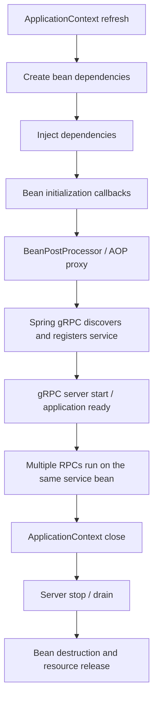
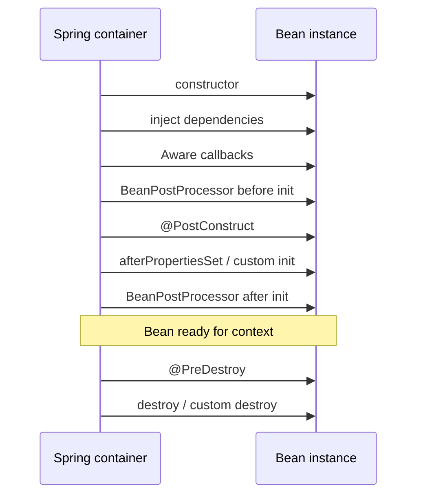

# Service Lifecycle in `ApplicationContext`

## Lesson Objectives

In **SPRING_GRPC**, a gRPC service is typically managed by Spring as a bean in `ApplicationContext`. The bean is instantiated, has its dependencies injected, is initialized, participates in gRPC server registration, serves many concurrent RPCs, and is cleaned up when the application shuts down.

This lesson focuses on the **service lifecycle in `ApplicationContext`**: understanding bean lifecycle phases, using initialization/destruction callbacks appropriately, distinguishing bean lifecycle from server and per-RPC lifecycles, and managing owned resources such as executors or client channels.

After this lesson, you will be able to:

1. Describe the main stages of the Spring bean lifecycle and where `@PostConstruct`/`@PreDestroy` fit.
2. Distinguish bean creation, gRPC service registration, server startup, and RPC execution.
3. Design a `@GrpcService` singleton that is safe when many RPCs run concurrently.
4. Avoid calling transactional/AOP methods at the wrong time inside lifecycle callbacks.
5. Manage application-owned resources and close them cleanly when the context stops.
6. Handle startup failures, graceful shutdown, and lifecycle testing of Spring gRPC services.

> **Scope:** Examples use official Spring gRPC with `org.springframework.grpc.server.service.GrpcService`, Spring Boot, and gRPC Java. Internal details of server factories and exact service binding timing can vary by version and transport; this lesson distinguishes the lifecycle milestones an application needs to understand without assuming a fixed internal callback.

## 1. Three Distinct Lifecycles

In a Spring gRPC application, three lifecycles must be distinguished:

| Lifecycle | Begins / Ends | Scope |
| --- | --- | --- |
| **Spring bean lifecycle** | Spring creates the bean during context refresh; destroys it when the context closes | One bean instance per scope, typically singleton |
| **gRPC server lifecycle** | Server is created/started on application startup; stopped on application shutdown | Listener, transport, executor, and bound services |
| **RPC lifecycle** | Begins when a client invokes a method; ends with completion, error, or cancellation | A single call, either unary or streaming |



The diagram illustrates conceptual relationships. Exact ordering among server stop, lifecycle processors, and destruction callbacks is managed by the server factory and Spring; never rely on assumptions that every version calls the same internal method. What your application must ensure is that the server stops accepting new work, in-flight RPCs drain per policy, and application-owned resources are closed afterward.

A gRPC service bean lives vastly longer than a single RPC. With the default singleton scope, one endpoint instance can handle many RPCs over time. Therefore, never store requests, response observers, or per-stream temporary state in mutable fields on a singleton service.

## 2. Main Stages of the Spring Bean Lifecycle

For a typical Spring-managed bean, the general flow is:

1. **Instantiate:** Spring creates the bean instance.
2. **Populate properties / dependency injection:** inject constructor dependencies, field/setter dependencies if any, and resolved collaborators.
3. **Aware callbacks:** if the bean implements interfaces like `BeanNameAware` or `ApplicationContextAware`, Spring supplies the corresponding metadata.
4. **BeanPostProcessor before initialization:** processors can inspect or transform the bean before init callbacks.
5. **Initialization callbacks:** `@PostConstruct`, `InitializingBean.afterPropertiesSet()`, and custom init methods if configured.
6. **BeanPostProcessor after initialization:** processors can wrap the bean in a proxy, such as AOP proxies.
7. **Ready for use:** the bean is placed in the context for other components to use.

When the context closes, Spring runs destruction for managed singleton beans, invoking the corresponding destroy callbacks.



This is the general sequence for container-managed beans; proxies, scoped beans, circular references, or factory beans have additional rules. For gRPC services, use constructor injection and avoid instantiating endpoints manually with `new` so Spring can manage their lifecycle.

## 3. Using Initialization Callbacks Appropriately

`@PostConstruct` runs after dependency injection finishes and before the bean is fully exposed through post-initialization steps. It is suited for validating local configuration or preparing lightweight internal state.

Example:

```java
@Component
public class CatalogPolicy {

    private final CatalogProperties properties;

    public CatalogPolicy(CatalogProperties properties) {
        this.properties = properties;
    }

    @PostConstruct
    void validateConfiguration() {
        if (properties.maxPageSize() < 1
                || properties.maxPageSize() > 500) {
            throw new IllegalStateException(
                    "catalog.max-page-size must be between 1 and 500");
        }
    }

    public int maxPageSize() {
        return properties.maxPageSize();
    }
}
```

If configuration is invalid, the callback throws an exception and fails bean/context creation. That is the desired behavior when the application cannot operate safely with bad settings.

### Do Not Turn `@PostConstruct` into Business Execution

Avoid doing the following inside init callbacks:

- Running an RPC or calling a synchronous downstream without timeouts.
- Reading an entire database to warm up without bounds.
- Holding long transactions or executing non-idempotent side effects.
- Spawning background tasks without a shutdown mechanism.
- Calling a transactional/AOP method on the same bean assuming the call goes through a proxy.

In proxy-based AOP, `@PostConstruct` executes on the target object during initialization, before the final proxy is returned to callers. Self-invocation also bypasses the proxy. Therefore, never put logic needing transaction, security, or retry advice inside a callback and call another method on the same instance expecting advice to run.

If asynchronous warm-up is needed, use an appropriate lifecycle component or startup runner with timeouts, readiness status, and cleanup mechanisms. Never let an init callback hang indefinitely and block `ApplicationContext` startup.

## 4. Using Destruction Callbacks and Managing Resources

`@PreDestroy` is invoked when Spring destroys singleton beans during context shutdown. It is suited for stopping bean-owned tasks, closing self-created resources, or releasing handles not managed by the container.

Example of a component owning its own scheduler:

```java
@Component
public class CatalogRefreshWorker {

    private final ScheduledExecutorService scheduler =
            Executors.newSingleThreadScheduledExecutor();

    public void start() {
        scheduler.scheduleWithFixedDelay(
                this::refreshSafely,
                10, 60, TimeUnit.SECONDS);
    }

    private void refreshSafely() {
        // Bounded-time work with error handling.
    }

    @PreDestroy
    void stop() {
        scheduler.shutdown();
        try {
            if (!scheduler.awaitTermination(5, TimeUnit.SECONDS)) {
                scheduler.shutdownNow();
            }
        } catch (InterruptedException ex) {
            scheduler.shutdownNow();
            Thread.currentThread().interrupt();
        }
    }
}
```

This example is only valid if the component truly owns the scheduler. In real applications, prefer letting Spring manage `ThreadPoolTaskExecutor`/`TaskScheduler` via bean lifecycles; never shut down a shared executor owned by another bean.

Spring supports destruction mechanisms such as `@PreDestroy`, `DisposableBean.destroy()`, or a custom destroy method via `@Bean(destroyMethod = "...")`. Usually pick one clear mechanism and avoid duplicating the same cleanup across multiple callbacks where it could run twice.

### Closing gRPC Client Channels

If the application creates a `ManagedChannel` itself and owns its lifecycle, close the channel when the context stops. Never create a new channel per RPC and never close a shared channel after a single call.

A bean factory method can declare a destroy method:

```java
@Configuration(proxyBeanMethods = false)
public class InventoryClientConfiguration {

    @Bean(destroyMethod = "shutdown")
    ManagedChannel inventoryChannel() {
        return ManagedChannelBuilder
                .forAddress("inventory.internal", 9090)
                .useTransportSecurity()
                .build();
    }
}
```

This example uses TLS transport and an illustrative address; certificates/trust must be configured per environment. `shutdown()` initiates a graceful channel shutdown, but if the application needs to wait a bounded time for active calls to finish before calling `shutdownNow()`, create a lifecycle owner with explicit await logic. Never assume `destroyMethod="shutdown"` automatically waits for all RPCs to complete in every configuration.

For channels/clients managed by a Spring starter or factory, follow the starter's shutdown mechanism; do not manually close resources owned by another bean.

## 5. Lifecycle of a Spring gRPC Service

A server-side service typically extends the generated base and is annotated with `@GrpcService`:

```java
@GrpcService
public class InventoryGrpcEndpoint
        extends InventoryGrpc.InventoryImplBase {

    private final InventoryApplicationService application;

    public InventoryGrpcEndpoint(
            InventoryApplicationService application) {
        this.application = application;
    }

    @Override
    public void getInventory(
            InventoryRequest request,
            StreamObserver<InventoryReply> responses) {
        // Call use case, map response, and complete observer.
    }
}
```

Key points to understand:

- **Bean creation:** Spring instantiates the endpoint and injects `InventoryApplicationService`.
- **Service discovery/registration:** Spring gRPC discovers the service bean whose generated base implements `BindableService` and binds its service definition to the server.
- **Server start:** the transport starts listening according to server factory configuration.
- **RPC execution:** many requests can hit the same endpoint instance; each RPC gets its own observer and context.
- **Shutdown:** the server stops according to the server factory's lifecycle when the context closes.

`@GrpcService` marks a service for Spring gRPC integration; it does not mean a new bean is created per RPC. Never call `bindService()` yourself to spin up a second server if the server factory already manages that service. Registering the same service name twice can fail when building the server.

### Do Not Store Per-RPC State on a Service Singleton

Do not write code like this:

```java
@GrpcService
public class BadInventoryEndpoint
        extends InventoryGrpc.InventoryImplBase {

    private String currentRequestId; // Wrong: shared across RPCs

    private StreamObserver<InventoryReply> currentObserver; // Wrong

    // ...
}
```

Two concurrent RPCs can overwrite those fields. Keep requests, observers, completion state, and per-stream data in local variables or session objects created per RPC. Singleton fields should hold only immutable dependencies or thread-safe collaborators.

## 6. Bean Lifecycle and AOP Proxies

Spring can wrap beans in proxies to apply transactions, security, caching, retries, or other advice. This matters in Spring gRPC because endpoints usually invoke application services through proxies.

Put cross-cutting concerns on the application service:

```java
@Service
public class InventoryApplicationService {

    private final InventoryRepository repository;

    public InventoryApplicationService(InventoryRepository repository) {
        this.repository = repository;
    }

    @Transactional(readOnly = true)
    public InventoryView getInventory(String sku) {
        return repository.findViewBySku(sku)
                .orElseThrow(() -> new InventoryNotFoundException(sku));
    }
}
```

The endpoint injects the Spring-managed service bean and calls it through the proxy. The transaction opens and closes at the application method; the adapter sends the response after the transactional method returns.

Never instantiate `new InventoryApplicationService(...)` manually, as that instance bypasses Spring proxies. Also never call a transactional method on the same bean from `@PostConstruct` expecting transaction advice to apply. Lifecycle callbacks are meant for validating, preparing, or cleaning up resources—not replacing application use cases.

## 7. `ApplicationContext` Refresh, Readiness, and Shutdown

Successful bean creation does not automatically mean the gRPC server is ready to receive traffic. Distinguish:

1. **Bean initialized:** dependency graph and init callbacks complete.
2. **Service registered:** server factory received the service definition.
3. **Server started:** transport bound and listening.
4. **Application ready:** startup steps completed and traffic can be served per readiness policy.

In Spring Boot, readiness should reflect the application's actual ability to serve, not merely that an endpoint bean exists. If downstream checks or warm-ups are required, use proper readiness/health mechanisms with finite timeouts. Never run unbounded blocking probes inside `@PostConstruct`.

During shutdown, account for in-flight RPCs:

- Stop accepting new calls via the server's graceful shutdown mechanism.
- Allow active RPCs a grace period to complete.
- Cancel or reject remaining work once the grace period expires.
- Close application-owned client channels, executors, and resources in proper order.
- Record logs/metrics for in-flight RPC counts, cancelled calls, and shutdown duration.

Do not assume an internal ordering between the server factory and individual bean destroy callbacks. If the application has resources that must stay alive while the server drains, use a lifecycle abstraction/phase supported by your Spring gRPC version or an owner component with explicit shutdown ordering.

## 8. Testing Lifecycle

### 8.1. Checking Init and Destroy Callbacks

You can use a simple bean to verify callbacks run when the context opens and closes:

```java
@Component
public class LifecycleProbe {

    private final AtomicBoolean initialized = new AtomicBoolean();
    private final AtomicBoolean destroyed = new AtomicBoolean();

    @PostConstruct
    void initialize() {
        initialized.set(true);
    }

    @PreDestroy
    void destroy() {
        destroyed.set(true);
    }

    boolean isInitialized() {
        return initialized.get();
    }

    boolean isDestroyed() {
        return destroyed.get();
    }
}
```

Test with explicit context closure:

```java
@Test
void invokesLifecycleCallbacks() {
    AnnotationConfigApplicationContext context =
            new AnnotationConfigApplicationContext(TestConfiguration.class);

    LifecycleProbe probe = context.getBean(LifecycleProbe.class);
    assertThat(probe.isInitialized()).isTrue();

    context.close();

    assertThat(probe.isDestroyed()).isTrue();
}
```

Real tests can use dedicated test configuration beans. Do not treat this test alone as proof of gRPC server shutdown ordering; this callback test only verifies bean lifecycle.

### 8.2. Verifying Service Registration and Server

With a Spring gRPC integration test, boot the context/server under test configuration and invoke the service using a generated stub. Verify:

- The service descriptor has the right package/service name.
- The server accepts RPCs once startup completes.
- Dependencies are injected from the Spring context.
- Closing the context stops new calls and releases resources.
- In-flight RPCs drain or cancel per the configured grace period.

### 8.3. Verifying Resource Cleanup

For application-owned executors/channels, inject a spy/fake owner or use a test resource whose shutdown state can be observed. Verify cleanup runs only once, honors timeouts, and never blocks shutdown indefinitely.

Never rely on `Thread.sleep()` to guess lifecycle timing. Use latches, futures, events, or state assertions with timeouts for deterministic tests.

## 9. Common Errors

| Symptom | Cause | Resolution |
| --- | --- | --- |
| Service bean exists but client cannot connect | Server not started, wrong port/transport, or service not bound | Check server factory, startup logs, service descriptor, and readiness |
| Init callback hangs startup | Blocking downstream/database call without timeout | Keep callbacks lightweight; run warm-up with timeouts and separate readiness |
| `@Transactional` does not run during init | Method called on target before AOP proxy is ready, or self-invocation | Place transactions on application services invoked through proxies |
| Singleton service mixes data between two RPCs | Request/observer/state stored in mutable fields | Keep per-call state isolated; singleton fields hold only safe dependencies |
| Bean is not destroyed as expected | Bean not Spring-managed or different scope/lifecycle | Let the container create the bean and check scope; prototypes require manual cleanup |
| Channel keeps threads/sockets open after shutdown | Application-created channel never closed | Declare destroy method or lifecycle owner with graceful shutdown |
| Shutdown hangs | Cleanup waits indefinitely or workers lack timeouts | Use finite grace periods, dependency timeouts, and controlled forced shutdown |
| Two services with the same name fail registration | Same implementation registered via multiple mechanisms | Keep only one bean/service definition per service name on the server |
| In-flight RPCs are cut off abruptly | Shutdown does not drain or grace period is too short | Configure graceful shutdown, track in-flight calls, and handle cancellation |

## 10. Hands-On Exercises

1. Add `@PostConstruct` to a policy bean to validate page-size settings. Verify that invalid configuration fails context startup with a clear error message.
2. Create an application-owned executor; close it with `@PreDestroy` and test that closing the context terminates workers within the timeout.
3. Register a generated `BindableService` with Spring gRPC, call an RPC after the context is ready, and inspect the service descriptor.
4. Simulate two concurrent RPCs on the same endpoint; verify that requests and `StreamObserver`s are not stored in singleton fields.
5. Create a downstream `ManagedChannel` bean, configure appropriate TLS, and verify the channel shuts down when the context closes.
6. Try calling a `@Transactional` method from `@PostConstruct` on the same bean. Explain why you cannot rely on proxies at this stage; move the logic to a separate application service.
7. Test graceful shutdown while an RPC is in flight: measure drain time, cancellation behavior, and resource state after the context closes.

### Self-Check Questions

- At what stage does `@PostConstruct` run relative to dependency injection and AOP proxies?
- How does `@PreDestroy` differ from an RPC's `onCompleted()`?
- Why can a singleton `@GrpcService` serve multiple concurrent RPCs?
- Does a service bean existing mean the gRPC server is already ready?
- Why should unbounded network warm-ups never run inside init callbacks?
- Who is responsible for closing an application-created `ManagedChannel`?
- Why can a `@Transactional` method called from the same instance bypass the proxy?
- How must graceful shutdown handle in-flight RPCs?
- When should you use `SmartLifecycle` or a dedicated lifecycle owner instead of just `@PreDestroy`?

## References

- [Spring Framework — Bean Lifecycle](https://docs.spring.io/spring-framework/reference/core/beans/factory-nature.html): initialization callbacks, destruction callbacks, and bean lifecycle.
- [Spring Framework — Container Extension Points](https://docs.spring.io/spring-framework/reference/core/beans/factory-extension.html): `BeanPostProcessor` and container extension points.
- [Spring Framework — Task Execution and Scheduling](https://docs.spring.io/spring-framework/reference/integration/scheduling.html): managing executors and task lifecycles.
- [Spring Boot — Application Availability](https://docs.spring.io/spring-boot/reference/actuator/endpoints.html): application health and availability.
- [Spring gRPC — gRPC Server](https://docs.spring.io/spring-grpc/reference/server.html): `BindableService` bean registration and server integration.
- [gRPC Java — ManagedChannel](https://grpc.github.io/grpc-java/javadoc/io/grpc/ManagedChannel.html): channel shutdown and state.
- [gRPC — Graceful Server Shutdown](https://grpc.io/docs/guides/server-graceful-stop/): stopping new RPCs and draining active calls.

**Expected outcome:** Learners understand the Spring bean lifecycle from instantiation to destruction, distinguish bean lifecycle from gRPC server and RPC lifecycles, register `@GrpcService` properly, keep singleton endpoints concurrency-safe, and release executors/channels cleanly when `ApplicationContext` closes.
