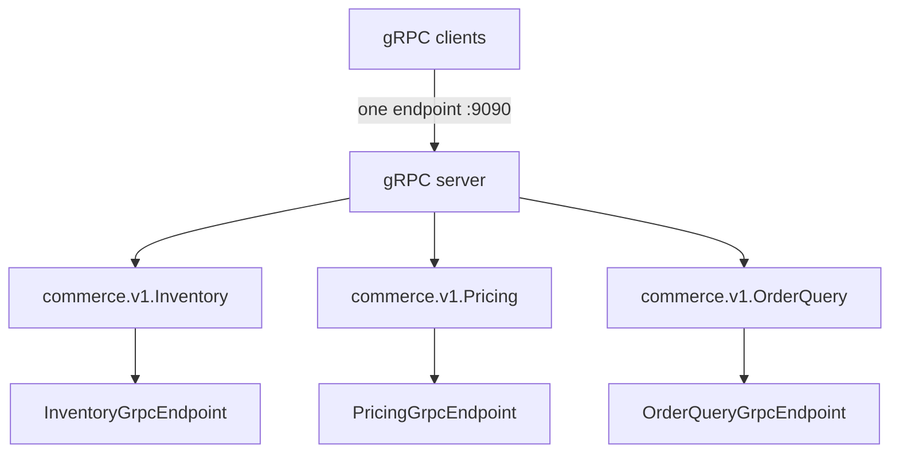

# Multiple Services in One Server

## Lesson Objectives

A single gRPC server can expose multiple services at the same time. In Spring gRPC, each service is usually a Spring bean extending its corresponding generated base; the server factory collects the service definitions and binds them onto the same server/transport.

This lesson focuses on **registering and operating multiple gRPC services in one server**: designing non-colliding service names, implementing multiple `@GrpcService` beans, sharing a server and channel, organizing shared interceptors/policies, and testing that every service is bound properly.

After this lesson, you will be able to:

1. Explain the relationship between one gRPC server, multiple service definitions, and multiple RPC methods.
2. Define multiple services in Protobuf and identify their full service names.
3. Implement each service as its own Spring `@GrpcService` bean.
4. Avoid duplicate service name registration or accidentally creating multiple servers.
5. Call multiple services over a single `ManagedChannel` and manage the channel according to the application lifecycle.
6. Organize interceptors, authorization, reflection/health, and integration tests for a multi-service server.

> **Scope:** Examples use official Spring gRPC, gRPC Java, and `org.springframework.grpc.server.service.GrpcService`. Server factory configuration details depend on the version and transport; this lesson does not assume a single shared property across all server types.

## 1. One Server Can Serve Multiple Services

In gRPC, a server listens on a network endpoint and exposes a set of service definitions. Each service has a full name and one or more RPC methods. Clients route requests by service name and method name in the HTTP/2 path.

For example, a commerce server exposes:

- `commerce.v1.Inventory` with RPC `GetStock`.
- `commerce.v1.Pricing` with RPC `GetPrice`.
- Optionally `commerce.v1.OrderQuery` or health/reflection services when needed.



**One server does not mean only one service.** The server manages the transport, listener, and collection of service definitions; each service handles a group of RPCs under its own contract. Each service has its own generated base, descriptor, and method handlers.

| Component | Count in Example | Responsibility |
| --- | ---: | --- |
| Server/transport endpoint | 1 | Listens for connections and dispatches RPCs |
| Service definition | 2 or more | Exposes a group of RPCs with a distinct full name |
| Generated service base | One type per service | Provides method signatures and binds the service definition |
| Spring service bean | One bean per implementation | Holds the service's handlers and dependencies |
| Client channel | Usually one channel per server endpoint | Reuses connections to invoke multiple services |
| Stub | One type per service and call style | Provides the client API for that service's RPCs |

An RPC path has the form `/package.Service/Method`. For example, `/commerce.v1.Inventory/GetStock` and `/commerce.v1.Pricing/GetPrice`. The full service name is the key identifier; two services with the same short name in different Protobuf packages are still two distinct names.

## 2. Defining Two Services in Protobuf

You can place multiple `service` declarations in one `.proto` file, or split each service into its own file sharing a package. How files are organized does not determine the number of servers; server registration determines which services are bound together.

File `src/main/proto/commerce.proto`:

```proto
syntax = "proto3";

package commerce.v1;

option java_package = "com.example.commerce.proto";
option java_multiple_files = true;

service Inventory {
  rpc GetStock(GetStockRequest) returns (StockReply);
}

service Pricing {
  rpc GetPrice(GetPriceRequest) returns (PriceReply);
}

message GetStockRequest {
  string sku = 1;
}

message StockReply {
  string sku = 1;
  int32 available_quantity = 2;
}

message GetPriceRequest {
  string sku = 1;
  string currency = 2;
}

message PriceReply {
  string sku = 1;
  string currency = 2;
  int64 amount_minor_units = 3;
}
```

After running `protoc` and `protoc-gen-grpc-java`, the Java package `com.example.commerce.proto` contains the main classes:

- `InventoryGrpc.InventoryImplBase` and Inventory stubs.
- `PricingGrpc.PricingImplBase` and Pricing stubs.
- Request/response messages such as `GetStockRequest`, `StockReply`, `GetPriceRequest`, and `PriceReply`.

Both services belong to the Protobuf package `commerce.v1`, so their full names are `commerce.v1.Inventory` and `commerce.v1.Pricing`, respectively. Do not infer the full name from the Java package; the Java package only controls where generated code is placed.

### Splitting `.proto` Files as Contracts Grow

When services have different release lifecycles or ownership, you can place `inventory.proto` and `pricing.proto` in separate files while keeping packages and imports clean. Whether in the same file or separate files, they can still be registered on the same server if the application provides both service beans to the same server factory.

## 3. Implementing Each Service as a Spring Bean

In Spring gRPC, annotate each implementation with `@GrpcService`. Spring manages the beans, injects dependencies, and integrates the service definitions into the server.

### 3.1. Inventory Service

```java
package com.example.commerce.grpc;

import com.example.commerce.application.InventoryApplicationService;
import com.example.commerce.proto.GetStockRequest;
import com.example.commerce.proto.InventoryGrpc;
import com.example.commerce.proto.StockReply;
import io.grpc.Status;
import io.grpc.stub.StreamObserver;
import org.springframework.grpc.server.service.GrpcService;

@GrpcService
public class InventoryGrpcEndpoint
        extends InventoryGrpc.InventoryImplBase {

    private final InventoryApplicationService application;

    public InventoryGrpcEndpoint(
            InventoryApplicationService application) {
        this.application = application;
    }

    @Override
    public void getStock(
            GetStockRequest request,
            StreamObserver<StockReply> responses) {
        try {
            var stock = application.getStock(request.getSku());

            responses.onNext(StockReply.newBuilder()
                    .setSku(stock.sku())
                    .setAvailableQuantity(stock.availableQuantity())
                    .build());
            responses.onCompleted();
        } catch (IllegalArgumentException ex) {
            responses.onError(Status.INVALID_ARGUMENT
                    .withDescription("Invalid SKU")
                    .asRuntimeException());
        } catch (RuntimeException ex) {
            responses.onError(Status.INTERNAL
                    .withDescription("Unable to query inventory")
                    .asRuntimeException());
        }
    }
}
```

`InventoryGrpcEndpoint` implements only Inventory RPCs and depends on the inventory application service. You do not need to create a `Server` manually or call `bindService()` to register this endpoint.

### 3.2. Pricing Service

```java
package com.example.commerce.grpc;

import com.example.commerce.application.PricingApplicationService;
import com.example.commerce.proto.GetPriceRequest;
import com.example.commerce.proto.PriceReply;
import com.example.commerce.proto.PricingGrpc;
import io.grpc.Status;
import io.grpc.stub.StreamObserver;
import org.springframework.grpc.server.service.GrpcService;

@GrpcService
public class PricingGrpcEndpoint
        extends PricingGrpc.PricingImplBase {

    private final PricingApplicationService application;

    public PricingGrpcEndpoint(PricingApplicationService application) {
        this.application = application;
    }

    @Override
    public void getPrice(
            GetPriceRequest request,
            StreamObserver<PriceReply> responses) {
        try {
            var price = application.getPrice(
                    request.getSku(), request.getCurrency());

            responses.onNext(PriceReply.newBuilder()
                    .setSku(price.sku())
                    .setCurrency(price.currency())
                    .setAmountMinorUnits(price.amountMinorUnits())
                    .build());
            responses.onCompleted();
        } catch (IllegalArgumentException ex) {
            responses.onError(Status.INVALID_ARGUMENT
                    .withDescription("Invalid SKU or currency")
                    .asRuntimeException());
        } catch (RuntimeException ex) {
            responses.onError(Status.INTERNAL
                    .withDescription("Unable to query price")
                    .asRuntimeException());
        }
    }
}
```

Both beans can live in the same `ApplicationContext`. When Spring gRPC configures the server, all matching service beans are discovered and bound to the server. Clients can call both over the same host and port; you do not need a separate port per service.

> The example focuses on registration and routing. In real applications, use shared exception mapping, log correlation IDs, and return safe status messages; never repeat or bypass the module's error-handling policy.

## 4. Configuring One Server and Avoiding Duplicate Registration

With a native gRPC server, an illustrative Spring gRPC port configuration might be:

```yaml
spring:
  grpc:
    server:
      port: 9090
```

Actual configuration depends on the starter, Spring Boot version, and transport. If serving gRPC via a servlet/HTTP server, the port belongs to the web server and corresponding HTTP/2 configuration; never mechanically apply native server properties to a servlet transport.

What you must verify is that both `InventoryGrpcEndpoint` and `PricingGrpcEndpoint` are registered with **the same server factory/transport instance**. A Spring context can contain multiple server factories or multiple servers if configured intentionally; merely seeing two beans does not prove they share the same server.

### 4.1. Do Not Register the Same Service Twice

Common mistakes:

- A class is both annotated with `@GrpcService` and instantiated again via `@Bean`.
- The same service implementation is manually added to a server builder while Spring gRPC already auto-detects it.
- Two beans implement service descriptors with the same full service name on the same server.
- A test configuration starts a second server while the test calls the wrong port.

Every full service name on a server requires a unique service definition. If swapping implementations by profile, ensure only one bean is active in that profile. If multiple API versions are needed, use distinct package/version names such as `commerce.v1.Inventory` and `commerce.v2.Inventory` when contracts actually differ.

### 4.2. Sharing Logic Does Not Mean Merging Services

Inventory and Pricing may share a repository or application component when business responsibilities fit. However, do not merge every method into one giant service simply because they run in the same server. Service boundaries should reflect cohesive capabilities and client contracts, whereas server boundaries are primarily deployment/operational decisions.

## 5. Calling Multiple Services Through One Client Channel

The client creates one `ManagedChannel` to the server endpoint and creates a stub for each generated service. The channel can be reused across many RPCs and multiple services on the same host.

```java
ManagedChannel channel = ManagedChannelBuilder
        .forAddress("localhost", 9090)
        .usePlaintext() // Use only in local/dev environments.
        .build();

try {
    InventoryGrpc.InventoryBlockingStub inventory =
            InventoryGrpc.newBlockingStub(channel);

    PricingGrpc.PricingBlockingStub pricing =
            PricingGrpc.newBlockingStub(channel);

    StockReply stock = inventory
            .withDeadlineAfter(500, TimeUnit.MILLISECONDS)
            .getStock(GetStockRequest.newBuilder()
                    .setSku("SKU-100")
                    .build());

    PriceReply price = pricing
            .withDeadlineAfter(500, TimeUnit.MILLISECONDS)
            .getPrice(GetPriceRequest.newBuilder()
                    .setSku("SKU-100")
                    .setCurrency("VND")
                    .build());

    System.out.println(stock.getAvailableQuantity());
    System.out.println(price.getAmountMinorUnits());
} finally {
    channel.shutdown();
    if (!channel.awaitTermination(5, TimeUnit.SECONDS)) {
        channel.shutdownNow();
    }
}
```

This example uses blocking stubs for clarity. In a Spring application, never create a channel per request; manage the channel as a shared bean, configure TLS/credentials/interceptors, and close it with the context lifecycle. With async or future stubs, stub creation is similar, while results arrive via callbacks or futures.

`withDeadlineAfter` creates a stub configured with a deadline for that call; one call's deadline is not a fixed deadline for the entire channel. Each RPC should have a time budget suited to its use case.

### One Channel Does Not Mean One Stub for Every Service

A stub is tied to a specific generated service descriptor. Therefore you need:

- One channel per endpoint.
- `InventoryBlockingStub` for Inventory RPCs.
- `PricingBlockingStub` for Pricing RPCs.

Stubs can share the same channel; they are not interchangeable because each stub knows the method descriptors of its own service.

## 6. Shared Interceptors and Policies

When multiple services share one server, several policies can apply server-wide:

- Authenticating metadata and establishing caller identity.
- Correlation IDs and tracing.
- Metrics/logging for service name, method, status, and latency.
- Rate limiting or request admission under shared policies.

Server interceptors are typically registered at the server/factory level using the mechanism supported by your Spring gRPC version. When an interceptor applies to all services, ensure it does not accidentally enforce the same authorization rule on methods with different requirements.

For example, both Inventory and Pricing may require authentication, yet `inventory:read` and `pricing:read` permissions may differ. Authorization should inspect the full method name or policies bound per service/method. Never check a single generic role and permit every RPC.

When a policy applies to only one service, use the per-service interceptor/customization mechanism supported by your version, or enforce authorization inside the application use case. Avoid spinning up a separate server solely to attach a different interceptor unless there is a clear deployment reason.

### Metadata Does Not Replace Service Identity

Clients can send tokens in metadata, yet the service/method name is still determined by the gRPC method descriptor. Interceptors can combine the method name with the verified principal to evaluate policy. Never trust arbitrary client-supplied metadata like `x-service-name` to make authorization decisions.

## 7. Health, Reflection, and Multi-Service Checks

A multi-service server must be operated as a unit, yet server health and individual dependency health can differ.

- **Server health:** is the server actively serving RPCs?
- **Service health:** can a specific service accept contract requests, or is it disabled/unavailable?
- **Dependency health:** are the database, cache, or downstreams used by that service ready?

If implementing the gRPC Health Checking Protocol, the health service is an additional service on the same server. It can report overall health or per-service health, such as `commerce.v1.Inventory` and `commerce.v1.Pricing`. Clients/load balancers must query the exact service name in health checks; health status is not inferred automatically merely from a bean existing.

Server reflection lets tools like `grpcurl` discover service descriptors without supplying `.proto` files. When reflection is enabled, verify that the service list includes both Inventory and Pricing. In production, enabling reflection should follow security and environment policies; do not expose internal schemas externally when unnecessary.

## 8. Testing Multi-Service Registration

### 8.1. Checking That the Spring Context Has Both `BindableService` Beans

You can verify service beans and descriptors with a context test:

```java
@SpringBootTest
class CommerceGrpcRegistrationTest {

    @Autowired
    ApplicationContext context;

    @Test
    void registersInventoryAndPricingServices() {
        Map<String, BindableService> services =
                context.getBeansOfType(BindableService.class);

        Set<String> serviceNames = services.values().stream()
                .map(service -> service.bindService()
                        .getServiceDescriptor().getName())
                .collect(Collectors.toSet());

        assertThat(serviceNames)
                .contains("commerce.v1.Inventory", "commerce.v1.Pricing");
    }
}
```

This test verifies that the context contains bindable beans with the expected descriptors. If the application has multiple server factories, additionally verify which services attach to each server; inspecting the whole context alone does not prove they share one transport.

### 8.2. Integration Test Calling Both RPCs

An integration test should boot the same server factory used in deployment, obtain the assigned test port, and create one channel to that server. Then invoke `GetStock` and `GetPrice` via the two stubs over **the same channel**, verifying both RPCs succeed.

When using dynamic ports in tests, obtain the port through the test/server factory mechanism supported by your Spring gRPC version; do not assume `0` or a specific property means the exact same thing across every transport. Close the channel in `finally` or let Spring manage the test client bean.

### 8.3. Testing Collisions and Registration Errors

Include misconfiguration tests or startup-failure checks for two service definitions sharing the same full name. Duplicate service errors should be caught at server build/startup rather than diagnosed later when a client calls.

You can also add interceptor tests to verify:

- Both services receive correlation IDs/tracing.
- Authorization differs per method where required.
- Failure of one dependency does not mark another service unhealthy if the architecture allows independent serving.
- Each service's health status reflects its actual dependencies.

## 9. Common Errors

| Symptom | Cause | Resolution |
| --- | --- | --- |
| Only one service appears in reflection | Only one bean was discovered or the other was not bound to the server factory | Check `@GrpcService`, generated base, component scan, and server registration |
| Server fails startup with duplicate service | Two beans/registrations share the same full service name | Register only one implementation per name on that server |
| Two services listen on two unexpected ports | Multiple server factories or server builders created | Identify the server instance explicitly and attach both services to the same factory |
| Client calls the wrong service | Using short name or confusing Java package with Protobuf package | Use full name `package.Service/Method` from the descriptor |
| Inventory stub calls Pricing method | Wrong generated stub used | Create stubs from the matching generated service class |
| Client opens a new channel per RPC | Transport resources not reused | Share one channel per endpoint and close with lifecycle |
| One interceptor breaks another service | Global policy assumes all services are identical | Separate shared authentication from per-method authorization |
| Overall health is green while one service is unusable | Only checking server listener, not service/dependencies | Perform health checks per service and critical dependency |
| Tests find all beans yet RPCs fail | Beans exist but server/transport is unbound or not started | Write integration tests calling each RPC over a real test server channel |

## 10. Hands-On Exercises

1. Add `OrderQuery` to `commerce.v1` and implement it as a third bean on the same server. Verify the service descriptors include all three names.
2. Write a client that creates a single channel and calls Inventory, Pricing, and OrderQuery. Set a separate deadline on each call.
3. Create two services with the same short name in different packages/versions; explain why their full service names do not collide and how clients select a version.
4. Intentionally create two implementations with the same service descriptor on a test server. Observe the startup error and fix it with a profile/condition so only one bean is registered.
5. Attach a shared correlation ID interceptor, then apply distinct authorization rules to `Inventory/GetStock` and `Pricing/GetPrice`.
6. Enable reflection in a test environment, run `grpcurl list` to verify exposed services, and define a production policy for enabling/disabling reflection.
7. Add the gRPC health service and check individual health for Inventory and Pricing when one dependency stops.
8. Write an integration test proving that two RPCs belonging to two different services both work over one server and one channel.

### Self-Check Questions

- How does a gRPC server differ from a gRPC service definition?
- Why can one server bind multiple generated `BindableService` implementations?
- Which components form a full service name?
- Why can two beans implementing the same service descriptor cause a registration failure?
- How can one channel be used with multiple generated stubs?
- When should an interceptor apply server-wide versus per-method policy?
- Is server health sufficient to conclude every service is ready?
- Does verifying all beans exist in the Spring context prove that services are bound to the same server?
- When should services be split into separate servers/endpoints rather than hosted on the same server?

## References

- [gRPC — Core Concepts](https://grpc.io/docs/what-is-grpc/core-concepts/): servers, services, RPC methods, and channels.
- [gRPC Java — Generated Code Reference](https://grpc.io/docs/languages/java/generated-code/): generated service bases and client stubs.
- [gRPC Java — ServerBuilder](https://grpc.github.io/grpc-java/javadoc/io/grpc/ServerBuilder.html): registering multiple service definitions on a server.
- [Spring gRPC — gRPC Server](https://docs.spring.io/spring-grpc/reference/server.html): how Spring discovers and registers `BindableService` beans.
- [gRPC — Health Checking](https://grpc.io/docs/guides/health-checking/): health service and per-service status.
- [gRPC — Reflection](https://grpc.io/docs/guides/reflection/): discovering service descriptors via server reflection.
- [gRPC — Interceptors](https://grpc.io/docs/guides/interceptors/): shared policies at the RPC boundary.

**Expected outcome:** Learners can implement multiple `@GrpcService` beans with distinct full service names, let Spring gRPC bind them onto one server, call each service with its matching stub over a shared channel, and test registration, interceptors, health, and duplicate-service prevention.
