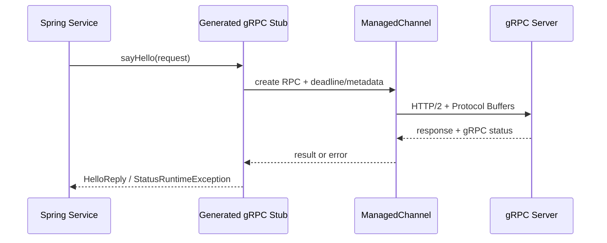

# Creating a gRPC Client Channel in Spring

In a Spring application, a gRPC client invokes methods on a remote service through a **channel**. Understanding how to create, configure, and manage a channel's lifecycle is the foundation for making unary RPCs, opening streaming flows, attaching metadata, setting deadlines, securing connections, and tracking errors. This lesson builds a gRPC client using **gRPC Java** and manages it as a **Spring Boot** bean. This approach clearly illustrates the core components, even when a project later uses the Spring gRPC starter for auto-configuration.

## 1. Where Does the Channel Fit in an RPC Call?

A Java gRPC client typically has three layers of responsibility:

| Component | Role | Scope of Use |
| --- | --- | --- |
| `ManagedChannel` | Manages connections, address resolution, HTTP/2 transport, and connection state to a target service. | Created once and reused across many calls. |
| Protocol Buffers generated stub | Provides Java methods corresponding to the RPCs declared in the `.proto` file. | Created from a channel; available as blocking, async, or future stubs depending on the RPC type. |
| RPC call | Carries its own request, metadata, deadline, and result/status. | Each call has an independent context. |

Typical processing flow:



`ManagedChannel` **is not synonymous with a single socket**: gRPC can establish connections on demand, recover from failures, and manage multiple connections depending on address resolution, transport, and load-balancing policies. Channels and standard stubs can be safely reused across multiple threads; there is no need to create a channel for every incoming HTTP request in a Spring application.

## 2. Preparing the Protocol Buffers Contract and Dependencies

Suppose the system has a `Greeter` service with a unary RPC `SayHello`:

```protobuf
syntax = "proto3";

package greeting;

option java_package = "com.example.grpc";
option java_multiple_files = true;

service Greeter {
  rpc SayHello (HelloRequest) returns (HelloReply);
}

message HelloRequest {
  string name = 1;
}

message HelloReply {
  string message = 1;
}
```

After running the `protoc` code generation step with the `protoc-gen-grpc-java` plugin, the client needs visibility to the `GreeterGrpc`, `HelloRequest`, and `HelloReply` classes in the `com.example.grpc` package. Code generation is typically configured in Maven or Gradle; **simply adding `.proto` files to the project without generating code is not enough to compile the Java examples**.

At the dependency level, the application needs Spring Boot, `grpc-protobuf`, `grpc-stub`, and a gRPC Java transport such as `grpc-netty-shaded`. Use aligned gRPC versions via a BOM or your project's dependency management mechanism; avoid mixing different versions of `grpc-api`, `grpc-stub`, and transport libraries. The sample below demonstrates creating a channel directly without assuming the project has enabled a dedicated gRPC starter.

## 3. Externalizing Destination Configuration in Spring Boot

Place connection settings in `application.yml` so they can vary by environment:

```yaml
app:
  grpc:
    greeter:
      host: localhost
      port: 9090
      plaintext: true
      timeout: 2s
```

`plaintext: true` **is only suitable for development or controlled testing environments**. When calling a real server over the network, use TLS and change it to `plaintext: false`. The `timeout` value represents the maximum deadline for a single RPC in this example; it is not a channel creation timeout.

Declare a strongly typed configuration class:

```java
package com.example.client;

import java.time.Duration;
import org.springframework.boot.context.properties.ConfigurationProperties;

@ConfigurationProperties(prefix = "app.grpc.greeter")
public record GreeterChannelProperties(
        String host,
        int port,
        boolean plaintext,
        Duration timeout) {
}
```

Spring Boot maps `2s` to a `Duration`. In a real project, you should validate that `host` is non-empty, `port` is within `1..65535`, and `timeout` is greater than `Duration.ZERO` so the application reports configuration errors immediately at startup.

## 4. Initializing `ManagedChannel` as a Spring Bean

Define the channel once in a `@Configuration` class, then create the stub from that channel:

```java
package com.example.client;

import com.example.grpc.GreeterGrpc;
import io.grpc.ManagedChannel;
import io.grpc.ManagedChannelBuilder;
import org.springframework.beans.factory.annotation.Qualifier;
import org.springframework.boot.context.properties.EnableConfigurationProperties;
import org.springframework.context.annotation.Bean;
import org.springframework.context.annotation.Configuration;

@Configuration
@EnableConfigurationProperties(GreeterChannelProperties.class)
public class GreeterGrpcClientConfiguration {

    @Bean(name = "greeterChannel", destroyMethod = "shutdown")
    ManagedChannel greeterChannel(GreeterChannelProperties settings) {
        ManagedChannelBuilder<?> builder = ManagedChannelBuilder
                .forAddress(settings.host(), settings.port());

        if (settings.plaintext()) {
            builder.usePlaintext();
        } else {
            builder.useTransportSecurity();
        }

        return builder.build();
    }

    @Bean
    GreeterGrpc.GreeterBlockingStub greeterBlockingStub(
            @Qualifier("greeterChannel") ManagedChannel channel) {
        return GreeterGrpc.newBlockingStub(channel);
    }
}
```

This snippet accomplishes four things:

1. `ManagedChannelBuilder.forAddress(host, port)` configures the target server. The actual transport is provided by the gRPC library on the classpath.
2. `usePlaintext()` disables TLS; `useTransportSecurity()` enables TLS and uses the transport's default trust mechanism.
3. Spring keeps `ManagedChannel` in the container and invokes `shutdown()` when destroying the bean, instead of recreating a connection for every call.
4. The stub is created from the same channel and injected into the Spring services that need to call the server.

With multiple servers, you can create multiple named channels and inject them using `@Qualifier`. Do not inject a plain `ManagedChannel` by type alone when the container has multiple beans of the same type without specifying which bean to use.

**Lifecycle note:** `shutdown()` initiates an orderly shutdown of the channel, but it does not wait for all in-flight RPCs to finish on its own. If the system needs time for active RPCs to complete, the component responsible for shutdown can call `awaitTermination(timeout, unit)` after `shutdown()`, and then `shutdownNow()` if the timeout expires. Once lifecycle management is delegated to Spring, do not close the channel yourself after each call.

## 5. Using the Stub to Call RPCs from a Spring Service

A blocking stub fits synchronous flows, such as a Spring MVC service performing a unary RPC:

```java
package com.example.client;

import com.example.grpc.GreeterGrpc;
import com.example.grpc.HelloReply;
import com.example.grpc.HelloRequest;
import java.util.concurrent.TimeUnit;
import org.springframework.stereotype.Service;

@Service
public class GreetingGateway {

    private final GreeterGrpc.GreeterBlockingStub stub;
    private final GreeterChannelProperties settings;

    public GreetingGateway(
            GreeterGrpc.GreeterBlockingStub stub,
            GreeterChannelProperties settings) {
        this.stub = stub;
        this.settings = settings;
    }

    public String greet(String name) {
        HelloRequest request = HelloRequest.newBuilder()
                .setName(name)
                .build();

        HelloReply reply = stub
                .withDeadlineAfter(settings.timeout().toMillis(), TimeUnit.MILLISECONDS)
                .sayHello(request);

        return reply.getMessage();
    }
}
```

`withDeadlineAfter(...)` returns **a new stub with the deadline configuration**, without mutating the original stub. Therefore, multiple calls can set different deadlines while still sharing the channel. `sayHello(...)` is the method generated by gRPC Java from the `SayHello` RPC in the `.proto` contract.

Common stub types:

| Stub | Invocation Style | Best Suited For |
| --- | --- | --- |
| `GreeterGrpc.newBlockingStub(channel)` | Blocks the calling thread until the unary RPC completes or fails. | Synchronous processing, controlled blocking tasks. |
| `GreeterGrpc.newFutureStub(channel)` | Returns a future for a unary RPC. | Integrating asynchronous results. |
| `GreeterGrpc.newStub(channel)` | Uses `StreamObserver` callbacks; supports streaming RPCs. | Server streaming, client streaming, bidirectional streaming. |

All three use the same underlying channel infrastructure. Only change the stub type when you need to change the RPC processing model; you do not have to create an additional channel just to switch from unary to streaming.

## 6. Practical Channel Configurations That Commonly Go Together

### 6.1. Target Address, DNS, and Load Balancing

`forAddress("localhost", 9090)` is convenient for a known single host and port. When a service needs name resolution or a list of endpoints, gRPC also provides `ManagedChannelBuilder.forTarget(target)` with a target syntax supported by `NameResolver`. For example, a target like `dns:///greeter.internal:9090` allows gRPC to use its DNS resolver. Actual syntax, resolution capabilities, and load balancing depend on the transport, resolver, and configured policies.

Do not assume that simply because a DNS name returns multiple IPs, the client will automatically distribute traffic evenly. Check the configured load-balancing policy, how endpoints are updated, health-checking mechanisms, and behavior when an endpoint goes down.

### 6.2. TLS and Server Verification

In real deployment environments, `useTransportSecurity()` must be paired with a TLS-enabled endpoint, a valid certificate, and a hostname matching the name in the certificate. If the server uses an internal CA, configure the trust store or the corresponding transport's `SslContext` to trust that specific CA. For mutual TLS, the client must also present its own certificate and private key according to the server's policy.

Do not use `usePlaintext()` to work around certificate errors when deploying to production. That is a security configuration issue that must be fixed at the source. In networks with proxies or ingress, ensure the path to the gRPC server supports HTTP/2 and proper TLS configuration.

### 6.3. Metadata and Interceptors

Metadata carries information alongside an RPC, such as `authorization`, `x-request-id`, or correlation IDs. Metadata belongs to the **call context**, whereas a channel is typically reused across many users. Therefore, never bind a single user's token to a shared channel.

Example of attaching headers for a single call via a stub interceptor:

```java
import io.grpc.Metadata;
import io.grpc.stub.MetadataUtils;

Metadata headers = new Metadata();
Metadata.Key<String> requestIdKey = Metadata.Key.of(
        "x-request-id", Metadata.ASCII_STRING_MARSHALLER);
headers.put(requestIdKey, "request-123");

var requestStub = stub.withInterceptors(
        MetadataUtils.newAttachHeadersInterceptor(headers));
var response = requestStub.sayHello(
        HelloRequest.newBuilder().setName("Lan").build());
```

In this example, `stub` is a previously created `GreeterBlockingStub`. Create separate metadata per request when values change; an interceptor holding static headers is only appropriate for constant data. For authentication tokens that need refreshing, consider `CallCredentials` or an interceptor that fetches the token per RPC. Never write access tokens or sensitive metadata to logs.

### 6.4. Deadlines, Timeouts, and Retries

An active channel does not guarantee that an RPC will respond on time. Every call should have a deadline appropriate for the business requirement; if time runs out, gRPC returns the `DEADLINE_EXCEEDED` status. If an upstream HTTP request has a shorter timeout, reserve sufficient budget for intermediate processing steps and propagate an appropriate deadline down to gRPC.

Retries should only be enabled when you clearly understand the RPC's idempotency and have controlled backoff, attempt count, and overall deadline. A funds transfer or resource creation call without an idempotency key cannot safely be retried by default. Using `waitForReady` also does not replace a deadline.

## 7. Recognizing Connection States and Errors

With a blocking stub, RPC errors are typically thrown as `StatusRuntimeException`. You can inspect the status code to classify the issue:

```java
import io.grpc.Status;
import io.grpc.StatusRuntimeException;

try {
    return greetingGateway.greet("Lan");
} catch (StatusRuntimeException ex) {
    Status.Code code = ex.getStatus().getCode();
    // Log the status code and request-id; map to an appropriate domain error.
    throw ex;
}
```

| Status / Symptom | Causes to Check |
| --- | --- |
| `UNAVAILABLE` | Server is down, wrong DNS/port, network issue, proxy issue, or TLS handshake failure. |
| `DEADLINE_EXCEEDED` | Slow server, slow network, or deadline set too short. |
| `UNAUTHENTICATED` / `PERMISSION_DENIED` | Missing, invalid, or insufficiently privileged credentials. |
| `UNIMPLEMENTED` | Called the wrong service/method or the server has not implemented the RPC. |
| `INVALID_ARGUMENT` | The request failed server-side input validation rules. |

Do not turn every `StatusRuntimeException` into a "connection lost" error: many status codes are intentional results returned by the server. For `UNAVAILABLE`, also check whether the client is using `plaintext` while the server requires TLS (or vice versa), the listening port, and HTTP/2 support. You can observe the `ManagedChannel`'s connectivity state via its connectivity state API when diagnosing issues, though channel state does not replace the actual outcome of individual RPCs.

## 8. Testing Channels and Production Observability

Testing should cover two layers:

1. **Client behavior tests:** use an in-process gRPC server with the `grpc-inprocess` transport, or a controllable test server. Invoke the stub over the test channel and verify the protobuf response, status, metadata, deadline, and how resources are closed.
2. **Environment integration tests:** call a server running on a real port over TLS, verifying certificates, DNS, ingress/proxy, timeouts, and reconnection after failures. In-process tests cannot catch every network or TLS configuration bug.

In production, monitor RPC counts, per-method latency, `UNAVAILABLE`/`DEADLINE_EXCEEDED` status rates, retry counts, and transport resource usage. Client interceptors or OpenTelemetry-compatible metrics/tracing integrations can record the duration and trace of each RPC. A channel created successfully at Spring startup **does not guarantee the server is reachable**: many transports only establish the physical connection when an actual call is made.

## 9. Common Implementation Mistakes

| Symptom | How to Fix |
| --- | --- |
| Calling `ManagedChannelBuilder...build()` per request | Move the channel into an application-scoped bean and share it across stubs. |
| Works locally but fails against the server | Verify host/port, DNS, TLS, certificates, and the path through HTTP/2 proxies. |
| Requests hang for too long | Set a deadline per RPC and measure actual latency. |
| Application does not shut down cleanly | Ensure the channel is shut down within the Spring lifecycle; await termination with a bounded timeout if needed. |
| Multiple channel beans get injected into the wrong place | Give beans explicit names and use `@Qualifier` clearly. |
| User tokens leak across requests | Pass metadata/credentials per call instead of storing them in a shared channel bean. |
| Blocking stubs exhaust threads | Bound concurrency or use async stubs with an appropriate execution model. |

## 10. When the Project Already Uses the Spring gRPC Starter

Some versions of Spring gRPC provide channel auto-configuration and factories to create named channels from Spring configuration. When a project uses that starter, verify the exact APIs, property prefixes, interceptor registration, and lifecycle management against **your installed Spring gRPC version**. Avoid enabling auto-configuration while simultaneously declaring a duplicate manual channel for the same target unless intentional. Whether creating channels through a factory or `ManagedChannelBuilder`, the core principles remain the same: **reuse channels, build stubs from channels, set per-RPC deadlines, protect metadata, and shut down channels when the application stops**.

## 11. Practice Exercises

1. Build a server implementing `Greeter/SayHello` listening on port `9090`, generate Java code from `.proto`, and configure the Spring application above to successfully call `greet("Lan")`.
2. Stop the server and observe the status. Restart the server and call it again using **the exact same channel** to observe reconnection behavior.
3. Lower the deadline from `2s` to a value smaller than the server's response time to observe `DEADLINE_EXCEEDED`. Then raise it to a reasonable deadline.
4. Add `x-request-id` via an interceptor and read the metadata on the server; verify that two requests receive two different IDs.
5. Switch the server to TLS, change `plaintext` to `false`, test the connection with a valid certificate, and observe how the application reacts when the certificate hostname does not match.

Completing this lesson means you can explain the difference between a channel and a stub, register a `ManagedChannel` in Spring, invoke unary RPCs with deadlines, choose how to pass metadata, and know where to inspect when connection errors occur. These skills also form the foundation for building client streaming, advanced interceptors, and gRPC observability in the Spring ecosystem.
