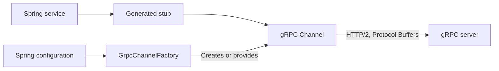
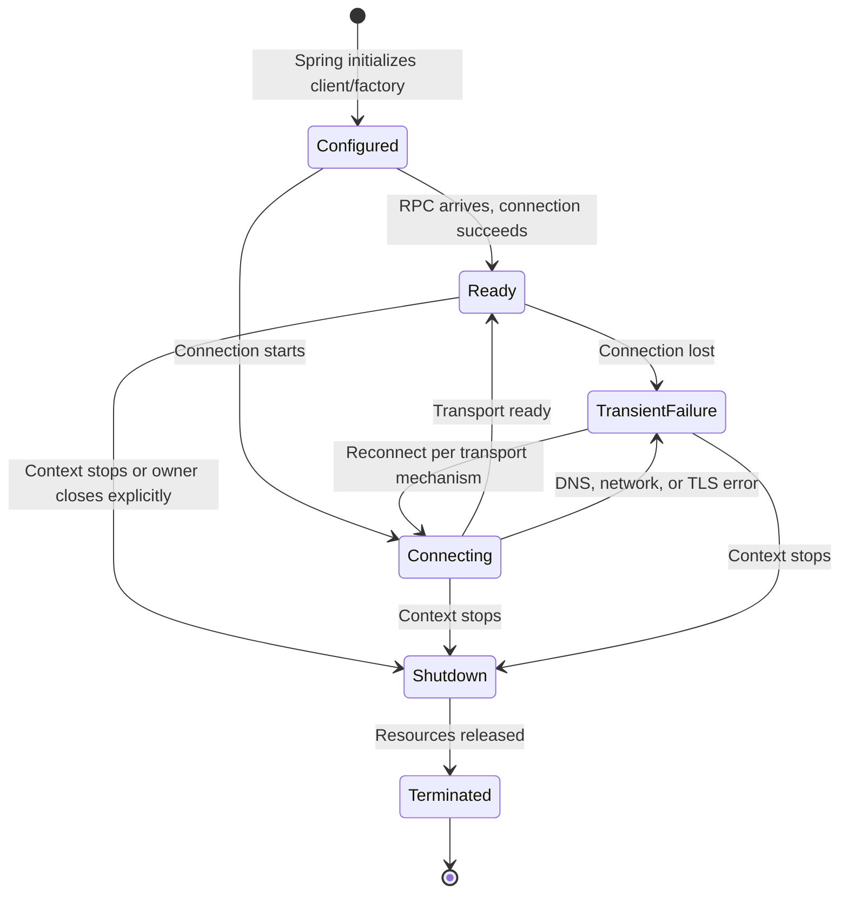

# GrpcChannelFactory and Channel Lifecycle

In the **Spring gRPC** ecosystem, a client can obtain a `Channel` through `GrpcChannelFactory`, create a stub from the channel, and use that stub to call a gRPC service described with Protocol Buffers. This approach brings server address, transport, security, and connection lifecycle into Spring's configuration mechanism. It is an important part of building clients/servers for unary RPCs or streaming RPCs, especially when the application needs to control deadlines, metadata, errors, TLS, and reliability.

This lesson focuses on two questions: **What is `GrpcChannelFactory` responsible for?** and **How does a channel live, get reused, fail, and terminate in a Spring application?**

## 1. Distinguishing Factory, Channel, Stub, and RPC

Suppose a Spring application needs to call a `Greeting` service in another process. The journey of a call involves the following components:



| Component | Nature and Responsibility | When to Use? |
| --- | --- | --- |
| `GrpcChannelFactory` | **Spring gRPC** abstraction for creating or retrieving a channel by configured name. | When you want the client configured and managed by Spring's mechanism. |
| `io.grpc.Channel` | **gRPC Java** abstraction used by stubs to execute RPCs. | Passed to `newBlockingStub`, `newStub`, or `newFutureStub`. |
| `io.grpc.ManagedChannel` | A `Channel` implementation with additional state-management and resource-closing APIs: `shutdown`, `shutdownNow`, `awaitTermination`. | When the application itself owns and must close the channel. |
| Generated stub | Java class generated from `.proto`; maps Java methods to RPCs. | Calling unary/streaming RPCs in blocking, async, or future style. |
| RPC invocation | A concrete call with its own request, metadata, deadline, and status. | Each business operation, potentially with its own deadline policy. |

`GrpcChannelFactory` **is not a core gRPC Java API**: it belongs to the Spring gRPC integration layer. By contrast, `Channel`, `ManagedChannel`, generated stubs, `Metadata`, and `Status` come from the gRPC Java library. Thus, a plain Java program can create a channel with `ManagedChannelBuilder`, while an application using Spring gRPC typically obtains a channel through the factory provided by Spring.

Key point: **a channel is not equivalent to a single socket**, and an RPC is not equivalent to a channel either. One channel can serve many concurrent calls, handle address resolution, and reconnect when the transport changes. The actual number of connections, when connections are created, and how load balancing works depend on the implementation as well as the resolver/load balancer configuration.

## 2. Why Use `GrpcChannelFactory`?

Without a factory, an application can create a `ManagedChannel` manually:

```java
ManagedChannel channel = ManagedChannelBuilder
        .forAddress("localhost", 9090)
        .usePlaintext()
        .build();
```

This works well for a small gRPC Java example. However, when integrating into Spring, the application also needs to centralize environment configuration, select destinations per backend, apply interceptors, secure the transport, and close resources when `ApplicationContext` shuts down. `GrpcChannelFactory` separates those concerns from business code:

```java
Channel channel = grpcChannelFactory.createChannel("greeter");
```

The name `greeter` represents a **logical client/channel name**. The factory looks up the configuration for this name according to the mechanism defined by the Spring gRPC version and implementation in use. It does not automatically infer the server address solely from the service name in `.proto`.

Main benefits of the factory:

1. **Centralized configuration:** a channel name can correspond to host, port, target URI, TLS, and environment transport settings.
2. **Reduced service coupling to transport:** services only need a stub, without needing to know how to construct a Netty channel.
3. **Multi-backend support:** an application can request `greeter`, `billing`, and `notification` channels with independent configurations.
4. **Fits into Spring's lifecycle:** the factory implementation and Spring-created resources can participate in `ApplicationContext` initialization, management, and destruction.
5. **Testing convenience:** you can configure a different target or replace the channel provider with a test implementation.

**Do not assume** every call to `createChannel("greeter")` always returns the exact same object or always opens a new socket. Caching policy, wrappers/interceptors, and channel ownership depend on the specific implementation; manage the channel according to the contract of the factory in use.

## 3. Example Protocol Buffers Contract and Generated Code

Suppose the Spring application acts as a client of the unary RPC `Greet`:

```protobuf
syntax = "proto3";

package greeting;

option java_package = "com.example.contract";
option java_multiple_files = true;

service Greeting {
  rpc Greet (GreetRequest) returns (GreetReply);
}

message GreetRequest {
  string name = 1;
}

message GreetReply {
  string message = 1;
}
```

After the code generation step with `protoc` and the `protoc-gen-grpc-java` plugin, the client module has the types `GreetingGrpc`, `GreetRequest`, and `GreetReply` in the `com.example.contract` package. The client needs dependencies on the generated contract code, compatible gRPC Java libraries, and the Spring gRPC client component containing `GrpcChannelFactory`.

The Java examples below assume the project has configured **Spring Boot + Spring gRPC client** and has generated/imported the classes from `.proto`. Third-party gRPC starters may have different annotation names, property names, and client creation mechanisms; do not mix their configuration with the Spring gRPC model studied here.

## 4. Configuring a Named Channel in Spring

Instead of placing `host`/`port` inside a service, we define a logical channel named `greeter`. A common configuration format for the Spring gRPC client is:

```yaml
spring:
  grpc:
    client:
      channels:
        greeter:
          address: static://localhost:9090
```

In this example, `greeter` is the name Java code will request from the factory, and `static://localhost:9090` is the target address. **Target syntax, TLS/plaintext declaration, and additional properties depend on the Spring gRPC version in use**; check the configuration documentation for your project's exact version and supported resolvers. Do not assume that setting `address` automatically enables plaintext or completes certificate configuration.

When deploying the application to real environments, you can change the destination via profile-loaded configuration or environment variables rather than recompiling the service. For a server offering TLS, configure the client to use TLS and trust the proper certificate. With multiple backends, name channels according to service roles and avoid sharing one configuration across destinations with different security requirements.

### Creating a Stub Using `GrpcChannelFactory`

```java
package com.example.client;

import com.example.contract.GreetingGrpc;
import io.grpc.Channel;
import org.springframework.context.annotation.Bean;
import org.springframework.context.annotation.Configuration;
import org.springframework.grpc.client.GrpcChannelFactory;

@Configuration(proxyBeanMethods = false)
public class GreetingClientConfiguration {

    @Bean
    GreetingGrpc.GreetingBlockingStub greetingBlockingStub(
            GrpcChannelFactory channelFactory) {

        Channel channel = channelFactory.createChannel("greeter");
        return GreetingGrpc.newBlockingStub(channel);
    }
}
```

Here:

- Spring injects the pre-configured `GrpcChannelFactory` implementation.
- `createChannel("greeter")` requests the channel corresponding to the logical name `greeter`.
- `GreetingGrpc.newBlockingStub(channel)` creates a stub for synchronous unary RPC calls.
- The stub is declared as a Spring bean, so business services only need dependency injection.

Notice the use of **`io.grpc.Channel`**, because the stub creation API only requires that base interface. Do not cast the result of `createChannel` to `ManagedChannel` to call `shutdown()` yourself: the factory may return a channel wrapped by interceptors or an implementation that does not carry the same ownership contract as a `ManagedChannel` you created manually.

A service using the stub:

```java
package com.example.client;

import com.example.contract.GreetReply;
import com.example.contract.GreetRequest;
import com.example.contract.GreetingGrpc;
import java.util.concurrent.TimeUnit;
import org.springframework.stereotype.Service;

@Service
public class GreetingGateway {

    private final GreetingGrpc.GreetingBlockingStub stub;

    public GreetingGateway(GreetingGrpc.GreetingBlockingStub stub) {
        this.stub = stub;
    }

    public String greet(String name) {
        GreetRequest request = GreetRequest.newBuilder()
                .setName(name)
                .build();

        GreetReply reply = stub
                .withDeadlineAfter(1500, TimeUnit.MILLISECONDS)
                .greet(request);

        return reply.getMessage();
    }
}
```

`withDeadlineAfter(...)` creates **a new stub instance with the added deadline** for that call; it does not modify the original stub in the singleton bean. gRPC Java stubs are generally immutable and safe to share across threads. Thus, you can create a stub once and vary call options per RPC.

## 5. Channel Lifecycle: From Initialization to Release

A channel's lifecycle differs from an RPC call's lifecycle. In Spring, you need a clear view of who creates it, who uses it, who closes it, and when connections are reopened.



This diagram is conceptual. gRPC Java defines connectivity states such as `IDLE`, `CONNECTING`, `READY`, `TRANSIENT_FAILURE`, and `SHUTDOWN`; **do not equate** creating the channel object with being in the `READY` state. Many implementations only initiate a connection when a call is made or when a connection trigger fires.

### Phase A — Context and Factory Initialization

Spring Boot initializes configuration beans, client structures, and the factory. When a stub bean calls `createChannel("greeter")`, the factory has enough information to supply the channel. The factory's exact eager/lazy initialization and caching behavior are implementation details.

**Consequence:** the fact that the application starts up and the stub is created **does not prove the server is online**. If a readiness check is required, perform it at the appropriate layer—such as a gRPC health check against the server with an explicit timeout—rather than merely checking that the bean exists.

### Phase B — Serving Multiple RPCs

One channel can handle many RPCs across different threads and should generally be reused. Creating a new channel on every HTTP request wastes connection setup, buffers, and transport resources, while making connection shutdown harder to manage. A Spring bean holding a generated stub is the right pattern when the stub is reused.

Concurrent RPCs have their own deadlines and metadata. Two requests hitting the same channel can time out or fail differently; do not use channel state to infer the outcome of individual RPCs.

### Phase C — Transient Failures and Recovery

When the server goes down or the network drops, the channel can transition into a transient failure state and then attempt to re-establish the connection. From the caller's perspective, an RPC may fail with `UNAVAILABLE`, `DEADLINE_EXCEEDED`, or another status.

You do not need to destroy and recreate the channel immediately when **one** RPC fails. Classify the error and evaluate retry/backoff policies, resolvers, load balancing, and server health. The fact that a channel can reconnect **does not mean** a failed RPC will be automatically and safely resent; retries depend on configuration and the business operation's idempotency.

### Phase D — Spring Shutdown and Graceful Termination

When the Spring `ApplicationContext` closes, resources owned by the framework/beans must be released according to the implementation's lifecycle contract. For channels obtained from `GrpcChannelFactory`, **let the factory or Spring's channel-owning component perform cleanup according to the version in use**; avoid calling `shutdown()` on a shared channel at the end of a business method.

A streaming RPC can live much longer than a unary RPC, so production systems often need an orderly shutdown strategy: stop accepting new work, allow critical in-flight RPCs to complete within a bounded period, and then close the transport. Closing the connection immediately while requests are still running can cause clients to receive `CANCELLED` or `UNAVAILABLE` depending on timing and context.

## 6. When the Application Owns `ManagedChannel` Directly

Sometimes you need to create a channel with `ManagedChannelBuilder` to use a custom transport or configuration mechanism. This case differs from a factory-provided channel: **the component that creates the channel is responsible for closing it**.

Example logic for closing a self-created `ManagedChannel`:

```java
import io.grpc.ManagedChannel;
import java.util.concurrent.TimeUnit;

static void stopChannel(ManagedChannel channel)
        throws InterruptedException {
    channel.shutdown();
    if (!channel.awaitTermination(5, TimeUnit.SECONDS)) {
        channel.shutdownNow();
        channel.awaitTermination(2, TimeUnit.SECONDS);
    }
}
```

`shutdown()` requests an orderly stop of the channel, preventing new calls while giving active RPCs a chance to finish. `awaitTermination(...)` waits up to a bounded timeout for shutdown to complete; `shutdownNow()` forces cancellation of remaining calls if the budget is exceeded. Production code should tie this method into the lifecycle of the bean that owns the channel—such as an explicit destroy hook—and handle interruption according to application policy.

**Do not run this channel-closing snippet on a `Channel` shared by a Spring factory unless you have proof you are its owner.** Accidentally closing a shared channel can break many other services or RPC flows.

| Scenario | Who Is Responsible for Closing? | What to Avoid |
| --- | --- | --- |
| Stub created by Spring from `GrpcChannelFactory` | The implementation/factory or lifecycle manager owning the channel per Spring gRPC's contract. | Calling `shutdown` on the channel yourself after each RPC. |
| Self-created `ManagedChannel` in a dedicated bean | The bean/application that created the channel, with an explicit destroy hook. | Forgetting to close it, or registering a destroy hook while also closing it in multiple other places. |
| Channel provided by a test environment | The test fixture/extension that created the channel, or the test bean assigned ownership. | Leaking test resources across test cases. |

## 7. One Factory, Multiple Backends, and Multiple Stub Types

Example of an application calling two different services:

```java
@Bean
GreetingGrpc.GreetingBlockingStub greetingStub(GrpcChannelFactory factory) {
    return GreetingGrpc.newBlockingStub(factory.createChannel("greeter"));
}

@Bean
PaymentGrpc.PaymentFutureStub paymentStub(GrpcChannelFactory factory) {
    return PaymentGrpc.newFutureStub(factory.createChannel("payment"));
}
```

`PaymentGrpc` in this snippet is assumed to be a class **generated from a separate `.proto` file** declaring a `Payment` service. You must configure the `payment` channel separately in the application. If there are multiple beans of the same stub type (for instance, two `GreetingBlockingStub` beans targeting two regions), give the beans distinct names and use `@Qualifier` when injecting them.

For a single backend, you can create different stubs from the same channel:

```java
Channel channel = factory.createChannel("greeter");

GreetingGrpc.GreetingBlockingStub blocking =
        GreetingGrpc.newBlockingStub(channel);

GreetingGrpc.GreetingStub async =
        GreetingGrpc.newStub(channel);

GreetingGrpc.GreetingFutureStub future =
        GreetingGrpc.newFutureStub(channel);
```

These stubs differ only in how you interact with the RPC. Switching to async or streaming **does not require creating a new channel for each stub type**. However, the `.proto` contract must declare a streaming method in order to use the streaming APIs on the generated stub.

## 8. Where Do Deadlines, Metadata, and Interceptors Attach?

To avoid lifecycle design mistakes, distinguish long-lived configuration from per-RPC data.

| Scope | Examples | How to Apply |
| --- | --- | --- |
| Channel/factory | Backend name, target, TLS, trust material, transport policy. | Spring gRPC client / factory implementation configuration. |
| Stub | Blocking/async style, shared interceptors, default call options. | Create the stub from the channel; keep as a singleton when appropriate. |
| RPC | Specific deadline, `x-request-id`, user token, request-scoped metadata. | Derive a stub variant or attach call credentials/metadata per invocation. |

Example of per-RPC metadata:

```java
import io.grpc.Metadata;
import io.grpc.stub.MetadataUtils;

Metadata headers = new Metadata();
Metadata.Key<String> requestIdKey = Metadata.Key.of(
        "x-request-id", Metadata.ASCII_STRING_MARSHALLER);
headers.put(requestIdKey, "req-4782");

GreetingGrpc.GreetingBlockingStub requestStub = stub.withInterceptors(
        MetadataUtils.newAttachHeadersInterceptor(headers));

GreetReply reply = requestStub
        .withDeadlineAfter(1, TimeUnit.SECONDS)
        .greet(GreetRequest.newBuilder().setName("Mai").build());
```

The variables `stub`, `GreetingGrpc`, `GreetRequest`, and `GreetReply` come from the configuration and contract shown earlier. This snippet sits inside **a single request's** processing context; do not store `headers` containing a request ID or user token inside a Spring singleton shared by all users. For dynamic authentication, use `CallCredentials` or an interceptor that retrieves credentials per RPC; protect sensitive data when logging.

Deadlines also live at the RPC layer. When a deadline expires, the client can receive `DEADLINE_EXCEEDED` even while the channel remains `READY`. For long-lived streams, consider the overall stream lifetime and cancellation strategy; do not blindly copy a short unary RPC timeout onto a stream expected to last several minutes.

## 9. TLS, Server Name, and Target Resolution

A channel can communicate with a server over plaintext or TLS depending on configuration. Over a network, use TLS, verify the server certificate and hostname, and configure trusted CAs; mutual TLS additionally requires a client certificate and private key. Business code only calls the stub and does not need to know every TLS handshake step, though misconfiguration will surface as connection/RPC errors.

A named channel's target address may be handled by a `NameResolver` or a custom scheme provided by the integration. Therefore, moving from `localhost` to service discovery requires checking:

- Does the resolver support the configured target syntax?
- Does the server name used for TLS verification match the certificate?
- Does the load-balancing policy fit the resolved endpoint list?
- Does traffic passing through ingress/proxies preserve the HTTP/2 required for gRPC?

Do not assume multiple IP addresses from DNS guarantee the client will load-balance as expected. All of the factors above directly affect `CONNECTING` duration, recovery after `TRANSIENT_FAILURE`, and RPC error rates.

## 10. Observing State and Handling Failures

With a blocking stub, RPC errors commonly appear as `StatusRuntimeException`:

```java
import io.grpc.Status;
import io.grpc.StatusRuntimeException;

try {
    greetingGateway.greet("Mai");
} catch (StatusRuntimeException ex) {
    Status.Code code = ex.getStatus().getCode();
    // Log the status code, RPC method, latency, and correlation ID.
    // Do not log tokens or sensitive contents from metadata.
    throw ex;
}
```

| Status / Symptom | How to Interpret and Investigate |
| --- | --- |
| `UNAVAILABLE` | May indicate server unavailability, wrong endpoint, DNS, network, TLS, or proxy issues. Check both transport and server logs. |
| `DEADLINE_EXCEEDED` | RPC exceeded its time budget; check server latency, network, and client deadline. |
| `UNAUTHENTICATED` / `PERMISSION_DENIED` | Review credentials, authentication policy, and authorization rules on the server. |
| `RESOURCE_EXHAUSTED` | Check quotas, concurrency limits, message sizes, and resource usage. |
| `UNIMPLEMENTED` | Method/service is missing on the server or the client is calling the wrong backend. |
| `CANCELLED` | The call was cancelled by the client or by lifecycle handling in one of the layers. |

If you own a `ManagedChannel` directly, gRPC Java exposes connectivity state APIs such as `getState(...)` and `notifyWhenStateChanged(...)` for diagnostics. However, those APIs **do not replace checking RPC results** and do not guarantee a call will succeed. If you only receive `io.grpc.Channel` from a factory, do not cast it just to access `ManagedChannel`'s management APIs.

In operations, monitor RPC counts by service/method, latency, deadline exceeded rates, unavailable rates, retry rates, active stream counts, and signs of resource saturation. Client interceptors or OpenTelemetry/metrics integrations can attach trace/correlation IDs and time each RPC; configure metrics to avoid high-cardinality labels like request IDs.

## 11. Testing the Factory and Channel Lifecycle

A useful test suite should include both logic tests and real connection tests:

| Test Type | Goal | Example Scenario |
| --- | --- | --- |
| Gateway unit test | Verify requests are constructed properly and how the gateway handles responses/errors. | Use a mock stub or isolate the RPC call layer to simulate statuses. |
| In-process gRPC test | Verify real gRPC calls without TCP sockets, including serializers and interceptors. | Create an in-process server/channel, inject the test stub; close fixtures after the test. |
| Spring integration test | Verify `GrpcChannelFactory` resolves the name properly and Spring injects the right stub. | Configure a dedicated test backend, start the context, and call `GreetingGateway`. |
| Network/TLS integration test | Test transport, certificates, proxies, deadlines, and error recovery. | Call a server on a real port; stop and restart the server and call again through the same client. |
| Shutdown test | Verify resource cleanup when closing the context. | Open an RPC/stream, request shutdown, and observe termination within the allowed timeout. |

In-process tests are very fast but do not fully simulate DNS, TCP, or TLS. For lifecycle concerns, integration tests using a real transport help uncover bugs that only appear when starting/stopping servers, sharing channels, and closing the Spring context. Any server/channel created manually in test fixtures must also be released after the test.

### Hands-On Test Scenarios

1. Create a server supporting `Greeting/Greet` running on `localhost:9090`; generate code from `.proto` and configure the channel named `greeter`.
2. Inject `GrpcChannelFactory`, call `createChannel("greeter")`, build a blocking stub, invoke `Greet` with an explicit deadline, and verify the response.
3. Stop the server and call again to observe `UNAVAILABLE` or `DEADLINE_EXCEEDED` depending on the case. Restart the server and call using the previously created client.
4. Execute multiple RPCs through the same stub/channel; compare latency and managed resources against creating a new channel per request.
5. Add `x-request-id` metadata per RPC, read it on the server, and verify it is not accidentally shared between two users.
6. Switch the backend to TLS, configure the client accordingly, and test both a valid certificate and a hostname mismatch case.
7. Close the Spring context while an RPC/stream is in flight, record termination behavior, and adjust shutdown policy if transaction preservation is required.

## 12. Design Mistakes to Watch Out For

| Mistake | Consequence | How to Fix |
| --- | --- | --- |
| Calling `ManagedChannelBuilder.build()` inside every service method | Creates excessive transport resources, increases connection overhead, and is easy to forget to shut down. | Use a factory and reusable stubs, or a channel bean with a clear owner. |
| Casting `Channel` returned by the factory to `ManagedChannel` | Can fail with a cast error or close a resource owned by the framework. | Program against `Channel`; let the owner close it per the defined lifecycle. |
| Creating a singleton stub with the first request's fixed token | Leaks credentials/metadata across users. | Attach credentials/metadata per RPC; never store request state in a singleton. |
| Treating bean creation as proof the backend is `READY` | Failures go undetected until the first RPC runs. | Use real readiness checks and appropriate deadlines. |
| Skipping deadlines because the channel reconnects automatically | RPCs can wait indefinitely, exhausting threads or processing budgets. | Set business-appropriate deadlines and monitor errors and latency. |
| Closing the channel when a single RPC fails | Disrupts all other calls sharing that channel. | Classify the status; let the transport recover and only replace a channel with specific justification. |
| Using plaintext configuration in environments requiring security | Data and credentials can traverse the network unencrypted. | Configure TLS, verify the server, and manage certificates properly. |

## 13. Key Takeaways and Self-Check Questions

`GrpcChannelFactory` is Spring gRPC's integration entry point for supplying configured channels; `Channel` is the abstraction used by generated stubs to transmit RPCs; and `ManagedChannel` adds shutdown APIs for **the component that owns the resource**. Declaring stubs as Spring beans allows one channel to serve many RPCs while deadlines and metadata remain customizable per request.

Before wrapping up this lesson, ask yourself:

1. Why does `GrpcChannelFactory.createChannel("greeter")` take a logical name rather than necessarily taking `host:port` directly?
2. Why shouldn't a `Channel` obtained from a factory be automatically cast and `shutdown()` at the end of an RPC?
3. If a channel has been created but the server is not running yet, must the application necessarily fail immediately at startup?
4. With 100 concurrent RPCs, should you create 100 channels or reuse the existing channel? Where do each RPC's deadline and metadata live?
5. When a server temporarily loses connectivity, what is the difference between *the channel can reconnect* and *the old RPC is guaranteed to be retried successfully*?
6. In a system with long-running streaming RPCs, what must be considered before closing the Spring context?

Mastering these points helps you build gRPC clients in Spring with clean configuration, effective connection reuse, clear resource-management boundaries, and readiness to expand into interceptors, TLS security, integration testing, and performance and reliability observability.
