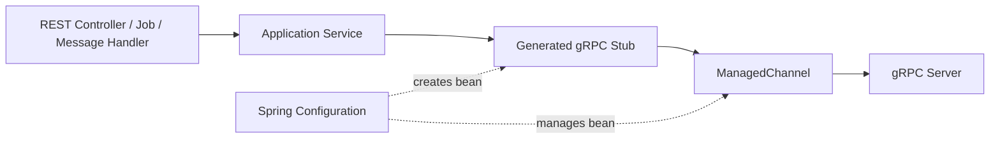

# Injecting Stubs into Application Services

In a Spring application calling gRPC, a **stub** is the Java object providing RPC methods generated from a Protocol Buffers contract. Instead of letting each controller open connections and create stubs on its own, we register the stub as a **Spring bean**, then **inject it via constructor** into the application service. The service focuses on business logic, while the configuration bean is responsible for creating the client and managing the `ManagedChannel` lifecycle.

This lesson belongs to the **Spring client** section of the **SPRING_GRPC** module: developing gRPC services in the Spring ecosystem from Protocol Buffers contracts to unary and streaming clients/servers, with metadata, deadline, status, interceptor, TLS, and testing handling. The focus here is how to bring generated clients into the application service layer cleanly, testably, and safely under concurrent requests.

## 1. Why Inject a Stub Instead of Instantiating It in Every Method?

Once the client has the `.proto` contract and its corresponding Java code, a call follows this flow:



`ManagedChannel` manages connections and HTTP/2 transport. A stub is merely a client object **bound to a channel** that carries call configuration; the stub does not own its own TCP connection. gRPC Java stubs are designed to be safely reused across threads, and configuration methods such as `withDeadlineAfter(...)` return a **new stub** instead of mutating the shared stub directly.

Creating a channel on every call wastes connection setup resources, makes resource shutdown hard to control, and makes replacing the client in tests difficult. Instantiating stubs directly in controllers easily duplicates client creation and remote error handling across many endpoints.

An appropriate separation of responsibilities:

| Component | Responsibility |
| --- | --- |
| `@Configuration` | Reads target configuration, creates `ManagedChannel` and generated stubs as beans. |
| Application service | Decides when to make remote calls, validates input, maps data, applies deadlines, and interprets results/errors. |
| Controller or consumer | Receives external requests and calls the application service; needs no knowledge of channel creation. |
| Spring container | Resolves dependencies during bean creation and coordinates lifecycle. |

## 2. The gRPC Contract and Generated Stub Class

Consider a greeting service with a single unary RPC:

```protobuf
syntax = "proto3";

package greeting;

option java_package = "com.example.contract.grpc";
option java_multiple_files = true;

service Greeter {
  rpc SayHello (HelloRequest) returns (HelloReply);
}

message HelloRequest {
  string name = 1;
}

message HelloReply {
  string message = 1;
}
```

After running `protoc` and the Java gRPC plugin, the generated code includes `com.example.contract.grpc.GreeterGrpc` along with `HelloRequest` and `HelloReply`. The Java method name on `GreeterBlockingStub` is `sayHello(...)`, corresponding to the `SayHello` RPC.

Required dependencies include Spring Boot, the Java/Protobuf code generated from the contract, `grpc-protobuf`, `grpc-stub`, and a gRPC Java transport such as `grpc-netty-shaded`. For the in-process test later, add `grpc-inprocess` in test scope. Let your build manage compatible gRPC module versions together; this lesson does not tie you to a specific Spring Boot or gRPC starter version.

## 3. Registering the Channel and Stub in Spring

First, configure the target destination in `application.yml`:

```yaml
app:
  grpc:
    greeter:
      host: localhost
      port: 9090
      plaintext: true
```

This is a development configuration for a server running locally. For real environments, use TLS and change it to `plaintext: false`; the server, DNS, and certificates must be configured accordingly.

Create the Spring configuration class:

```java
package com.example.client;

import com.example.contract.grpc.GreeterGrpc;
import io.grpc.ManagedChannel;
import io.grpc.ManagedChannelBuilder;
import org.springframework.beans.factory.annotation.Qualifier;
import org.springframework.beans.factory.annotation.Value;
import org.springframework.context.annotation.Bean;
import org.springframework.context.annotation.Configuration;

@Configuration(proxyBeanMethods = false)
public class GreeterClientConfiguration {

    @Bean(name = "greeterChannel", destroyMethod = "shutdown")
    ManagedChannel greeterChannel(
            @Value("${app.grpc.greeter.host}") String host,
            @Value("${app.grpc.greeter.port}") int port,
            @Value("${app.grpc.greeter.plaintext:false}") boolean plaintext) {

        ManagedChannelBuilder<?> builder =
                ManagedChannelBuilder.forAddress(host, port);

        if (plaintext) {
            builder.usePlaintext();
        } else {
            builder.useTransportSecurity();
        }

        return builder.build();
    }

    @Bean
    GreeterGrpc.GreeterBlockingStub greeterBlockingStub(
            @Qualifier("greeterChannel") ManagedChannel channel) {
        return GreeterGrpc.newBlockingStub(channel);
    }
}
```

Key takeaways:

1. Spring creates the `greeterChannel` bean once under default singleton scope. The channel is shared across different RPCs.
2. `greeterBlockingStub(...)` receives the already created channel via constructor-like dependency injection on the `@Bean` parameter. Hence all calls through this stub share the same channel.
3. The stub bean has the **concrete type** `GreeterGrpc.GreeterBlockingStub`; Spring resolves the bean by type when injecting it into services.
4. `destroyMethod = "shutdown"` instructs Spring to close the channel when destroying the bean. If you need to wait for in-flight RPCs to finish, add a shutdown routine with `awaitTermination(...)` and an appropriate timeout in the lifecycle-managing component. Never close the channel after individual RPCs.

**Distinguish bean initialization from a successful connection:** creating a `ManagedChannel` does not prove the gRPC server is ready. Depending on the transport, the physical connection may only be established when a call occurs.

## 4. Constructor Injection into an Application Service

Suppose the application needs to return a greeting message to the user. The application service layer does not need to return a raw Protobuf message directly to the controller; a dedicated result type limits coupling to the gRPC contract.

`GreetingResult.java`:

```java
package com.example.application;

public record GreetingResult(String message) {
}
```

`GreetingRemoteUnavailableException.java`:

```java
package com.example.application;

public class GreetingRemoteUnavailableException extends RuntimeException {
    public GreetingRemoteUnavailableException(String message, Throwable cause) {
        super(message, cause);
    }
}
```

`GreetingApplicationService.java`:

```java
package com.example.application;

import com.example.contract.grpc.GreeterGrpc;
import com.example.contract.grpc.HelloReply;
import com.example.contract.grpc.HelloRequest;
import io.grpc.Status;
import io.grpc.StatusRuntimeException;
import java.util.concurrent.TimeUnit;
import org.springframework.stereotype.Service;

@Service
public class GreetingApplicationService {

    private final GreeterGrpc.GreeterBlockingStub greeterStub;

    public GreetingApplicationService(
            GreeterGrpc.GreeterBlockingStub greeterStub) {
        this.greeterStub = greeterStub;
    }

    public GreetingResult greet(String rawName) {
        if (rawName == null || rawName.isBlank()) {
            throw new IllegalArgumentException("Name must not be empty");
        }

        HelloRequest request = HelloRequest.newBuilder()
                .setName(rawName.trim())
                .build();

        try {
            HelloReply reply = greeterStub
                    .withDeadlineAfter(2, TimeUnit.SECONDS)
                    .sayHello(request);
            return new GreetingResult(reply.getMessage());
        } catch (StatusRuntimeException exception) {
            Status.Code code = exception.getStatus().getCode();
            if (code == Status.Code.UNAVAILABLE
                    || code == Status.Code.DEADLINE_EXCEEDED) {
                throw new GreetingRemoteUnavailableException(
                        "Unable to fetch greeting from the gRPC service", exception);
            }
            throw exception;
        }
    }
}
```

With a single constructor, Spring **does not require `@Autowired`** on the constructor. The `GreeterBlockingStub` dependency is automatically supplied by the bean in `GreeterClientConfiguration`. The `private final` field shows that the service never replaces the stub during request processing.

In the call above, `withDeadlineAfter(...)` creates a stub instance configured specifically for that RPC. The deadline belongs to the call, while the original stub bean remains safe to reuse. The two statuses `UNAVAILABLE` and `DEADLINE_EXCEEDED` are mapped to a meaningful application-layer exception; other statuses are rethrown for higher-level error handling policies to decide. In production systems, define a complete error mapping aligned with your domain contract; in particular, `INVALID_ARGUMENT`, `UNAUTHENTICATED`, `PERMISSION_DENIED`, or `NOT_FOUND` do not mean the same thing as a connectivity failure.

For an HTTP API, the controller class can consume the service as an ordinary dependency:

```java
package com.example.api;

import com.example.application.GreetingApplicationService;
import com.example.application.GreetingResult;
import org.springframework.web.bind.annotation.GetMapping;
import org.springframework.web.bind.annotation.RequestMapping;
import org.springframework.web.bind.annotation.RequestParam;
import org.springframework.web.bind.annotation.RestController;

@RestController
@RequestMapping("/greetings")
public class GreetingController {

    private final GreetingApplicationService greetings;

    public GreetingController(GreetingApplicationService greetings) {
        this.greetings = greetings;
    }

    @GetMapping
    public GreetingResult greet(@RequestParam String name) {
        return greetings.greet(name);
    }
}
```

For example, `GET /greetings?name=Lan` calls `GreetingApplicationService`, which invokes `Greeter/SayHello`, and then Spring returns `GreetingResult` as JSON. When the remote connection is unavailable, you can add a `@RestControllerAdvice` to map `GreetingRemoteUnavailableException` to HTTP `503 Service Unavailable` instead of returning a stack trace to the user. The controller does not need to know about `ManagedChannel`, `HelloRequest`, or `StatusRuntimeException`.

## 5. How Does Spring Inject When There Are Multiple Stubs?

Spring resolves dependencies by type first. If the application context has **one** `GreeterBlockingStub` bean, the constructor above is unambiguous. When the system has **two** Greeter clients of the same type connecting to different server clusters, you must specify the bean name:

```java
@Bean("mainGreeterStub")
GreeterGrpc.GreeterBlockingStub mainGreeterStub(
        @Qualifier("mainGreeterChannel") ManagedChannel channel) {
    return GreeterGrpc.newBlockingStub(channel);
}

@Bean("backupGreeterStub")
GreeterGrpc.GreeterBlockingStub backupGreeterStub(
        @Qualifier("backupGreeterChannel") ManagedChannel channel) {
    return GreeterGrpc.newBlockingStub(channel);
}
```

The two channel beans `mainGreeterChannel` and `backupGreeterChannel` in this snippet must be declared separately with their respective target endpoints. The service constructor selects the client to use:

```java
public GreetingApplicationService(
        @Qualifier("mainGreeterStub")
        GreeterGrpc.GreeterBlockingStub greeterStub) {
    this.greeterStub = greeterStub;
}
```

This replaces the constructor from the earlier example when multiple beans of the same type exist. You do not need two channels if two application services simply share **one** remote gRPC service with the same connection policy. `@Primary` can be used when one bean is an intentional default choice, though `@Qualifier` makes each service's dependency more explicit when reading the code.

## 6. Choosing Blocking Stub, Future Stub, or Async Stub

Each stub type is created from the same channel; **choose the type that matches how the application service processes calls**:

| Injected Type | How It Is Created | When to Use |
| --- | --- | --- |
| `GreeterGrpc.GreeterBlockingStub` | `GreeterGrpc.newBlockingStub(channel)` | Synchronous unary RPC handling where blocking the calling thread is acceptable. |
| `GreeterGrpc.GreeterFutureStub` | `GreeterGrpc.newFutureStub(channel)` | Unary RPC returning `ListenableFuture`, when composing with async flows. |
| `GreeterGrpc.GreeterStub` | `GreeterGrpc.newStub(channel)` | `StreamObserver` callbacks, suited for async unary and streaming RPCs. |

Declaring a bean for an async stub looks just like a blocking stub:

```java
@Bean
GreeterGrpc.GreeterStub greeterAsyncStub(
        @Qualifier("greeterChannel") ManagedChannel channel) {
    return GreeterGrpc.newStub(channel);
}
```

In an application service using an async stub, results arrive via `StreamObserver`, so you must manage `onNext`, `onError`, `onCompleted` callbacks and request lifecycle boundaries. With synchronous Spring MVC, a blocking stub may be the simplest option; with streaming or reactive flows, **never call a blocking stub on an event-loop thread**. If integrating with Reactor, design a bridge between gRPC observers and `Mono`/`Flux` with proper cancellation and backpressure handling; simply injecting the stub does not create that mechanism automatically.

## 7. Metadata, Deadlines, and Safety When Beans Are Shared

`@Service` and stub beans are usually singletons. That makes sense because client configuration can be shared, but **metadata tied to a single request or user must be built separately for that call**. For example, when an application service needs to propagate a correlation ID:

```java
import io.grpc.Metadata;
import io.grpc.stub.MetadataUtils;

Metadata headers = new Metadata();
Metadata.Key<String> requestIdKey = Metadata.Key.of(
        "x-request-id", Metadata.ASCII_STRING_MARSHALLER);
headers.put(requestIdKey, requestId);

HelloReply reply = greeterStub
        .withInterceptors(MetadataUtils.newAttachHeadersInterceptor(headers))
        .withDeadlineAfter(2, TimeUnit.SECONDS)
        .sayHello(request);
```

Here, `requestId` is the value for the **current call**, and `request` is the previously built `HelloRequest`. This snippet sits inside the per-request handler method. Never share a single mutable `Metadata` object globally and overwrite values on each request: data from concurrent requests risks leaking across calls.

For user-specific authentication tokens, consider `CallCredentials` or a client interceptor that retrieves the token from the call context. Never hard-code tokens into singleton beans or print tokens in logs. Deadlines should be set per RPC according to the business time budget; when the originating request has a timeout, ensure the gRPC call does not keep running indefinitely after the user has stopped waiting.

## 8. Testing the Application Service Without Opening a Network Port

Constructor injection allows instantiating the service directly in tests. To verify Protobuf mapping logic and unary calls realistically without depending on a real server, use a **gRPC in-process server**. The example below uses JUnit 5 and the `grpc-inprocess` API:

```java
package com.example.application;

import static org.junit.jupiter.api.Assertions.assertEquals;

import com.example.contract.grpc.GreeterGrpc;
import com.example.contract.grpc.HelloReply;
import com.example.contract.grpc.HelloRequest;
import io.grpc.ManagedChannel;
import io.grpc.Server;
import io.grpc.inprocess.InProcessChannelBuilder;
import io.grpc.inprocess.InProcessServerBuilder;
import io.grpc.stub.StreamObserver;
import org.junit.jupiter.api.Test;

class GreetingApplicationServiceTest {

    @Test
    void returnsGreetingFromGrpcService() throws Exception {
        String serverName = InProcessServerBuilder.generateName();

        Server server = InProcessServerBuilder.forName(serverName)
                .directExecutor()
                .addService(new GreeterGrpc.GreeterImplBase() {
                    @Override
                    public void sayHello(
                            HelloRequest request,
                            StreamObserver<HelloReply> observer) {
                        observer.onNext(HelloReply.newBuilder()
                                .setMessage("Hello, " + request.getName())
                                .build());
                        observer.onCompleted();
                    }
                })
                .build()
                .start();

        ManagedChannel channel = InProcessChannelBuilder
                .forName(serverName)
                .directExecutor()
                .build();

        try {
            GreetingApplicationService app = new GreetingApplicationService(
                    GreeterGrpc.newBlockingStub(channel));

            assertEquals("Hello, Lan", app.greet(" Lan ").message());
        } finally {
            channel.shutdownNow();
            server.shutdownNow();
        }
    }
}
```

This test verifies that the application service normalizes the name, converts it to `HelloRequest`, invokes the generated stub, and transforms `HelloReply` into `GreetingResult`. Because the dependency is constructor-injected, the service logic can be tested without starting a Spring context. This is a **gRPC communication test**, but it does not test TLS configuration, DNS, ingress, or real HTTP/2 networking; those behaviors require integration tests against a server over a real network port. If you also want to verify Spring wiring, add a test that boots the `ApplicationContext` and checks that `GreetingApplicationService` receives the right stub bean, using a test configuration isolated from production.

## 9. Common Mistakes When Injecting Stubs

| Symptom | Cause / How to Fix |
| --- | --- |
| `NoSuchBeanDefinitionException` for `GreeterBlockingStub` | Bean not declared, `@Configuration` outside component scan, or generated classes missing from classpath. |
| `NoUniqueBeanDefinitionException` | Multiple stubs of the same type exist; use `@Qualifier` with the exact bean name. |
| Code compiles, but RPC returns `UNIMPLEMENTED` | Server method or service does not match the generated contract; verify package/service and proto version. |
| Service builds stubs from `ManagedChannelBuilder` inside `greet()` | Move channel and stub configuration into beans and reuse resources. |
| Using `@Autowired` on mutable fields | Prefer constructor injection and `final` fields so dependencies are explicit and easy to test. |
| One request overwrites another request's deadline/metadata | Call `withDeadlineAfter`/`withInterceptors` to create a per-call stub; do not hold mutable metadata in a singleton. |
| Calling a blocking stub from a reactive thread | Switch to an async stub or explicitly offload blocking work to an appropriate scheduler. |
| First RPC call fails with `UNAVAILABLE` | Check server, host/port, TLS, certificates, and network; Spring creating the bean does not guarantee the server is ready. |

If the project uses a Spring gRPC starter with built-in client declarations or factories, use the stub registration mechanism matching that starter version. The application service still receives **the generated stub or an adapter wrapping it via its constructor**, while avoiding creating a second manual channel duplicating the one managed by the starter. Check the channel shutdown, interceptor, and TLS policies of your chosen configuration.

## 10. When Should You Inject an Adapter Instead of the Generated Stub Directly?

Injecting the generated stub directly works well when the application is small, the application service layer is the only place calling remote APIs, and coupling to Protobuf is acceptable. When multiple features call the same service, when you want to swap transports, or when you want to isolate Protobuf structures from the application layer, place a **gateway/adapter** in front of the stub:


In this setup, `GrpcGreetingGateway` receives the stub via constructor and translates `HelloRequest`/`HelloReply` into domain data types; the application service depends only on `GreetingGateway`. This is a design choice driven by complexity, not a mandatory requirement for using a Spring gRPC client. Either way, responsibility for creating the channel and managing its lifecycle remains in the client configuration.

## 11. Practice Exercises

1. Generate Java code from the `Greeter` contract, configure `greeterChannel` and `greeterBlockingStub` in Spring, and then add `GreetingApplicationService` with constructor injection.
2. Call `GET /greetings?name=Lan`; verify the greeting comes from the gRPC server rather than a hard-coded string in the controller.
3. Create two `GreeterBlockingStub` beans pointing to two servers and observe the injection error when `@Qualifier` is missing; add qualifiers to pick the right server.
4. Write in-process tests for both the success case and the case where the server returns `UNAVAILABLE`. Verify the corresponding domain exception and make sure both server and channel are closed after the test.
5. Add per-call `x-request-id` metadata along with a deadline and verify that two concurrent calls do not share mutable metadata.

After this lesson, you should be able to explain why Spring manages channels and stubs as beans, why constructor injection makes application services easy to test, when to use `@Qualifier`, and how to apply per-call deadlines and metadata without mutating shared stubs. This lays the groundwork for Spring applications integrating unary RPCs, streaming RPCs, interceptors, and reliable gRPC observability.
