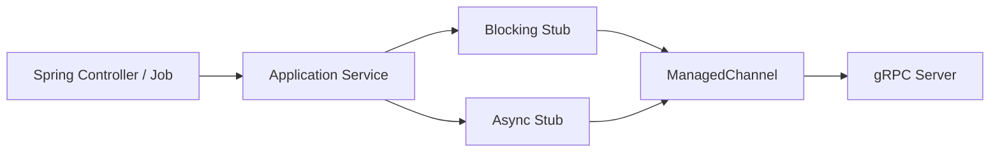

# Blocking Stub and Async Stub in Spring

When a Spring application calls a gRPC server, the Java code generated from a Protocol Buffers contract provides multiple types of **stubs**. The two most important types are the **blocking stub** (synchronous invocation) and the **async stub** (callback-based invocation). Both use the same `ManagedChannel` but differ in how they return results, manage threads, and handle errors. Choosing the right stub directly affects how an application service handles unary RPCs, server streaming, client streaming, and bidirectional streaming.

This lesson belongs to the **Spring client** chapter in the **SPRING_GRPC** module. We will create both stub types as Spring beans, invoke them from application services, and compare how they handle `deadline`, `status`, metadata, and integration testing. The examples use the gRPC Java APIs directly to make the mechanics clear; if your project uses a Spring gRPC starter, bean declarations may be replaced by factories or auto-configuration matching that starter version.

## 1. What Is a Stub and What Do Stub Types Share?

Flow of a gRPC call in a Spring application:



- **`ManagedChannel`** manages the connection infrastructure, address resolution, HTTP/2 transport, and load balancing per configuration.
- **Generated stubs** turn Java method calls into RPCs with the request/response types defined in `.proto`.
- **Application services** decide how to use the stub, map domain data, and handle results/errors.

A channel is typically created once and reused; each RPC call carries its own metadata and deadline. gRPC Java stubs can be safely shared across threads, and methods like `withDeadlineAfter(...)` and `withInterceptors(...)` return a newly configured stub instead of mutating the original object. Therefore, **you can register stubs as singleton Spring beans** and derive call-specific configurations for each RPC.

## 2. How Do Blocking Stub and Async Stub Differ?

| Criterion | Blocking Stub | Async Stub |
| --- | --- | --- |
| How it is created | `GreeterGrpc.newBlockingStub(channel)` | `GreeterGrpc.newStub(channel)` |
| Unary RPC | Method returns the response or throws `StatusRuntimeException`; calling thread waits. | Method accepts `StreamObserver<Response>`; results arrive via callbacks. |
| Server streaming | Method typically returns `Iterator<Response>`; `hasNext()`/`next()` may block waiting for data. | Server pushes each message via `onNext()`, ending with `onCompleted()` or `onError()`. |
| Client/bidirectional streaming | No corresponding blocking API in traditional generated blocking stubs. | Uses `StreamObserver` to send requests and receive responses. |
| Thread usage | Typically occupies the calling thread while waiting for the RPC. | Initiating thread does not block waiting for the response; callbacks run on the executor managed by gRPC. |
| Best suited for | Synchronous flows where the volume of concurrent waiting RPCs is bounded. | Asynchronous processing, streaming, and flows that must continue other work while an RPC is in flight. |
| Error handling | `try/catch` around the call or iterator operations. | `onError(Throwable)` on the response observer. |

Beyond these two, gRPC Java also generates a **future stub** via `GreeterGrpc.newFutureStub(channel)`, commonly used for unary RPCs to obtain a `ListenableFuture<Response>`. A future stub differs from an observer-style async stub; it is convenient when awaiting or composing unary results via a future API, but it does not replace the async stub for client streaming or bidirectional streaming.

**Do not interpret "async" as "the server is faster."** Server processing time and network latency can be identical; the primary difference lies in how the client uses threads to wait for and receive responses. A blocking stub is generally simpler to write and read, while an async stub helps organize concurrency and streaming without pinning a waiting thread for every call.

## 3. Preparing the Protocol Buffers Contract

Consider a `Greeter` service that has both a unary RPC and a server-streaming RPC:

```protobuf
syntax = "proto3";

package greeting.v1;

option java_package = "com.example.contract.grpc";
option java_multiple_files = true;

service Greeter {
  rpc SayHello (HelloRequest) returns (HelloReply);
  rpc WatchGreetings (WatchRequest) returns (stream HelloReply);
}

message HelloRequest {
  string name = 1;
}

message WatchRequest {
  string name = 1;
  int32 count = 2;
}

message HelloReply {
  string message = 1;
}
```

After generating code with `protoc` and the `protoc-gen-grpc-java` plugin, the client has `GreeterGrpc`, `HelloRequest`, `WatchRequest`, and `HelloReply` in the `com.example.contract.grpc` package. This lesson assumes the generated code is on the classpath. In terms of dependencies, the application needs `grpc-stub`, `grpc-protobuf`, and a transport such as `grpc-netty-shaded` from a compatible set of gRPC versions, alongside the Spring Boot dependencies needed to run application services and controllers.

From the contract above, the unary methods look like this:

```java
// Blocking: the call directly returns a single response.
HelloReply reply = blockingStub.sayHello(request);

// Async: the call takes an observer to deliver the response or error.
asyncStub.sayHello(request, responseObserver);
```

This snippet only illustrates the method signatures; the sections below show how to register and use these stubs in a more complete Spring application.

## 4. Creating Both Stubs as Spring Beans Sharing a Channel

In `application.yml`, configure the destination:

```yaml
app:
  grpc:
    greeter:
      host: localhost
      port: 9090
      plaintext: true
```

`plaintext: true` is only appropriate for development or controlled testing environments. When communicating over real networks, configure TLS, trusted certificates, and matching hostnames; never enable plaintext just to bypass certificate errors.

Create `GrpcClientConfiguration.java`:

```java
package com.example.client;

import com.example.contract.grpc.GreeterGrpc;
import io.grpc.ManagedChannel;
import io.grpc.ManagedChannelBuilder;
import org.springframework.beans.factory.annotation.Qualifier;
import org.springframework.beans.factory.annotation.Value;
import org.springframework.context.annotation.Bean;
import org.springframework.context.annotation.Configuration;

@Configuration(proxyBeanMethods = false)
public class GrpcClientConfiguration {

    @Bean(name = "greeterChannel", destroyMethod = "shutdown")
    ManagedChannel greeterChannel(
            @Value("${app.grpc.greeter.host}") String host,
            @Value("${app.grpc.greeter.port}") int port,
            @Value("${app.grpc.greeter.plaintext:false}") boolean plaintext) {

        ManagedChannelBuilder<?> builder =
                ManagedChannelBuilder.forAddress(host, port);

        if (plaintext) {
            builder.usePlaintext();
        } else {
            builder.useTransportSecurity();
        }
        return builder.build();
    }

    @Bean
    GreeterGrpc.GreeterBlockingStub greeterBlockingStub(
            @Qualifier("greeterChannel") ManagedChannel channel) {
        return GreeterGrpc.newBlockingStub(channel);
    }

    @Bean
    GreeterGrpc.GreeterStub greeterAsyncStub(
            @Qualifier("greeterChannel") ManagedChannel channel) {
        return GreeterGrpc.newStub(channel);
    }

    @Bean
    GreeterGrpc.GreeterFutureStub greeterFutureStub(
            @Qualifier("greeterChannel") ManagedChannel channel) {
        return GreeterGrpc.newFutureStub(channel);
    }
}
```

Three differently typed stubs share the same `greeterChannel` bean. Spring resolves the stubs by **type** during constructor injection. `destroyMethod = "shutdown"` requests channel shutdown when the container destroys the bean. `shutdown()` does not wait for all RPCs to complete by itself; if you need bounded graceful shutdown, add an `awaitTermination(...)` mechanism and handle remaining RPCs according to application policy.

**Note:** successfully creating the `ManagedChannel` bean does not prove the server is running or accepting connections. Many transports only initiate a connection when an actual RPC is made.

## 5. Using a Blocking Stub in an Application Service

A synchronous service can accept `GreeterBlockingStub` via its constructor and invoke unary RPCs directly:

```java
package com.example.application;

import com.example.contract.grpc.GreeterGrpc;
import com.example.contract.grpc.HelloReply;
import com.example.contract.grpc.HelloRequest;
import java.util.concurrent.TimeUnit;
import org.springframework.stereotype.Service;

@Service
public class BlockingGreetingService {

    private final GreeterGrpc.GreeterBlockingStub stub;

    public BlockingGreetingService(GreeterGrpc.GreeterBlockingStub stub) {
        this.stub = stub;
    }

    public String greet(String name) {
        if (name == null || name.isBlank()) {
            throw new IllegalArgumentException("Name must not be empty");
        }

        HelloRequest request = HelloRequest.newBuilder()
                .setName(name.trim())
                .build();

        HelloReply reply = stub
                .withDeadlineAfter(2, TimeUnit.SECONDS)
                .sayHello(request);

        return reply.getMessage();
    }
}
```

When `greet()` runs, the calling thread waits until `sayHello(...)` receives a response, hits the deadline, or terminates with an error. Generated blocking stubs do not automatically turn RPC errors into `Optional.empty()`: error statuses are normally reported via `StatusRuntimeException`. In Spring MVC's servlet model, this is often easy to understand for bounded concurrency, though each request can hold a thread while waiting on the server.

### Blocking Server Streaming

For `WatchGreetings`, the generated blocking stub returns `Iterator<HelloReply>`. Example of reading up to 3 messages and returning a list:

```java
import com.example.contract.grpc.HelloReply;
import com.example.contract.grpc.WatchRequest;
import java.util.ArrayList;
import java.util.Iterator;
import java.util.List;
import java.util.concurrent.TimeUnit;

WatchRequest request = WatchRequest.newBuilder()
        .setName("Lan")
        .setCount(3)
        .build();

Iterator<HelloReply> responses = stub
        .withDeadlineAfter(5, TimeUnit.SECONDS)
        .watchGreetings(request);

List<String> messages = new ArrayList<>();
while (responses.hasNext()) {
    messages.add(responses.next().getMessage());
}
```

In this snippet, `stub` is the `GreeterBlockingStub` injected into the service. `hasNext()` or `next()` can block the thread until the next message arrives; if the stream fails, iterator operations can throw `StatusRuntimeException`. Collecting an entire stream into a list only makes sense when the server **explicitly bounds the number of messages**; for long-lived or unbounded streams, process messages incrementally, enforce resource limits, and provide an RPC cancellation mechanism.

## 6. Using an Async Stub and `StreamObserver`

The async stub uses `StreamObserver<T>` to handle results in an event-driven manner:

| Callback | Timing | Typical Responsibility |
| --- | --- | --- |
| `onNext(T response)` | Whenever a new message arrives. | Receive/map data; keep processing brief. |
| `onError(Throwable error)` | RPC failed; terminal event. | Mark the task failed, record status, and clean up related resources. |
| `onCompleted()` | RPC finished successfully; terminal event. | Mark all messages received and complete the aggregated result. |

For a unary RPC, the server sends **one** response before completing; `onNext` receives the response and `onCompleted` signals completion. An async stub does not automatically turn callbacks into a service return value. We can use `CompletableFuture` as a bridge to asynchronous APIs in Spring.

`AsyncGreetingService.java`:

```java
package com.example.application;

import com.example.contract.grpc.GreeterGrpc;
import com.example.contract.grpc.HelloReply;
import com.example.contract.grpc.HelloRequest;
import io.grpc.stub.StreamObserver;
import java.util.concurrent.CompletableFuture;
import java.util.concurrent.TimeUnit;
import java.util.concurrent.atomic.AtomicReference;
import org.springframework.stereotype.Service;

@Service
public class AsyncGreetingService {

    private final GreeterGrpc.GreeterStub stub;

    public AsyncGreetingService(GreeterGrpc.GreeterStub stub) {
        this.stub = stub;
    }

    public CompletableFuture<String> greet(String name) {
        if (name == null || name.isBlank()) {
            throw new IllegalArgumentException("Name must not be empty");
        }

        HelloRequest request = HelloRequest.newBuilder()
                .setName(name.trim())
                .build();

        CompletableFuture<String> result = new CompletableFuture<>();
        AtomicReference<HelloReply> response = new AtomicReference<>();

        stub.withDeadlineAfter(2, TimeUnit.SECONDS)
                .sayHello(request, new StreamObserver<HelloReply>() {
                    @Override
                    public void onNext(HelloReply value) {
                        response.set(value);
                    }

                    @Override
                    public void onError(Throwable error) {
                        result.completeExceptionally(error);
                    }

                    @Override
                    public void onCompleted() {
                        HelloReply value = response.get();
                        if (value == null) {
                            result.completeExceptionally(
                                    new IllegalStateException("RPC returned no response"));
                        } else {
                            result.complete(value.getMessage());
                        }
                    }
                });

        return result;
    }
}
```

`AtomicReference` holds the received response; in a unary example, there should be only one `onNext`. Completing the `CompletableFuture` in `onCompleted()` ensures the RPC has signaled successful completion. If the RPC invokes `onError(...)`, the future completes exceptionally. Exceptions thrown synchronously when initiating the call on the client (such as programming errors or invalid arguments) may still be thrown synchronously; the example above does not catch every such exception to swallow errors.

`CompletableFuture` lets the caller continue other work while gRPC waits for the response. However, **`future.cancel(true)` in this simple wrapper does not automatically cancel the in-flight RPC**. To support client disconnects or explicit business cancellation, wire cancellation to gRPC's cancellation mechanism—such as `ClientCallStreamObserver` via `ClientResponseObserver`, or a properly lifecycle-managed `Context.CancellableContext`. A deadline is still necessary to bound execution time even when the caller stops waiting.

### Async Server Streaming

For server-streaming RPCs, the same `GreeterStub` receives each message without calling `Iterator.hasNext()`:

```java
import com.example.contract.grpc.HelloReply;
import com.example.contract.grpc.WatchRequest;
import io.grpc.stub.StreamObserver;
import java.util.concurrent.TimeUnit;

WatchRequest request = WatchRequest.newBuilder()
        .setName("Lan")
        .setCount(3)
        .build();

stub.withDeadlineAfter(5, TimeUnit.SECONDS)
        .watchGreetings(request, new StreamObserver<HelloReply>() {
            @Override
            public void onNext(HelloReply value) {
                handleMessage(value.getMessage());
            }

            @Override
            public void onError(Throwable error) {
                handleFailure(error);
            }

            @Override
            public void onCompleted() {
                handleFinished();
            }
        });
```

In this example, `stub` is the injected `GreeterStub`; `handleMessage`, `handleFailure`, and `handleFinished` represent application-defined handler methods. Callbacks should stay fast or offload heavy work to a controlled executor. For long streams, cap buffered messages, account for backpressure, and cancel the stream when the consumer no longer needs data. Do not assume every stream finishes in a few seconds like the illustrative sample.

## 7. Spring MVC, WebFlux, and Execution Threads

Choose a stub that fits the execution model of the endpoint receiving the request:

| Context | Typical Choice | What to Control |
| --- | --- | --- |
| Synchronous Spring MVC endpoint | Blocking stub | Thread is held while RPC waits; set deadlines and bound concurrency. |
| Asynchronous Spring MVC endpoint | Async stub returning `CompletableFuture`/`CompletionStage` | Handle completion or errors on the future; do not block inside callbacks. |
| Spring WebFlux on event loop | Async stub bridged to `Mono`/`Flux` | Never block the event loop; propagate cancellation and regulate message flow. |
| Job running in a dedicated thread pool | Depends on load and result coordination | Control pool size, timeouts, and concurrent resources. |

Example Spring MVC controller calling both services:

```java
package com.example.api;

import com.example.application.AsyncGreetingService;
import com.example.application.BlockingGreetingService;
import java.util.concurrent.CompletableFuture;
import org.springframework.web.bind.annotation.GetMapping;
import org.springframework.web.bind.annotation.RequestMapping;
import org.springframework.web.bind.annotation.RequestParam;
import org.springframework.web.bind.annotation.RestController;

@RestController
@RequestMapping("/greetings")
public class GreetingController {

    private final BlockingGreetingService blocking;
    private final AsyncGreetingService async;

    public GreetingController(
            BlockingGreetingService blocking,
            AsyncGreetingService async) {
        this.blocking = blocking;
        this.async = async;
    }

    @GetMapping("/blocking")
    public String blocking(@RequestParam String name) {
        return blocking.greet(name);
    }

    @GetMapping("/async")
    public CompletableFuture<String> async(@RequestParam String name) {
        return async.greet(name);
    }
}
```

The `/greetings/async` endpoint uses Spring MVC's asynchronous result support; the servlet thread does not need to block waiting on the RPC with `.get()`. This approach does not automatically cancel the gRPC call if the HTTP client disconnects, so add explicit cancellation handling if required by the application. For WebFlux, you can use `Mono.fromFuture(...)` for unary RPCs, though you still need to handle cancellation and avoid blocking work on gRPC callbacks.

With Spring WebFlux, offloading a blocking RPC to `boundedElastic` can avoid locking the event loop, yet it still ties up a waiting thread and has bounded capacity. For streaming or high concurrency, evaluate using the async stub with realistic load-regulation mechanisms.

## 8. Per-RPC Deadlines, Metadata, Status, and Cancellation

### Deadlines Do Not Belong to the Singleton Bean Lifecycle

A deadline is attached to a stub instance configured for **a single RPC**:

```java
var callStub = blockingStub.withDeadlineAfter(2, TimeUnit.SECONDS);
HelloReply reply = callStub.sayHello(request);
```

Here, `blockingStub` is the `GreeterBlockingStub` injected by Spring; `callStub` does not mutate the original bean. Similarly, an async stub can call `asyncStub.withDeadlineAfter(...)` before starting an RPC or stream. When the timeout expires, the client usually receives the `DEADLINE_EXCEEDED` gRPC status; do not assume the server immediately halted all processing at that exact instant.

### Per-User / Per-Request Metadata

Example of attaching `x-request-id` for a single call:

```java
import io.grpc.Metadata;
import io.grpc.stub.MetadataUtils;

Metadata headers = new Metadata();
Metadata.Key<String> requestIdKey = Metadata.Key.of(
        "x-request-id", Metadata.ASCII_STRING_MARSHALLER);
headers.put(requestIdKey, requestId);

var callStub = asyncStub
        .withInterceptors(MetadataUtils.newAttachHeadersInterceptor(headers))
        .withDeadlineAfter(2, TimeUnit.SECONDS);

callStub.sayHello(request, responseObserver);
```

This snippet executes within a single call, where `requestId`, `request`, and `responseObserver` come from the call's context. Never store a mutable `Metadata` containing per-user tokens or IDs inside a singleton stub or singleton service. For credentials, consider `CallCredentials` or an interceptor that resolves credentials when the RPC runs; never log sensitive tokens.

### Classifying Status by Invocation Style

Blocking stubs throw `StatusRuntimeException`; async stubs report errors via `onError(Throwable)` (commonly converted to `Status` with `Status.fromThrowable(error)`). For example:

```java
import io.grpc.Status;

Status.Code code = Status.fromThrowable(error).getCode();
switch (code) {
    case UNAVAILABLE -> markRemoteTemporarilyUnavailable();
    case DEADLINE_EXCEEDED -> markTimeout();
    case INVALID_ARGUMENT -> markInvalidRequest();
    default -> markUnexpectedGrpcFailure();
}
```

The `mark...()` methods represent application error-recording routines; the snippet illustrates classification rather than a standalone snippet that compiles without defining those helpers. `UNAVAILABLE` can mean the server or transport is unavailable, `DEADLINE_EXCEEDED` means the time budget was exceeded, and `INVALID_ARGUMENT` indicates the request was invalid according to the server. Do not automatically retry every status. For state-mutating RPCs, retries require examining idempotency, backoff policy, and overall deadline.

### Cancellation and Long-Lived Streams

When a user cancels a request, a stream loses its consumer, or the application shuts down, active RPCs must be cancelled to avoid wasting resources. `ClientResponseObserver` lets you obtain the `ClientCallStreamObserver` before gRPC starts sending the call; from there, the application can call `cancel(...)` and use the appropriate flow-control APIs. Do not call methods on the request observer arbitrarily from multiple threads; respect gRPC Java's synchronization and lifecycle rules.

## 9. Testing Blocking and Async Stubs Against the Same gRPC Server

In-process testing verifies that both stubs communicate properly according to the Protobuf contract without binding a TCP port. Below is a JUnit 5 test with `grpc-inprocess` on the test classpath:

```java
package com.example.application;

import static org.junit.jupiter.api.Assertions.assertEquals;

import com.example.contract.grpc.GreeterGrpc;
import com.example.contract.grpc.HelloReply;
import com.example.contract.grpc.HelloRequest;
import io.grpc.ManagedChannel;
import io.grpc.Server;
import io.grpc.inprocess.InProcessChannelBuilder;
import io.grpc.inprocess.InProcessServerBuilder;
import io.grpc.stub.StreamObserver;
import java.util.concurrent.TimeUnit;
import org.junit.jupiter.api.Test;

class GreetingStubsTest {

    @Test
    void blockingAndAsyncReturnTheSameGreeting() throws Exception {
        String serverName = InProcessServerBuilder.generateName();
        Server server = InProcessServerBuilder.forName(serverName)
                .directExecutor()
                .addService(new GreeterGrpc.GreeterImplBase() {
                    @Override
                    public void sayHello(
                            HelloRequest request,
                            StreamObserver<HelloReply> responseObserver) {
                        responseObserver.onNext(HelloReply.newBuilder()
                                .setMessage("Hello, " + request.getName())
                                .build());
                        responseObserver.onCompleted();
                    }
                })
                .build()
                .start();

        ManagedChannel channel = InProcessChannelBuilder.forName(serverName)
                .directExecutor()
                .build();

        try {
            var blocking = new BlockingGreetingService(
                    GreeterGrpc.newBlockingStub(channel));
            var async = new AsyncGreetingService(
                    GreeterGrpc.newStub(channel));

            assertEquals("Hello, Lan", blocking.greet("Lan"));
            assertEquals("Hello, Lan",
                    async.greet("Lan").get(3, TimeUnit.SECONDS));
        } finally {
            channel.shutdownNow();
            server.shutdownNow();
        }
    }
}
```

`get(3, TimeUnit.SECONDS)` is used **in the test** to wait for a bounded result, not as a recommended pattern for production event-loop code. `directExecutor()` keeps the test concise and easy to follow; it allows callbacks to run directly on the thread involved in the call, so do not generalize that executor behavior to real networked gRPC transports.

This test verifies the output of both services, but it does not verify TLS, DNS, proxies, or HTTP/2. Integration tests against a server using a real network transport are needed for those aspects. Also add test cases for `UNAVAILABLE`, `DEADLINE_EXCEEDED`, `onError` callbacks, stream termination, call cancellation, and concurrent requests if your system requirements include those scenarios.

## 10. Common Mistakes When Choosing and Injecting Stubs

| Scenario | Problem | How to Fix |
| --- | --- | --- |
| Using a blocking stub on the Netty event loop | Blocks I/O threads, reducing capacity to serve other requests. | Use an async stub or schedule blocking work on an appropriate executor. |
| Calling `.get()` immediately after an async RPC | Turns an asynchronous call into synchronous waiting; can stall thread pools. | Return the future or compose results asynchronously whenever possible. |
| Assuming `CompletableFuture.cancel()` cancels the gRPC call automatically | The call may continue running on the server or transport. | Wire future cancellation to gRPC cancellation and always set an appropriate deadline. |
| Writing user metadata onto a singleton stub | Can leak or mix tokens/request IDs between calls. | Build metadata per RPC or use appropriate credentials. |
| `NoSuchBeanDefinitionException` | Spring has not registered a stub bean of the right type, or config is outside component scan. | Check `@Configuration`, `@Bean`, package scanning, and generated Java code. |
| `NoUniqueBeanDefinitionException` | Multiple stubs of the same type point to different servers. | Name the beans and inject with `@Qualifier`. |
| Failing to handle `onError` or `onCompleted` | Futures, streams, or resources may never finish cleanly. | Implement every terminal branch and add error tests. |
| Omitting deadlines | RPCs can hang indefinitely during network/server incidents. | Set deadlines based on business requirements rather than an arbitrary single value for all RPCs. |
| Creating a channel on every call | Increases connection overhead and complicates resource control. | Define `ManagedChannel` as a bean and reuse it across stubs. |

Beyond technical bugs, consider readability and maintainability. If an application service directly manipulates many Protobuf message types, an adapter/gateway wrapping the generated stub can isolate the gRPC contract from business logic. The adapter can still inject a blocking or async stub as needed without changing the shared channel management principles.

## 11. Practice and Self-Check Questions

1. Build a `Greeter` server implementing `SayHello` and `WatchGreetings`; generate Java code from `.proto` and register `GreeterBlockingStub` and `GreeterStub` in Spring.
2. Write two application services calling the same unary RPC: one method returning `String`, the other returning `CompletableFuture<String>`. Explain which thread blocks and which callbacks determine success/failure.
3. Make the server delay by 3 seconds and set the client deadline to 1 second. Observe `StatusRuntimeException` on the blocking stub and `onError` on the async stub.
4. Invoke `WatchGreetings` with both stubs. With the blocking stub, read the `Iterator`; with the async stub, record the order of `onNext` calls before `onCompleted`. Check how early server termination due to an error is handled.
5. Attach different `x-request-id` values to two concurrent RPCs. Verify both RPCs share the channel while keeping metadata and deadlines independent.
6. Write a test where the HTTP client disconnects before a unary RPC finishes, then add real cancellation at the gRPC layer. Observe the effect on server-side resources.

When finished, you should be able to choose blocking stubs for appropriate synchronous flows and async stubs for asynchronous/streaming applications, inject them as Spring beans sharing a `ManagedChannel`, and handle responses, statuses, deadlines, metadata, and cancellation consistently. That forms the foundation for building Spring gRPC clients that are both maintainable and capable of reliably serving high volumes of calls.
