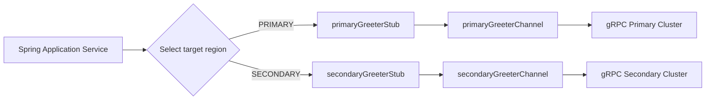

# Configuring Multiple Target Channels

A Spring application may need to call multiple gRPC services: `Catalog` for product lookups, `Payment` for processing payments, or the same service deployed across different clusters or regions. Each target can have its own hostname, port, TLS configuration, deadline, and connection policy. Therefore, the client must **manage multiple `ManagedChannel` instances** explicitly, inject the right stub into the right application service, and close the channels when the application stops.

This lesson belongs to the **Spring client** chapter of the **SPRING_GRPC** module, in which learners build gRPC services using Protocol Buffers contracts, generated Java code, unary/streaming RPCs, and mechanisms for metadata, deadlines, statuses, interceptors, TLS, integration testing, and observability. The focus here is **configuring multiple target channels in a Spring Boot application**. Examples use plain gRPC Java with Spring beans so the underlying mechanics are clear. For projects using a Spring gRPC starter, use the factory/configuration corresponding to your deployed version to avoid creating duplicate channels.

## 1. Distinguishing Multiple Targets from Multiple Connections

A `ManagedChannel` is the logical representation of a gRPC communication configuration: it handles target resolution, HTTP/2 transport management, connection state, and client policies. **A channel does not necessarily correspond to a single TCP socket.** One channel can manage connections to multiple addresses returned by a resolver or load balancer.

Two scenarios that are easy to confuse:

| Scenario | Common Approach | Reason |
| --- | --- | --- |
| An application calls **two services or two clusters with separate policies** | Create two named channels, each with its own target and configuration. | Separates endpoints, TLS, authentication, and lifecycle as needed. |
| A single **logical service** backed by multiple equivalent replicas behind DNS or service discovery | Typically use one channel to the service target and configure an appropriate resolver/load-balancing policy. | gRPC selects endpoints according to policy; the application does not manually split replicas. |
| Two application services calling **the same target** with the same transport/config | Reuse one channel; multiple generated stubs can be created from it. | Avoids duplicating transport resources. |
| Two environments or tenants requiring different certificates or credentials | Use separate channels when security configuration genuinely differs. | Preserves configuration and credential boundaries. |

An explicit routing example:



The diagram above depicts **explicit routing** to two clusters. It does not automatically provide failover, load balancing, or retries. If the business requirement only calls for reaching a single service with multiple replicas, consider a single logical target with a resolver and load-balancing policy before writing a channel selector in your application service.

## 2. Protocol Buffers Contract Used in the Example

To focus on configuring multiple channels, both clusters in this lesson implement the same `Greeter` contract:

```protobuf
syntax = "proto3";

package greeting.v1;

option java_package = "com.example.contract.grpc";
option java_multiple_files = true;

service Greeter {
  rpc SayHello (HelloRequest) returns (HelloReply);
}

message HelloRequest {
  string name = 1;
}

message HelloReply {
  string message = 1;
}
```

After generating Java code with `protoc` and `protoc-gen-grpc-java`, the client has `GreeterGrpc`, `HelloRequest`, and `HelloReply` in `com.example.contract.grpc`. The examples assume the generated code is on the classpath and the application has compatible versions of Spring Boot, `grpc-protobuf`, `grpc-stub`, and a gRPC Java transport such as `grpc-netty-shaded`.

Both clusters implement `Greeter/SayHello`, so both stubs have the type `GreeterGrpc.GreeterBlockingStub`. This exact case of **multiple beans with the same type** demonstrates why explicit `@Qualifier` annotations are needed during injection.

## 3. Declaring Multiple Targets in `application.yml`

Place each target's connection settings under its own key. For local development, two servers listen on two different ports:

```yaml
app:
  grpc:
    greeter:
      primary:
        target: localhost:9091
        plaintext: true
        timeout: 2s
      secondary:
        target: localhost:9092
        plaintext: true
        timeout: 3s
```

`target` is the destination string passed to `ManagedChannelBuilder.forTarget(...)`. It can be `host:port` or a URI with a scheme supported by a `NameResolver`, such as `dns:///greeter-primary.internal:9443`. Here, `timeout` is for the **per-RPC deadline** applied by the application service, not a bean setup timeout or a guarantee that the server is ready.

In deployment environments using TLS, you can override values per profile or via environment variables:

```yaml
# application-prod.yml - example targets with TLS matching hostnames
app:
  grpc:
    greeter:
      primary:
        target: dns:///greeter-primary.internal:9443
        plaintext: false
        timeout: 2s
      secondary:
        target: dns:///greeter-secondary.internal:9443
        plaintext: false
        timeout: 3s
```

Avoid pinning IP addresses when TLS certificates are issued for DNS hostnames. If the system uses a private CA, configure the transport's appropriate trust material; setting `plaintext: false` does not automatically make the client trust certificates issued by an internal CA.

### Binding Configuration to Strongly Typed Objects

With Spring Boot 3, records combined with `@ConfigurationProperties` provide a readable configuration model and avoid scattering `@Value` across multiple beans:

```java
package com.example.client;

import java.time.Duration;
import org.springframework.boot.context.properties.ConfigurationProperties;

@ConfigurationProperties(prefix = "app.grpc.greeter")
public record GreeterTargets(Endpoint primary, Endpoint secondary) {

    public record Endpoint(String target, boolean plaintext, Duration timeout) {
    }
}
```

Spring maps `2s` to `Duration.ofSeconds(2)`. In real projects, validate that `primary`/`secondary` are non-null, `target` is non-empty, deadlines are positive, and timeouts are valid. The next section includes basic input validation when constructing beans. If targets are added or changed frequently, you can switch from two fields to `Map<String, Endpoint>` in your configuration properties; even then, define bean/qualifier names and lifecycle management clearly.

## 4. Creating Two Named `ManagedChannel` Spring Beans

Define a `@Configuration` class that builds two channels from the two configurations, then creates the two corresponding stubs:

```java
package com.example.client;

import com.example.contract.grpc.GreeterGrpc;
import io.grpc.ManagedChannel;
import io.grpc.ManagedChannelBuilder;
import org.springframework.beans.factory.annotation.Qualifier;
import org.springframework.boot.context.properties.EnableConfigurationProperties;
import org.springframework.context.annotation.Bean;
import org.springframework.context.annotation.Configuration;

@Configuration(proxyBeanMethods = false)
@EnableConfigurationProperties(GreeterTargets.class)
public class GreeterMultiChannelConfiguration {

    @Bean(name = "primaryGreeterChannel", destroyMethod = "shutdown")
    ManagedChannel primaryGreeterChannel(GreeterTargets targets) {
        return createChannel(targets.primary());
    }

    @Bean(name = "secondaryGreeterChannel", destroyMethod = "shutdown")
    ManagedChannel secondaryGreeterChannel(GreeterTargets targets) {
        return createChannel(targets.secondary());
    }

    @Bean("primaryGreeterStub")
    GreeterGrpc.GreeterBlockingStub primaryGreeterStub(
            @Qualifier("primaryGreeterChannel") ManagedChannel channel) {
        return GreeterGrpc.newBlockingStub(channel);
    }

    @Bean("secondaryGreeterStub")
    GreeterGrpc.GreeterBlockingStub secondaryGreeterStub(
            @Qualifier("secondaryGreeterChannel") ManagedChannel channel) {
        return GreeterGrpc.newBlockingStub(channel);
    }

    private ManagedChannel createChannel(GreeterTargets.Endpoint endpoint) {
        if (endpoint == null || endpoint.target() == null
                || endpoint.target().isBlank()) {
            throw new IllegalArgumentException("gRPC target must not be empty");
        }
        if (endpoint.timeout() == null
                || endpoint.timeout().toMillis() <= 0) {
            throw new IllegalArgumentException(
                    "gRPC timeout must be at least 1 ms");
        }

        ManagedChannelBuilder<?> builder =
                ManagedChannelBuilder.forTarget(endpoint.target());

        if (endpoint.plaintext()) {
            builder.usePlaintext();
        } else {
            builder.useTransportSecurity();
        }

        return builder.build();
    }
}
```

This is manual configuration with gRPC Java. Key points:

1. `primaryGreeterChannel` and `secondaryGreeterChannel` are **two differently named beans**, even though both have type `ManagedChannel`.
2. Each `GreeterBlockingStub` receives exactly one channel via `@Qualifier`, avoiding `NoUniqueBeanDefinitionException`.
3. `destroyMethod = "shutdown"` ensures Spring shuts down each channel when destroying the beans. The two channels maintain independent resources and connectivity state.
4. `createChannel(...)` reuses the transport creation logic without creating a new channel per call.
5. All stubs are reusable across threads; per-RPC policies such as deadlines and metadata should be attached to a newly derived stub at call time.

Watch out for a common mistake when using `@Configuration(proxyBeanMethods = false)`: **never call `primaryGreeterChannel(targets)` directly from a stub bean method**. Calling that Java method directly can create an extra channel outside the registered Spring bean. Instead, accept the channel as a `@Bean` method parameter as shown so Spring resolves the registered bean and manages a single lifecycle.

## 5. Injecting the Right Stub into the Application Service

Because both stubs share the same type, a constructor declaring only `GreeterBlockingStub stub` would be ambiguous. Use `@Qualifier` to express the business choice:

```java
package com.example.application;

import com.example.client.GreeterTargets;
import com.example.contract.grpc.GreeterGrpc;
import com.example.contract.grpc.HelloRequest;
import java.time.Duration;
import java.util.Objects;
import java.util.concurrent.TimeUnit;
import org.springframework.beans.factory.annotation.Qualifier;
import org.springframework.stereotype.Service;

@Service
public class GreetingRouter {

    public enum Destination { PRIMARY, SECONDARY }

    private final GreeterGrpc.GreeterBlockingStub primary;
    private final GreeterGrpc.GreeterBlockingStub secondary;
    private final GreeterTargets targets;

    public GreetingRouter(
            @Qualifier("primaryGreeterStub")
            GreeterGrpc.GreeterBlockingStub primary,
            @Qualifier("secondaryGreeterStub")
            GreeterGrpc.GreeterBlockingStub secondary,
            GreeterTargets targets) {
        this.primary = primary;
        this.secondary = secondary;
        this.targets = targets;
    }

    public String greet(Destination destination, String rawName) {
        Objects.requireNonNull(destination, "destination");
        if (rawName == null || rawName.isBlank()) {
            throw new IllegalArgumentException("Name must not be empty");
        }

        GreeterGrpc.GreeterBlockingStub chosen =
                destination == Destination.PRIMARY ? primary : secondary;
        Duration timeout = destination == Destination.PRIMARY
                ? targets.primary().timeout()
                : targets.secondary().timeout();

        HelloRequest request = HelloRequest.newBuilder()
                .setName(rawName.trim())
                .build();

        return chosen
                .withDeadlineAfter(timeout.toMillis(), TimeUnit.MILLISECONDS)
                .sayHello(request)
                .getMessage();
    }
}
```

`GreetingRouter` receives both generated stubs as dependencies and stores them in `final` fields. Channel selection through the stub happens according to `Destination`, and the timeout is selected per target. Calling `withDeadlineAfter(...)` creates a temporary stub for **the current RPC**, without modifying the singleton bean.

A Spring MVC controller can pass the routing parameter to the service:

```java
package com.example.api;

import com.example.application.GreetingRouter;
import com.example.application.GreetingRouter.Destination;
import org.springframework.web.bind.annotation.GetMapping;
import org.springframework.web.bind.annotation.RequestMapping;
import org.springframework.web.bind.annotation.RequestParam;
import org.springframework.web.bind.annotation.RestController;

@RestController
@RequestMapping("/greetings")
public class GreetingController {

    private final GreetingRouter router;

    public GreetingController(GreetingRouter router) {
        this.router = router;
    }

    @GetMapping
    public String greet(
            @RequestParam Destination destination,
            @RequestParam String name) {
        return router.greet(destination, name);
    }
}
```

For example, `GET /greetings?destination=PRIMARY&name=Lan` routes through the primary channel, while `destination=SECONDARY` routes through the secondary channel. In production systems, **do not let external clients arbitrarily choose sensitive endpoints** when routing policy belongs to the server; instead, the application service should determine the destination from domain data, authorized tenant context, or administrative configuration.

### Multiple Distinct gRPC Service Types

If an application has `CatalogGrpc.CatalogBlockingStub` and `PaymentGrpc.PaymentBlockingStub`, the two stubs already have different types, so constructor injection usually does not need a qualifier **on the stub**, provided there is only one bean of each type. However, channels that share the `ManagedChannel` type still require qualifiers when building stubs. Never reuse a Catalog channel to build a Payment stub merely because both have type `Channel`: the target and connection policy must match the target service.

## 6. Multiple Targets, Failover, and Load Balancing

### Explicit Routing Is Not Load Balancing

In the `GreetingRouter` example, a request choosing `PRIMARY` calls primary once; a request choosing `SECONDARY` calls secondary once. The system **does not automatically fail over** from primary to secondary if primary returns `UNAVAILABLE`.

If the business requires failover, clarify these conditions:

- **Is the secondary target semantically equivalent?** Do both regions hold the same data and consistency guarantees?
- **Is it safe to retry the same RPC?** Only retry when the operation is known to be idempotent or uses a server-side idempotency key.
- **What is the total time budget?** Deadlines should not be reset indefinitely across attempts.
- **Is there load protection during cascading failures?** Control backoff, attempt limits, circuit breaking, or rate limiting as appropriate.

In the `SayHello` example, retrying is low-risk because it is read-only; however, a payment or order-creation RPC might have already succeeded on the server even when the client receives `UNAVAILABLE`. Automatically re-invoking another cluster can produce duplicate side effects without deduplication keys and data synchronization rules.

### One Logical Target with Multiple Replicas

With DNS or service discovery, a single logical target can provide multiple addresses. For example:

```java
ManagedChannel channel = ManagedChannelBuilder
        .forTarget("dns:///greeter.internal:9443")
        .useTransportSecurity()
        .defaultLoadBalancingPolicy("round_robin")
        .build();
```

This snippet illustrates selecting the `round_robin` policy when the resolver supplies a list of endpoints and the transport/dependencies include the corresponding policy. `defaultLoadBalancingPolicy(...)` sets the **default policy**; a service config provided by the resolver can override the effective policy. gRPC's default can be `pick_first`, so **DNS returning multiple IPs does not automatically prove traffic is evenly balanced**. With gateways or Kubernetes Services, you also need to understand where load-balancing decisions happen: client, proxy, or network infrastructure.

If a request must hit specifically the primary or secondary cluster because of data partitioning, choosing multiple named channels as shown in this lesson fits better than a single shared target with random load balancing.

## 7. Per-Target TLS, Interceptors, and Metadata

Each channel can have its **own transport configuration**, such as primary using TLS to hostname A and secondary using TLS to hostname B. Items to verify:

| Aspect | Questions When Using Multiple Channels |
| --- | --- |
| TLS / certificates | Does each target's hostname match the certificate SAN? Is the trusted root CA right for each cluster? |
| Mutual TLS | Which channels need distinct client certificates and private keys? What is the certificate rotation mechanism? |
| Authentication | Which service was the metadata/token issued for? Is the same credential allowed to be sent to another cluster? |
| Interceptors | Should logging, tracing, metrics, or retry interceptors be attached to both channels or per target? |
| Deadlines | Should RPC budgets differ between primary and secondary due to network distance or business rules? |

`ManagedChannelBuilder.useTransportSecurity()` enables TLS with the transport's default trust configuration. If you need an internal CA or mTLS, use the transport's TLS API (such as Netty's `SslContext`) and supply the proper material per channel; never modify a global trust manager to skip certificate verification.

**Metadata is scoped per RPC.** Example of sending a request ID to primary:

```java
import io.grpc.Metadata;
import io.grpc.stub.MetadataUtils;

Metadata.Key<String> requestIdKey = Metadata.Key.of(
        "x-request-id", Metadata.ASCII_STRING_MARSHALLER);
Metadata headers = new Metadata();
headers.put(requestIdKey, requestId);

var callStub = primary
        .withInterceptors(MetadataUtils.newAttachHeadersInterceptor(headers))
        .withDeadlineAfter(2, TimeUnit.SECONDS);

var reply = callStub.sayHello(request);
```

This snippet sits **inside the call method** after receiving `requestId` and constructing `request`; `primary` is the injected stub. For another request, create fresh metadata and a newly configured stub variant. Never keep a mutable `Metadata` holding `Authorization` or a request ID inside a singleton application service and overwrite values per user; doing so can mix data across concurrent RPCs.

If each target uses different credentials, configure `CallCredentials` per call or an interceptor tailored for that specific target. Never accidentally reuse a token meant for Payment on the Catalog channel, or forward a primary-region token to secondary unless policy allows it.

## 8. Per-Channel State, Errors, and Lifecycle

Channels operate independently. An error from primary does not prove secondary is failing, and vice versa. In an application service using a blocking stub, errors typically appear as `StatusRuntimeException`:

```java
import io.grpc.Status;
import io.grpc.StatusRuntimeException;

try {
    String message = router.greet(GreetingRouter.Destination.PRIMARY, "Lan");
    return message;
} catch (StatusRuntimeException ex) {
    Status.Code code = ex.getStatus().getCode();
    // Record target=primary, gRPC status, and correlation ID.
    // Only fall back to secondary if business policy permits.
    throw ex;
}
```

The code above is an **illustrative snippet inside a method returning `String`**, assuming `router` is available. When analyzing errors, distinguish carefully:

| Signal | Possible Meaning | How to Investigate |
| --- | --- | --- |
| `UNAVAILABLE` only on primary | Primary server, DNS, network, proxy, or TLS is failing. | Check target, port, TLS handshake, resolver, and target-specific logs. |
| `DEADLINE_EXCEEDED` | Call exceeded its deadline due to network, server, or too short a budget. | Compare server processing time against the corresponding target's deadline. |
| `UNAUTHENTICATED` / `PERMISSION_DENIED` | Invalid credentials or insufficient permissions on one target. | Verify permissions and tokens issued for that specific service without logging secrets. |
| `UNIMPLEMENTED` | Receiving target lacks the corresponding method/contract. | Check `.proto`, version, and routing to the right server. |
| `INVALID_ARGUMENT` | Server rejected the request's data. | Inspect validation rules; switching channels usually will not fix this. |

**Connections may be established on the first RPC call**, not necessarily when Spring initializes beans. Thus, a successful `ApplicationContext` startup does not guarantee primary or secondary is reachable. Health checks should rely on server-supported behavior, such as the gRPC Health Checking Protocol or a safe dedicated probe RPC, with reasonable frequency and deadlines.

`destroyMethod = "shutdown"` on each channel requests resource cleanup when the Spring context closes. It **does not wait** for all RPCs to finish automatically. In systems with long-lived streams, implement graceful shutdown: stop accepting new work, allow in-flight RPCs time to finish, call `shutdown()`, wait via `awaitTermination(timeout, unit)`, and consider `shutdownNow()` on timeout. Never call `shutdown()` every time a service returns a response; doing so destroys channel reuse and breaks subsequent RPCs.

## 9. Testing Two Channels and Verifying Routing

First distinguish **routing logic tests** from **real connection configuration tests**. Routing tests can use two in-process servers to ensure `PRIMARY` calls reach server A and `SECONDARY` calls reach server B without binding TCP ports.

JUnit 5 example using the `grpc-inprocess` dependency in test scope:

```java
package com.example.application;

import static org.junit.jupiter.api.Assertions.assertEquals;

import com.example.client.GreeterTargets;
import com.example.contract.grpc.GreeterGrpc;
import com.example.contract.grpc.HelloReply;
import com.example.contract.grpc.HelloRequest;
import io.grpc.ManagedChannel;
import io.grpc.Server;
import io.grpc.inprocess.InProcessChannelBuilder;
import io.grpc.inprocess.InProcessServerBuilder;
import io.grpc.stub.StreamObserver;
import java.time.Duration;
import org.junit.jupiter.api.Test;

class GreetingRouterTest {

    private static Server buildServer(String name, String prefix) {
        return InProcessServerBuilder.forName(name)
                .directExecutor()
                .addService(new GreeterGrpc.GreeterImplBase() {
                    @Override
                    public void sayHello(
                            HelloRequest request,
                            StreamObserver<HelloReply> observer) {
                        observer.onNext(HelloReply.newBuilder()
                                .setMessage(prefix + request.getName())
                                .build());
                        observer.onCompleted();
                    }
                })
                .build();
    }

    @Test
    void selectsTheExpectedChannel() throws Exception {
        String primaryName = InProcessServerBuilder.generateName();
        String secondaryName = InProcessServerBuilder.generateName();
        Server primaryServer = buildServer(primaryName, "P:").start();
        Server secondaryServer = null;
        ManagedChannel primaryChannel = null;
        ManagedChannel secondaryChannel = null;

        try {
            secondaryServer = buildServer(secondaryName, "S:").start();
            primaryChannel = InProcessChannelBuilder.forName(primaryName)
                    .directExecutor().build();
            secondaryChannel = InProcessChannelBuilder.forName(secondaryName)
                    .directExecutor().build();

            GreeterTargets settings = new GreeterTargets(
                    new GreeterTargets.Endpoint("primary-test", true,
                            Duration.ofSeconds(2)),
                    new GreeterTargets.Endpoint("secondary-test", true,
                            Duration.ofSeconds(2)));

            GreetingRouter router = new GreetingRouter(
                    GreeterGrpc.newBlockingStub(primaryChannel),
                    GreeterGrpc.newBlockingStub(secondaryChannel),
                    settings);

            assertEquals("P:Lan",
                    router.greet(GreetingRouter.Destination.PRIMARY, "Lan"));
            assertEquals("S:Lan",
                    router.greet(GreetingRouter.Destination.SECONDARY, "Lan"));
        } finally {
            if (primaryChannel != null) primaryChannel.shutdownNow();
            if (secondaryChannel != null) secondaryChannel.shutdownNow();
            primaryServer.shutdownNow();
            if (secondaryServer != null) secondaryServer.shutdownNow();
        }
    }
}
```

`primary-test`/`secondary-test` in `GreeterTargets` are **placeholder names** used solely to supply timeouts to `GreetingRouter`; actual test connections are created with `InProcessChannelBuilder`. This test verifies routing and reuse of generated stubs, but **does not test** whether Spring binds YAML correctly or creates the right channel beans.

To verify Spring configuration, add a test that boots the application context with a test profile and asserts the existence of `primaryGreeterChannel`, `secondaryGreeterChannel`, `primaryGreeterStub`, and `secondaryGreeterStub`. Then add integration tests against two servers over TCP/TLS to verify resolvers, hostnames, certificates, and network failures. Misspelled `@Qualifier` names are usually caught when Spring creates the context; if both stubs were wired to the wrong valid channels, a test calling two servers returning distinct prefixes like the one above will expose the mismatch.

## 10. Observing and Operating Multiple Channels

When you have multiple targets, per-target telemetry is much more useful than only summing total RPCs across the application. At a minimum, monitor **call counts, latency, gRPC status, deadline exceeded counts, retries, and connection state** per service/cluster. Use client interceptors, Micrometer, or OpenTelemetry integrations depending on your project's Spring and gRPC stack.

In metrics and logs, use stable target names such as `primary` and `secondary`. Avoid using high-cardinality values like request IDs, user IDs, or dynamically generated hostnames directly as metric labels. Request IDs belong in tracing or structured logs, while `Authorization` headers and private keys must never be logged.

Common implementation mistakes:

| Symptom | Possible Cause | How to Fix |
| --- | --- | --- |
| `NoUniqueBeanDefinitionException` when injecting `ManagedChannel` | Multiple beans of the same type exist. | Add `@Qualifier` to the relevant `@Bean` parameters or constructors. |
| Both stubs hit the same cluster despite different YAML configs | Mixed-up qualifiers or wrong channel reuse. | Test against two servers returning different prefixes; verify wiring. |
| Connection failure occurs only on secondary | Secondary's DNS, port, cert, ingress, or firewall differs from primary. | Diagnose each target independently rather than assuming parity with primary. |
| One request alters another request's metadata | Mutable metadata stored in a singleton bean. | Build fresh metadata and derived stubs per RPC. |
| Multiple channels created inside `@Bean` due to direct factory method call | Instantiating outside Spring-managed dependency injection. | Inject beans via parameters with the exact qualifiers. |
| Endless retries when primary is down | Unbounded retry attempts or missing overall deadline. | Design failover/retries around idempotence, backoff, and total time budget. |
| Channels stay open at shutdown | Resource not managed by the container or missing lifecycle hook. | Register beans and a bounded shutdown mechanism. |
| Metrics fail to distinguish clusters | Missing logical target label. | Attach stable cluster names to metrics/traces. |

## 11. Practice Exercises

1. Run two `Greeter` gRPC servers on `localhost:9091` and `localhost:9092`, returning different prefixes for `SayHello`. Register both channels and both stubs in Spring.
2. Temporarily remove `@Qualifier` from the `ManagedChannel` parameter of `secondaryGreeterStub`, observe the Spring error caused by two beans of the same type, and then restore it.
3. Write a REST endpoint selecting `PRIMARY` or `SECONDARY` based on business configuration; verify each cluster's response and distinct deadlines.
4. Simulate primary losing connectivity. Record `UNAVAILABLE`, latency, and retry count. Add failover only if the RPC contract and data allow it; explain why non-idempotent operations are dangerous to retry.
5. Switch both targets to TLS in a test environment; verify each channel trusts the right CA and hostname. Add per-call `x-request-id` metadata without sharing mutable objects.
6. Write an in-process test for routing, a Spring context test to verify qualifiers, and a TCP/TLS integration test. Ensure both channels shut down when the application exits.

After this lesson, you should be able to distinguish **multiple named channels** from **a single channel with multiple replicas**, describe how to declare per-target configuration in Spring Boot, inject the right generated stub with `@Qualifier`, apply per-RPC deadlines and metadata, and manage TLS, errors, testing, and lifecycle per destination. This provides the foundation for Spring applications to connect to multiple gRPC services intentionally, safely, and observably.
