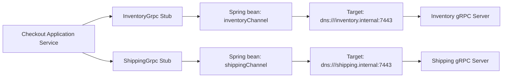

# Named Channels vs. Target-Based Channels

In a Spring application using gRPC, a client needs to know **which service it is calling** and **where that service lives**. Two concepts often appear together yet serve different roles:

- **Channel name** is a logical name managed by the application or Spring configuration mechanism, such as `inventory` or `shipping`. Business code uses a stable name to pick the right client.
- **gRPC target** is the address string that `ManagedChannelBuilder` passes to a *name resolver*, such as `dns:///inventory.internal:7443` or `localhost:9091`.

This lesson belongs to the **Spring client** chapter of the **SPRING_GRPC** module. Learners have already worked with Protocol Buffers contracts, generated Java code, and RPC types; here we focus on pointing a Spring client to its target service. Naming and target choices affect stub injection, TLS configuration, metadata, deadlines, status handling, integration testing, and system observability.

## 1. Logical Name and Target Are Not the Same Thing

Imagine a Spring application calling an inventory service and a shipping service:



The names `inventoryChannel` and `shippingChannel` belong to the **Spring bean registry**. By contrast, `dns:///inventory.internal:7443` is used by **gRPC Java** to locate the endpoint. Spring can swap targets across development, test, and production profiles while the code injecting the `inventoryChannel` bean stays unchanged.

| Property | Named Channel | Target-Based Channel |
| --- | --- | --- |
| Typical values | `inventory`, `shipping`, `primary` | `localhost:9091`, `dns:///inventory.internal:7443` |
| Who interprets it? | Spring container, configuration, or a channel factory provided by the app/starter. | `NameResolver` and the gRPC Java transport. |
| Purpose | Identifies a dependency/configuration within the application. | Locates the actual network destination or logical service to call. |
| Stability | Typically fixed by business role. | Can differ between local, test, staging, and production. |
| Creates a connection by itself? | No. A name only has meaning if mapped to a real channel. | `forTarget(...)` builds a channel configuration; connections may open on the first RPC. |
| Example on environment change | Keeps using the name `inventory`. | Changes from `dns:///localhost:9091` to `dns:///inventory.internal:7443`. |

**Common misconception:** `ManagedChannelBuilder.forTarget("inventory")` does not mean gRPC looks up a Spring bean named `inventory`. At that point gRPC treats `"inventory"` as a target to resolve via its default resolver; it does not look up `app.grpc.channels.inventory` or `@Bean("inventory")`. To use application-level names, you need a configuration class or factory that maps that name to a concrete target.

## 2. Two Basic Ways to Build a Channel in gRPC Java

`ManagedChannelBuilder` exposes two common APIs:

```java
import io.grpc.ManagedChannel;
import io.grpc.ManagedChannelBuilder;

// Option A: pass host and port separately.
ManagedChannel local = ManagedChannelBuilder
        .forAddress("localhost", 9091)
        .usePlaintext()
        .build();

// Option B: pass a target with an explicit resolution scheme.
ManagedChannel remote = ManagedChannelBuilder
        .forTarget("dns:///inventory.internal:7443")
        .useTransportSecurity()
        .build();
```

These are two illustrative channel variables; if run outside Spring, the owner must close them with `shutdown()` and wait with a bounded timeout when needed. In a long-lived Spring application, place channels under container management and **reuse** them across RPCs.

`forAddress(host, port)` is convenient when you already have separate host and port values. `forTarget(target)` fits when the address comes from configuration as a single string and can use schemes like `dns:///`. Both produce a `ManagedChannel`; **stubs can be created via `GreeterGrpc.newBlockingStub(channel)` or another stub style** regardless of how the channel was built.

### Understanding the `dns:///host:port` Target String

In `dns:///inventory.internal:7443`:

- `dns` is the scheme selecting gRPC's DNS resolver.
- `///` represents a URI with an empty authority component and a path starting with `/`.
- `inventory.internal:7443` is the service name and port the resolver handles.

The resolver returns endpoint addresses; gRPC then selects connections based on balancer/transport configuration. A DNS record returning multiple IPs **does not by itself prove the client is evenly balancing RPCs**: `pick_first`, `round_robin`, service config, and the resolver determine actual behavior. When gRPC sits behind an ingress or proxy, you also need to know whether load balancing happens at the client or in the infrastructure.

Do not hard-code an IP for a TLS-enabled service if the certificate is only valid for the DNS hostname. The target and certificate verification name must match; use `usePlaintext()` only in environments where unencrypted traffic is permitted.

## 3. Protocol Buffers Contract in the Spring Example

Suppose a client calls two separate gRPC services to prepare order details:

```protobuf
syntax = "proto3";

package checkout.v1;

option java_package = "com.example.contract.grpc";
option java_multiple_files = true;

service Inventory {
  rpc GetStock (StockRequest) returns (StockReply);
}

service Shipping {
  rpc EstimateDelivery (DeliveryRequest) returns (DeliveryReply);
}

message StockRequest {
  string sku = 1;
}

message StockReply {
  int32 available_units = 1;
}

message DeliveryRequest {
  string postal_code = 1;
}

message DeliveryReply {
  int32 estimated_days = 1;
}
```

After running `protoc` with the `protoc-gen-grpc-java` plugin, the Java client has `InventoryGrpc`, `ShippingGrpc`, and the messages `StockRequest`, `StockReply`, `DeliveryRequest`, and `DeliveryReply`. The examples below assume the generated code is on the classpath and the application has compatible versions of Spring Boot, `grpc-stub`, `grpc-protobuf`, and a transport like `grpc-netty-shaded`.

The two generated stubs have different types, yet each must be created from **the channel configured specifically for its service**. Spring cannot infer `InventoryGrpc`'s target solely from the generated class name.

## 4. Using Stable Channel Names and Externalizing Targets to Configuration

First, define two logical names in `application.yml`:

```yaml
app:
  grpc:
    outbound:
      inventory:
        target: dns:///localhost:9091
        plaintext: true
        deadline: 2s
      shipping:
        target: dns:///localhost:9092
        plaintext: true
        deadline: 3s
```

`inventory` and `shipping` are **logical keys chosen by the application**, not names registered in DNS. Both local targets are for development examples. In production, update targets to real hostnames/ports and enable TLS:

```yaml
# application-prod.yml - example when the server and TLS certificates are ready
app:
  grpc:
    outbound:
      inventory:
        target: dns:///inventory.internal:7443
        plaintext: false
        deadline: 2s
      shipping:
        target: dns:///shipping.internal:7443
        plaintext: false
        deadline: 3s
```

**Deadline is a limit for a single RPC**, not a limit on creating the channel. It sits alongside target settings so services can easily pick the appropriate time budget. Do not confuse a deadline with `connect timeout` or the `ManagedChannel` lifecycle.

Declare strongly typed configuration for Spring Boot:

```java
package com.example.client;

import java.time.Duration;
import java.util.Map;
import org.springframework.boot.context.properties.ConfigurationProperties;

@ConfigurationProperties(prefix = "app.grpc")
public record GrpcClientProperties(Map<String, Endpoint> outbound) {

    public Endpoint require(String name) {
        Endpoint endpoint = outbound == null ? null : outbound.get(name);
        if (endpoint == null || endpoint.target() == null
                || endpoint.target().isBlank()) {
            throw new IllegalArgumentException(
                    "Missing gRPC target for channel: " + name);
        }
        if (endpoint.deadline() == null
                || endpoint.deadline().toMillis() <= 0) {
            throw new IllegalArgumentException(
                    "Deadline must be at least 1 ms: " + name);
        }
        return endpoint;
    }

    public record Endpoint(String target, boolean plaintext, Duration deadline) {
    }
}
```

Spring Boot binds the entries under `app.grpc.outbound` into `Map<String, Endpoint>`; for instance, `2s` converts to `Duration.ofSeconds(2)`. `require(name)` checks that the name exists and satisfies minimum requirements, letting the application fail fast on misconfiguration during bean creation. In production systems, add validation for target format, supported schemes, TLS policy, and maximum timeout bounds.

### Creating Channel Beans from Logical Names

```java
package com.example.client;

import com.example.contract.grpc.InventoryGrpc;
import com.example.contract.grpc.ShippingGrpc;
import io.grpc.ManagedChannel;
import io.grpc.ManagedChannelBuilder;
import org.springframework.beans.factory.annotation.Qualifier;
import org.springframework.boot.context.properties.EnableConfigurationProperties;
import org.springframework.context.annotation.Bean;
import org.springframework.context.annotation.Configuration;

@Configuration(proxyBeanMethods = false)
@EnableConfigurationProperties(GrpcClientProperties.class)
public class OutboundGrpcConfiguration {

    @Bean(name = "inventoryChannel", destroyMethod = "shutdown")
    ManagedChannel inventoryChannel(GrpcClientProperties properties) {
        return build(properties.require("inventory"));
    }

    @Bean(name = "shippingChannel", destroyMethod = "shutdown")
    ManagedChannel shippingChannel(GrpcClientProperties properties) {
        return build(properties.require("shipping"));
    }

    @Bean
    InventoryGrpc.InventoryBlockingStub inventoryStub(
            @Qualifier("inventoryChannel") ManagedChannel channel) {
        return InventoryGrpc.newBlockingStub(channel);
    }

    @Bean
    ShippingGrpc.ShippingBlockingStub shippingStub(
            @Qualifier("shippingChannel") ManagedChannel channel) {
        return ShippingGrpc.newBlockingStub(channel);
    }

    private ManagedChannel build(GrpcClientProperties.Endpoint options) {
        ManagedChannelBuilder<?> builder =
                ManagedChannelBuilder.forTarget(options.target());

        if (options.plaintext()) {
            builder.usePlaintext();
        } else {
            builder.useTransportSecurity();
        }
        return builder.build();
    }
}
```

Here, Spring receives the **bean names** `inventoryChannel` and `shippingChannel`, while gRPC receives the **target** from `options.target()`. If an environment changes Inventory's address, you only change `app.grpc.outbound.inventory.target`; the application service keeps injecting the same bean/stub.

`@Qualifier` is required on the stub factory methods because Spring has **two beans of type `ManagedChannel`**. The two stubs are generated from different services (`InventoryBlockingStub` and `ShippingBlockingStub`), so they can be injected by type in the application service. If you have multiple beans of the same stub type, you must also use corresponding qualifiers.

`destroyMethod = "shutdown"` lets Spring call `shutdown()` when stopping the application. This initiates an orderly channel shutdown without automatically waiting for in-flight RPCs to finish; if you need long-lived stream handling and graceful shutdown, add a bounded wait (`awaitTermination`) and cancellation on timeout.

## 5. Injecting Stubs by Target Name into an Application Service

An application does not need to pass target strings throughout business layers. The service simply receives the typed stub and looks up the deadline associated with the target's logical name:

```java
package com.example.application;

import com.example.client.GrpcClientProperties;
import com.example.contract.grpc.DeliveryRequest;
import com.example.contract.grpc.InventoryGrpc;
import com.example.contract.grpc.ShippingGrpc;
import com.example.contract.grpc.StockRequest;
import java.util.concurrent.TimeUnit;
import org.springframework.stereotype.Service;

@Service
public class CheckoutEnrichmentService {

    private final InventoryGrpc.InventoryBlockingStub inventory;
    private final ShippingGrpc.ShippingBlockingStub shipping;
    private final GrpcClientProperties properties;

    public CheckoutEnrichmentService(
            InventoryGrpc.InventoryBlockingStub inventory,
            ShippingGrpc.ShippingBlockingStub shipping,
            GrpcClientProperties properties) {
        this.inventory = inventory;
        this.shipping = shipping;
        this.properties = properties;
    }

    public CheckoutDetails inspect(String sku, String postalCode) {
        if (sku == null || sku.isBlank()
                || postalCode == null || postalCode.isBlank()) {
            throw new IllegalArgumentException("Missing SKU or postal code");
        }

        long inventoryMs = properties.require("inventory")
                .deadline().toMillis();
        long shippingMs = properties.require("shipping")
                .deadline().toMillis();

        int available = inventory
                .withDeadlineAfter(inventoryMs, TimeUnit.MILLISECONDS)
                .getStock(StockRequest.newBuilder()
                        .setSku(sku.trim())
                        .build())
                .getAvailableUnits();

        int days = shipping
                .withDeadlineAfter(shippingMs, TimeUnit.MILLISECONDS)
                .estimateDelivery(DeliveryRequest.newBuilder()
                        .setPostalCode(postalCode.trim())
                        .build())
                .getEstimatedDays();

        return new CheckoutDetails(available, days);
    }

    public record CheckoutDetails(int availableUnits, int estimatedDays) {
    }
}
```

This code executes **two sequential unary RPCs**. Each call applies its own target deadline; total processing time can exceed either individual deadline. When an upstream HTTP request has an overall time budget, calculate remaining time before each RPC or propagate a shared deadline rather than summing independent deadlines past what the user will wait.

`withDeadlineAfter(...)` produces **a newly configured stub instance** without mutating the injected singleton stub. Under high concurrency or streaming needs, an application service can inject an async stub built from the **same named channel**, then structure `StreamObserver` and cancellation accordingly. The channel name does not dictate unary, client streaming, or bidirectional streaming; that comes from the RPC definition in the Protobuf contract and the chosen stub type.

## 6. When Should You Use a Target Directly?

If an application calls only a single service and prefers minimal configuration, you can construct one channel from an explicit target without building a logical-name map:

```java
// An independent configuration alternative to the two-named-channel example above.
@Bean(name = "inventoryChannel", destroyMethod = "shutdown")
ManagedChannel inventoryChannel() {
    return ManagedChannelBuilder
            .forTarget("dns:///inventory.internal:7443")
            .useTransportSecurity()
            .build();
}
```

This is an **alternative approach**—do not declare a duplicate `inventoryChannel` bean in the same application as the configuration from section 4. In real products, externalize the target into environment variables or `application.yml` so environments are easy to switch. When multiple destinations or environments exist, logical names in Spring help readers understand which dependency a channel represents without relying on DNS addresses embedded in code.

| Need | Recommendation |
| --- | --- |
| Small app calling one fixed endpoint | Use a single `ManagedChannel` bean created via `forTarget(...)`/`forAddress(...)`. |
| Multiple services or isolated clusters | Name channels by capability and map names to targets in configuration. |
| Multiple replicas of **one** logical service | Use a single logical target with an appropriate resolver and load balancing; each replica does not need its own named channel. |
| Selecting a tenant or region per request | Allow only declared names and enforce authorization; never create unbounded channels from user-supplied strings. |
| Using a Spring gRPC starter | Check the channel factory API, configuration keys, and lifecycle for your **starter version** to keep client creation consistent. |

## 7. How Does Dynamic Name Mapping Differ from Static `@Qualifier`?

`@Qualifier("inventoryChannel")` selects a dependency **when Spring constructs beans**. A service injected with that channel or stub continues using that dependency unless the application explicitly implements dynamic reconfiguration.

If a request must pick among multiple services by name at runtime, you can build a registry holding channels or stubs initialized from configuration and look them up by logical name. For example, a registry interface might look like:

```java
// Illustrative interface; requires its own implementation and lifecycle management.
public interface NamedGrpcChannels {
    io.grpc.ManagedChannel require(String logicalName);
}
```

This is an **application-defined abstraction**, not a built-in gRPC Java class. The registry should validate names against a configured allowlist, create each channel once, return the same instance on repeated lookups for the same name, and close all channels on Spring shutdown. When a name does not exist, fail explicitly instead of silently falling back to a default target. With multiple differently typed generated stubs, it is often cleaner for the registry to expose **stubs bound to the right channel** or typed adapters per service.

Never run `ManagedChannelBuilder.forTarget(userSuppliedUrl).build()` inside every HTTP request: it spawns uncontrolled connections, risks calling unintended endpoints, increases TLS overhead, and leaks resources. In multi-tenant applications with thousands of tenants, per-tenant channels also require strict caps, eviction policies, and isolated auth policies.

### Is a Spring gRPC Starter Name the Same as a Bean Name?

Some starters or Spring gRPC versions provide a **channel factory** that lets you request a channel by a name declared in configuration. Property names, factory APIs, and caching/lifecycle semantics vary by version. The name used to ask a factory for a channel in Spring **remains distinct** from the target string gRPC resolves. When using such a mechanism, consult your exact version's documentation and avoid simultaneously building manual `ManagedChannelBuilder` instances for the same dependency unless intentional.

## 8. TLS, Metadata, Interceptors, and Deadlines When Changing Targets

Pointing `inventory` to a new target is a significant operational change. Each target may have a different hostname, trusted CA, mTLS requirement, auth policy, and latency profile:

| Component | What to Keep Consistent |
| --- | --- |
| TLS | Destination server supports TLS; hostname matches certificate SAN; CA and client certs are configured properly. |
| Authorization | Credentials issued for Inventory are never accidentally sent to Shipping or an unauthorized region. |
| Metadata | Request IDs, trace context, and dynamic tokens are built/attached per RPC. |
| Deadline | Every call has a time limit that respects the overall request budget. |
| Interceptors | Logging, metrics, tracing, and auth policies attach to the right channel/stub object. |
| Retry | Account for idempotency, attempt counts, and backoff; never auto-retry side-effecting operations. |

Example of attaching metadata to a unary RPC using a derived stub:

```java
import io.grpc.Metadata;
import io.grpc.stub.MetadataUtils;

Metadata.Key<String> requestIdKey = Metadata.Key.of(
        "x-request-id", Metadata.ASCII_STRING_MARSHALLER);
Metadata headers = new Metadata();
headers.put(requestIdKey, requestId);

var callStub = inventory
        .withInterceptors(MetadataUtils.newAttachHeadersInterceptor(headers))
        .withDeadlineAfter(2, TimeUnit.SECONDS);

var reply = callStub.getStock(request);
```

This snippet lives inside a method that already has `requestId`, where `inventory` is an `InventoryBlockingStub` and `request` is a `StockRequest`. Create fresh `Metadata` **for every request**; never store a mutable object holding user tokens on a singleton service. If tokens need refreshing, consider `CallCredentials` or an interceptor that resolves credentials per RPC. Never log raw access tokens or private keys.

If you need mTLS or need to trust an internal CA, use the transport's TLS API, such as configuring a dedicated Netty SSL context per channel. `useTransportSecurity()` only enables TLS with the default trust mechanism; it does not automatically trust arbitrary private CAs or supply a client certificate.

## 9. Name Resolution, Load Balancing, and Connection Errors

Choosing a target is not the same as checking server readiness. `ManagedChannelBuilder.build()` usually **does not verify that RPCs can succeed**. With a blocking stub, RPC errors surface as `StatusRuntimeException`:

```java
import io.grpc.Status;
import io.grpc.StatusRuntimeException;

try {
    return inventory.getStock(request);
} catch (StatusRuntimeException exception) {
    Status.Code code = exception.getStatus().getCode();
    // Record logical_channel=inventory, status, and trace ID.
    throw exception;
}
```

This snippet shows a branch inside a method returning `StockReply`, assuming `inventory` and `request` are already declared. In production code, add a deadline and error mapping appropriate for the application service.

| Status or Symptom | Likely Related To | What to Check? |
| --- | --- | --- |
| `UNAVAILABLE` | Unresolved DNS, wrong target/port, network failure, proxy, TLS handshake, or stopped server. | Verify the actual configured target, connectivity, logs, and certificates. |
| `DEADLINE_EXCEEDED` | Server not reached in time, slow processing, or deadline set too short. | Measure latency per logical name and check time budgets. |
| `UNIMPLEMENTED` | RPC does not exist on the current server/route. | Compare service/method in `.proto`, versions, and target server. |
| `UNAUTHENTICATED` / `PERMISSION_DENIED` | Missing, invalid, or insufficiently privileged credentials for that target. | Inspect auth mechanisms and service policies. |
| `INVALID_ARGUMENT` | Invalid request data. | Fix input/validation; changing targets will probably not help. |

If a DNS target returns multiple endpoints, the load-balancing policy governs selection. You can set `defaultLoadBalancingPolicy("round_robin")` when the transport and libraries support that policy, though do not assume every DNS cluster uses round-robin. When a resolver supplies a service config, the effective policy can differ from the default setting. Distinguish gRPC client-side balancing from load balancing performed by a reverse proxy or Kubernetes Service.

Metrics should carry **stable logical names** such as `inventory` and `shipping`, along with service, method, status, and latency. Avoid using request IDs or dynamically changing raw targets as metric labels that cause high cardinality. Specific targets can be recorded in controlled diagnostic logs, while tracing correlates a single request across multiple RPCs.

## 10. Testing Named and Target-Based Configurations

Test at two distinct levels: verifying **Spring wiring** and verifying **real gRPC connectivity**.

### 10.1. Verifying Beans Are Created Under the Expected Names

A Spring Boot test can confirm that the two names map to two distinct channel beans:

```java
package com.example.client;

import static org.junit.jupiter.api.Assertions.assertNotSame;
import io.grpc.ManagedChannel;
import org.junit.jupiter.api.Test;
import org.springframework.beans.factory.annotation.Autowired;
import org.springframework.beans.factory.annotation.Qualifier;
import org.springframework.boot.test.context.SpringBootTest;

@SpringBootTest
class GrpcChannelWiringTest {

    @Autowired
    @Qualifier("inventoryChannel")
    private ManagedChannel inventory;

    @Autowired
    @Qualifier("shippingChannel")
    private ManagedChannel shipping;

    @Test
    void createsDistinctNamedChannels() {
        assertNotSame(inventory, shipping);
    }
}
```

Because channels can connect lazily, this test verifies **beans and qualifiers** but **does not prove targets are actually reachable**. When using `@SpringBootTest`, provide test configuration containing `app.grpc.outbound.inventory` and `shipping`, for instance via a test profile.

### 10.2. Testing Real Targets with Controllable Servers

Run two test gRPC servers on two different ports, each returning a distinct response—for example, `available_units=11` from Inventory and `estimated_days=2` from Shipping. Point the configured targets to those ports and invoke them through the application service. This test catches swapped addresses, ports, and stub routes when merely checking two distinct bean instances is insufficient.

To verify TLS, certificate hostnames, trust stores, ingress, and HTTP/2, use servers over a **real network transport** with security configuration matching deployment. In-process tests are great for validating stubs and business logic, yet they bypass TCP/TLS and DNS.

Additional test cases to include: unconfigured target, unresolvable DNS endpoint, stopped server, timeout/deadline, invalid certificate, metadata propagation, and recovery after server restart. Also verify that Spring shutdown closes all channels, especially when long-lived streaming RPCs are active.

## 11. Common Mistakes

| Symptom | Cause | How to Fix |
| --- | --- | --- |
| Calling `forTarget("inventory")` does not reach the desired host | Confusing a Spring logical name with a gRPC target. | Look up `inventory` via configuration/factory and pass the real target string. |
| `NoUniqueBeanDefinitionException` for `ManagedChannel` | Multiple beans of the same type without `@Qualifier`. | Inject using explicit bean names. |
| Changing production addresses requires editing Java code | Target hard-coded inside business services. | Move targets to `application.yml`/environment while keeping logical names stable. |
| Treating `ManagedChannelBuilder.build()` as a health check | Building does not verify a successful server connection. | Use a health RPC or a probe RPC with a deadline. |
| One server receives calls for the wrong service/method | Stub was built from a channel pointing to the wrong target. | Test actual RPCs against servers returning identifiable data. |
| Channel created on every request | Connection and TLS overhead grows, and clean closing becomes hard. | Let Spring manage singleton channels and reuse stubs. |
| Attaching per-user auth data to a singleton bean | Credentials/metadata can leak between RPCs. | Apply metadata and credentials per RPC. |
| Multiple DNS IPs yet all traffic hits one backend | Resolver/policy differs from load-balancing assumptions. | Check resolver, service config, and effective balancer policy. |
| Combining starter channels with manual config causes duplicate connections | Two mechanisms create clients for the same dependency. | Standardize channel creation and lifecycle management. |

## 12. Practice Exercises

1. Run two local gRPC servers implementing `Inventory/GetStock` and `Shipping/EstimateDelivery`, generate Java code from `.proto`, and configure two named channels `inventory` and `shipping` pointing to different targets.
2. Write `CheckoutEnrichmentService` injecting both generated stubs, invoking each RPC with its configured deadline, and returning `CheckoutDetails`.
3. Point `inventory.target` to another test server without editing service code. Observe the response and explain why the logical name remains unchanged.
4. Temporarily replace `ManagedChannelBuilder.forTarget(properties.require("inventory").target())` with `forTarget("inventory")`; observe the behavior and explain why Spring does not automatically resolve that name.
5. Test `@Qualifier` by defining two channels of the same type, intentionally removing the qualifier to observe the injection error, and then restoring it.
6. Switch one target to TLS; verify the hostname/CA certificate, attach distinct request ID metadata to two concurrent calls, and measure latency and statuses per logical name.
7. When multiple replicas serve one service, test a DNS target and compare `pick_first` behavior against `round_robin` in an environment with a supporting resolver, rather than creating one channel per replica.

After this lesson, you should clearly distinguish **channel names managed by Spring/the application** from **target URIs handled by gRPC resolvers**; know when to choose `forAddress(...)` or `forTarget(...)`, configure named channels, inject stubs for the right destinations, and verify real targets through testing. This makes Spring gRPC applications easy to adapt across environments, keeps TLS/deadline/status handling properly scoped, and maintains reliable connectivity as the number of services grows.
