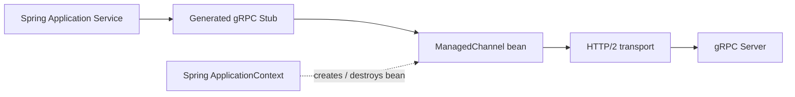
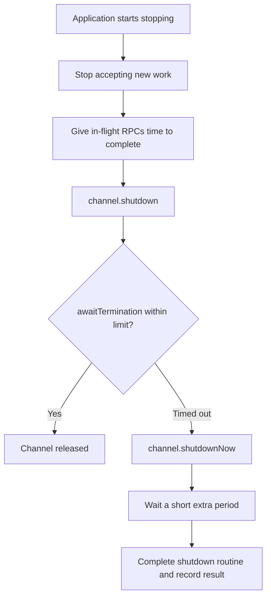
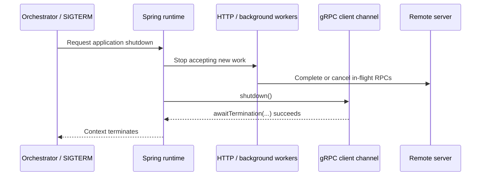

# Closing Channels When the Context Stops

In a Spring application, a gRPC client typically holds a `ManagedChannel` to call remote services over HTTP/2. A channel manages transport, connections, and execution resources; therefore, it must be **closed when the Spring `ApplicationContext` stops**. The completion of a single RPC call does not mean the channel's job is done: the same channel may be serving other RPCs or a long-lived streaming flow.

This lesson belongs to the **Spring client** chapter of the **SPRING_GRPC** module. The module covers developing gRPC services with Protocol Buffers, Java code generation, clients/servers for unary and streaming RPCs, metadata, deadlines, statuses, interceptors, TLS, integration testing, and reliability observability. Here, the focus is **client-side channel ownership and lifecycle**: delegating management to Spring, understanding the difference between graceful stop and forced stop, coordinating in-flight RPCs, and verifying resource cleanup.

## 1. Why Must You Manage the `ManagedChannel` Lifecycle?

A gRPC client typically has this structure:



**Stubs** are generated from the `.proto` contract and expose methods like `sayHello(...)`; the **channel** is the shared resource behind the stub. One channel can be used by multiple blocking, async, or future stubs. A channel also does not equate to a single TCP socket: gRPC can manage multiple connections, resolve destinations, and reconnect according to transport/configuration policies.

If you instantiate a `ManagedChannel` inside every RPC call method, the application repeats connection setup costs, loses track of resources, and easily forgets to close them. If you close the channel right after a unary RPC, other calls sharing that channel can break. The standard management pattern in Spring is **initializing the channel as a singleton bean, reusing it across stubs, and shutting it down when the context closes**.

| Object | Who Owns the Lifecycle? | When Does It End? |
| --- | --- | --- |
| Application-created `ManagedChannel` | Spring container or a dedicated channel-managing component. | When the application no longer accepts work needing the channel, usually at context shutdown. |
| Generated stub | Created from a channel; needs no separate `shutdown()`. | When no longer referenced; network resources are owned by the channel. |
| Unary RPC | Per-call context with its own deadline/status. | After response, error, or cancellation. |
| Streaming RPC | Per-stream context, potentially long-lived. | After `onCompleted`, `onError`, cancellation, or deadline. |

Key principle: **the component that creates or is assigned ownership of the channel is responsible for closing it**. An application service that only uses an injected stub should never call `channel.shutdown()` after every business method.

## 2. Distinguishing `shutdown`, `shutdownNow`, and `awaitTermination`

gRPC Java's `ManagedChannel` provides these lifecycle APIs:

| API | Meaning | When to Use |
| --- | --- | --- |
| `shutdown()` | Stops accepting new RPCs and starts an orderly shutdown. Already-started RPCs are allowed to continue per transport policy. | First step when the application context stops. |
| `shutdownNow()` | Requests an immediate stop and cancels in-flight calls if possible. | After a wait timeout expires and the channel still has not terminated; prevents hanging too long. |
| `awaitTermination(timeout, unit)` | Waits up to the specified time for the channel to terminate; returns `true` if terminated, `false` if timed out. | When you need to prove resources have closed before completing shutdown. |
| `isShutdown()` | Indicates that shutdown has been initiated. | Observing state after requesting shutdown. |
| `isTerminated()` | Indicates that the channel has completely finished shutting down. | Verifying resource release; stronger than `isShutdown()`. |

The steps differ between **requesting shutdown** and **waiting for shutdown to complete**:



`shutdown()` **does not block until RPCs finish**. After calling it, `isShutdown()` can be `true` while `isTerminated()` is still `false`. Therefore, if the system requires a time-bounded shutdown and completion verification, call `awaitTermination(...)` with an explicit timeout. Never wait indefinitely: a long-lived stream or stalled callback can prevent the channel from terminating.

`shutdownNow()` can cause errors/cancellations for active calls. It does not guarantee the server immediately stops side effects already in progress; for write RPCs, the client receiving an error **does not prove the operation did not happen**. Combine it with idempotency, deadlines, and business-level state reconciliation.

## 3. Letting Spring Call `shutdown()` via `@Bean(destroyMethod = "shutdown")`

Suppose the client calls the unary RPC `Greeter/SayHello` from the following contract:

```protobuf
syntax = "proto3";

package greeting.v1;

option java_package = "com.example.contract.grpc";
option java_multiple_files = true;

service Greeter {
  rpc SayHello (HelloRequest) returns (HelloReply);
}

message HelloRequest { string name = 1; }
message HelloReply { string message = 1; }
```

After generating code with `protoc` and the `protoc-gen-grpc-java` plugin, the application has `GreeterGrpc`, `HelloRequest`, and `HelloReply`. The examples require Spring Boot, `grpc-stub`, `grpc-protobuf`, and a transport such as `grpc-netty-shaded` in compatible versions.

Place the server target in `application.yml`:

```yaml
app:
  grpc:
    greeter:
      target: dns:///localhost:9090
      plaintext: true
```

This is a local development configuration. In production, choose an appropriate TLS hostname/certificate and typically switch to `plaintext: false`. Configure a channel in Spring:

```java
package com.example.client;

import com.example.contract.grpc.GreeterGrpc;
import io.grpc.ManagedChannel;
import io.grpc.ManagedChannelBuilder;
import org.springframework.beans.factory.annotation.Qualifier;
import org.springframework.beans.factory.annotation.Value;
import org.springframework.context.annotation.Bean;
import org.springframework.context.annotation.Configuration;

@Configuration(proxyBeanMethods = false)
public class GreeterClientConfiguration {

    @Bean(name = "greeterChannel", destroyMethod = "shutdown")
    ManagedChannel greeterChannel(
            @Value("${app.grpc.greeter.target}") String target,
            @Value("${app.grpc.greeter.plaintext:false}") boolean plaintext) {

        ManagedChannelBuilder<?> builder =
                ManagedChannelBuilder.forTarget(target);

        if (plaintext) {
            builder.usePlaintext();
        } else {
            builder.useTransportSecurity();
        }
        return builder.build();
    }

    @Bean
    GreeterGrpc.GreeterBlockingStub greeterBlockingStub(
            @Qualifier("greeterChannel") ManagedChannel channel) {
        return GreeterGrpc.newBlockingStub(channel);
    }
}
```

Spring creates the `greeterChannel` bean under the default singleton scope. The stub receives **that exact bean**, so application services can reuse the channel. When Spring destroys the bean, `destroyMethod = "shutdown"` instructs it to call `ManagedChannel.shutdown()` on this instance. There is no need to close it manually in a controller or a `finally` block around each RPC.

If the application only needs to initiate an orderly shutdown and does not need to wait deterministically for termination, this configuration is simple and easy to maintain. However, **declaring `destroyMethod = "shutdown"` alone does not perform a waiting graceful shutdown**. It does not automatically execute `awaitTermination(...)` or fall back to `shutdownNow()` if waiting takes too long.

Once Spring is chosen as the owner, avoid these mistakes:

- Calling `shutdown()` inside every request handler method.
- Creating a new channel via `ManagedChannelBuilder.build()` inside a service and forgetting to register cleanup.
- Using one close mechanism in `@PreDestroy` and another in `destroyMethod` on the same instance without clear ownership.
- Treating successful context startup as proof the server is reachable: the channel may only connect when the first RPC starts.

## 4. When You Need to Wait for RPCs to Finish Before Forcing Shutdown

Applications with long-lived server-streaming or bidirectional-streaming RPCs often need a time-bounded shutdown procedure. You can use a dedicated bean to manage closing the channel and register it with Spring.

In this **alternative** approach, configure the `ManagedChannel` bean with `destroyMethod = ""` to disable default destroy-method inference, because responsibility for calling `shutdown()` moves to another bean. **Do not simultaneously keep the `destroyMethod = "shutdown"` version from section 3 in the same configuration.**

`GracefulGreeterClientConfiguration.java`:

```java
package com.example.client;

import io.grpc.ManagedChannel;
import io.grpc.ManagedChannelBuilder;
import org.springframework.beans.factory.annotation.Qualifier;
import org.springframework.context.annotation.Bean;
import org.springframework.context.annotation.Configuration;

@Configuration(proxyBeanMethods = false)
public class GracefulGreeterClientConfiguration {

    @Bean(name = "greeterChannel", destroyMethod = "")
    ManagedChannel greeterChannel() {
        return ManagedChannelBuilder.forTarget("dns:///localhost:9090")
                .usePlaintext()
                .build();
    }

    @Bean
    GreeterChannelCloser greeterChannelCloser(
            @Qualifier("greeterChannel") ManagedChannel channel) {
        return new GreeterChannelCloser(channel);
    }
}
```

Target and plaintext are for local runs only; in production, load settings from properties and enable TLS appropriately. The `GreeterChannelCloser` bean **depends on** the `greeterChannel` bean, so Spring knows the destruction order of dependent beans. It closes the channel in `destroy()`:

```java
package com.example.client;

import io.grpc.ManagedChannel;
import java.util.concurrent.TimeUnit;
import org.slf4j.Logger;
import org.slf4j.LoggerFactory;
import org.springframework.beans.factory.DisposableBean;

public final class GreeterChannelCloser implements DisposableBean {

    private static final Logger log =
            LoggerFactory.getLogger(GreeterChannelCloser.class);

    private final ManagedChannel channel;

    public GreeterChannelCloser(ManagedChannel channel) {
        this.channel = channel;
    }

    @Override
    public void destroy() {
        channel.shutdown();

        try {
            if (!channel.awaitTermination(10, TimeUnit.SECONDS)) {
                log.warn("gRPC channel has not terminated; forcing cancellation of remaining RPCs");
                channel.shutdownNow();

                if (!channel.awaitTermination(3, TimeUnit.SECONDS)) {
                    log.warn("gRPC channel still not terminated after shutdownNow");
                }
            }
        } catch (InterruptedException interrupted) {
            channel.shutdownNow();
            Thread.currentThread().interrupt();
        }
    }
}
```

This routine executes step by step: (1) reject new calls via `shutdown()`, (2) wait up to 10 seconds, (3) force-cancel remaining RPCs if needed, (4) wait up to 3 more seconds and log if still not terminated. This is only **a limit on the channel wait step**, not a guarantee that total application shutdown lasts exactly 13 seconds. Actual timeouts must fit within your application shutdown budget, Kubernetes termination grace period, or deployment orchestrator limits.

Because `GreeterChannelCloser` depends on `greeterChannel`, Spring destroys the dependent bean before the bean it uses. That lets the closer handle the channel while the channel bean is still alive. However, **stopping business work and background workers must be coordinated separately**: the dependency between closer and channel alone does not ensure all other services have stopped issuing RPCs. If the system has active workers sending gRPC calls during shutdown, they must stop accepting tasks before the closer begins shutting down the channel.

When using a Spring gRPC starter that provides a built-in factory and lifecycle management, check that starter version's shutdown policy. Do not attach an extra closer to a starter-owned channel without clarifying closing responsibility and shutdown ordering.

## 5. Coordinating Shutdown Order in a Spring Application

A production application has multiple components that must stop in sequence, especially if it handles incoming HTTP requests while making outbound gRPC calls:



Spring publishes context-close events and destroys singleton beans during the application lifecycle. Spring Boot also supports **graceful shutdown** for the web server when configured properly, giving in-flight HTTP requests time to complete. However, it does not automatically manage all gRPC RPCs triggered by scheduled jobs, message consumers, or standalone streaming workers. Those components need their own stop mechanisms.

A practical rule is: **stop new request producers first, finish or cancel active RPCs next, and close the channel last**. For active components with independent lifecycles, use `SmartLifecycle` with appropriate phases to coordinate stopping, or coordinate task cancellation in the worker-owning component. Do not rely on arbitrary `@PreDestroy` ordering among beans without explicit dependencies.

Scenarios to distinguish:

| Scenario | What Needs to Happen? |
| --- | --- |
| Spring context closes normally | Call `shutdown()` via owner; await and force-stop if policy requires. |
| Application service is executing a unary RPC | Let the request finish within its deadline or cancel within the shutdown budget. |
| Client holds a long-lived stream | Signal stream completion/cancellation early; do not wait indefinitely on streams by default. |
| Background job is still making RPCs | Stop accepting new tasks and coordinate completion/cancellation before closing the channel. |
| Container receives `SIGTERM` | Ensure total graceful shutdown duration fits within the platform's grace period. |
| Process is killed forcefully, e.g. `SIGKILL` | No guarantee callbacks/bean destroy hooks will run; design servers to tolerate abrupt disconnects. |

Do not call `System.exit()` from business code merely to close a gRPC client. In a standard Spring Boot application, let the framework close the `ApplicationContext` so other components have a chance to release their resources properly.

## 6. What Happens to In-Flight RPCs When a Channel Stops?

For unary RPCs, after `shutdown()`, new calls on the channel may fail because the channel is shutting down; already-started calls may complete under orderly shutdown. For a streaming RPC, if the server has not yet emitted `onCompleted()`, the client may still have an active task. If a timeout forces escalation to `shutdownNow()`, waiting callbacks may receive cancellation or transport errors.

The application should not interpret every end-of-life error as a broken server. A `StatusRuntimeException` on a blocking stub or `onError(Throwable)` on an async stub may mean:

| Common Status | Possible Interpretation | Reasonable Action |
| --- | --- | --- |
| `CANCELLED` | Client or infrastructure cancelled the call, e.g. due to shutdown. | Log the cancellation reason and stop related work; avoid retrying while shutting down. |
| `UNAVAILABLE` | Channel/transport unavailable, or server/network failure. | Distinguish genuine faults from expected shutdown timing. |
| `DEADLINE_EXCEEDED` | Call exceeded its allotted time budget. | Check deadline, latency, and overload conditions. |
| `UNKNOWN` or other status | Error propagated from callback/transport or server error. | Preserve the status code and diagnostic info, and classify per business logic. |

Exact statuses depend on the RPC type, transport, and timing; **do not assume `shutdownNow()` always yields one specific status for every RPC**. On the server, cancellation may arrive after work has started or partially committed. If an RPC has side effects, use idempotency keys and rules for handling uncertain outcomes.

### Cancelling a Single RPC vs. Shutting Down the Whole Channel

If a user closes a web page or a streaming job loses its consumer, you should normally **cancel that specific call**, not close the channel serving other requests. With async/streaming RPCs, the application can use `ClientCallStreamObserver.cancel(...)` via `ClientResponseObserver` or a properly scoped `Context.CancellableContext`. With blocking RPCs, deadlines cap waiting time; when proactive cancellation is needed, choose a cancellation-capable API and define call lifecycles clearly.

For streaming, also handle `onNext`, `onError`, `onCompleted`, buffer bounds, and backpressure to avoid unreleased resources when consumers are slow. **Channel shutdown is an end-of-application-life mechanism**, not a substitute for per-RPC cancellation.

## 7. Deadlines, Metadata, TLS, and Interceptors During Shutdown

**Deadlines** matter greatly because an unbounded RPC can outlive the time the application is allowed to stay running. Example using an injected blocking stub sharing a channel:

```java
import com.example.contract.grpc.HelloRequest;
import java.util.concurrent.TimeUnit;

HelloRequest request = HelloRequest.newBuilder()
        .setName("Lan")
        .build();

String message = greeterStub
        .withDeadlineAfter(2, TimeUnit.SECONDS)
        .sayHello(request)
        .getMessage();
```

Here, `greeterStub` is the `GreeterBlockingStub` injected by Spring. `withDeadlineAfter(...)` returns a newly configured stub without modifying the singleton bean. The RPC's deadline and the timeout for **awaiting channel termination** are two different quantities: the deadline bounds a call, while `awaitTermination(...)` bounds the shutdown step.

**Metadata** such as `authorization`, `x-request-id`, and trace context are scoped per RPC. While the application context is stopping, do not issue extra calls carrying tokens just to probe channel status. In shutdown logs, record status code, logical channel name, active RPC count, or wait duration; never log tokens, secrets, or private keys.

**TLS** must be configured when the channel is built; `shutdown()` does not replace certificate/secret rotation and does not force remote systems to close. With multiple target channels, each channel may use a different CA or client certificate, so each bean needs a clear owner and lifecycle.

**Client interceptors** can track completed/failed RPC counts and cancellation states to distinguish normal shutdowns from connectivity failures. However, do not make interceptor callbacks block for long during shutdown; if metrics/tracing exporters are also shutting down, design an appropriate flush/close order.

## 8. Testing That Spring Actually Closes the Channel

A lifecycle test can start an `AnnotationConfigApplicationContext`, retrieve the `ManagedChannel` bean, then close the context and assert its state. Use the in-process transport so the test needs no network server. Add `grpc-inprocess` to test dependencies.

```java
package com.example.client;

import static org.junit.jupiter.api.Assertions.assertFalse;
import static org.junit.jupiter.api.Assertions.assertTrue;

import io.grpc.ManagedChannel;
import io.grpc.inprocess.InProcessChannelBuilder;
import io.grpc.inprocess.InProcessServerBuilder;
import java.util.concurrent.TimeUnit;
import org.junit.jupiter.api.Test;
import org.springframework.context.annotation.AnnotationConfigApplicationContext;
import org.springframework.context.annotation.Bean;
import org.springframework.context.annotation.Configuration;

class GrpcChannelLifecycleTest {

    @Configuration(proxyBeanMethods = false)
    static class TestConfig {
        @Bean(name = "testChannel", destroyMethod = "shutdown")
        ManagedChannel testChannel() {
            String name = InProcessServerBuilder.generateName();
            return InProcessChannelBuilder.forName(name)
                    .directExecutor()
                    .build();
        }
    }

    @Test
    void closesChannelWhenContextCloses() throws Exception {
        var context = new AnnotationConfigApplicationContext(TestConfig.class);
        ManagedChannel channel = context.getBean("testChannel", ManagedChannel.class);

        try {
            assertFalse(channel.isShutdown());
        } finally {
            context.close();
        }

        assertTrue(channel.isShutdown());
        assertTrue(channel.awaitTermination(3, TimeUnit.SECONDS));
        assertTrue(channel.isTerminated());
    }
}
```

Because this test does not invoke an RPC, it does not need to start an in-process server; the name generated by `generateName()` simply supplies a test target for the channel. It verifies that **Spring runs the destroy method** and that the channel reaches `isTerminated()` when idle. Do not extrapolate from this test that every real stream or RPC completes cleanly at shutdown. To test graceful shutdown under load, issue a delayed RPC, invoke `shutdown()`, observe the in-flight call's behavior, and then test timeout and `shutdownNow()` in a controlled test.

The test above does not exercise TLS, DNS, or networked HTTP/2 transport. A TCP/TLS integration test should verify timely connection closure, handling of unfinished requests, server-side status, and overall application shutdown duration limits. With Spring Boot, also test shutdown while HTTP requests and background consumers are actively sharing the channel.

## 9. Closing Multiple Channels in the Same Application

An application may call `Inventory`, `Payment`, and `Shipping` across three different targets. Each channel should have a **defined bean name, owner, and destroy policy**. For example:

```java
@Bean(name = "inventoryChannel", destroyMethod = "shutdown")
ManagedChannel inventoryChannel() {
    return ManagedChannelBuilder.forTarget("dns:///inventory.internal:7443")
            .useTransportSecurity()
            .build();
}

@Bean(name = "shippingChannel", destroyMethod = "shutdown")
ManagedChannel shippingChannel() {
    return ManagedChannelBuilder.forTarget("dns:///shipping.internal:7443")
            .useTransportSecurity()
            .build();
}
```

This snippet merely illustrates two beans in a `@Configuration` class with the proper imports; real targets should come from environment-specific configuration. Spring calls the destroy method for **both beans** when the context stops. If you need bounded waiting or forced cancellation, use a centralized manager holding an explicit list of channels, or multiple owners with a designed shutdown sequence. Avoid closing the same channel twice from different owners, especially when it is shared across multiple generated stubs.

If a Spring gRPC starter creates named channels via a `ChannelFactory` or auto-configuration, verify whether **the starter owns shutdown** or the application does. API configuration and lifecycle depend on the starter version. Avoid manually adding a duplicate `ManagedChannelBuilder` for the same target or calling `shutdown()` on a factory-shared channel if the factory's contract specifies centralized closing.

When monitoring, attach stable metric labels such as `client=inventory` and `client=shipping`, and record `shutdown_duration`, cancelled RPC counts, and termination outcomes per channel. Do not use user IDs, tokens, or request IDs as high-cardinality metric labels. Orderly channel termination reduces rollout errors and avoids abrupt connection drops.

## 10. Common Shutdown Lifecycle Mistakes

| Symptom | Possible Cause | How to Fix |
| --- | --- | --- |
| Application exits in tests but transport threads remain running | Channel created outside Spring without closing, or forgot to close context. | Place channels under explicit lifecycle management; use `try/finally` in tests creating channels manually. |
| RPC fails with `UNAVAILABLE` after one call | Service called `shutdown()` after each request while the channel was shared. | Close the channel only when its owner no longer needs it, typically on context stop. |
| Context stops yet channel is not terminated | Only `shutdown()` was called without waiting, or a stream is still open. | Use bounded `awaitTermination`; consider cancelling overdue RPCs. |
| Shutdown hangs on an infinite stream | No strategy to stop consumer/producer, or missing deadline/cancellation. | Close streams first with a time limit, then close the channel. |
| Two beans close the same channel | Unclear ownership; `destroyMethod` and `@PreDestroy` overlap. | Pick a single owner and one consistent cleanup mechanism. |
| Background job fails while context is stopping | Job keeps issuing new RPCs after `channel.shutdown()`. | Stop jobs/consumers first via coordinated lifecycle phases. |
| `awaitTermination` gets interrupted | Waiting thread is interrupted, risking incomplete cleanup. | Call `shutdownNow()` when appropriate and restore the interrupt flag. |
| Confusing `isShutdown()` with `isTerminated()` | Only checks that shutdown was requested, not that resources finished releasing. | Assert both states and `awaitTermination`. |
| Always calling `shutdownNow()` immediately | Cancels in-flight RPCs that could have completed normally. | Prefer `shutdown()` and wait within budget before forcing stop. |
| Closing a starter-owned channel manually | Ownership conflict disrupting other stubs sharing the factory. | Confirm the starter/factory lifecycle contract. |

## 11. Practice Exercises

1. Build a Spring Boot client from the `Greeter` contract, register `ManagedChannel` with `@Bean(destroyMethod = "shutdown")`, inject the generated blocking stub, and invoke a unary RPC successfully.
2. Write a JUnit test that creates and closes an `ApplicationContext`. Assert `isShutdown()` before/after closing and `isTerminated()` after `awaitTermination(...)`.
3. Use a test gRPC server that delays responses. Start an RPC, call `shutdown()` on the channel, and observe the difference between the already-started call and a newly initiated call.
4. Open a long-lived server-streaming RPC. Stop the application with a short shutdown deadline; add per-RPC cancellation so the stream closes before the channel needs `shutdownNow()`.
5. Replace `destroyMethod = "shutdown"` with a `DisposableBean` owner that waits up to 10 seconds and forces cancellation on timeout; verify logs, termination duration, and interrupt flag handling in an appropriate test.
6. Define two channel beans targeting two different services, stop the Spring context, and verify both close. Simulate a background worker still issuing RPCs during shutdown to design a clean stop sequence.
7. Test graceful shutdown with TLS and an interceptor recording metrics/tracing. Ensure tokens never appear in logs and distinguish shutdown-time RPC errors from prior network failures.

After this lesson, you should be able to explain why a channel must have **one clear owner**, when Spring calls `shutdown()` automatically, why `shutdown()` differs from `awaitTermination()`, when `shutdownNow()` is necessary, and how to coordinate in-flight RPCs with `ApplicationContext` shutdown. These principles keep Spring gRPC clients predictable during termination, preserve reliability for unary/streaming RPCs, and prevent resource leaks during deployment, testing, or service shutdown.
