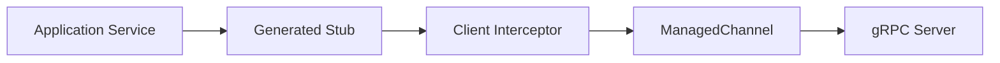

# Shared Client Interceptors

A Spring application often has multiple application services calling gRPC. If every service manually attaches request IDs, logs methods, times calls, or classifies statuses, repetitive handling quickly diverges. A **client interceptor** solves this cross-cutting concern at the boundary between the generated stub and the channel: one interceptor can apply across many RPCs, many stubs, and many target services.

This lesson belongs to the **Spring client** chapter of the **SPRING_GRPC** module. The focus is designing a shared interceptor, registering it with a Spring-managed channel, understanding its scope, and handling metadata and call lifecycle. Interceptors unify logging, tracing, metrics, or common headers; they do not replace application services for business logic, nor do they replace `CallCredentials` when supplying dynamic authentication credentials.

## 1. Where Does a Client Interceptor Sit?

A client call passes through these components:



`ClientInterceptor` is a gRPC Java extension point. It receives method information, `CallOptions`, and the next channel, then creates or wraps a `ClientCall`. This lets the interceptor observe or augment behavior before an RPC starts and when it ends.

Tasks suited for a shared interceptor:

- Attaching stable client metadata, such as `x-client-name` or per-RPC correlation metadata.
- Recording the full method name, gRPC status, and execution duration.
- Integrating with tracing/metrics instrumentation.
- Applying a uniform client policy such as a default deadline, when that policy is explicitly designed.

Tasks you should not casually place inside an interceptor: business decisions, use-case-specific data mapping, retrying side-effecting operations without considering idempotency, or storing user tokens in singleton fields. Interceptors should be **lightweight, thread-safe for concurrent use, and free of per-request mutable state in shared fields**.

## 2. Scope: Channel-Wide or Stub-Specific?

There are two common ways to attach an interceptor:

| Attachment Method | Scope | When Appropriate |
| --- | --- | --- |
| `ManagedChannelBuilder.intercept(...)` | All RPCs created over that channel, across multiple stubs built from it. | Logging, metrics, tracing, or common metadata for a client/target. |
| `stub.withInterceptors(...)` | The newly configured stub and calls routed through that stub. | Special policy for one group of methods or one specific adapter. |

Declaring an interceptor as a Spring bean **does not automatically apply it to every channel**. Your configuration must attach it to each channel that needs it. If the application has `inventoryChannel` and `shippingChannel`, you can inject the same interceptor bean into both builders. When one channel uses different credentials or policies, separate interceptors per channel instead of sharing every behavior by default.

Do not confuse `ClientInterceptor` with `ServerInterceptor`: a client interceptor runs in the process issuing the RPC; a server interceptor runs on the server to inspect/enforce incoming calls. Both sides may share a metadata contract yet have different lifecycles and access boundaries.

## 3. Writing an RPC Observability Interceptor

The following example attaches the application name to each RPC's metadata and records the method, status, and elapsed time from call start to call close. It does not log payloads, tokens, or sensitive metadata.

```java
package com.example.client;

import io.grpc.CallOptions;
import io.grpc.Channel;
import io.grpc.ClientCall;
import io.grpc.ClientInterceptor;
import io.grpc.ForwardingClientCall;
import io.grpc.ForwardingClientCallListener;
import io.grpc.Metadata;
import io.grpc.MethodDescriptor;
import io.grpc.Status;
import java.util.concurrent.TimeUnit;
import org.slf4j.Logger;
import org.slf4j.LoggerFactory;

public final class ClientObservabilityInterceptor implements ClientInterceptor {

    private static final Logger log =
            LoggerFactory.getLogger(ClientObservabilityInterceptor.class);

    private static final Metadata.Key<String> CLIENT_NAME = Metadata.Key.of(
            "x-client-name", Metadata.ASCII_STRING_MARSHALLER);

    private final String clientName;

    public ClientObservabilityInterceptor(String clientName) {
        if (clientName == null || clientName.isBlank()) {
            throw new IllegalArgumentException("clientName must not be empty");
        }
        this.clientName = clientName;
    }

    @Override
    public <RequestT, ResponseT> ClientCall<RequestT, ResponseT> interceptCall(
            MethodDescriptor<RequestT, ResponseT> method,
            CallOptions callOptions,
            Channel next) {

        ClientCall<RequestT, ResponseT> delegate =
                next.newCall(method, callOptions);

        return new ForwardingClientCall.SimpleForwardingClientCall<>(delegate) {
            @Override
            public void start(Listener<ResponseT> responseListener, Metadata headers) {
                headers.discardAll(CLIENT_NAME);
                headers.put(CLIENT_NAME, clientName);
                long startedAt = System.nanoTime();

                Listener<ResponseT> observingListener =
                        new ForwardingClientCallListener
                                .SimpleForwardingClientCallListener<>(responseListener) {
                            @Override
                            public void onClose(Status status, Metadata trailers) {
                                long elapsedMillis = TimeUnit.NANOSECONDS.toMillis(
                                        System.nanoTime() - startedAt);
                                log.info(
                                        "gRPC client call closed: client={}, method={}, status={}, elapsedMs={}",
                                        clientName,
                                        method.getFullMethodName(),
                                        status.getCode(),
                                        elapsedMillis);
                                super.onClose(status, trailers);
                            }
                        };

                super.start(observingListener, headers);
            }
        };
    }
}
```

Several important details:

- `interceptCall(...)` runs when gRPC creates a call. `next.newCall(...)` delegates call creation to the next channel/interceptor.
- `start(...)` receives the metadata for the **current call**. Here it strips any previous `x-client-name` value and adds the application's value so the header carries one deterministic value.
- `startedAt` is a local variable inside `start`, so every call keeps its own start timestamp. Never store the timestamp in a field of the singleton interceptor.
- `ForwardingClientCallListener` forwards all remaining callbacks to the original listener; we only add logic in `onClose(...)`.
- `onClose(...)` signals RPC completion with `Status`, covering both success and failure. Duration measured here includes RPC queuing and network transfer, not only server processing time.

This interceptor can be used concurrently across many RPCs because per-call state lives inside the `start` closure. The `clientName` field and metadata key are immutable after construction. When extending an interceptor, never store `Metadata`, responses, or the current request in shared fields.

## 4. Registering the Interceptor Once in Spring and Attaching It to a Channel

Put the client name and target in `application.yml`:

```yaml
spring:
  application:
    name: checkout-api

app:
  grpc:
    greeter:
      target: dns:///greeter.internal:7443
      plaintext: false
```

Declare the interceptor as a bean and attach it to the channel:

```java
package com.example.client;

import com.example.contract.grpc.GreeterGrpc;
import io.grpc.ClientInterceptor;
import io.grpc.ManagedChannel;
import io.grpc.ManagedChannelBuilder;
import org.springframework.beans.factory.annotation.Qualifier;
import org.springframework.beans.factory.annotation.Value;
import org.springframework.context.annotation.Bean;
import org.springframework.context.annotation.Configuration;

@Configuration(proxyBeanMethods = false)
public class GreeterClientConfiguration {

    @Bean
    ClientInterceptor clientObservabilityInterceptor(
            @Value("${spring.application.name:application}") String clientName) {
        return new ClientObservabilityInterceptor(clientName);
    }

    @Bean(name = "greeterChannel", destroyMethod = "shutdown")
    ManagedChannel greeterChannel(
            @Value("${app.grpc.greeter.target}") String target,
            @Value("${app.grpc.greeter.plaintext:false}") boolean plaintext,
            ClientInterceptor clientObservabilityInterceptor) {

        ManagedChannelBuilder<?> builder =
                ManagedChannelBuilder.forTarget(target)
                        .intercept(clientObservabilityInterceptor);

        if (plaintext) {
            builder.usePlaintext();
        } else {
            builder.useTransportSecurity();
        }
        return builder.build();
    }

    @Bean
    GreeterGrpc.GreeterBlockingStub greeterBlockingStub(
            @Qualifier("greeterChannel") ManagedChannel channel) {
        return GreeterGrpc.newBlockingStub(channel);
    }
}
```

The `clientObservabilityInterceptor` bean is created once and attached to `greeterChannel`. Every stub built from that channel passes through the interceptor. `destroyMethod = "shutdown"` manages the channel's lifecycle; the interceptor does not close the channel because it does not own the transport.

If the application has multiple channels, inject the same interceptor bean into each channel creation method that needs observation. If each channel needs a different `clientName`, create separate qualified interceptor beans or use an immutable interceptor parameterized per client. Never build a singleton interceptor and mutate its `clientName` field per request.

## 5. Shared Metadata vs. Per-RPC Metadata

The `x-client-name` header in the example is stable application metadata. It is suitable for telling the server which logical client is calling. Other metadata belongs to individual requests:

| Metadata | Appropriate Scope | How to Supply |
| --- | --- | --- |
| `x-client-name` | Stable across all RPCs from an application/channel. | Can be attached in a shared interceptor. |
| `x-request-id` | Varies per request for log correlation. | Generated or read from each RPC's context; never kept as a mutable field in a singleton. |
| `traceparent` / tracing context | Per trace/span. | Use OpenTelemetry gRPC instrumentation or a compatible propagation mechanism. |
| `authorization` | Per call identity/permissions. | Prefer `CallCredentials` or a per-call credential interceptor; never hard-code a global token. |

`Metadata` is a mutable object. Every `ClientCall.start(...)` invocation receives a metadata instance belonging to that specific call; you can safely add headers to that instance. Never keep one shared `Metadata` object and overwrite the request ID or token before each call, since concurrent RPCs can interleave and corrupt data.

For authentication, `CallCredentials` is usually the better choice for supplying per-RPC credentials and integrating with gRPC's security mechanisms. An interceptor can still observe methods/statuses or add non-sensitive metadata. Never log `authorization` values, cookies, private keys, or payloads containing personal data.

## 6. Reusing a Shared Interceptor Across Multiple Channels and Stubs

A stateless interceptor can attach to multiple channels:

```java
@Bean(name = "inventoryChannel", destroyMethod = "shutdown")
ManagedChannel inventoryChannel(
        @Value("${app.grpc.inventory.target}") String target,
        ClientInterceptor clientObservabilityInterceptor) {
    return ManagedChannelBuilder.forTarget(target)
            .useTransportSecurity()
            .intercept(clientObservabilityInterceptor)
            .build();
}

@Bean(name = "shippingChannel", destroyMethod = "shutdown")
ManagedChannel shippingChannel(
        @Value("${app.grpc.shipping.target}") String target,
        ClientInterceptor clientObservabilityInterceptor) {
    return ManagedChannelBuilder.forTarget(target)
            .useTransportSecurity()
            .intercept(clientObservabilityInterceptor)
            .build();
}
```

These are two additional `@Bean` methods in the same configuration class; each channel has its own target and lifecycle while sharing the same observability behavior. When Spring has multiple `ClientInterceptor` beans, specify injection intentionally via `@Qualifier`, `@Primary`, or an ordered list of interceptors. Do not rely on ambiguous ordering when multiple beans share the same type.

If only one stub needs a special interceptor, derive a new stub:

```java
GreeterGrpc.GreeterBlockingStub auditedStub =
        greeterStub.withInterceptors(auditInterceptor);
```

`auditedStub` applies the extra interceptor only to calls made through that stub; the original stub keeps its baseline configuration. Whether attached at the channel or stub level, interceptors must remain thread-safe and must never close the channel.

## 7. Combining Multiple Interceptors and Execution Order

A client can use multiple interceptors, for example:

| Interceptor | Role |
| --- | --- |
| Tracing | Creates/propagates trace context and spans. |
| Metrics | Counts RPCs and records latency and status per method. |
| Default deadline | Attaches a deadline when the caller omitted one. |
| Client metadata | Attaches logical client name or non-sensitive headers. |
| Audit | Records required events per security policy. |

You can register multiple interceptors on the builder via `.intercept(...)` calls. Registration order affects how `ClientCall` and listeners wrap one another; an outer interceptor observes calls before/after an inner interceptor. Therefore, set the order intentionally and test interactions, especially when tracing, deadlines, or metadata depend on each other. Do not assume all instrumentation libraries follow the exact same ordering convention if they wrap channels differently.

Do not reinvent a full tracing system if the project already uses OpenTelemetry gRPC instrumentation or Spring observability integration. Use compatible instrumentation libraries so propagation, span lifecycles, and metrics work properly; custom interceptors should add application-specific behavior such as the logical client name.

## 8. Things an Interceptor Should Not Do

- **Do not store per-request data in singleton fields.** One interceptor bean can process many concurrent calls.
- **Do not log payloads or secrets.** Recording method, status, duration, and logical client name is usually enough for initial diagnostics.
- **Do not blindly retry every error.** Retries depend on status, idempotency, overall deadline, and backoff policy; an interceptor lacks enough business context to decide every case.
- **Do not block callbacks for long.** Logging/metrics/tracing work should stay lightweight or move to an appropriate executor; slow callbacks can stall RPC processing.
- **Do not swallow callbacks.** When wrapping a listener, forward `onHeaders`, `onMessage`, `onReady`, `onClose`, and all other callbacks via a forwarding listener.
- **Do not close the channel.** Channels belong to configuration beans or factories; interceptors only observe and augment calls.
- **Do not assume every RPC yields a response.** Failed unary calls or cancelled streams can terminate via `onClose` with a non-`OK` status and zero messages.

For metrics, use bounded-cardinality labels such as service, method, status, and logical client. Never use request IDs, user IDs, or targets containing dynamic identifiers as metric labels. Request IDs belong in structured logs or traces.

## 9. Testing Interceptors

Tests should verify that the interceptor is actually invoked, metadata reaches the server, and terminal statuses are observed on the client. You can use a gRPC in-process server:

1. Create a server with a `ServerInterceptor` reading the `x-client-name` metadata key.
2. Create a `ManagedChannel` with `ClientObservabilityInterceptor("checkout-api")`.
3. Create a generated stub from the channel and invoke a successful unary RPC.
4. Verify the server receives the exact `x-client-name`.
5. Run one RPC where the server returns an error and another that hits a deadline or cancellation; verify the interceptor captures the status and closing callback.
6. Close the channel and server in `finally` or via test lifecycle hooks so no resources leak.

Beyond in-process tests, integration tests over a real network transport verify that the interceptor works properly alongside TLS, resolvers, proxies, and real instrumentation. With multiple channels, test that every channel has the interceptor attached; Spring creating the interceptor bean successfully does not automatically prove every channel uses it.

## 10. Common Mistakes

| Symptom | Cause | How to Fix |
| --- | --- | --- |
| Interceptor bean declared, yet no logs appear | Bean was not attached to any channel or stub. | Call `.intercept(...)` when building the channel or `.withInterceptors(...)` on the stub. |
| One channel logs while another does not | Only one builder was configured with the interceptor. | Inject the interceptor into every channel that needs it. |
| Request IDs leak across calls | Using a shared mutable `Metadata` or shared mutable field. | Create metadata and state separately inside each call. |
| Logs only record successes | Handling only `onMessage`/`onCompleted` while ignoring `onClose`/`onError`. | Observe `onClose(Status, trailers)` to capture error statuses as well. |
| gRPC callbacks run unusually slowly | Interceptor performs synchronous I/O or heavy processing. | Keep callbacks light; offload heavy work to a bounded executor. |
| Metrics suffer excessive cardinality | Using request ID or user ID as a metric label. | Use stable labels by service, method, status, and client. |
| Tokens show up in logs | Logging all metadata or headers wholesale. | Allowlist fields safe to log; mask or omit sensitive data. |
| Interceptor drops callbacks | Custom listener implementation fails to delegate all methods. | Extend `ForwardingClientCallListener` and invoke `super` methods properly. |

## 11. Practice Exercises

1. Write `ClientObservabilityInterceptor` to attach `x-client-name` and log method/status/latency for every RPC.
2. Register the interceptor as a Spring bean, attach it to two different channels, and verify stubs from both channels flow through the interceptor.
3. Write a server interceptor in a test to verify the `x-client-name` metadata; add cases for server errors and expired deadlines.
4. Add per-request `x-request-id`. Send multiple concurrent RPCs and verify request IDs never mix.
5. Attach a custom interceptor via `stub.withInterceptors(...)`; compare its scope with a channel-level interceptor.
6. Enable your project's tracing/metrics instrumentation, check ordering against your custom interceptor, and verify no tokens or sensitive payloads are logged.

After this lesson, you should be able to distinguish channel-wide shared interceptors from stub-specific interceptors, build a thread-safe `ClientInterceptor`, register it as a Spring bean, and inspect metadata/status/latency via callbacks. This centralizes cross-cutting behaviors in Spring gRPC clients so RPCs remain observable and consistent without cluttering application services with repeated infrastructure code.
