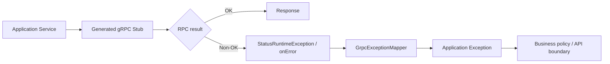

# Mapping gRPC Errors to Application Exceptions

When a Spring service calls gRPC, errors from the remote service typically surface on the client as `StatusRuntimeException` or arrive in the `onError` callback. If these exceptions spread throughout application services and controllers, business logic becomes coupled directly to gRPC status codes. **Mapping gRPC errors to application exceptions** establishes a clean boundary: the integration layer understands gRPC statuses, while the business layer handles scenarios such as invalid input, missing resources, conflicts, timeouts, or unavailable dependencies.

This lesson belongs to the **Spring client** chapter of the **SPRING_GRPC** module. The module covers developing clients/servers from Protocol Buffers contracts and generated Java code, supporting unary/streaming RPCs, metadata, deadlines, interceptors, TLS, integration testing, and observability. The focus here is classifying errors semantically, preserving necessary diagnostic context, and keeping transport details from leaking into business logic.

## 1. Understanding gRPC Errors Before Mapping

gRPC represents the outcome of an RPC via `Status`. When an RPC succeeds, the status is `OK`; when it fails, the status carries a code such as `NOT_FOUND`, `INVALID_ARGUMENT`, `UNAVAILABLE`, or `DEADLINE_EXCEEDED`. On a blocking client, calls typically throw `StatusRuntimeException`. With an async stub, errors usually arrive via `StreamObserver.onError(Throwable)`.



`Status` is an RPC-boundary result. It is not automatically the right exception for the domain. For example, `NOT_FOUND` might mean a SKU does not exist, or it might mean the client called the wrong service or method. Only the operation that knows the business intent of the call has enough context to decide whether to map it to `ProductNotFoundException` or an integration error.

Thus, mapping has two responsibilities:

- **Technical classification:** read the status code and preserve the cause and required diagnostic details.
- **Use-case interpretation:** decide which domain scenario that status represents in the current operation.

Do not treat every `StatusRuntimeException` as a lost connection or collapse every failure into one generic exception that erases the underlying cause.

## 2. Common Statuses and Their Meaning at the Application Layer

| gRPC status | Common Meaning | Candidate Application Exception Group |
| --- | --- | --- |
| `INVALID_ARGUMENT` | Request invalid per contract or server-side validation. | `InvalidRemoteRequestException` |
| `OUT_OF_RANGE` | Value outside allowed bounds, e.g. cursor or out-of-range index. | `InvalidRemoteRequestException` or a use-case-specific exception |
| `NOT_FOUND` | Requested resource does not exist. | `RemoteResourceNotFoundException`, if operation semantics confirm it |
| `ALREADY_EXISTS` | Resource already exists. | `RemoteConflictException` |
| `ABORTED` | Operation aborted due to conflict, typically concurrency/transaction related. | `RemoteConflictException` or transaction-level retry exception |
| `FAILED_PRECONDITION` | System state does not satisfy prerequisites to run the operation. | `RemotePreconditionException` |
| `UNAUTHENTICATED` | Missing or invalid authentication credentials. | `RemoteAuthenticationException` |
| `PERMISSION_DENIED` | Identity authenticated, but lacks sufficient permissions. | `RemoteAccessDeniedException` |
| `RESOURCE_EXHAUSTED` | Quota, resource limit, or rate limit exceeded. | `RemoteCapacityException` |
| `DEADLINE_EXCEEDED` | RPC did not complete before deadline. | `RemoteTimeoutException` |
| `UNAVAILABLE` | Service or transport temporarily unavailable. | `RemoteUnavailableException` |
| `CANCELLED` | RPC cancelled by caller, context, or system. | `RemoteCallCancelledException` or dedicated cancellation handling |
| `UNIMPLEMENTED`, `INTERNAL`, `DATA_LOSS`, `UNKNOWN` | Unsupported method or internal/unknown error. | `RemoteServiceException` |

These are classification guidelines, not a mandatory mapping table for every system. For example, `NOT_FOUND` should become a "product not found" error only when the `GetProduct` contract defines that meaning. If `NOT_FOUND` occurs due to a wrong route or service name, that is an integration or configuration bug that needs investigation.

## 3. Designing Application Exceptions That Preserve Status and Cause

An application exception should supply enough information for upper layers to make decisions without exposing internal remote server details. A single exception type carrying `kind` and `grpcCode` avoids creating too many repetitive classes in small examples; larger systems can split into domain-specific subclasses.

`GrpcApplicationException.java`:

```java
package com.example.application.error;

import io.grpc.Status;

public final class GrpcApplicationException extends RuntimeException {

    public enum Kind {
        INVALID_INPUT,
        NOT_FOUND,
        CONFLICT,
        PRECONDITION_FAILED,
        AUTHENTICATION_REQUIRED,
        ACCESS_DENIED,
        CAPACITY_EXCEEDED,
        TIMEOUT,
        DEPENDENCY_UNAVAILABLE,
        CANCELLED,
        REMOTE_FAILURE,
        CLIENT_FAILURE
    }

    private final Kind kind;
    private final Status.Code grpcCode;

    public GrpcApplicationException(
            Kind kind, Status.Code grpcCode, String message, Throwable cause) {
        super(message, cause);
        this.kind = kind;
        this.grpcCode = grpcCode;
    }

    public Kind kind() {
        return kind;
    }

    public Status.Code grpcCode() {
        return grpcCode;
    }
}
```

`grpcCode` may be null when the error does not originate from a gRPC status, such as a local error when initiating the call. `cause` is preserved for logging and investigation; never return stack traces or raw causes to API callers. `Kind` is a stable application-layer classification, enabling controllers, jobs, or message handlers to decide how to respond without importing `io.grpc.Status`.

## 4. Writing a Mapper from `StatusRuntimeException` to Application Exceptions

The mapper lives in the gRPC integration layer. It converts the status code into `Kind`, sets an application-controlled safe message, and retains the original exception as `cause`:

`GrpcExceptionMapper.java`:

```java
package com.example.client;

import com.example.application.error.GrpcApplicationException;
import com.example.application.error.GrpcApplicationException.Kind;
import io.grpc.Status;
import io.grpc.StatusException;
import io.grpc.StatusRuntimeException;
import org.springframework.stereotype.Component;

@Component
public class GrpcExceptionMapper {

    public GrpcApplicationException map(Throwable failure) {
        if (!containsGrpcStatus(failure)) {
            return new GrpcApplicationException(
                    Kind.CLIENT_FAILURE,
                    null,
                    "Error executing gRPC client",
                    failure);
        }

        Status status = Status.fromThrowable(failure);
        Status.Code code = status.getCode();

        Kind kind = switch (code) {
            case INVALID_ARGUMENT, OUT_OF_RANGE -> Kind.INVALID_INPUT;
            case NOT_FOUND -> Kind.NOT_FOUND;
            case ALREADY_EXISTS, ABORTED -> Kind.CONFLICT;
            case FAILED_PRECONDITION -> Kind.PRECONDITION_FAILED;
            case UNAUTHENTICATED -> Kind.AUTHENTICATION_REQUIRED;
            case PERMISSION_DENIED -> Kind.ACCESS_DENIED;
            case RESOURCE_EXHAUSTED -> Kind.CAPACITY_EXCEEDED;
            case DEADLINE_EXCEEDED -> Kind.TIMEOUT;
            case UNAVAILABLE -> Kind.DEPENDENCY_UNAVAILABLE;
            case CANCELLED -> Kind.CANCELLED;
            default -> Kind.REMOTE_FAILURE;
        };

        return new GrpcApplicationException(
                kind, code, safeMessage(kind), failure);
    }

    private boolean containsGrpcStatus(Throwable failure) {
        for (Throwable current = failure;
             current != null;
             current = current.getCause()) {
            if (current instanceof StatusRuntimeException
                    || current instanceof StatusException) {
                return true;
            }
        }
        return false;
    }

    private String safeMessage(Kind kind) {
        return switch (kind) {
            case INVALID_INPUT -> "Invalid data sent to dependent service";
            case NOT_FOUND -> "Resource not found on dependent service";
            case CONFLICT -> "Request conflicts with current state";
            case PRECONDITION_FAILED -> "Dependent service preconditions not met";
            case AUTHENTICATION_REQUIRED -> "Dependent service requires valid authentication";
            case ACCESS_DENIED -> "Insufficient permissions for operation on dependent service";
            case CAPACITY_EXCEEDED -> "Dependent service exceeded resource limits";
            case TIMEOUT -> "Dependent service response timed out";
            case DEPENDENCY_UNAVAILABLE -> "Dependent service is currently unavailable";
            case CANCELLED -> "Call to dependent service was cancelled";
            case CLIENT_FAILURE -> "Error executing gRPC client";
            case REMOTE_FAILURE -> "Dependent service encountered an error processing the request";
        };
    }
}
```

`Status.fromThrowable(...)` extracts status from `StatusRuntimeException` or `StatusException`, even when the gRPC exception sits deeper in the cause chain. The mapper checks first so an ordinary local error is not misclassified as a remote `UNKNOWN` error. In async callbacks, `onError(Throwable)` typically receives an exception carrying a gRPC status; the mapper can also handle exceptions wrapped in `CompletionException` as long as the cause chain retains the status exception.

`safeMessage(...)` does not pass `status.getDescription()` outward as the external message. Descriptions and trailers from remote services can contain hostnames, class names, queries, or internal details. For diagnostics, log the status code and allowlisted fields; keep the original exception as the cause so internal logs can trace failures under security policy.

In systems with many services, you can extend the design into per-dependency mappers or pass operation context. The same `NOT_FOUND` status can mean different things across `GetProduct`, `GetCustomer`, and `ReserveStock`; do not force every operation into a single interpretation.

## 5. Applying the Mapper in a Blocking Client

With a blocking stub, catch `StatusRuntimeException` right inside the adapter/gateway calling gRPC and convert it into an application exception:

```java
package com.example.client;

import com.example.application.error.GrpcApplicationException;
import com.example.contract.grpc.InventoryGrpc;
import com.example.contract.grpc.StockReply;
import com.example.contract.grpc.StockRequest;
import io.grpc.StatusRuntimeException;
import java.util.concurrent.TimeUnit;
import org.springframework.stereotype.Component;

@Component
public class InventoryGateway {

    private final InventoryGrpc.InventoryBlockingStub stub;
    private final GrpcExceptionMapper exceptionMapper;

    public InventoryGateway(
            InventoryGrpc.InventoryBlockingStub stub,
            GrpcExceptionMapper exceptionMapper) {
        this.stub = stub;
        this.exceptionMapper = exceptionMapper;
    }

    public StockReply getStock(String sku) {
        StockRequest request = StockRequest.newBuilder()
                .setSku(sku)
                .build();

        try {
            return stub.withDeadlineAfter(800, TimeUnit.MILLISECONDS)
                    .getStock(request);
        } catch (StatusRuntimeException failure) {
            throw exceptionMapper.map(failure);
        }
    }
}
```

From here, the application service calls `InventoryGateway.getStock(...)` and handles `GrpcApplicationException.Kind` or domain-specific exceptions thrown by the gateway. It does not need to know about `StatusRuntimeException` or `Status.Code`. A deadline is set on the RPC; if 800 ms elapses, the mapper converts `DEADLINE_EXCEEDED` into `Kind.TIMEOUT`.

Never catch generic `Exception` around an entire method and turn every failure into `DEPENDENCY_UNAVAILABLE`. Local validation, programming bugs, serialization errors, and gRPC statuses are different kinds of failures; lumping them together corrupts retry decisions and hides bugs.

## 6. Applying the Mapper in an Async Stub

With an async stub, mapping happens inside `onError`:

```java
import io.grpc.stub.StreamObserver;
import java.util.concurrent.atomic.AtomicReference;

stub.getStock(request, new StreamObserver<StockReply>() {
    private final AtomicReference<StockReply> response = new AtomicReference<>();

    @Override
    public void onNext(StockReply reply) {
        response.set(reply);
    }

    @Override
    public void onError(Throwable failure) {
        result.completeExceptionally(exceptionMapper.map(failure));
    }

    @Override
    public void onCompleted() {
        StockReply reply = response.get();
        if (reply == null) {
            result.completeExceptionally(
                    new IllegalStateException("RPC completed with no response"));
        } else {
            result.complete(reply);
        }
    }
});
```

This is the callback portion inside a method that already has `stub`, `request`, `result`, and `exceptionMapper`. For a unary RPC, the server emits one response via `onNext` and then calls `onCompleted`; for streaming, multiple `onNext` calls can occur, so do not complete a future on the first message if the business operation requires the whole stream. `onError` is the terminal error branch. The mapper only classifies errors; it does not auto-retry, cancel other streams, or replace backpressure logic.

If the callback receives a local failure that carries no gRPC status, the mapper returns `Kind.CLIENT_FAILURE`. In production code, clearly distinguish adapter errors from application-service errors so domain errors are not misreported as remote failures.

## 7. Do Not Confuse Technical Statuses with Retry Policy

Exception mapping classifies failures, but **it does not mean every exception is retryable**. Retries depend on status, idempotency, deadline budget, and data state:

| Kind / status | Retryability | Conditions to Consider |
| --- | --- | --- |
| `TIMEOUT` / `DEADLINE_EXCEEDED` | Possible, but never by default. | Operation must be safe to repeat; overall deadline budget remains; server may already have committed. |
| `DEPENDENCY_UNAVAILABLE` / `UNAVAILABLE` | Possible with bounded backoff. | Service can recover; avoid triggering retry storms. |
| `CAPACITY_EXCEEDED` / `RESOURCE_EXHAUSTED` | Depends on quota and server policy. | May need waiting or load shedding; immediate retries can worsen saturation. |
| `CONFLICT` / `ABORTED` | Possible at the transaction level. | Must re-read state and rerun the whole transaction appropriately. |
| `INVALID_INPUT`, `NOT_FOUND`, `ACCESS_DENIED` | Usually no. | Input, state, or permissions must change before retrying. |
| `CANCELLED` | Do not retry if caller cancelled intentionally. | Respect request cancellation or application shutdown. |
| `REMOTE_FAILURE` | Investigate first. | Check logs/traces and server contract; do not assume `INTERNAL` is transient automatically. |

In particular, `DEADLINE_EXCEEDED` does not prove the server has not executed the operation. If an RPC writes data, use an idempotency key or a status-query API to verify the outcome before retrying. `ABORTED` usually requires retrying at a higher transaction boundary rather than blindly re-issuing one isolated RPC.

## 8. Mapping Exceptions at Spring's HTTP Boundary

If a Spring application simultaneously exposes a REST API and calls gRPC downstream, controllers should never leak raw `StatusRuntimeException` to HTTP callers. Use `@RestControllerAdvice` to translate application exceptions into HTTP responses according to your API contract:

| Exception kind | Typically Suitable HTTP Status | Notes |
| --- | --- | --- |
| `INVALID_INPUT` | `400 Bad Request` | Only when the error truly stems from input supplied by the API caller. |
| `NOT_FOUND` | `404 Not Found` | Only when the operation defines that resource as a resource of the current API. |
| `CONFLICT` | `409 Conflict` | Fits state or resource conflicts. |
| `AUTHENTICATION_REQUIRED` | `401 Unauthorized` | Follow the public API's authentication scheme; do not copy remote headers verbatim. |
| `ACCESS_DENIED` | `403 Forbidden` | Caller is not permitted to perform the operation. |
| `TIMEOUT` | `504 Gateway Timeout` | Gateway/service did not receive a timely response from the dependency. |
| `DEPENDENCY_UNAVAILABLE`, `CAPACITY_EXCEEDED` | `503 Service Unavailable` | Can include retry guidance if the API contract allows it. |
| `REMOTE_FAILURE` | `502 Bad Gateway` or `500` per architecture | Never include internal remote details in the response. |

`CANCELLED` needs special handling: if the HTTP client already disconnected, there is usually nowhere left to send a response; if cancellation came from business logic, the calling layer should stop work rather than turning it into a generic server error. Mapping gRPC statuses to HTTP is not a one-to-one mapping and must follow the application's API contract.

A `@RestControllerAdvice` should return a stable error code, a safe message, and a correlation ID. Internal logs can contain `grpcCode`, method, and trace ID; avoid returning raw `status.description`, trailers, or stack traces to external clients.

## 9. Testing Error Mapping

The mapper should be tested independently across critical statuses:

```java
package com.example.client;

import static org.junit.jupiter.api.Assertions.assertEquals;

import com.example.application.error.GrpcApplicationException;
import io.grpc.Status;
import org.junit.jupiter.api.Test;

class GrpcExceptionMapperTest {

    private final GrpcExceptionMapper mapper = new GrpcExceptionMapper();

    @Test
    void mapsDeadlineExceededToTimeout() {
        var failure = Status.DEADLINE_EXCEEDED
                .withDescription("upstream did not respond")
                .asRuntimeException();

        GrpcApplicationException mapped = mapper.map(failure);

        assertEquals(GrpcApplicationException.Kind.TIMEOUT, mapped.kind());
        assertEquals(Status.Code.DEADLINE_EXCEEDED, mapped.grpcCode());
        assertEquals(failure, mapped.getCause());
    }

    @Test
    void mapsNotFoundWithoutExposingRemoteDescription() {
        var failure = Status.NOT_FOUND
                .withDescription("internal resource key=secret-123")
                .asRuntimeException();

        GrpcApplicationException mapped = mapper.map(failure);

        assertEquals(GrpcApplicationException.Kind.NOT_FOUND, mapped.kind());
        assertEquals(Status.Code.NOT_FOUND, mapped.grpcCode());
        // Application message controlled by mapper, free of remote description.
        org.junit.jupiter.api.Assertions.assertFalse(
                mapped.getMessage().contains("secret-123"));
    }
}
```

These tests verify the classification, original status, and preserved cause, while ensuring the message does not leak the server's description. Add tests for `UNAVAILABLE`, `INVALID_ARGUMENT`, `PERMISSION_DENIED`, `CANCELLED`, and local exceptions without a gRPC status. Integration tests with an in-process gRPC server or a TCP/TLS server verify that real statuses flow from the stub to the gateway and convert cleanly into application exceptions.

When testing an async stub, wait for callbacks to finish using a `CompletableFuture` or a latch with a timeout; never wait unboundedly. For streaming, test `onError` and cancellation, and make sure channels/servers are closed in `finally` or via test lifecycle hooks.

## 10. Common Mistakes

| Symptom | Cause | How to Fix |
| --- | --- | --- |
| Every error turns into `DependencyUnavailableException` | Mapper collapses all statuses into network failures. | Separate validation, not found, conflict, auth, timeout, and transport errors. |
| Returning `status.getDescription()` to HTTP callers | Remote description can expose internal details. | Use safe application messages and keep the cause for internal logs. |
| Retrying every `UNAVAILABLE` or `DEADLINE_EXCEEDED` | Ignoring idempotency and the possibility of server-side commit. | Define retry policies per operation, total deadline, and backoff. |
| `NOT_FOUND` always returns HTTP 404 | Remote status alone does not define the current API's resource. | Map according to each use case's semantics. |
| Local bugs get converted to remote `UNKNOWN` | Mapper applied blindly to every `Throwable`. | Map only gRPC errors or classify `CLIENT_FAILURE` separately. |
| Async callbacks expose raw gRPC exceptions | Mapper not invoked inside `onError`. | Translate the error in the adapter before completing the future. |
| Original cause lost when creating new exception | Passing only a message string to the constructor. | Always retain the original exception as `cause`. |
| Logging full trailers/metadata | Risks leaking tokens or sensitive data. | Allowlist safe fields and mask secrets. |

## 11. Practice Exercises

1. Create `GrpcApplicationException` with `Kind` and `grpcCode`, along with a mapper handling `StatusRuntimeException`.
2. Call a unary RPC using a blocking stub; map `NOT_FOUND`, `INVALID_ARGUMENT`, `UNAVAILABLE`, and `DEADLINE_EXCEEDED` to the corresponding application exceptions.
3. Use an async stub, invoke the mapper inside `onError`, and verify that the `CompletableFuture` completes exceptionally with the application exception.
4. Build a `@RestControllerAdvice` translating `Kind` values into HTTP responses per API contract; verify responses contain no raw remote descriptions or tokens.
5. Test retrying an idempotent read RPC and a write RPC with an idempotency key; verify the mapper does not make retry decisions on behalf of application policy.
6. Write integration tests against a gRPC server returning different statuses; verify status, cause, logs, and correlation IDs are preserved without exposing sensitive data.

After this lesson, you should be able to translate gRPC status errors into meaningful application-layer exceptions, preserve causes and statuses for diagnostics, handle blocking and async flows consistently, and let the API boundary decide HTTP responses per its own contract. Clear mapping boundaries reduce transport coupling in Spring gRPC client business logic while enabling more reliable retry, observability, and error-response decisions.
