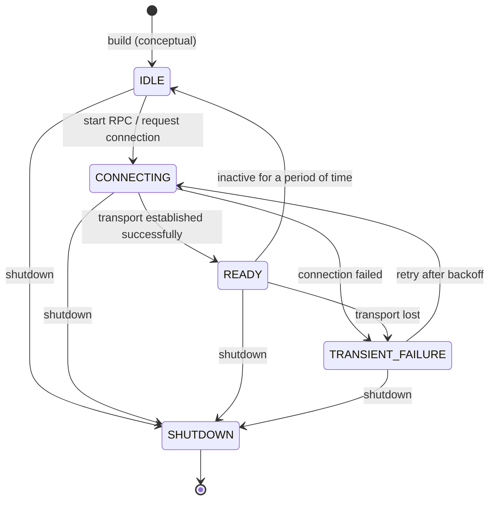
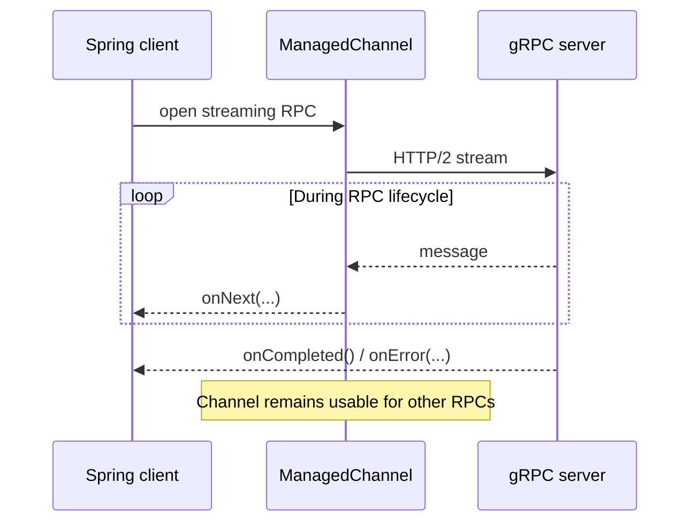

# ManagedChannel and Its Lifecycle

## 1. Learning Objectives

In gRPC Java, `ManagedChannel` is the entry point a client uses to call a remote service. When developing Spring applications, managing channels properly directly affects latency, connection count, fault recovery, and graceful shutdown.

After this lesson, you will be able to:

- Distinguish between a `ManagedChannel`, an actual network connection, a generated stub, and a single RPC invocation.
- Design a reusable channel for multiple unary or streaming calls instead of creating a new channel per request.
- Explain connectivity states and the limitations of observing them.
- Create, share, and shut down channels according to Spring bean lifecycles; clearly identify which component is responsible for closing them.
- Combine deadlines, TLS, interceptors, metadata, and observability without mixing RPC lifecycles with channel lifecycles.
- Test RPC invocations and resource cleanup when the application shuts down.

**Context:** Spring gRPC combines Protocol Buffers contracts, Java code generated from `.proto`, gRPC clients/servers, and Spring component management. This lesson focuses on the client side. The examples create channels directly using the gRPC Java API to make the lifecycle explicit; for channels pre-created by a Spring gRPC integration library, use the lifecycle management mechanism provided by that library.

## 2. What Is `ManagedChannel`?

A gRPC service typically starts from a `.proto` contract. The Java code generator produces message types and stub classes. A stub uses a `Channel` to send RPCs; `ManagedChannel` is a channel implementation that adds connection management and resource shutdown capabilities.

```mermaid
flowchart LR
    A[Spring service / Controller] --> B[Generated gRPC stub]
    B --> C[ManagedChannel]
    C --> D[Name resolver]
    C --> E[Load balancer]
    D --> E
    E --> F[HTTP/2 transport(s)]
    F --> G[gRPC server]
```

The diagram illustrates the high-level relationships; the resolver, load balancer, and transport are internal components of endpoint selection and call dispatch.

The key point is that **a `ManagedChannel` does not equate to a single TCP socket**. A channel is a long-lived logical object: depending on configuration and state, gRPC may not have opened a connection yet, may reopen connections, may select among multiple addresses, or may use different transports. Similarly, a single RPC call does not equate to a channel; multiple RPCs can run concurrently on the same channel, and HTTP/2 can multiplex multiple streams over a connection.

| Concept | Role | Typical Lifecycle |
|---|---|---|
| `ManagedChannel` | Provides a path to a gRPC destination, coordinating connections and resources | Per client/service or per application |
| Generated stub, e.g., `GreeterGrpc.GreeterBlockingStub` | Java API for calling methods defined in `.proto` | Can be kept and reused; configured per call via `with...()` |
| Unary RPC | One request, one response | From call initiation until result or error |
| Streaming RPC | One or two message streams within a single RPC | Can be much longer than unary; still a distinct RPC |
| HTTP/2 transport | Network connection used by gRPC for transmission | Established, reconnected, and reclaimed by gRPC |

`ManagedChannel` and the stubs generated by gRPC Java are designed for concurrent use. Typically, an application keeps **one channel per logical destination and corresponding connection configuration**, then creates or reuses stubs on that channel. Do not open a new channel for every incoming HTTP request in a Spring controller: this incurs extra connection handshakes, increases sockets/threads, adds latency, and easily leaks resources.

A single channel can serve multiple stubs for multiple services located at the same compatible destination. Conversely, two systems with different addresses, certificates, authentication policies, or connection configurations usually require separate channels. There is no rigid rule that the entire application must have only a single channel.

## 3. Contract Example and First Call

Suppose the server declares the `greeter.proto` contract:

```proto
syntax = "proto3";

package tutorial.hello;
option java_package = "dev.example.hello";
option java_multiple_files = true;

service Greeter {
  rpc SayHello (HelloRequest) returns (HelloReply);
}

message HelloRequest {
  string name = 1;
}

message HelloReply {
  string message = 1;
}
```

After Protocol Buffers/gRPC code generation, the Java side has types such as `HelloRequest`, `HelloReply`, and `GreeterGrpc`. The example below invokes a unary RPC using the gRPC Java API. A test server at `localhost:9090` is assumed to be running and exposing the `Greeter` service.

```java
import dev.example.hello.GreeterGrpc;
import dev.example.hello.HelloReply;
import dev.example.hello.HelloRequest;
import io.grpc.Grpc;
import io.grpc.InsecureChannelCredentials;
import io.grpc.ManagedChannel;
import java.util.concurrent.TimeUnit;

public class GreeterDemo {
    public static void main(String[] args) throws InterruptedException {
        ManagedChannel channel = Grpc.newChannelBuilderForAddress(
                "localhost", 9090, InsecureChannelCredentials.create())
                .build();

        try {
            GreeterGrpc.GreeterBlockingStub stub =
                    GreeterGrpc.newBlockingStub(channel);
            HelloReply reply = stub.withDeadlineAfter(2, TimeUnit.SECONDS)
                    .sayHello(HelloRequest.newBuilder().setName("Lan").build());
            System.out.println(reply.getMessage());
        } finally {
            channel.shutdown();
            if (!channel.awaitTermination(5, TimeUnit.SECONDS)) {
                channel.shutdownNow();
                channel.awaitTermination(2, TimeUnit.SECONDS);
            }
        }
    }
}
```

`InsecureChannelCredentials` allows non-TLS connections, suitable only for development environments or controlled test networks. When connecting to real systems, use TLS and configure appropriate certificates (see Section 8).

Observe three points in the example:

1. `build()` creates the channel object but **does not guarantee the server is ready**; transport establishment may occur when an RPC is invoked.
2. `withDeadlineAfter(...)` returns **a new stub** with a deadline for the call; it does not mutate the original stub or close the channel.
3. `shutdown()` is an operation for the *channel owner*. It is not something to execute after every RPC when the channel is shared.

In a long-running Spring server application, transfer channel ownership to a bean or the framework's channel management mechanism instead of wrapping individual requests in `try/finally`.

## 4. Channel States

gRPC Java provides `ConnectivityState` to observe the aggregated connection state of a channel.

| State | Practical Meaning | Handling Notes |
|---|---|---|
| `IDLE` | The channel is not actively connecting at the time of observation | May occur right after creation or after a period of inactivity; a new RPC typically triggers connection |
| `CONNECTING` | gRPC is resolving addresses or establishing a connection/transport | Does not yet mean RPCs can succeed |
| `READY` | The channel has a transport ready to serve RPCs | Does not guarantee every RPC will succeed; the server may still return business errors |
| `TRANSIENT_FAILURE` | A transport establishment or usage attempt failed; gRPC may retry after backoff | Do not immediately destroy and recreate the channel every time this state occurs |
| `SHUTDOWN` | Channel shutdown has started; no new RPCs are accepted | Final state of the channel lifecycle |



This is a **conceptual diagram** for reasoning about behavior, not a guarantee that every configuration and every state transition follows those exact arrows. In practice, a domain name can resolve to multiple addresses, and connections can change while the client continues sending RPCs.

### Reading State and Receiving Notifications

```java
ConnectivityState state = channel.getState(false);
System.out.println("Channel state: " + state);

ConnectivityState observed = channel.getState(true);
channel.notifyWhenStateChanged(observed, () -> {
    ConnectivityState current = channel.getState(false);
    System.out.println("State changed: " + observed + " -> " + current);
});
```

The APIs above belong to `io.grpc.ManagedChannel` and `io.grpc.ConnectivityState`:

- `getState(false)` takes a current **snapshot** and does not request a new connection.
- `getState(true)` can cause the channel to leave `IDLE` to attempt connecting; it does not wait until `READY`.
- `notifyWhenStateChanged(source, callback)` registers a **one-shot** listener until the state leaves `source`. To monitor continuously, you must re-register after the callback runs.
- The callback should be short and non-blocking; do not use it to run heavy network operations or replace service health checks.

The `READY` state only describes part of transport readiness. It does not prove that a specific business method works, that authentication is valid, or that the system is meeting latency thresholds. To assess actual health, observe RPC outcomes, deadlines, gRPC Health Checking (if implemented by the server), and appropriate metrics.

## 5. Standard Lifecycle: Create, Reuse, Stop

### Creation and Usage Phase

1. **Create the channel:** choose the logical target, security credentials, and options such as resolver, load balancing, and message size.
2. **Create stubs:** `GreeterGrpc.newBlockingStub(channel)` or async/future variants depending on the generated API.
3. **Send RPCs:** set per-call deadlines and metadata; reuse the channel for subsequent RPCs.
4. **Connection recovery:** let gRPC's reconnect/backoff mechanism manage normal transport errors; handle RPC-level errors according to business policy.
5. **Application shutdown:** stop accepting new work, allow in-flight RPCs time to complete, shut down the channel with a bounded timeout, then force shutdown if necessary.

### Differences Between Shutdown Operations

| API | Effect | Use Case |
|---|---|---|
| `shutdown()` | Initiates an orderly shutdown; no new RPCs are accepted, already-started RPCs get a chance to finish | Normal application shutdown |
| `awaitTermination(timeout, unit)` | Blocks the calling thread up to the specified timeout waiting for the channel to terminate completely | Waiting for resource cleanup on the shutdown path |
| `shutdownNow()` | Requests immediate shutdown and cancels remaining RPCs | Shutdown time budget exhausted or critical failure |
| `isShutdown()` | Indicates whether shutdown has been initiated | Checking status; does not mean all resources are released |
| `isTerminated()` | Indicates whether the channel has completely terminated | Verifying shutdown completion |

A common shutdown sequence:

```java
channel.shutdown();
try {
    if (!channel.awaitTermination(5, TimeUnit.SECONDS)) {
        channel.shutdownNow();
        channel.awaitTermination(2, TimeUnit.SECONDS);
    }
} catch (InterruptedException e) {
    channel.shutdownNow();
    Thread.currentThread().interrupt();
}
```

The `5 + 2` second budget is only an example; choose timeouts based on your application's allowed shutdown window. `shutdownNow()` requests cancellation of remaining work but does not guarantee immediate release of all resources. Do not call `awaitTermination(...)` on an RPC handler thread or event loop that still needs to serve traffic. After `shutdown()`, do not reuse the channel to send new RPCs.

Operations such as `enterIdle()` and `resetConnectBackoff()` are meant for specialized connection control scenarios. They do not replace `shutdown()` and are rarely needed in typical business logic.

## 6. Binding Channel Ownership to Spring

In Spring, a `ManagedChannel` object typically outlives a single request. Application-scoped singleton is a sensible starting point when a client shares the same target and configuration.

There are two common management approaches:

- **Framework-managed channel:** configure via the client/channel mechanism of the Spring gRPC version in use, then inject the client or channel using the corresponding API. The framework owns the lifecycle; do not manually call `shutdown()` on a channel that other components are still using.
- **Application-managed channel:** declare a singleton bean or component and take responsibility for closing it when the Spring context shuts down. This approach is useful for understanding the lifecycle and when direct gRPC Java customization is needed.

The example below shows **a Spring component that owns its channel**. The types `GreeterGrpc`, `HelloRequest`, and `HelloReply` are generated from the contract in Section 3.

```java
package dev.example.client;

import dev.example.hello.GreeterGrpc;
import dev.example.hello.HelloReply;
import dev.example.hello.HelloRequest;
import io.grpc.Grpc;
import io.grpc.InsecureChannelCredentials;
import io.grpc.ManagedChannel;
import java.util.concurrent.TimeUnit;
import org.springframework.beans.factory.DisposableBean;
import org.springframework.beans.factory.annotation.Value;
import org.springframework.stereotype.Component;

@Component
public final class GreetingRpcClient implements DisposableBean {
    private final ManagedChannel channel;
    private final GreeterGrpc.GreeterBlockingStub stub;

    public GreetingRpcClient(
            @Value("${demo.grpc.greeter.host:localhost}") String host,
            @Value("${demo.grpc.greeter.port:9090}") int port) {
        this.channel = Grpc.newChannelBuilderForAddress(
                host, port, InsecureChannelCredentials.create()).build();
        this.stub = GreeterGrpc.newBlockingStub(channel);
    }

    public String greet(String name) {
        HelloRequest request = HelloRequest.newBuilder().setName(name).build();
        HelloReply reply = stub.withDeadlineAfter(2, TimeUnit.SECONDS)
                .sayHello(request);
        return reply.getMessage();
    }

    @Override
    public void destroy() {
        channel.shutdown();
        try {
            if (!channel.awaitTermination(5, TimeUnit.SECONDS)) {
                channel.shutdownNow();
                channel.awaitTermination(2, TimeUnit.SECONDS);
            }
        } catch (InterruptedException e) {
            channel.shutdownNow();
            Thread.currentThread().interrupt();
        }
    }
}
```

Minimal configuration for the example:

```yaml
demo:
  grpc:
    greeter:
      host: localhost
      port: 9090
```

The default values and non-TLS connection in the example are for local development. In real deployments, obtain targets and TLS settings from environment-specific configuration. Never hardcode tokens or private keys directly in code.

Because `GreetingRpcClient` owns its own channel, `DisposableBean.destroy()` is the right place to close it. If you separate `ManagedChannel` into a `@Bean`, you can let the container call `shutdown` via `@Bean(destroyMethod = "shutdown")`; when bounded wait for termination is needed, use a shutdown manager component with clear ownership. Avoid having both the bean and the client attempt to shut down the same channel.

For a Spring server, consider shutdown ordering: stop accepting new HTTP/RPC requests and stop dependent tasks before shutting down channels used to call external services. Complex cases can be coordinated using Spring lifecycle hooks (`SmartLifecycle` or an appropriate shutdown mechanism) to prevent beans from still sending RPCs after the channel has closed. Do not store a channel in a request-scoped bean and recreate it on every request.

## 7. Deadlines, Statuses, and Error Recovery

A deadline belongs to **each RPC**, not to the `ManagedChannel` lifecycle. When an RPC times out, it may terminate with `DEADLINE_EXCEEDED`; the channel can remain `READY` and continue serving other RPCs.

```java
GreeterGrpc.GreeterBlockingStub fastStub =
        stub.withDeadlineAfter(300, TimeUnit.MILLISECONDS);

try {
    fastStub.sayHello(HelloRequest.newBuilder().setName("Lan").build());
} catch (io.grpc.StatusRuntimeException e) {
    switch (e.getStatus().getCode()) {
        case DEADLINE_EXCEEDED -> System.err.println("RPC deadline exceeded");
        case UNAVAILABLE -> System.err.println("Service/transport unavailable");
        default -> System.err.println("RPC failed: " + e.getStatus());
    }
}
```

The `switch` example uses modern Java syntax. When using an older Java version, replace it with the corresponding `switch` statement.

Options to understand:

| Scenario | Appropriate Behavior |
|---|---|
| RPC returns `DEADLINE_EXCEEDED` | Check time budgets, load, and latency; do not close the channel just because one RPC timed out |
| RPC returns `UNAVAILABLE` | Check address, DNS, TLS, connectivity, and server; gRPC may automatically attempt to reconnect |
| Need to wait for a temporarily unavailable server | Consider `withWaitForReady()` **with a deadline**, as the call may have to wait for the connection to return |
| Want custom retries | Only retry within a budget and based on business idempotency; avoid duplicating operations with side effects |
| RPC is cancelled | Cancel the corresponding call or stream; do not shut down a channel shared by other RPCs |

`withWaitForReady()` does not mean every application error is retried. It primarily changes how a call is handled when no transport is ready yet. Always attach a deadline to avoid waiting indefinitely at the business level.

Distinguish between `Status.Code.CANCELLED`, `DEADLINE_EXCEEDED`, `UNAVAILABLE`, `UNAUTHENTICATED`, `PERMISSION_DENIED`, and `RESOURCE_EXHAUSTED` in operations. Each code points to a different category of root causes. For example, authentication errors usually require fixing credentials/metadata or permissions; repeatedly creating new channels will not solve them.

## 8. Where Do TLS, Metadata, and Interceptors Attach?

A channel carries **connection** configuration: target address, transport security, and sometimes load balancing and connection policies. Metadata and deadlines typically have **RPC** scope or stub/interceptor scope.

### TLS for Real Connections

```java
import io.grpc.Grpc;
import io.grpc.ManagedChannel;
import io.grpc.TlsChannelCredentials;

ManagedChannel secureChannel = Grpc.newChannelBuilderForAddress(
        "grpc.example.com", 443, TlsChannelCredentials.create())
        .build();
```

This snippet uses TLS and the environment's default trust store. In systems using an internal CA or mTLS, provide appropriate trust material and client certificates/keys matching the server's policy. The hostname used for connecting must match the identity verified in the certificate; never disable TLS verification as a "quick fix" for handshake failures in production.

### Metadata and Interceptors

Metadata can carry authentication tokens, correlation IDs, or routing information for an RPC. In gRPC Java, a client interceptor can attach metadata, log calls, or measure call duration. A simple example attaching a header to a stub (assuming a channel and token already exist):

```java
import io.grpc.Metadata;
import io.grpc.stub.MetadataUtils;

Metadata headers = new Metadata();
Metadata.Key<String> requestIdKey =
        Metadata.Key.of("x-request-id", Metadata.ASCII_STRING_MARSHALLER);
headers.put(requestIdKey, "demo-request-001");

GreeterGrpc.GreeterBlockingStub tracedStub =
        GreeterGrpc.newBlockingStub(channel)
                .withInterceptors(MetadataUtils.newAttachHeadersInterceptor(headers));
```

This illustrates static metadata. Request IDs and tokens may vary per call; do not attach a single static request ID onto a singleton stub used for all requests, and do not log sensitive tokens. When metadata varies by context, use an appropriate interceptor/credential provider to retrieve values **per RPC**. Also distinguish between `CallCredentials` (per-RPC authentication credentials) and `ChannelCredentials` (transport security).

An interceptor used across the application should minimize mutable state, be thread-safe, and have a clear purpose. Adding an interceptor solely for one specific client does not mean a new network connection must be created.

## 9. Do Streaming RPCs Need a Separate Channel?

No. Unary, server streaming, client streaming, and bidirectional streaming can all share the same channel. The difference is that **the lifetime of a streaming RPC** can be very long, which affects deadlines, cancellation, backpressure, and shutdown.



Practical guidelines:

- Set reasonable deadlines for streams with bounded durations. Long-lived monitoring streams need dedicated policies for connection duration, heartbeats, and re-subscription upon completion.
- If the client is no longer interested in results, cancel the **active RPC** using the appropriate stub/call/stream observer API; do not call `shutdownNow()` on a shared channel.
- For client/bidirectional streaming, respect flow control/backpressure mechanisms; do not buffer an unbounded number of messages simply because a connection exists.
- When shutting down the Spring context, long-lived streams can prevent graceful shutdown from completing. Proactively close or cancel them during the phase where new work is stopped, and then shut down the channel with a timeout.

## 10. Resilience and Operations

`ManagedChannel` handles a great deal at the transport layer, but it does not replace fault-tolerant design at the application layer.

### Resolver, Load Balancing, and Reconnect

A channel selects endpoints based on its target, name resolver, and configured load-balancing policy. For a service name with multiple addresses, the address selection policy affects where RPCs are sent. Verify how DNS/service discovery behaves in the runtime environment before choosing a load-balancing configuration. One example in gRPC Java is the `round_robin` policy when supported by the environment and when the resolver provides multiple suitable addresses.

Transient transport failures are typically reconnected automatically by gRPC with backoff. Writing a loop such as "on `UNAVAILABLE` → close channel → create new channel" often makes matters worse by losing reconnection state, causing connection spikes, and potentially ignoring RPC deadlines. If application-level retries are needed, enforce count/time bounds and retry only safe operations.

### Keepalive and Message Size

Keepalive can help detect dead connections, but pinging too aggressively may cause the server or proxy to reject connections. Configure keepalive according to infrastructure policies, and do not treat it as a replacement for health checking or deadlines. Likewise, message size limits must be aligned between client and server; raising the inbound message limit unboundedly can lead to high memory consumption.

### What Should You Observe?

To evaluate the performance and reliability of a Spring gRPC client, prioritize measuring:

| Metric Group | Questions to Answer |
|---|---|
| RPC count, success rate, and `Status` codes | Which methods are failing? Are errors caused by deadlines, authentication, or transport? |
| Per-method latency, P50/P95/P99 | How much latency are users experiencing, and is the tail increasing? |
| Active RPCs and long-lived streams | Is the client overloaded or failing to terminate streams? |
| Connections/reconnects and channel state | Is there flapping, or issues with DNS, TLS, or load balancing? |
| Process resources | Are threads, sockets, CPU, or memory growing abnormally from repeated channel creation? |

You can integrate logging, metrics, and tracing using the observability mechanisms suited to your Spring gRPC/gRPC Java version, such as OpenTelemetry-compatible instrumentation. Never log sensitive metadata. `getState(false)` should only serve as an auxiliary diagnostic signal, not the sole source for deciding whether business operations can proceed.

## 11. Testing Lifecycle

To test client logic without starting a real network server, gRPC Java provides an **in-process server/channel** via the `grpc-inprocess` test module. The following test focuses on unary invocation and resource cleanup using the messages and stubs generated from `.proto`.

```java
import static org.junit.jupiter.api.Assertions.assertEquals;

import dev.example.hello.GreeterGrpc;
import dev.example.hello.HelloReply;
import dev.example.hello.HelloRequest;
import io.grpc.ManagedChannel;
import io.grpc.Server;
import io.grpc.inprocess.InProcessChannelBuilder;
import io.grpc.inprocess.InProcessServerBuilder;
import io.grpc.stub.StreamObserver;
import java.util.concurrent.TimeUnit;
import org.junit.jupiter.api.Test;

class GreeterChannelTest {
    @Test
    void reusesChannelAndClosesResources() throws Exception {
        String name = InProcessServerBuilder.generateName();
        Server server = InProcessServerBuilder.forName(name)
                .directExecutor()
                .addService(new GreeterGrpc.GreeterImplBase() {
                    @Override
                    public void sayHello(
                            HelloRequest request,
                            StreamObserver<HelloReply> responses) {
                        responses.onNext(HelloReply.newBuilder()
                                .setMessage("Hello " + request.getName())
                                .build());
                        responses.onCompleted();
                    }
                })
                .build()
                .start();
        ManagedChannel channel = InProcessChannelBuilder.forName(name)
                .directExecutor()
                .build();

        try {
            GreeterGrpc.GreeterBlockingStub stub =
                    GreeterGrpc.newBlockingStub(channel);
            for (String person : new String[] {"Lan", "Minh"}) {
                HelloReply reply = stub.withDeadlineAfter(1, TimeUnit.SECONDS)
                        .sayHello(HelloRequest.newBuilder()
                                .setName(person)
                                .build());
                assertEquals("Hello " + person, reply.getMessage());
            }
        } finally {
            channel.shutdownNow();
            channel.awaitTermination(2, TimeUnit.SECONDS);
            server.shutdownNow();
            server.awaitTermination(2, TimeUnit.SECONDS);
        }
    }
}
```

`directExecutor()` keeps the example concise but should only be used in short, controlled tests. In-process tests verify RPC handling and lifecycle behavior; they **do not verify** DNS, TLS, HTTP/2 over a real network, or proxy interactions. For production applications, supplement them with integration tests running over real network ports, testing Spring context startup/shutdown, connection drops, and deadlines under realistic load.

A useful lifecycle test scenario is: create a client, successfully invoke two RPCs over the same channel, initiate shutdown, verify the channel terminates within the allowed budget, and verify that new calls after shutdown fail as expected. In Spring, you can run context startup/shutdown tests to detect channels that are not reclaimed.

## 12. Common Pitfalls and Troubleshooting

| Symptom | Causes to Check | Resolution |
|---|---|---|
| Every HTTP request creates a new `ManagedChannel` | Creating the channel inside a request handler method | Move the channel to a singleton bean or long-lived owner |
| Threads/sockets grow steadily after many calls | Skipping shutdown on self-created channels | Close in the owner's lifecycle; observe `isTerminated()` during shutdown |
| Repeated `UNAVAILABLE` | Wrong host/port, DNS, proxy, TLS, server not ready | Check connectivity and status/cause; do not recreate channels indefinitely |
| One RPC exceeding its deadline cancels other RPCs | Code calls `shutdownNow()` when a single call times out | Cancel only the failing RPC; keep the shared channel active |
| Startup checks `READY` yet RPCs still fail | Treating connectivity state as a guarantee of business health | Use health checks and real RPC results; set deadlines |
| Spring stops but streams are still open | Long-lived streams or unbounded shutdown | Stop accepting work, cancel/complete streams, shut down channel with timeout |
| `UNAUTHENTICATED` or TLS errors | Invalid credentials, metadata, or certificate/hostname mismatch | Check `CallCredentials`, trust chain, mTLS, and permissions |
| Latency spikes and rejected pings observed | Keepalive too aggressive for server/proxy | Adjust to match infrastructure policy; re-measure latency and reconnects |

## 13. Hands-On Exercise

You are building a Spring service that calls `Greeter.SayHello`. The service must handle many concurrent HTTP requests, respond within at most two seconds per RPC, and terminate cleanly when the Spring context closes.

1. Use the `.proto` contract in Section 3 to generate Java code. Create a client bean holding a `ManagedChannel` and a blocking stub without creating a channel per call.
2. Set a two-second deadline via `withDeadlineAfter(...)`. Try stopping the server to observe `UNAVAILABLE` or `DEADLINE_EXCEEDED`, depending on the scenario and failure timing.
3. Log `Status.Code`, RPC duration, and channel state at the time of diagnosis. Explain why `READY` does not guarantee call success.
4. Add shutdown handling with a timeout and verify no application-created channels remain after the Spring context closes.
5. Switch the test environment to TLS, configure appropriate trust settings, and test failure when the hostname does not match the certificate.

**Completion Criteria:** You can pinpoint exactly where the channel is created, which component uses it, who owns its shutdown, where deadlines live, and the execution flow when the server is temporarily unavailable. When replacing unary with streaming, you can explain why an individual stream must be cancelled before considering shutting down the shared channel.

## 14. Design Takeaways

A `ManagedChannel` is a **long-lived** logical resource, whereas each RPC is **short-lived or independently scoped** work. Solid Spring gRPC design starts with choosing the right channel owner, reusing channels and stubs, setting per-call deadlines, handling statuses at the proper layer, and shutting down resources in an orderly manner when the application exits. Connectivity states assist with diagnostics; they do not replace RPC observability, TLS security, and integration testing on real infrastructure.
