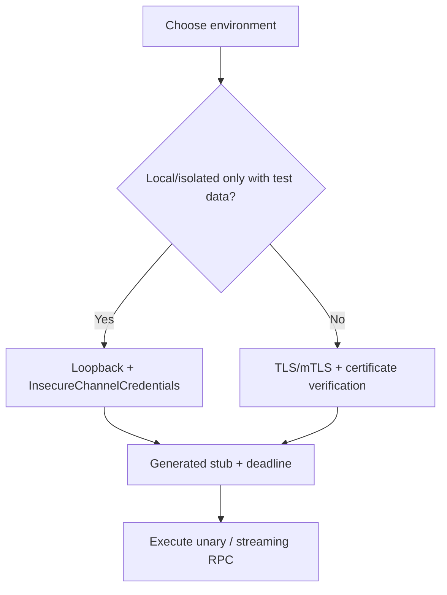

# Plaintext Connections in Development Environments

## 1. Objectives and Scope

When developing **Spring gRPC** services on a local machine, teams often want to run the client and server quickly, inspect requests/responses, and test Protocol Buffers contracts before configuring TLS certificates. A **plaintext connection** allows gRPC to transmit data over HTTP/2 without encrypting the transport channel. This is useful for local machines or isolated test environments, but it requires understanding the exact security boundaries and how to transition to TLS for real deployments.

After this lesson, you will be able to:

- Explain how plaintext in gRPC differs from TLS, HTTP/1.1, and REST/JSON.
- Create a plaintext gRPC Java server and client using code properly generated from `.proto`.
- Restrict a test server to loopback and control exposed ports.
- Declare a plaintext client as a Spring bean with a clear lifecycle.
- Verify connectivity using `grpcurl`, deadlines, statuses, and logs to diagnose wrong ports or TLS mismatches.
- Write integration tests over real HTTP/2 plaintext and recognize when TLS/mTLS must be used.

**Position in the "Channels and Connections" chapter:** this lesson examines the **transport security mode** when creating channels and servers in development environments. A `ManagedChannel` can be reused across multiple unary/streaming RPCs and must be closed when its owner terminates; choosing plaintext does not alter those lifecycle principles.

## 2. What Is Plaintext in gRPC, Really?

gRPC Java typically uses **HTTP/2** as its transport protocol and **Protocol Buffers** to serialize messages. The phrase *plaintext connection* indicates **not using TLS on the transport connection**; it does not mean payloads are converted into human-readable text strings.

| Characteristic | Plaintext gRPC | gRPC over TLS |
|---|---|---|
| RPC protocol | gRPC over HTTP/2 | gRPC over HTTP/2 |
| Payload | Usually binary Protobuf | Usually binary Protobuf |
| In-transit encryption | No | Yes, when TLS is properly configured and verified |
| Peer identity verification via TLS certificate | No | Yes for server; mTLS also verifies client |
| Protection of metadata and RPC content from network eavesdropping | No | Yes on segments protected by TLS |
| Appropriate usage | Loopback, controlled isolated test environments | Production, untrusted networks, sensitive data flows |

In plaintext communication, data can be inspected on the network even though Protobuf messages are not directly human-readable like JSON. Do not confuse **format serialization** with **security encryption**. Metadata such as `authorization` is also transmitted without TLS protection if sent over this channel.

Some documentation uses the term **h2c** to refer to HTTP/2 without TLS. Plaintext gRPC Java normally speaks direct HTTP/2 (*prior knowledge*), rather than turning into HTTP/1.1 REST or automatically upgrading every HTTP/1.1 request to gRPC. Therefore, using a standard `curl` `GET /` against a gRPC port is generally not the right test.


**Trust boundaries** are the deciding factor. `localhost` may be suitable for learning, but a plaintext port open on all network interfaces, a service in Kubernetes, or a connection traversing a proxy can still be observed by intermediate devices or other parties on the path. "Internal only" does not automatically mean "secure".

## 3. Prerequisites Before Running Examples

The examples use Java with the gRPC Java transport and code generated from Protocol Buffers contracts. A Spring gRPC project typically includes:

- Tools to generate Java messages from `.proto` (`protoc`) and gRPC stubs (`protoc-gen-grpc-java`).
- gRPC APIs for stubs, Protobuf, and an HTTP/2 transport, such as `grpc-netty-shaded`.
- Corresponding Spring Framework/Spring Boot libraries if using Spring integration.
- A free local port; here `127.0.0.1:9090` is chosen.

Code generator versions and runtime libraries must be compatible. This lesson uses the gRPC Java APIs `Grpc`, `InsecureChannelCredentials`, and `TlsChannelCredentials`; systems on older APIs may have different builder names. To clarify the mechanics of the connection, the first part builds client/server using pure gRPC Java APIs, then brings the client into the Spring lifecycle. When using a **Spring gRPC starter** where the framework creates the server/channel automatically, configure security using the exact mechanism of the starter version in use, and avoid creating a second server on the same port.

### The `greeter.proto` Contract

Place an example file at `src/main/proto/greeter.proto`:

```proto
syntax = "proto3";

package demo.greeter;

option java_package = "dev.example.hello";
option java_multiple_files = true;

service Greeter {
  rpc SayHello (HelloRequest) returns (HelloReply);
}

message HelloRequest {
  string name = 1;
}

message HelloReply {
  string message = 1;
}
```

After code generation, the Java classes reside in package `dev.example.hello`, including `GreeterGrpc`, `HelloRequest`, and `HelloReply`. The **service name to invoke with gRPC tools** is `demo.greeter.Greeter`, based on the `.proto` `package`; do not confuse it with the Java package generated from `java_package`.

## 4. Running a Local Plaintext gRPC Server

To keep the test service inaccessible from other machines, the example uses the **Netty transport** and binds directly to the loopback address `127.0.0.1`.

```java
package dev.example.hello;

import io.grpc.Server;
import io.grpc.netty.shaded.io.grpc.netty.NettyServerBuilder;
import io.grpc.stub.StreamObserver;
import java.net.InetSocketAddress;
import java.util.concurrent.TimeUnit;

public final class LocalGreeterServer {
    public static final class GreeterService
            extends GreeterGrpc.GreeterImplBase {
        @Override
        public void sayHello(
                HelloRequest request,
                StreamObserver<HelloReply> responseObserver) {
            HelloReply reply = HelloReply.newBuilder()
                    .setMessage("Hello " + request.getName())
                    .build();
            responseObserver.onNext(reply);
            responseObserver.onCompleted();
        }
    }

    public static void main(String[] args) throws Exception {
        Server server = NettyServerBuilder
                .forAddress(new InetSocketAddress("127.0.0.1", 9090))
                .addService(new GreeterService())
                .build()
                .start();

        Runtime.getRuntime().addShutdownHook(new Thread(() -> {
            server.shutdown();
            try {
                if (!server.awaitTermination(5, TimeUnit.SECONDS)) {
                    server.shutdownNow();
                }
            } catch (InterruptedException e) {
                server.shutdownNow();
                Thread.currentThread().interrupt();
            }
        }));

        System.out.println("Plaintext gRPC at 127.0.0.1:9090");
        server.awaitTermination();
    }
}
```

Here `NettyServerBuilder` is not configured with TLS/`sslContext`, so the server accepts plaintext gRPC connections. Calling `forAddress` **restricts the listening interface**. The server still uses Protocol Buffers and HTTP/2, without requiring a Spring HTTP controller.

The gRPC Java API also allows declaring plaintext explicitly with credentials:

```java
import io.grpc.Grpc;
import io.grpc.InsecureServerCredentials;

// Only illustrates the API for creating a non-TLS server.
// newServerBuilderForPort typically listens on default interfaces;
// restrict access before using outside an isolated environment.
var builder = Grpc.newServerBuilderForPort(
        9090, InsecureServerCredentials.create());
```

When running locally on the same machine, prefer the loopback-bound variant above. Servers managed by a Spring gRPC starter usually have their own configuration for port, transport, and security; do not assume property names from one guide apply to every version.

## 5. Connecting from a Java Client Using `InsecureChannelCredentials`

The client uses the same address/port and explicitly sets plaintext mode:

```java
package dev.example.hello;

import io.grpc.Grpc;
import io.grpc.InsecureChannelCredentials;
import io.grpc.ManagedChannel;
import io.grpc.StatusRuntimeException;
import java.util.concurrent.TimeUnit;

public final class LocalGreeterClient {
    public static void main(String[] args) throws InterruptedException {
        ManagedChannel channel = Grpc.newChannelBuilderForAddress(
                "127.0.0.1", 9090,
                InsecureChannelCredentials.create())
                .build();

        try {
            GreeterGrpc.GreeterBlockingStub stub =
                    GreeterGrpc.newBlockingStub(channel);
            HelloRequest request = HelloRequest.newBuilder()
                    .setName("Lan")
                    .build();

            HelloReply reply = stub
                    .withDeadlineAfter(2, TimeUnit.SECONDS)
                    .sayHello(request);
            System.out.println(reply.getMessage());
        } catch (StatusRuntimeException e) {
            System.err.println("RPC failed: " + e.getStatus());
        } finally {
            channel.shutdown();
            if (!channel.awaitTermination(5, TimeUnit.SECONDS)) {
                channel.shutdownNow();
                channel.awaitTermination(2, TimeUnit.SECONDS);
            }
        }
    }
}
```

When the server from Section 4 is running, the expected output is:

```text
Hello Lan
```

Points to understand:

1. `InsecureChannelCredentials.create()` specifies that there is **no TLS** on this channel. It does not generate dummy certificates and does not implicitly enable authentication.
2. `.build()` creates a `ManagedChannel` instance. This call **does not guarantee a successful connection**; the first RPC invocation may trigger transport setup.
3. The two-second deadline applies **to the RPC**, not to the lifetime of the channel. If an RPC times out, the channel can still be used for subsequent calls.
4. In a short demo program, `finally` closes the channel. In a long-running Spring application, **do not** run `shutdown()` after every HTTP request; share the channel and let its owner close it when the application exits.

Do not use `ManagedChannelBuilder.forAddress(...).usePlaintext()` as a universal recipe across every transport/version when you already have the explicit credentials API above; both approaches can achieve plaintext in supported versions. For new code, pick one consistent configuration mechanism so maintainers clearly know whether a channel uses TLS.

## 6. Integrating a Plaintext Channel into the Spring Lifecycle

In Spring, multiple controllers/services may call the same gRPC backend. Declaring the channel as a **singleton bean** avoids the overhead of opening connections repeatedly and lets Spring close it when the context stops.

The example activates this bean only under the **`local` profile**, so plaintext configuration is not accidentally shipped to production:

```java
package dev.example.client;

import io.grpc.Grpc;
import io.grpc.InsecureChannelCredentials;
import io.grpc.ManagedChannel;
import org.springframework.beans.factory.annotation.Value;
import org.springframework.context.annotation.Bean;
import org.springframework.context.annotation.Configuration;
import org.springframework.context.annotation.Profile;

@Configuration(proxyBeanMethods = false)
@Profile("local")
public class LocalGrpcClientConfiguration {
    @Bean(destroyMethod = "shutdown")
    public ManagedChannel localGreeterChannel(
            @Value("${demo.grpc.greeter.host:127.0.0.1}") String host,
            @Value("${demo.grpc.greeter.port:9090}") int port) {
        return Grpc.newChannelBuilderForAddress(
                host, port, InsecureChannelCredentials.create())
                .build();
    }
}
```

Service using the injected channel:

```java
package dev.example.client;

import dev.example.hello.GreeterGrpc;
import dev.example.hello.HelloRequest;
import io.grpc.ManagedChannel;
import java.util.concurrent.TimeUnit;
import org.springframework.beans.factory.annotation.Qualifier;
import org.springframework.stereotype.Service;

@Service
public final class GreeterGateway {
    private final GreeterGrpc.GreeterBlockingStub stub;

    public GreeterGateway(
            @Qualifier("localGreeterChannel") ManagedChannel channel) {
        this.stub = GreeterGrpc.newBlockingStub(channel);
    }

    public String greet(String name) {
        return stub.withDeadlineAfter(2, TimeUnit.SECONDS)
                .sayHello(HelloRequest.newBuilder().setName(name).build())
                .getMessage();
    }
}
```

In the example's `application-local.yml`:

```yaml
demo:
  grpc:
    greeter:
      host: 127.0.0.1
      port: 9090
```

The `demo.grpc.*` properties are **custom configuration names chosen for this exercise**, not default properties of a Spring gRPC starter. Run the application with the `local` profile only in appropriate environments; other environments must provide a TLS-enabled `ManagedChannel` with the same qualifier, or use the client/channel mechanism supported by the framework. If the application fails to supply the required bean, Spring catches the configuration error when creating `GreeterGateway`, rather than silently falling back to plaintext.

`@Bean(destroyMethod = "shutdown")` invokes channel shutdown when the context closes, but it **does not wait** for all RPCs to finish. If the application needs graceful shutdown with a bounded timeout, use a shutdown manager component that calls `awaitTermination()` and stops accepting new work before closing the channel; do not let multiple beans claim ownership of calling `shutdown()` on the same channel.

Another note: `GreeterGateway` uses a **blocking stub**. Never invoke blocking methods on an event-loop thread that must not be blocked; in reactive or high-load applications, consider async stubs and an appropriate threading model.

### What About the Spring gRPC Server?

Spring gRPC can auto-detect registered services and start a server via auto-configuration, depending on the starter/version. With that model, server, port, and security must be configured via the official documentation for your exact version; **do not** manually create a second `Server` on the same port. The pure Java server example in Section 4 is used to practice the protocol and keep security configuration transparent. If you want full manual control in Spring, you can expose a `Server` bean started/stopped with the context, but you must coordinate lifecycle and ports rather than running alongside an auto-configured server.

## 7. Ensuring Plaintext Only Runs in Trusted Development Zones

Before enabling plaintext, answer three questions: **who can connect**, **what data is transmitted**, and **which devices the traffic traverses**.

| Situation | Assessment and Handling |
|---|---|
| Client/server on the same machine via `127.0.0.1` | Suitable for learning; still use dummy data and avoid leaking secrets in logs |
| Integration test on an isolated runner | Acceptable if the runner/port serves only the test and is torn down afterward |
| Container with `-p 9090:9090` | The port may be published on host interfaces; restrict mapping and firewall rules |
| Two machines on the same LAN or shared Wi-Fi | Do not assume it is safe just because it is for development; consider TLS |
| Kubernetes, cloud VM, load balancer, or ingress | Use TLS/mTLS per policy; TLS at ingress does not automatically protect a plaintext backend leg |
| Payload with real tokens, personal data, or production data | Never transmit over a plaintext connection |

For example, if the server runs **inside a container** and listens on `0.0.0.0:9090` inside the container to receive forwarded traffic, you can restrict the **host** port to loopback:

```bash
docker run --rm -p 127.0.0.1:9090:9090 my-grpc-dev-image
```

This command assumes the image exists and the server inside the container listens on the right port; if the server only binds `127.0.0.1` **inside the container** as in Section 4, port mapping from the host to the container network IP will not reach that socket. When port mapping is needed, adjust the server's bind address inside the container accordingly while keeping host mapping and firewall policies restrictive. Never expose this configuration to public environments.

Beyond bind addresses, use test data, dummy tokens, separated configuration profiles, and environment permission restrictions. **The convenience of plaintext does not replace network access control**.

## 8. Testing with `grpcurl` Instead of Regular HTTP Requests

`grpcurl` is a command-line tool for sending gRPC RPCs. For non-TLS connections, pass the `-plaintext` flag:

```bash
grpcurl -plaintext \
  -import-path src/main/proto \
  -proto greeter.proto \
  -d '{"name":"Lan"}' \
  127.0.0.1:9090 demo.greeter.Greeter/SayHello
```

Example output:

```json
{
  "message": "Hello Lan"
}
```

This invocation **does not require server reflection**, because the tool receives the `.proto` contract via `-import-path` and `-proto`. If the server supports *gRPC Server Reflection*, you can run `grpcurl -plaintext 127.0.0.1:9090 list`; if reflection is disabled, the `list` command can fail even though the main RPC works normally.

For comparison, running the same call while **omitting `-plaintext`** causes many default `grpcurl` configurations to attempt TLS; a plaintext server will reject or close the connection. This experiment helps identify a **TLS mode mismatch**, not proof that the server is down.

A TCP connection check with `nc`/`Test-NetConnection` only confirms the port is reachable. It does not verify HTTP/2, the gRPC contract, metadata, or RPC payloads. Sending HTTP/1.1 `curl` to a plaintext gRPC port also cannot replace `grpcurl`.

## 9. Distinguishing Connection Errors from RPC Errors

When a client calls a plaintext server, gRPC statuses help narrow down the cause, though they do not always pinpoint a single network fault.

```java
try {
    var response = stub.withDeadlineAfter(2, TimeUnit.SECONDS)
            .sayHello(HelloRequest.newBuilder().setName("Lan").build());
    System.out.println(response.getMessage());
} catch (io.grpc.StatusRuntimeException e) {
    switch (e.getStatus().getCode()) {
        case UNAVAILABLE -> System.err.println("Check address, port, TLS, and server");
        case DEADLINE_EXCEEDED -> System.err.println("RPC deadline exceeded");
        case UNIMPLEMENTED -> System.err.println("Wrong service/method name or server not registered");
        default -> System.err.println("RPC status: " + e.getStatus());
    }
}
```

This `switch` code requires Java syntax compatible with *switch rules*. In older Java versions, use a traditional `switch` statement.

| Symptom | Possibilities to Check | Diagnostic Action |
|---|---|---|
| `UNAVAILABLE: io exception` or connection refused | Server not running, wrong address/port, port blocked | Check bind address, port, firewall, and server process |
| Messages mentioning TLS handshake/SSL or HTTP/2 preface | One side uses TLS and the other plaintext; proxy speaks the wrong protocol | Check `InsecureChannelCredentials`, server TLS, and proxy configuration |
| `DEADLINE_EXCEEDED` | Slow server, resolver/transport waiting, stalled call, or deadline too short | Check logs on both sides and RPC duration; keep finite deadlines |
| `UNIMPLEMENTED` | Server has not registered the method or full service name is wrong | Check `.proto` contract, generated code, and server service registry |
| `UNKNOWN` or `INTERNAL` | Server processing error, protocol issue, or unmapped exception | Correlate server logs with client status/cause |
| `UNAUTHENTICATED` / `PERMISSION_DENIED` | Server has its own authentication/authorization layer or requires credentials | Check interceptors, metadata, and access policies |

Do not try to solve every error by creating a new `ManagedChannel`. gRPC Java has built-in reconnection mechanisms when the transport encounters errors; repeatedly creating channels increases sockets/threads and makes diagnostics harder. Retry **appropriate RPCs** with bounds based on idempotency and deadlines; never blindly retry methods with side effects.

## 10. Plaintext Preserves Metadata, Deadlines, and Interceptors

Protocol Buffers and the gRPC API still behave the same as with TLS. Clients can send metadata, attach deadlines, use interceptors for tracing/metrics, and receive `Status` codes. The difference is that **metadata on the wire is not protected by TLS**.

```java
import io.grpc.Metadata;
import io.grpc.stub.MetadataUtils;

Metadata metadata = new Metadata();
Metadata.Key<String> correlationKey = Metadata.Key.of(
        "x-correlation-id", Metadata.ASCII_STRING_MARSHALLER);
metadata.put(correlationKey, "local-demo-001");

GreeterGrpc.GreeterBlockingStub tracedStub = stub.withInterceptors(
        MetadataUtils.newAttachHeadersInterceptor(metadata));

HelloReply reply = tracedStub
        .withDeadlineAfter(2, TimeUnit.SECONDS)
        .sayHello(HelloRequest.newBuilder().setName("Lan").build());
```

This is an example of non-sensitive metadata for a single test run. For request IDs that change per request, do not attach a static value to a singleton stub serving all requests. Use an interceptor or component that produces metadata **per RPC**. Never put JWTs, API keys, passwords, or real data into logs, and do not send production credentials over plaintext for a "quick test".

Every RPC type can run over a plaintext channel:

| RPC Type | Impact of Plaintext | Points to Control |
|---|---|---|
| Unary | One request and one response over non-TLS HTTP/2 | Deadlines, timeouts, statuses |
| Server streaming | Server sends multiple messages in one RPC | Cancel the stream when no longer needed; choose suitable timeouts |
| Client streaming | Client sends a sequence of messages before receiving a result | Flow control/backpressure, mid-stream error handling |
| Bidirectional streaming | Both sides can send messages independently within one RPC | Ensure observer lifecycle hygiene; cancel on application shutdown |

Plaintext connections **do not exempt** you from backpressure, message size limits, keepalive policies, or long-lived stream handling. A streaming RPC does not require a dedicated channel; once a stream expires or is cancelled, the shared channel remains usable for other RPCs.

## 11. Real Integration Testing over Loopback TCP

*In-process* testing is great for verifying handler logic, but it bypasses real TCP/HTTP/2. To verify a **plaintext connection** setup, start a server on loopback with a **dynamic port** (`port = 0`) and connect using `InsecureChannelCredentials`.

The JUnit 5 example below reuses `LocalGreeterServer.GreeterService` from Section 4:

```java
package dev.example.hello;

import static org.junit.jupiter.api.Assertions.assertEquals;
import static org.junit.jupiter.api.Assertions.assertTrue;

import io.grpc.Grpc;
import io.grpc.InsecureChannelCredentials;
import io.grpc.ManagedChannel;
import io.grpc.Server;
import io.grpc.netty.shaded.io.grpc.netty.NettyServerBuilder;
import java.net.InetSocketAddress;
import java.util.concurrent.TimeUnit;
import org.junit.jupiter.api.Test;

class PlaintextGrpcIntegrationTest {
    @Test
    void unaryRpcOverRealPlaintextTransport() throws Exception {
        Server server = NettyServerBuilder
                .forAddress(new InetSocketAddress("127.0.0.1", 0))
                .addService(new LocalGreeterServer.GreeterService())
                .build()
                .start();

        ManagedChannel channel = Grpc.newChannelBuilderForAddress(
                "127.0.0.1", server.getPort(),
                InsecureChannelCredentials.create())
                .build();

        try {
            var reply = GreeterGrpc.newBlockingStub(channel)
                    .withDeadlineAfter(2, TimeUnit.SECONDS)
                    .sayHello(HelloRequest.newBuilder()
                            .setName("Lan")
                            .build());
            assertEquals("Hello Lan", reply.getMessage());
        } finally {
            channel.shutdownNow();
            server.shutdownNow();
            assertTrue(channel.awaitTermination(3, TimeUnit.SECONDS));
            assertTrue(server.awaitTermination(3, TimeUnit.SECONDS));
        }
    }
}
```

Port `0` lets the operating system choose a free port, preventing tests from colliding on port `9090`. `server.getPort()` returns the bound port. This test proves the client/server can execute **gRPC over non-TLS TCP loopback**, including the service path and Protobuf handler. It **does not** test TLS correctness, authentication, certificate chains, proxies, or real networks outside loopback.

To increase confidence, add targeted test cases:

1. Pause/stop the server or call the wrong port, and verify the client receives an appropriate `UNAVAILABLE`/deadline error instead of hanging forever.
2. Call with a very short deadline against a controlled-delay handler, and verify `DEADLINE_EXCEEDED` under the expected conditions.
3. Point a TLS-configured client at a plaintext server to recognize a handshake mismatch; avoid hardcoding a specific transport error message since it depends on version and timing.
4. Close the Spring context and verify that application-owned channels shut down and do not keep the process alive indefinitely.
5. When introducing TLS, run a dedicated integration test suite verifying valid/invalid certificates and mTLS if required.

## 12. Migrating from Local Plaintext to TLS

A good design isolates security changes to **how channels and servers are constructed**, leaving `.proto` contracts, service handlers, and most stub logic unchanged.



Switch the **client** to TLS once the corresponding server is configured with TLS and a valid certificate:

```java
import io.grpc.Grpc;
import io.grpc.ManagedChannel;
import io.grpc.TlsChannelCredentials;

ManagedChannel secureChannel = Grpc.newChannelBuilderForAddress(
        "grpc.example.com", 443,
        TlsChannelCredentials.create())
        .build();
```

`TlsChannelCredentials.create()` uses the default trust mechanism. If the server uses an internal CA or requires **mTLS**, configure the proper trust certificates, client certificate, and private key according to your runtime environment. The server must also present a TLS certificate with an identity matching the hostname; switching only the client to TLS while the server remains plaintext will **fail**.

In production environments, review the entire path: client → proxy/load balancer → server. If TLS terminates at the proxy while the proxy → gRPC server leg is plaintext, RPC payloads remain unencrypted on that segment. Security policy must explicitly document which segments are permitted to use plaintext and the associated network protections. For sensitive data, prefer end-to-end TLS/mTLS or an equivalent approved security architecture.

## 13. Practical Diagnostic Checklist

Before suspecting `ManagedChannel` or Protobuf itself, check step by step:

1. **Is the server actually running?** Is it bound to `127.0.0.1:9090`, `0.0.0.0:9090`, or an address inside a container?
2. **Does the client point to the right target?** `localhost` inside a container does not automatically point to the host machine or another container; verify IP/DNS and port against the actual topology.
3. **Do both sides agree on TLS mode?** `InsecureChannelCredentials` only works when the path to the server accepts plaintext; a TLS port requires a TLS client.
4. **Is it speaking proper gRPC HTTP/2?** HTTP/1.1 `curl` or a proxy downgrading to HTTP/1.1 will cause calls to fail even when TCP is open.
5. **Does the contract match?** Are the full name `demo.greeter.Greeter/SayHello`, message schema, and service registration aligned?
6. **Is there a deadline?** RPCs need an upper bound; avoid waiting indefinitely when the server disconnects.
7. **Where does the error occur?** Compare `Status`, cause, logs on both sides, tracing, and connection counts; never log real credentials.
8. **Did the application shut down properly?** After tests or when the Spring context exits, invoke shutdown on channels/servers owned by that component.

### Common Anti-Patterns

| Anti-Pattern | Why It Is Problematic | Replace With |
|---|---|---|
| Opening a plaintext port on `0.0.0.0` on a laptop and sending real tokens | Other machines can reach and eavesdrop on it | Bind loopback; use dummy data; enable TLS over networks |
| Adding `usePlaintext()` to "fix" production TLS errors | Bypasses certificate verification and transport encryption | Fix trust chain, hostname, certificate, or proxy config |
| Testing only with `curl http://localhost:9090/` | Plain HTTP requests do not verify the gRPC protocol | Use `grpcurl -plaintext` with `.proto` or reflection |
| Creating and discarding a channel on every HTTP request | Wastes connections and leaks resources | Share a Spring singleton channel and close it in the owner's lifecycle |
| Treating `port open` as `RPC healthy` | An open TCP socket does not prove methods work | Send a real RPC with a deadline and check the status |
| Using `-plaintext` against a TLS-required server | Handshake/protocol mismatch | Configure a TLS client with trusted certificates |
| Copying properties from a different Spring gRPC version | Your current version may use different APIs/property names | Check dependencies and version-matched documentation |

## 14. Practice Exercise

**Scenario:** you are building a Spring service acting as an HTTP gateway that calls `Greeter.SayHello` on a backend gRPC server. Initially both run on a laptop to verify the contract. Later the gateway moves into a container, and finally the system is deployed behind an ingress in a TLS-enabled environment.

**Requirements:**

1. Generate code from `greeter.proto`, run `LocalGreeterServer` on loopback, and invoke it successfully with `LocalGreeterClient`. Verify the response using `grpcurl -plaintext` with `.proto`.
2. Declare a shared `ManagedChannel` in Spring under the `local` profile, inject it into the gateway, and set a two-second deadline per RPC. Shut down the context and verify the channel closes.
3. Intentionally switch the client from plaintext to TLS while the server remains plaintext. Record the status and handshake error details; explain why the result differs from `UNIMPLEMENTED`.
4. Run a test using a dynamic port and add an unavailable-server scenario. Distinguish connection errors, deadline errors, and service errors.
5. Design a plan for moving the gateway into a container: identify precisely what `localhost` resolves to for each process and which ports are exposed. Prevent other machines from accessing the plaintext port.
6. Outline the production configuration: server TLS or mTLS, trust chain, hostname, and proxy/ingress behavior. Indicate which parts of `.proto`/stubs remain unchanged.

**Completion Criteria:** You can demonstrate a unary gRPC call over plaintext loopback, explain the role of `InsecureChannelCredentials`, show why gRPC still requires HTTP/2, avoid exposing ports/tokens in development environments, and clearly identify when the transport must switch to TLS.

## 15. Key Takeaways

Plaintext is **gRPC over HTTP/2 without TLS**, suited for controlled local testing; it is not HTTP/1.1, nor does it turn Protobuf into readable text. In Java, configure it via `InsecureChannelCredentials` on the client and a non-TLS server transport; in Spring, restrict it with environment profiles and assign clear lifecycle ownership to the bean/channel. Validate behavior with real RPCs using deadlines, `Status`, tools like `grpcurl`, and TCP integration tests. Once data or networks leave the trusted test boundary, switch both ends consistently to TLS/mTLS and audit any segments passing through proxies.
