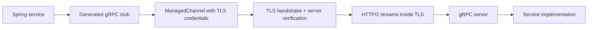
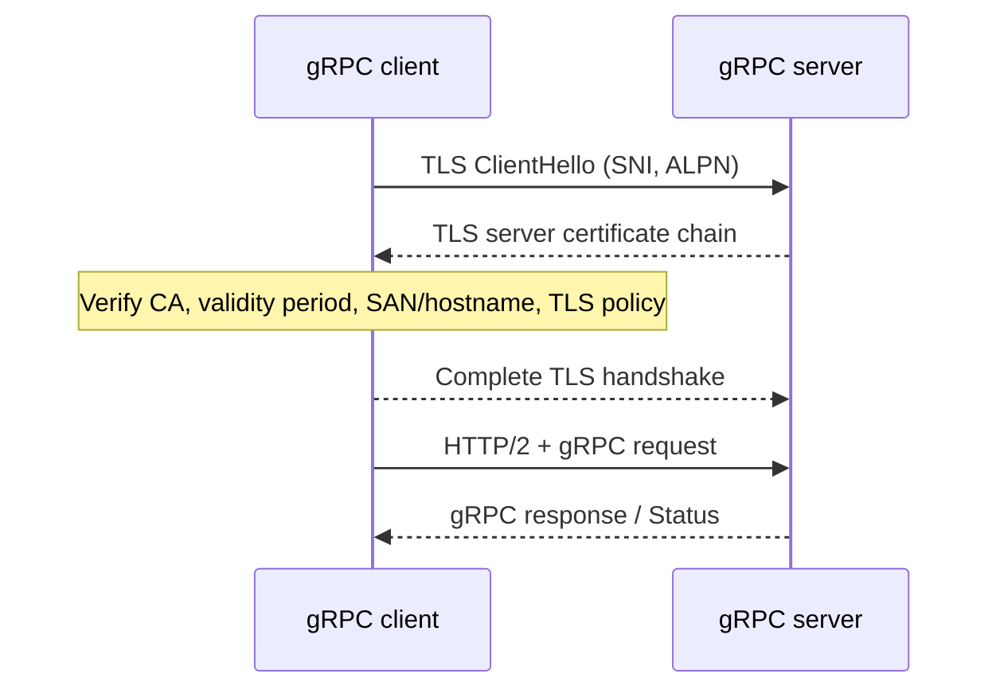
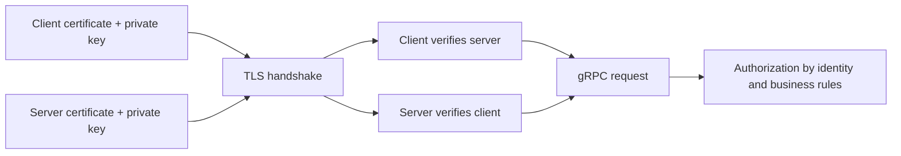
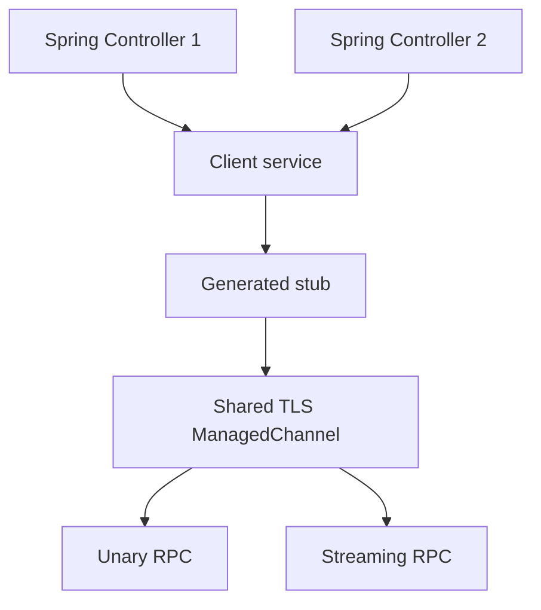
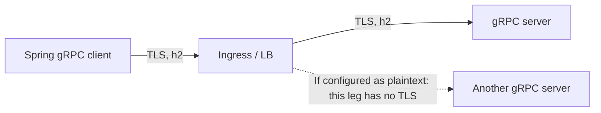

# TLS Connections in Production

## 1. Learning Objectives

In the **Spring gRPC** ecosystem, a client application can invoke unary or streaming RPCs using Java stubs generated from Protocol Buffers contracts. In production deployments, a call that is valid at the `.proto` level can still fail if the connection channel cannot authenticate the server, lacks trusted certificates, or passes through a proxy that does not support gRPC over HTTP/2.

**TLS (Transport Layer Security)** protects connections between gRPC components. This lesson focuses on configuring TLS at the **channel and connection** layer from a Spring client to a gRPC server, distinguishing one-way TLS from mTLS, managing certificates, troubleshooting handshake errors, and verifying security across the entire network path.

Upon completing this lesson, you will be able to:

- Explain what TLS protects in HTTP/2 gRPC and what its limitations are.
- Distinguish server authentication via TLS from mutual authentication via **mTLS** and application-layer RPC authorization.
- Create a `ManagedChannel` using `TlsChannelCredentials`, verify the server certificate, and invoke a unary RPC with a deadline.
- Configure `TlsServerCredentials`, certificate chains, and trusted CAs appropriately; enable client certificate verification when mTLS is required.
- Manage TLS channels with environment-scoped Spring beans, reuse connections, and close resources in an orderly manner.
- Evaluate TLS termination at ingress/load balancers, certificate rotation, metadata security, and failure observability.
- Verify handshakes, HTTP/2, hostnames, certificate chains, and gRPC calls using real tools and integration tests.

The hands-on sections use the **gRPC Java** API to clarify transport security mechanics, combined with Spring for client lifecycle management. Different Spring gRPC starters may provide their own channel/server configuration mechanisms; verify your exact version before applying properties or auto-configured beans in a project.

## 2. What Does TLS Protect in gRPC?

gRPC Java typically uses **HTTP/2** as its transport protocol; requests, responses, and metadata are carried over HTTP/2 streams. Protocol Buffers serializes messages into binary data, but **does not encrypt data on its own**. TLS adds confidentiality and integrity protection over a connection segment while enabling the client to verify the server's identity via certificates.



TLS does **not** replace deadlines, retries, load balancing, access control checks, message size limits, or business error handling. TLS also does not encrypt data at TLS termination endpoints: RPC contents can still appear in application memory, logging systems, terminating proxies, or other network segments where TLS is not enabled.

| Aspect | Plaintext gRPC | gRPC over TLS |
|---|---|---|
| RPC transport | Unencrypted HTTP/2 | HTTP/2 over a TLS connection |
| Protobuf payload | Still binary | Still binary |
| Protection against eavesdropping and tampering on the segment | No | Yes, when handshake and certificate verification succeed |
| Server identity verification | Not TLS-based | Based on certificate chain, hostname, and trust policy |
| Client authentication via certificate | No | Can be enabled with mTLS |
| Appropriate environment | Controlled isolated local/test setups | Production, shared networks, traffic containing sensitive data |

gRPC over TLS requires a connection capable of negotiating **HTTP/2**, typically via ALPN with the `h2` protocol. An open TCP port or a successful TLS handshake alone is **not sufficient** to conclude a gRPC call will succeed: proxies and servers must also handle HTTP/2/gRPC properly.

## 3. One-Way TLS, mTLS, and RPC Permissions

### One-Way TLS (Server Authentication)

Normally, the client must verify that the **server** it connects to presents a valid certificate for the target domain name and is signed by a trusted CA. The server does not necessarily require a client certificate. If the system uses tokens/OAuth, metadata and `CallCredentials` can handle RPC-level authentication over that TLS channel.



This diagram is a learning model and does not depict every message in TLS 1.2/1.3. Do not infer wire byte ordering from these high-level labels.

### mTLS (Mutual TLS)

With **mTLS**, in addition to authenticating the server, the server also requests and verifies a **client certificate**. A common use case is internal service-to-service communication requiring machine/microservice identity.



**mTLS does not automatically decide which methods a client is allowed to invoke.** A certificate proves an identity accepted by the trust mechanism; the server still needs to check **authorization** for a specific service, method, or resource. For example, a workload holding a valid certificate does not implicitly have permission to read every customer's profile.

| Question | One-Way TLS | mTLS |
|---|---|---|
| Does the client verify the server? | Yes | Yes |
| Does the server require a client certificate? | Normally no | Yes |
| How does the server identify the client? | Application tokens/credentials or another mechanism | Identity in the client certificate, optionally combined with tokens |
| Is business authorization still required? | Yes | Yes |
| Secret material management | Server holds a private key | Both server and client hold their own private keys |

## 4. Certificates, SAN, Trust Stores, and Hostname Verification

For a client to trust a TLS connection, multiple conditions must be satisfied simultaneously:

1. **Certificate chain:** the server's certificate chains validly through intermediate CAs to a root CA trusted by the client. The server usually supplies the leaf certificate and required intermediates; the root CA may reside in the client's trust store.
2. **Hostname:** the DNS name or IP address the client uses to connect must match a **Subject Alternative Name (SAN)** in the server certificate. A certificate issued for `grpc.example.com` is not implicitly valid for `10.0.0.5` or `localhost`.
3. **Validity period:** the certificate must be within its valid time window; skewed system clocks can also cause handshakes to fail.
4. **Algorithms and policies:** certificates, signatures, key usage, and TLS versions must satisfy the library and infrastructure policies.
5. **Proof of key possession:** the server must hold the private key corresponding to the public key in its certificate.

**SAN is the primary basis for hostname verification.** Do not rely on the Common Name (CN) or disable hostname checking when encountering a SAN error. If connecting directly by IP address is genuinely necessary, the certificate must contain an **IP SAN** of the proper type and value.

### Common File Set

| Example File | Contents | Where Used |
|---|---|---|
| `server-chain.pem` | Server certificate along with appropriate intermediates | Presented by the server during the handshake |
| `server-key.pem` | Private key matching the server certificate | Readable only by the server |
| `trusted-server-ca.pem` | Root/intermediate CA approved by the client to trust the server | Client trust configuration |
| `client-chain.pem` | Client certificate when deploying mTLS | Presented by the client |
| `client-key.pem` | Client private key | Readable only by the client workload |
| `trusted-client-ca.pem` | CA trusted by the server to verify clients | Server mTLS trust configuration |

Filenames are for illustration only. In production, certificate artifacts are typically issued by an organizational PKI or certificate/secret management solution; keys must be stored in locations protected by access permissions, secret volumes, or appropriate key management mechanisms. Never commit private keys to Git, never embed key contents in `application.yml`, and never print private keys/tokens in logs. Choose certificates with the correct key usage (server/client authentication) and issuance policy.

The CA used to verify the server and the CA used to verify clients **can be different**. Configuring `trustManager` with an organizational CA must be approved according to trust boundaries, avoiding blanket trust of unrelated certificates.

## 5. Sample gRPC Contract and Deployment Prerequisites

Suppose a Spring client calls the `Greeter` service using a unary RPC:

```proto
syntax = "proto3";

package demo.greeter;
option java_package = "dev.example.hello";
option java_multiple_files = true;

service Greeter {
  rpc SayHello (HelloRequest) returns (HelloReply);
}

message HelloRequest {
  string name = 1;
}

message HelloReply {
  string message = 1;
}
```

The `protoc` compiler and gRPC Java plugin generate the `HelloRequest`, `HelloReply`, and `GreeterGrpc` classes in package `dev.example.hello`. The examples assume the project has configured dependencies for the gRPC API, Protobuf, code generation, and an HTTP/2 transport such as `grpc-netty-shaded`. Use runtime/plugin versions compatible with the application's Java and Spring Boot versions.

**Implementation note:** the Java examples use `Grpc.newServerBuilderForPort` and `Grpc.newChannelBuilderForAddress`, allowing the runtime to pick a supported provider. In a Spring gRPC starter application with auto-configured server/channels, choose **one** mechanism to own the server and connections; do not launch an extra manual server on the same port. Starter properties vary across versions, so the code below uses **custom-defined** configuration keys to avoid confusion with default APIs.

## 6. Enabling TLS on a gRPC Server with `TlsServerCredentials`

To complete a TLS handshake, the server needs a certificate chain and matching private key. Example of running a gRPC Java server on port `8443` using file paths supplied via environment variables:

```java
package dev.example.hello;

import io.grpc.Grpc;
import io.grpc.Server;
import io.grpc.ServerCredentials;
import io.grpc.TlsServerCredentials;
import io.grpc.stub.StreamObserver;
import java.io.File;
import java.util.concurrent.TimeUnit;

public final class TlsGreeterServer {
    public static class GreeterService extends GreeterGrpc.GreeterImplBase {
        @Override
        public void sayHello(
                HelloRequest request,
                StreamObserver<HelloReply> observer) {
            observer.onNext(HelloReply.newBuilder()
                    .setMessage("Hello " + request.getName())
                    .build());
            observer.onCompleted();
        }
    }

    public static void main(String[] args) throws Exception {
        File certChain = new File(System.getenv("GRPC_SERVER_CERT_CHAIN"));
        File privateKey = new File(System.getenv("GRPC_SERVER_PRIVATE_KEY"));

        ServerCredentials credentials = TlsServerCredentials.newBuilder()
                .keyManager(certChain, privateKey)
                .build();

        Server server = Grpc.newServerBuilderForPort(8443, credentials)
                .addService(new GreeterService())
                .build()
                .start();

        Runtime.getRuntime().addShutdownHook(new Thread(() -> {
            server.shutdown();
            try {
                if (!server.awaitTermination(5, TimeUnit.SECONDS)) {
                    server.shutdownNow();
                }
            } catch (InterruptedException e) {
                server.shutdownNow();
                Thread.currentThread().interrupt();
            }
        }));

        System.out.println("TLS gRPC server listening on port 8443");
        server.awaitTermination();
    }
}
```

The snippet above demonstrates **server-authenticated TLS**; it does not yet require a client certificate. Both `GRPC_SERVER_CERT_CHAIN` and `GRPC_SERVER_PRIVATE_KEY` must be set to valid file paths before running. If a variable is missing or a file is malformed, startup can fail; production applications should validate configuration and log clear errors **without printing secret contents**.

`newServerBuilderForPort` uses provider-based binding and may listen on multiple interfaces. Restrict firewalls, network policies, and exposed ports according to your architecture. If the server is managed by a Spring starter, define the service as a Spring component and supply TLS credentials through the corresponding server factory/configuration mechanism instead of copying `main()` into an application that already runs an auto-configured server.

## 7. gRPC Java Client Connecting to a TLS Server

Create channels using `TlsChannelCredentials`; **never** call `usePlaintext()` or use `InsecureChannelCredentials` for production endpoints requiring TLS.

### Trusting the Environment's Default CAs

If the server's certificate chain is valid under CAs trusted by the runtime environment, you can start with:

```java
import io.grpc.Grpc;
import io.grpc.ManagedChannel;
import io.grpc.TlsChannelCredentials;

ManagedChannel channel = Grpc.newChannelBuilderForAddress(
        "grpc.example.com", 443, TlsChannelCredentials.create())
        .build();
```

Default trust depends on the provider, platform, and runtime configuration. Do not assume an internal CA is automatically present inside a container environment; verify the deployed trust configuration.

### Trusting a Specific CA and Calling an RPC with a Deadline

When the server uses an internal PKI, the client is provided a trusted CA bundle and connects using the exact DNS name listed in the server certificate's SAN:

```java
package dev.example.hello;

import io.grpc.Grpc;
import io.grpc.ManagedChannel;
import io.grpc.TlsChannelCredentials;
import io.grpc.StatusRuntimeException;
import java.io.File;
import java.util.concurrent.TimeUnit;

public final class TlsGreeterClient {
    public static void main(String[] args) throws Exception {
        File trustedCa = new File(System.getenv("GRPC_TRUSTED_SERVER_CA"));

        ManagedChannel channel = Grpc.newChannelBuilderForAddress(
                "grpc.example.com", 8443,
                TlsChannelCredentials.newBuilder()
                        .trustManager(trustedCa)
                        .build())
                .build();

        try {
            GreeterGrpc.GreeterBlockingStub stub =
                    GreeterGrpc.newBlockingStub(channel);

            HelloReply result = stub
                    .withDeadlineAfter(3, TimeUnit.SECONDS)
                    .sayHello(HelloRequest.newBuilder()
                            .setName("Lan")
                            .build());
            System.out.println(result.getMessage());
        } catch (StatusRuntimeException e) {
            System.err.println("RPC failed: " + e.getStatus());
            throw e;
        } finally {
            channel.shutdown();
            if (!channel.awaitTermination(5, TimeUnit.SECONDS)) {
                channel.shutdownNow();
                channel.awaitTermination(2, TimeUnit.SECONDS);
            }
        }
    }
}
```

The example assumes `GRPC_TRUSTED_SERVER_CA` points to a CA bundle in a format accepted by the provider, the server listens on `grpc.example.com:8443`, and the certificate matches `grpc.example.com`. If the server only holds a certificate for another name, the client must use a **valid target name** with matching DNS/routing; do not bypass hostname verification as a workaround.

`withDeadlineAfter(...)` bounds the duration of a single RPC; it is not a standalone TLS handshake timeout and does not alter the lifecycle state of `ManagedChannel`. Set deadlines on each unary RPC, and select an appropriate policy for long-lived streaming RPCs.

### Can One Channel Be Used for Multiple RPCs?

**Yes.** A TLS handshake incurs certificate verification and key establishment overhead; creating a new channel after every request typically increases latency and connection count. A long-lived `ManagedChannel` can carry multiple HTTP/2 streams and many RPCs, even when gRPC has to reconnect after transient failures. Do not create or close a channel inside every Spring controller method.



gRPC Java channels and generated stubs are safe for concurrent use. Methods such as `withDeadlineAfter(...)` and `withInterceptors(...)` return a newly configured stub rather than mutating the original stub. When endpoints, trust CAs, or client identities differ, create separately configured channels with clear bean/qualifier names.

## 8. Integrating a TLS Channel in Spring Boot

If the application **manages its channel directly**, you can declare a singleton bean for the `prod` environment to avoid colliding with local plaintext configuration. The path to the CA is supplied via deployment configuration; never place PEM private keys in code or properties.

```java
package dev.example.client;

import io.grpc.Grpc;
import io.grpc.ManagedChannel;
import io.grpc.TlsChannelCredentials;
import java.io.File;
import org.springframework.beans.factory.annotation.Value;
import org.springframework.context.annotation.Bean;
import org.springframework.context.annotation.Configuration;
import org.springframework.context.annotation.Profile;

@Configuration(proxyBeanMethods = false)
@Profile("prod")
public class ProductionGrpcClientConfig {
    @Bean(name = "greeterChannel", destroyMethod = "shutdown")
    public ManagedChannel greeterChannel(
            @Value("${demo.grpc.greeter.host}") String host,
            @Value("${demo.grpc.greeter.port}") int port,
            @Value("${demo.grpc.greeter.trust-ca-file}") String trustCaPath)
            throws Exception {
        return Grpc.newChannelBuilderForAddress(
                host, port,
                TlsChannelCredentials.newBuilder()
                        .trustManager(new File(trustCaPath))
                        .build())
                .build();
    }
}
```

```java
package dev.example.client;

import dev.example.hello.GreeterGrpc;
import dev.example.hello.HelloRequest;
import io.grpc.ManagedChannel;
import java.util.concurrent.TimeUnit;
import org.springframework.beans.factory.annotation.Qualifier;
import org.springframework.stereotype.Service;

@Service
public final class GreeterGateway {
    private final GreeterGrpc.GreeterBlockingStub stub;

    public GreeterGateway(
            @Qualifier("greeterChannel") ManagedChannel channel) {
        this.stub = GreeterGrpc.newBlockingStub(channel);
    }

    public String sayHello(String name) {
        return stub.withDeadlineAfter(3, TimeUnit.SECONDS)
                .sayHello(HelloRequest.newBuilder()
                        .setName(name)
                        .build())
                .getMessage();
    }
}
```

Example `application-prod.yml` using the **custom namespace** `demo.grpc.*`:

```yaml
demo:
  grpc:
    greeter:
      host: grpc.example.com
      port: 8443
      trust-ca-file: /var/run/secrets/grpc/trusted-server-ca.pem
```

`@Profile("prod")` scopes the TLS configuration bean to an environment, but a profile alone is **not sufficient** to enforce security policy; the deployment pipeline must control secrets, endpoints, network policies, and configuration verification. If the client also needs to present an mTLS certificate, replace `TlsChannelCredentials` with the variant configured with `.keyManager(...)` as shown in the next section.

`@Bean(destroyMethod = "shutdown")` initiates channel shutdown when the Spring context closes, but it **does not wait** for in-flight RPCs to finish. For systems with long-lived streams or strict graceful shutdown requirements, use a lifecycle owner to stop accepting new work, cancel/complete streams, call `shutdown()`, wait on `awaitTermination(...)` within the allowed budget, and then call `shutdownNow()` if necessary. Only **one owner** should be responsible for closing each channel.

If you use a Spring gRPC starter that manages channels automatically, use the starter's supported mechanisms for supplying `ChannelCredentials` and managing lifecycle. Do not arbitrarily shut down framework-owned channels, and do not assume `demo.grpc.*` properties are starter defaults.

## 9. Enabling Mutual TLS (mTLS)

In service-to-service systems, the server sometimes requires the client to present an X.509 certificate. The server side must specify which CA is trusted to verify clients along with the `REQUIRE` policy:

```java
import io.grpc.Grpc;
import io.grpc.Server;
import io.grpc.ServerCredentials;
import io.grpc.TlsServerCredentials;
import java.io.File;

ServerCredentials mtlsServerCredentials = TlsServerCredentials.newBuilder()
        .keyManager(
                new File("/var/run/secrets/grpc/server-chain.pem"),
                new File("/var/run/secrets/grpc/server-key.pem"))
        .trustManager(new File("/var/run/secrets/grpc/trusted-client-ca.pem"))
        .clientAuth(TlsServerCredentials.ClientAuth.REQUIRE)
        .build();

Server server = Grpc.newServerBuilderForPort(8443, mtlsServerCredentials)
        .addService(new TlsGreeterServer.GreeterService())
        .build();
// Register the server with the application's start/stop lifecycle before use.
```

On the client side, in addition to the CA for verifying the server, provide the **client's own certificate chain and private key**:

```java
import io.grpc.Grpc;
import io.grpc.ManagedChannel;
import io.grpc.TlsChannelCredentials;
import java.io.File;

ManagedChannel channel = Grpc.newChannelBuilderForAddress(
        "grpc.example.com", 8443,
        TlsChannelCredentials.newBuilder()
                .trustManager(new File("/var/run/secrets/grpc/trusted-server-ca.pem"))
                .keyManager(
                        new File("/var/run/secrets/grpc/client-chain.pem"),
                        new File("/var/run/secrets/grpc/client-key.pem"))
                .build())
        .build();
```

Files must be provisioned individually for the intended workload with restricted read permissions. The snippet uses fixed paths for readability; production deployments should obtain paths from configuration/secret mounts or an organizationally managed identity provider. Do not share a single private key across all clients if the goal is verifying per-workload identity.

### Operational Implications of mTLS

- **Mutual trust:** the client must trust the server's CA, and the server must trust the CA that issued the client's certificate. The two CAs may differ.
- **Names and identity:** the client must still verify the server's hostname/SAN; the server should match the client certificate's identity against policies permitted to call the RPC.
- **Authorization:** a valid, trusted client certificate does not imply permission to perform every operation. The server still needs authorization per service/method/resource.
- **Revocation capability:** check your organization's certificate lifecycle/revocation policy. Replace compromised or expired certificates promptly; do not expect closing a client-side channel to revoke identity across other systems.
- **Scope limits:** set `ClientAuth.REQUIRE` when the architecture genuinely requires mTLS. A public server that must support clients without certificates can use a separate authentication scheme; do not enable required client auth and skip designing client onboarding.

## 10. TLS Termination and Paths Through Ingress / Load Balancers

Production setups often place a proxy, ingress controller, service mesh, or load balancer between the client and the gRPC server. You must determine for **each connection leg** whether it uses TLS or plaintext, where private keys reside, and which component verifies identity.



This diagram illustrates **two different backend options**, not a single request going to two servers simultaneously. When a proxy terminates TLS from the client, the proxy can inspect metadata/payloads for routing and monitoring. The connection from the proxy to the backend is secure only when explicitly protected; do not equate "TLS at ingress" with "end-to-end TLS".

| Architecture | What Must Be Verified |
|---|---|
| Client TLS → server TLS directly | DNS/SAN, CA, ALPN `h2`, network restrictions, and credentials |
| Client TLS → ingress terminates → plaintext backend | Whether plaintext on that leg is acceptable, whether the network is isolated, and whether the proxy forwards gRPC HTTP/2 properly |
| Client TLS → ingress → backend TLS | The proxy acts as a TLS client to the backend; verify backend certificate/hostname and trust CA on the proxy |
| mTLS in a service mesh | Which mesh/proxy performs the handshake and issues identity; whether the application needs additional TLS, and where authorization occurs |
| TCP/TLS passthrough | TLS terminates at the backend server; configure SNI/routing and matching certificates appropriately |

**Hostname, SNI, and HTTP/2 `:authority`** are frequent sources of confusion behind proxies. The hostname used for certificate verification, the name used for routing, and the actual TCP target must be designed consistently. Avoid arbitrarily using authority overrides to bypass certificate errors; fixing DNS, certificate SANs, or proxy configuration is the proper production solution.

Load balancing across multiple backends also requires consistent identity and trust policies. If server nodes use different certificates/CAs, a channel might succeed on one connection and fail when reconnecting to another node.

## 11. Deadlines, Statuses, Interceptors, and Streaming with TLS

TLS operates at the transport layer. Core gRPC concepts continue to function as usual:

- **Deadline:** set a time limit on each unary RPC so slow connections, handshake failures, or slow servers do not hang requests indefinitely. For long-lived streaming, choose suitable deadlines and reconnection strategies.
- **Status:** a failed handshake typically surfaces on the client as `UNAVAILABLE` (or occasionally `DEADLINE_EXCEEDED`). Do not assume a single status code unambiguously proves a TLS error.
- **Metadata/CallCredentials:** authentication tokens and trace context travel with RPCs. TLS protects metadata across the TLS segment, yet the application must still avoid writing sensitive data into logs/traces.
- **Interceptor:** used to measure latency, attach request IDs, propagate authentication context, or record status metrics. A client interceptor does not replace certificate verification.
- **Streaming:** unary, server streaming, client streaming, and bidirectional streaming all share a TLS channel; active streams can affect shutdown duration.

Example handling statuses on a unary RPC:

```java
import io.grpc.Status;
import io.grpc.StatusRuntimeException;
import java.util.concurrent.TimeUnit;

try {
    stub.withDeadlineAfter(3, TimeUnit.SECONDS)
            .sayHello(HelloRequest.newBuilder().setName("Lan").build());
} catch (StatusRuntimeException ex) {
    Status.Code code = ex.getStatus().getCode();
    switch (code) {
        case UNAVAILABLE -> System.err.println("Check DNS, TLS, trust CA, SAN, or transport");
        case DEADLINE_EXCEEDED -> System.err.println("RPC deadline exceeded");
        case UNAUTHENTICATED -> System.err.println("Check application-level authentication");
        case PERMISSION_DENIED -> System.err.println("Check permissions to invoke RPC");
        default -> System.err.println("RPC status: " + ex.getStatus());
    }
}
```

This example uses modern Java switch rules. `UNAUTHENTICATED` is a gRPC status that the application layer may return; a rejected mTLS handshake usually fails the RPC at the transport layer before service logic ever gets a chance to return this code.

Certain retry and wait-for-ready policies can help cope with transient network glitches, but they **cannot** fix an expired certificate, mismatched SAN, or untrusted CA. Retries should only be applied within a time budget and based on business idempotency. Do not spin up new channels in a loop hoping to "get lucky" past a TLS error.

## 12. Certificate Management and Production Resilience

### Certificate Expiration and Rotation

Certificates have finite lifetimes; systems must monitor expiration dates in advance and follow a replacement process that avoids dropping connections.

1. **Issuance:** PKI/secret manager issues server/client identities with the right SAN, key usage, CA, and environment.
2. **Distribution:** secret mounts or an identity platform supply files/certs to workloads; restrict read permissions, audit access, and avoid committing them to repositories.
3. **Monitoring:** track expiration windows, TLS handshake failures, certificate verification errors, and abnormal reconnect spikes.
4. **Rotation:** roll out new certificates while ensuring peers already trust the appropriate CA; for CA rotation, maintain an overlapping trust window when appropriate.
5. **Retirement:** revoke or stop trusting old certificates/CAs properly while detecting clients still running stale configurations.

**Updating a PEM file on disk does not guarantee every gRPC Java channel/server automatically reloads the new certificate.** Behavior depends on the transport, credential provider, and reload support in the version used. Test the actual refresh mechanism: you may need to build a new channel/credential with the updated config, shift traffic to the new channel, and drain/close the old channel cleanly. Avoid disrupting active streaming RPCs just because secrets changed without a drain plan.

### Long-Lived Connection Operations

| Risk | How to Observe / Handle |
|---|---|
| Channel repeatedly reconnects | Inspect DNS, certs, ALPN, proxy, keepalive, and handshake messages; track RPC error rates |
| One node serves an invalid certificate | Check SAN and chain on each replica; fix issuance/deployment pipeline |
| Certificate nearing expiration | Alert ahead of expiry, validate rotation plan, and test replacement |
| Load balancer closes idle connections | Align timeouts/keepalive with server and proxy settings; avoid overly aggressive pings |
| Many channels created per HTTP request | Use singleton channels/stubs; monitor threads, sockets, and connection pools |
| Streams do not stop during deploy | Complete or cancel in-flight RPCs; gracefully shut down channels with an overall deadline |
| Metadata/tokens appear in logs | Filter/redact sensitive headers; use safe correlation IDs |

Minimum observability should include RPC counts, `Status.Code` breakdown, P50/P95/P99 latency, deadline exceeded counts, active RPC count, handshake/reconnect failure rates, and certificate expiration dates. `ManagedChannel.getState(false)` can aid diagnostics, but it does not prove certificates or business logic are healthy: `READY` is merely the connection state at sampling time.

## 13. Verifying TLS with External Tools

### Checking Handshake, Hostname, and ALPN

When a gRPC port is exposed over TLS, you can inspect the chain, verify the hostname, and check ALPN:

```bash
openssl s_client \
  -connect grpc.example.com:8443 \
  -servername grpc.example.com \
  -verify_hostname grpc.example.com \
  -verify_return_error \
  -alpn h2 \
  -CAfile trusted-server-ca.pem \
  -showcerts </dev/null
```

This command assumes OpenSSL is available in your shell environment with an appropriate CA bundle. On PowerShell, you can omit stdin redirection if unnecessary. Verify the certificate chain, validity period, `Verify return code`, and selected ALPN protocol; the server/proxy must support `h2` for standard gRPC. **Seeing `CONNECTED` in the output does not mean the certificate was verified.**

If the server requires mTLS, supply the client certificate and private key to the tool, for example by adding `-cert client-chain.pem -key client-key.pem` to the test command. Do not store private keys or sensitive debug output in public logging systems.

### Making a Real gRPC Call with `grpcurl`

If the server does not enable reflection, specify the `.proto` contract explicitly:

```bash
grpcurl \
  -cacert trusted-server-ca.pem \
  -import-path src/main/proto \
  -proto greeter.proto \
  -d '{"name":"Lan"}' \
  grpc.example.com:8443 demo.greeter.Greeter/SayHello
```

For servers requiring mTLS, add `-cert client-chain.pem -key client-key.pem` to the command; `-cacert` is still used to verify the server. If the server certificate is verified by a public CA trusted by default on the OS/tool runtime, specifying `-cacert` may be omitted.

`grpcurl -plaintext` is only for servers running without TLS. `grpcurl -insecure` **still connects over TLS but skips server certificate verification**; this is strictly a diagnostic tool in controlled environments, not a production configuration. Never use it to mask hostname or CA trust errors. Sending HTTP/1.1 `curl` to a gRPC port is also not a substitute for an RPC test.

## 14. Common TLS Errors and Troubleshooting

| Symptom | Possible Cause | Resolution |
|---|---|---|
| `UNAVAILABLE` with certificate/trust error | Client does not trust the root CA, or chain is missing intermediates | Distribute the right CA and intermediates; inspect server chain |
| Hostname/SAN mismatch error | Calling via IP, alias, or a DNS name absent from the certificate | Fix DNS/target or issue a certificate with the correct SAN |
| TLS handshake timeout/failure | Firewall, proxy, TLS version, or trust config mismatch | Check TCP reachability, handshake, TLS policy, and intermediaries |
| HTTP/2 preface or ALPN error | Proxy/server uses HTTP/1.1 or client sends plaintext to a TLS port | Configure HTTP/2 gRPC and align TLS on both ends |
| Client rejected when server enables mTLS | Missing client certificate, wrong key/chain, or server does not trust client CA | Provision a client cert with the right identity; check `ClientAuth.REQUIRE` and server trust |
| RPC returns `UNAUTHENTICATED` | Invalid application-level authentication token/metadata | Check tokens, CallCredentials, and interceptors; distinguish from TLS handshake |
| RPC returns `PERMISSION_DENIED` | Client is authenticated but lacks permission | Verify authorization policies per service or resource |
| RPC returns `DEADLINE_EXCEEDED` | Slow handshake/connection, slow server, or deadline too tight | Break down latency by stage, DNS/proxy, and deadline budget |
| Only some replicas fail | Inconsistent cert/CA/SAN or secret mounts across replicas | Inspect per-backend config and rollout process |
| Worked before cert rotation, failed after | CA trust not updated or runtime has not reloaded the new certificate | Review rotation plan; test channel reload/recreation |

When analyzing failures, do not rely solely on a single `UNAVAILABLE` message: examine the **cause chain**, transport handshake logs, cert/SAN configuration, path tracing, and server status. Detailed error strings may differ across gRPC Java, Netty, and TLS provider versions; never write business logic that depends on exact error message strings.

## 15. TLS and mTLS Integration Testing

A unit test with a mocked stub or in-process server can test service logic, but it **does not prove TLS handshakes work over the network**. Security tests must start a TCP server with valid certificate fixtures, connect via `TlsChannelCredentials`, and invoke real RPCs.

For illustration, prepare a **test-only** set of certificates beforehand:

- `src/test/resources/tls/ca.pem`: trusted CA for testing.
- `src/test/resources/tls/server-chain.pem` and `server-key.pem`: server certificate/key with SAN DNS `localhost`, signed by the test CA.
- If testing mTLS: add `client-chain.pem`, `client-key.pem`, and the corresponding CA with client authentication usage.

Never reuse test certificates/private keys in production. The test below uses gRPC Java with a server listening on a dynamic port to avoid port conflicts across test processes:

```java
package dev.example.hello;

import static org.junit.jupiter.api.Assertions.assertEquals;
import static org.junit.jupiter.api.Assertions.assertTrue;

import io.grpc.Grpc;
import io.grpc.ManagedChannel;
import io.grpc.Server;
import io.grpc.TlsChannelCredentials;
import io.grpc.TlsServerCredentials;
import java.io.File;
import java.util.concurrent.TimeUnit;
import org.junit.jupiter.api.Test;

class GrpcTlsIntegrationTest {
    private static File fixture(String name) {
        return new File("src/test/resources/tls/" + name);
    }

    @Test
    void callsUnaryRpcWithVerifiedTls() throws Exception {
        Server server = Grpc.newServerBuilderForPort(
                0,
                TlsServerCredentials.newBuilder()
                        .keyManager(
                                fixture("server-chain.pem"),
                                fixture("server-key.pem"))
                        .build())
                .addService(new TlsGreeterServer.GreeterService())
                .build()
                .start();

        ManagedChannel channel = Grpc.newChannelBuilderForAddress(
                "localhost", server.getPort(),
                TlsChannelCredentials.newBuilder()
                        .trustManager(fixture("ca.pem"))
                        .build())
                .build();

        try {
            HelloReply reply = GreeterGrpc.newBlockingStub(channel)
                    .withDeadlineAfter(3, TimeUnit.SECONDS)
                    .sayHello(HelloRequest.newBuilder()
                            .setName("Lan")
                            .build());
            assertEquals("Hello Lan", reply.getMessage());
        } finally {
            channel.shutdownNow();
            server.shutdownNow();
            assertTrue(channel.awaitTermination(5, TimeUnit.SECONDS));
            assertTrue(server.awaitTermination(5, TimeUnit.SECONDS));
        }
    }
}
```

This test assumes the server certificate contains SAN `DNS:localhost`; when running against `127.0.0.1`, a matching IP SAN or using the `localhost` name is required. The test requires a gRPC transport provider supporting TLS on the test classpath. `server.getPort()` returns the dynamically bound port after server startup.

A production test suite should cover the following cases:

1. **Positive TLS:** valid trust CA, valid hostname, unary RPC succeeds; also test server streaming when the application uses streams.
2. **Wrong CA:** client does not trust the server certificate and the RPC fails before reaching the handler; no need to assert a fixed transport error message string.
3. **Wrong hostname:** server uses a cert for a different name, client still verifies hostname and rejects the handshake.
4. **Expired certificate:** with appropriate test fixtures, confirm the system rejects expired certificates.
5. **mTLS required:** client without a certificate is rejected; client with a valid certificate is accepted; client with the wrong CA is rejected.
6. **Authorization:** a valid client certificate lacking permission for a method is still rejected by the application layer.
7. **Rotation and shutdown:** replace cert/CA according to plan, verify new connections and active streams, and shut down channels/servers without leaking resources.

Do not make a test "pass" by disabling hostname verification or trusting every server certificate: doing so skips the exact behavior the test is meant to prove.

## 16. Practice Exercise: Deploying Spring gRPC Behind an Ingress

**Scenario:** a Spring Boot application calls `Greeter.SayHello` on a production cluster via the DNS name `grpc.example.com`. The system requires transport encryption, a three-second deadline for unary RPCs, internal access control using mTLS, and an ingress standing between the client and the gRPC backend.

Complete the following steps:

1. Design the certificate chain, SAN `grpc.example.com`, root CA trusted by the client, and client certificate/identity used for mTLS. Specify which component holds each private key.
2. Create a reusable TLS `ManagedChannel` in Spring under `@Profile("prod")` and bind it to the generated `GreeterBlockingStub`; demonstrate per-request deadlines.
3. Determine whether the ingress uses **TLS passthrough**, **TLS termination + TLS re-encryption**, or **TLS termination + plaintext backend**; draw the TLS segments and specify where the backend certificate is verified.
4. Verify the TLS handshake, ALPN `h2`, and hostname using OpenSSL; invoke the RPC using `grpcurl` with the `.proto` contract and proper certs/CA.
5. Intentionally supply the wrong CA or a hostname absent from SAN; observe the error. Explain why switching to `-insecure` or plaintext is unacceptable for fixing production errors.
6. Design a rotation plan: monitor expiration dates, update CA trust when needed, reload certs/channels as supported by the transport, allow old streams to finish, and close old channels safely.
7. Add at least one valid TLS integration test, one wrong-CA test, and one missing-client-certificate test when the server requires mTLS. Distinguish handshake failures from `UNAUTHENTICATED`/`PERMISSION_DENIED` returned by business logic.

**Completion Criteria:** You can explain the path and TLS boundaries of a gRPC call, verify the server by CA and SAN, configure client/server credentials for their proper roles, identify where identity and permissions are decided, and provide evidence from real RPC calls and integration tests rather than just TCP port checks.

## 17. Key Takeaways

In production, a gRPC `ManagedChannel` should verify **the right server certificate, the right hostname/SAN, and the right trusted CA**, while maintaining HTTP/2 for RPCs. `TlsChannelCredentials` secures the client connection, `TlsServerCredentials` configures server TLS, and **mTLS** adds client certificates when workload identity is required. TLS does not replace authorization, deadlines, statuses, interceptors, observability, or channel lifecycle management in Spring. When proxies/ingresses are involved, inspect **every connection leg** and operate explicit certificate rotation procedures, negative tests, and graceful shutdown.
