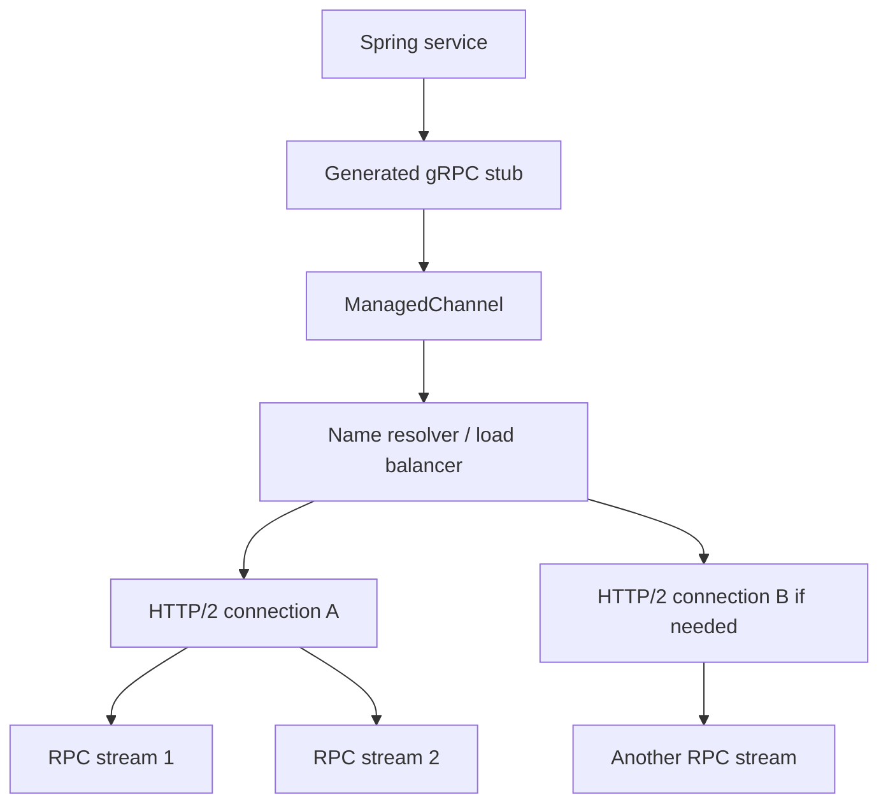
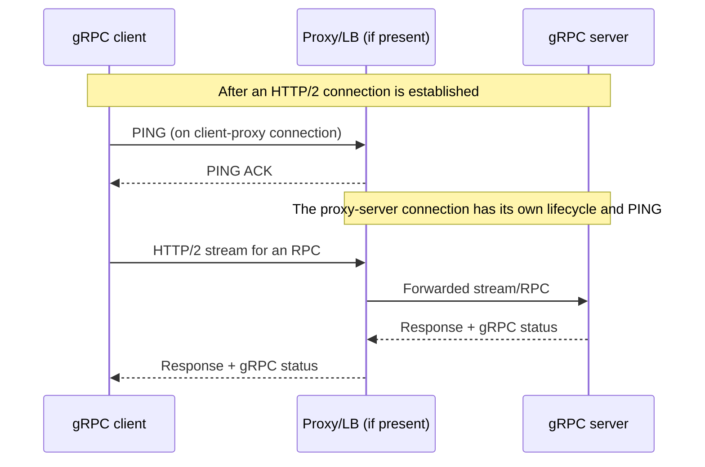
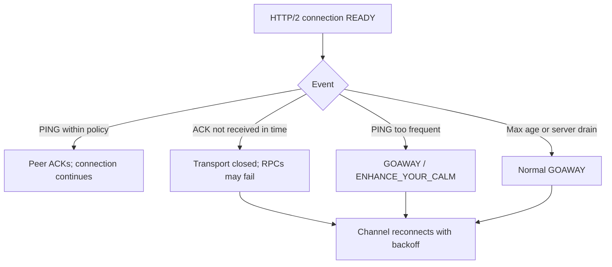
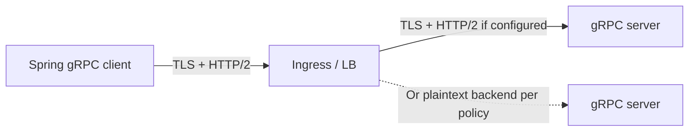

# Keepalive and HTTP/2 Connections

## 1. Learning Objectives

In **Spring gRPC**, a client typically holds a `ManagedChannel` to invoke multiple unary or streaming RPCs against the same service. A channel may use one or more underlying HTTP/2 connections. When a connection traverses a load balancer, proxy, or network device with idle timeouts, RPCs can be interrupted even though business logic and Protocol Buffers contracts have not changed. **Keepalive** is a transport-layer mechanism that detects unresponsive connections and, depending on policy, keeps connections active across quiet intervals.

After this lesson, you will be able to:

- Distinguish between a `ManagedChannel`, an HTTP/2 connection, and an RPC stream.
- Explain `PING`, `ACK`, `GOAWAY`, `SETTINGS`, and `WINDOW_UPDATE` frames and their impact on gRPC.
- Differentiate **keepalive**, deadlines, health checking, TCP keepalive, application heartbeats, and idle timeouts.
- Configure gRPC Java/Netty keepalive for a Spring client and server-side ping acceptance policies.
- Identify why pinging too frequently can cause `GOAWAY`, `ENHANCE_YOUR_CALM`, or `too_many_pings`.
- Choose intervals compatible with HTTP/2 proxies, TLS, streaming, and operational policies.
- Test, observe, and diagnose reconnect issues, stream interruptions, and resource cleanup.

**Scope:** this lesson delves into the channel/connection layer of `SPRING_GRPC` services. Concepts covering Protocol Buffers, generated stubs, metadata, statuses, deadlines, interceptors, TLS, integration testing, and reliability are connected to keepalive mechanics; they are not replaced by keepalive.

## 2. One Channel Is Not Necessarily One TCP Connection

In gRPC Java, the application creates a `ManagedChannel` and passes it to generated stubs (for example, `GreeterGrpc.newBlockingStub(channel)`). A channel is a **long-lived logical entry point** responsible for name resolution, endpoint selection, transport creation, and RPC dispatch. It does not guarantee a single TCP socket over its entire lifetime.



This diagram is a general model. Depending on target, load-balancing policy, and transport, a channel may manage one or multiple subchannels/connections; it may also remain in `IDLE` without opening a network connection yet.

| Component | Scope | Characteristics |
|---|---|---|
| `ManagedChannel` | Client to a logical destination and corresponding configuration | Reused across many RPCs; has a `shutdown()` lifecycle |
| HTTP/2 connection | Between two endpoints of **a single transport hop** | Carries multiple streams; governed by pings, flow control, `GOAWAY` |
| HTTP/2 stream | One request/response exchange at the HTTP/2 layer | gRPC typically maps each RPC to one stream |
| Unary RPC | One request, one response | Has its own deadline, status, and metadata |
| Streaming RPC | Multiple messages in one or both directions | Can be long-lived; still shares a connection with other RPCs |
| TCP connection and TLS session | Underlying transport beneath HTTP/2 | Can be closed by the network, proxy, server, or client |

**HTTP/2 multiplexing** allows multiple RPCs to run concurrently over one connection. This is why you should not create a new `ManagedChannel` for every HTTP request entering a Spring controller. Repeatedly creating connections adds TCP/TLS handshakes, sockets, threads, resource consumption, and latency jitter.

Every HTTP/2 connection has a concurrent stream limit, **flow-control windows**, and peer-negotiated parameters. When those limits are reached, RPCs may queue or experience backpressure even while the connection stays `READY`. Keepalive does not increase message throughput, expand flow-control windows, or fix an overloaded server.

## 3. How Does HTTP/2 PING Work?

HTTP/2 defines the **PING** frame to check whether a peer is still responsive at the connection layer. PING is not bound to a specific stream and carries a fixed 8-byte payload. The peer responds with a **PING frame with the ACK flag set**, echoing the same payload.



This diagram illustrates the case where a **proxy terminates HTTP/2**: the ACK verifies the peer on the *client–proxy hop*, not that the backend server is healthy. If TLS/HTTP/2 passes through a passthrough proxy, PING behavior and peer visibility differ. In multi-hop topologies, keepalive must be evaluated at each hop.

### The gRPC Keepalive Cycle

Conceptually:

1. The client or server enables keepalive and maintains an HTTP/2 connection.
2. When time/policy conditions are met, one side sends an HTTP/2 `PING`.
3. The peer replies with `PING ACK` if the transport and peer can still process frames.
4. If no ACK arrives before `keepAliveTimeout`, the sender may treat the connection as dead and close the transport.
5. In-flight RPCs on the broken connection may fail, commonly surfacing as `UNAVAILABLE`; the channel can attempt to reconnect via its reconnect/backoff mechanism.

**Receiving a PING ACK only proves that an HTTP/2 peer responded.** It does not guarantee that a gRPC method handles business logic properly, that a database is up, that tokens remain valid, or that the next RPC will have low latency.

Nor should PING be confused with a Protobuf message or a `Greeter.Ping()` RPC. Applications generally do not write a custom service method to answer HTTP/2 PINGs; the gRPC transport handles these frames automatically.

## 4. HTTP/2 Frames Relevant to gRPC Operations

| Frame / Mechanism | Scope and Meaning | Relation to gRPC |
|---|---|---|
| `HEADERS` | Headers/trailers on a stream | Carries metadata, HTTP status, and gRPC status/trailers |
| `DATA` | Payload transmitted on a stream | Contains framed gRPC data, usually Protobuf-encoded |
| `SETTINGS` | Connection-level HTTP/2 parameter negotiation | Affects concurrency limits and transport behavior |
| `WINDOW_UPDATE` | Per-connection or per-stream flow-control update | Controls how much more data may be sent, especially for streaming |
| `PING` / `PING ACK` | Connection-level liveness check | Underlying mechanism for gRPC keepalive |
| `RST_STREAM` | Terminates/cancels a single stream | Can affect one RPC without closing the entire channel |
| `GOAWAY` | Signals that no new streams will be accepted on the connection | Used for draining, max connection age, or policy violations |

A `GOAWAY` **is not always an error**. A server or proxy may send `GOAWAY` to close a connection gracefully, shift load onto a new connection, or enforce a connection age limit. Already-accepted streams may still be given a chance to finish depending on the drain phase and timeouts. However, `GOAWAY` with a reason tied to **`ENHANCE_YOUR_CALM`** and debug data **`too_many_pings`** usually indicates the client is sending PINGs in violation of the peer's policy.



Do not equate **a closed connection** with **a shut-down `ManagedChannel`**. If the owner has not called `shutdown()`, the channel can still re-establish a transport. Conversely, once `shutdown()` has been called, the channel accepts no new RPCs.

## 5. Keepalive vs. Deadlines, Health Checks, and TCP Keepalive

These mechanisms answer different questions:

| Mechanism | Question Answered | Unit / Scope |
|---|---|---|
| gRPC keepalive (HTTP/2 PING) | Is the HTTP/2 peer on this connection still responsive? | Connection; does not measure business health |
| RPC deadline | How long is a specific call allowed to take? | Single RPC; may return `DEADLINE_EXCEEDED` |
| gRPC Health Checking | Does the service report itself ready to serve? | Service/application; requires server support for health protocol |
| Application heartbeat | Is the business stream or session still making progress? | Depends on `.proto` contract and application logic |
| TCP keepalive | Is the TCP peer/network path still alive at the TCP layer? | Socket; unaware of HTTP/2 or gRPC |
| Idle timeout | How long without qualifying activity before closing the resource? | Defined by server, proxy, or client |

For instance, a server might respond normally to PINGs while the thread pool handling `SayHello` is stalled. Keepalive can remain green while unary RPCs slow down enough to exceed their deadlines. To determine whether a service is functioning properly, observe **RPC outcomes, statuses, latency, health services**, and load metrics.

With streaming, periodic business events can double as application-level liveness signals. Still, application heartbeats and HTTP/2 keepalive follow different policies: heartbeats must be defined in the contract and handled by the service, whereas HTTP/2 PING is driven by the transport.

## 6. Key Keepalive Parameters to Know

In common gRPC Java/Netty APIs:

| Parameter | Configured On | Meaning |
|---|---|---|
| `keepAliveTime(t, unit)` | Client; server also has active ping options | Interval after which keepalive may send a PING when conditions allow |
| `keepAliveTimeout(t, unit)` | Pinging client or server | Time to wait for `PING ACK` before considering the transport unresponsive |
| `keepAliveWithoutCalls(boolean)` | Client | Whether PINGs are allowed when there are no active RPCs |
| `permitKeepAliveTime(t, unit)` | Server | Minimum interval the server enforces between client PINGs |
| `permitKeepAliveWithoutCalls(boolean)` | Server | Whether the server allows client PINGs when no RPCs are active |
| `maxConnectionIdle(t, unit)` | Server | Duration a connection may remain without active RPCs before the server closes it |
| `maxConnectionAge(t, unit)` | Server | Maximum lifetime of a connection before the server starts draining it |
| `maxConnectionAgeGrace(t, unit)` | Server | Grace period after max age to let in-flight RPCs finish |

**Default values, minimum thresholds, and boundary behaviors** can vary across gRPC Java versions, transports, proxies, and server policies. Do not treat defaults from another runtime (C++, Go, Node.js) as defaults for Java applications. When configuring, consult the documentation for your exact gRPC Java version and infrastructure limits.

The most important relationship: **a client cannot arbitrarily choose its PING frequency.** If the client configures 30 seconds while the server permits PINGs no closer than 5 minutes apart, it risks receiving `GOAWAY`. Even if both gRPC endpoints agree, an intermediate ingress or load balancer on the path may enforce its own policy.

## 7. Configuring a gRPC Java Client for Production

Example using `grpc-netty-shaded` and a TLS endpoint with valid DNS/SAN. To avoid excessive pinging, this sample sends keepalive only while RPCs are active:

```java
package dev.example.client;

import dev.example.hello.GreeterGrpc;
import dev.example.hello.HelloReply;
import dev.example.hello.HelloRequest;
import io.grpc.ManagedChannel;
import io.grpc.netty.shaded.io.grpc.netty.NettyChannelBuilder;
import java.util.concurrent.TimeUnit;

public final class GreeterKeepaliveDemo {
    public static void main(String[] args) throws InterruptedException {
        ManagedChannel channel = NettyChannelBuilder
                .forAddress("grpc.example.com", 443)
                .useTransportSecurity()
                .keepAliveTime(10, TimeUnit.MINUTES)
                .keepAliveTimeout(20, TimeUnit.SECONDS)
                .keepAliveWithoutCalls(false)
                .build();

        try {
            GreeterGrpc.GreeterBlockingStub stub =
                    GreeterGrpc.newBlockingStub(channel);

            HelloReply reply = stub
                    .withDeadlineAfter(3, TimeUnit.SECONDS)
                    .sayHello(HelloRequest.newBuilder()
                            .setName("Lan")
                            .build());
            System.out.println(reply.getMessage());
        } finally {
            channel.shutdown();
            if (!channel.awaitTermination(5, TimeUnit.SECONDS)) {
                channel.shutdownNow();
                channel.awaitTermination(2, TimeUnit.SECONDS);
            }
        }
    }
}
```

The example requires the `.proto` contract and generated `GreeterGrpc`, `HelloRequest`, and `HelloReply` classes; the `Greeter` server is assumed to run at `grpc.example.com:443`. With an internal TLS CA, configure trust material suitable for the transport; **never** disable certificate/hostname verification to work around connection errors.

Key takeaways from the code:

1. `NettyChannelBuilder` configures the **HTTP/2 transport** and keepalive, while the generated stub only models the RPC API.
2. `keepAliveTime(10, MINUTES)` is an **illustrative value** that must be checked against real timeouts/policies; it does not promise "a PING every 10 minutes on the dot" regardless of connection state.
3. `keepAliveTimeout(20, SECONDS)` is how long to wait for an ACK after a PING, **not** the deadline for `SayHello`.
4. `keepAliveWithoutCalls(false)` avoids sending continuous PINGs on connections with no active RPCs, reducing load and policy conflicts.
5. `withDeadlineAfter(3, SECONDS)` bounds the unary call; a single RPC timeout does not mean you should call `shutdownNow()` on the shared channel.
6. `shutdown()` belongs to channel ownership. The `finally` block fits a short console demo, and **must not** be placed after every HTTP request in a long-running Spring application.

**Does every client need keepalive enabled?** No. If an application only issues short, infrequent unary RPCs and reconnecting causes no trouble, leaving defaults alone is often better. Keepalive is more valuable for long-lived streams, connections traversing devices that silently drop idle sockets, or requirements to detect dead connections within a bounded budget.

## 8. Managing Channel Ownership in Spring

A Spring application typically receives many HTTP requests and translates some of them into gRPC calls. Rather than creating a `ManagedChannel` per request, keep the channel in a singleton Spring component. The example below manages the channel and its complete shutdown directly; **do not** also register another bean calling `shutdown()` on the same channel.

```java
package dev.example.client;

import dev.example.hello.GreeterGrpc;
import dev.example.hello.HelloRequest;
import io.grpc.ManagedChannel;
import io.grpc.netty.shaded.io.grpc.netty.NettyChannelBuilder;
import java.util.concurrent.TimeUnit;
import org.springframework.beans.factory.DisposableBean;
import org.springframework.beans.factory.annotation.Value;
import org.springframework.context.annotation.Profile;
import org.springframework.stereotype.Component;

@Component
@Profile("prod")
public final class GreeterGateway implements DisposableBean {
    private final ManagedChannel channel;
    private final GreeterGrpc.GreeterBlockingStub stub;

    public GreeterGateway(
            @Value("${demo.grpc.greeter.host}") String host,
            @Value("${demo.grpc.greeter.port}") int port) {
        this.channel = NettyChannelBuilder.forAddress(host, port)
                .useTransportSecurity()
                .keepAliveTime(10, TimeUnit.MINUTES)
                .keepAliveTimeout(20, TimeUnit.SECONDS)
                .keepAliveWithoutCalls(false)
                .build();
        this.stub = GreeterGrpc.newBlockingStub(channel);
    }

    public String greet(String name) {
        return stub.withDeadlineAfter(3, TimeUnit.SECONDS)
                .sayHello(HelloRequest.newBuilder().setName(name).build())
                .getMessage();
    }

    @Override
    public void destroy() {
        channel.shutdown();
        try {
            if (!channel.awaitTermination(5, TimeUnit.SECONDS)) {
                channel.shutdownNow();
                channel.awaitTermination(2, TimeUnit.SECONDS);
            }
        } catch (InterruptedException e) {
            channel.shutdownNow();
            Thread.currentThread().interrupt();
        }
    }
}
```

```yaml
# application-prod.yml; custom demo.grpc.* namespace for this example
demo:
  grpc:
    greeter:
      host: grpc.example.com
      port: 443
```

The `demo.grpc.*` properties are **not** default property names guaranteed across every Spring gRPC version. If you use a Spring gRPC starter where the framework provides pre-built channels/stubs, configure keepalive via the configuration API supported by that version and let the framework manage lifecycle; do not manually close resources the framework is still using.

For applications with long-running streaming RPCs, coordinate shutdown ordering: stop accepting new work, cancel/complete registered streams, then shut down the channel with an overall deadline. `shutdown()` gives already-started RPCs a chance to finish, while `shutdownNow()` requests cancellation of remaining RPCs. A shut-down channel accepts no new RPCs, whereas a connection closed due to a keepalive timeout can be re-established by the channel.

If using Spring WebFlux or an event loop, blocking stubs must run on an appropriate execution pool; never let `.sayHello()` block an event-loop thread directly. Keepalive does not turn a blocking RPC into a non-blocking one.

## 9. Server Side: How Frequently Should Pings Be Permitted?

A gRPC server does not merely reply with `PING ACK`; it can also **enforce keepalive policies** to prevent clients from flooding CPU/network with excessive PINGs. With the Netty transport, a server can set a minimum interval for client PINGs, allow or disallow pings when no RPCs are active, and cap connection age or idle duration.

Example deploying a TLS gRPC Java server (assuming code generated from `greeter.proto`):

```java
package dev.example.server;

import dev.example.hello.GreeterGrpc;
import dev.example.hello.HelloReply;
import dev.example.hello.HelloRequest;
import io.grpc.Server;
import io.grpc.netty.shaded.io.grpc.netty.GrpcSslContexts;
import io.grpc.netty.shaded.io.grpc.netty.NettyServerBuilder;
import io.grpc.stub.StreamObserver;
import java.io.File;
import java.util.concurrent.TimeUnit;

public final class GreeterServer {
    public static void main(String[] args) throws Exception {
        File certChain = new File(System.getenv("GRPC_SERVER_CERT_CHAIN"));
        File privateKey = new File(System.getenv("GRPC_SERVER_PRIVATE_KEY"));

        Server server = NettyServerBuilder.forPort(8443)
                .sslContext(GrpcSslContexts.forServer(certChain, privateKey).build())
                .permitKeepAliveTime(5, TimeUnit.MINUTES)
                .permitKeepAliveWithoutCalls(false)
                .maxConnectionIdle(30, TimeUnit.MINUTES)
                .maxConnectionAge(2, TimeUnit.HOURS)
                .maxConnectionAgeGrace(30, TimeUnit.SECONDS)
                .addService(new GreeterGrpc.GreeterImplBase() {
                    @Override
                    public void sayHello(
                            HelloRequest request,
                            StreamObserver<HelloReply> observer) {
                        observer.onNext(HelloReply.newBuilder()
                                .setMessage("Hello " + request.getName())
                                .build());
                        observer.onCompleted();
                    }
                })
                .build()
                .start();

        Runtime.getRuntime().addShutdownHook(new Thread(server::shutdown));
        server.awaitTermination();
    }
}
```

This is a **policy illustration**, not a universal default production parameter set for every system. The server assumes valid certificate/key files exist; environment variables must be supplied before starting. In an application where a Spring gRPC starter owns the server, configure these via that version's server factory/customizer rather than running a second `main()` on the same port.

**Distinguish clearly:**

- `permitKeepAliveTime(5, MINUTES)` is the **minimum interval the server permits from clients**, not an instruction for the server to actively send a PING every 5 minutes.
- `permitKeepAliveWithoutCalls(false)` sets a policy rejecting client PINGs when no RPCs are active. Clients should configure `keepAliveWithoutCalls(false)` to match.
- `maxConnectionIdle(30, MINUTES)` and `maxConnectionAge(2, HOURS)` are **server connection close/drain policies**; they are not equivalent to keepalive PINGs.
- `maxConnectionAgeGrace(30, SECONDS)` may cut off long-lived streams after the grace window expires. Choose bounds based on streaming RPC durations and client reconnection logic.
- A server can also actively send PINGs via its own keepalive configuration APIs, but enable that only when needed and aligned with infrastructure; **permitting client pings** does not require the server to emit pings itself.

When `maxConnectionAge` is configured, clients must be ready to transition to a new transport upon receiving `GOAWAY`. Maintaining a single long-lived channel does **not** mean the underlying HTTP/2 connection lives forever. When backends have differing connection ages, monitor reconnects and RPC errors to catch misconfigured drain coordination.

## 10. Choosing Frequencies Compatible with Proxies and Load Balancers

Production systems often span multiple hops:



**Timeouts at each hop can differ.** For instance, if a proxy closes silent connections after 60 seconds while the client only sends PINGs after 10 minutes, that keepalive configuration cannot stop the proxy from dropping the connection first. Conversely, setting PING every 10 seconds to beat a 60-second idle timeout may violate server/proxy policies and trigger `too_many_pings`. Coordinate timeout adjustments or permitted keepalive intervals with the infrastructure owners.

Parameter selection workflow:

1. **Identify real RPC patterns:** mostly short unary calls or long-lived streams? A stream can sit silent for minutes while still logically active.
2. **Inventory timeouts across every hop:** client, gateway, ingress, service mesh, LB, server, NAT; distinguish TCP, HTTP/2, and RPC idle timeouts.
3. **Check peer policies:** what minimum PING interval does the server allow, and are PINGs permitted without active RPCs?
4. **Pick conservative intervals:** enable keepalive only when needed; the PING interval must fit inside the idle timeout you want to avoid without violating permitted thresholds.
5. **Choose a reasonable ACK timeout:** allow headroom for network latency and load; overly aggressive timeouts create false positives and mass reconnects.
6. **Test under load and faults:** simulate packet loss, idle periods, proxy closure, server restarts, and long streams; measure RPC failure rates and recovery time.
7. **Roll out gradually:** monitor `GOAWAY`, reconnects, PING traffic, and latency to tune before scaling out.

There is no single optimal `keepAliveTime`/`keepAliveTimeout` pair for all systems. Nor should you configure PINGs faster than the server's allowed threshold just to keep TCP alive through an LB with an overly short idle timeout; align the policies or design application logic to tolerate reconnection.

### Scenario Comparison

| Context | Assessment | Approach |
|---|---|---|
| Fast, low-traffic unary RPCs | Keepalive may be unnecessary | Set deadlines, reuse the channel, accept occasional reconnects |
| Long-lived server streaming, frequently silent | Infrastructure may treat the connection as idle | Align keepalive across **every hop** or adjust timeouts/architecture |
| Client PINGs faster than server permits | Risk of `GOAWAY too_many_pings` | Increase PING interval or adjust server policy carefully |
| Server enforces a short `maxConnectionAge` | Long-lived streams may drain frequently | Design reconnect/resubscribe logic and suitable age/grace limits |
| NAT/proxy silently drops connections | Client detects failure slowly without active RPCs | Consider peer-permitted keepalive; inspect the network path |
| Widespread `keepAliveWithoutCalls(true)` | Many idle clients continually send pings | Reduce frequency, consider `false`, evaluate server overhead |

## 11. Streaming, Deadlines, Backpressure, and Reconnects

Keepalive receives particular attention in **server streaming** and **bidirectional streaming** because a single RPC can stay open for a long time with gaps between business messages. When a connection closes, streams on that connection may fail with an error; `ManagedChannel` reconnection **does not automatically restore lost stream business state**.

```mermaid
sequenceDiagram
    participant C as Streaming client
    participant CH as ManagedChannel
    participant S as gRPC server
    C->>CH: Open streaming RPC
    CH->>S: HTTP/2 stream
    S-->>C: onNext(event 1)
    Note over CH,S: Quiet period; keepalive may PING
    S--xCH: Connection lost or GOAWAY grace expired
    CH-->>C: onError(status)
    Note over CH: Channel may reconnect
    C->>CH: Start new RPC + resume cursor if contract supports it
    CH->>S: New stream
```

For stateful streams, design **resume tokens/cursors, event ordering, deduplication**, or snapshot/reconciliation according to requirements. If a client resends messages after a failure, enforce idempotency to avoid duplicating side effects. Never assume gRPC automatically replays interrupted streaming RPCs.

**Deadlines** still require separate consideration. Unary RPCs should have finite deadlines; continuous streams may rely on session duration limits, reconnection, and dedicated heartbeats. Setting too short a deadline will terminate the stream even when PINGs are answered normally.

**Flow control/backpressure** governs message processing rates. Timely `PING ACK` responses do not prove a consumer is draining messages fast enough. For client/bidirectional streaming, use stream observer APIs and appropriate rate-limiting policies, keeping memory buffers and open RPC counts bounded.

## 12. TLS, mTLS, and Metadata When Keepalive Is Enabled

In production, gRPC typically runs HTTP/2 over TLS, optionally with mTLS so both sides verify certificates. Configuring keepalive **does not change encryption or authentication**: PING is part of the established HTTP/2 connection, while TLS protects traffic on that leg.

- The client must still verify the server's certificate chain and **hostname/SAN**; with mTLS, the server also verifies the client certificate identity.
- A `PING ACK` does not validate per-RPC tokens. `UNAUTHENTICATED`/`PERMISSION_DENIED` are application authentication/authorization failures and cannot be fixed by tuning ping intervals.
- Metadata such as bearer tokens, correlation IDs, and deadlines must be handled at RPC scope; never log tokens in interceptors or transport diagnostics.
- If TLS terminates at an ingress, client-side PINGs reflect the connection to the ingress. The ingress needs its own policy for the backend leg, whether that leg uses TLS or plaintext.
- Keepalive cannot fix wrong DNS, expired certificates, missing ALPN `h2`, or a proxy misconverting gRPC to HTTP/1.1.

When `UNAVAILABLE` occurs, check TLS/HTTP2 root causes as well—do not just increase keepalive frequency. Retries and reconnects cannot fix a wrong CA or a hostname mismatch against the certificate.

## 13. Observability and Troubleshooting in Practice

### Signals to Collect

| Signal | Operational Meaning |
|---|---|
| Active RPCs and long-lived streams | Are RPCs hanging or streams failing to close? |
| `UNAVAILABLE`, `DEADLINE_EXCEEDED`, `CANCELLED` rates | Impact of transport drops and timeouts on clients |
| Per-service/method P50/P95/P99 latency | Do stable connections actually improve RPC latency? |
| Reconnects, transport closures, and `GOAWAY` | Normal draining or policy-violating pings? |
| `ENHANCE_YOUR_CALM` / `too_many_pings` reasons | Is the client pinging too aggressively? |
| Connections, threads, sockets, server/proxy resources | Is keepalive or repeated channel creation causing resource pressure? |
| TLS handshake and certificate errors | Are there CA/SAN/ALPN issues before RPCs start? |

`ManagedChannel.getState(false)` and `notifyWhenStateChanged(...)` help diagnose the **aggregated state** of a channel (`IDLE`, `CONNECTING`, `READY`, `TRANSIENT_FAILURE`, `SHUTDOWN`), but they do not directly expose per-HTTP/2-connection PING statistics and are not business health checks. Combine controlled transport logging, OpenTelemetry metrics/tracing or Spring stack observability, and Channelz where supported by your version/deployment.

Do not leave verbose frame/metadata logging enabled indefinitely across all of production. Capture within a narrow, bounded scope while protecting sensitive data. When proxies are present, correlate logs per hop to determine which connection actually closed.

### Diagnostic Sequence When a Stream Drops

1. Capture the **RPC status** and failure timestamp at the client; note the deadline, stream duration, and endpoint.
2. Look for `GOAWAY`, transport close, keepalive timeout, or TLS/HTTP2 errors on both client and server.
3. Check whether ingress/LB/service mesh enforces its own idle timeout or `maxConnectionAge`.
4. Compare client `keepAliveTime` and `keepAliveWithoutCalls` with server `permitKeepAliveTime` and `permitKeepAliveWithoutCalls`.
5. Separate application errors (`UNAUTHENTICATED`, handler exceptions, server overload) from transport errors.
6. Reproduce under controlled load with sufficiently long idle intervals, and verify reconnect/resubscribe recovery and post-shutdown resource cleanup.

### Error Symptoms and Resolutions

| Symptom | Possible Cause | Resolution |
|---|---|---|
| `GOAWAY` `ENHANCE_YOUR_CALM` / `too_many_pings` | Client sends PINGs too frequently or when server disallows them | Increase ping interval, disable pings without calls, align with server policy |
| RPC fails after a fixed quiet period | Idle timeout on proxy, NAT, server, or LB | Identify which hop closed the connection; align timeouts/keepalive |
| RPCs hang even though channel is `READY` | Service bottleneck, backpressure, or backend failure | Inspect deadlines, health, server load, and per-method metrics |
| Mass reconnects after rollout | `maxConnectionAge`, server drain, deployment, or proxy policy | Smooth rollouts, watch `GOAWAY`, tune age/grace settings |
| CPU/network rises after enabling keepalive | Too many channels/clients sending frequent PINGs | Reuse channels, lengthen ping intervals, control idle channels |
| `UNAVAILABLE` with TLS/HTTP2 errors | DNS, cert/SAN, CA, ALPN, or proxy protocol mismatch | Fix security/transport config; do not fall back to plaintext to dodge errors |
| Stream loses events after reconnect | No mechanism to resume stream state | Design cursors/replay/deduplication and test with fault injection |

A `grpcurl` check verifies basic RPC functionality, for example:

```bash
grpcurl \
  -cacert trusted-server-ca.pem \
  -import-path src/main/proto \
  -proto greeter.proto \
  -d '{"name":"Lan"}' \
  grpc.example.com:443 demo.greeter.Greeter/SayHello
```

This command assumes `greeter.proto` defines `demo.greeter.Greeter/SayHello` and the server presents a certificate issued by the trusted CA. It **does not prove keepalive is sending PINGs on schedule**, because a short unary RPC may finish before the ping timer fires. To validate a keepalive policy, observe transport behavior over a sufficiently long-lived connection and check metrics across all involved network components. Do not use `grpcurl -insecure` to bypass certificate errors in production.

## 14. Integration Testing Keepalive and Connection Failures

In-process server tests are useful for RPC logic, but they **do not exercise PINGs over real HTTP/2 TCP**. To verify connection behavior, write an integration test starting a Netty server on loopback TCP with a Netty client making real RPCs. The example below tests transport communication and channel reuse using generated `GreeterGrpc`/`HelloRequest`/`HelloReply`:

```java
package dev.example.hello;

import static org.junit.jupiter.api.Assertions.assertEquals;
import static org.junit.jupiter.api.Assertions.assertTrue;

import io.grpc.ManagedChannel;
import io.grpc.Server;
import io.grpc.netty.shaded.io.grpc.netty.NettyChannelBuilder;
import io.grpc.netty.shaded.io.grpc.netty.NettyServerBuilder;
import io.grpc.stub.StreamObserver;
import java.net.InetSocketAddress;
import java.util.concurrent.TimeUnit;
import org.junit.jupiter.api.Test;

class KeepaliveTransportIntegrationTest {
    @Test
    void callsTwiceThroughAReusableHttp2Channel() throws Exception {
        Server server = NettyServerBuilder
                .forAddress(new InetSocketAddress("127.0.0.1", 0))
                .permitKeepAliveTime(5, TimeUnit.MINUTES)
                .permitKeepAliveWithoutCalls(false)
                .addService(new GreeterGrpc.GreeterImplBase() {
                    @Override
                    public void sayHello(
                            HelloRequest request,
                            StreamObserver<HelloReply> responses) {
                        responses.onNext(HelloReply.newBuilder()
                                .setMessage("Hello " + request.getName())
                                .build());
                        responses.onCompleted();
                    }
                })
                .build()
                .start();

        ManagedChannel channel = NettyChannelBuilder
                .forAddress("127.0.0.1", server.getPort())
                .usePlaintext() // Loopback test only
                .keepAliveTime(10, TimeUnit.MINUTES)
                .keepAliveTimeout(20, TimeUnit.SECONDS)
                .keepAliveWithoutCalls(false)
                .build();

        try {
            var stub = GreeterGrpc.newBlockingStub(channel);
            for (String name : new String[] {"Lan", "Minh"}) {
                var response = stub.withDeadlineAfter(2, TimeUnit.SECONDS)
                        .sayHello(HelloRequest.newBuilder()
                                .setName(name)
                                .build());
                assertEquals("Hello " + name, response.getMessage());
            }
        } finally {
            channel.shutdownNow();
            server.shutdownNow();
            assertTrue(channel.awaitTermination(5, TimeUnit.SECONDS));
            assertTrue(server.awaitTermination(5, TimeUnit.SECONDS));
        }
    }
}
```

This test verifies that **RPCs traverse real HTTP/2 TCP and the channel is reused**, not that any PING was actually sent (the two RPCs are too brief for the ping timer to trigger). Testing keepalive thoroughly requires an integration environment capable of observing HTTP/2 frames or transport logs while controlling time and connections. Do not infer "keepalive PASS" solely from the unary test above.

Valuable additional test cases:

1. **Idle gap between two unary RPCs:** leave the connection idle longer than a proxy's timeout, verify the client can reconnect, and ensure new calls carry deadlines.
2. **Quiet streaming:** keep a server stream open without sending messages for an interval, and measure whether the proxy closes the connection and whether the stream recovers properly.
3. **Policy-violating ping:** in a dedicated test environment, configure the client to PING faster than the server permits; observe `GOAWAY`/`too_many_pings` when the implementation enforces the policy. Never run this load-inducing experiment against production.
4. **Network drop or server restart:** cut TCP or close the proxy during an RPC; observe `UNAVAILABLE`, detection latency, and backoff/resubscribe behavior.
5. **Max connection age:** set short age/grace limits in a test environment; verify the client handles `GOAWAY` and long-lived streams do not lose unrecoverable data.
6. **TLS/mTLS and ALPN:** run a separate test suite for certificate chains, hostnames, and proxy segment security; PING does not replace TLS verification.
7. **Spring lifecycle:** close the application context and confirm channels and streams have clear owners and do not keep threads/sockets alive past the shutdown budget.

Avoid configuring ultra-short timeouts in tests while assuming the server/transport always permits them: gRPC Java and proxies may clamp keepalive values to minimum thresholds. Tests must run against the actual versions and policies used in deployment.

## 15. Case Study Exercise: Notification Stream Through an Ingress

**Context:** a Spring Boot service opens a server-streaming RPC to a notification service. The stream often goes 3–5 minutes without messages, while an ingress enforces an idle timeout of roughly one minute. When the connection is cut, the client sees `UNAVAILABLE`, and users occasionally miss events emitted during reconnection. The gRPC server is configured to reject overly frequent PINGs and disallows PINGs when no RPC is active.

Practical tasks:

1. Draw a diagram of `ManagedChannel → ingress → gRPC server`, distinguishing per-hop connections/HTTP2 PINGs from the RPC stream.
2. Identify why an open stream **sending no `DATA`** may still be treated as idle by network devices, depending on how idle timers are evaluated.
3. Propose two options: (a) align idle timeouts and keepalive policies across hops; (b) accept reconnects and build a resume cursor/catch-up mechanism. List pros and cons against operational requirements.
4. Check client `keepAliveTime`, `keepAliveTimeout`, and `keepAliveWithoutCalls`; compare with server `permitKeepAliveTime` and `permitKeepAliveWithoutCalls`. Explain why you cannot arbitrarily set PING to every 10 seconds.
5. Add appropriate deadlines for unary RPCs, cancellation for streaming RPCs, status logging with correlation IDs, and measure recovery time after failure.
6. Use an integration test with a proxy or simulated connection drop to prove the solution. Verify both TLS/ALPN and channel closure when the Spring context stops.

**Completion Criteria:** You can explain the purpose of HTTP/2 PING and `PING ACK`, distinguish normal `GOAWAY` from `too_many_pings`, choose keepalive settings aligned with client/server/proxy policies, and show how to guarantee business reliability even when connections must be replaced.

## 16. Summary

`ManagedChannel` is a long-lived reusable client resource; HTTP/2 connections serve as the underlying transport, and each RPC typically maps to one stream. **gRPC keepalive** uses HTTP/2 `PING`/`ACK` to check connection-level peer responsiveness, but it does not measure service health, replace deadlines, or preserve stream state across dropped connections. Proper configuration coordinates PING intervals, ACK timeouts, pings-without-calls permissions, idle timeouts, and max connection age across client, server, and every proxy. For production Spring gRPC, prioritize channel sharing, proper TLS, status/GOAWAY/latency observability, transport-fault testing, and reconnect/resume design for long-lived streams.
