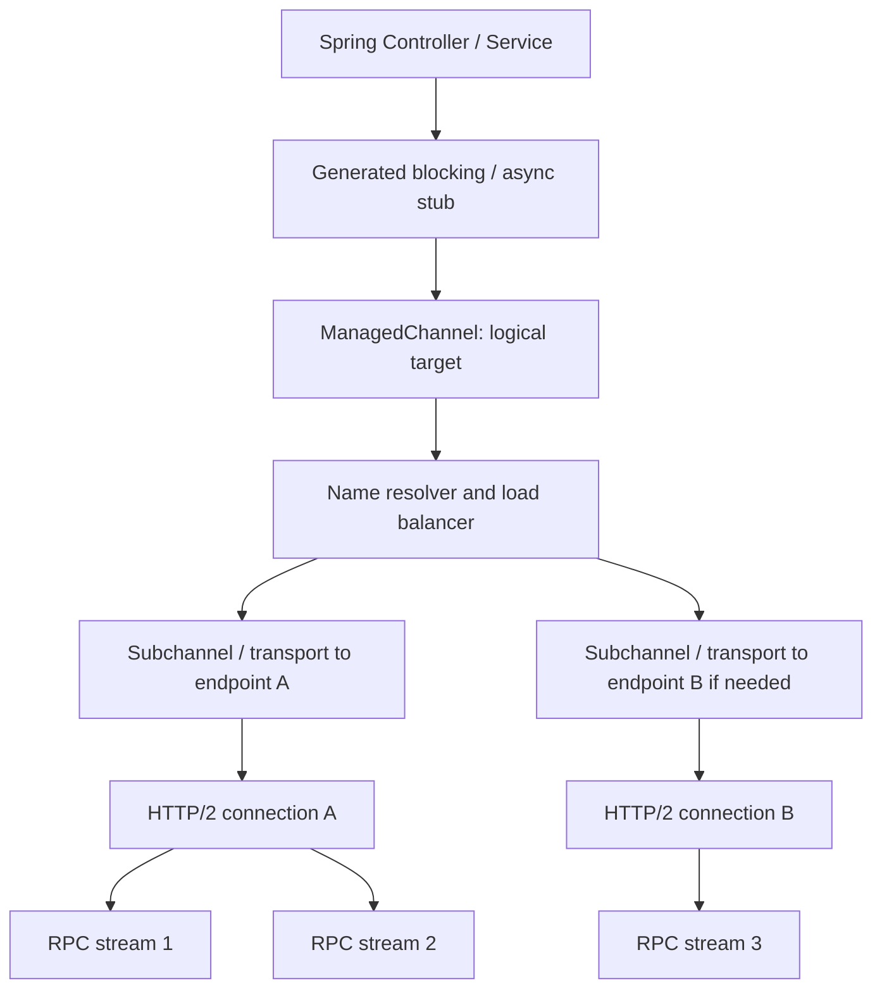
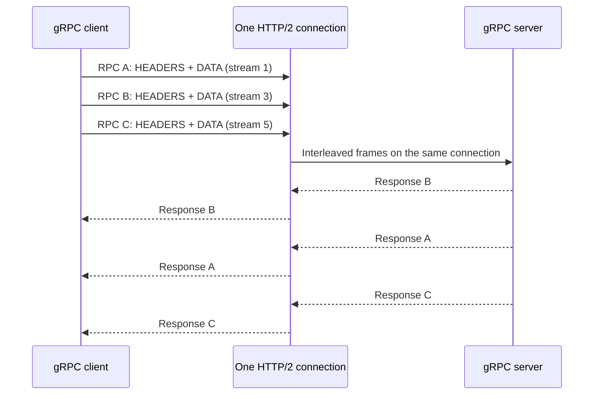
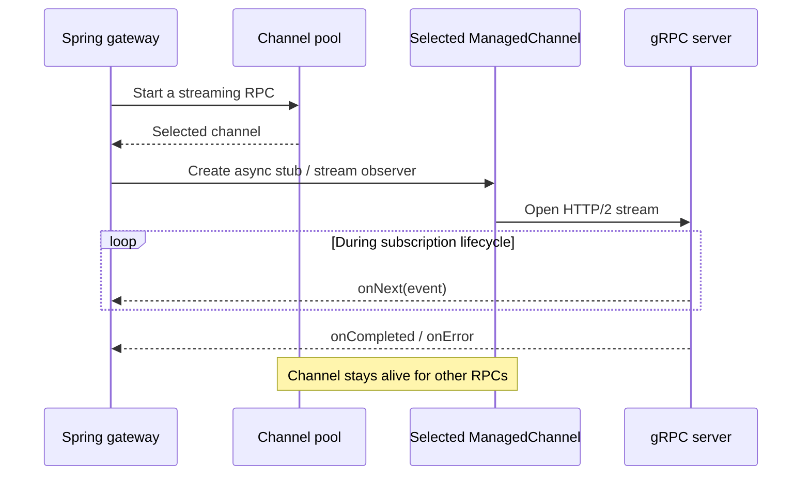
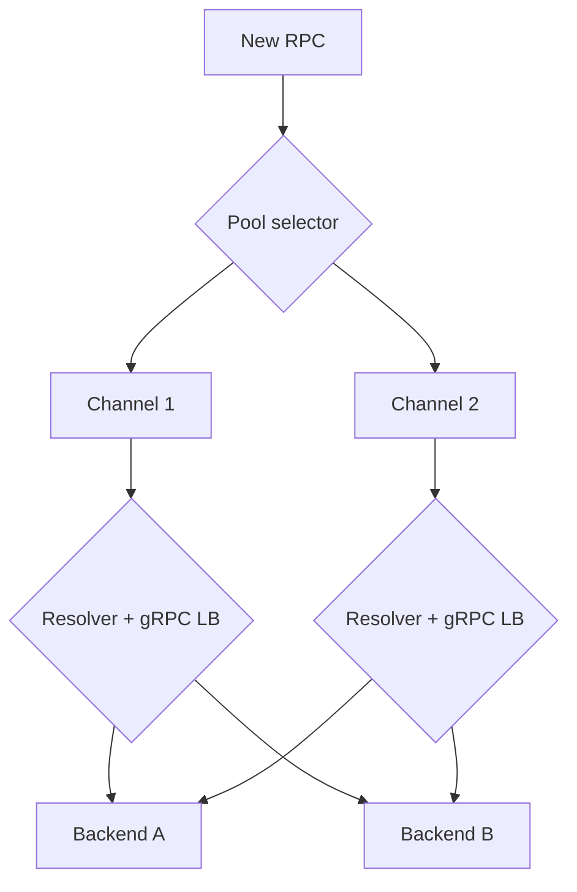

# Connection Pooling and Channel Limits

## 1. Objectives and Context

In **Spring gRPC** services, a client can invoke many unary or streaming RPCs against a backend using Java code generated from Protocol Buffers contracts. As request volume grows, developers often ask: *Should we create multiple `ManagedChannel` instances as a connection pool? How many concurrent RPCs can a single channel serve? What happens when an HTTP/2 connection hits its limit?*

The first distinction to make: `ManagedChannel` is the **logical object used to send RPCs**, whereas TCP/TLS connections and HTTP/2 streams are managed by the transport underneath. Unlike JDBC, gRPC Java typically **does not require a pool of channels for every request**. HTTP/2 supports many concurrent RPCs over a single connection; a channel can also manage multiple subchannels/transports depending on the resolver and load balancer.

After this lesson, you will be able to:

- Distinguish between a channel, subchannel, HTTP/2 connection, stream, and generated stub.
- Explain HTTP/2 multiplexing, `SETTINGS_MAX_CONCURRENT_STREAMS`, flow control, and other bottlenecks.
- Choose among **a single shared channel**, **multiple channels to the same target**, and **multiple channels to different targets**.
- Structure channel lifecycles in Spring, avoiding per-request connection creation and teardown.
- Design a bounded pool when measurements prove it necessary, without assuming pooling scales throughput linearly.
- Control the number of in-flight RPCs with admission control separate from channel count.
- Apply deadlines, statuses, interceptors, metadata, TLS, integration testing, and metrics when evaluating load.

**Scope in the "Channels and Connections" chapter:** this lesson focuses on client-side connection resource management and concurrency limits. The examples use explicit gRPC Java APIs so they can be applied directly in Spring applications or mapped to the channel factory mechanism of your Spring gRPC starter version.

## 2. The Real Connection Model

A call such as `GreeterGrpc.newBlockingStub(channel).sayHello(request)` traverses multiple layers:



This diagram is conceptual. The actual number of subchannels and connections depends on target, resolver, load-balancing policy, and transport; do not infer a 1:1 ratio from stub count or `ManagedChannel` count.

| Component | Role | Reusability |
|---|---|---|
| Generated stub | Java service API generated from `.proto`, carrying call configuration | Generally safe to share across threads; `withDeadline...` returns a new stub |
| `ManagedChannel` | Client abstraction connecting to a logical target | Shared across many stubs and RPCs; thread-safe |
| Subchannel / load-balancer pick | Binds a logical target to an available endpoint/backend | Managed by gRPC according to the active policy |
| HTTP/2 connection | Transport between two endpoints of a network hop | Multiplexes many concurrent streams |
| HTTP/2 stream | Data stream for a single RPC | Created per RPC; not an object to be reused |
| RPC | Unit of deadline, status, metadata, and cancellation | Has its own lifecycle; can be unary or streaming |

A long-lived channel **reuses established connections** and reduces TCP/TLS handshakes. When a network transport closes, an active channel can reconnect. Therefore, closing a transport or receiving `GOAWAY` is not equivalent to `ManagedChannel.shutdown()`.

**Default rule:** create a channel per **logical target and security configuration**, reuse it across calls, and close it once when its owner shuts down. Do not open a channel on every incoming HTTP request in a Spring controller.

## 3. How HTTP/2 Multiplexing Changes Pooling Needs

With older HTTP/1.1 clients, a connection pool was typically how applications kept multiple TCP connections open to serve concurrent requests. HTTP/2 allows many **independent streams** to coexist on one connection. gRPC leverages this capability so a single channel/transport can process a large number of concurrent RPCs.



This diagram is illustrative: streams initiated by one side use IDs following HTTP/2 rules, though applications rarely manipulate stream IDs directly.

### Concurrent Stream Limits

An HTTP/2 peer may advertise `SETTINGS_MAX_CONCURRENT_STREAMS`, capping the **number of simultaneously open streams on a single connection**. For example, if a connection permits at most 100 concurrent streams, the 101st call may have to wait for a slot depending on the transport/client implementation. This can increase latency or cause RPCs to miss their deadlines even when server handler execution for an individual call is very fast.

**Do not confuse this limit with:**

- Maximum total RPCs of the **entire `ManagedChannel`**: a channel can use multiple connections/subchannels.
- Maximum requests of the **entire Spring application**: the application also has thread pools, schedulers, semaphores, and other resources.
- Total **server** throughput: CPU, memory, databases, business processing time, and replica count may bottleneck earlier.
- `maxInboundMessageSize` or `DATA` frame sizes: those are size limits, not concurrent RPC limits.

If a server or proxy configures a low concurrent stream limit, the client may observe **transport-level queuing** or step-function latency increases above the threshold. Checking `channel.getState(false) == READY` alone is insufficient: `READY` does not prove free stream slots remain or that the backend has spare capacity.

### Flow Control and Head-of-Line

HTTP/2 provides **per-stream and per-connection flow control**. `WINDOW_UPDATE` frames tell the sender when it may transmit more data. A client/bidirectional streaming RPC that does not consume messages fast enough can induce backpressure while keepalive PINGs still reply normally.

HTTP/2 avoids certain HTTP/1.1 application-layer blocking issues, yet streams sharing a TCP connection are still affected when TCP packet loss triggers retransmission. Opening additional connections can occasionally isolate some effects, but **it does not eliminate** finite network bandwidth, CPU saturation, or server limits.

## 4. "Connection Pool" Can Mean Three Different Designs

| Organization | Structure | When Appropriate | Limits to Understand |
|---|---|---|---|
| **Single shared channel** | One `ManagedChannel` for one target, many stubs/RPCs | Default for most Spring gRPC clients | Transport may still have stream and flow-control limits |
| **Multiple channels to the same target** | Bounded pool of `ManagedChannel`s, picking one channel per RPC/stream | When load tests confirm a single transport path bottlenecks and the backend can handle more load | Does not guarantee each channel maps to a distinct socket or backend endpoint |
| **Multiple channels to different targets** | Dedicated channel per service/tenant/security target | Different services, different CAs/client identities, or different timeout/policy settings | Never mix distinct targets in one pool for random selection |

Multiple stubs sharing one channel **do not** create a new connection pool. Conversely, multiple channels to the same target do not guarantee RPCs spread evenly across replicas: each channel still runs its own DNS, resolver, and load-balancer policy. If all four channels pick the same backend node, the pool can concentrate load onto one node.

**Distinguish pooling from load balancing:** a pool selects **which channel** the application uses to send an RPC; gRPC load balancing selects **which subchannel/endpoint** inside a channel. Some systems use both layers of selection; observe and measure the right layer to prevent conflicting policies.

## 5. Why Creating a Channel Per Request Is a Design Flaw

Do **not** write code like this in a controller:

```java
// Anti-pattern: a new channel per HTTP request
public String greet(String name) {
    ManagedChannel channel = Grpc.newChannelBuilderForAddress(
            "grpc.example.com", 443, TlsChannelCredentials.create())
            .build();
    return GreeterGrpc.newBlockingStub(channel)
            .sayHello(HelloRequest.newBuilder().setName(name).build())
            .getMessage();
}
```

This code has two bugs: it **never closes** the channel, and every invocation creates a brand-new connection manager. Even if you add `finally { channel.shutdown(); }`, the application still pays initialization, DNS, and TCP/TLS handshake costs every time without reusing transports effectively.

As traffic rises, typical consequences include:

- Far more sockets, threads, or Netty buffers than needed.
- Increased latency, especially on short RPCs, due to connection setup overhead.
- Difficulty bounding connection counts to a backend or load balancer.
- Higher CPU and network pressure from repeated TLS handshakes.
- Complicated graceful shutdown, certificate rotation, and reconnect observability.

The fix is **a single owner with a clear lifecycle**, usually a Spring singleton bean or a framework-managed channel factory. Each RPC carries its own deadline while the channel persists across requests.

## 6. Sample Contract and Single-Channel Spring Client

Suppose the server implements this contract:

```proto
syntax = "proto3";
package demo.greeter;
option java_package = "dev.example.hello";
option java_multiple_files = true;

service Greeter {
  rpc SayHello (HelloRequest) returns (HelloReply);
}

message HelloRequest {
  string name = 1;
}

message HelloReply {
  string message = 1;
}
```

After `protoc` and the gRPC Java plugin generate code, we have `GreeterGrpc`, `HelloRequest`, and `HelloReply` in package `dev.example.hello`. The example uses `TlsChannelCredentials` to verify the server certificate on a production endpoint. You need the gRPC Java runtime, Protobuf, gRPC stubs, an HTTP/2 transport such as Netty, and the corresponding Spring dependencies.

```java
package dev.example.client;

import io.grpc.Grpc;
import io.grpc.ManagedChannel;
import io.grpc.TlsChannelCredentials;
import org.springframework.beans.factory.annotation.Value;
import org.springframework.context.annotation.Bean;
import org.springframework.context.annotation.Configuration;
import org.springframework.context.annotation.Profile;

@Configuration(proxyBeanMethods = false)
@Profile("prod")
public class GreeterChannelConfig {
    @Bean(name = "greeterChannel", destroyMethod = "shutdown")
    public ManagedChannel greeterChannel(
            @Value("${demo.grpc.greeter.host}") String host,
            @Value("${demo.grpc.greeter.port}") int port) {
        return Grpc.newChannelBuilderForAddress(
                host, port, TlsChannelCredentials.create())
                .build();
    }
}
```

```java
package dev.example.client;

import dev.example.hello.GreeterGrpc;
import dev.example.hello.HelloRequest;
import io.grpc.ManagedChannel;
import java.util.concurrent.TimeUnit;
import org.springframework.beans.factory.annotation.Qualifier;
import org.springframework.stereotype.Service;

@Service
public final class GreeterGateway {
    private final GreeterGrpc.GreeterBlockingStub stub;

    public GreeterGateway(
            @Qualifier("greeterChannel") ManagedChannel channel) {
        this.stub = GreeterGrpc.newBlockingStub(channel);
    }

    public String greet(String name) {
        return stub.withDeadlineAfter(2, TimeUnit.SECONDS)
                .sayHello(HelloRequest.newBuilder()
                        .setName(name)
                        .build())
                .getMessage();
    }
}
```

```yaml
# application-prod.yml; demo.grpc.* is a custom namespace
demo:
  grpc:
    greeter:
      host: grpc.example.com
      port: 443
```

The example assumes the server certificate is valid for `grpc.example.com` and trusted by the runtime. If your organization uses an internal CA or mTLS, supply the trust CA and client certificate via the appropriate credential builder; **never** use `usePlaintext()` to dodge certificate errors. The `demo.grpc.*` properties are custom settings, not configuration keys guaranteed across every Spring gRPC starter version.

A singleton stub can be used concurrently from multiple threads. `withDeadlineAfter(...)` returns a new stub carrying its own deadline. Do not mutate a shared singleton stub with per-request metadata; request-specific metadata/call credentials should be attached per RPC or through an appropriate interceptor.

**Limitation of `destroyMethod = "shutdown"`:** it initiates channel shutdown without waiting for termination. For long-lived streams or bounded graceful shutdown requirements, use a lifecycle owner that calls `shutdown()`, `awaitTermination(...)`, and then `shutdownNow()` if the budget expires, ensuring no two beans attempt to close the same channel.

## 7. When Can a Single Channel Become a Bottleneck?

Measure before increasing channel count. Signs worth investigating:

1. Tail latency (P95/P99) climbs sharply as active RPCs approach a consistent plateau.
2. Server CPU and handler execution times remain low, while client latency increases due to transport waiting.
3. The backend/proxy advertises `SETTINGS_MAX_CONCURRENT_STREAMS` below your desired concurrency.
4. Streaming RPCs hold many long-lived streams open and force unary RPCs to wait for slots.
5. Flow control or TCP congestion on a single connection path degrades large-payload transfer efficiency.

However, similar symptoms can also stem from thread pools, GC, databases, server-side connection limits, rate limits, or load balancers. Adding channels when the server is already saturated merely shifts queuing and can overload the backend faster.

### An Illustrative Calculation, Not a Performance Guarantee

Suppose *each* transport currently allows at most 100 active streams, and a workload needs 240 long-lived streaming RPCs. If all 240 RPCs actually traverse **one HTTP/2 connection** and each RPC occupies one stream, more than 100 streams cannot run concurrently on that connection. A pool can create opportunities to use multiple connections, yet actual usable stream capacity still depends on transports created, endpoints selected, proxy/server limits, processing resources, and retries.

Do not conclude "3 channels × 100 streams = 300 RPCs guaranteed in parallel". This is merely a hypothetical model for spotting limit types; a single `ManagedChannel` may have multiple connections, and connection count does not necessarily equal channel count.

## 8. Fixed-Size Pool of Multiple `ManagedChannel`s When Backed by Evidence

When load tests prove stream/transport limits are the bottleneck and spreading across more connections lowers tail latency **without overloading the backend**, you can use a **fixed-size** pool. Never create an unbounded pool; cap it according to resources and server policies.

Example pool class owning all channels and picking a channel round-robin for **each new RPC**. For streaming, pick a channel when **starting** the stream and keep using it for that RPC's entire lifetime.

```java
package dev.example.client;

import io.grpc.Grpc;
import io.grpc.ManagedChannel;
import io.grpc.TlsChannelCredentials;
import java.util.ArrayList;
import java.util.List;
import java.util.concurrent.TimeUnit;
import java.util.concurrent.atomic.AtomicBoolean;
import java.util.concurrent.atomic.AtomicInteger;

public final class FixedGrpcChannelPool implements AutoCloseable {
    private final List<ManagedChannel> channels;
    private final AtomicInteger cursor = new AtomicInteger();
    private final AtomicBoolean closing = new AtomicBoolean(false);

    public FixedGrpcChannelPool(String host, int port, int poolSize) {
        if (poolSize < 1 || poolSize > 8) {
            throw new IllegalArgumentException("poolSize must be in 1..8");
        }
        List<ManagedChannel> created = new ArrayList<>(poolSize);
        try {
            for (int i = 0; i < poolSize; i++) {
                created.add(Grpc.newChannelBuilderForAddress(
                        host, port, TlsChannelCredentials.create()).build());
            }
        } catch (RuntimeException e) {
            created.forEach(ManagedChannel::shutdownNow);
            throw e;
        }
        this.channels = List.copyOf(created);
    }

    public ManagedChannel nextChannel() {
        if (closing.get()) {
            throw new IllegalStateException("Channel pool is closing");
        }
        int index = Math.floorMod(
                cursor.getAndIncrement(), channels.size());
        return channels.get(index);
    }

    public int size() {
        return channels.size();
    }

    @Override
    public void close() {
        if (!closing.compareAndSet(false, true)) {
            return;
        }
        channels.forEach(ManagedChannel::shutdown);
        boolean interrupted = false;
        for (ManagedChannel channel : channels) {
            try {
                if (!channel.awaitTermination(5, TimeUnit.SECONDS)) {
                    channel.shutdownNow();
                }
            } catch (InterruptedException e) {
                interrupted = true;
                channel.shutdownNow();
            }
        }
        if (interrupted) {
            Thread.currentThread().interrupt();
        }
    }
}
```

This is an **illustrative pool** using a hardcoded `1..8` bound to emphasize configuring an upper cap; those numbers are not a sizing recommendation for every system. Round-robin selection only balances **channel picks**, without measuring in-flight RPCs, bytes in transit, queue depth, or per-endpoint health. `nextChannel()` also does not replace admission control; a four-channel pool can still be handed thousands of RPCs simultaneously.

Lifecycle note for real deployments: `close()` in this example waits **up to 5 seconds per channel**, so total shutdown duration can grow with pool size. Under a strict overall shutdown budget, compute a shared deadline, stop accepting new RPCs, and await channels in parallel or against the remaining budget. Races between in-flight requests and `close()` must be handled via application-layer **draining** before closing the pool.

### Declaring a Spring-Owned Pool

```java
package dev.example.client;

import org.springframework.beans.factory.annotation.Value;
import org.springframework.context.annotation.Bean;
import org.springframework.context.annotation.Configuration;
import org.springframework.context.annotation.Profile;

@Configuration(proxyBeanMethods = false)
@Profile("prod")
public class GrpcPoolConfig {
    @Bean(destroyMethod = "close")
    public FixedGrpcChannelPool greeterPool(
            @Value("${demo.grpc.greeter.host}") String host,
            @Value("${demo.grpc.greeter.port}") int port,
            @Value("${demo.grpc.greeter.pool-size:2}") int size) {
        return new FixedGrpcChannelPool(host, port, size);
    }
}
```

```java
package dev.example.client;

import dev.example.hello.GreeterGrpc;
import dev.example.hello.HelloRequest;
import java.util.concurrent.TimeUnit;
import org.springframework.stereotype.Service;

@Service
public final class PooledGreeterGateway {
    private final FixedGrpcChannelPool pool;

    public PooledGreeterGateway(FixedGrpcChannelPool pool) {
        this.pool = pool;
    }

    public String greet(String name) {
        var stub = GreeterGrpc.newBlockingStub(pool.nextChannel())
                .withDeadlineAfter(2, TimeUnit.SECONDS);
        return stub.sayHello(HelloRequest.newBuilder()
                .setName(name).build()).getMessage();
    }
}
```

The pool can be injected into multiple gateways sharing the same target/configuration. In Spring, **do not simultaneously register** `GreeterChannelConfig` from Section 6 and `GrpcPoolConfig` for the same client if doing so creates redundant channels or bean ambiguity. Choose one approach after evaluating the workload. Creating a new stub from an existing channel is relatively cheap; you can cache a stub per channel to reduce object allocation further, provided per-request metadata remains isolated.

`${demo.grpc.greeter.pool-size:2}` is a **custom property**. The pool does not automatically detect how many concurrent streams the server advertises; measure and tune size through real testing.

## 9. Pools Do Not Replace In-Flight RPC Limits

Another concern is **application backpressure**. If a Spring endpoint receives 2,000 concurrent requests, even with only two channels it can dispatch or queue 2,000 RPCs. Opening more channels does not control backend CPU, memory, or database transaction pressure.

Applications should enforce an independent **admission limit**, capping concurrent in-flight RPCs and queue wait budgets. A simple approach for **blocking RPCs** uses a `Semaphore`:

```java
package dev.example.client;

import dev.example.hello.GreeterGrpc;
import dev.example.hello.HelloRequest;
import io.grpc.Deadline;
import io.grpc.Status;
import java.util.concurrent.Semaphore;
import java.util.concurrent.TimeUnit;

public final class BoundedGreeterClient {
    private final GreeterGrpc.GreeterBlockingStub stub;
    private final Semaphore inFlight = new Semaphore(64, true);

    public BoundedGreeterClient(
            GreeterGrpc.GreeterBlockingStub stub) {
        this.stub = stub;
    }

    public String greet(String name) {
        Deadline budget = Deadline.after(2, TimeUnit.SECONDS);
        boolean acquired;
        try {
            long remainingNanos = Math.max(
                    0, budget.timeRemaining(TimeUnit.NANOSECONDS));
            acquired = inFlight.tryAcquire(
                    remainingNanos, TimeUnit.NANOSECONDS);
        } catch (InterruptedException e) {
            Thread.currentThread().interrupt();
            throw Status.CANCELLED
                    .withDescription("Interrupted while waiting for capacity")
                    .withCause(e)
                    .asRuntimeException();
        }

        if (!acquired) {
            throw Status.RESOURCE_EXHAUSTED
                    .withDescription("Client concurrency limit reached")
                    .asRuntimeException();
        }

        try {
            return stub.withDeadline(budget)
                    .sayHello(HelloRequest.newBuilder()
                            .setName(name).build())
                    .getMessage();
        } finally {
            inFlight.release();
        }
    }
}
```

Here the 2-second budget is created **before waiting on the semaphore**; the gRPC stub receives that same `Deadline` so queuing time does not silently stretch the total budget. Calls unable to obtain a permit throw `RESOURCE_EXHAUSTED` **decided by the client application itself**, which should not be misinterpreted as a server error. If the `Deadline` expires right as a slot is acquired, the RPC can fail immediately; production code can detect that and return the corresponding deadline status while still releasing the permit.

Choosing `64` concurrent RPCs is illustrative only; measure CPU, latency, memory, and server capacity to pick real bounds. For async/reactive RPCs, do not use blocking `tryAcquire` on an event loop; use an asynchronous limiter or non-blocking queue/bulkhead. When using a semaphore, instrument rejected requests, wait times, and active permits.

**Channel pools and semaphores solve two different problems:** a pool controls **which path sends**, while a semaphore controls **whether more work is admitted**. Never increase channel count when what you actually need is concurrency limiting or server scaling.

## 10. Managing Retries, Wait-for-Ready, and Deadlines

When stream limits are hit or a backend is temporarily unavailable, RPCs may queue, exceed deadlines, or return errors. Read `Status.Code` to distinguish causes:

| Symptom | Common Code | Investigation Path |
|---|---|---|
 RPC waits too long and exhausts its budget | `DEADLINE_EXCEEDED` | Admission wait, client queue, transport stream slots, backend latency |
 Backend/connection unavailable | `UNAVAILABLE` | DNS, TLS, proxy, backend, reconnects, and `GOAWAY` |
 Server rejects due to quota or resources | `RESOURCE_EXHAUSTED` | Real server quotas/limits, memory, concurrency, rate limits |
 Client rejects locally due to exhausted permits | `RESOURCE_EXHAUSTED` in the example | Client-side admission policy; do not misattribute to server |
 RPC is cancelled | `CANCELLED` | Caller cancellation, shutdown, stream lifecycle |
 Application handler returns an error | `INTERNAL`, `INVALID_ARGUMENT`, etc. | Business error handling; do not blame the pool |

`withWaitForReady()` can make an RPC wait for a transport to become `READY` rather than failing fast in certain connection states, but it **does not increase stream limits** or backend capacity. Always pair it with a deadline; never let RPCs wait indefinitely when a load balancer loses endpoints.

**Retries and hedging can amplify RPC execution counts**, adding extra load right when the system is overloaded. Only retry when business semantics tolerate re-execution, using a retry budget, backoff, and overall deadline. For RPCs with side effects, enforce idempotency keys or proper deduplication.

## 11. Streaming and Channel Pools

Streaming RPCs typically hold HTTP/2 streams open far longer than unary calls. For example, 150 clients opening server-streaming subscriptions—each quiet for minutes while remaining incomplete—still occupy stream slots on connections.



Rules to follow:

1. **Select one channel when creating the stream**; do not switch channels mid-stream for the same RPC.
2. A failed stream or dropped connection does not automatically "migrate" to another channel with its business state intact. The client must open a new RPC and **resume/replay** if the contract supports it.
3. For long-lived server streaming or bidirectional streaming, consider how load is isolated between streams and unary calls; separate **channel classes** only after proving contention and verifying server policy permits it.
4. **Backpressure** and bounding buffered messages matter more than channel count in many cases. Never push unbounded data into a slow stream.
5. On shutdown, complete/cancel open streams before closing the pool; track reconnects and cancellations.

One option is keeping **one channel for unary** and **one channel for long-lived streaming** to isolate keepalive/deadline policies or reduce stream contention if measurements confirm the benefit. However, splitting channels increases transports and may still target the same backend; do not treat it as a default rule.

## 12. Interactions with TLS, Keepalive, and Connection Age

A multi-channel pool can create more TCP/TLS sessions and more connections to proxies/servers. Before raising pool size, evaluate:

- **TLS/mTLS:** every channel must use the right trust CA, hostname/SAN, client certificate, and private key. Never accidentally share identities across tenants or workloads; certificates may require rotation.
- **Keepalive:** each HTTP/2 connection can emit `PING`s per policy. Many active channels can multiply PING traffic and trigger `GOAWAY ENHANCE_YOUR_CALM` or `too_many_pings` if policies are violated.
- **Max connection age:** servers/proxies may send `GOAWAY` when connections hit max age or drain. Channels stay alive and establish new transports; in-flight streams must be handled explicitly.
- **Connection idle:** many channels with no RPCs do not necessarily keep many open sockets; maintaining idle connections and keepalive depends on transport and configuration.
- **Certificate rotation:** replacing secrets on disk does not automatically reload certificates in every transport. You may need to construct a new pool, shift traffic, and drain the old pool.

For example, scaling a client service from 10 to 100 replicas, each holding an 8-channel pool to the same backend, yields up to **800 logical channels** in configuration—excluding internal subchannels/connections. Monitor actual transport counts, TLS handshake overhead, and proxy connection caps before rolling out widely.

## 13. Is a Channel Pool the Same as Load Balancing?

No. These are two independent choices:



If the target is a DNS name with multiple IPs, each channel resolves and load-balances according to its own configuration; do not assume different channels automatically point to different IPs. To spread load across multiple backends, configure the name resolver and gRPC load-balancing policy or appropriate service discovery.

For example, `round_robin` is a gRPC Java load-balancing policy in supported environments, distinct from the round-robin channel selection in `FixedGrpcChannelPool`. Channel pool size should not be used to "fix" a resolver seeing only one endpoint or a policy picking an inappropriate backend.

When backend A is overloaded while B sits idle, prioritize measuring per-endpoint distribution and fixing service discovery/LB. Multiplying channels can simply funnel the entire pool into A if the pick policy stays unchanged.

## 14. Measure Before Optimizing

### Metrics to Examine Together

| Observation Group | Example Metrics | Questions |
|---|---|---|
 Client RPC | `in_flight`, throughput, errors by `Status.Code` | What is the actual load and success rate? |
 Latency | Per-method P50, P95, P99 | At what load does tail latency climb? |
 Client admission | Permits in use, queue wait, rejected requests | Are too many calls arriving concurrently? |
 Transport | Connection/subchannel count, reconnects, `GOAWAY` | Does the pool actually add useful connections? |
 HTTP/2 | Active streams, stream limits, flow control where observable | Is queuing caused by stream slots or flow-control windows? |
 Backend | CPU, memory, threads, executor queues, DB pools | Is the bottleneck inside the server? |
 Network/security | TLS handshake latency/failures, proxy timeouts | Are connection setup costs or certificate errors occurring? |
 Streaming | Long-lived stream count, reconnect/resume frequency | Are streams holding slots too long or dropping events? |

**Do not measure connection count by counting `ManagedChannel` objects.** Use transport metrics/logs, **Channelz** if supported by your deployment/version, controlled socket inspection, or load-balancer/server metrics. RPC-layer interceptors measure call status and duration, but usually cannot directly report how many stream slots each HTTP/2 connection has.

You can use OpenTelemetry/Micrometer in the Spring stack to collect RPC metrics/tracing; protect sensitive metadata in logs/traces and avoid high-cardinality metric labels such as user ID or request ID.

### How to Run Valid Comparisons

Fix **the same backend, same deadline, same retry policy, same message size, and same workload**, then compare:

1. One shared channel vs. a 2-channel pool.
2. A 4-channel pool if the prior step showed clear gains.
3. Pure unary load, pure streaming load, and mixed load.
4. RPC latency and error rates **alongside** client, server, and proxy CPU/memory/sockets.
5. Behavior during server stop/restart, single-backend loss, cert rotation, and shutdown.

Keep a larger pool only when P95/P99 or throughput gains are **consistent across runs**, do not shift failures to another layer, and stay within resource budgets. Benchmarks must include warm-up so initial handshake costs are not confused with steady-state throughput.

## 15. Integration Testing: Verifying Concurrency Without Misrepresenting It

An in-process channel unit test is great for service logic, but **it proves nothing about real TCP/HTTP/2 connection counts**. For connections, use a real Netty server/client over loopback, set deadlines, invoke many concurrent RPCs, and shut down all resources.

JUnit 5 example using a non-TLS server on `127.0.0.1` **solely in an isolated test environment**. The goal is demonstrating multiple RPCs running over one channel, not claiming to measure a single connection or a specific `SETTINGS_MAX_CONCURRENT_STREAMS` value.

```java
package dev.example.hello;

import static org.junit.jupiter.api.Assertions.assertEquals;
import static org.junit.jupiter.api.Assertions.assertTrue;

import io.grpc.Grpc;
import io.grpc.InsecureChannelCredentials;
import io.grpc.ManagedChannel;
import io.grpc.Server;
import io.grpc.netty.shaded.io.grpc.netty.NettyServerBuilder;
import io.grpc.stub.StreamObserver;
import java.net.InetSocketAddress;
import java.util.List;
import java.util.concurrent.CompletableFuture;
import java.util.concurrent.ExecutorService;
import java.util.concurrent.Executors;
import java.util.concurrent.TimeUnit;
import org.junit.jupiter.api.Test;

class SharedChannelConcurrencyTest {
    @Test
    void manyUnaryRpcsReuseOneChannel() throws Exception {
        Server server = NettyServerBuilder
                .forAddress(new InetSocketAddress("127.0.0.1", 0))
                .addService(new GreeterGrpc.GreeterImplBase() {
                    @Override
                    public void sayHello(
                            HelloRequest req,
                            StreamObserver<HelloReply> observer) {
                        observer.onNext(HelloReply.newBuilder()
                                .setMessage("Hello " + req.getName())
                                .build());
                        observer.onCompleted();
                    }
                })
                .build()
                .start();

        ManagedChannel channel = Grpc.newChannelBuilderForAddress(
                "127.0.0.1", server.getPort(),
                InsecureChannelCredentials.create()).build();
        ExecutorService callers = Executors.newFixedThreadPool(8);

        try {
            var stub = GreeterGrpc.newBlockingStub(channel);
            List<CompletableFuture<String>> tasks =
                    java.util.stream.IntStream.range(0, 32)
                            .mapToObj(i -> CompletableFuture.supplyAsync(
                                    () -> stub
                                            .withDeadlineAfter(3, TimeUnit.SECONDS)
                                            .sayHello(HelloRequest.newBuilder()
                                                    .setName("User" + i)
                                                    .build())
                                            .getMessage(), callers))
                            .toList();
            for (int i = 0; i < tasks.size(); i++) {
                assertEquals("Hello User" + i, tasks.get(i).join());
            }
        } finally {
            channel.shutdownNow();
            server.shutdownNow();
            callers.shutdownNow();
            assertTrue(channel.awaitTermination(5, TimeUnit.SECONDS));
            assertTrue(server.awaitTermination(5, TimeUnit.SECONDS));
            assertTrue(callers.awaitTermination(5, TimeUnit.SECONDS));
        }
    }
}
```

This test uses Java's `Stream.toList()`; on older Java versions, use `collect(Collectors.toList())`. If the test fails due to a tight deadline on a slow CI runner, diagnose machine load and timeouts rather than blindly adding channels to hide flakiness.

**What this test proves:** 32 unary RPCs can be invoked concurrently from multiple threads using one stub/channel and the server processes them. **What it does not prove:** TCP connection count, max concurrent stream limits, which pool policy is optimal, or whether production TLS works. Use transport observability tools and dedicated stress tests for those goals.

### Other Valuable Tests

- **Admission limits:** generate slow RPCs and verify permits are not exceeded; rejected requests return an observable error.
- **Transport stream limits:** configure a test server/proxy with a low stream cap if supported, raise concurrent RPCs, and observe queuing/deadlines instead of guessing from stub counts.
- **Pool lifecycle:** initialize a fixed-size pool, close the Spring context, and confirm all channels shut down without leaking threads/sockets.
- **Single-endpoint loss:** stop one replica or drop TCP; inspect resolver/LB behavior, retry budget, and RPC outcomes upon backend loss.
- **Streaming:** open multiple long-lived streams; verify cancel/resume behavior when the server sends `GOAWAY` or drops connections.
- **TLS/mTLS:** use certificate fixtures with proper SAN/CA, test mismatched hostnames and wrong CAs, and never substitute plaintext when testing production security.

## 16. Common Incidents and Resolutions

| Symptom | Causes to Examine | Action |
|---|---|---|
 Every request creates a new channel | Creating channels inside controller/service methods | Use a singleton bean or framework-managed channel |
 P99 climbs when many long-lived streams exist | Exhausted HTTP/2 stream slots, flow control, or saturated server | Measure per layer; consider workload isolation or a small pool after load testing |
 Increasing pool size does not raise throughput | Backend CPU/DB or LB is the real bottleneck | Shrink the pool; scale or fix the backend or LB |
 Sockets/threads/handshakes spike suddenly | Pool too large or connection churn | Bound the pool; measure real connections and TLS handshakes |
 `RESOURCE_EXHAUSTED` | Server quota/resources or client admission limit | Identify where the code originates; shed load and enforce a limiter |
 `DEADLINE_EXCEEDED` despite fast server | Waiting for slots/queues before backend execution | Measure end-to-end latency and queue wait times |
 Channel pool concentrates on one replica | Inadequate DNS/LB picking | Fix resolver/LB; do not treat pooling as load balancing |
 `GOAWAY too_many_pings` | Multiple connections pinging too frequently for policy | Align keepalive settings with server/proxy |
 Stream loses events after reconnect | Old streaming RPC ended and did not resume | Design replay cursors/deduplication |
 Shutdown hangs or leaves threads | Long-lived RPCs or channels without clear ownership | Drain streams, close each channel with a timeout, verify termination |

## 17. Applied Exercise: High-Load Spring Gateway

**Scenario:** a Spring Boot gateway calls `Greeter.SayHello` and `Notification.Subscribe` (server streaming). There are 300 long-lived streams alongside roughly 150 unary RPCs/s. The backend consists of three replicas behind a DNS/load balancer; the proxy enforces a per-HTTP/2-connection stream cap. Unary P95 climbs when open stream count is high. The team suggests "just add 20 channels to make it fast."

Carry out the following:

1. Diagram `Spring gateway → ManagedChannel → subchannel/transport → proxy → server` and mark where `SETTINGS_MAX_CONCURRENT_STREAMS` applies.
2. Measure per-method latency, active RPCs/streams, real transport count, proxy queues, server CPU, and `Status.Code` breakdown. Specify the evidence required before introducing a pool.
3. Benchmark a single channel vs. 2-channel and 4-channel pools under the same workload with fixed retries and deadlines. Compare memory/sockets as well as server load.
4. Add an admission limit for unary RPCs with a wait budget and overall deadline. Explain why a pool does not cap the number of requests the application accepts.
5. Design the streaming policy: select a channel once, handle `onError`, resume via cursor, and cancel streams when clients disconnect.
6. Evaluate DNS/LB to verify RPCs distribute properly across all three replicas; do not infer distribution from channel count.
7. Review TLS/mTLS, certificate rotation, keepalive, and `GOAWAY` when increasing transport counts.
8. Test shutting down the Spring context and prove the pool/channels retain no threads/sockets after shutdown; note the limitations of an in-process integration test.

**Completion Criteria:** You can propose a measurement-backed configuration, avoid per-request channel creation, distinguish HTTP/2 stream limits from application concurrency limits, explain the role of admission control, and design tests uncovering both performance gains and risks of adding channels.

## 18. Key Takeaways

In Spring gRPC, **a single long-lived reusable `ManagedChannel` is the right starting point**. HTTP/2 multiplexing lets many RPCs share a connection, yet concurrent stream limits, flow control, server resources, and proxy policies remain real constraints. A multi-channel pool can help specific workloads once a transport bottleneck is **measured**; it is not load balancing and does not limit in-flight RPCs on its own. Combine clear channel ownership, admission control, deadlines, TLS, metrics, streaming recovery, and graceful shutdown to optimize latency while preserving system reliability.
