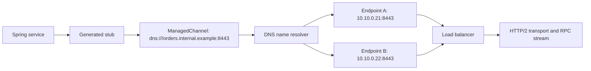
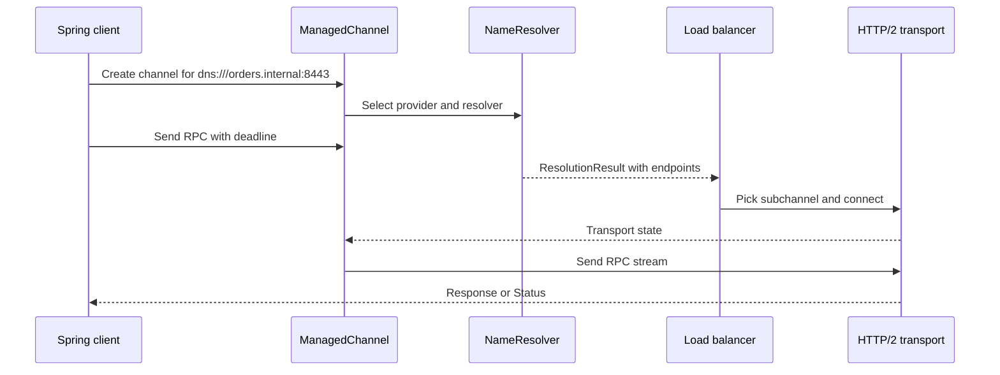
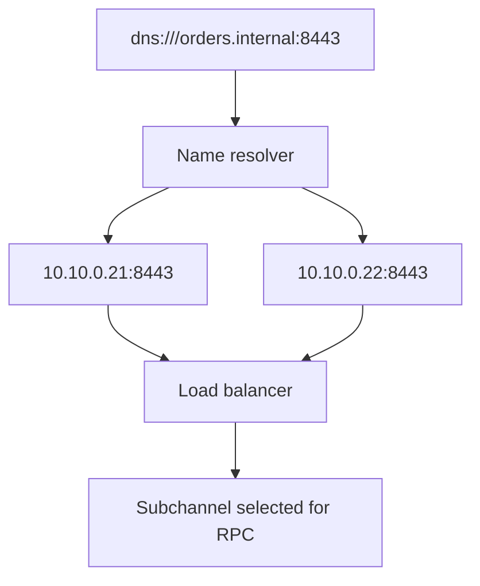

# Name Resolvers and Target URIs

## 1. Objectives and Context

In **Spring gRPC**, generated stubs know RPC method names and message types from Protocol Buffers contracts, but they do not know which IP address the server currently runs on. When an application calls a service such as `OrderService.GetOrder`, the `ManagedChannel` must locate an appropriate endpoint and dispatch the RPC over an HTTP/2 transport. The **name resolver** and **target URI** are the two components that govern how endpoints are discovered.

A target can remain stable for months while server IP addresses change on every deployment, failover, or scaling event. Separating **service identity** from **concrete network addresses** keeps client code free from updates whenever servers move.

After this lesson, you will be able to:

- Parse the scheme, URI authority, and path of a target such as `dns:///orders.internal:8443`.
- Distinguish the service name in `.proto`, the target URI, the service authority, and socket addresses.
- Explain the flow `target → name resolver → endpoint → load balancer → transport`.
- Configure an explicit DNS target via gRPC Java and Spring beans.
- Compare DNS, Kubernetes ClusterIP, headless Services, and custom resolvers.
- Separate `pick_first` and `round_robin` policies from name resolution itself.
- Identify TLS hostname/SAN errors, DNS caching, endpoint updates, and streaming behavior when server addresses change.
- Design a basic custom `NameResolverProvider` and test at the proper resolution layer.

This content focuses on **name resolvers and target URIs** within the "Channels and Connections" chapter. TLS, deadlines, statuses, interceptors, and performance observability are included where they help verify or operate the connection path.

## 2. Service Identity, Target, and Endpoint Are Three Different Things

Suppose we have the gRPC contract `demo.orders.OrderService/GetOrder`:

| Component | Example | Meaning |
|---|---|---|
| Full method name | `demo.orders.OrderService/GetOrder` | RPC name generated from the `.proto` file |
| Target URI | `dns:///orders.internal.example:8443` | Specifies how to locate the destination and port |
| Endpoint address | `10.10.0.21:8443`, `10.10.0.22:8443` | Concrete socket addresses eligible for selection |
| `ManagedChannel` | Client-owned Java object | Coordinates resolver, load balancer, transports, and multiple RPCs |

Changing backend IP addresses usually **does not require editing `.proto` files or regenerating stubs**. Conversely, changing package/service/method names in `.proto` impacts the RPC API even if DNS remains unchanged.



This is a conceptual model. A channel may manage multiple subchannels/transports; socket count does not necessarily equal stub count, channel count, or the number of returned addresses.

## 3. Target URI Syntax

A target has the general form:

```text
scheme://authority/path
```

The **scheme** selects the `NameResolverProvider`; the remainder is interpreted by that provider. A target URI **is not an HTTP URL**. For example, writing `https://...` is not how you tell gRPC Java to enable TLS. TLS is selected via `ChannelCredentials` or an appropriate security builder.

A familiar DNS target looks like:

```text
dns:///orders.internal.example:8443
│     └─ Path containing endpoint name and port
└─────── Scheme = dns
```

The three slashes after `dns:` indicate an **empty URI authority** and a path starting with `/`. Check with Java:

```java
import java.net.URI;

URI target = URI.create("dns:///orders.internal.example:8443");
System.out.println(target.getScheme());    // dns
System.out.println(target.getAuthority()); // null
System.out.println(target.getPath());      // /orders.internal.example:8443
```

| Target | When Used | What to Watch |
|---|---|---|
| `dns:///localhost:9090` | Local machine practice | gRPC port target, not an HTTP/1.1 endpoint |
| `dns:///orders.internal.example:8443` | Production DNS | Requires matching TLS hostname and CA config |
| `dns:///orders.default.svc.cluster.local:8443` | Kubernetes Service | DNS may return a virtual IP or Pod IPs depending on Service type |
| `orders.internal.example:8443` | Target omitting scheme | gRPC uses the runtime's default scheme, usually `dns` |
| `xds:///orders-service` | Discovery via xDS | Only when the runtime has an xDS provider and valid bootstrap/config |
| `localdemo:///greeter` | Custom resolver example | Not a built-in default scheme |

For targets missing a scheme, `ManagedChannelBuilder` may fall back to a default resolver scheme. In production, **writing the scheme explicitly** makes clear to operators which provider the client invokes and avoids implicit dependence on registered process resolvers.

Some providers allow the URI authority segment to carry custom metadata. Do not apply `dns` path/authority conventions blindly to other resolvers: each scheme defines its own resolution contract.

## 4. URI Authority, Service Authority, and Socket Address

The word "authority" appears at several layers with different meanings:

| Concept | Layer | Meaning |
|---|---|---|
| **URI authority** | URI syntax | Sits between `//` and `/`; empty in `dns:///...` |
| **Service authority** | gRPC resolver/channel | Logical identity the transport may use for HTTP/2 `:authority` and server verification |
| **Socket address** | TCP/transport | Actual IP and port used to open a connection |

For example, a channel targets `dns:///orders.internal.example:8443`. DNS returns `10.10.0.21:8443`. The TCP connection opens to `10.10.0.21`, yet the TLS certificate normally still needs to be valid for `orders.internal.example`. **A backend IP address does not automatically become the name required on the certificate.**

A custom `NameResolver` supplies `getServiceAuthority()`. That name must align with the verifiable service identity. `ManagedChannel.authority()` helps inspect the authority advertised by the channel, though it is not proof that a TLS handshake succeeded.

Avoid calling `overrideAuthority(...)` or disabling hostname verification to silence certificate errors. In TLS/mTLS environments, fix DNS configuration, service identity, or issue certificates with the right **Subject Alternative Name (SAN)**. When ingress/xDS/service mesh is present, SNI, HTTP/2 `:authority`, and socket routing must be designed consistently across every hop.

## 5. What Does a Name Resolver Do After Receiving a Target?

`ManagedChannel` uses the scheme to locate a `NameResolverProvider`, instantiate a resolver, and receive resolved addresses. The load balancer then decides which subchannel/endpoint serves each RPC.



These steps can execute asynchronously; `build()` constructs the channel object but **does not guarantee DNS has finished resolving or that the server is ready**.

### What Data Does a Resolver Return?

In gRPC Java, the result can be a `NameResolver.ResolutionResult` containing:

- **Address groups (`EquivalentAddressGroup`):** groups of socket addresses treated by the API as equivalent choices for an endpoint/subchannel.
- **Attributes:** internal metadata for routing, load balancing, or resolver use; **they do not automatically become** gRPC metadata sent with RPCs.
- **Service config:** in supporting providers/runtimes, can influence LB policy, retries, and relevant client behavior.

Do not lump multiple independent backends into **a single** `EquivalentAddressGroup` and expect `round_robin` to spread across them. Typically, each group represents one endpoint selectable by the load balancer; multiple addresses within one group usually act as alternatives for that endpoint.

### When Do Resolver Results Change?

Addresses can change due to DNS updates, instance replacements, pod scaling, or discovery watch events. A resolver may respond to `refresh()` or push updated results asynchronously when backed by a watch mechanism. Even so:

1. There is no guarantee gRPC immediately sees DNS changes the moment a record updates. DNS/JVM/resolver/proxies may cache records.
2. Existing connections may continue serving RPCs even after records change, until the transport closes or the LB updates state.
3. When the resolver has no usable endpoints left, RPCs may fail with `UNAVAILABLE` or hit `DEADLINE_EXCEEDED` while waiting to connect.
4. Reconnection does not automatically restore the business state of an interrupted streaming RPC.

An `UNAVAILABLE` error **is not enough to conclude DNS is broken**; also verify ports, TCP/TLS, HTTP/2, proxies, and backend health.

## 6. DNS Resolver: A/AAAA Records and Caching

A DNS resolver can look up IPv4 (`A`) and IPv6 (`AAAA`) addresses for a hostname, depending on implementation and environment; `CNAME` records may participate in the chain. For example:

```text
Target: dns:///orders.internal.example:8443
DNS:    orders.internal.example → 10.10.0.21, 10.10.0.22
Output: endpoint A (10.10.0.21:8443)
        endpoint B (10.10.0.22:8443)
```

This is an illustrative case; **not every DNS name returns multiple backend IPs**. DNS may return only a single virtual IP belonging to a proxy or load balancer.

Key facts to understand:

- DNS provides no guarantee that a backend is still healthy when an RPC arrives.
- Multiple IPs **do not automatically** mean even RPC distribution; the LB policy determines selection.
- TTL is not a promise that all HTTP/2 connections will be torn down when TTL expires.
- Java, DNS proxies, and resolvers may cache according to differing rules and versions.
- Some systems need dedicated resolvers to obtain health, locality, weights, or addresses from a custom registry.

When troubleshooting, test DNS **inside the exact environment where the client runs**. `localhost` inside a container is the container itself; DNS results inside a Kubernetes pod can differ from your laptop.

## 7. Kubernetes: ClusterIP vs. Headless Services

Example target:

```text
dns:///orders.default.svc.cluster.local:8443
```

With a standard **ClusterIP Service**, DNS returns a single virtual IP. The gRPC client may only see **one endpoint**, while traffic distribution to Pods is handled by the Kubernetes dataplane. Setting `round_robin` on the client cannot discover individual Pods if the resolver only sees one ClusterIP.

With a **headless Service** (`clusterIP: None`), DNS can return IP addresses for multiple Pods/endpoints. Client-side LB can then receive multiple addresses to choose among. Still, real behavior depends on readiness, how the Service publishes addresses, caching, refresh behavior, and long-lived HTTP/2 connections.

| Question | ClusterIP | Headless Service |
|---|---|---|
| What does DNS usually return? | Virtual IP of the Service | IPs of eligible endpoints/Pods |
| Can the gRPC client see individual Pods? | Usually not | Potentially yes |
| Who primarily distributes across Pods? | Kubernetes dataplane/proxy | Client-side LB or an appropriate discovery component |
| Need to watch caching and stale connections? | Yes | Yes |
| Does it automatically solve TLS SAN and service identity? | No | No |

Do not convert every Service to headless just to fix uneven load: an ingress, xDS control plane, service mesh, or L7 LB may already be the intended routing layer. Choose based on real topology, health checks, and certificates.

## 8. How Do Resolvers Differ from Load Balancers?

| Component | Question Answered | Output |
|---|---|---|
| Resolver | "Which endpoints exist for this service?" | List of address groups, attributes/config |
| Load balancer | "Which subchannel should carry this RPC?" | A selected endpoint/subchannel |
| Transport | "How is the HTTP/2 connection established?" | TCP, TLS, and streams |
| Deadline/retry | "How long to wait or how many retries?" | Time bounds and attempt counts |

**`pick_first`** typically selects one usable address/connection path and keeps using it while available. This is usually the default policy unless overridden by configuration.

**`round_robin`** rotates across `READY` subchannels. If two endpoints exist but only one connection is ready, traffic distribution will not be 50/50. And if DNS returns a single ClusterIP, `round_robin` will not conjure additional Pod endpoints.



**Adding more `ManagedChannel` instances does not replace a proper resolver or load-balancing policy.** One channel can manage multiple endpoints, whereas multiple channels to the same target may still land on the same backend. When load distribution looks skewed, inspect resolver output and LB policy before changing channel counts.

## 9. Configuring Target URIs in gRPC Java

For practice, assume the following gRPC service:

```proto
syntax = "proto3";
package demo.greeter;
option java_package = "dev.example.hello";
option java_multiple_files = true;

service Greeter {
  rpc SayHello (HelloRequest) returns (HelloReply);
}
message HelloRequest { string name = 1; }
message HelloReply { string message = 1; }
```

After running the Protocol Buffers and gRPC Java code generators, the application has `GreeterGrpc`, `HelloRequest`, and `HelloReply`. In production, you can build a channel from a **target string** rather than just host and port:

```java
import dev.example.hello.GreeterGrpc;
import dev.example.hello.HelloReply;
import dev.example.hello.HelloRequest;
import io.grpc.Grpc;
import io.grpc.ManagedChannel;
import io.grpc.TlsChannelCredentials;
import java.util.concurrent.TimeUnit;

String target = "dns:///greeter.internal.example:8443";
ManagedChannel channel = Grpc.newChannelBuilder(
        target, TlsChannelCredentials.create())
        .defaultLoadBalancingPolicy("round_robin")
        .build();

try {
    var stub = GreeterGrpc.newBlockingStub(channel);
    HelloReply reply = stub.withDeadlineAfter(3, TimeUnit.SECONDS)
            .sayHello(HelloRequest.newBuilder()
                    .setName("Lan")
                    .build());
    System.out.println(reply.getMessage());
} finally {
    channel.shutdown();
    if (!channel.awaitTermination(5, TimeUnit.SECONDS)) {
        channel.shutdownNow();
        channel.awaitTermination(2, TimeUnit.SECONDS);
    }
}
```

The example requires a gRPC Java version providing `Grpc.newChannelBuilder` and `TlsChannelCredentials`, a compatible HTTP/2 transport, and a TLS server with a SAN matching `greeter.internal.example`. With a private CA, supply trust material via `TlsChannelCredentials.newBuilder().trustManager(...)` instead of disabling TLS verification.

Points to note:

1. `target` specifies **which resolver** to use. `TlsChannelCredentials` specifies **how to secure the transport**—two separate concerns.
2. `defaultLoadBalancingPolicy("round_robin")` is a fallback policy; a valid service config from the resolver may override it, depending on runtime support.
3. When DNS returns only a single VIP, `round_robin` does not split that VIP into individual Pods/backends.
4. `build()` does not synchronously wait for DNS, the TLS handshake, or an RPC health check.
5. `withDeadlineAfter(...)` bounds **one RPC** including resolution/connection wait time; it is not the channel lifetime.
6. `shutdown()` belongs to the channel owner; in a long-running Spring application, never shut down the channel after each HTTP request.

If a client uses `ManagedChannelBuilder.forTarget(...)` in other versions/APIs, target URI selection principles remain similar. Verify the exact API of your gRPC Java version when integrating with a Spring gRPC starter.

## 10. Externalizing Targets in Spring Configuration

Keeping logical names in configuration lets you switch environments without changing RPC call code:

```yaml
# application-prod.yml, the app.grpc.* namespace is custom-defined
app:
  grpc:
    greeter:
      target: dns:///greeter.internal.example:8443
      lb-policy: round_robin
```

```java
package dev.example.client;

import io.grpc.Grpc;
import io.grpc.ManagedChannel;
import io.grpc.TlsChannelCredentials;
import org.springframework.beans.factory.annotation.Value;
import org.springframework.context.annotation.Bean;
import org.springframework.context.annotation.Configuration;
import org.springframework.context.annotation.Profile;

@Configuration(proxyBeanMethods = false)
@Profile("prod")
public class GreeterChannelConfiguration {
    @Bean(name = "greeterChannel", destroyMethod = "shutdown")
    public ManagedChannel greeterChannel(
            @Value("${app.grpc.greeter.target}") String target,
            @Value("${app.grpc.greeter.lb-policy:pick_first}") String policy) {
        return Grpc.newChannelBuilder(
                target, TlsChannelCredentials.create())
                .defaultLoadBalancingPolicy(policy)
                .build();
    }
}
```

Service calling a stub backed by the injected channel:

```java
package dev.example.client;

import dev.example.hello.GreeterGrpc;
import dev.example.hello.HelloRequest;
import io.grpc.ManagedChannel;
import java.util.concurrent.TimeUnit;
import org.springframework.beans.factory.annotation.Qualifier;
import org.springframework.stereotype.Service;

@Service
public final class GreeterGateway {
    private final GreeterGrpc.GreeterBlockingStub stub;

    public GreeterGateway(
            @Qualifier("greeterChannel") ManagedChannel channel) {
        this.stub = GreeterGrpc.newBlockingStub(channel);
    }

    public String greet(String name) {
        return stub.withDeadlineAfter(3, TimeUnit.SECONDS)
                .sayHello(HelloRequest.newBuilder().setName(name).build())
                .getMessage();
    }
}
```

`app.grpc.*` in the example is **not a default property prefix guaranteed across every Spring gRPC starter version**. If the starter already creates and manages channels automatically, use that version's target configuration API or channel customizer and avoid registering duplicate beans.

The `ManagedChannel` bean outlives individual requests. `destroyMethod = "shutdown"` only initiates shutdown without waiting for open streams to finish. For long-lived streaming, use a lifecycle owner that stops new RPCs, drains/cancels streams, calls `shutdown()`, and runs bounded `awaitTermination(...)`; do not let multiple components independently decide to close one channel.

A sensible environment separation looks like:

```text
Local:       dns:///localhost:9090 + plaintext credentials, for testing only
Staging:     dns:///greeter.staging.internal:8443 + TLS
Production:  dns:///greeter.internal.example:8443 + TLS/mTLS
```

The `dns` scheme **does not** prove the connection is encrypted. TLS/mTLS requires valid credentials, CAs, and certificates independently of the target URI.

## 11. When Should You Write a Custom NameResolver?

DNS works well for most straightforward deployments. A custom resolver is helpful when endpoints live in a private registry, update via watches, or need extra routing attributes for load-balancing policies. gRPC Java is extended via `NameResolverProvider` and `NameResolver`.

A custom resolver must handle these responsibilities:

1. Define its scheme and parse the target URI syntax properly.
2. Return a `getServiceAuthority()` matching the service/TLS identity.
3. Emit `ResolutionResult` containing valid `EquivalentAddressGroup` entries.
4. Emit updates when addresses change or when `refresh()` is called.
5. Report errors when resolution fails instead of fabricating dummy addresses.
6. Cancel any watches/schedulers and release created resources on `shutdown()`.

### Static Provider Example for Testing

Two test servers are assumed to listen on `127.0.0.1:9090` and `127.0.0.1:9091`, both implementing `Greeter`. The example illustrates only the provider API, with no dynamic discovery:

```java
package dev.example.resolver;

import io.grpc.EquivalentAddressGroup;
import io.grpc.NameResolver;
import io.grpc.NameResolverProvider;
import java.net.InetSocketAddress;
import java.net.URI;
import java.util.List;

public final class LocalDemoResolverProvider extends NameResolverProvider {
    @Override
    public NameResolver newNameResolver(URI uri, NameResolver.Args args) {
        if (!"localdemo".equals(uri.getScheme())
                || !"/greeter".equals(uri.getPath())) {
            return null;
        }
        return new NameResolver() {
            @Override
            public String getServiceAuthority() {
                return "localhost";
            }

            @Override
            public void start(Listener2 listener) {
                var endpoints = List.of(
                        new EquivalentAddressGroup(
                                new InetSocketAddress("127.0.0.1", 9090)),
                        new EquivalentAddressGroup(
                                new InetSocketAddress("127.0.0.1", 9091)));
                listener.onResult(ResolutionResult.newBuilder()
                        .setAddresses(endpoints)
                        .build());
            }

            @Override
            public void shutdown() {
                // Static demo has no scheduler/watch to stop.
            }
        };
    }

    @Override public String getDefaultScheme() { return "localdemo"; }
    @Override protected boolean isAvailable() { return true; }
    @Override protected int priority() { return 3; }
}
```

Register the provider in the test process and use the `localdemo` scheme:

```java
import dev.example.resolver.LocalDemoResolverProvider;
import io.grpc.Grpc;
import io.grpc.InsecureChannelCredentials;
import io.grpc.ManagedChannel;
import io.grpc.NameResolverRegistry;

NameResolverRegistry.getDefaultRegistry()
        .register(new LocalDemoResolverProvider());

ManagedChannel channel = Grpc.newChannelBuilder(
        "localdemo:///greeter",
        InsecureChannelCredentials.create())
        .defaultLoadBalancingPolicy("round_robin")
        .build();

// Try sending RPCs to the two local servers, then shut down the channel.
```

Do not assert strict alternating results `9090, 9091, 9090, 9091`: `round_robin` only picks among `READY` subchannels, and connection establishment is asynchronous. Registering a provider mutates the process-wide registry; isolate tests or manage registration carefully. `InsecureChannelCredentials` is strictly for controlled local testing.

For a production resolver, never use the static code above as a stand-in for a real service registry. Add registry error handling, event-driven address updates, thread safety, subscription cleanup, backoff, and stale-result handling. Avoid blocking I/O or infinite retries on gRPC callbacks. **Never return `localhost` as the service authority for a production service just to bypass SAN errors.**

## 12. Resolver Errors Affect Unary and Streaming Differently

### Unary RPCs and Deadlines

A unary call may be initiated before the resolver has produced results. Connection failures can surface as `UNAVAILABLE`; if the RPC waits without an available endpoint until its deadline expires, it can return `DEADLINE_EXCEEDED`. `withWaitForReady()` lets a call wait through certain unready states, yet it **cannot fix** a wrong target name, wrong certificate, or broken registry.

```java
var reply = GreeterGrpc.newBlockingStub(channel)
        .withWaitForReady()
        .withDeadlineAfter(3, java.util.concurrent.TimeUnit.SECONDS)
        .sayHello(HelloRequest.newBuilder()
                .setName("Lan").build());
```

Never enable unbounded `waitForReady`: deadlines must reflect business time budgets. Do not automatically retry RPCs with side effects without idempotency and a retry budget.

### Streaming RPCs When Endpoints Change

A resolver can update addresses while a server-streaming or bidirectional-streaming RPC is open. gRPC **does not migrate an open HTTP/2 stream mid-flight** to a new endpoint's socket. If the old connection drops, the stream can fail; the application must open a new RPC and handle resume tokens, replay, deduplication, or reconciliation per the business contract.

The name resolver does not track which stream messages the server has already processed. Consequently, observing the channel return to `READY` is not enough to confirm no events were lost.

### Metadata and Interceptors

Metadata carrying tokens, correlation IDs, and deadline/tracing context operates at RPC scope. Attributes in `ResolutionResult` **do not automatically turn into RPC metadata**. Use interceptors and metrics to observe target, method, status, and latency, but never log bearer tokens, secret certificates, or sensitive data. When targets use xDS or custom discovery, TLS/mTLS and authorization still require explicit policies.

## 13. Diagnosing Targets, DNS, and Connection Errors

An ordered diagnostic workflow saves far more time than adding channels or retrying blindly:

1. **Inspect the resolved target string** after Spring loads configuration: are the scheme, slashes `/`, host, port, and whitespace correct?
2. **Identify the resolver provider:** is `dns` available, is a custom scheme registered, or does xDS have its bootstrap and dependencies?
3. **Resolve the name in the right environment:** run DNS lookups inside the container/pod running the app, not just on your laptop.
4. **Inspect endpoints and LB policy:** does DNS return a virtual IP or multiple Pod IPs? Is the active policy `pick_first` or `round_robin`? Are subchannels `READY`?
5. **Check the transport:** TCP to the right port, TLS trust CA/SAN/hostname, HTTP/2/ALPN `h2`, and whether ingress/proxy forwards gRPC properly.
6. **Send an RPC with a deadline:** inspect `Status.Code`, cause chain, latency, server logs, and deployment version.
7. **Test endpoint churn:** stop one replica in staging and observe refresh/reconnect and unary or streaming recovery.

Common DNS commands:

```bash
nslookup greeter.internal.example
# If dig is available:
dig +short A greeter.internal.example
dig +short AAAA greeter.internal.example
```

`nslookup`/`dig` only report DNS results from the shell's environment at that moment. They **do not confirm** which IP a running `ManagedChannel` is currently using or whether gRPC has refreshed. For deeper inspection, consider scoped resolver/transport logs, Channelz (if supported by the runtime), Spring-appropriate metrics/tracing, and actual connection counts reported by proxies/backends.

To test an RPC against a TLS server when server reflection is disabled:

```bash
grpcurl -cacert trusted-ca.pem \
  -import-path src/main/proto \
  -proto greeter.proto \
  -d '{"name":"Lan"}' \
  greeter.internal.example:8443 demo.greeter.Greeter/SayHello
```

`grpcurl` takes a hostname and port; it **does not automatically use a JVM custom `NameResolverProvider`**. To test `localdemo:///...` or xDS inside gRPC Java accurately, invoke RPCs through a Java channel with that resolver registered. Never use `-insecure` in production to bypass certificate errors.

### Common Root Causes Table

| Symptom | Possible Cause | Resolution |
|---|---|---|
 `build()` succeeds but RPC fails with `UNAVAILABLE` | Resolver has no endpoints yet, wrong port, backend down, or TLS/HTTP2 error | Check target, cause chain, and transport |
 No resolver found for scheme | Wrong scheme or missing provider/dependency | Use a valid scheme; register custom provider |
 `localhost` works locally but fails in a container | `localhost` resolves to the container itself | Use Service DNS or the proper network address |
 DNS returns multiple IPs but traffic hits one backend | `pick_first`, VIP, or other subchannels not `READY` | Verify resolver output, LB, and backend health |
 DNS record changed but RPCs still hit the old IP | Caching, refresh hasn't run, or old connection remains open | Check TTL/caches, transports, and drain plan |
 TLS fails after changing target | SAN/CA/SNI/service authority mismatch | Align identity, trust, and certificates |
 `DEADLINE_EXCEEDED` right at startup | DNS/connect/TLS takes longer than the RPC budget | Break down per-stage timing and deadlines |
 xDS URI fails to connect | Missing bootstrap, control plane, or provider | Verify runtime xDS configuration |
 Stream loses events after backend replacement | Old stream failed without resume logic | Design cursors/replay and client recovery |

Never write application logic depending on exact Netty/DNS error text, because messages vary across versions and timing. Classify using `Status.Code`, supplemented by causes, logs, and tracing during investigation.

## 14. Integration Testing for Target URIs

A unit test mocking a stub never actually runs `NameResolver`. To verify how a target translates into an HTTP/2 transport, start a Netty server on loopback with a dynamic port and pass a `dns:///...` target to the client.

```java
package dev.example.hello;

import static org.junit.jupiter.api.Assertions.assertEquals;
import static org.junit.jupiter.api.Assertions.assertTrue;

import io.grpc.Grpc;
import io.grpc.InsecureChannelCredentials;
import io.grpc.ManagedChannel;
import io.grpc.Server;
import io.grpc.netty.shaded.io.grpc.netty.NettyServerBuilder;
import io.grpc.stub.StreamObserver;
import java.net.InetSocketAddress;
import java.util.concurrent.TimeUnit;
import org.junit.jupiter.api.Test;

class DnsTargetIntegrationTest {
    @Test
    void callsGrpcThroughExplicitDnsTarget() throws Exception {
        Server server = NettyServerBuilder
                .forAddress(new InetSocketAddress("127.0.0.1", 0))
                .addService(new GreeterGrpc.GreeterImplBase() {
                    @Override
                    public void sayHello(
                            HelloRequest request,
                            StreamObserver<HelloReply> observer) {
                        observer.onNext(HelloReply.newBuilder()
                                .setMessage("Hello " + request.getName())
                                .build());
                        observer.onCompleted();
                    }
                })
                .build()
                .start();

        String target = "dns:///127.0.0.1:" + server.getPort();
        ManagedChannel channel = Grpc.newChannelBuilder(
                target, InsecureChannelCredentials.create())
                .build();

        try {
            HelloReply reply = GreeterGrpc.newBlockingStub(channel)
                    .withDeadlineAfter(3, TimeUnit.SECONDS)
                    .sayHello(HelloRequest.newBuilder()
                            .setName("Lan")
                            .build());
            assertEquals("Hello Lan", reply.getMessage());
        } finally {
            channel.shutdownNow();
            server.shutdownNow();
            assertTrue(channel.awaitTermination(5, TimeUnit.SECONDS));
            assertTrue(server.awaitTermination(5, TimeUnit.SECONDS));
        }
    }
}
```

This test confirms that **gRPC Java accepts an explicit target scheme and executes calls over TCP/HTTP/2 loopback**. Because the target contains an IP literal, it **does not yet** prove real DNS records are queried, TTLs are respected, multiple endpoints are load-balanced, or TLS works. `InsecureChannelCredentials` is solely for isolated loopback network tests.

To verify deeper behavior, add test cases covering:

1. **Changing DNS records:** use a test DNS server or updatable mock resolver; verify the client observes the new endpoint under controlled conditions.
2. **Custom provider:** run two test servers, register `LocalDemoResolverProvider`, and call via `localdemo:///greeter`. Verify RPC outcomes and shutdown.
3. **LB policy:** run multiple `READY` endpoints and measure selection distribution. Avoid asserting strict one-for-one alternation over small sample sizes.
4. **Resolver failure:** return no endpoints or an error, and verify proper status/deadline behavior without hanging indefinitely.
5. **TLS:** use certificate fixtures with matching SANs, then deliberately alter hostname or CA; verify the client rejects the invalid server.
6. **Streaming failover:** drop the connection mid-stream and verify client logic opens a new RPC and resumes/replays per contract.
7. **Spring context:** shut down the application and verify application-owned channels/streams close without leaking threads or sockets.

Staging tests in Kubernetes should also verify differences between ClusterIP and headless Services, speed of detecting new/removed Pods, readiness probes, and actual proxy behavior.

## 15. Practice Exercise: Deploying OrderService in Kubernetes

**Scenario:** Spring Boot calls `OrderService.GetOrder` via `dns:///orders.default.svc.cluster.local:8443`. DNS returns only one ClusterIP even though the service has three Pods. When a Pod is replaced, a few RPCs fail with `UNAVAILABLE`. The team proposes switching to a headless Service and enabling `round_robin` to speed up failover.

Work through these steps in order:

1. Split the URI into scheme, URI authority, and path. Explain how the service authority and the hostname checked on the TLS certificate relate to the target.
2. Trace the path from generated stub through channel, resolver, LB, subchannel, and HTTP/2 connection to the server.
3. Inspect DNS inside the client Pod and record whether it returns a ClusterIP or Pod IPs. Explain the impact of each on gRPC client `round_robin`.
4. Compare keeping ClusterIP, using a headless Service, and using a resolver/mesh/xDS. Indicate where health checking, routing, and TLS verification occur.
5. Create Spring configuration holding target and LB policy, construct a reusable TLS channel for multiple RPCs, set a deadline on `GetOrder`, and define a shutdown owner.
6. Simulate deleting one Pod in staging. Measure `UNAVAILABLE`, `DEADLINE_EXCEEDED`, recovery latency, and RPC distribution.
7. For an open server-streaming RPC, explain why the resolver cannot transparently move the existing stream to another Pod; design an appropriate cursor/resubscribe mechanism.
8. For a private registry without DNS, define the scheme for a custom resolver, how `EquivalentAddressGroup` entries are returned, the service authority, and refresh/error policies.

**Completion Criteria:** You can explain **how the target is parsed, which resolver supplies addresses, which LB picks endpoints, and which name TLS must verify**. The solution must be backed by real tests and metrics while cleanly separating name resolution errors from transport or business processing errors.

## 16. Key Takeaways

In gRPC Java, **the target URI selects how to locate a service**, commonly via the `dns:///host:port` scheme; **the name resolver supplies endpoints**, while **the load balancer selects a subchannel** and **the transport opens HTTP/2/TLS connections**. URI authority does not equate to service authority or socket IP. A Spring client should load its target from configuration, reuse a `ManagedChannel`, attach deadlines, and monitor statuses when endpoints shift. A name resolver alone does not guarantee healthy backends, even traffic distribution, or automatic recovery of streaming RPCs after a disconnect.
