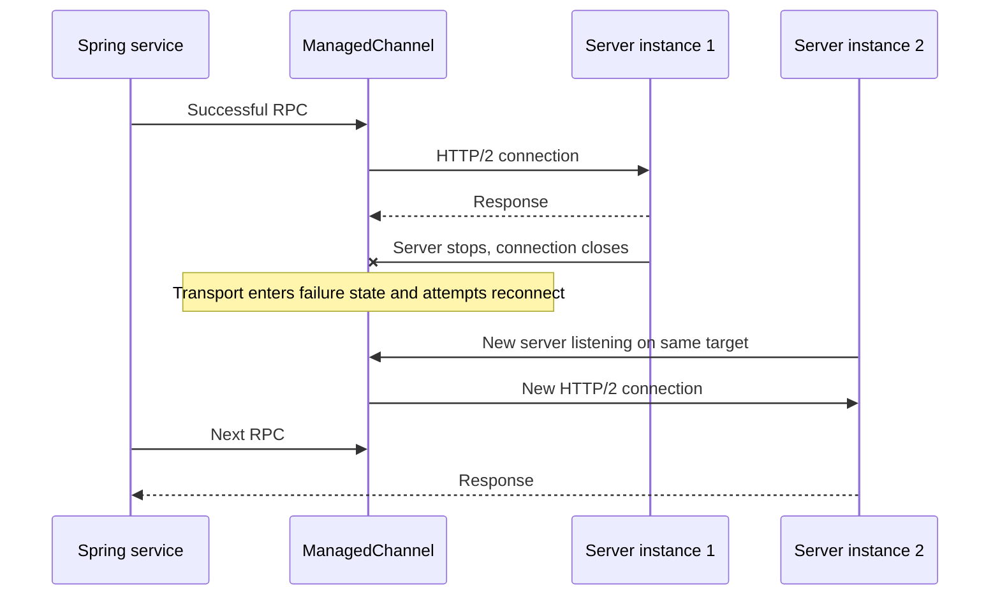
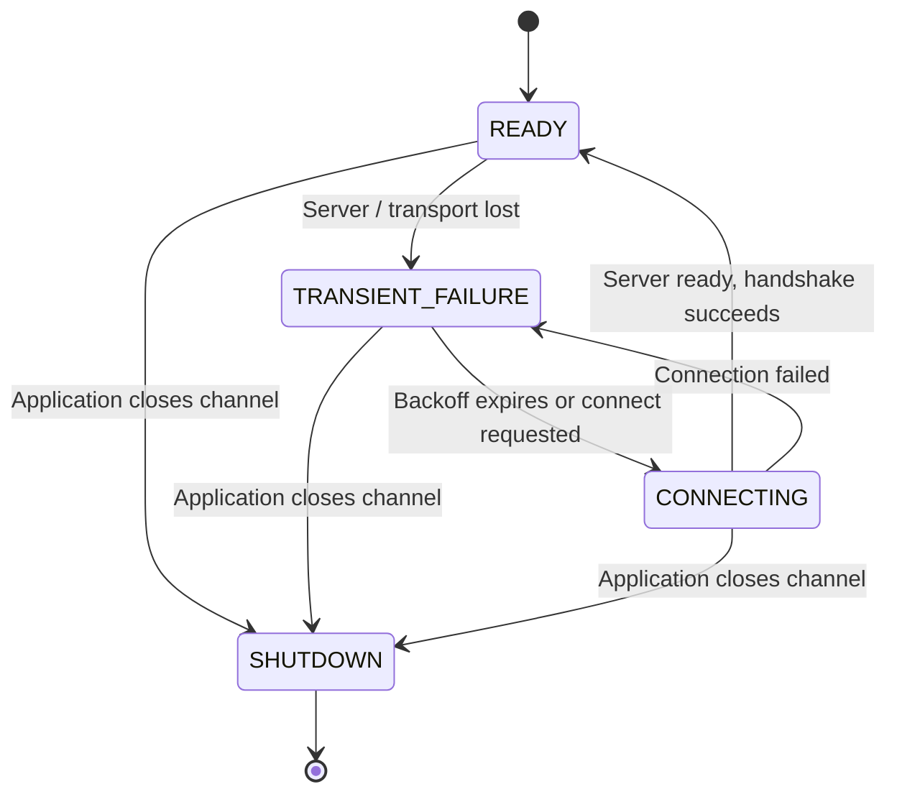

# Reconnection After Server Restart

## 1. Objectives

A Spring gRPC application typically holds a long-lived `ManagedChannel` to send many RPCs to a server. When the server is deployed with a new version, restarts after a crash, or is replaced by another replica, the current HTTP/2 connection can close. The client must recover the transport and keep serving requests without creating a new channel on every failure.

After this lesson, you will be able to:

- Distinguish the `ManagedChannel` lifecycle from the lifecycle of a TCP/TLS/HTTP/2 connection.
- Explain channel states, reconnection, and backoff when a server stops and restarts.
- Differentiate fail-fast, `withWaitForReady()`, and retry policies.
- Design server graceful shutdown to reduce errors for in-flight RPCs.
- Handle unary RPCs and streaming RPCs separately when a connection drops.
- Organize a singleton channel in the Spring lifecycle, observe failures, and test real restarts.

**Core principle:** gRPC Java manages transport reconnection underneath the channel. The application must decide which RPCs may wait or retry, and how to recover the business state of streams. Never react to every connection error by closing and recreating the `ManagedChannel`.

## 2. The Channel Stays Alive When Connections Close

`ManagedChannel` is a logical object representing a target. Underneath, it uses a resolver, load balancer, subchannels, and transports to open connections. When a server restarts, a connection may drop, yet the channel remains alive and can establish a new connection.



This diagram assumes the new server uses the same target and can be discovered by the resolver. If the IP address or DNS changes, the resolver must update endpoints too. If the new server presents a different certificate, the client must still verify a valid CA and hostname/SAN.

| Component | On Server Restart |
|---|---|
| `ManagedChannel` | Usually remains alive unless the application has called `shutdown()` |
| HTTP/2 connection | May close and be re-established |
| Generated stub | Can continue using the same channel; no regeneration needed |
| In-flight unary RPC | May succeed, fail, or be retried if policy permits |
| In-flight streaming RPC | May fail with an error; the stream does not automatically migrate to a new connection |
| New RPC | May fail-fast, wait for channel readiness, or retry per configuration |

It is essential to distinguish **transport reconnection** from **RPC replay**. A channel can restore connectivity for subsequent requests, but it does not automatically re-execute an interrupted business operation.

## 3. Connectivity States and Backoff

gRPC Java provides `ConnectivityState` to inspect a channel's aggregated connection state:

| State | Meaning During a Restart |
|---|---|
| `IDLE` | The channel does not currently need to maintain an active connection |
| `CONNECTING` | Resolving target or establishing transport |
| `READY` | A transport is ready to send RPCs |
| `TRANSIENT_FAILURE` | A connection attempt failed; the channel may retry after backoff |
| `SHUTDOWN` | The application initiated channel shutdown; no new RPCs are accepted |

A typical cycle after the server drops connectivity:



This is a conceptual model. Real states can change rapidly; not every restart lets polling observe every single state transition.

### Why Backoff Exists

If thousands of clients reconnect simultaneously the instant a server restarts, the new server can be overwhelmed by concurrent DNS lookups, TCP/TLS handshakes, and requests. **Connection backoff** spaces out retries, typically increasing wait intervals exponentially with jitter up to a cap according to gRPC's algorithm.

- On consecutive connection failures, wait intervals grow instead of hammering continuously.
- Once a connection stabilizes, backoff state can reset according to gRPC mechanics.
- Transport backoff is not an RPC retry policy; the two mechanisms have different scopes and goals.
- Never write a loop creating new channels to bypass backoff. That triggers reconnect storms and breaks centralized resource management.

The `ManagedChannel.resetConnectBackoff()` API can ask a channel experiencing failures to reset backoff and retry connecting sooner. This is a deliberate control tool and should not be called on a timer or after every failed RPC.

## 4. Handling RPCs While the Server Is Unavailable

During a server restart, incoming requests have three main handling modes:

### Fail-Fast

By default, an RPC can terminate early with `UNAVAILABLE` if the channel has no ready transport. This suits callers that want fast feedback to trigger a fallback or return an error to users.

### Wait-for-Ready

`withWaitForReady()` allows an RPC to wait for the channel to become ready instead of failing immediately in certain connectivity states. The RPC must still carry a deadline to keep waiting bounded:

```java
GreeterGrpc.GreeterBlockingStub stub =
        GreeterGrpc.newBlockingStub(channel);

HelloReply reply = stub
        .withWaitForReady()
        .withDeadlineAfter(5, TimeUnit.SECONDS)
        .sayHello(HelloRequest.newBuilder()
                .setName("Lan")
                .build());
```

`withWaitForReady()` does not make the server start faster, check business health, or guarantee that a call already in flight before a connection drop will resume. If the server is not ready before the deadline, the RPC still fails.

### Retry Policy

Retries can issue a new RPC attempt after specified errors within policy limits. Example service config:

```json
{
  "methodConfig": [{
    "name": [{
      "service": "demo.greeter.Greeter",
      "method": "SayHello"
    }],
    "retryPolicy": {
      "maxAttempts": 4,
      "initialBackoff": "0.2s",
      "maxBackoff": "2s",
      "backoffMultiplier": 2,
      "retryableStatusCodes": ["UNAVAILABLE"]
    }
  }]
}
```

This is an example policy; check your gRPC Java runtime and how service config is supplied via the resolver/channel. `maxAttempts` includes the initial call. The policy above retries only `SayHello` for the listed status codes; do not apply it blindly to every RPC.

**Safe retries depend on business semantics.** If the server already wrote data and the connection dropped before the client received the response, a retry can execute the operation a second time. Only retry idempotent operations or operations protected by server-side idempotency keys/deduplication. Retry rules also depend on RPC commitment state; once the client receives response headers or the retry buffer overflows, gRPC will not retry further.

### Quick Comparison

| Mechanism | When Decided | Re-runs the RPC? | Constraints |
|---|---|---|---|
| Fail-fast | When RPC starts | No | Fails immediately if unable to proceed |
| Wait-for-ready | When RPC needs to wait for the channel | Does not re-run an already-terminated RPC | Must have a deadline |
| Retry policy | After a retryable error while RPC remains eligible | Yes, creates a new attempt | Requires idempotency, attempt cap, and retry budget |
| Connection backoff | At the connection layer | No | Throttles transport connection attempts |

Do not stack multiple retry layers without budgeting. If an HTTP gateway retries three times and the gRPC client retries four attempts, one user action can generate far more backend calls than expected.

## 5. Orderly Server Restart

A well-behaved server should **stop accepting new work first**, then give in-flight RPCs a chance to finish within a bounded window.

High-level sequence:

1. Mark the instance out of rotation via readiness/health checks or the platform's orchestrator.
2. Stop accepting new RPCs and initiate graceful shutdown.
3. Allow in-flight RPCs to complete within the configured grace period.
4. Once the grace period expires, request cancellation of any remaining RPCs.
5. Exit the process and release resources.
6. The new instance starts up and registers its endpoint/readiness only once the service is truly ready.

A gRPC Java server provides `shutdown()` to begin orderly termination and `shutdownNow()` to force immediate termination. Example:

```java
server.shutdown();
try {
    if (!server.awaitTermination(20, TimeUnit.SECONDS)) {
        server.shutdownNow();
        server.awaitTermination(5, TimeUnit.SECONDS);
    }
} catch (InterruptedException e) {
    server.shutdownNow();
    Thread.currentThread().interrupt();
}
```

The `20` and `5` second values are illustrative only. The grace period must align with Spring/container/orchestrator termination windows and RPC deadlines. If the platform kills the process before the grace period finishes, code-level graceful shutdown has no chance to complete.

### Readiness vs. Liveness

- **Readiness:** should this instance receive new traffic?
- **Liveness:** does the process need to be restarted because it is wedged?
- **gRPC Health Checking:** does the service report serving status via gRPC's health protocol, if implemented on the server?

A server process opening a port does not mean the service is ready. During a restart, expose the endpoint to discovery/load balancers only after critical dependencies and service handlers are initialized. If using health checking, configure clients/LBs to support that mechanism; never infer health solely from a channel being in `READY`.

## 6. Spring Clients Should Keep the Channel Across Restarts

The channel should be created once per target and credentials, then injected into gateways/services. Example bean configuration:

```java
@Configuration(proxyBeanMethods = false)
public class GreeterClientConfig {
    @Bean(name = "greeterChannel", destroyMethod = "shutdown")
    ManagedChannel greeterChannel(
            @Value("${app.grpc.greeter.target}") String target) {
        return Grpc.newChannelBuilder(
                target, TlsChannelCredentials.create())
                .build();
    }
}
```

Service using the injected channel:

```java
@Service
public class GreeterGateway {
    private final GreeterGrpc.GreeterBlockingStub stub;

    public GreeterGateway(
            @Qualifier("greeterChannel") ManagedChannel channel) {
        this.stub = GreeterGrpc.newBlockingStub(channel);
    }

    public String greet(String name) {
        return stub.withDeadlineAfter(3, TimeUnit.SECONDS)
                .sayHello(HelloRequest.newBuilder()
                        .setName(name)
                        .build())
                .getMessage();
    }
}
```

`app.grpc.greeter.target` is a custom property; if your Spring gRPC starter manages channels automatically, use the target/credentials/lifecycle configuration for that exact starter version instead of creating a second channel.

**Never call `shutdown()` upon encountering `UNAVAILABLE`.** A live channel is responsible for reconnecting. Closing and recreating channels on every error breaks backoff, adds handshakes, and can trigger reconnect storms.

`destroyMethod = "shutdown"` only initiates closure when the Spring context exits. For applications with long-lived streams, use a lifecycle owner to stop accepting requests, complete/cancel streams, call `shutdown()`, await `awaitTermination(...)`, and call `shutdownNow()` only if the shutdown budget expires.

## 7. How Does a Restart Affect Unary RPCs?

Suppose a client sends `SayHello` right as the old server stops:

- If the RPC completes before the transport closes, the client receives the response normally.
- If the server processed it but the response did not reach the client, the outcome is ambiguous from the caller's perspective; an error status does not prove the operation rolled back.
- If the transport dropped before the server processed it, the RPC may fail with `UNAVAILABLE`.
- If a valid retry policy is active and the RPC is uncommitted, gRPC may issue a new attempt when the new server is ready.
- If the RPC waits past its deadline, the client gets `DEADLINE_EXCEEDED` even if the server just finished restarting.

Therefore, for state-mutating operations or payments, design business-level idempotency. For instance, the client sends a unique `request_id`; the server stores the outcome keyed by it so retries do not create duplicate transactions.

Never rely solely on `Status.Code` to assume "the server never saw the request." `UNAVAILABLE` indicates the RPC did not complete cleanly, not that a transaction rolled back.

## 8. Streaming RPCs Do Not Automatically Resume After Reconnect

This is the most important difference compared to a short unary call. Server streaming, client streaming, and bidirectional streaming each bind to an HTTP/2 stream with its own lifecycle. When the connection closes, the stream receives `onError` or cancellation. The channel can reconnect, but **the old RPC stream does not automatically migrate to the new transport**.

```mermaid
sequenceDiagram
    participant C as Spring client
    participant Ch as ManagedChannel
    participant S1 as Old server
    participant S2 as New server
    C->>Ch: Open Subscribe(cursor=100)
    Ch->>S1: HTTP/2 stream
    S1-->>C: events 101, 102
    S1-xCh: Server restarts, stream errors
    Ch->>S2: Transport reconnects
    Note over C: Old RPC ended; application decides to open a new stream
    C->>Ch: Subscribe(cursor=102)
    Ch->>S2: New HTTP/2 stream
    S2-->>C: subsequent events
```

A contract can support cursor/offset resumption:

```proto
message SubscribeRequest {
  string consumer_id = 1;
  int64 after_event_id = 2;
}

message Event {
  int64 event_id = 1;
  bytes payload = 2;
}

service NotificationService {
  rpc Subscribe(SubscribeRequest) returns (stream Event);
}
```

The client persists the last processed event ID durably. When the stream terminates due to a transport error, the client opens a new RPC passing the last committed `after_event_id`. The server continues streaming from that cursor.

To prevent lost or duplicated events:

- Update the cursor only after the event has been processed/committed per business rules.
- The server must support cursor replay and define cursor expiration clearly.
- The client should deduplicate by event ID if the server may replay already-received events.
- Use backoff and cap resubscribe attempts; do not hammer endlessly during maintenance windows.
- When the caller intentionally cancels the subscription, do not reopen the stream automatically.

For client streaming or bidirectional streaming, you must determine which messages the server received/committed before the connection dropped. Without sequence numbers, acknowledgments, or idempotency keys, the client cannot know precisely which message was processed last.

## 9. Retry, Reconnect, and Recovery Are Not the Same Thing

| Mechanism | Layer | What Does It Recover? |
|---|---|---|
| Connection backoff/reconnect | Channel/transport | Re-establishes HTTP/2 connectivity to the endpoint |
| RPC retry | Single RPC | Issues a new attempt according to policy |
| Wait-for-ready | Pending RPC | Waits for the channel to have a suitable transport within deadline |
| Streaming resubscribe | Application logic | Opens a new stream and resumes from cursor/state |
| Readiness/health | Server/discovery | Avoids routing RPCs to unready instances |

These mechanisms can coexist without replacing one another. For example, a successful channel reconnect does not mean a lost streaming RPC resumed; a server reporting health `SERVING` does not make a retried transaction idempotent.

### Choosing Retries for Unary Calls

Retries are appropriate when:

- The status is within a defined transient error set, such as `UNAVAILABLE`.
- The method is idempotent or guarded against duplicate execution.
- Attempt counts and backoff are bounded.
- The overall deadline covers wait time plus retry attempts.
- Retries will not overload a recovering backend beyond its capacity.

Never unconditionally retry `INVALID_ARGUMENT`, `PERMISSION_DENIED`, `UNAUTHENTICATED`, or business errors that a fresh connection cannot fix.

## 10. Observing the Restart Process

Useful signals:

| Group | Metrics / Logs | Purpose |
|---|---|---|
| Channel | Connectivity state transitions | Spot `READY`, `TRANSIENT_FAILURE`, `CONNECTING` |
| RPC | Call counts, statuses, per-method latency | Measure user impact during restart |
| Retry | Attempt count, retry reason, backoff duration | Detect retry storms or overly broad policies |
| Server | Startup/readiness, graceful shutdown, active RPCs | Pinpoint the window when the server stops accepting traffic |
| Streaming | Open streams, error/resubscribe timestamps, cursors | Detect dropped events or reconnect loops |
| Network | DNS results, TLS handshakes, `GOAWAY`, connection closes | Identify transport root causes |

You can read channel state for diagnostics:

```java
ConnectivityState state = channel.getState(false);
log.info("gRPC channel state={}", state);
```

`getState(false)` only returns a snapshot at the moment of invocation; it does not wait for `READY` or check service health. `notifyWhenStateChanged(...)` registers a callback for when the state leaves the observed value, and must be re-registered for continuous tracking. Callbacks should be brief and non-blocking.

Never log tokens or sensitive metadata while debugging reconnects. If using OpenTelemetry/Micrometer, record RPC duration, status, and retry attempts with bounded-cardinality labels. You can combine this with gRPC Health Checking if the server exposes the health service.

## 11. Integration Testing Server Restarts

Mocked-stub unit tests do not exercise connection backoff or resolvers. A useful integration test will:

1. Start a server on a dynamic port.
2. Create a single channel and invoke an RPC successfully.
3. Stop the server and wait for it to release the port.
4. Start a new server on the **same port/target**.
5. Reset channel backoff if needed and send a new RPC with wait-for-ready and a deadline.
6. Confirm the existing channel still works, then shut down channel and server cleanly.

Example using Netty server/client over loopback plaintext strictly for transport testing:

```java
package dev.example.hello;

import static org.junit.jupiter.api.Assertions.assertEquals;
import static org.junit.jupiter.api.Assertions.assertTrue;

import io.grpc.Grpc;
import io.grpc.InsecureChannelCredentials;
import io.grpc.ManagedChannel;
import io.grpc.Server;
import io.grpc.netty.shaded.io.grpc.netty.NettyServerBuilder;
import io.grpc.stub.StreamObserver;
import java.net.InetSocketAddress;
import java.util.concurrent.TimeUnit;
import org.junit.jupiter.api.Test;

class ReconnectAfterRestartTest {
    private Server startServer(int port, String version) throws Exception {
        return NettyServerBuilder.forAddress(
                new InetSocketAddress("127.0.0.1", port))
                .addService(new GreeterGrpc.GreeterImplBase() {
                    @Override
                    public void sayHello(
                            HelloRequest request,
                            StreamObserver<HelloReply> observer) {
                        observer.onNext(HelloReply.newBuilder()
                                .setMessage(version + ": " + request.getName())
                                .build());
                        observer.onCompleted();
                    }
                })
                .build()
                .start();
    }

    @Test
    void sameChannelReconnectsAfterServerRestart() throws Exception {
        Server first = NettyServerBuilder
                .forAddress(new InetSocketAddress("127.0.0.1", 0))
                .addService(new GreeterGrpc.GreeterImplBase() {
                    @Override
                    public void sayHello(
                            HelloRequest request,
                            StreamObserver<HelloReply> observer) {
                        observer.onNext(HelloReply.newBuilder()
                                .setMessage("v1: " + request.getName())
                                .build());
                        observer.onCompleted();
                    }
                })
                .build()
                .start();

        int port = first.getPort();
        ManagedChannel channel = Grpc.newChannelBuilderForAddress(
                "127.0.0.1", port,
                InsecureChannelCredentials.create())
                .build();
        Server second = null;

        try {
            var stub = GreeterGrpc.newBlockingStub(channel);
            var request = HelloRequest.newBuilder().setName("Lan").build();
            assertEquals("v1: Lan", stub
                    .withDeadlineAfter(3, TimeUnit.SECONDS)
                    .sayHello(request).getMessage());

            first.shutdown();
            assertTrue(first.awaitTermination(5, TimeUnit.SECONDS));

            second = startServer(port, "v2");
            channel.resetConnectBackoff();

            assertEquals("v2: Lan", stub.withWaitForReady()
                    .withDeadlineAfter(20, TimeUnit.SECONDS)
                    .sayHello(request).getMessage());
        } finally {
            channel.shutdownNow();
            first.shutdownNow();
            if (second != null) {
                second.shutdownNow();
            }
            assertTrue(channel.awaitTermination(5, TimeUnit.SECONDS));
        }
    }
}
```

The `startServer` helper shows one way to build a versioned server; real tests only need a single consistent server factory. The test reuses the same channel and port to prove the transport can be re-established. `resetConnectBackoff()` speeds up the restart test and is not required in production applications.

This is a plaintext loopback test; it **does not** verify TLS certificates, mTLS, proxies, DNS endpoint shifts, or streaming data durability. Those require separate tests in suitable environments. If CI cannot immediately rebind the port after shutdown, verify the server has terminated and released the port before starting the new instance.

### Additional Scenarios Worth Testing

- Server restarts while a unary RPC is processing; verify outcome and idempotent retry behavior.
- Server restarts during a quiet stream; verify `onError` and cursor-based resubscribe.
- New server is not yet ready; verify clients do not send business traffic prematurely.
- DNS switches to a new endpoint; verify resolver refresh and channel connection to the updated address.
- TLS certificate rotates; verify clients continue trusting the right CA/SAN.
- Multiple clients reconnect simultaneously; observe backoff, handshake load, and reconnect storm prevention.
- Spring context shutdown; verify channels and streams close within the shutdown budget.

## 12. Common Pitfalls and Troubleshooting

| Symptom | Cause | Resolution |
|---|---|---|
| After restart, new RPCs return `UNAVAILABLE` | Server not yet listening/ready, wrong DNS/port, or transport still reconnecting | Check readiness, resolver, and causes; retry within deadline |
| Client never recovers | Channel is already `SHUTDOWN`, target is invalid, or persistent TLS error | Check ownership, channel state, DNS, and certificates |
| Retries create duplicate records | RPC has side effects and is not idempotent | Add idempotency keys/deduplication; bound retries |
| RPC waits a long time then `DEADLINE_EXCEEDED` | Wait-for-ready/backoff exceeds deadline | Tune budgets or fail fast as required |
| Stream drops after server restart | Old HTTP/2 stream cannot move to the new connection | Resubscribe and resume via cursor |
| Client creates new channels after every error | Reconnection implemented at request layer | Keep a long-lived channel; let gRPC manage transports |
| Reconnect storm after deployment | Many clients reconnect simultaneously with aggressive backoff/retries | Use backoff, jitter, rollout/readiness gates, and retry budgets |
| New server holds port open yet RPCs still fail | Service unready, wrong TLS identity, or unready dependencies | Check health, certificates, ALPN, and server logs |

## 13. Hands-On Exercise

**Scenario:** a Spring service calls `Greeter.SayHello` and `Notification.Subscribe`. The server restarts periodically during deployments. Unary RPCs occasionally return `UNAVAILABLE`; streaming clients lose subscriptions and miss some events.

Complete the following:

1. Create a singleton `ManagedChannel` and verify unary RPCs succeed before restart.
2. Stop and restart the server on the same target. Observe channel state, reconnect behavior, and RPC statuses during the outage.
3. Compare fail-fast with `withWaitForReady()` plus a deadline; explain the difference between waiting for transport readiness and retrying an attempt.
4. Add a retry policy solely for an idempotent unary method; specify `maxAttempts`, backoff, retryable statuses, and overall deadline.
5. Design `SubscribeRequest` with a cursor; when the stream fails, resubscribe from the last committed event and deduplicate replayed events.
6. Configure server graceful shutdown/readiness; compare outcomes between orderly server shutdown and sudden process termination.
7. Write an integration test verifying the same channel calls the new server instance after a restart.
8. Collect failed RPC counts, recovery time, retry counts, time spent in `TRANSIENT_FAILURE`, and resubscribed stream counts.

**Completion Criteria:** You can distinguish transport reconnection, RPC retry, and application-level resumption; preserve channel ownership across the Spring lifecycle; avoid blindly retrying operations with side effects; and provide test evidence for both unary and streaming calls across server restarts.

## 14. Key Takeaways

When a server restarts, **the HTTP/2 connection may drop, but `ManagedChannel` remains alive and manages reconnect/backoff automatically**. New RPCs can fail-fast, wait with `withWaitForReady()`, or retry under bounded policies. Retries must respect idempotency and deadlines; streaming RPCs require explicit resubscribe/resume logic because channel reconnection does not restore old streams. On the server side, use readiness checks and graceful shutdown to minimize disruption; on the Spring client side, use a singleton channel, observe statuses/reconnects, and test real restarts instead of creating a new channel on every `UNAVAILABLE`.
