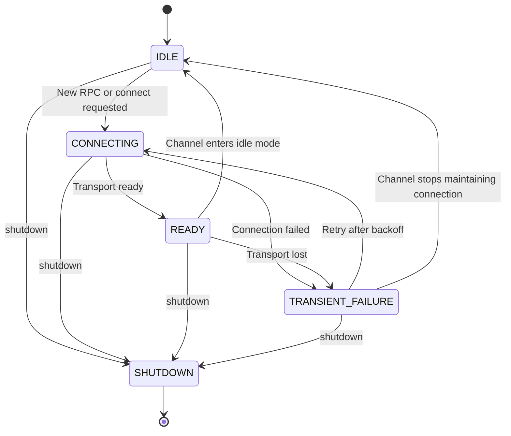
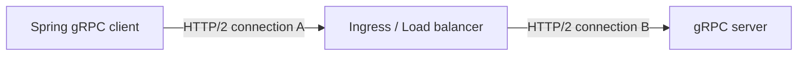

# Idle Timeouts and Connection States

## 1. Objectives

In Spring gRPC, a client usually keeps a `ManagedChannel` to send multiple RPCs to a server. After a period without requests, the channel, server, or proxy may enter an idle state and release connections. When the next request arrives, the system may have to resolve the target, open TCP/TLS, and negotiate HTTP/2 before the RPC executes.

To configure this properly, you must distinguish **channel idle timeout**, **channel connectivity state**, **server HTTP/2 connection idle timeout**, and **timeouts enforced by proxies/networks**. Each mechanism has a different owner and impact.

After this lesson, you will be able to:

- Distinguish `ConnectivityState.IDLE` from a TCP/HTTP/2 connection that happens to send no data.
- Explain `ManagedChannelBuilder.idleTimeout` and `ManagedChannel.enterIdle()`.
- Separate client channel idle timeouts from server `maxConnectionIdle`, `maxConnectionAge`, and proxy timeouts.
- Read `IDLE`, `CONNECTING`, `READY`, `TRANSIENT_FAILURE`, and `SHUTDOWN` states with their exact semantics.
- Configure idle policies in Spring clients/servers and choose durations suited to your workload.
- Assess impacts on unary RPCs, streaming RPCs, deadlines, keepalive, and TLS handshakes.
- Test idle behavior, reconnection, and shutdown without confusing channel state with socket state.

## 2. "Idle" Has Multiple Meanings

The word *idle* is applied to different entities. Without identifying which layer you mean, tuning one timeout may fail to address a timeout at another layer.

| Concept | Managed Entity | When Is It Considered Idle? | Common Consequence |
|---|---|---|---|
| **Channel idle mode** | Client-side `ManagedChannel` | No RPCs for the configured duration | Channel may stop resolver/LB and release transports; a new RPC wakes the channel |
| **Channel state `IDLE`** | Aggregated channel state | Channel is not actively maintaining connections at observation time | Does not mean the server failed; a new RPC can trigger connection |
| **Server max connection idle** | An HTTP/2 connection on the server | No active RPCs on that connection for the configured duration | Server may send `GOAWAY` and drain/close the connection |
| **Proxy/LB idle timeout** | Connection or flow tracked by a proxy | No qualifying activity per the proxy's own rules | Proxy may close the connection even while the client channel remains alive |
| **TCP keepalive** | TCP socket | TCP stack probes peer after inactivity | Checks TCP-layer reachability; not a gRPC health check |
| **HTTP/2 keepalive PING** | HTTP/2 connection | Per ping schedule and peer policy | Checks HTTP/2 peer; does not mean an RPC is active |
| **Connection age** | Connection lifetime | Reaches maximum age since creation | Server may drain the connection even while it still carries RPCs |

Example: a client makes no RPCs for 15 minutes. The channel may enter idle mode after 10 minutes and release transports. In another case, the channel stays active, yet a load balancer closes the HTTP/2 connection after 2 minutes without RPCs. Both can force the next request to reconnect, but their origins and configuration points differ.

## 3. Connectivity State Is a Channel-Level State

gRPC Java provides `ConnectivityState` with five main states:

| State | Meaning |
|---|---|
| `IDLE` | The channel is not actively establishing or maintaining connections right now; may be waiting for a new RPC |
| `CONNECTING` | The channel is resolving the target or establishing transports |
| `READY` | A transport is ready to send RPCs |
| `TRANSIENT_FAILURE` | A connection attempt failed; the channel may retry after backoff |
| `SHUTDOWN` | The channel has started closing and accepts no new RPCs |



This is a conceptual diagram, not a guarantee that every version/provider emits this exact transition sequence. Channels can transition fast enough that polling misses intermediate states.

**`IDLE` does not mean an error.** It is normally a resource-saving state when the channel has no RPCs to serve. When a new RPC arrives, the channel can leave idle mode and re-establish transports.

**`READY` is also not a business health check.** It indicates the channel had a ready transport at observation time; the server can still return errors, exceed quotas, lose its database, or respond slowly.

One critical detail: `ConnectivityState` is an **aggregated channel-level state**, not a per-TCP-socket or per-backend status table. A channel managing multiple subchannels/transports can behave more subtly than a single connection.

## 4. Client Channel Idle Timeout

gRPC Java provides `ManagedChannelBuilder.idleTimeout(long, TimeUnit)` to set how long a channel goes without RPCs before entering idle mode. Once idle mode triggers, the channel may stop its name resolver/load balancer and release unneeded connection resources. A new RPC wakes the channel and triggers reconnection.

Channel configuration example:

```java
ManagedChannel channel = NettyChannelBuilder
        .forTarget("dns:///greeter.internal.example:8443")
        .useTransportSecurity()
        .idleTimeout(10, TimeUnit.MINUTES)
        .build();
```

`NettyChannelBuilder` here is gRPC Java's Netty transport. The target must resolve and the server must support TLS/HTTP/2; the certificate must be valid for the hostname. If the application uses an internal CA, configure appropriate trust material rather than skipping TLS verification.

### When Should You Configure an Idle Timeout?

- **Infrequently used clients:** reduces how long transports and resources stay allocated without RPCs.
- **Steady-traffic clients:** too short a timeout can make the channel bounce in and out of idle mode, increasing handshakes and latency.
- **Long-lived stream clients:** an open stream counts as an active RPC; the channel is not considered RPC-free simply because the stream has not sent business messages recently.
- **Clients requiring low latency on the first request after a pause:** keep the channel alive longer, or accept cold connections and measure real impact.

Default values and bounds for `idleTimeout` depend on the gRPC Java version; verify the documentation for your exact dependency. Never copy defaults from another gRPC language runtime.

### Manually Placing a Channel into Idle Mode

`ManagedChannel.enterIdle()` asks the channel to enter idle mode immediately rather than waiting for the idle timeout. This is a control API, useful when the application knows for certain the channel will sit unused for a long period:

```java
channel.enterIdle();

// When the next RPC is invoked, the channel may leave idle mode
// and begin resolving the target/establishing transport.
```

Do not call `enterIdle()` after every RPC or while the application is still under load. Doing so causes connection churn and forces subsequent requests to reconnect.

## 5. Waking Up a Channel and Reading State

Two APIs commonly used to observe or trigger state:

```java
ConnectivityState state = channel.getState(false);
log.info("gRPC channel state={}", state);

// true requests the channel to start connecting if currently IDLE
ConnectivityState stateAfterRequest = channel.getState(true);
log.info("gRPC channel state after request={}", stateAfterRequest);
```

- `getState(false)` only takes a snapshot; it does not ask the channel to open a connection.
- `getState(true)` can ask the channel to leave `IDLE` and start connecting; it does not wait until `READY`.
- `notifyWhenStateChanged(source, callback)` registers a one-shot callback for when the channel leaves `source`. To observe multiple transitions, re-register after the callback runs.
- Callbacks should be brief, non-blocking, and free of heavy network calls.

Example watching one transition:

```java
ConnectivityState observed = channel.getState(false);
channel.notifyWhenStateChanged(observed, () -> {
    ConnectivityState current = channel.getState(false);
    log.info("gRPC state changed: {} -> {}", observed, current);
});
```

This snippet watches only a single transition out of the initial state. Continuous tracking requires a component that manages re-registration, stops cleanly with the lifecycle, and avoids tight recursive callbacks.

Never write business logic like "only send the RPC if the snapshot is `READY`." State can change right after reading; the RPC itself and its returned status are the real proof of outcome. Attach deadlines and handle errors properly.

## 6. Server-Side Idle Timeout: `maxConnectionIdle`

Client channel idle timeout governs the **client's channel**. On the server side, gRPC Java Netty can limit how long an HTTP/2 connection remains open without active RPCs:

```java
Server server = NettyServerBuilder.forPort(8443)
        .maxConnectionIdle(15, TimeUnit.MINUTES)
        .addService(new GreeterService())
        .build()
        .start();
```

`maxConnectionIdle` is a **server connection** policy, not a command putting the client's whole channel into `IDLE`. When a connection has no active RPCs past the threshold, the server can send HTTP/2 `GOAWAY` to drain it. The client channel remains alive and opens another connection when needed.

A server connection with an open stream usually counts as having an active RPC, even if the application has not sent messages for a while. This differs from proxies that measure idleness by lack of frames/data. Check how each device defines "idle".

### `maxConnectionIdle` vs. `maxConnectionAge`

| Setting | Timer Starts From | When It Takes Effect |
|---|---|---|
| `maxConnectionIdle` | When the connection has no active RPCs remaining | Connection sits idle too long |
| `maxConnectionAge` | When the connection is established | Connection reaches maximum age, even if active |
| `maxConnectionAgeGrace` | After max age is reached | Grace window for in-flight RPCs to finish before closing |

Server example:

```java
Server server = NettyServerBuilder.forPort(8443)
        .maxConnectionIdle(15, TimeUnit.MINUTES)
        .maxConnectionAge(2, TimeUnit.HOURS)
        .maxConnectionAgeGrace(30, TimeUnit.SECONDS)
        .addService(new GreeterService())
        .build()
        .start();
```

These values are illustrative only. `maxConnectionAge` typically serves long-term connection draining/rotation; `maxConnectionIdle` reclaims idle connections. Do not treat the two parameters as a single unified timeout.

If a Spring gRPC starter owns the server, configure these via the server builder/customizer or properties supported by that version. Never spin up a second Netty server on the same port just to set timeouts.

## 7. Proxies and Load Balancers Have Independent Idle Timeouts

In production, the path may look like:



If the proxy terminates HTTP/2/TLS, client–proxy and proxy–server are **two separate connections**. Each leg can enforce a different idle timeout. If the proxy passes TCP through transparently, its connection tracking differs as well.

Common scenarios:

- The client channel stays alive, but the proxy closes the socket after 60 seconds of inactivity.
- The server keeps connections longer than the proxy, yet the client does not realize the proxy closed it until the next RPC.
- The server sends `GOAWAY` due to `maxConnectionIdle`; the proxy forwards or handles it per its own policy.
- A streaming RPC is open without `DATA` frames. The server may consider the RPC active, while a proxy may still view the flow as idle if it counts silence between data frames.

Therefore, **setting a client idle timeout longer than the proxy's idle timeout will not stop the proxy from closing the connection**. Coordinate timeouts and reconnection logic. When connections must survive quiet gaps, consider HTTP/2 keepalive PINGs within server/proxy policy limits; PING is not a blanket solution for every idle timeout.

### Keepalive Is Not an Idle Timeout

| Mechanism | What It Does | What It Cannot Do |
|---|---|---|
| Channel `idleTimeout` | Transitions channel to idle mode after no RPCs | Does not check whether the peer is responsive |
| Server `maxConnectionIdle` | Drains connections without active RPCs | Does not check business health |
| HTTP/2 PING keepalive | Probes peer on an HTTP/2 connection | Does not guarantee RPC handlers or databases are healthy |
| TCP keepalive | Probes responsiveness at the TCP layer | Unaware of gRPC streams or service health |
| RPC deadline | Bounds duration of a single RPC | Does not keep connections open |

Do not raise PING frequency to fix a server that already called `shutdown()` or an expired TLS certificate. PINGs can be rejected by the server if they exceed policy, e.g. `GOAWAY` with `ENHANCE_YOUR_CALM`.

## 8. Configuration in a Spring Client

The example below uses a singleton channel scoped to the production profile. The `app.grpc.*` namespace is custom-defined for this lesson, not a default prefix guaranteed across every Spring gRPC starter version.

```yaml
# application-prod.yml
app:
  grpc:
    greeter:
      target: dns:///greeter.internal.example:8443
      channel-idle-timeout: 10m
```

```java
@Configuration(proxyBeanMethods = false)
@Profile("prod")
public class GreeterChannelConfiguration {
    @Bean(name = "greeterChannel", destroyMethod = "shutdown")
    ManagedChannel greeterChannel(
            @Value("${app.grpc.greeter.target}") String target,
            @Value("${app.grpc.greeter.channel-idle-timeout:10m}")
            Duration idleTimeout) {
        return NettyChannelBuilder.forTarget(target)
                .useTransportSecurity()
                .idleTimeout(
                        idleTimeout.toMillis(), TimeUnit.MILLISECONDS)
                .build();
    }
}
```

`Duration` in this snippet must be imported from `java.time.Duration`; depending on binding style, you can use `@ConfigurationProperties` for durations instead of relying on `@Value` conversion. The goal is explicit configuration validated at startup.

Gateway using the injected channel:

```java
@Service
public class GreeterGateway {
    private final GreeterGrpc.GreeterBlockingStub stub;

    public GreeterGateway(
            @Qualifier("greeterChannel") ManagedChannel channel) {
        this.stub = GreeterGrpc.newBlockingStub(channel);
    }

    public String greet(String name) {
        return stub.withDeadlineAfter(3, TimeUnit.SECONDS)
                .sayHello(HelloRequest.newBuilder()
                        .setName(name)
                        .build())
                .getMessage();
    }
}
```

After 10 minutes without RPCs, the channel may enter idle mode. The next request wakes the channel and may incur DNS/connect/TLS handshake latency. If post-idle first-request latency matters, measure P95/P99 and consider lengthening the timeout or keeping connections warm per agreed policy.

If a framework starter already creates the channel, never create a second channel just to set a timeout. Use the starter's version-appropriate configuration API and preserve single lifecycle ownership.

## 9. Impact on Unary and Streaming RPCs

### Unary RPCs

Short unary RPCs rarely need connections kept permanently warm under sparse traffic. After a channel idle timeout or proxy close, the next call may take extra time to resolve the target and establish TLS/HTTP2. Deadlines must include that budget if the request must finish within a fixed bound.

```java
HelloReply reply = stub
        .withWaitForReady()
        .withDeadlineAfter(4, TimeUnit.SECONDS)
        .sayHello(request);
```

`withWaitForReady()` can wait for the channel to become ready within the deadline, yet it cannot make bad DNS valid or make a server boot faster. If the deadline expires while the channel wakes up, the RPC still returns `DEADLINE_EXCEEDED`.

### Streaming RPCs

An existing stream is an active RPC, even if no business messages flow for several minutes. Channel idle timeouts based on lack of RPCs generally do not put the channel into idle mode while a stream remains open. Nonetheless, server `maxConnectionAge`, proxy idle timeouts, or connection drops can still break the stream.

When a stream fails:

1. Receive `onError`/status and separate transient errors from deliberate cancellation.
2. Open a new RPC if business rules allow.
3. Use a cursor, sequence number, or resume token to continue from the last committed position.
4. Deduplicate events that may be replayed.
5. Apply backoff and cap reconnects to avoid hammering the server in a loop.

Never assume channel reconnection transparently moves an old HTTP/2 stream onto a new connection.

## 10. Observing Connection States and Idle Behavior

Metrics to track:

| Metric | Question |
|---|---|
| Channel state transitions | Is the channel in `IDLE`, `CONNECTING`, `READY`, or `TRANSIENT_FAILURE`? |
| RPC count and in-flight RPCs | Does the channel actually have active RPCs or is it idle? |
| First-RPC latency after idle | Do cold connections raise tail latency? |
| DNS resolution and TLS handshake | Is wake-up time dominated by the resolver or the transport? |
| Connection close / `GOAWAY` | Did the server, proxy, or client initiate connection closure? |
| Reconnects and statuses | Do `UNAVAILABLE`/`DEADLINE_EXCEEDED` spike after idle periods? |
| Streaming duration | Are long-lived streams cut by age/idle policies? |

You can log a snapshot:

```java
ConnectivityState state = channel.getState(false);
log.debug("Greeter channel state={}", state);
```

State is **channel-level** information, not a socket count, and not proof that a proxy still holds a connection open. Combine gRPC metrics, tracing, controlled transport logs, ingress/server logs, and Channelz if supported by your deployment version.

Avoid polling state aggressively to build a "real-time" dashboard; state-change callbacks are generally better suited. Callbacks must be lifecycle-managed and non-blocking. Never log tokens or sensitive metadata when enabling diagnostics.

## 11. Testing Idle Timeouts

Testing idle behavior requires clarity on what is being tested. Mocked-stub unit tests do not verify HTTP/2 connection closure; in-process tests bypass TCP and proxies.

Valuable tests:

1. **Client channel idle mode:** configure a short channel idle timeout in a test, leave it without RPCs long enough, observe state/resources, then send an RPC and verify the channel recovers.
2. **Manual `enterIdle`:** invoke `enterIdle()` after an RPC completes, then send a new RPC and confirm the same channel object still works.
3. **Server `maxConnectionIdle`:** use a Netty test server with a short idle limit, keep a connection without RPCs, observe `GOAWAY`/connection replacement, and execute a subsequent RPC.
4. **Proxy idle timeout:** run through a test proxy or staging environment, let the connection sit idle past the threshold, then invoke again and measure cold-start latency.
5. **Streaming:** hold a stream open without sending `DATA`; verify whether the server/proxy treats the stream as active or closes it per policy.
6. **Shutdown:** close the Spring context while RPCs/streams are present; confirm the channel drains and leaks no threads/sockets.

Example checking that a channel remains usable after explicitly entering idle mode:

```java
channel.enterIdle();

HelloReply reply = GreeterGrpc.newBlockingStub(channel)
        .withDeadlineAfter(3, TimeUnit.SECONDS)
        .sayHello(HelloRequest.newBuilder()
                .setName("Lan")
                .build());

assertEquals("Hello Lan", reply.getMessage());
```

This illustrates a test backed by a suitable real or in-process server. It proves a new RPC can wake the channel, **not** that proxy timeouts or server `maxConnectionIdle` were exercised. To test network-layer timeouts, you must run a real server/proxy and observe corresponding frames/connection closures.

## 12. Common Pitfalls

| Symptom | Cause | Resolution |
|---|---|---|
| First RPC after an idle gap is slow | Channel entered idle or proxy closed the connection | Measure DNS/TLS/connect; adjust timeouts against SLOs |
| `IDLE` channel state mistaken for server down | Confusing channel state with health | Run health/RPC checks with deadlines and inspect the server |
| Long client idle timeout set yet sockets still close | Proxy/LB enforces a shorter timeout | Check per-hop timeouts; design reconnection handling |
| Overly short idle timeout causes constant handshakes | Channel releases transports too frequently | Increase timeout or keep connections warm per traffic profile |
| Silent stream is interrupted | Proxy tracks idle by traffic/frames or server enforces age limit | Inspect policies and design appropriate heartbeats/resumption |
| RPC hits `DEADLINE_EXCEEDED` right after idle | Deadline budget too tight for cold connection setup | Measure wake-up latency; tune budgets or idle policy |
| PINGs rejected with `too_many_pings` | Keepalive exceeds server/proxy policy | Align `keepAliveTime` and permit policies; avoid aggressive pings |
| Server closes connections while channel stays alive | Server `maxConnectionIdle`/`maxConnectionAge` | Let channel reconnect; inspect `GOAWAY` and draining |

## 13. Hands-On Exercise

**Scenario:** a Spring gateway calls Greeter with uneven traffic. Daytime brings steady requests; nights can see 20-minute quiet gaps. An ingress closes connections after 5 minutes without traffic. The first request after a quiet gap occasionally exceeds its 2-second deadline.

Perform the following:

1. Distinguish channel idle timeout, channel state `IDLE`, server `maxConnectionIdle`, and ingress idle timeout on a deployment diagram.
2. Measure DNS, TCP/TLS/HTTP2 handshake, and first-RPC duration after 5–20 minutes of idle time.
3. Test client channel idle timeouts of 3 minutes, 10 minutes, and a longer value; record cold latency, connection churn, and resource usage.
4. Check whether the server/ingress closes connections on its own idle timers. Determine whether HTTP/2 PING is permitted and genuinely needed.
5. Hold a quiet streaming RPC open to contrast RPC-count-based channel idle with traffic-based proxy idle.
6. Set deadlines matching your SLO and handle `UNAVAILABLE`/`DEADLINE_EXCEEDED` during reconnection.
7. Close the Spring context and confirm the channel releases within the shutdown budget.

**Completion Criteria:** You can explain which component owns each timeout, why channel `IDLE` is not an error, and how to pick settings from real latency/resource/timeout measurements instead of blindly raising keepalive or pinning connections forever.

## 14. Key Takeaways

**Channel idle mode**, **channel state `IDLE`**, **server `maxConnectionIdle`**, and **proxy idle timeouts** are distinct mechanisms. Client `idleTimeout` lets a channel stop holding resources when no RPCs exist; server `maxConnectionIdle` drains idle HTTP/2 connections; proxies close individual hops per their own policies. When a new request arrives, an active channel wakes and reconnects, though cold setup can add latency. Observe channel states, RPCs, and connection closures together, set reasonable deadlines, tie channels to the Spring lifecycle, and test against real transports/proxies when validating network idle behavior.
