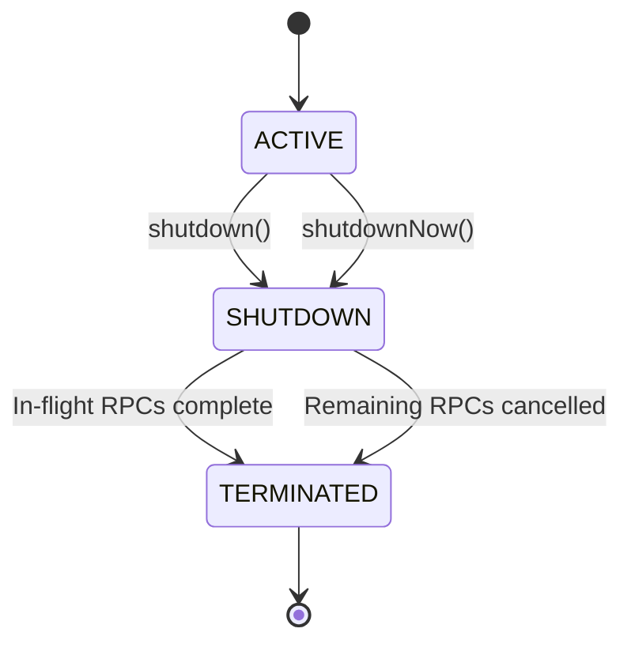

# Channel Shutdown and Await Termination

## 1. Objectives

In Spring gRPC, a `ManagedChannel` is typically created once and reused across many unary or streaming RPCs. When the application shuts down or deploys a new version, channels must be released in an orderly manner so in-flight RPCs have a chance to finish. Waiting too long can exceed the container's shutdown window; forcing closure too early cancels requests mid-flight.

Three core APIs in gRPC Java:

- `shutdown()`: initiates a **graceful shutdown**. The channel rejects new RPCs while giving already-accepted RPCs a chance to finish.
- `awaitTermination(timeout, unit)`: waits for the channel to terminate, up to the specified duration.
- `shutdownNow()`: requests cancellation of active RPCs when forceful termination is required.

After this lesson, you will be able to distinguish shutdown from termination, build shutdown sequences for Spring clients/servers, calculate shutdown budgets, handle unary and streaming RPCs, and test that a channel has genuinely terminated.

## 2. Lifecycle of a ManagedChannel

`ManagedChannel` is an application-level resource that outlives individual RPCs. It coordinates resolvers, load balancers, subchannels, and transports to send many RPCs. Closing a channel closes the **RPC dispatch entry point** together with the transport resources owned by that channel.



The diagram uses conceptual labels. The public API does not expose an `ACTIVE` or `TERMINATED` enum; state is queried via `isShutdown()` and `isTerminated()`.

| API | Effect | Does It Block? |
|---|---|---|
| `shutdown()` | Stops accepting new RPCs; gives accepted RPCs a chance to complete | No |
| `shutdownNow()` | Initiates shutdown and requests cancellation of active RPCs | No |
| `awaitTermination(t, unit)` | Waits until the channel terminates or the timeout expires | Yes, blocks the calling thread |
| `isShutdown()` | Checks whether shutdown has been requested | No |
| `isTerminated()` | Checks whether the channel has completely terminated | No |

**`shutdown()` is not equivalent to `awaitTermination()`.** Calling shutdown only starts the process. If the application needs to confirm the channel has terminated before exiting, it must await termination and inspect the result.

```java
channel.shutdown();
boolean terminated = channel.awaitTermination(5, TimeUnit.SECONDS);
if (!terminated) {
    channel.shutdownNow();
}
```

If `awaitTermination` returns `false`, the channel did not finish within the wait window. If the thread is interrupted, the method throws `InterruptedException`; the application must handle interruption and restore the interrupt flag.

## 3. Graceful Shutdown vs. Forceful Shutdown

### Graceful Shutdown

`shutdown()` is appropriate when the application can afford time for already-started RPCs to complete:

1. The channel stops accepting new RPCs.
2. Accepted RPCs get a chance to continue.
3. Once RPCs finish and resources are freed, the channel becomes terminated.
4. The application observes completion via `awaitTermination` or `isTerminated`.

Graceful shutdown **does not guarantee every RPC succeeds**. RPCs can still fail due to the server, deadlines, network drops, or cancellation.

### Forceful Shutdown

`shutdownNow()` requests cancellation of active RPCs. Use it when the wait budget runs out or the application must stop immediately. Cancelling an RPC on the client does not prove the server never processed the business operation: the server may have committed data before receiving cancellation. Any subsequent retry must account for idempotency and business state.

```mermaid
flowchart TD
    A[Stop accepting new work] --> B[channel.shutdown()]
    B --> C[awaitTermination within grace period]
    C --> D{Terminated?}
    D -->|Yes| E[Done]
    D -->|No| F[channel.shutdownNow()]
    F --> G[Short final wait]
    G --> H[Log if still not terminated]
```

Never call `shutdownNow()` immediately after `shutdown()` with zero grace period, unless specifically implementing an emergency abort path.

## 4. Shutdown Budget

An application typically has a total window to shut down before the container or platform kills the process. Channels must not consume that entire budget if the application also needs to close servers, databases, executors, and other resources.

Example with a 30-second total shutdown window:

| Phase | Illustrative Budget |
|---|---:|
| Stop accepting traffic and update readiness | 3 seconds |
| Drain inbound requests/RPCs | 12 seconds |
| Close outbound gRPC channels | 8 seconds |
| Close executors and other resources | 4 seconds |
| Reserve for hooks/runtime | 3 seconds |

Adjust these numbers to match your platform and SLOs. If a channel waits a full 30 seconds while the container itself only grants 30 seconds total, downstream components will have no time left to shut down.

**RPC deadlines and shutdown budgets are two distinct limits:**

- Deadlines bound the execution time of each RPC.
- Shutdown grace bounds how long the application spends shutting down.
- `awaitTermination` only waits for the channel to finish; it does not extend RPC deadlines or buy extra container time.

Track a single overall budget and pass remaining time into each step, rather than letting every bean wait independently for a long fixed duration.

## 5. Managing Channels in Spring

Never create channels inside controller or service methods. A singleton bean can own the channel and close it when the Spring context exits.

Example owner wrapping a channel, running graceful shutdown with a bounded wait, and forcing shutdown if necessary:

```java
package dev.example.client;

import io.grpc.ManagedChannel;
import java.time.Duration;
import java.util.concurrent.TimeUnit;

public final class GrpcChannelOwner implements AutoCloseable {
    private final ManagedChannel channel;
    private final Duration gracePeriod;

    public GrpcChannelOwner(
            ManagedChannel channel, Duration gracePeriod) {
        this.channel = channel;
        this.gracePeriod = gracePeriod;
    }

    public ManagedChannel channel() {
        return channel;
    }

    @Override
    public void close() {
        channel.shutdown();
        try {
            boolean terminated = channel.awaitTermination(
                    gracePeriod.toMillis(), TimeUnit.MILLISECONDS);
            if (!terminated) {
                channel.shutdownNow();
                channel.awaitTermination(2, TimeUnit.SECONDS);
            }
        } catch (InterruptedException e) {
            channel.shutdownNow();
            Thread.currentThread().interrupt();
        }
    }
}
```

Register the owner as a Spring bean:

```java
@Configuration(proxyBeanMethods = false)
public class GreeterClientConfiguration {
    @Bean(destroyMethod = "close")
    GrpcChannelOwner greeterChannelOwner(
            @Value("${app.grpc.greeter.target}") String target) {
        ManagedChannel channel = NettyChannelBuilder
                .forTarget(target)
                .useTransportSecurity()
                .build();
        return new GrpcChannelOwner(
                channel, Duration.ofSeconds(8));
    }
}
```

Gateway depending on the owner:

```java
@Service
public class GreeterGateway {
    private final GreeterGrpc.GreeterBlockingStub stub;

    public GreeterGateway(GrpcChannelOwner owner) {
        this.stub = GreeterGrpc.newBlockingStub(owner.channel());
    }

    public String greet(String name) {
        return stub.withDeadlineAfter(3, TimeUnit.SECONDS)
                .sayHello(HelloRequest.newBuilder()
                        .setName(name)
                        .build())
                .getMessage();
    }
}
```

Spring manages the dependency graph between the gateway and the owner; dependent beans are destroyed before the dependencies they use. With multiple beans or custom lifecycle coordinators, verify the actual destruction order.

`app.grpc.greeter.target` is a custom property. If a Spring gRPC starter already manages channels, use the lifecycle and configuration API of that exact starter version; never wrap and close a channel still owned by the framework.

**Never call shutdown per request.** A shared channel serves many RPCs; closing it when one request finishes breaks other concurrent requests and destroys transport reuse.

## 6. Shutdown Ordering When an Application Both Serves and Calls gRPC

A Spring service may simultaneously accept HTTP requests, host a gRPC server, and issue outbound gRPC calls. Closing outbound channels while inbound handlers are still running can prevent handlers from calling backends needed to complete in-flight work.

Reference sequence:

1. Mark the instance **not ready** so load balancers stop sending new traffic.
2. Stop accepting new HTTP requests and begin gRPC server shutdown to reject new inbound RPCs.
3. Let inbound handlers and in-flight requests finish within the grace period. Outbound channels must remain operational during this phase.
4. Once handlers drain or the budget expires, cancel remaining requests/streams per policy.
5. Shut down outbound gRPC channels with `shutdown()`, `awaitTermination`, and `shutdownNow()` if needed.
6. Close executors, database pools, and other resources in dependency order.

If the application is strictly a gRPC client, skip the inbound server steps. If it is strictly a server, manage the `Server` lifecycle rather than only closing `ManagedChannel`.

Do not rely on arbitrary ordering across independent bean destroy methods to coordinate complex sequences. For interdependent resources, build an explicit lifecycle coordinator or use Spring Boot's appropriate lifecycle mechanisms.

## 7. Server Shutdown and Await Termination

The server side offers corresponding APIs:

- `Server.shutdown()`: stops accepting new RPCs and gives accepted RPCs a chance to complete.
- `Server.shutdownNow()`: requests cancellation of active RPCs.
- `Server.awaitTermination(timeout, unit)`: waits for the server to finish within a bounded window.

Example:

```java
server.shutdown();
try {
    if (!server.awaitTermination(15, TimeUnit.SECONDS)) {
        server.shutdownNow();
        server.awaitTermination(3, TimeUnit.SECONDS);
    }
} catch (InterruptedException e) {
    server.shutdownNow();
    Thread.currentThread().interrupt();
}
```

In Spring, bind server lifecycle to the context or starter instead of managing a standalone server outside Spring. When receiving traffic through Kubernetes/ingress, coordinate readiness, endpoint removal, server shutdown, and container grace periods together.

**Readiness differs from shutdown:** readiness stops new traffic from arriving; `Server.shutdown()` actually shuts the server down. Changing readiness alone leaves the process holding resources. Shutting down the server without draining endpoints first causes clients to hit repeated errors during rollouts.

## 8. In-Flight Unary RPCs During Channel Shutdown

For unary RPCs, `shutdown()` does not automatically turn every in-flight call into an error. Accepted RPCs get a chance to finish; new calls after channel shutdown are rejected.

```java
GreeterGrpc.GreeterFutureStub stub =
        GreeterGrpc.newFutureStub(channel);

ListenableFuture<HelloReply> pending = stub.sayHello(
        HelloRequest.newBuilder().setName("Lan").build());

channel.shutdown();

// pending may complete if the server finishes in time.
// The application must await the Future within the shutdown budget.
```

This example assumes the project includes the Future stub library matching its gRPC Java version. In production code, track Futures/callbacks and await results within the shutdown budget.

If an RPC has a deadline shorter than the grace period, it can finish or time out before the channel terminates. If an RPC lacks a deadline or the backend hangs, it can keep the channel from terminating longer than expected. Always attach finite deadlines to unary RPCs and enforce bounded shutdown grace windows.

If the server committed a write before the channel closed without delivering the response, the caller may not know whether the operation succeeded. For writes, use idempotency keys and lookup/reconciliation before retrying.

## 9. Streaming RPCs and Cancellation

Streaming RPCs can outlive normal shutdown windows. An open stream does not terminate automatically just because the client pauses sending messages briefly.

When `channel.shutdown()` is called, already-accepted RPCs get a chance to finish. If a stream does not close, `awaitTermination` can time out. The application must decide:

- Wait longer within the remaining budget if the stream can finish naturally.
- Proactively send an application-level completion/cancellation signal.
- Call `shutdownNow()` when the channel must be force-closed.

For client streaming or bidirectional streaming, retain a cancellable handle—such as `ClientCallStreamObserver` in the async API—and track it in a lifecycle-aware registry. At shutdown, stop accepting new messages, send completion if the protocol allows, or cancel the stream.

When a stream is cancelled, the server can observe cancellation and release resources. Still, if the server already processed a message before cancellation arrived, the client cannot assume that message went uncommitted. For streams carrying critical data, use sequence numbers, acknowledgments, cursors, and deduplication for safe recovery.

## 10. awaitTermination Is Not a Health Check

Two distinct questions:

- `awaitTermination`: "Have the channel and server finished shutting down completely?"
- Health check: "Is the service ready to process business traffic?"

A channel can be `READY` while the server fails a method or a database is down. A channel can also be `IDLE` with zero errors. After shutdown, `awaitTermination` returning `true` only confirms channel resources terminated—not that prior RPCs succeeded or data committed.

| Method | Used To |
|---|---|
| `channel.isShutdown()` | Check whether shutdown has been requested |
| `channel.isTerminated()` | Check whether the channel has completely terminated |
| `channel.awaitTermination(t, unit)` | Wait up to a bound for channel termination |
| `server.isShutdown()` | Check whether server shutdown has started |
| `server.isTerminated()` | Check whether the server has completely terminated |
| `server.awaitTermination(t, unit)` | Wait up to a bound for server termination |

Never use `awaitTermination()` as a readiness probe or invoke it on an event-loop or request-handling thread. It is a potentially blocking wait and belongs on a managed lifecycle thread.

## 11. Handling Interruption and Timeouts

A channel close method must handle three cases:

1. **Terminates on time:** `awaitTermination` returns `true`; no forceful shutdown needed.
2. **Wait times out:** returns `false`; call `shutdownNow()` and wait briefly one final time.
3. **Thread is interrupted:** trigger forceful shutdown if needed, then restore the interrupt flag via `Thread.currentThread().interrupt()`.

Never swallow `InterruptedException` and keep waiting indefinitely. An interrupt may be Spring, the container, or a lifecycle coordinator signaling an immediate stop.

Do not claim resources are fully released merely because `shutdownNow()` was called. Inspect `isTerminated()` or the `awaitTermination` result after forceful shutdown.

When closing multiple channels, avoid awaiting each channel sequentially with the full timeout, which can blow the total shutdown budget. Initiate `shutdown()` on all channels first, then await termination against a **shared deadline** or remaining time budget.

## 12. Observing Shutdown

Signals worth collecting:

| Signal | Meaning |
|---|---|
| Shutdown start timestamp | Determines remaining time budget |
| Active RPC/stream count | Volume of work to drain |
| RPCs completed during grace | Effectiveness of graceful shutdown |
| RPCs cancelled/failed | Impact of forceful shutdown |
| `awaitTermination` duration | Detects slow-closing channels or servers |
| Unterminated channel count | Detects leaks or hung streams |
| Per-method RPC status | Caller impact during rollouts |

Logs should distinguish graceful shutdown start, grace expiration, forceful shutdown requested, channel/server terminated, and channel/server still unterminated after the final wait. Avoid logging tokens, sensitive metadata, or payloads.

## 13. Testing Shutdown and Termination

Unit tests with mocked stubs do not verify that transports actually closed. Integration tests can use a Netty server/client over loopback to test a real channel:

```java
package dev.example.hello;

import static org.junit.jupiter.api.Assertions.assertTrue;

import io.grpc.Grpc;
import io.grpc.InsecureChannelCredentials;
import io.grpc.ManagedChannel;
import io.grpc.Server;
import io.grpc.netty.shaded.io.grpc.netty.NettyServerBuilder;
import java.net.InetSocketAddress;
import java.util.concurrent.TimeUnit;
import org.junit.jupiter.api.Test;

class ChannelShutdownTest {
    @Test
    void shutdownTerminatesChannel() throws Exception {
        Server server = NettyServerBuilder
                .forAddress(new InetSocketAddress("127.0.0.1", 0))
                .addService(new GreeterGrpc.GreeterImplBase() {})
                .build()
                .start();

        ManagedChannel channel = Grpc.newChannelBuilderForAddress(
                "127.0.0.1", server.getPort(),
                InsecureChannelCredentials.create())
                .build();

        try {
            channel.shutdown();
            assertTrue(channel.isShutdown());
            assertTrue(channel.awaitTermination(5, TimeUnit.SECONDS));
            assertTrue(channel.isTerminated());
        } finally {
            channel.shutdownNow();
            server.shutdownNow();
            assertTrue(server.awaitTermination(5, TimeUnit.SECONDS));
        }
    }
}
```

This test verifies channel termination. To test an in-flight RPC, add a handler with a latch: start the RPC, call `shutdown()`, confirm the accepted RPC finishes, and then verify channel termination. Use latches/barriers and deadlines instead of arbitrary `Thread.sleep` calls to avoid flaky tests.

Scenarios worth testing:

1. Shutdown with no RPCs: channel terminates within grace period.
2. Shutdown with an in-flight unary RPC: RPC finishes if the handler completes before grace expires.
3. Shutdown with an open stream: stream completes or cancels; channel is not held open indefinitely.
4. Grace period expires: `shutdownNow()` is invoked and remaining RPCs are cancelled.
5. Interrupt during await: interrupt flag is preserved.
6. Spring context close: owner bean closes the channel with no stray transport threads/sockets left behind.
7. Server graceful shutdown: server rejects new RPCs and waits for in-flight RPCs within grace.

Plaintext loopback tests only verify channel lifecycle, not TLS/mTLS, ingress, or orchestrators. Those layers require integration tests matched to the deployment environment.

## 14. Common Pitfalls

| Symptom | Cause | Resolution |
|---|---|---|
| Process stays alive after `shutdown()` | In-flight RPCs/streams or other unclosed resources | Check in-flight RPCs and use bounded `awaitTermination` |
| `awaitTermination` returns `false` | Grace period too short or stream never finishes | Drain/cancel streams; adjust budget with evidence |
| New RPCs fail after shutdown | Channel is already rejecting new RPCs | Stop accepting incoming work before closing the channel |
| Creating a new channel on every error | Confusing reconnect with request lifecycle | Keep a long-lived channel; recreate only when owner/config changes |
| `shutdownNow()` drops write results | Server may have committed before cancellation | Use idempotency keys, deduplication, and reconciliation |
| Spring closes channel before gateway | Unclear lifecycle/dependency ownership | Make the gateway depend on the owner or use a coordinator |
| Server shuts down while ingress still sends traffic | Readiness/endpoint removal not coordinated | Stop accepting new traffic first, then drain the server |
| Waiting sequentially per channel takes too long | Each channel uses the full timeout, exceeding total budget | Call `shutdown()` on all channels first, then await a shared deadline |

## 15. Hands-On Exercise

**Scenario:** a Spring Boot service receives HTTP requests, makes outbound Greeter unary RPCs, and holds a bidirectional stream to a notification service. During deploys, the container has 30 seconds to stop. Unary RPCs normally finish quickly, whereas the stream can stay open for many minutes.

Carry out the following:

1. Create a singleton `ManagedChannel` and confirm unary RPCs succeed prior to shutdown.
2. Write an owner executing `shutdown()`, `awaitTermination()`, and `shutdownNow()` when grace expires; log termination outcomes.
3. Flip readiness off and stop accepting new requests before closing outbound channels.
4. Keep a unary RPC in flight and confirm graceful shutdown lets it finish within the timeout.
5. Keep a long-lived stream open; design a stop/cancel signal and cursor so it can resume after deployment.
6. Calculate shutdown budgets for the inbound server, outbound channels, and executors so the total stays within the container's grace period.
7. Test forceful shutdown upon grace expiration and inspect statuses/cancellations on client and server.
8. Close the Spring context in an integration test and confirm channels/servers terminate with no unexpected threads or sockets left behind.

**Completion Criteria:** You can distinguish shutdown initiation from actual termination, implement bounded graceful shutdown, handle both unary and streaming RPCs, avoid closing channels before dependent components stop sending RPCs, and provide integration test evidence for termination.

## 16. Key Takeaways

`shutdown()` starts graceful shutdown and rejects new RPCs; `awaitTermination(timeout, unit)` waits for the channel to actually finish; `shutdownNow()` requests cancellation of remaining active RPCs when the budget expires. In Spring, a channel needs one clear lifecycle owner and should close only after the application stops issuing new RPCs. For server/client streaming, proactively drain or cancel streams and design business resumption. Always compute an overall shutdown budget, handle interruption, verify `isTerminated()`, and test against real transports—merely calling `shutdown()` does not prove resources were released.
