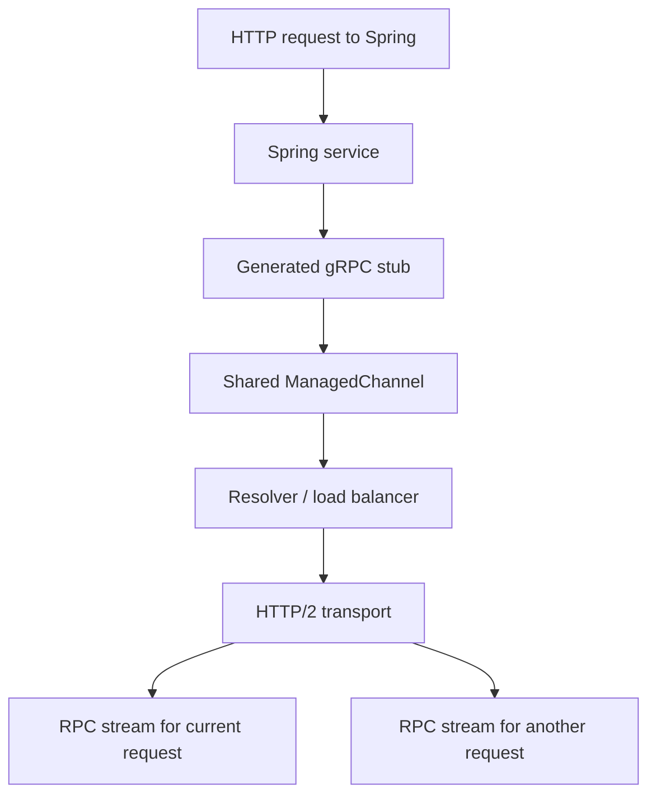
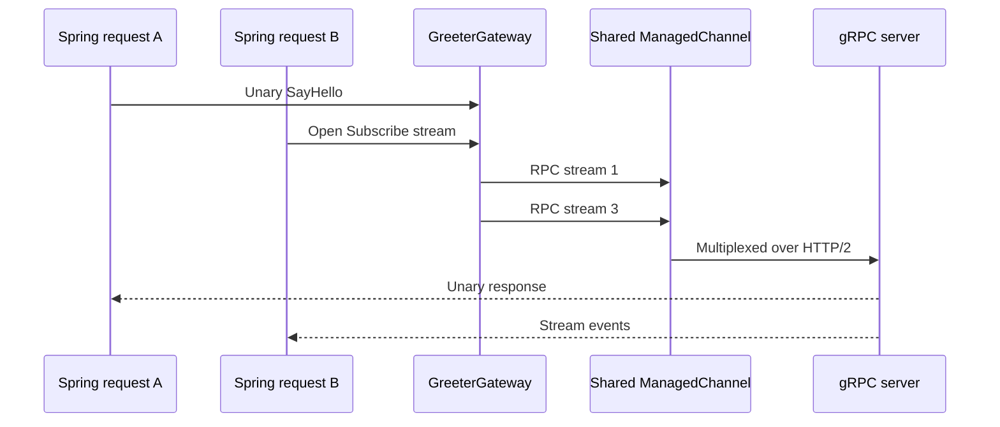

# Never Create a Channel Per Request

## 1. Objectives

In Spring gRPC, `ManagedChannel` is a logical connection resource pointing to a target. It is designed to be long-lived and serve many unary or streaming RPCs. Creating a new channel for every HTTP request eliminates transport reuse, adds DNS/TCP/TLS/HTTP/2 handshake overhead, and makes sockets, threads, and reconnects hard to control.

After this lesson, you will be able to:

- Explain why channels and generated stubs should be reused.
- Distinguish a channel, an HTTP/2 connection, an RPC stream, and a business request.
- Organize a shared channel per target in Spring.
- Keep deadlines, metadata, and cancellation isolated per RPC without creating new channels.
- Identify when separate channels are warranted due to different targets or transport configurations.
- Close channels in the proper lifecycle and test that multiple requests share resources.

**Default rule:** create channels by target/connection configuration, wire them through dependency injection, and reuse them across requests. Never create or shut down a channel inside a controller, service method, or per stub call.

## 2. Channels Are Designed to Be Long-Lived

A gRPC call passes through multiple layers:



`ManagedChannel` is the logical entry point for RPCs. Underneath, gRPC manages the resolver, load balancer, subchannels, and transports. A single HTTP/2 connection can multiplex many concurrent RPC streams. Thus, one shared channel can serve many requests without needing a dedicated channel per request.

| Component | Lifecycle | Create Per Request? |
|---|---|---|
| `ManagedChannel` | Long-lived per target and connection config | No |
| Generated stub | Immutable, used to invoke a service over a channel | Usually unnecessary; can be shared |
| RPC call/stream | One business invocation | Yes, each request opens its own RPC |
| Protobuf request/response | Data for a single call | Yes, built per call's payload |
| Metadata/deadline | Context for a single RPC | Yes, attached per RPC |

**Reusing a channel does not mean reusing an RPC.** Every request still creates its own call/stream with its own messages, deadline, metadata, and outcome.

## 3. Why Creating a Channel Per Request Is Harmful

Anti-pattern example in a service:

```java
public String greet(String name) {
    ManagedChannel channel = NettyChannelBuilder
            .forAddress("greeter.internal.example", 8443)
            .useTransportSecurity()
            .build();

    try {
        return GreeterGrpc.newBlockingStub(channel)
                .sayHello(HelloRequest.newBuilder()
                        .setName(name)
                        .build())
                .getMessage();
    } finally {
        channel.shutdown();
    }
}
```

Even with `finally` closing the channel, this code allocates and tears down transports on every request. For each call, the client may have to repeat:

- DNS resolution and endpoint selection.
- TCP connection establishment.
- TLS handshake and certificate verification.
- HTTP/2 connection preface and `SETTINGS` exchange.
- Transport resource, event loop, or buffer allocation depending on the implementation.

As load grows, this creates far more sockets and handshakes than needed, drives up request latency, and burdens client, proxy, and server CPUs. Forgetting to close the channel leaks resources; closing it prematurely breaks other callers if shared.

Avoiding per-request channels also lets gRPC manage reconnect/backoff in one place. When a transport drops, a long-lived channel establishes a fresh connection; the application does not need to build a new channel every time `UNAVAILABLE` occurs.

## 4. Creating the Channel Once in Spring

Put the channel in a long-lived bean. Example using a DNS target and TLS:

```yaml
# application-prod.yml
# app.grpc.* is an application-defined configuration namespace
app:
  grpc:
    greeter:
      target: dns:///greeter.internal.example:8443
```

```java
package dev.example.client;

import io.grpc.ManagedChannel;
import io.grpc.netty.shaded.io.grpc.netty.NettyChannelBuilder;
import org.springframework.beans.factory.annotation.Value;
import org.springframework.context.annotation.Bean;
import org.springframework.context.annotation.Configuration;
import org.springframework.context.annotation.Profile;

@Configuration(proxyBeanMethods = false)
@Profile("prod")
public class GreeterChannelConfiguration {
    @Bean(name = "greeterChannel", destroyMethod = "shutdown")
    ManagedChannel greeterChannel(
            @Value("${app.grpc.greeter.target}") String target) {
        return NettyChannelBuilder.forTarget(target)
                .useTransportSecurity()
                .build();
    }
}
```

`useTransportSecurity()` enables TLS; the server certificate must still be trusted and have a hostname/SAN matching the service name. If using an internal CA or mTLS, configure corresponding credentials/trust material. Never switch to plaintext to hide certificate errors.

Gateway receiving the channel via constructor injection:

```java
package dev.example.client;

import dev.example.hello.GreeterGrpc;
import dev.example.hello.HelloRequest;
import io.grpc.ManagedChannel;
import java.util.concurrent.TimeUnit;
import org.springframework.beans.factory.annotation.Qualifier;
import org.springframework.stereotype.Service;

@Service
public class GreeterGateway {
    private final GreeterGrpc.GreeterBlockingStub stub;

    public GreeterGateway(
            @Qualifier("greeterChannel") ManagedChannel channel) {
        this.stub = GreeterGrpc.newBlockingStub(channel);
    }

    public String greet(String name) {
        return stub.withDeadlineAfter(2, TimeUnit.SECONDS)
                .sayHello(HelloRequest.newBuilder()
                        .setName(name)
                        .build())
                .getMessage();
    }
}
```

Both the gateway and the channel are Spring-managed beans. Each time `greet` runs, the code creates a new Protobuf request and RPC while reusing the same channel/stub. `withDeadlineAfter` returns a derived immutable stub with a dedicated deadline for that call.

The `app.grpc.greeter.target` property is a custom example name, not a property name guaranteed across every Spring gRPC starter version. If a starter already creates channels, use that version's configuration API and inject the framework-managed channel/stub; avoid creating a second channel for the same target.

## 5. Stubs and Channels Are Safe for Concurrent Use

Generated gRPC stubs are immutable: configuration methods such as `withDeadlineAfter`, `withWaitForReady`, or `withInterceptors` return a derived stub instead of mutating the original stub. `ManagedChannel` is likewise designed for concurrent invocation across threads.

Accordingly, a singleton gateway can hold a base stub:

```java
private final GreeterGrpc.GreeterBlockingStub baseStub;

public GreeterGateway(ManagedChannel channel) {
    this.baseStub = GreeterGrpc.newBlockingStub(channel);
}

public HelloReply greet(String name, Duration timeout) {
    return baseStub
            .withDeadlineAfter(timeout.toMillis(), TimeUnit.MILLISECONDS)
            .sayHello(HelloRequest.newBuilder()
                    .setName(name)
                    .build());
}
```

Never store a request's deadline or metadata in a shared mutable field. Doing so lets concurrent threads overwrite one another's context. Keeping the base stub immutable and deriving a per-call stub cleanly isolates RPC configuration.

Blocking stubs still perform blocking calls. In Spring MVC, execute on an appropriate worker thread; in WebFlux/event-loop apps, never call a blocking stub directly on an event-loop thread. Reusing a channel does not turn blocking RPCs into non-blocking ones.

## 6. Metadata and Deadlines Remain Per-RPC

A common misconception is thinking that a shared channel forces all requests to share the same metadata or deadline. In fact, call-specific attributes can be attached individually.

### Per-Request Deadlines

```java
HelloReply reply = baseStub
        .withDeadlineAfter(1500, TimeUnit.MILLISECONDS)
        .sayHello(request);
```

Request A can carry a 1.5-second deadline while Request B carries a 4-second deadline. Both calls share the same channel. Deadlines bound RPC execution; they neither allocate a new channel nor reset the channel's lifecycle.

### Per-Request Metadata

Use interceptors, call credentials, or an appropriate call-scoped mechanism to attach metadata. Example using gRPC Java's `MetadataUtils` API:

```java
Metadata headers = new Metadata();
Metadata.Key<String> requestIdKey = Metadata.Key.of(
        "x-request-id", Metadata.ASCII_STRING_MARSHALLER);
headers.put(requestIdKey, requestId);

GreeterGrpc.GreeterBlockingStub requestStub =
        baseStub.withInterceptors(
                MetadataUtils.newAttachHeadersInterceptor(headers));

HelloReply reply = requestStub
        .withDeadlineAfter(2, TimeUnit.SECONDS)
        .sayHello(request);
```

This demonstrates call-scoped headers; use the exact `MetadataUtils` API of your installed gRPC Java version and build separate metadata per request. Never share one mutable `Metadata` instance across threads. For bearer tokens, prefer call credentials or an interceptor that retrieves tokens safely; never log tokens.

A shared channel does not imply shared user identity. If each request carries its own token, attach it to that specific call. Only when tenants require **different client certificates, trust roots, proxies, or transport policies** should you separate channels by security config—still never per HTTP request.

## 7. When Are Multiple Channels Needed?

One shared channel per target/connection configuration is a sensible default. Multiple channels should appear only when configuration boundaries demand them or measurements prove the need.

| Scenario | Appropriate Organization |
|---|---|
| Many requests calling the same service with the same TLS identity | Share a single channel |
| Multiple methods on the same service/target | Share the channel; create corresponding stubs |
| Multiple services at different targets | One channel per logical target/configuration |
| Tenants with distinct client certificates or trust policies | Separate channels by security identity/configuration |
| Load tests prove transport is a bottleneck | Evaluate a bounded pool, measuring before and after |
| Each user has a distinct bearer token | Use per-RPC call credentials/metadata; do not create a channel per user |

Do not create a channel per tenant if all share the same endpoint and transport identity and differ only in metadata. Conversely, do not merge tenants with different TLS identities onto one channel and try to swap client certificates per request; TLS identity belongs to the connection, not arbitrary RPC metadata.

One channel can manage multiple endpoints via resolvers/load balancers. Having multiple channels also does not guarantee even traffic distribution; they may all pick the same backend. For load balancing, configure resolvers/LB policies and measure endpoint distribution rather than multiplying channels arbitrarily.

## 8. Streaming RPCs Also Reuse the Channel

Each streaming RPC gets its own stream while still riding on the same channel shared with unary RPCs and other streams. Never create a new channel simply because a method returns a stream.



A stream can outlive the HTTP request that started it. When an HTTP client disconnects, the application must decide whether to cancel the corresponding gRPC stream or keep processing per business rules. Cancelling one stream **does not require closing the shared channel**, because other RPCs still depend on it.

When a connection drops, the channel can reconnect, but the old stream does not automatically move onto the new connection. To recover a subscription, open a new RPC with a cursor/resume token per the contract.

## 9. Closing Channels in the Application Lifecycle

Channel reuse requires clear ownership. When the Spring context stops, the channel should be closed once. `shutdown()` starts graceful shutdown; if waiting for resource termination is required, the owner calls `awaitTermination` and falls back to `shutdownNow()` once the grace period expires.

Example owner:

```java
public final class GrpcChannelOwner implements AutoCloseable {
    private final ManagedChannel channel;

    public GrpcChannelOwner(ManagedChannel channel) {
        this.channel = channel;
    }

    public ManagedChannel channel() {
        return channel;
    }

    @Override
    public void close() {
        channel.shutdown();
        try {
            if (!channel.awaitTermination(8, TimeUnit.SECONDS)) {
                channel.shutdownNow();
                channel.awaitTermination(2, TimeUnit.SECONDS);
            }
        } catch (InterruptedException e) {
            channel.shutdownNow();
            Thread.currentThread().interrupt();
        }
    }
}
```

Register the owner with `@Bean(destroyMethod = "close")`. The 8-second and 2-second durations are illustrative; they must fit inside the application/container's total shutdown budget. If a starter owns the channel, let the starter close it within the framework lifecycle.

Never close the channel in a `finally` block inside a controller or service method. That belongs to per-request resources, whereas the channel belongs to the application and serves concurrent requests.

## 10. Testing Reuse

A useful test should prove multiple RPCs share the same channel while verifying the channel terminates when the owner/context closes.

Test steps:

1. Initialize the channel once in the test or Spring context.
2. Send multiple unary RPCs sequentially and concurrently through the same gateway.
3. Verify responses are correct and no new channel is created per call.
4. If metadata/deadlines are used, verify each RPC receives its own values.
5. Close the context/owner and confirm the channel terminates.

Example testing gateway logic by injecting a shared channel; integration tests should run a real Netty server over loopback to verify HTTP/2 transport:

```java
@Test
void manyCallsUseTheSameGatewayChannel() {
    ManagedChannel channel = testChannel();
    GreeterGateway gateway = new GreeterGateway(channel);

    assertEquals("Hello Lan", gateway.greet("Lan"));
    assertEquals("Hello Minh", gateway.greet("Minh"));

    channel.shutdown();
    assertTrue(channel.awaitTermination(5, TimeUnit.SECONDS));
}
```

This snippet is an illustrative outline; `testChannel()` must create a channel connected to a running test server. To verify how many channels were instantiated, assert the factory/bean runs once or confirm the gateway holds the same object reference. Simply seeing two RPCs succeed does not prove no hidden channels were created.

Additional cases worth testing:

- Concurrent unary RPCs sharing the same stub/channel.
- Two requests with different deadlines not interfering with one another.
- Request-scoped metadata not leaking into subsequent requests.
- Cancelling one stream without closing the channel or disrupting other RPCs.
- Server restart: the same channel reconnects for new RPCs.
- Spring context shutdown: the owner closes the channel without leaking threads/sockets.

## 11. Common Pitfalls

| Symptom | Cause | Resolution |
|---|---|---|
| Every request creates a channel | Channel constructed inside controller/service method | Move the channel to a singleton bean |
| Channel is never closed | No lifecycle owner | Register a bean destroy method or coordinator |
| Other RPCs fail when one request finishes | Channel shut down in the request's `finally` block | Close the channel only on application shutdown |
| User metadata mixes across requests | Mutable object shared across calls | Construct metadata/call credentials per RPC |
| New token is not applied | Token cached in interceptor/channel scope | Fetch token per call or use proper credentials |
| Too many channels created per tenant | Using channels to differentiate request data | Use metadata; separate only when transport/security config differs |
| Multiple channels created yet load stays skewed | Resolver/LB still picks the same backend | Inspect endpoints and load-balancing policy |
| Cancelling a stream breaks other calls | Shutting down the channel instead of cancelling the stream | Cancel only the target RPC/stream; keep shared channel alive |
| First request after idle is slow | Channel/connection went idle or proxy closed it | Measure cold connections; tune idle/keepalive per policy |

## 12. Hands-On Exercise

**Scenario:** a Spring Boot API receives 500 HTTP requests per second and translates them into unary gRPC calls to `Greeter`. Currently, the controller creates a `ManagedChannel` on every request. Client CPU spikes, TLS handshakes surge, and P95 latency is high.

Perform the following:

1. Move channel creation to a singleton Spring bean per target and TLS configuration.
2. Inject the channel into the gateway and keep an immutable generated stub for reuse.
3. Send multiple concurrent RPCs through the same gateway; verify each call receives its own request/response.
4. Set per-call deadlines and pass request IDs/tokens via metadata or appropriate call credentials.
5. Test two requests with different tokens to verify metadata never leaks between threads.
6. Measure channel count, socket count, TLS handshakes, P95/P99 latency, and CPU before and after the change.
7. Add an owner that closes the channel when the Spring context stops; verify the channel terminates within the shutdown budget.
8. If streaming RPCs exist, cancel one stream and confirm other unary RPCs keep flowing over the channel.

**Completion Criteria:** Channels are created per target/connection configuration rather than per request; metadata/deadlines remain per-RPC; multiple threads safely share channels/stubs; channels close cleanly with the lifecycle; and improvements are backed by measurements.

## 13. Key Takeaways

`ManagedChannel` is a long-lived resource that should be reused across many requests. HTTP/2 multiplexing allows multiple RPC streams to share a transport; immutable generated stubs can be shared, while requests, metadata, deadlines, and cancellations stay scoped to individual RPCs. In Spring, declare channels as beans per target/security configuration, inject them into gateways, and shut them down when the application context stops. Create separate channels only when targets or transport identities differ, or when measurements prove it necessary—never create a new channel on every service call.
