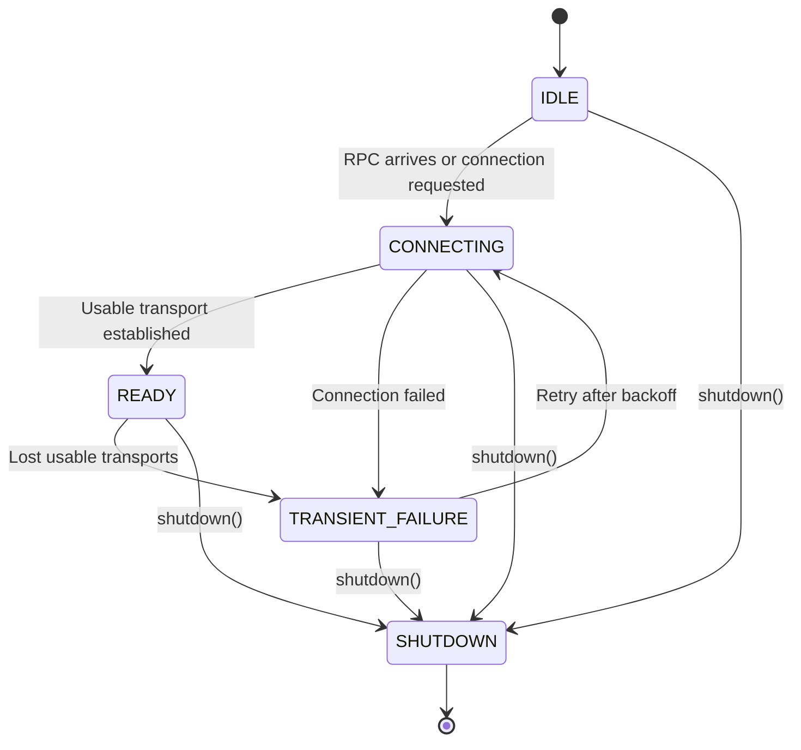

# Observing Channel State

## 1. Objectives

In Spring gRPC, a `ManagedChannel` is the logical entry point for a client to send unary or streaming RPCs to a target. A channel can pass through several states during DNS resolution, HTTP/2 setup, connection drops, reconnection, or shutdown. Observing channel state helps operators tell whether a channel is waiting to connect, ready, experiencing transient failures, or shut down.

After this lesson, you will be able to:

- Explain the five states: `IDLE`, `CONNECTING`, `READY`, `TRANSIENT_FAILURE`, and `SHUTDOWN`.
- Use `getState()` to read snapshots and actively request connection establishment.
- Use `notifyWhenStateChanged()` to receive state transition notifications without tight polling.
- Build a watcher with a clean lifecycle in a Spring application.
- Distinguish channel state from service health and individual socket state.
- Combine state transitions with RPC statuses, metrics, tracing, and Channelz for diagnostics.
- Test state transitions across server startup, connection loss, reconnection, and shutdown.

## 2. The Five ConnectivityStates

gRPC Java represents a channel's aggregated state via `ConnectivityState`:

| State | Meaning | Operational Interpretation |
|---|---|---|
| `IDLE` | The channel is not actively establishing or maintaining a connection right now | May be waiting for a new RPC or in idle mode; not an error on its own |
| `CONNECTING` | Resolver/load balancer is locating endpoints or transports are being established | May be running DNS lookup, TCP connect, or TLS/HTTP/2 handshake |
| `READY` | A transport path is ready to send RPCs | The channel can accept calls; does not prove handlers or databases are healthy |
| `TRANSIENT_FAILURE` | No usable connection path is currently available after a temporary failure | gRPC may wait for backoff and retry |
| `SHUTDOWN` | Channel shutdown has started | Do not use this channel for new RPCs; terminal lifecycle state |

A common lifecycle:



This is a conceptual model. Depending on the resolver, load balancer, and observation timing, a channel can transition rapidly; polling can miss intermediate states.

### Reading the Right Meaning

- `IDLE` does not mean the server is down. The channel may simply be conserving resources because no RPC has needed a connection.
- `CONNECTING` does not guarantee connection will succeed; DNS resolution or TLS handshakes can still fail.
- `READY` only says the channel has a ready transport. An individual RPC can still return `UNAVAILABLE`, `PERMISSION_DENIED`, or a business error.
- `TRANSIENT_FAILURE` indicates no usable connection path exists right now. The root cause could be DNS, network, proxy, TLS, or server; the state alone does not pinpoint which.
- `SHUTDOWN` differs from `TRANSIENT_FAILURE`: transient failures can recover, whereas a shut-down channel cannot be reused.

## 3. Reading Snapshots with getState()

`ManagedChannel.getState(boolean requestConnection)` returns the state at the moment of invocation:

```java
ConnectivityState state = channel.getState(false);
log.info("gRPC channel state={}", state);
```

Meaning of the boolean argument:

- `getState(false)` only reads the current snapshot; it does not ask the channel to start connecting.
- `getState(true)` can ask the channel to leave `IDLE` and start connecting if needed.

Example:

```java
ConnectivityState state = channel.getState(true);
log.info("Channel state after requesting connection: {}", state);
```

`getState(true)` **does not wait for the channel to reach `READY`**. It merely triggers connection setup. When you need to send an RPC and wait up to a limit for the channel to become ready, attach a deadline and consider `withWaitForReady()` for suitable calls.

Do not use snapshots as an absolute gate:

```java
// Do not use a state snapshot to guarantee an RPC will succeed.
if (channel.getState(false) == ConnectivityState.READY) {
    return stub.sayHello(request);
}
throw new IllegalStateException("Channel is not READY");
```

Immediately after reading `READY`, the transport can still drop. Conversely, an `IDLE` channel can be woken up by the next RPC. The safe pattern is invoking RPCs with proper deadlines, handling gRPC statuses, and using state for diagnostics or trend monitoring.

## 4. Receiving Transitions with notifyWhenStateChanged()

Short-interval polling adds overhead and can still miss fast transitions. gRPC Java provides `notifyWhenStateChanged(source, callback)` to register a one-shot callback for when the channel leaves `source`.

```java
ConnectivityState observed = channel.getState(false);

channel.notifyWhenStateChanged(observed, () -> {
    ConnectivityState current = channel.getState(false);
    log.info("Channel state changed: {} -> {}", observed, current);
});
```

The callback fires **once upon leaving the observed state**. For continuous monitoring, read the new state and re-register after each callback.

### A Lifecycle-Managed Watcher

The example below offloads callback work to a dedicated executor so gRPC's callback thread does not perform logging or lengthy application tasks. The watcher does not own the channel; it only observes the injected channel.

```java
package dev.example.client;

import io.grpc.ConnectivityState;
import io.grpc.ManagedChannel;
import java.util.concurrent.ExecutorService;
import java.util.concurrent.Executors;
import java.util.concurrent.RejectedExecutionException;
import java.util.concurrent.atomic.AtomicBoolean;
import org.slf4j.Logger;
import org.slf4j.LoggerFactory;

public final class ChannelStateWatcher implements AutoCloseable {
    private static final Logger log =
            LoggerFactory.getLogger(ChannelStateWatcher.class);

    private final ManagedChannel channel;
    private final ExecutorService observer =
            Executors.newSingleThreadExecutor();
    private final AtomicBoolean running = new AtomicBoolean(false);

    public ChannelStateWatcher(ManagedChannel channel) {
        this.channel = channel;
    }

    public void start() {
        if (running.compareAndSet(false, true)) {
            armNextTransition();
        }
    }

    private void armNextTransition() {
        if (!running.get()) {
            return;
        }

        ConnectivityState source = channel.getState(false);
        if (source == ConnectivityState.SHUTDOWN) {
            return;
        }

        channel.notifyWhenStateChanged(source, () -> {
            if (!running.get()) {
                return;
            }
            try {
                observer.execute(() -> {
                    if (!running.get()) {
                        return;
                    }
                    ConnectivityState current = channel.getState(false);
                    log.info("gRPC channel state: {} -> {}", source, current);
                    armNextTransition();
                });
            } catch (RejectedExecutionException ignored) {
                // Watcher stopped while the callback was dispatched.
            }
        });
    }

    @Override
    public void close() {
        running.set(false);
        observer.shutdown();
    }
}
```

Key notes:

- Call `start()` once after bean initialization.
- `notifyWhenStateChanged` only signals that the channel left the source state; the callback reads the fresh snapshot and arms the next watch.
- `close()` stops the watcher and its private executor; it **does not close the channel**.
- The channel owner remains responsible for calling `shutdown()`/`awaitTermination()` when the Spring context stops.
- Callbacks must never block or perform synchronous RPCs. To send alerts, hand off to a bounded queue/executor with load control.

In production applications, register and stop watchers with the Spring lifecycle. If using a shared application executor, do not shut down that executor inside the watcher; keep executor ownership unambiguous.

## 5. Integrating the Watcher in Spring

A simple configuration can register the watcher as a bean depending on the channel:

```java
@Configuration(proxyBeanMethods = false)
public class GreeterObservabilityConfiguration {
    @Bean(destroyMethod = "close")
    ChannelStateWatcher greeterChannelStateWatcher(
            @Qualifier("greeterChannel") ManagedChannel channel) {
        ChannelStateWatcher watcher = new ChannelStateWatcher(channel);
        watcher.start();
        return watcher;
    }
}
```

`greeterChannel` must be the channel managed by the application or Spring gRPC starter. This example assumes the channel is already declared in client configuration. Never create a separate channel solely to watch state; the watcher must observe the exact instance used by the gateway.

If your framework starter already supplies built-in metrics or lifecycle hooks, prefer integrating with those rather than registering duplicate watchers on the same channel. Never give the watcher ownership of a starter-managed channel.

## 6. Channel State Is Not Service Health

This is a critical boundary when building dashboards and alerts:

| Signal | Question It Answers | What It Does Not Prove |
|---|---|---|
| Channel `READY` | Is a transport ready to send RPCs? | Whether a specific method succeeds |
| Channel `TRANSIENT_FAILURE` | Is a usable connection path currently available? | That the sole cause is the server being down |
| TCP socket connected | Is the TCP peer connected? | Whether TLS, HTTP/2, or business handlers are healthy |
| gRPC Health Check | What status does the health service report for the service? | That every business request will succeed |
| RPC success/status | What happened on a specific call? | That the entire service is always healthy |

A channel can be `READY` while the backend returns `UNAVAILABLE` for a method due to quotas or broken dependencies. Conversely, an `IDLE` channel may simply have no recent traffic.

When you need to know whether a service is ready to accept work, use the gRPC Health Checking Protocol if the server implements the health service. The `Check` RPC returns status for a service; `Watch` can stream status changes continuously. Combine platform readiness with deadline-bounded synthetic RPCs where appropriate.

Never use channel state as the sole readiness probe for an entire application. A single channel to one backend does not represent all dependencies and business logic of a Spring service.

## 7. Combining Channel State with gRPC Statuses

State gives a high-level connectivity view; status tells you the outcome of a concrete RPC. Analyze both together:

| Observed Channel State | RPC Status | Investigation Direction |
|---|---|---|
| `READY` | Success | Connection path and method were working at that time |
| `READY` | `UNAVAILABLE` | Server/proxy rejected the call or transport just dropped; check causes and server logs |
| `CONNECTING` | `DEADLINE_EXCEEDED` | Deadline may have expired during DNS/connect/TLS or transport wait |
| `TRANSIENT_FAILURE` | `UNAVAILABLE` | Inspect resolver, network, proxy, TLS, and backoff |
| `IDLE` | No RPCs yet | No conclusion yet on service health |
| `SHUTDOWN` | New RPCs fail | Inspect lifecycle and shutdown ordering |

Example status logging:

```java
try {
    return stub.withDeadlineAfter(2, TimeUnit.SECONDS)
            .sayHello(request);
} catch (StatusRuntimeException e) {
    log.warn("gRPC call failed: code={}, channelState={}",
            e.getStatus().getCode(),
            channel.getState(false));
    throw e;
}
```

The snapshot inside `catch` may differ from the state at the exact instant the error occurred. Treat it as diagnostic context, not causal proof. For precise correlation, log timestamp, method, deadline, attempt, status, and trace ID.

Never retry solely because the channel is in `TRANSIENT_FAILURE`. Retries must be governed by status, idempotency, retry policies, and overall deadlines.

## 8. Channelz, Metrics, and Tracing

`ConnectivityState` is a channel-level view. When deeper detail is needed, combine:

- **Channelz:** gRPC's built-in diagnostic service, exposing channels, subchannels, sockets, addresses, and states where supported by your version/transport.
- **Metrics:** state transition counts, time spent in each state, RPC counts, latency, statuses, and reconnects.
- **Tracing:** connects an individual RPC across the Spring service, client interceptors, and backend.
- **Transport/proxy logs:** pinpoint connection closures, `GOAWAY`, TLS handshakes, or DNS failures.
- **Health checking:** monitors application-level service health.

Not every transport or build enables Channelz by default. If you expose a Channelz service/endpoint, restrict access carefully because its output can reveal topology, internal addresses, and connection details.

### How to Design Metrics

| Suggested Metric | Type | Purpose |
|---|---|---|
| `grpc.channel.state` | Gauge/state sample | Most recent state of the channel |
| `grpc.channel.state.transitions` | Counter by target state | Counts state transitions |
| `grpc.channel.state.duration` | Histogram/timer | Time the channel spends in each state |
| `grpc.client.calls` | Counter by method/status | RPC outcomes |
| `grpc.client.duration` | Histogram | Per-method latency |
| `grpc.client.inflight` | Gauge | Active in-flight RPCs |

Metric names are instrumentation suggestions for your application, not guaranteed defaults across every gRPC/Micrometer version. Keep labels low-cardinality, such as service, method, and status. Avoid labels with request IDs, user IDs, tokens, or dynamic per-socket addresses.

## 9. Polling vs. Callbacks

| Approach | Strengths | Limitations |
|---|---|---|
| Polling `getState(false)` | Easy to wire into schedulers/health dashboards | Can miss fast transitions; frequent polling adds overhead |
| `notifyWhenStateChanged` | Notifies when state leaves the registered value | One-shot callback; requires re-arming and lifecycle management |
| Channelz/transport diagnostics | Detailed channel/subchannel/socket visibility | Depends on support/config; endpoints must be secured |
| Active RPC/health probes | Tests service/method at the RPC layer | Adds load and needs bounded deadlines/cadence |

In routine applications, callbacks work well for recording state transitions while metrics/tracing capture RPC outcomes. Slow polling can suffice for high-level dashboards, but never spin in a busy-wait loop polling for `READY`.

When tests need to await a state transition, combine callbacks with `CountDownLatch` or `CompletableFuture` plus a timeout instead of looping on state reads.

## 10. Testing State Transitions

A meaningful integration test should use a real server and transport over loopback:

1. Start a Netty server on a dynamic port.
2. Create a client channel to the server and register a watcher.
3. Send an RPC to trigger connection; observe the channel reach `READY`.
4. Stop the server and observe state leave `READY`, typically toward `TRANSIENT_FAILURE` or an intermediate connecting state.
5. Start a new server on the same target/port; observe the channel reconnect and return to `READY`.
6. Call `shutdown()`; verify the final state is `SHUTDOWN` and the channel terminates.

Never assert a rigid exact sequence of states across every runtime. For instance, `CONNECTING` can flash past too quickly for tests to catch; backoff and scheduler timing also affect observed ordering. Assert meaningful invariants, such as the channel eventually serving a new RPC within a deadline.

Example harness synchronizing on a single state change:

```java
ConnectivityState initial = channel.getState(false);
CountDownLatch changed = new CountDownLatch(1);

channel.notifyWhenStateChanged(initial, changed::countDown);
channel.getState(true);

assertTrue(changed.await(5, TimeUnit.SECONDS));
ConnectivityState after = channel.getState(false);
assertNotEquals(initial, after);
```

This snippet confirms the channel left its initial state—not that the new state must be `READY`. To verify `READY`, execute a successful RPC or await that specific condition with callbacks and a deadline.

### Cases Worth Including

- Unresolvable target: verify connection errors and expected state.
- Server stop and restart: observe reconnect/backoff behavior.
- Server returns a business error while transport stays `READY`: verify state does not replace status.
- Channel enters idle mode: distinguish `IDLE` from `TRANSIENT_FAILURE`.
- Shutdown called: watcher stops and arms no new callbacks.
- Spring context closes: watcher and executor terminate, and channel owner releases the channel.

## 11. Common Pitfalls

| Symptom | Cause | Resolution |
|---|---|---|
| Alerting server down when state is `IDLE` | Treating `IDLE` as an error | Distinguish idle mode from failure; use health checks |
| State is `READY` yet requests fail | Transport readiness does not guarantee healthy handlers | Check RPC status, server logs, and dependencies |
| Never seeing `CONNECTING` | State transitions faster than polling interval | Use state-change callbacks |
| Callback fires only once | `notifyWhenStateChanged` is a one-shot registration | Read the new state and re-register |
| Watcher leaves threads running | Executor lacks a lifecycle owner | Stop the watcher when the Spring context closes |
| Callback slows down transport | Performing blocking I/O directly inside the callback | Offload work to a separate executor/queue |
| State used to block all RPCs | Snapshot can go stale immediately after reading | Send RPCs with deadlines and handle statuses |
| Metrics cardinality explosion | Attaching request ID/user/socket as labels | Use only stable, bounded labels |

## 12. Hands-On Exercise

**Scenario:** a Spring service calls `Greeter` over a singleton `ManagedChannel`. After each server deployment, dashboards show the channel bouncing between `TRANSIENT_FAILURE` and `READY`; occasionally RPCs still fail with `UNAVAILABLE` right after the channel transitions to `READY`.

Complete the following:

1. Build a watcher using `getState(false)` and `notifyWhenStateChanged()`, re-registering after every transition.
2. Offload callbacks to a dedicated executor, stop the executor with the Spring lifecycle, and ensure the watcher does not close the channel.
3. Log state transitions alongside timestamp, RPC method, deadline, and `Status.Code`.
4. Stop and restart the server to observe reconnect/backoff behavior.
5. Trigger a business error while the channel stays `READY`; explain why state does not reflect method health.
6. Add gRPC Health Checking if the server exposes the health service; compare its results with channel state.
7. Verify metrics maintain low cardinality and protect sensitive topology details if exposing Channelz.
8. Write an integration test using callbacks/latches and deadlines without relying on a fixed sequence of intermediate transitions.

**Completion Criteria:** You can read and interpret all five states accurately, recognize snapshot/callback limitations, separate transport readiness from service health, track transitions without tight polling, shut down watchers cleanly with the lifecycle, and provide tests for reconnection and shutdown.

## 13. Key Takeaways

`ConnectivityState` reports the aggregated state of a `ManagedChannel`: `IDLE`, `CONNECTING`, `READY`, `TRANSIENT_FAILURE`, or `SHUTDOWN`. `getState(false)` reads a snapshot; `getState(true)` can request connection setup; `notifyWhenStateChanged()` registers a one-shot callback when the channel leaves an observed state. State is neither a health check nor a replacement for RPC status. In Spring, tie watchers to the lifecycle, combine state transitions with metrics, tracing, Channelz, and gRPC Health Checking, and test against real servers and transports.
