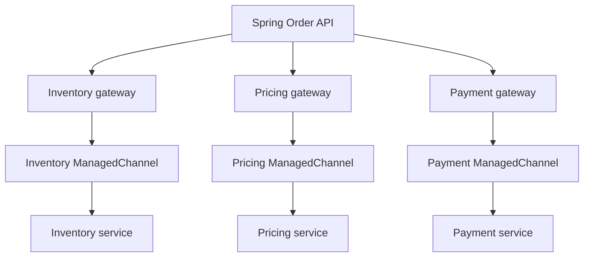

# Configuring Separate Channels Per Dependency

## 1. Objectives

A Spring gRPC application commonly calls multiple downstream services, such as Inventory, Pricing, Payment, or Notification. Each dependency may have its own target, TLS identity, load-balancing policy, retry policy, and operational lifecycle. Sharing a single channel across all dependencies makes connection policies hard to separate; creating a channel per request wastes resources.

The sensible goal is **one shared channel per logical dependency that has its own connection configuration**, created and managed within the application lifecycle. Multiple RPC methods or multiple stubs belonging to the same dependency can share that channel.

After this lesson, you will be able to:

- Identify which dependency boundaries require separate channels.
- Distinguish a dependency, an RPC service/method, a channel, and a request.
- Configure distinct targets and credentials per downstream service in Spring.
- Inject the right channel via constructor injection and qualifiers.
- Keep metadata, tokens, and deadlines scoped per RPC.
- Weigh isolation, resources, lifecycle, and per-dependency error observability.
- Test that one dependency failing leaves other dependencies operating normally.

## 2. Dependencies as Connection Configuration Boundaries

In this lesson, a **dependency** is a downstream gRPC service that the application calls as an operational unit: it has its own target, security policy, and independently managed connection settings.

For example, an Order API calls:

- `InventoryService` at `dns:///inventory.internal:8443`.
- `PricingService` at `dns:///pricing.internal:8443`.
- `PaymentService` at `dns:///payment.internal:9443`.

These dependencies may differ in DNS, certificates, mTLS, load balancing, keepalive, message size limits, and retry policies. Separating channels ensures each RPC group uses the right settings and exposes isolated state.



Each channel maintains its own resolver, load balancer, and connectivity state. For instance, Pricing can be in `TRANSIENT_FAILURE` while Inventory remains `READY`. Separating channels isolates client-side configuration and observability; it does **not** guarantee services avoid sharing underlying proxies, networks, DNS resolvers, or physical infrastructure.

## 3. When Should You Separate Channels?

Consider a dedicated channel whenever a dependency has at least one connection boundary requiring independent management:

| Difference Between Dependencies | Why a Separate Channel May Be Needed |
|---|---|
| Different target/authority or name resolver | Each channel must resolve and route to its matching destination |
| Different TLS trust roots or client certificates | TLS identity belongs to the transport connection |
| Different load-balancing or service configs | Each dependency may need distinct policies and retry behaviors |
| Different keepalive, idle timeout, or message limits | Avoids forcing one transport policy across all backends |
| Different channel-level interceptors or telemetry | Applies shared configuration accurately per dependency |
| Different lifecycles or maintainability needs | Enables observing, draining, or updating each dependency independently |

Do not split channels merely for two different methods if they call the same dependency, target, and transport policy. One channel can serve multiple service stubs at the same endpoint.

### When Can They Share?

If two generated services are hosted at the same target with the same TLS identity, resolver, load-balancing, and transport policy, they can share a single channel:

```java
ManagedChannel sharedChannel = NettyChannelBuilder
        .forTarget("dns:///platform.internal:8443")
        .useTransportSecurity()
        .build();

CatalogGrpc.CatalogBlockingStub catalogStub =
        CatalogGrpc.newBlockingStub(sharedChannel);
ProfileGrpc.ProfileBlockingStub profileStub =
        ProfileGrpc.newBlockingStub(sharedChannel);
```

You do not need one channel per generated stub. The boundary to evaluate is **connection configuration and lifecycle**, not the number of `*Grpc` classes.

## 4. Configuring Targets Per Dependency in Spring

Define separate targets in environment configuration:

```yaml
# application-prod.yml
app:
  grpc:
    inventory:
      target: dns:///inventory.internal:8443
    pricing:
      target: dns:///pricing.internal:8443
    payment:
      target: dns:///payment.internal:9443
```

The `app.grpc.*` namespace is application-defined configuration, not a default property set guaranteed by every Spring gRPC starter.

Declare one bean per dependency:

```java
package dev.example.orders.config;

import io.grpc.ManagedChannel;
import io.grpc.netty.shaded.io.grpc.netty.NettyChannelBuilder;
import org.springframework.beans.factory.annotation.Value;
import org.springframework.context.annotation.Bean;
import org.springframework.context.annotation.Configuration;

@Configuration(proxyBeanMethods = false)
public class DownstreamChannelConfiguration {

    @Bean(name = "inventoryChannel", destroyMethod = "shutdown")
    ManagedChannel inventoryChannel(
            @Value("${app.grpc.inventory.target}") String target) {
        return NettyChannelBuilder.forTarget(target)
                .useTransportSecurity()
                .build();
    }

    @Bean(name = "pricingChannel", destroyMethod = "shutdown")
    ManagedChannel pricingChannel(
            @Value("${app.grpc.pricing.target}") String target) {
        return NettyChannelBuilder.forTarget(target)
                .useTransportSecurity()
                .build();
    }

    @Bean(name = "paymentChannel", destroyMethod = "shutdown")
    ManagedChannel paymentChannel(
            @Value("${app.grpc.payment.target}") String target) {
        return NettyChannelBuilder.forTarget(target)
                .useTransportSecurity()
                .build();
    }
}
```

Each bean has a stable name for `@Qualifier` injection. TLS in this example uses the runtime's default trust configuration. If Payment requires mTLS or a custom CA, configure dedicated credentials/trust material for `paymentChannel`; never assume `useTransportSecurity()` loads client certificates automatically.

If the application uses a Spring gRPC starter that already creates channels, configure and inject channels via that starter version's API. Avoid inadvertently creating a second channel for the same dependency.

## 5. Injecting the Right Channel into Each Gateway

Each gateway receives only the channel for the dependency it calls:

```java
package dev.example.orders.gateway;

import dev.example.inventory.InventoryGrpc;
import dev.example.inventory.ReserveRequest;
import dev.example.inventory.ReserveReply;
import io.grpc.ManagedChannel;
import java.util.concurrent.TimeUnit;
import org.springframework.beans.factory.annotation.Qualifier;
import org.springframework.stereotype.Component;

@Component
public class InventoryGateway {
    private final InventoryGrpc.InventoryBlockingStub stub;

    public InventoryGateway(
            @Qualifier("inventoryChannel") ManagedChannel channel) {
        this.stub = InventoryGrpc.newBlockingStub(channel);
    }

    public ReserveReply reserve(String sku, int quantity) {
        ReserveRequest request = ReserveRequest.newBuilder()
                .setSku(sku)
                .setQuantity(quantity)
                .build();
        return stub.withDeadlineAfter(800, TimeUnit.MILLISECONDS)
                .reserve(request);
    }
}
```

The Pricing gateway receives `pricingChannel` and builds a Pricing stub. Never inject an unqualified `ManagedChannel` across gateways once the application declares multiple beans of type `ManagedChannel`.

Constructor injection makes dependencies explicit when Spring initializes beans. If a qualifier is missing or ambiguous, the application fails fast at startup rather than silently routing to the wrong backend at runtime.

## 6. Distinguishing Channel-Level Policy from Call-Level Policy

Separating channels per dependency does not mean every RPC property lives on the channel.

| Attribute | Appropriate Scope | Example |
|---|---|---|
| Target URI/resolver | Channel | `dns:///inventory.internal:8443` |
| TLS trust/client certificate | Channel/transport | Backend CA and mTLS identity |
| Load-balancing policy | Channel or service config | `round_robin`, `pick_first` |
| Channel-level interceptor | Channel | Dependency-wide tracing/telemetry |
| Deadline | RPC call | Inventory reserve 800 ms |
| Request ID/correlation ID | RPC metadata | Per-request `x-request-id` |
| User bearer token | RPC credentials/metadata | Current caller's token |
| Protobuf request/response | RPC | SKU and quantity to reserve |

Deadlines must be set per call or method policy as needed. Never create a separate channel simply because one request uses a 500 ms deadline and another uses 2 seconds.

Similarly, per-user tokens belong in per-RPC call credentials or metadata. Never store user tokens in a mutable field on a singleton gateway or create a channel per user.

Conversely, **client certificates and trust policies are transport properties**. If two dependencies need distinct TLS identities, separating channels is the right design because the handshake occurs at connection time before RPC metadata is sent.

## 7. Separating Security and Routing Configuration

Example across three dependencies:

| Dependency | Target | Security | Routing |
|---|---|---|---|
| Inventory | `dns:///inventory.internal:8443` | TLS with internal CA A | `round_robin` if DNS returns multiple endpoints |
| Pricing | `dns:///pricing.internal:8443` | TLS with internal CA A | `pick_first` |
| Payment | `dns:///payment.internal:9443` | mTLS with dedicated client certificate | Policy matching Payment infrastructure |

Apply the corresponding credentials and resolver when building each channel. Never replace hostnames with raw IPs to dodge certificate errors; service identity/SAN must match the verified name. With a service mesh or proxy, verify authority/SNI and where TLS terminates.

A failure in Payment must never cause the application to close the Inventory or Pricing channels. However, channels may still fail together if they share DNS, nodes, proxies, or physical networks during an outage.

## 8. Bounded Isolation and Resource Costs

Separate channels provide valuable operational boundaries:

- Each channel maintains its own connectivity state, resolver, and backoff.
- Credentials, service configs, and channel-level interceptors can be tailored independently.
- Metrics can be segmented by dependency to pinpoint which backend is failing.
- One dependency's channel can be updated or drained without closing the others.

In return, multiple channels can create more subchannels, sockets, TLS sessions, event-loop resources, and connections to shared infrastructure. Actual resource counts depend on resolvers, load balancers, and transports; one channel does not always map 1:1 to a single TCP socket.

**Never create channels per request, per user, or per RPC method.** Organize them by logical dependency and transport configuration. If a single dependency needs a pool of multiple channels for load limits or special isolation, keep the pool bounded, define a clear lifecycle, and justify it with benchmarks.

Do not use a channel pool to work around HTTP/2 multiplexing or load balancing. Inspect endpoint counts, LB policies, concurrent stream limits, server limits, and metrics first.

## 9. Lifecycle of Multiple Channels

Every channel needs a clear owner. With the Spring beans above, `destroyMethod = "shutdown"` initiates graceful shutdown on context close. When the application must await transport termination, use an owner/coordinator with a shutdown budget:

1. Stop accepting new work.
2. Let in-flight requests/streams drain within bounds.
3. Call `shutdown()` on all channels.
4. Wait for termination against a shared overall deadline rather than giving every channel the full timeout sequentially.
5. Call `shutdownNow()` on channels not yet terminated when grace expires.
6. Log any channels still unterminated after the final wait.

Never have individual gateways close a shared channel inside `@PreDestroy`. Gateways do not own that resource; the configuration or lifecycle coordinator does.

When targets or certificates must change at runtime, construct a new channel with the updated settings, shift traffic to the new channel, then drain and close the old channel. Never mutate shared fields expecting an active transport to reload certificates automatically.

## 10. Per-Dependency Observability

Attach metrics and logs to stable dependency names:

| Signal | Example Dimension | Purpose |
|---|---|---|
| Channel state | `dependency=inventory` | Identify which channel is `READY` / `TRANSIENT_FAILURE` |
| RPC count/status | `dependency=pricing, method=Quote` | Track failures by backend |
| RPC latency | `dependency=payment, method=Authorize` | Measure P95/P99 and timeouts |
| Retry attempts | `dependency=inventory` | Detect retry storms |
| In-flight streams | `dependency=notification` | Track streaming resource usage |
| TLS/connect errors | `dependency=payment` | Isolate credential or handshake issues |

Never use request IDs, user IDs, tokens, or dynamic socket addresses as metric labels, as cardinality can grow unboundedly. Traces can carry per-request correlation IDs; metrics should stick to low-cardinality dimensions.

If the Payment channel is in `TRANSIENT_FAILURE` while Inventory is `READY`, inspect Payment's DNS, certificates, proxy, and endpoints before touching other channels. State is only one signal; combine RPC statuses, cause chains, server logs, and Channelz if supported by your runtime.

## 11. Testing Channel Isolation

Integration tests should prove both that each gateway hits the right dependency and that one dependency failing does not cause the application to close remaining channels.

Sample scenario:

1. Start two test servers on dynamic ports: Inventory and Pricing.
2. Create a Spring context with `inventoryChannel` and `pricingChannel`.
3. Call an RPC through each gateway and confirm responses come from the expected servers.
4. Stop the Inventory server; call Inventory again and observe the error/state on `inventoryChannel`.
5. Call Pricing during the same window and verify it still succeeds.
6. Restart the Inventory server; verify `inventoryChannel` reconnects for new RPCs.
7. Close the Spring context; confirm both channels are released.

Example assertion structure:

```java
assertEquals("inventory", inventoryGateway.health());
assertEquals("pricing", pricingGateway.health());

inventoryServer.shutdownNow();

assertThrows(StatusRuntimeException.class,
        () -> inventoryGateway.health());

// The other dependency continues serving via its own channel.
assertEquals("pricing", pricingGateway.health());
```

This is an illustrative outline; `health()` and the test servers must be implemented in your project's test fixtures. Never assert a rigid status or exact reconnect timing unless the test controls deadlines and backoff. Use latches and deadlines instead of `Thread.sleep` for synchronization.

### Additional Cases

- Two generated services sharing a target and credentials: confirm they can share one channel.
- Two dependencies with different client certificates: confirm each channel uses the right TLS identity.
- Different deadlines and metadata across requests: confirm they never leak across calls.
- One dependency returns a business error while its channel stays `READY`: confirm the channel is not closed.
- Spring context shutdown: confirm owners close all channels within budget.
- Load testing: compare channel/socket counts, TLS handshakes, CPU, and P95/P99 before and after.

## 12. Common Pitfalls

| Symptom | Cause | Resolution |
|---|---|---|
| All gateways hit the same target | Default channel injected or wrong qualifier | Give beans distinct names and use constructor qualifiers |
| One backend error closes every channel | Shared owner closes channels when one call fails | Separate ownership per dependency; never shut down on RPC errors |
| Creating a channel per method | Confusing service stubs with transport boundaries | Share a channel whenever target and transport policy match |
| Creating a channel per request/user | Using channels to carry metadata | Use call-scoped metadata/credentials |
| Sharing a channel despite distinct mTLS identities | TLS identity configured at the wrong layer | Split channels by client certificate/trust policy |
| Creating many channels yet load stays uneven | Confusing channel count with load balancing | Inspect resolver, endpoints, and LB policy |
| Channels/sockets grow continuously | Old channels unclosed or unbounded dynamic channel creation | Manage lifecycles and cap pools |
| Metrics cannot pinpoint failing backend | Missing stable dependency dimension | Add a low-cardinality dependency label |

## 13. Hands-On Exercise

**Scenario:** an Order API calls Inventory, Pricing, and Payment. Inventory uses internal TLS, Pricing uses the same CA but requires `round_robin`, and Payment requires mTLS with a dedicated client certificate. Some methods have different deadlines, and every request carries a unique request ID.

Carry out the following:

1. Define dependency boundaries and list the target, credentials, LB policy, and channel-level interceptors needed for each service.
2. Declare three channel beans in Spring configuration, each with a clear qualifier and lifecycle owner.
3. Inject the right channel into each gateway; hold reusable stubs instead of creating channels inside methods.
4. Set per-RPC deadlines and metadata; never store tokens or request IDs in mutable gateway state.
5. Test an Inventory failure while Pricing keeps working; observe per-dependency states and statuses.
6. Test the Payment handshake with valid and invalid certificates; confirm TLS errors do not disturb Inventory or Pricing channels.
7. Close the Spring context and verify all three channels shut down/terminate within budget.
8. Measure resources and latency to decide whether any dependency genuinely needs a bounded pool.

**Completion Criteria:** Each channel represents a logical dependency with its own connection configuration; methods of the same dependency share a channel; metadata and deadlines remain per-RPC; TLS identities are separated at the proper layer; and lifecycles and failure observability are managed independently.

## 14. Key Takeaways

Organize channels by **logical dependency and transport configuration**, not per request or per RPC method. Spring can manage each channel as a distinct bean with an explicit qualifier while gateways reuse channels and stubs across calls. Splitting channels makes sense when targets, TLS identities, resolvers, load-balancing policies, or transport policies differ; attributes such as deadlines, request IDs, and bearer tokens still belong to individual RPCs. Dedicated channels isolate state and operations at the cost of extra resources, so keep channel counts bounded, manage shutdown cleanly, and verify isolation against real servers.
