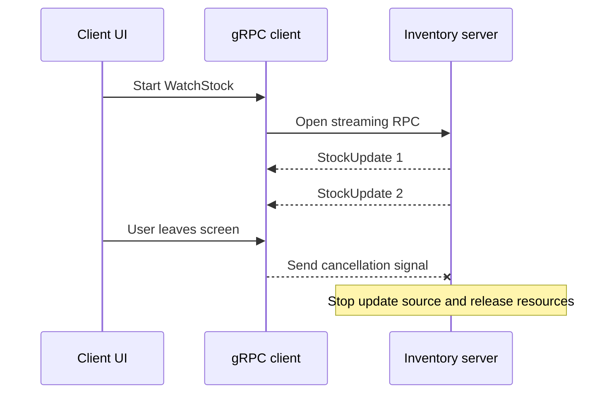

# CANCELLED and Client-Initiated Cancellation

In gRPC, **CANCELLED is status code 1**, indicating that an RPC was cancelled, typically because the caller actively cancelled it. A typical scenario is when a user leaves a screen that is watching data, the application no longer needs the result, or an upstream request is cancelled so downstream RPCs must also stop. Cancelling an RPC avoids continuing to consume resources for work that is no longer valuable.

However, cancellation is not a rollback. When the client cancels, the server may already have received the request, be processing it, or even have committed a transaction. The cancellation signal only tells the server that the client no longer wants to continue the RPC; the server must observe that signal and proactively stop whatever work can be stopped. Therefore, when developing with **SPRING_GRPC**, you need to understand the CANCELLED status, how cancellation propagates from client to server, streaming lifecycles, and the limits of cancellation.

## 1. Meaning of CANCELLED

gRPC defines CANCELLED with numeric value **1**. Its general meaning is that the operation was cancelled, typically by the caller. In gRPC Java, this status can be referenced via **io.grpc.Status.CANCELLED**.

| Perspective | Meaning |
| --- | --- |
| Client | The application proactively stops waiting for or cancels an RPC that is no longer needed |
| Server | The runtime notifies that the RPC was cancelled; the handler can stop related work |
| gRPC runtime | Stops normal RPC exchange and releases transport resources when possible |
| Business | Does not automatically undo changes that have already been made or committed |

CANCELLED is a terminal status at the **RPC level**. It does not describe why the user changed their mind, nor does it inherently carry business meanings such as "order cancelled" or "transaction refunded". If business logic needs to cancel an already-created order, you need a dedicated business method such as CancelOrder; you cannot replace that operation by cancelling an in-flight CreateOrder RPC.

## 2. When should the client actively cancel?

Some common scenarios:

- The user leaves a page or closes a screen that is tracking progress.
- The user changes search filters; results from the old query are no longer needed.
- A new operation supersedes the previous one.
- An upstream HTTP request was cancelled by the web client or timed out, so the backend does not need to continue downstream RPCs.
- A streaming RPC no longer has a subscriber.
- The application is shutting down and needs to stop active calls according to policy.

For example, Order Service starts calling Inventory to watch stock updates. The user navigates to another screen before the stream ends. Continuing to receive data and query the database for a closed screen only wastes resources.



The client cancels because **it no longer needs the result**, not to report that business logic on the server failed.

## 3. Client cancellation differs from deadlines and server errors

Three situations can cause server-side work to stop, but their causes and observed statuses differ:

| Scenario | Cause | Status typically seen on client |
| --- | --- | --- |
| Client actively cancels | The application calls a cancellation API or the context is cancelled | CANCELLED |
| Deadline expires | RPC duration exceeds the configured deadline | DEADLINE_EXCEEDED |
| Server actively returns an error | The handler finishes with an error status | Status returned by the server, e.g. INVALID_ARGUMENT, NOT_FOUND, INTERNAL |
| Connection drops unexpectedly | Network, proxy, or process encounters a failure | May be UNAVAILABLE or an appropriate transport error |

### 3.1. CANCELLED does not mean DEADLINE_EXCEEDED

A deadline is a pre-configured time limit. When the deadline expires, the client receives DEADLINE_EXCEEDED; the runtime also cancels server-side work if possible. Client cancellation is an active decision to stop an RPC before needing its result, for example because the user left the screen.

Both cases can cause the server to receive a cancellation signal. However, the client needs to distinguish the cause so telemetry and application behavior are accurate: a timeout may indicate latency exceeding an SLO, whereas cancellation because a user switched screens may be normal behavior.

### 3.2. CANCELLED is not a business error returned by the server

If the server receives an invalid request, the handler should return a status such as INVALID_ARGUMENT. If the server cannot find a resource and the contract specifies that as an error, it can return NOT_FOUND. CANCELLED normally indicates the RPC was stopped by the caller or an external context, and should not be used in place of every situation where the server wants to stop processing.

## 4. Actively cancelling in a Java client

gRPC Java offers multiple client APIs. How you cancel depends on the stub type and how the application manages calls.

### 4.1. Using a cancellable Context for async RPCs

A common approach is to create a Context.CancellableContext, start the RPC inside that context, and then cancel the context when the application no longer needs the result:

```java
Context.CancellableContext callContext =
    Context.current().withCancellation();

callContext.run(() -> {
    inventoryStub.watchStock(request, new StreamObserver<StockUpdate>() {
        @Override
        public void onNext(StockUpdate update) {
            // Update the UI or process the message.
        }

        @Override
        public void onError(Throwable error) {
            // Classify CANCELLED, DEADLINE_EXCEEDED, or other errors.
        }

        @Override
        public void onCompleted() {
            // Server finished the stream normally.
        }
    });
});

// Call when the user leaves the screen or no longer needs the stream.
callContext.cancel(new CancellationException("No longer need to watch"));
```

An RPC started inside the context receives cancellation when the context is cancelled. The application must keep the context tied to the right operation or screen so it does not accidentally cancel other RPCs. Once the stream completes or errors, clean up/manage the context according to the call's lifecycle.

### 4.2. Future stub

For a unary RPC using a future stub, the application can cancel the future if it no longer needs the result:

```java
ListenableFuture<CheckStockReply> result =
    inventoryFutureStub.checkStock(request);

// When the user action is superseded:
result.cancel(true);
```

Cancelling the future is translated by the gRPC integration into cancellation of the corresponding call. Do not mistake cancel(true) for a guarantee that every running database operation on the server is immediately interrupted; the server still has to cooperate with cancellation.

### 4.3. Blocking stub requires careful consideration

A blocking stub makes the calling thread wait for a response. If you need to cancel a blocking call, the application should configure a deadline or use a Context.CancellableContext attached when starting the call. Do not spawn an unmanaged thread per RPC just so you can interrupt that thread.

In a Spring WebFlux application or event-loop environment, avoid calling a blocking stub directly on the event loop. You can use the async/future API or offload the blocking call to an appropriate scheduler/executor and manage cancellation end-to-end.

## 5. How does the server know the client cancelled?

The server must not assume the handler will always run all the way to onCompleted. When the client cancels, the gRPC runtime can notify the server of the cancellation. In gRPC Java, you can use ServerCallStreamObserver to check the state and register a callback:

```java
ServerCallStreamObserver<StockUpdate> serverObserver =
    (ServerCallStreamObserver<StockUpdate>) responseObserver;

serverObserver.setOnCancelHandler(() -> {
    // Stop the subscription or background work attached to this RPC.
    stockSubscription.cancel();
});

if (serverObserver.isCancelled()) {
    return;
}
```

stockSubscription represents the update source subscription that the application created specifically for the current RPC. The example above focuses on the cancellation hook; in real code you need to handle races between creating the subscription and the client cancelling, and ensure the subscription is cancelled exactly once.

For long-running work on the server, you can monitor cancellation via Context or the corresponding server call API. Upon receiving the signal, the handler needs to:

1. Stop emitting new messages.
2. Cancel any cancellable subscriptions, timers, queries, or background tasks.
3. Release buffers and resources attached to the RPC.
4. Do not call onNext or onCompleted after the call has been cancelled.
5. Record cancellation properly in telemetry rather than treating every cancellation as a server error.

## 6. Cancellation must be handled cooperatively

The client sending a cancellation does not mean CPU work, threads, or database queries on the server stop immediately. Cancellation is a signal; server code must observe and react to it.

Example processing flow:

```text
Client:
  1. Start WatchStock
  2. Receive a few updates
  3. Cancel RPC

Server:
  1. Runtime marks the call as cancelled
  2. Cancellation handler is invoked
  3. Application cancels the producer / background task
  4. Work stops at a cancellable point
  5. RPC resources are released
```

If the handler is running a computation loop, it needs to check the cancellation state or handle interrupts. If it is subscribed to events, it needs to unsubscribe. If it is waiting on a downstream API, it needs to propagate cancellation or the deadline to that API when possible.

A handler that ignores cancellation can keep querying the database or emitting data into a cancelled observer. This wastes resources and produces confusing error logs.

## 7. Cancelling streaming RPCs: pay special attention to data sources and buffers

Streaming is typically where cancellation yields the clearest benefits because an RPC can be long-lived and maintain a subscription.

For example, WatchStock subscribes to stock updates:

```protobuf
service InventoryService {
  rpc WatchStock(WatchStockRequest) returns (stream StockUpdate);
}

message WatchStockRequest {
  string sku = 1;
}

message StockUpdate {
  string sku = 1;
  int32 remaining = 2;
}
```

When the client cancels, the server must stop the subscription for that specific client. Do not cancel a shared data source used by other clients. Each RPC should have its own handle or subscription, while the shared event source can continue serving remaining active subscribers.

### Flow control and cancellation are two different mechanisms

- **Flow control/readiness** helps the server pace message sending when the client or transport is not yet ready to receive more.
- **Cancellation** signals that the RPC no longer needs to continue.

A client that reads slowly has not necessarily cancelled; the server may need to wait for readiness or bound its buffer. For a client that has cancelled, the server should stop producing messages for that call. Do not use a full buffer as a substitute for cancellation.

## 8. Cancelling an RPC does not roll back a transaction

This is the most important limitation to remember.

Suppose the client calls ReserveStock:

1. The server receives the request.
2. The server deducts inventory in the database.
3. The database commits successfully.
4. The client actively cancels or the connection closes before receiving the response.

The business outcome has already been committed. Cancellation does not automatically roll back the transaction and does not restore the deducted stock. The client may not know the outcome, so a status lookup API or idempotency key is needed if retrying safely is required.

If business logic genuinely needs to **cancel a stock reservation**, provide a separate operation such as ReleaseReservation(reservation_id). This is a business command with authorization, state, and consistency checks; it is not the same as cancelling a pending RPC.

| Action | Meaning |
| --- | --- |
| Cancel the ReserveStock RPC | The client stops waiting for the call's result |
| Server stops unfinished work | Cooperative cancellation; may stop work that is still cancellable |
| Transaction rollback | Undoes changes inside an uncommitted transaction via the database mechanism |
| ReleaseReservation | Business operation to release an already-created reservation |

## 9. Cancellation and related statuses

| Status | Meaning | Example |
| --- | --- | --- |
| CANCELLED | RPC was cancelled, typically by the caller | User leaves a streaming screen |
| DEADLINE_EXCEEDED | RPC did not finish before the deadline | Client sets 300 ms, but server responds more slowly |
| UNAVAILABLE | Service is temporarily unable to serve or connection failed | Server stopped or network/proxy failed |
| INTERNAL | Unexpected internal error | Handler encountered an unhandled error |
| OK | RPC completed normally | Server finished sending response/stream |

Do not retry CANCELLED like a normal transient error. If the cancellation came from a user who no longer needs the result, retrying goes against that intent. If the application actively cancelled for another reason and later needs the result, issue a new call as an explicit decision of the business layer.

## 10. Observing cancellation without false alarms

In systems with streaming or frequent UI changes, cancellation can be normal behavior. Dashboards should distinguish:

- Number of cancelled RPCs by service/method.
- Source of cancellation: user, parent request, deadline, shutdown, or internal logic if the application records it.
- RPC lifetime before cancellation.
- Whether resources were released and background work stopped.
- Abnormal cancellation rates by client or workload.

Do not lump every CANCELLED into the same bucket as server errors. A rising rate may reflect new UI behavior, or it could indicate upstream timeouts or clients closing connections too early. Trace/correlation IDs help link the cancellation event to the parent request.

Avoid logging tokens, sensitive data, or full request payloads in cancellation logs. Information such as method, duration, status code, and a normalized reason is usually sufficient for diagnosis.

## 11. Testing cancellation

A test that only verifies the client called cancel() does not prove the server stopped its work. You should test both sides:

| Test | What to verify |
| --- | --- |
| Client cancels unary async call | Client receives the appropriate cancellation status and stops processing the response |
| Client cancels server stream | Server receives the cancellation callback |
| Server has background task | Task/subscription is stopped or interrupted at a cancellable point |
| Client cancels after a few messages | Server stops generating messages for that call |
| Deadline expires | Distinguish DEADLINE_EXCEEDED from user-initiated cancellation |
| Cancel after transaction commit | Do not assume data was rolled back |
| Multiple clients subscribed concurrently | Cancelling one subscriber does not affect other subscribers |
| Server shutdown | Active calls are drained/cancelled according to policy |

With gRPC Java, tests can use the in-process transport to verify handlers and cancellation callbacks. You still need tests over a real transport when verifying HTTP/2, proxies, TLS, or deployment environment shutdown behavior.

## 12. Common mistakes

| Mistake | Consequence | Mitigation |
| --- | --- | --- |
| Treating CANCELLED as a server error | False alarms and unnecessary retries | Classify by cancellation source and context |
| Thinking client cancel immediately stops the database | Queries/tasks keep running, wasting resources | Propagate cancellation down to cancellable layers |
| Treating cancellation as a rollback | Committed data still remains | Use idempotency and compensating business commands |
| Retrying immediately after cancellation | Re-executes work the user abandoned | Only create a new call when business logic still needs it |
| Not cancelling streaming subscriptions | Leaks subscribers, buffers, or tasks | Register a cancellation handler and unsubscribe |
| Cancelling a shared event source | Impacts other clients | Manage per-RPC subscriptions independently |
| Ignoring races when registering callbacks | Work keeps running after the call was cancelled | Check state before/after creating the task and make cleanup idempotent |
| Testing only the client side | Unknown whether the server actually stopped | Verify server callbacks, tasks, and resources |

## 13. Client cancellation design checklist

Before introducing cancellation to an RPC, determine:

1. **Who owns the call lifecycle?** UI, parent HTTP request, job, or another service?
2. **What conditions trigger cancellation?** User leaving the screen, action superseded, or shutdown?
3. **In what context is the call created?** Can the right call be cancelled without affecting other RPCs?
4. **How does the server observe cancellation?** ServerCallStreamObserver, gRPC Context, or integration API?
5. **What work can be stopped?** Subscriptions, tasks, queries, buffers, or downstream calls?
6. **Are there committed side effects?** If so, what is the lookup or business compensation mechanism?
7. **Is cancellation distinguished from deadlines?** Status and telemetry must reflect the true cause.
8. **Do tests verify server cleanup?** Not just checking that the client called cancel.

## 14. Takeaways

CANCELLED is gRPC status code 1, typically appearing when the caller actively cancels an RPC. The client can cancel because it no longer needs the result; the gRPC runtime propagates the cancellation signal to the server when possible. The server must cooperate by stopping tasks, cancelling subscriptions, ceasing message emission, and releasing resources tied to the call.

CANCELLED is distinct from DEADLINE_EXCEEDED, distinct from server-returned errors, and especially **is not a rollback**. If an operation has already committed, data may still have changed. In Spring gRPC, bind call lifecycles to the appropriate context, handle cancellation in server handlers, design streaming cleanup, and test both client and server. Doing these things properly helps applications avoid wasted work while preserving business correctness.

### References

- [gRPC – Cancellation](https://grpc.io/docs/guides/cancellation/)
- [gRPC – Status codes](https://grpc.io/docs/guides/status-codes/)
- [gRPC Java – Context](https://grpc.github.io/grpc-java/javadoc/io/grpc/Context.html)
- [gRPC Java – ServerCallStreamObserver](https://grpc.github.io/grpc-java/javadoc/io/grpc/stub/ServerCallStreamObserver.html)
- [gRPC – Deadlines](https://grpc.io/docs/guides/deadlines/)
