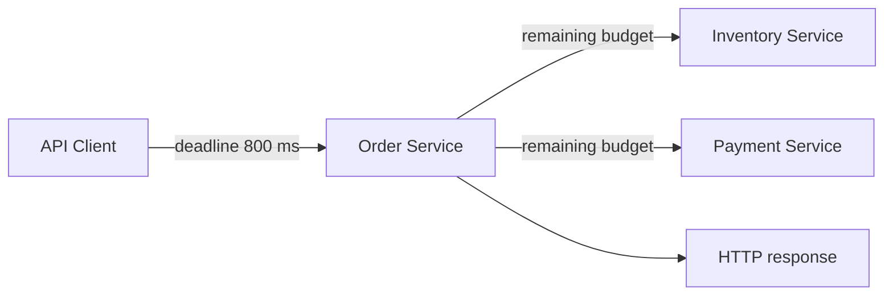
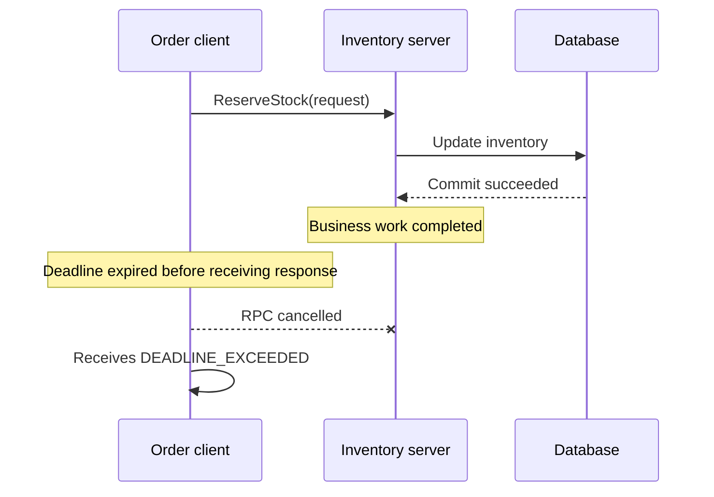

# DEADLINE_EXCEEDED

In gRPC, **`DEADLINE_EXCEEDED` is status code `4`**, indicating that an RPC did not complete before the deadline set by the caller. A deadline limits how long a call is allowed to consume resources and helps services coordinate within the same latency budget. When a deadline expires, the client does not receive the result in time; gRPC also propagates a cancellation signal to the server when possible.

The key point to remember is that **a timeout does not prove the server has not executed the business operation**. The server may already have committed a transaction while the response arrived late or was lost. In **SPRING_GRPC**, you should set deadlines on the client, propagate the remaining budget across downstream calls, let the server cooperate with cancellation, and design idempotency for operations with side effects.

## 1. Meaning of DEADLINE_EXCEEDED

`DEADLINE_EXCEEDED` has the numeric value **4**. This status typically appears when an RPC does not finish within the time allowed by the caller.

| Perspective | Meaning |
| --- | --- |
| Client | Did not receive a result before the configured deadline |
| Server | The RPC may be cancelled when the caller's deadline expires; application work should cooperate to stop |
| gRPC runtime | Tracks the call's deadline and terminates the RPC when the allowed time runs out |
| Business | Cannot conclude from the status alone that the operation did not run or commit |

A deadline is part of RPC semantics. It is not merely how long a single thread waits on the client. A call with a finite deadline sets a limit for the entire RPC duration, including request transmission, queuing, server processing, and returning the response.

## 2. Distinguishing deadline and timeout

The two concepts are related but viewed from different angles:

- **Deadline** is the absolute point in time by which the RPC must finish.
- **Timeout** is typically the maximum wait duration configured or observed by the application.

For example, a client starts an RPC at 10:00:00 and sets a 300 ms timeout. The corresponding deadline is roughly 10:00:00.300. If the request sits in a queue for 100 ms before being processed, the server only has about 200 ms left in the budget.

In gRPC Java, the common API is `withDeadlineAfter`:

```java
CheckStockReply reply = inventoryStub
    .withDeadlineAfter(300, TimeUnit.MILLISECONDS)
    .checkStock(request);
```

The number 300 ms is just an example. A deadline belongs to a specific call; there is no need to create a new channel for each deadline. Derived stubs can carry different call options while sharing the same `ManagedChannel`.

### 2.1. Why not rely solely on Future.get(timeout)?

An application might call `future.get(300, MILLISECONDS)` to limit how long a thread blocks. However, timing out a Java wait operation does not automatically mean a deadline was sent to the gRPC server. If the application merely stops waiting without cancelling the future/call, the RPC may keep running and consuming resources.

Set the deadline on the stub/call so the gRPC runtime knows the time limit. If the caller no longer needs the result for another reason, proactively cancel the corresponding call or future.

## 3. End-to-end deadline budget

A request in a Spring system can traverse multiple services. For example, Order Service calls Inventory and then Payment before returning a result to the client.



Do not set a separate 800 ms timeout for each downstream call if the overall request only has an 800 ms budget. Two sequential calls can push the total duration past the original request's limit.

Allocate the budget instead:

```text
Request budget:                 800 ms
  Order processing & response:  100 ms
  Inventory RPC:                250 ms
  Payment RPC:                  300 ms
  Queue/network reserve:        150 ms
```

This is an allocation example, not a fixed formula. Real budgets should be based on p95/p99 latency, SLAs, hop count, degree of parallelism, and the time needed to send the response.

### 3.1. Do not reset the full timeout at every hop

When receiving an RPC with a deadline, a downstream service should use the **remaining time** rather than granting a fresh full timeout from scratch. If the parent request already consumed 500 ms out of an 800 ms budget, the next service should not be granted another 800 ms.

In gRPC Java, the deadline can be read from the current Context:

```java
Deadline parentDeadline = Context.current().getDeadline();

if (parentDeadline != null) {
    long remainingNanos =
        parentDeadline.timeRemaining(TimeUnit.NANOSECONDS);

    long responseReserve =
        TimeUnit.MILLISECONDS.toNanos(25);
    long childBudget = remainingNanos - responseReserve;

    if (childBudget <= 0) {
        throw Status.DEADLINE_EXCEEDED
            .withDescription("Insufficient budget to call downstream")
            .asRuntimeException();
    }

    CheckStockReply reply = inventoryStub
        .withDeadlineAfter(childBudget, TimeUnit.NANOSECONDS)
        .checkStock(request);
}
```

This illustration assumes execution inside a gRPC Context with a deadline and separate handling when no deadline is set. Reserve time for the aggregation and response steps. gRPC Java's propagation depends on which Context the call is created in; check your integration and test in practice rather than assuming every asynchronous task automatically carries Context across threads.

## 4. How the server reacts when a deadline expires

When a deadline expires, the client usually receives `DEADLINE_EXCEEDED`. The server may receive a call cancellation signal. However, application code must cooperate to stop cancellable work:

- Do not start additional queries or downstream calls if the RPC is already cancelled.
- Cancel subscriptions, timers, or background tasks bound to the RPC.
- Propagate deadlines/cancellations to downstream APIs that support them.
- Stop emitting messages to a cancelled stream.
- Release buffers and resources following the call lifecycle.

In gRPC Java, `Context.current()` during execution can be used to check cancellation. For streaming handlers, `ServerCallStreamObserver` provides APIs such as `isCancelled()` and `setOnCancelHandler(...)`.

Illustrative example for server streaming:

```java
ServerCallStreamObserver<StockUpdate> serverObserver =
    (ServerCallStreamObserver<StockUpdate>) responseObserver;

serverObserver.setOnCancelHandler(() -> {
    stockSubscription.cancel();
});

if (serverObserver.isCancelled()) {
    return;
}
```

`stockSubscription` is the subscription dedicated to the current RPC. Production code must handle races between creating the subscription and the call being cancelled; cleanup must be safe when triggered nearly concurrently from multiple paths.

### 4.1. Deadlines do not automatically stop all work

If the server is running a long CPU loop without checking cancellation, work can continue after the client's deadline has expired. If the server calls a database API that does not support cancellation, the query can likewise continue until the database finishes or hits its own timeout.

Therefore, coordinate:

- gRPC deadline for the whole RPC;
- database/HTTP client timeouts for each downstream operation;
- appropriate cancellation tokens or interrupts for background tasks;
- transaction timeouts if required by business logic/database;
- concurrency and queue limits to avoid accepting more work than can be processed.

These limits are related, but they do not automatically align. Each layer must be configured and tested.

## 5. DEADLINE_EXCEEDED does not prove the operation did not complete

This is the scenario most likely to cause data bugs:



In this example, the client did not receive the response in time, yet the server already committed. If the client automatically sends a new request, inventory may be reserved a second time.

For write operations, you need one of these approaches:

1. **Idempotency key:** send the same request ID for retries belonging to the same operation.
2. **Status lookup:** provide a method to query the result by operation/request ID.
3. **Reconciliation:** if the outcome cannot be determined immediately, handle it via a business workflow instead of retrying blindly.

Contract example:

```protobuf
message ReserveStockRequest {
  string request_id = 1;
  string sku = 2;
  int32 quantity = 3;
}

message ReserveStockReply {
  string reservation_id = 1;
  bool reserved = 2;
}
```

Merely adding `request_id` is not enough. The server must store and process the request ID atomically with the side effect, handle two identical requests arriving concurrently, and return the stored result when the same ID is received again.

## 6. Distinguishing DEADLINE_EXCEEDED from nearby statuses

| Status | Meaning | Example |
| --- | --- | --- |
| `DEADLINE_EXCEEDED` | RPC did not complete before the deadline | Server takes longer than the client's deadline |
| `CANCELLED` | RPC was cancelled, typically by the caller | User leaves the screen and the client actively cancels |
| `UNAVAILABLE` | Service temporarily unable to serve or connection unusable | Server not ready or proxy lost connection |
| `INTERNAL` | Unexpected internal error | Handler hit an invariant violation |
| `UNKNOWN` | Not enough information to classify the error specifically | Exception was not explicitly mapped |
| `RESOURCE_EXHAUSTED` | Out of quota or resources | Server rejected due to concurrency/quota limits |

Clients must distinguish timeouts from user-initiated cancellations. A rising `DEADLINE_EXCEEDED` rate may signal latency or capacity issues; a rising `CANCELLED` rate may reflect UI behavior or parent requests being cancelled.

## 7. Retrying when a deadline expires

Retrying is not the default fix for every `DEADLINE_EXCEEDED`. Before retrying, the client needs to know:

- Does the method have side effects or is it read-only?
- If the server already committed but the response was lost, is a repeat request safe?
- Is there enough total deadline remaining for a new attempt?
- Is the server overloaded so retries will worsen the queue?
- Are backoff and jitter in place to prevent many clients from retrying simultaneously?
- Can status be queried instead of re-executing?

| Operation type | Handling approach |
| --- | --- |
| Read-only query | May retry with bounds if total deadline remains and result is still useful |
| Write with idempotency key | May resend with the same key per contract and policy |
| Non-idempotent write | Do not retry blindly; look up or reconcile state |
| Streaming | Determine received messages, cursor/sequence, and resume capability |
| Sequential downstream calls | Reallocate budget; do not grant a full timeout to each hop |

If the deadline has already expired on the parent request, starting a new RPC usually makes no sense. The client or service must respect the remaining budget instead of generating additional work.

## 8. Deadlines with streaming RPCs

A deadline applies to the entire RPC, not to each individual message. A server stream lasting 30 minutes will hit the deadline if the client only granted 5 minutes, even if the server sends updates steadily.

For long-lived streams:

- Choose a deadline suited to the session lifecycle, not so short that it causes constant reconnects.
- If a session needs to live longer, design reconnect and resume at the application layer.
- Use a sequence/cursor so the client resumes from where it left off.
- Cancel subscriptions and release buffers when the deadline expires.
- Consider heartbeats or dead-connection detection; heartbeats do not replace deadlines.

Do not set an infinite deadline just to keep a stream alive. Long-lived streams need resource limits, reconnect policies, and drain capability during server shutdown.

## 9. Integrating deadlines in Spring gRPC

Spring manages beans and application configuration; deadlines belong to each gRPC call. A stub bean can be reused, and derived stubs with per-method deadlines created from it:

```java
@Component
public class InventoryGateway {
    private final InventoryServiceGrpc.InventoryServiceBlockingStub stub;

    public InventoryGateway(
            InventoryServiceGrpc.InventoryServiceBlockingStub stub) {
        this.stub = stub;
    }

    public CheckStockReply checkStock(CheckStockRequest request) {
        return stub
            .withDeadlineAfter(250, TimeUnit.MILLISECONDS)
            .checkStock(request);
    }
}
```

This example assumes the stub/channel is configured by Spring or a starter. The 250 ms deadline is a policy of this call; it is not `server.port`, an HTTP request timeout, or a Spring transaction timeout.

When a Spring handler calls downstream, do not start a new call with a full budget if the inbound request has already consumed most of its time. Use the remaining deadline from gRPC Context or an explicitly passed deadline budget. If work runs on a separate executor, ensure Context/cancellation is propagated in a way supported by the API and executor.

### 9.1. Do not confuse different timeout types in the application

| Timeout | Scope |
| --- | --- |
| gRPC deadline | A single RPC from client to server |
| HTTP request timeout | A request passing through a web server/gateway |
| Database query timeout | A single query operation |
| Transaction timeout | Allowed duration of a transaction |
| Executor/queue timeout | Time spent waiting to execute |
| Connection timeout | Time spent establishing a connection |

These limits must be coordinated. For instance, a database timeout should not be much longer than the RPC's remaining deadline if the database result is no longer useful once the caller has expired.

## 10. Testing DEADLINE_EXCEEDED

A test suite should verify both client-side status and server-side cleanup behavior:

| Scenario | What to verify |
| --- | --- |
| Server responds before deadline | Client receives response and status `OK` |
| Server processes slower than deadline | Client receives `DEADLINE_EXCEEDED` |
| Inbound deadline nearly exhausted when calling downstream | Child call uses remaining budget, does not reset timeout |
| Server receives cancellation | Cancellable tasks/subscriptions are stopped |
| Client times out after database commit | Do not assume transaction rolled back |
| Retrying write operation | Same idempotency key does not create duplicate side effects |
| Streaming deadline expires | Stream ends, producer and buffers are cleaned up |
| Server restarts while call is running | Client classifies status and handles per policy |

In-process gRPC tests are useful for verifying deadlines and handler logic, but do not replace tests over a real transport for network, proxies, TLS, and shutdown. With Spring, also test Context propagation when calling downstream via executors or async APIs.

## 11. Observing deadlines in production

Do not just count occurrences of `DEADLINE_EXCEEDED`. Monitor:

- Timeout rate by service/method and client.
- p50/p95/p99 latency compared to allocated deadlines.
- Remaining deadline budget when starting downstream calls.
- Queue, handler, database, and dependency durations.
- Number of RPCs cancelled after deadline expiration.
- Timeout rates by application version and environment.
- For streaming: stream lifetime, termination reasons, and active stream count.

Use traces to identify which hop consumes the budget. Metrics should use controlled-cardinality labels like service/method/status; do not put request IDs, tokens, or user data in metric labels. Logs may include deadline budgets and trace IDs, but never credentials.

If timeouts cluster on one method, investigate that method's handler and dependencies. If many methods time out together, inspect capacity, thread pools, network, database, and proxies. Do not simply raise deadlines to mask an overloaded system; raising deadlines can keep more requests waiting longer and hold onto resources longer.

## 12. Common design mistakes

| Mistake | Consequence | Better practice |
| --- | --- | --- |
| Not setting a deadline | RPCs can hang and hold resources | Set deadlines based on SLA and request budget |
| Granting a full timeout at every hop | Total duration exceeds parent deadline | Use remaining time and keep a response reserve |
| Using only `Future.get(timeout)` | Thread stops waiting, but RPC may keep running | Set deadline on gRPC call and cancel when no longer needed |
| Assuming `DEADLINE_EXCEEDED` means server did not commit | Retries can duplicate side effects | Idempotency keys and status lookup |
| Infinite retries on timeout | Retry storms and cascading overload | Backoff, jitter, limits, and idempotency checks |
| Not propagating cancellation downstream | Work continues even after caller expires | Cooperate with cancellation in handlers and dependencies |
| Setting short deadlines for long streams | Constant reconnects, poor efficiency | Design sessions, cursors, and resume |
| Only increasing deadlines when timeouts rise | Masks queue/capacity bottlenecks | Measure per-hop latency and fix the root cause |

## 13. Deadline design checklist

Before publishing a gRPC method, determine:

1. **What is the total budget?** Based on SLA and actual latency.
2. **How much time does each downstream call get?** Leave budget for processing and response.
3. **Is the deadline propagated?** Verify Context propagation across threads/executors.
4. **How does the server stop work?** Cancel cancellable tasks, subscriptions, and downstream calls.
5. **Are there side effects?** If so, prepare idempotency and status queries.
6. **Is there budget left for retries?** Do not start retries after the parent request has expired.
7. **How long do streams live?** Design reconnect/resume instead of infinite streams.
8. **Does telemetry reveal slow hops?** Measure latency and remaining budget.
9. **Do tests simulate timeout after commit?** Verify no duplicate data is created.

## 14. Takeaways

`DEADLINE_EXCEEDED` is gRPC status code `4`, indicating that an RPC did not complete before the deadline. Deadlines should be set on the client according to an end-to-end budget, propagated downstream using remaining time, and combined with cancellation so the server stops work that is no longer useful.

This status **does not prove the server has not performed the business operation**: a transaction may already have committed while the response was delayed or lost. For write operations, use idempotency keys or status lookups before retrying. In Spring gRPC, deadlines belong to individual calls, whereas HTTP timeouts, database timeouts, and transaction timeouts are separate limits that must work together. Monitoring per-hop latency and testing both cleanup and business outcomes helps services respond on time without sacrificing consistency.

### References

- [gRPC – Deadlines](https://grpc.io/docs/guides/deadlines/)
- [gRPC – Cancellation](https://grpc.io/docs/guides/cancellation/)
- [gRPC – Status codes](https://grpc.io/docs/guides/status-codes/)
- [gRPC Java – Deadline](https://grpc.github.io/grpc-java/javadoc/io/grpc/Deadline.html)
- [gRPC Java – Context](https://grpc.github.io/grpc-java/javadoc/io/grpc/Context.html)
- [gRPC – Retry](https://grpc.io/docs/guides/retry/)
