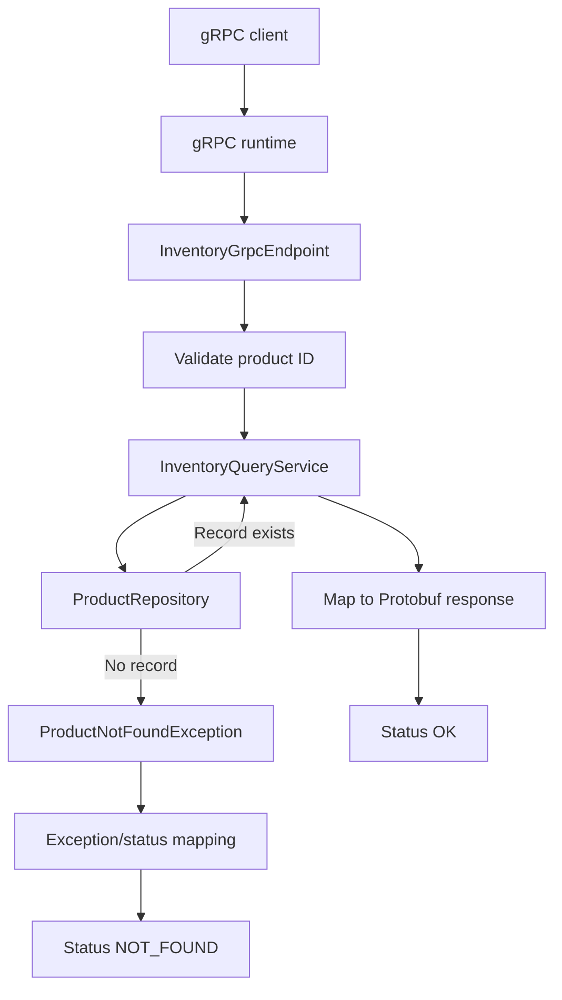

# NOT_FOUND

In gRPC, **NOT_FOUND is status code 5**, used when the resource that a method is looking for or operating on does not exist within the scope defined by the API. For example, a client requests product details using a syntactically valid SKU, but the system has no such product. The server can terminate the RPC with NOT_FOUND so the client understands that the target resource was not found.

What matters is distinguishing **resource does not exist** from **invalid request**, **insufficient permissions**, **current state does not allow the operation**, and **a valid query returning no results**. In SPRING_GRPC, Protobuf defines identifiers and messages, the Spring application service/repository performs the lookup, and the gRPC status conveys the RPC-level outcome. Proper mapping helps clients react accurately and avoids turning every empty result into an error.

## 1. Meaning of NOT_FOUND

NOT_FOUND has the numeric value **5**. This status applies when the resource identified by the request does not exist or cannot be found according to the method's contract.

| Perspective | Meaning |
| --- | --- |
| Client | The target resource was not found within the API's lookup scope |
| Server | The lookup or resource-resolving operation did not find the required object |
| gRPC runtime | Terminates the RPC with status NOT_FOUND |
| Business | No resource matches the identifier/conditions that the method promises to handle |

For example:

- GetProduct(product_id) receives a valid ID, but there is no matching product.
- GetOrder(order_id) finds no order within the caller's tenant scope.
- GetReservation(reservation_id) finds no reservation.
- DeleteDocument(document_id) is called for a nonexistent document, if the contract specifies that case as an error.

NOT_FOUND is not a connectivity error, does not mean the database is down, and does not necessarily indicate the underlying reason why the resource is missing. It describes the operation's outcome under the contract.

## 2. Valid identifier, nonexistent resource

Distinguish two steps:

1. **Validate identifier format:** does the request contain a structurally valid ID/SKU?
2. **Look up the resource:** does a resource corresponding to that identifier exist?

For example, with product_id:

- Blank string or malformed UUID: can be INVALID_ARGUMENT.
- Well-formed UUID with no matching record: NOT_FOUND.
- Product exists, but caller is not allowed to view it: normally PERMISSION_DENIED, or the API may intentionally return NOT_FOUND to avoid disclosing existence.

NOT_FOUND typically occurs **after the request has passed validation**. If the input format is invalid, the server does not need to query the database.

## 3. Resource not found differs from a query returning an empty list

This is an important contract decision. The same database having zero records can result in an OK response or a NOT_FOUND status, depending on method semantics.

| Method | Outcome when no records exist | Usually appropriate representation |
| --- | --- | --- |
| GetProduct(product_id) | No product with that ID | NOT_FOUND |
| ListProducts(filter) | No products match the filter | OK response with an empty list |
| SearchOrders(query) | No matching orders | OK response with zero results |
| GetLatestInvoice(account_id) | No invoices exist yet | Can use NOT_FOUND or a response with presence/optional result, per contract |
| GetRequiredConfiguration(key) | Required configuration is missing | Can be NOT_FOUND or FAILED_PRECONDITION depending on method intent |

Guidelines:

- If the method asks for **one specific resource**, a missing resource is usually NOT_FOUND.
- If the method asks to **search for a set of results**, an empty set is normally a valid outcome with OK.
- If "no result yet" is a normal domain state, consider representing it explicitly in the response instead of using an error.

Do not return NOT_FOUND for an empty list merely because a database query returned zero rows. Start from the API semantics the client needs to understand.

## 4. Distinguishing NOT_FOUND from easily confused statuses

| Status | Meaning | Example |
| --- | --- | --- |
| NOT_FOUND | Target resource does not exist/was not found | Valid product ID, but no record exists |
| INVALID_ARGUMENT | Invalid request argument | Malformed ID or blank required field |
| PERMISSION_DENIED | Caller lacks permission for the operation | User is not allowed to read another tenant's document |
| UNAUTHENTICATED | Caller identity cannot be verified | Token missing or invalid |
| FAILED_PRECONDITION | Existing resource/state does not meet conditions for the operation | Order exists, but is already closed so it cannot be edited |
| ALREADY_EXISTS | Resource to create already exists | Creating an account with a username already in use |
| UNAVAILABLE | Service temporarily unable to serve | Supporting database/service is unavailable |
| INTERNAL | Unexpected internal error | Server hit an invariant violation |

### 4.1. NOT_FOUND and INVALID_ARGUMENT

A syntactically invalid ID is an invalid request; a syntactically valid ID with no resource is not found. Separating the two helps clients fix their input when needed, instead of reporting "does not exist" for data that cannot even serve as an identifier.

### 4.2. NOT_FOUND and PERMISSION_DENIED

If the resource exists but the caller lacks permission, standard semantics is PERMISSION_DENIED. However, some multi-tenant APIs choose to return NOT_FOUND when the caller is not permitted to see a resource, in order to avoid leaking whether another tenant's resource exists. This is an **intentional security policy**; it must be applied consistently and without creating an enumeration side channel.

### 4.3. NOT_FOUND and FAILED_PRECONDITION

If the resource does not exist, NOT_FOUND is usually appropriate. If the resource exists but its state prevents the operation, FAILED_PRECONDITION may fit better. For example, no reservation with the given ID is NOT_FOUND; a reservation that exists but has already been completed and cannot be released again could be FAILED_PRECONDITION or an idempotent outcome per contract.

## 5. Processing flow in Spring gRPC

A typical lookup passes through these layers:



Role of each layer:

- **gRPC handler/endpoint:** translates the Protobuf request into an application call and chooses the response/status.
- **Validator:** validates format and input preconditions.
- **Spring application service:** executes the use case, enforces tenant/permission scope, and coordinates repositories.
- **Repository:** queries data; represents the no-record case explicitly.
- **Exception/status mapper:** translates known domain errors into the corresponding gRPC statuses.

Do not let every null returned from a repository automatically turn into NOT_FOUND. A null could be a programming bug, an optional relationship, or an empty result with different semantics. Use explicit return types such as Optional<Product> or meaningful domain exceptions.

## 6. Example of mapping NOT_FOUND on the server

An application service can express the not-found case explicitly:

```java
public Product getRequiredProduct(String productId) {
    return productRepository.findById(productId)
        .orElseThrow(() ->
            new ProductNotFoundException(productId));
}
```

The handler translates the domain exception into a status:

```java
@Override
public void getProduct(
        GetProductRequest request,
        StreamObserver<GetProductReply> observer) {
    try {
        if (request.getProductId().isBlank()) {
            observer.onError(Status.INVALID_ARGUMENT
                .withDescription("product_id must not be blank")
                .asRuntimeException());
            return;
        }

        Product product =
            productService.getRequiredProduct(request.getProductId());

        GetProductReply reply = GetProductReply.newBuilder()
            .setProductId(product.getId())
            .setName(product.getName())
            .build();

        observer.onNext(reply);
        observer.onCompleted();
    } catch (ProductNotFoundException ex) {
        observer.onError(Status.NOT_FOUND
            .withDescription("Product not found")
            .asRuntimeException());
    }
}
```

This example assumes ProductNotFoundException, productService, and the repository are already defined. The handler avoids returning exception text containing internal identifiers or internal details unnecessarily. In a large application, centralize mapping into an exception mapper/interceptor suited to the gRPC stack to avoid repeating try/catch in every method.

### 6.1. Do not turn every data access error into NOT_FOUND

A repository can throw many kinds of errors:

- No record found: can map to NOT_FOUND.
- Cannot connect to database: normally UNAVAILABLE or an infrastructure-appropriate status.
- Bad query, mapping error, or incompatible schema: can be INTERNAL.
- Constraint conflict: can be ALREADY_EXISTS, ABORTED, or another status per contract.

Only translate the "no record" case to NOT_FOUND. If you catch all DataAccessException instances and return NOT_FOUND, clients will mistake database outages for missing data.

## 7. Error details and resource information

A status with a short description may suffice for simple APIs. For APIs where clients handle multiple resource types or need structured diagnostics, you can use richer error details such as google.rpc.ResourceInfo.

Logical information may include:

```text
grpc-status: NOT_FOUND
grpc-message: Resource not found

ResourceInfo:
  resource_type: "commerce.inventory.v1.Product"
  resource_name: "products/{product_id}"
  owner: "tenant"
```

This illustrates the data; sending details in gRPC Java requires using the corresponding Protobuf types and status details APIs of the library in use.

When designing error details:

- Only include resource type names and identifiers that the caller is allowed to know.
- Do not expose tenants, emails, internal database keys, or other users' personal data.
- Keep resource type/name stable according to the public contract.
- Clients should rely on the status and structured details, not parse free-form description strings.
- If the API intentionally hides resource existence, do not include ResourceInfo that reveals IDs or owners.

## 8. How does the client handle NOT_FOUND?

With a blocking stub, the client receives StatusRuntimeException when the RPC finishes with an error status:

```java
try {
    GetProductReply reply = catalogStub.getProduct(
        GetProductRequest.newBuilder()
            .setProductId(productId)
            .build());

    // Display the product.
} catch (StatusRuntimeException ex) {
    if (ex.getStatus().getCode() == Status.Code.NOT_FOUND) {
        // Display the not-found state according to the application's UX.
    } else {
        // Handle other statuses according to policy.
    }
}
```

Clients should normally:

1. Check the status code rather than inferring from message text.
2. Display a not-found state or navigate appropriately.
3. Avoid continuously retrying the exact request if the resource truly does not exist.
4. Distinguish not found from insufficient permissions if the contract permits distinguishing them.
5. Record the method, resource type, and a safe correlation ID to aid investigation.

Do not show raw grpc-message strings directly to end users if the message is written for developers. The client can map NOT_FOUND to friendly UI copy without exposing system internals.

## 9. Retries, eventual consistency, and caching

Normally, NOT_FOUND **is not a transient error** and should not be retried automatically. However, there are architectures where a newly created resource may not appear immediately in a read replica, search index, or distributed cache.

In eventual consistency scenarios:

- The contract must clearly state the window during which a resource may not yet be readable after creation.
- Clients should retry only with bounds if the method and business requirements allow waiting.
- Use backoff and an overall deadline; never poll indefinitely.
- If read-after-write consistency is required, route reads to a consistent source or provide an operation status.

### 9.1. Caching NOT_FOUND results

Negative caching can reduce repeated lookup load, but easily causes issues if the cache holds "does not exist" right after a resource is created.

Consider:

- Shorter TTLs for negative caches compared to stable data.
- Invalidating the cache when creating or restoring a resource.
- Distinguishing genuine NOT_FOUND from UNAVAILABLE; never cache infrastructure failures as missing data.
- Including tenant and permissions in the cache key so results are never shared across security boundaries.
- Skipping negative caching if strong consistency is required.

### 9.2. Soft deletes and tombstones

If the system uses soft deletes, a resource may remain in the database while no longer being considered present by regular APIs. The contract must specify whether NOT_FOUND applies to soft-deleted records. For event replication or synchronization, tombstones help downstream systems recognize that a resource was deleted rather than mistaking it for data that never appeared.

## 10. Security: do not let NOT_FOUND become a data enumeration tool

In multi-tenant systems, distinguishing "does not exist" from "exists but unauthorized" can leak information. For example, an attacker could probe many order_ids and observe statuses to infer whether another tenant's order exists.

Some APIs choose to return NOT_FOUND for both cases:

- The resource does not exist.
- The resource exists, but the caller is not allowed to know about it.

This is an existence-hiding policy, not a mandatory rule for every API. Ensure identical responses across status, message, processing time, and side channels in cases where hiding is required. Permission checks must still execute on the server; never rely on hard-to-guess IDs as a substitute for authorization.

## 11. Testing NOT_FOUND

A test suite should verify both API semantics and the actual status received by the client:

| Scenario | What to verify |
| --- | --- |
| Malformed ID | INVALID_ARGUMENT, without querying the repository unnecessarily |
| Well-formed ID that does not exist | NOT_FOUND per contract |
| ListProducts with no results | OK with an empty list if an empty list is a valid outcome |
| Resource exists and caller has permission | Successful response |
| Resource exists but caller lacks permission | Status per policy: PERMISSION_DENIED or existence-hiding NOT_FOUND |
| Database loses connection | Not mis-mapped to NOT_FOUND |
| Newly created resource not yet on read replica | Behavior matches consistency contract |
| Negative cache after resource creation | Cache is invalidated or TTL expires as designed |
| Soft-deleted resource | Outcome matches published semantics |

Unit tests for the application service verify lookup and domain exceptions. Integration tests over a gRPC client/server confirm statuses and error details. Authorization tests should use different tenants/users to verify resource existence is not leaked.

## 12. Observing NOT_FOUND in production

NOT_FOUND can be normal behavior, but an unusual spike can also signal clients using wrong IDs, contract version drift, or data synchronization failures.

Monitor:

- Count and rate of NOT_FOUND by service/method.
- Resource type and operation group, without necessarily logging resource IDs.
- Client/SDK versions causing lookup misses.
- NOT_FOUND rate immediately after create/update/delete.
- Lag between primary database, replicas, search index, and cache if multiple read sources exist.
- Trace/correlation IDs to link requests with resource creation or deletion flows.

Do not use resource IDs, emails, tenant IDs, or tokens as high-cardinality metric labels. Logs must comply with data policies and avoid recording details of resources the caller is not permitted to know.

## 13. Common design mistakes

| Mistake | Consequence | Better practice |
| --- | --- | --- |
| Returning NOT_FOUND for every empty list | Clients struggle to tell "no results" from "missing resource" | Use an OK response with an empty collection when semantically right |
| Returning NOT_FOUND for malformed IDs | Hides input errors and misleads clients | Validate first and return INVALID_ARGUMENT |
| Turning every database exception into NOT_FOUND | Infrastructure failures look like missing data | Map only no-row cases; classify other database errors separately |
| Using NOT_FOUND instead of authorization without a policy | May leak resource existence | Choose clear semantics and apply consistently per threat model |
| Retrying NOT_FOUND indefinitely | Increases load without fixing the cause | Retry with bounds only when eventual consistency is documented |
| Caching negative results too long | Newly created resources still report missing | Use appropriate TTLs and invalidate on create/restore |
| Returning error details with owner or internal IDs | Information disclosure | Only return resource metadata the caller is allowed to know |

## 14. NOT_FOUND design checklist

Before publishing a method, determine:

1. **Does the method look up one resource or a set of results?** Choose NOT_FOUND or an empty collection based on semantics.
2. **How are malformed identifiers handled?** Separate INVALID_ARGUMENT from lookup misses.
3. **What is the search scope?** Do tenant, owner, soft-delete, and visibility affect the result?
4. **What if the resource exists without permission?** Choose PERMISSION_DENIED or an existence-hiding NOT_FOUND policy.
5. **Does the repository distinguish no-row from infrastructure errors?** Never map all exceptions to NOT_FOUND.
6. **Is there eventual consistency?** Specify retries, read-after-write, and cache invalidation.
7. **Do error details disclose sensitive info?** Only return publicly permitted resource metadata.
8. **How does the client handle the status?** Never retry infinitely or parse message text.
9. **Do tests distinguish empty list, missing resource, and forbidden?**
10. **Is telemetry diagnostic enough without leaking sensitive IDs?**

## 15. Takeaways

NOT_FOUND is gRPC status code 5, used when the target resource is not found under the contract. It differs from INVALID_ARGUMENT (invalid identifier), PERMISSION_DENIED (unauthorized), FAILED_PRECONDITION (current state prevents operation), and a valid list query with no results.

In Spring gRPC, let the application service/repository express lookup misses clearly, map the proper domain exception to Status.NOT_FOUND, and keep database/infrastructure errors under their appropriate statuses. Clients should handle structured statuses and retry only when permitted by an eventual consistency contract. For multi-tenant APIs, weigh the risk of leaking resource existence and protect error details. Semantically accurate NOT_FOUND mapping keeps APIs clear, secure, and operable.

### References

- [gRPC – Status codes](https://grpc.io/docs/guides/status-codes/)
- [gRPC – Error handling](https://grpc.io/docs/guides/error/)
- [gRPC – Java basics](https://grpc.io/docs/languages/java/basics/)
- [Google API – Error model](https://cloud.google.com/apis/design/errors)
- [Google API – Resource-oriented design](https://cloud.google.com/apis/design/resources)
