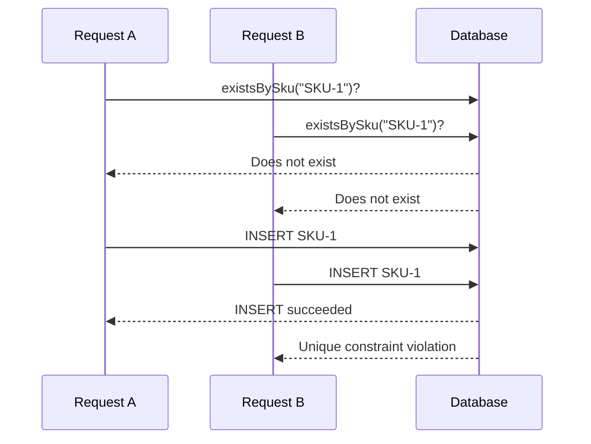

# ALREADY_EXISTS

In gRPC, **`ALREADY_EXISTS` is status code `6`**, used when an operation to create a resource fails because that resource already exists. For example, a client calls `CreateAccount` with a username that is already registered, or `CreateProduct` with a SKU already in use. This status tells the client that the conflict lies in the current resource state; resending the exact same request will usually not resolve it.

In **SPRING_GRPC**, Protobuf defines requests and responses, the Spring application service executes the use case, the repository/database guarantees uniqueness, and the gRPC status conveys the outcome back to the client. To use `ALREADY_EXISTS` properly, you must clearly define resource identity, unique constraint scope, concurrency handling when two creation requests arrive simultaneously, and the policy when a client resends a request after a timeout.

## 1. Meaning of ALREADY_EXISTS

`ALREADY_EXISTS` has the numeric value **6**. This status applies when a method attempts to create a new resource, but the corresponding resource already exists according to the API's identity rules.

| Perspective | Meaning |
| --- | --- |
| Client | The resource to create already exists; the client must decide how to handle the conflict |
| Server | Creation precondition failed because the identifier or unique attribute is already taken |
| gRPC runtime | Terminates the RPC with status `ALREADY_EXISTS` |
| Business | No duplicate resource is created under the contract |

For example:

- `CreateUser` with an email that has already been registered.
- `CreateProduct` with a SKU that already exists in the catalog.
- `CreateReservation` with a reservation code that has already been issued.
- `RegisterDevice` with a device ID already bound to an account.

`ALREADY_EXISTS` typically fits create operations. It does not mean every repeat submission of the same request is an error; if the API is designed to be idempotent, the server can return the already-created resource for the same operation key. That must be explicitly specified in the contract.

## 2. What counts as "already exists"?

A resource can be identified by a primary key or a business uniqueness rule:

| Resource | Possible unique key/condition |
| --- | --- |
| User | user ID, normalized email, or username |
| Product | product ID or SKU within catalog scope |
| Reservation | reservation ID or business key for the reservation attempt |
| Device registration | device ID within tenant/account scope |
| Payment instruction | merchant reference or idempotency key per contract |

You must define the **uniqueness scope**. For instance, a SKU may be unique system-wide, or only unique within each catalog. An email may be unique platform-wide, or unique per tenant. If the database constraint and API contract disagree on this scope, the server may return hard-to-explain statuses or allow unintended duplicate data.

For multi-tenant data, the unique key must typically include the tenant scope if business rules allow two tenants to use the same identifier. Do not rely solely on a pre-insert existence query as your uniqueness guarantee; concurrent requests can still create duplicates.

## 3. Distinguishing ALREADY_EXISTS from easily confused statuses

| Status | When it fits | Example |
| --- | --- | --- |
| `ALREADY_EXISTS` | The resource to create already exists | Creating a user with an email already in use |
| `INVALID_ARGUMENT` | The request contains invalid format/values | Malformed email syntax |
| `FAILED_PRECONDITION` | The resource or system is in a state that prevents the operation | Account exists, but is locked so it cannot be activated |
| `ABORTED` | The operation was aborted due to a conflict to handle at transaction level | Optimistic locking conflict during update |
| `PERMISSION_DENIED` | The caller does not have permission to create or access the resource | User is not allowed to create products in the catalog |
| `UNAUTHENTICATED` | The caller's identity cannot be verified | Token missing or expired |
| `RESOURCE_EXHAUSTED` | Out of quota or allocated resources | Tenant has reached its device count quota |
| `INTERNAL` | Unexpected internal error | Server-side mapping or invariant error |

### 3.1. ALREADY_EXISTS and INVALID_ARGUMENT

A malformed email is `INVALID_ARGUMENT`; a well-formed email already used by another account can be `ALREADY_EXISTS`. The first requires fixing the input. The second requires choosing a different identifier or handling the existing account according to business rules.

### 3.2. ALREADY_EXISTS and FAILED_PRECONDITION

`ALREADY_EXISTS` describes a conflict because a resource already exists during creation. `FAILED_PRECONDITION` describes current state preventing an operation, even when the resource exists. For example, `CreateUser` with a duplicate email can return `ALREADY_EXISTS`; `ActivateUser` for an account locked by policy can return `FAILED_PRECONDITION`.

### 3.3. ALREADY_EXISTS and ABORTED

`ABORTED` typically fits transaction or concurrency conflicts where the caller may need to re-run a read-modify-write sequence. `ALREADY_EXISTS` is a specific business outcome: the resource to create already exists. Do not turn every unique constraint error into `ABORTED`, or every transaction conflict into `ALREADY_EXISTS`.

## 4. Protobuf contract for create operations

Example of creating a product by SKU:

```protobuf
syntax = "proto3";

package commerce.catalog.v1;

option java_package = "com.example.catalog.grpc";
option java_multiple_files = true;

service CatalogService {
  rpc CreateProduct(CreateProductRequest) returns (CreateProductReply);
}

message CreateProductRequest {
  string sku = 1;
  string name = 2;
}

message CreateProductReply {
  string product_id = 1;
  string sku = 2;
  string name = 3;
}
```

The contract should clarify:

- What scope SKU is unique within: system-wide, tenant, or catalog.
- Rules for normalizing the SKU before comparison, such as case sensitivity and whitespace.
- On a duplicate SKU, whether the server returns `ALREADY_EXISTS` or returns the existing resource under an idempotency policy.
- Whether clients are allowed to update an existing resource via another method.
- That the response returns only fields the caller is permitted to view.

Do not silently turn `CreateProduct` into an upsert if the contract states the method only creates new resources. Upsert has different semantics: create if absent, update or keep unchanged according to rules if present. If you need that behavior, define an explicit method/operation.

## 5. Ensuring uniqueness in Spring and the database

A common mistake is checking existence first and then inserting:

```java
if (!productRepository.existsBySku(sku)) {
    productRepository.save(product);
}
```

This code does not guarantee uniqueness under two concurrent requests:



Both requests pass the pre-insert check. Therefore, **the database unique constraint is the final line of defense**. You can still check ahead of time for early feedback, but you must catch and classify conflicts from the write operation.

Entity example:

```java
@Entity
@Table(
    name = "products",
    uniqueConstraints = @UniqueConstraint(
        name = "uk_products_tenant_sku",
        columnNames = {"tenant_id", "sku"}
    )
)
public class ProductEntity {
    // fields
}
```

This example assumes SKU is unique within each tenant. Exact constraint names and declarations depend on your database/migration tooling. In production, manage constraints through migrations so the actual schema and code mappings stay consistent.

## 6. Mapping duplicate keys to ALREADY_EXISTS

The application service can surface a domain error:

```java
public Product createProduct(CreateProductCommand command) {
    try {
        return productRepository.save(
            ProductEntity.from(command)
        ).toDomain();
    } catch (DataIntegrityViolationException ex) {
        if (isSkuUniqueConstraint(ex)) {
            throw new ProductAlreadyExistsException(command.sku(), ex);
        }
        throw ex;
    }
}
```

`isSkuUniqueConstraint` is an illustrative helper. Production code must identify the specific constraint or SQL state/driver cause for the database in use; never treat every `DataIntegrityViolationException` as a duplicate. Foreign key, not-null, or other constraint violations may require different statuses.

At the gRPC boundary, map the domain exception:

```java
try {
    Product product = catalogService.createProduct(command);
    CreateProductReply reply = CreateProductReply.newBuilder()
        .setProductId(product.id())
        .setSku(product.sku())
        .setName(product.name())
        .build();

    observer.onNext(reply);
    observer.onCompleted();
} catch (ProductAlreadyExistsException ex) {
    observer.onError(Status.ALREADY_EXISTS
        .withDescription("SKU is already in use")
        .asRuntimeException());
}
```

This example assumes command, domain model, and service are already defined. In a large application, centralize mapping into an exception mapper/interceptor for the gRPC stack to avoid code duplication. Keep constraint details, SQL, and stack traces in server logs; client responses should contain only necessary information.

### 6.1. Transactions and when to emit the response

For a create operation, a successful response should be emitted only after the transaction commits according to the API's guarantee. If the handler calls `onNext`/`onCompleted` before the transaction actually commits or before data is guaranteed, the client may perceive success even if the insert later rolls back.

Keep transaction boundaries in the application service/repository per Spring design, and ensure the handler completes the RPC only after the application call returns successfully with the defined semantics. For asynchronous or event-driven transactions, define clearly whether `OK` means the resource was created or merely that the request was accepted.

## 7. Idempotency: repeated requests are not necessarily duplicate creates

Two concepts are often confused:

- **Business uniqueness:** there cannot be two products with the same SKU in one catalog.
- **Request idempotency:** resending the same operation due to timeout/lost response does not execute the side effect a second time.

A client may send `CreateProduct`, the server commits successfully, and the response is lost. When the client retries, the server sees the SKU already exists. If it only returns `ALREADY_EXISTS`, the client cannot tell whether that resource was created by its own previous call or by another caller.

An API requiring safe retries can accept an idempotency key:

```protobuf
message CreateProductRequest {
  string request_id = 1;
  string sku = 2;
  string name = 3;
}
```

The server stores the outcome keyed by `request_id` and the appropriate caller/tenant scope:

1. If the request ID has never been processed, create the resource and store the result in the same transaction.
2. If the same request ID and same payload are sent again, return the stored result.
3. If the same request ID arrives with a different payload, return an error per contract, usually `INVALID_ARGUMENT` or a specified conflict status.
4. If a different request ID arrives while the SKU already exists, apply business uniqueness and return `ALREADY_EXISTS` or the result per API policy.

Idempotency keys require a TTL/retention policy, scope, and atomicity. Merely adding a `request_id` field to the proto does not automatically guarantee idempotency.

## 8. How clients handle ALREADY_EXISTS

With a blocking stub, the client can catch `StatusRuntimeException`:

```java
try {
    CreateProductReply reply =
        catalogStub.createProduct(request);
    // Save product_id and display the new resource.
} catch (StatusRuntimeException ex) {
    if (ex.getStatus().getCode() == Status.Code.ALREADY_EXISTS) {
        // Guide the user to pick another SKU or open the existing resource
        // if allowed by the API and the caller has access.
    } else {
        // Handle other statuses according to policy.
    }
}
```

Clients should:

- Not continuously retry the exact request; unique conflicts usually do not resolve themselves.
- Let the user pick a different identifier or transition to fetching the existing resource.
- Call `GetProduct` after `ALREADY_EXISTS` only if the contract permits it and authorization is verified.
- For requests with an idempotency key, distinguish retrying the same operation from an intentional new creation.
- Not infer resource contents from `grpc-message`; use responses or protected read APIs.

Not every API should reveal information about existing resources. For instance, during account registration, revealing that an email already has an account can introduce an account-enumeration risk. The contract must balance UX, security, and business requirements.

## 9. Error details and existing resource information

For internal APIs, clients may need to know which resource caused the conflict. Rich error details such as `google.rpc.ResourceInfo` can describe the resource type/name:

```text
grpc-status: ALREADY_EXISTS
grpc-message: SKU is already in use

ResourceInfo:
  resource_type: "commerce.catalog.v1.Product"
  resource_name: "catalogs/{catalog_id}/products/{product_id}"
```

This is a logical illustration; sending details requires using the corresponding Protobuf types and status detail APIs in gRPC Java. Return a resource name/ID only if the caller is permitted to know it. For public APIs or sensitive data, return only a generic error code without disclosing which resource owns the unique key.

## 10. Testing ALREADY_EXISTS and concurrency

Do not test only sequential duplicate creation. Test the database constraint and races as well:

| Scenario | What to verify |
| --- | --- |
| First-time resource creation | RPC returns response and status `OK` after commit |
| Re-creating with the same unique key | RPC returns `ALREADY_EXISTS` per contract |
| Two concurrent requests creating the same key | Only one insert succeeds; the other is mapped properly |
| Same unique key in a different tenant scope | Behavior matches per-tenant/global uniqueness rules |
| Another constraint violated | Not mistakenly mapped to `ALREADY_EXISTS` |
| Client retries with same idempotency key | Receives stored result without repeating side effects |
| Same request ID with different payload | Rejected per contract |
| Resource exists but caller lacks permission | No information leaked via status/details |
| Transaction rollback | Client does not receive `OK` before commit |

Unit tests can verify the exception mapper. Integration tests should use a real database or appropriate container to verify unique constraints and transactions. Concurrency tests need to launch requests nearly simultaneously and verify the final record count, not just Java exceptions.

## 11. Observing conflicts in production

`ALREADY_EXISTS` can be a normal outcome of business uniqueness, but a sudden spike can indicate buggy client retries, multiple producers generating the same identifier, or an unclear contract.

Monitor:

- Count/rate of `ALREADY_EXISTS` by service/method.
- Unique constraint category or resource type as low-cardinality labels.
- Client/SDK versions and tenant tiers if policy allows.
- Conflict rate relative to total creates.
- Number of retries by idempotency key and duplicates detected.
- Trace/correlation IDs to link client calls to server transactions/logs.

Do not use emails, SKUs, request IDs, or user IDs as high-cardinality metric labels. Logs can include constraint names and correlation IDs; avoid logging sensitive payloads or data belonging to resources the caller is not permitted to view.

## 12. Common design mistakes

| Mistake | Consequence | Better practice |
| --- | --- | --- |
| Relying only on `existsBy...` before insert | Race conditions still create duplicates | Database unique constraints and write error mapping |
| Mapping every `DataIntegrityViolationException` to `ALREADY_EXISTS` | Masks other constraint errors | Identify the exact constraint/SQL state |
| Returning `ALREADY_EXISTS` on every retry | Clients cannot tell retry of same op from new create | Design idempotency keys and persist outcomes |
| Silently upserting inside a Create method | Can unexpectedly overwrite resources | Separate create, update, and upsert semantics |
| Retrying `ALREADY_EXISTS` continuously | Increases load without resolving conflict | Change identifier or fetch existing resource per contract |
| Emitting `OK` before transaction commit | Client sees success while data may roll back | Complete the RPC only after write durability is ensured |
| Exposing resource IDs in error details | Resource information leakage | Enforce authorization and restrict details |

## 13. ALREADY_EXISTS design checklist

Before publishing a create method, determine:

1. **How is the resource identified?** Primary key, natural key, or unique business key?
2. **What is the uniqueness scope?** Global, tenant, catalog, or owner?
3. **How are keys normalized?** Case sensitivity, whitespace, and canonical form.
4. **How does the database enforce uniqueness?** Are matching constraints/indexes and migrations in place?
5. **Which constraint errors map to ALREADY_EXISTS?** Distinguish from foreign key/not-null/other constraints.
6. **How are retries after timeouts handled?** Are idempotency keys and durable outcome storage in place?
7. **Do create and upsert have separate semantics?** Never silently update duplicate resources.
8. **How much may clients learn about existing resources?** Consider authorization and resource details.
9. **Do tests simulate race conditions?** Verify only one resource is created.
10. **Does telemetry track conflicts without leaking data?**

## 14. Takeaways

`ALREADY_EXISTS` is gRPC status code `6`, used when the resource a method tries to create already exists under the API's identity rules. It differs from `INVALID_ARGUMENT` (invalid request), `FAILED_PRECONDITION` (current state prevents operation), and `ABORTED` (transaction conflict).

In Spring gRPC, define uniqueness scope in the contract, protect uniqueness with database constraints, map only actual duplicate-key violations to `Status.ALREADY_EXISTS`, and never emit success before the transaction commits. For timeouts/retries, separate business uniqueness from request idempotency. Clients should handle conflicts per contract, avoid infinite retries, and prevent error details from exposing unauthorized resources. Clarifying these semantics keeps create operations safe against concurrency and network failures.

### References

- [gRPC – Status codes](https://grpc.io/docs/guides/status-codes/)
- [gRPC – Error handling](https://grpc.io/docs/guides/error/)
- [Google API – Error model](https://cloud.google.com/apis/design/errors)
- [Google API – Resource-oriented design](https://cloud.google.com/apis/design/resources)
- [Spring Data – Repository fundamentals](https://docs.spring.io/spring-data/commons/reference/repositories/core-concepts.html)
