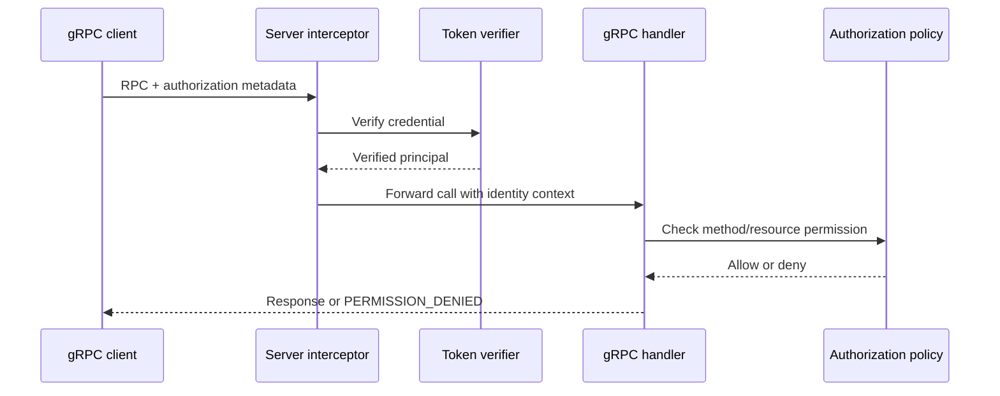

# PERMISSION_DENIED

In gRPC, **`PERMISSION_DENIED` is status code `7`**, indicating that the caller is not permitted to perform the requested operation. A typical case is when the server has identified the caller, but that identity lacks permission to access the resource or invoke the method in the current context. For example, a signed-in employee is not allowed to view records belonging to another tenant.

When developing with **SPRING_GRPC**, you must separate two questions: **who is the caller?** and **what is the caller allowed to do?** Authentication verifies identity; authorization checks permissions. The gRPC status `UNAUTHENTICATED` is typically used when identity cannot be verified, whereas `PERMISSION_DENIED` is used when identity is verified but lacks sufficient permission. Spring Security can help model identities and policies, yet the gRPC server still needs to integrate authentication, propagate context, and enforce permission checks at the right boundaries.

## 1. Meaning of PERMISSION_DENIED

`PERMISSION_DENIED` has the numeric value **7**. This status applies when the caller is not authorized to perform the operation, regardless of whether the resource exists. The server must not execute side effects after determining that the caller is unauthorized.

| Perspective | Meaning |
| --- | --- |
| Client | The current identity is not permitted to perform the operation |
| Server | Authorization policy rejected the method or action on the resource |
| gRPC runtime | Terminates the RPC with status `PERMISSION_DENIED` |
| Business | The caller does not meet the required permission, role, ownership, or policy |

For example:

- A signed-in user lacks the `inventory:write` permission.
- An employee in tenant A requests to view an order belonging to tenant B.
- A service account is allowed to read the catalog but not delete products.
- A user has permission to view a profile but is not allowed to modify sensitive fields.
- A caller has a valid role, yet the operation is forbidden by a higher-level policy.

`PERMISSION_DENIED` is an RPC-level authorization result. It does not by itself disclose which permission was missing or which policy rejected the call; details must be handled safely on the server and may be recorded in audit logs.

## 2. Distinguishing authentication and authorization

These two steps usually occur in sequence but serve distinct purposes:

1. **Authentication:** verifies credentials and establishes a principal, such as a user, workload, or service account.
2. **Authorization:** evaluates whether the principal is allowed to invoke the method and act on a specific resource.

| Scenario | Usually appropriate status | Reason |
| --- | --- | --- |
| No credentials sent to an API requiring login | `UNAUTHENTICATED` | Server has not identified the caller |
| Token has invalid signature, is expired, or malformed | `UNAUTHENTICATED` | Identity could not be verified |
| Valid token lacking a required scope | `PERMISSION_DENIED` | Identity is known, but lacks permission |
| Valid user who does not own the resource | `PERMISSION_DENIED` | Ownership policy denies access |
| Valid service account not allowed to call an admin method | `PERMISSION_DENIED` | Identity lacks permission on the method |

### 2.1. PERMISSION_DENIED and UNAUTHENTICATED

This is the most important status pair:

- `UNAUTHENTICATED` answers: the server cannot verify who the caller is.
- `PERMISSION_DENIED` answers: the server knows who the caller is, but the caller is not allowed to do this.

Do not return `UNAUTHENTICATED` for every permission error. If a token is valid yet lacks a scope, the client cannot solve the problem by logging in again; the principal's permissions or policy must be changed by an authorized party.

### 2.2. PERMISSION_DENIED and NOT_FOUND

If the caller has permission to look up the resource but it does not exist, `NOT_FOUND` is normally appropriate. If the resource exists but the caller is not allowed to access it, normal semantics is `PERMISSION_DENIED`.

Some APIs choose to return `NOT_FOUND` for both nonexistent resources and resources the caller is not allowed to see, in order to avoid leaking data existence. This is an intentional hiding policy; apply it consistently and ensure status, message, response timing, and error details do not accidentally reveal a difference.

### 2.3. PERMISSION_DENIED and FAILED_PRECONDITION

`PERMISSION_DENIED` is about the caller's permissions. `FAILED_PRECONDITION` is about the system/resource state not meeting preconditions for the operation. For example, if a user has permission to cancel an order but the order has already been delivered, business policy can return `FAILED_PRECONDITION`; if a user lacks permission to cancel someone else's order, return `PERMISSION_DENIED`.

## 3. Permissions can apply at multiple scopes

Not all authorization is a method-level role check. A gRPC service may need multi-layered checks:

| Scope | Question | Example |
| --- | --- | --- |
| Service/method | Is the principal allowed to call this RPC? | Only role `CATALOG_ADMIN` may call `DeleteProduct` |
| Tenant | Does the caller belong to the tenant owning the data? | Tenant A cannot access Tenant B's data |
| Resource/object | Does the caller have permission on the specific resource? | User can only view orders they created |
| Field/property | Is the caller allowed to read or edit this field? | Only HR can view salary |
| Business action | Do current state and role allow the action? | An approver cannot self-approve a request they created |

Method-level role checks do not replace ownership or tenant checks. A principal permitted to invoke `GetOrder` still must not by default view every `order_id` the client sends.

## 4. Bringing identity into gRPC via metadata and interceptors

Clients typically send credentials in gRPC metadata, such as a bearer token in the `authorization` header. Metadata is only a transport mechanism; metadata alone does not prove a token is valid.

Overview flow:



A server interceptor can:

- Read metadata by the defined key.
- Verify the token via a trusted library/identity provider.
- Check issuer, audience, expiry, and signature according to configuration.
- Build a verified principal and attach it to the gRPC `Context`.
- Reject invalid credentials with `UNAUTHENTICATED`.
- Never log raw tokens or credentials.

Do not write your own JWT verifier that merely decodes the payload. Decoding does not verify signature, issuer, audience, or expiration. Use a battle-tested authentication library and configure the trust boundary properly.

## 5. Authentication interceptor example in gRPC Java

The example below shows how to connect metadata to gRPC Context. `TokenVerifier` is an application abstraction configured to verify tokens with an appropriate identity provider:

```java
public final class AuthenticationInterceptor implements ServerInterceptor {
    private static final Metadata.Key<String> AUTHORIZATION =
        Metadata.Key.of("authorization", Metadata.ASCII_STRING_MARSHALLER);

    static final Context.Key<Principal> PRINCIPAL =
        Context.key("authenticated-principal");

    private final TokenVerifier tokenVerifier;

    public AuthenticationInterceptor(TokenVerifier tokenVerifier) {
        this.tokenVerifier = tokenVerifier;
    }

    @Override
    public <ReqT, RespT> ServerCall.Listener<ReqT> interceptCall(
            ServerCall<ReqT, RespT> call,
            Metadata headers,
            ServerCallHandler<ReqT, RespT> next) {

        String value = headers.get(AUTHORIZATION);
        if (value == null || !value.startsWith("Bearer ")) {
            call.close(Status.UNAUTHENTICATED
                .withDescription("Missing authentication credentials"), new Metadata());
            return new ServerCall.Listener<>() {};
        }

        try {
            Principal principal =
                tokenVerifier.verify(value.substring("Bearer ".length()));

            Context context = Context.current().withValue(PRINCIPAL, principal);
            return Contexts.interceptCall(context, call, headers, next);
        } catch (InvalidCredentialException ex) {
            call.close(Status.UNAUTHENTICATED
                .withDescription("Invalid authentication credentials"), new Metadata());
            return new ServerCall.Listener<>() {};
        }
    }
}
```

This is a skeleton to illustrate the boundary; adapt the `Principal` type, exceptions, verifier, and interceptor registration to the gRPC server/starter you use. The interceptor authenticates identity; whether the caller has permission to invoke a method or access a resource still requires an authorization policy.

With Spring, you can manage `TokenVerifier` and the interceptor as beans and register the interceptor with the server via the starter's mechanism. Simply creating a bean does not guarantee the interceptor is automatically attached to every server. Verify configuration and test that RPCs actually pass through the interceptor.

## 6. Checking permissions at method and resource level

After authentication, the handler or application service must check the appropriate permissions. For example, a user may only view orders belonging to their own tenant:

```java
public Order getOrder(String orderId, Principal principal) {
    Order order = orderRepository.findById(orderId)
        .orElseThrow(OrderNotFoundException::new);

    if (!authorization.canReadOrder(principal, order)) {
        throw new AccessDeniedException("Not allowed to access order");
    }

    return order;
}
```

At the gRPC boundary, translate access denied into a status:

```java
try {
    Principal principal = AuthenticationInterceptor.PRINCIPAL.get();
    Order order = orderService.getOrder(request.getOrderId(), principal);
    observer.onNext(toReply(order));
    observer.onCompleted();
} catch (AccessDeniedException ex) {
    observer.onError(Status.PERMISSION_DENIED
        .withDescription("Insufficient permission to perform operation")
        .asRuntimeException());
}
```

This example assumes `authorization`, `orderService`, and the principal context are already set up. In production code, avoid checking permissions solely using a `tenant_id` sent by the client. The tenant/subject must come from the verified identity or be cross-checked against a trusted policy.

### 6.1. Authorization should live close to the data being protected

Checking in the gRPC handler blocks method-level access early. However, resource-level authorization should usually be enforced in the application service or domain boundary, where full context about the resource, owner, tenant, and action is available.

Do not rely solely on hiding UI buttons or trusting clients not to send a field. Clients can be modified or RPCs can be invoked directly. The server must authorize every request before reading or writing sensitive data.

## 7. Integrating with Spring Security

Spring Security provides `Authentication`, `GrantedAuthority`, `AuthorizationManager`, and policy mechanisms. However, gRPC does not pass through a Servlet filter chain like a traditional HTTP controller in all configurations. Therefore, never assume `SecurityContextHolder` automatically holds the gRPC call's principal.

A general integration pattern:

1. A gRPC server interceptor reads credentials from metadata.
2. A token verifier validates credentials and produces an `Authentication`/principal.
3. Identity is attached to gRPC `Context` for the call lifecycle.
4. An adapter or application service passes the identity to the authorization layer.
5. Policy evaluates role/scope/tenant/resource/action.
6. Deny outcomes are mapped to `PERMISSION_DENIED`.

If the application wants to use `SecurityContextHolder`, bridge the identity into the right execution context and clear it after the call. With async callbacks, executors, or streaming, never assume ThreadLocal automatically propagates across threads. You can pass the principal explicitly via application commands or use an appropriate context propagation mechanism.

### 7.1. Roles and scopes do not replace resource authorization

A token with scope `orders:read` may allow calling an order-reading method, but does not necessarily allow reading every order. Policy must still check tenant, ownership, relationships, or resource attributes.

Avoid designing overly broad roles such as `ADMIN` that bypass all data checks. Even for administrative privileges, define specific scopes, auditing, and conditions.

## 8. Metadata, TLS, and protecting credentials

Authorization is trustworthy only if identity is verified over an appropriate channel and trust model:

- Use TLS to protect credentials in transit across the network.
- Consider mTLS for workload-to-workload communication to verify client identity at the transport layer.
- Bearer tokens should have an audience/scope matching the target service.
- Limit token lifetimes and enforce rotation/revocation processes via the identity system.
- Do not log authorization metadata into logs, trace attributes, or exceptions.
- Do not treat self-asserted client headers such as `x-user-role` or `x-tenant-id` as proof of identity.

TLS encrypts and authenticates the peer as configured; TLS does not by itself decide whether the caller has permission to call `DeleteProduct`. Authentication and authorization remain separate steps.

## 9. When to use NOT_FOUND to hide resources?

An API may not want to disclose that a resource exists when the caller is not permitted to see it. For example, if a user probes multiple `order_id` values, returning `PERMISSION_DENIED` for real IDs and `NOT_FOUND` for nonexistent IDs lets an attacker enumerate data.

You can adopt a policy of returning `NOT_FOUND` for both:

- The resource does not exist.
- The resource exists, but is not visible to the current caller.

Use this policy only when it fits the contract and threat model. Keep behavior consistent across status, message, error details, and client-observable channels. The server must still perform authorization; `NOT_FOUND` is merely the external representation, not a substitute for permission checks.

## 10. How clients handle PERMISSION_DENIED

With a blocking stub, the client can classify the status:

```java
try {
    DeleteProductReply reply = catalogStub.deleteProduct(request);
    // Process successful result.
} catch (StatusRuntimeException ex) {
    Status.Code code = ex.getStatus().getCode();
    if (code == Status.Code.PERMISSION_DENIED) {
        // Inform the caller they lack permission; do not retry the same request.
    } else if (code == Status.Code.UNAUTHENTICATED) {
        // Run the authentication/credential refresh flow per policy.
    } else {
        // Handle other statuses.
    }
}
```

Clients should:

- Not continuously retry with the same credentials upon receiving `PERMISSION_DENIED`.
- Not attempt to self-escalate roles or tamper with claims to retry.
- Prompt the user to switch accounts/tenants if supported by the application.
- Refresh credentials only when the error genuinely involves authentication/expiry per contract.
- Display an appropriate message without leaking internal policy details.

If permission was just granted while a policy cache has not yet refreshed, the system may need a controlled permission-refresh flow. Do not turn every `PERMISSION_DENIED` into an automatic retry.

## 11. Testing authorization

Tests must verify both allow and deny cases, at both method and resource levels:

| Scenario | What to verify |
| --- | --- |
| Missing token | `UNAUTHENTICATED` |
| Invalid signature/expired token | `UNAUTHENTICATED` |
| Valid token missing required scope | `PERMISSION_DENIED` |
| Principal in right tenant with permission | RPC succeeds |
| Principal in different tenant | Rejected or hidden with `NOT_FOUND` per policy |
| Read permission without write permission | Read succeeds, write gets `PERMISSION_DENIED` |
| User tries spoofing tenant ID in request | Server does not trust client-supplied claim |
| Valid role but mismatched resource ownership | Rejected |
| Async/streaming callbacks | Identity/context remains intact throughout the call |
| Error details | Does not leak tokens, internal policies, or others' data |

Integration tests should invoke through a gRPC client/server to confirm the interceptor is actually registered, metadata is read, and the right status reaches the client. With Spring, verify bean configuration and security context bridging in the test context.

## 12. Auditing and observability

`PERMISSION_DENIED` can be normal security behavior, yet a sudden spike can signal misconfigured client scopes, policy changes, or data enumeration attempts.

Record under proper controls:

- Service/method and status code.
- Principal ID in a loggable or pseudonymized form.
- Resource type and action, avoiding logging full payloads.
- Tenant scope if permitted by data policy.
- Policy decision ID or rule category, without necessarily exposing rule internals.
- Trace/correlation ID to link the request with the audit event.

Metrics should group by low-cardinality service/method/status and policy denial categories. Do not use tokens, emails, resource IDs, or user IDs as metric labels. Audit logs require read access control, retention policies, and integrity protection; never put credentials in logs.

Distinguish denials caused by users lacking permissions from denials caused by misconfigured service accounts. The former may be normal activity; the latter can break workflows and warrants operational alerting.

## 13. Common design mistakes

| Mistake | Consequence | Better practice |
| --- | --- | --- |
| Using `UNAUTHENTICATED` for every permission error | Clients misdiagnose and refresh tokens uselessly | Separate authentication from authorization |
| Checking roles only at method level | Can read another tenant's or owner's data | Check tenant, ownership, and action at resource boundaries |
| Trusting `x-user-id` or `x-role` from the client | Callers can spoof identity | Verify credentials and build principal server-side |
| Assuming Spring Security filter chain protects all gRPC methods | RPCs may bypass expected protection | Register interceptors/integrations and test in practice |
| Relying on the UI to hide actions | RPCs can still be called directly | Always enforce authorization on the server |
| Returning policy details or sensitive resource IDs | Leaks permission structure and data | Minimal error messages, audit details server-side |
| Retrying `PERMISSION_DENIED` continuously | Increases load without changing permissions | Wait for valid policy or credential changes |
| Not propagating identity to async callbacks | Wrong permission decisions or lost audit context | Context propagation or explicit principal passing |

## 14. PERMISSION_DENIED design checklist

Before publishing a gRPC method, determine:

1. **Where is authentication performed?** Metadata, token verifier, mTLS, or identity provider.
2. **How is the principal propagated?** Are gRPC Context and async/streaming propagation tested?
3. **Who is allowed to call the method?** Which role, scope, service identity, or policy?
4. **Where are resource permissions checked?** Tenant, owner, relationship, and field-level access.
5. **How does missing identity differ from missing permission?** Clear mapping between `UNAUTHENTICATED` and `PERMISSION_DENIED`.
6. **Should resource existence be hidden?** Consistently choose `NOT_FOUND` if the threat model requires it.
7. **Are credentials protected?** TLS, token audience, expiry, rotation, and no secret logging.
8. **How does the client react?** No blind retries or self-modifying permissions.
9. **Does auditing capture enough context?** Method, action, resource type, decision, and trace ID per policy.
10. **Do tests cover both allow and deny?** Including tenant boundaries, resource ownership, and async/streaming.

## 15. Takeaways

`PERMISSION_DENIED` is gRPC status code `7`, used when the caller lacks permission to invoke a method or act on a resource. It differs from `UNAUTHENTICATED`, which indicates the server could not verify the caller's identity. Authorization needs to evaluate method, tenant, resource ownership, and business action; a single role or scope may not be enough.

In Spring gRPC, an interceptor can verify credentials from metadata and attach the principal to gRPC Context; the application service or policy layer enforces actual permissions. Protect metadata with TLS, never trust client-asserted identities, avoid leaking policies/data in error details, and test both allow and deny cases. When statuses are mapped accurately, clients know whether to authenticate, request access, or stop; systems also gain clearer auditing and telemetry.

### References

- [gRPC – Status codes](https://grpc.io/docs/guides/status-codes/)
- [gRPC – Authentication](https://grpc.io/docs/guides/auth/)
- [gRPC – Metadata](https://grpc.io/docs/guides/metadata/)
- [gRPC – Interceptors](https://grpc.io/docs/guides/interceptors/)
- [Spring Security – Authorization](https://docs.spring.io/spring-security/reference/servlet/authorization/index.html)
