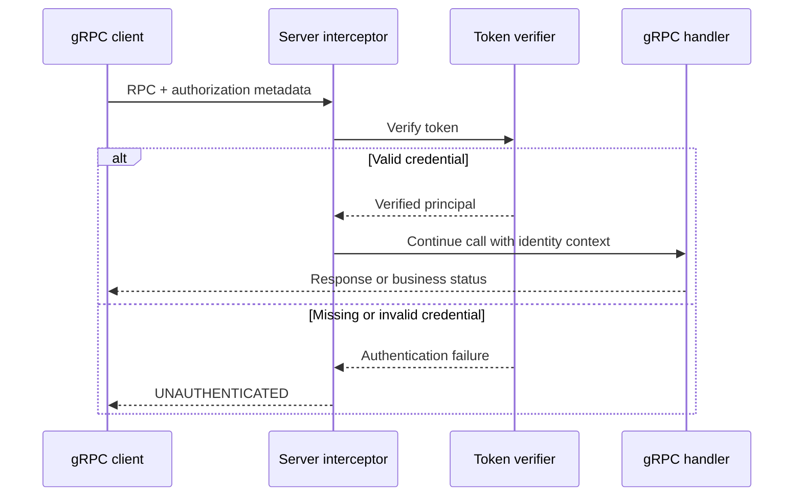

# UNAUTHENTICATED

In gRPC, **`UNAUTHENTICATED` is status code `16`**, indicating that the server could not verify the caller's identity for the current RPC. Common causes are missing, malformed, expired, invalid-signature, untrusted credentials, or credentials not intended for the target service. When identity cannot be established, the server must not proceed with business logic that requires authentication.

In **SPRING_GRPC**, authentication must be designed end-to-end from the client sending credentials via metadata or TLS to the server verifying them and establishing a principal. Only after this step is authorization performed. Therefore, `UNAUTHENTICATED` differs from `PERMISSION_DENIED`: the first means the caller's identity could not be verified; the second means the caller is known, but does not have permission to perform the action.

## 1. Meaning of UNAUTHENTICATED

`UNAUTHENTICATED` has the numeric value **16**. This status applies when an RPC cannot be processed because the caller's identity has not been verified or the credential is invalid under the service's authentication mechanism.

| Perspective | Meaning |
| --- | --- |
| Client | Credentials were rejected or not provided |
| Server | Could not establish a verified principal for the call |
| gRPC runtime | Terminates the RPC with status `UNAUTHENTICATED` |
| Business | Must not perform operations requiring a valid identity |

Common cases:

- No bearer token in metadata for a method requiring login.
- Expired, bad-signature, or revoked token.
- Token issued by an issuer not trusted by the service.
- Token audience does not match the target service.
- API key does not exist, is wrong, or is no longer active.
- Credentials cannot be verified due to mismatched trust configuration or identity provider setup.

Do not return `UNAUTHENTICATED` for every error. Invalid request data is usually `INVALID_ARGUMENT`; an authenticated caller lacking permission is usually `PERMISSION_DENIED`; an authentication dependency that is temporarily unavailable may need an appropriate infrastructure status instead of pretending the user's credentials are invalid.

## 2. Authentication differs from authorization

Authentication answers **who is the caller?** Authorization answers **what is the caller allowed to do?**

| Scenario | Usually appropriate status | Explanation |
| --- | --- | --- |
| No credentials sent to an API requiring auth | `UNAUTHENTICATED` | No identity to evaluate |
| Expired or bad-signature token | `UNAUTHENTICATED` | Credential cannot be verified |
| Valid token lacking a scope | `PERMISSION_DENIED` | Identity is verified, permission is insufficient |
| Valid user who does not own the resource | `PERMISSION_DENIED` or `NOT_FOUND` per policy | This is an authorization decision |
| Valid service account not allowed to call an admin method | `PERMISSION_DENIED` | Identity is real, but not permitted |
| Request has a malformed field | `INVALID_ARGUMENT` | Input error, not an identity error |

### 2.1. Why not use UNAUTHENTICATED for missing permissions?

If a token is valid but lacks the `orders:write` scope, asking to log in again will not fix the problem. The client needs to stop the operation or guide the user to the appropriate permission-request workflow. Mistakenly returning `UNAUTHENTICATED` can cause clients to refresh tokens repeatedly, generating unnecessary load and masking policy errors.

Conversely, an expired token is an authentication issue. The client can attempt to refresh the credential via the designed mechanism, then call again once if the operation is still valid and safe.

### 2.2. Why not use UNAUTHENTICATED for every verification failure?

If the token verifier calls an identity provider and the identity provider is temporarily unreachable, the server cannot yet conclude that the caller's token is wrong. Distinguish invalid credentials from an unavailable dependency. The latter should be recorded and mapped under the infrastructure error policy, not turned into a user login failure.

## 3. How are credentials transmitted to a gRPC server?

A common approach is sending a bearer token in gRPC metadata under the `authorization` key. Metadata is accompanying information attached to the RPC; it only transports the credential and does not verify it on its own.

General processing flow:



The server typically needs to check:

- That the credential exists and uses the expected scheme, such as `Bearer`.
- That the signature or credential verification mechanism is valid.
- That the issuer is in the trusted list.
- That the audience targets the service receiving the RPC.
- Expiration time and not-before validity window.
- Whether the token is revoked or blocked by policy, if supported by the system.
- That required claims have the expected types and structure.

Never treat decoding a JWT payload as verification. A payload can be read without knowing whether the signature is valid. Use a battle-tested library to verify signature, issuer, audience, and lifetime according to system configuration.

## 4. Client sending credentials via metadata

In gRPC Java, credentials can be attached to a call via `CallCredentials` or the client authentication mechanism provided by your library/starter. This decouples credential retrieval logic from business methods.

A simple illustration for metadata:

```java
Metadata headers = new Metadata();
Metadata.Key<String> authorization =
    Metadata.Key.of(
        "authorization",
        Metadata.ASCII_STRING_MARSHALLER);

headers.put(authorization, "Bearer " + accessToken);

InventoryServiceGrpc.InventoryServiceBlockingStub authenticatedStub =
    MetadataUtils.attachHeaders(inventoryStub, headers);
```

This example illustrates attaching static metadata to a stub. In real applications, tokens can rotate or expire; avoid creating a stub bound to an old token and reusing it indefinitely. For dynamic credentials, prefer `CallCredentials` or a provider invoked per call to obtain the current token.

Guidelines:

- Send credentials only to verified endpoints protected by TLS.
- Do not embed tokens inside Protobuf messages or query parameters.
- Do not write tokens into logs, exceptions, trace attributes, or metrics.
- Do not share a stub carrying one user's identity with another user's requests.
- For workload identity, consider short-lived credentials and automatic rotation.

## 5. Server interceptor verifying credentials

A server interceptor can read metadata, call a token verifier, and attach the verified principal to gRPC `Context`. The example below illustrates the processing boundary:

```java
public final class AuthenticationInterceptor implements ServerInterceptor {
    private static final Metadata.Key<String> AUTHORIZATION =
        Metadata.Key.of(
            "authorization",
            Metadata.ASCII_STRING_MARSHALLER);

    static final Context.Key<Principal> PRINCIPAL =
        Context.key("authenticated-principal");

    private final TokenVerifier tokenVerifier;

    public AuthenticationInterceptor(TokenVerifier tokenVerifier) {
        this.tokenVerifier = tokenVerifier;
    }

    @Override
    public <ReqT, RespT> ServerCall.Listener<ReqT> interceptCall(
            ServerCall<ReqT, RespT> call,
            Metadata headers,
            ServerCallHandler<ReqT, RespT> next) {

        String value = headers.get(AUTHORIZATION);
        if (value == null || !value.startsWith("Bearer ")) {
            call.close(Status.UNAUTHENTICATED
                .withDescription("Missing authentication credentials"), new Metadata());
            return new ServerCall.Listener<>() {};
        }

        try {
            Principal principal =
                tokenVerifier.verify(value.substring("Bearer ".length()));
            Context context =
                Context.current().withValue(PRINCIPAL, principal);
            return Contexts.interceptCall(context, call, headers, next);
        } catch (InvalidCredentialException ex) {
            call.close(Status.UNAUTHENTICATED
                .withDescription("Invalid authentication credentials"), new Metadata());
            return new ServerCall.Listener<>() {};
        }
    }
}
```

`TokenVerifier` and `InvalidCredentialException` are application abstractions. Production code must also classify errors from the identity provider: bad credentials differ from an identity provider that is temporarily unreachable. Do not turn connection errors to the identity provider into `UNAUTHENTICATED` when the server cannot conclude the caller's credentials are invalid.

The interceptor must actually be registered with the gRPC server. In Spring, you can manage the verifier and interceptor as beans and register them via the mechanism of the starter in use. Declaring a bean alone does not guarantee every gRPC service passes through the interceptor; integration tests must verify this.

## 6. Integrating identity with Spring Security

Spring Security provides concepts such as `Authentication`, `GrantedAuthority`, principals, and authorization policies. However, never assume gRPC calls automatically pass through the Servlet filter chain or have `SecurityContextHolder` populated like an HTTP controller in every setup.

An integration flow can include:

1. A gRPC interceptor reads credentials from metadata.
2. A token verifier validates credentials against the issuer/identity provider.
3. The server constructs a verified principal or `Authentication` object.
4. Identity is attached to gRPC `Context` or passed explicitly to the application service.
5. The authorization layer checks roles, scopes, tenant, and resources.
6. Identity errors map to `UNAUTHENTICATED`; permission errors map to `PERMISSION_DENIED`.

If the application wants to use `SecurityContextHolder`, bridge identity into the right execution context and clear it after the call. For async callbacks, executors, or streaming, ThreadLocal does not automatically guarantee identity is propagated properly. You can pass the principal via command/service arguments or use a tested context propagation mechanism.

### 6.1. Do not trust self-asserted client identity

Metadata such as `x-user-id`, `x-role`, or `x-tenant-id` is not proof of authentication if clients can set it themselves. The server should trust only identity derived from verified credentials or trusted transport identity.

If an internal gateway adds identity metadata, ensure:

- Only trusted gateways may connect to the backend or are authenticated via mTLS.
- The backend cannot be reached directly from untrusted networks to spoof headers.
- The gateway strips or overwrites identity headers sent by external clients.
- The backend still validates audience, issuer, or trust context suited to the architecture.

## 7. TLS, mTLS, and authentication across layers

TLS secures the transport channel and authenticates the server per certificate/trust configuration. mTLS adds client certificate authentication at the transport layer. Bearer tokens typically identify users or workloads at the application layer.

| Mechanism | What does it verify? | What does it not solve by itself? |
| --- | --- | --- |
| TLS server authentication | Client connects to the right server with a trusted certificate | Which methods the user is allowed to call |
| mTLS | Client workload has a valid certificate under trust policy | Business permissions on individual resources |
| Bearer token | Principal/claims at the application layer | TLS encryption if transport is unprotected |
| Authorization policy | Which actions a principal may perform | Does not replace credential verification |

If a TLS/mTLS handshake fails, the RPC may never reach the gRPC handler; the client may see a transport/handshake error rather than an `UNAUTHENTICATED` status returned by the server. Distinguish channel setup errors from application-layer token verification failures.

Do not send bearer tokens in plaintext over production networks. Manage certificate trust, rotation, and credential lifetimes per environment.

## 8. Expired tokens, refresh, and retries

When a client receives `UNAUTHENTICATED`, it first needs to know which category the cause belongs to:

- Expired token: can be refreshed via the authorized flow.
- Revoked token or wrong audience: refreshing may not help; check configuration or re-authenticate.
- Missing credential due to client bug: fix metadata attachment configuration.
- Identity provider unavailable: handle as a dependency/infrastructure error per policy rather than concluding the user's token is wrong.

A refresh flow should normally be bounded:

1. Receive `UNAUTHENTICATED` status.
2. Check whether the authentication mechanism supports refresh and whether the error is recoverable by refreshing.
3. Refresh the credential once over a secure channel.
4. Create a new call with the new credential if the deadline and business logic still fit.
5. If it still fails, stop and surface the error to the caller layer.

Do not retry indefinitely because tokens with invalid signatures, issuers, or audiences will keep failing. For write operations, if the previous call's outcome is unclear due to a transport failure, evaluate idempotency before resending; authentication failures usually occur before the handler, but do not rely on that assumption for every error.

## 9. Client distinguishing UNAUTHENTICATED and PERMISSION_DENIED

With a blocking stub, the client can classify statuses:

```java
try {
    GetProfileReply reply = profileStub.getProfile(request);
    // Process response.
} catch (StatusRuntimeException ex) {
    Status.Code code = ex.getStatus().getCode();

    if (code == Status.Code.UNAUTHENTICATED) {
        // Attempt credential refresh per policy, at most once.
    } else if (code == Status.Code.PERMISSION_DENIED) {
        // Stop operation; identity is valid but lacks permission.
    } else {
        // Handle other statuses.
    }
}
```

Clients should:

- Not infer causes solely from the wording of `grpc-message`.
- Not loop refreshes for every error status.
- Not alter claims or roles to try bypassing policy.
- Not send stale credentials after a successful refresh.
- Not expose tokens or authentication details in UI or logs.

In multi-user applications, do not share a single stub or metadata carrying a user-specific token across sessions. Credentials must be scoped to the right principal and call lifecycle.

## 10. Error messages and protecting authentication details

Descriptions returned to clients should be short and safe, such as "Missing authentication credentials" or "Invalid authentication credentials". Do not return:

- The received token or a recognizable portion of the token.
- Signatures, secrets, private keys, or trust store details.
- Stack traces from verification libraries.
- Sensitive claim contents or the full principal.
- Internal details about issuers, key rotation, or security configuration unless meant to be public.

Detailed diagnostic information belongs in protected server-side logs/audits. You can use a correlation ID to link client and server logs without disclosing credentials.

## 11. Testing UNAUTHENTICATED

Tests should cover valid credentials, invalid credentials, and transport boundaries:

| Scenario | What to verify |
| --- | --- |
| Missing authorization metadata | Server returns `UNAUTHENTICATED` for methods requiring authentication |
| Malformed Bearer scheme | Request is rejected safely |
| Expired token | Proper authentication status; client refreshes per policy |
| Invalid token signature | No principal created, business handler does not run |
| Wrong issuer or audience | Credential is rejected |
| Valid token lacking scope | Authentication succeeds; authorization returns `PERMISSION_DENIED` |
| Identity provider temporarily fails | Not mistakenly mapped to invalid credentials |
| Untrusted TLS certificate | Client detects handshake/transport failure |
| Async/streaming callbacks | Principal/context is preserved accurately across the call lifecycle |
| Logs and error details | No tokens, secrets, or sensitive claims present |

Integration tests must invoke through a gRPC client/server to verify the interceptor is registered and metadata is actually read. With TLS/mTLS, test channels/servers with proper certificates and trust configurations; in-process tests cannot replace real handshake verification.

## 12. Auditing and observability

Rising `UNAUTHENTICATED` rates can indicate clients failing to send tokens, mass token expirations, clock skew, broken issuer/key rotation, or authentication configuration changes.

Monitor:

- `UNAUTHENTICATED` rate by service/method.
- Normalized cause categories: missing, expired, invalid signature, wrong issuer/audience.
- Client/SDK versions and environments.
- Refresh success/failure rates.
- Connection errors to the identity provider, separated from invalid credentials.
- Trace/correlation IDs to link RPCs with authentication events.

Do not put tokens, emails, subject IDs, or raw claims into metric labels. Audit logs should record only permitted principal identifiers, verification outcomes, methods, and timestamps; protect read access and retention per policy. Never log raw credentials even when authentication fails.

## 13. Common design mistakes

| Mistake | Consequence | Better practice |
| --- | --- | --- |
| Using `PERMISSION_DENIED` for expired tokens | Clients may not refresh credentials | Return `UNAUTHENTICATED` when identity cannot be verified |
| Using `UNAUTHENTICATED` for missing scopes | Clients repeatedly refresh even with a valid token | Return `PERMISSION_DENIED` for authorization failures |
| Only decoding JWT without verifying signature | Accepts forged credentials | Verify signature, issuer, audience, and expiry |
| Trusting `x-user-id` or `x-role` from clients | Callers can spoof principals | Verify credentials and build principal server-side |
| Attaching a static token to a long-lived stub | Token expires or mixes identities across users | Use CallCredentials/providers scoped to call lifecycle |
| Assuming Spring Security automatically protects gRPC | RPCs may bypass expected filter chains | Register interceptors/bridges and test in practice |
| Mapping identity provider errors to UNAUTHENTICATED | Masks infrastructure outages | Classify dependency failures separately |
| Logging tokens | Credential leakage | Log status, normalized reason, and correlation ID |
| Retrying authentication infinitely | Increases load and can cause lockouts | Refresh with a bound, then stop |

## 14. UNAUTHENTICATED design checklist

Before publishing a gRPC method, determine:

1. **Does the method require authentication?** Separate public endpoints from protected endpoints.
2. **How are credentials transmitted?** Metadata, CallCredentials, mTLS, or workload identity mechanism.
3. **What does the server verify?** Signature, issuer, audience, expiry, revocation, and trust policy.
4. **How is the principal created and propagated?** gRPC Context or application arguments; test async/streaming.
5. **How does missing identity differ from missing permission?** Clear mapping between `UNAUTHENTICATED` and `PERMISSION_DENIED`.
6. **How is TLS/mTLS configured?** Separate handshake failures from application authentication failures.
7. **How does the client refresh?** Bounded, no infinite retries, and respects deadlines.
8. **Are credentials protected?** No token logging, no plaintext, and no sharing tokens across users.
9. **What if the authentication dependency fails?** Never confuse an unavailable identity provider with an invalid token.
10. **Do tests cover all cases?** Missing, expired, invalid signature, wrong audience, valid-but-forbidden, and TLS transport.

## 15. Takeaways

`UNAUTHENTICATED` is gRPC status code `16`, indicating that the server could not verify the caller's identity for the RPC. It typically occurs when credentials are missing, expired, have invalid signatures, or are untrusted. `PERMISSION_DENIED`, by contrast, indicates that the caller is authenticated but lacks permission for the operation.

In Spring gRPC, clients send credentials via metadata or gRPC credential mechanisms; server interceptors verify and create the principal; the Spring application/security layer checks permissions. TLS/mTLS secures and can verify identity at the transport layer, but does not replace business authorization. Clients should refresh credentials only when appropriate and within bounds. Keep tokens out of logs, separate identity provider errors from invalid credentials, and test both authentication and authorization. Clear boundaries keep RPC protection consistent and easy to diagnose.

### References

- [gRPC – Status codes](https://grpc.io/docs/guides/status-codes/)
- [gRPC – Authentication](https://grpc.io/docs/guides/auth/)
- [gRPC – Metadata](https://grpc.io/docs/guides/metadata/)
- [gRPC – Interceptors](https://grpc.io/docs/guides/interceptors/)
- [gRPC Java – CallCredentials](https://grpc.github.io/grpc-java/javadoc/io/grpc/CallCredentials.html)
- [Spring Security – Authentication](https://docs.spring.io/spring-security/reference/servlet/authentication/index.html)
