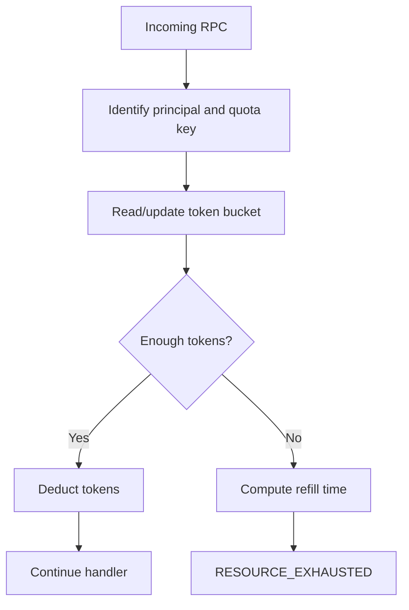

# RESOURCE_EXHAUSTED

In gRPC, **`RESOURCE_EXHAUSTED` is status code `8`**, indicating that a resource required to process the RPC has been exhausted or a usage limit has been exceeded. That resource might be a tenant quota, request count in a time window, storage capacity, processing queue, buffer memory, or message size limit. Servers use this status to reject work they cannot accept under current conditions.

In **SPRING_GRPC**, you must clearly identify which resource is constrained, whether the limit applies per user/tenant/service or system-wide, and how long the client should wait before trying again. `RESOURCE_EXHAUSTED` is not automatically a transient error: an exhausted monthly quota may not recover within seconds, whereas a full queue may clear quickly. Clients must rely on the contract and retry hints rather than retrying blindly on intuition.

## 1. Meaning of RESOURCE_EXHAUSTED

`RESOURCE_EXHAUSTED` has the numeric value **8**. This status fits when a resource has run out or a measurable limit has been exceeded.

| Perspective | Meaning |
| --- | --- |
| Client | Request rejected because a quota, capacity, or resource limit reached its threshold |
| Server | Cannot continue processing without violating a resource/policy limit |
| gRPC runtime | Terminates the RPC with status `RESOURCE_EXHAUSTED` |
| Business | May need to wait for quota replenishment, reduce request size, or shed load |

Common scenarios:

- A tenant has used up its daily or monthly API quota.
- A client exceeds a rate limit, such as sending too many requests per minute.
- The server hits its concurrent RPC limit or the admission queue is full.
- A message exceeds the configured size limit.
- Memory, storage capacity, or another finite resource is insufficient.
- A workflow exceeds the allowed quota of tasks or created data volume.

This status describes resource exhaustion or limit violation; it does not by itself tell you which limit was hit. The server should provide structured details when the client needs to know how to recover.

## 2. Distinguishing quota, rate limit, and capacity

These three concepts are related, but not identical:

| Concept | Meaning | Example |
| --- | --- | --- |
| Quota | Usage budget over a scope/period | A tenant may call 100,000 RPCs per month |
| Rate limit | Speed limit over a time window | Maximum 50 requests/second per API key |
| Capacity limit | Limit on intake or concurrency at a given moment | Maximum 500 concurrent calls, queue holding at most 1,000 tasks |

Quotas are usually counted by cumulative consumption and reset periodically or increased by an administrator. Rate limits control speed to protect the service and ensure fair distribution. Capacity limits protect live resources such as workers, connection pools, or memory.

Do not use one generic "overloaded" message for all three if clients need different actions:

- Long-term quota exhausted: client must wait for the reset period or request a quota increase.
- Rate limit: client can slow down and retry after a wait period.
- Temporary capacity limit: client can back off and retry once the service has room.

## 3. Distinguishing RESOURCE_EXHAUSTED from nearby statuses

| Status | Meaning | Example |
| --- | --- | --- |
| `RESOURCE_EXHAUSTED` | A specific resource or quota is exhausted/exceeded | Tenant quota exhausted or admission queue full |
| `UNAVAILABLE` | Service is temporarily unable to serve or connection is unusable | Server lost connection, restarting, or dependency unavailable |
| `ABORTED` | Operation aborted due to a conflict to handle at transaction level | Optimistic locking conflict |
| `FAILED_PRECONDITION` | Current state prevents the operation | Account has not been activated yet |
| `INVALID_ARGUMENT` | Request contains invalid arguments | Malformed field |
| `DEADLINE_EXCEEDED` | RPC did not finish before the deadline | Server responded slower than the caller allowed |

### 3.1. RESOURCE_EXHAUSTED and UNAVAILABLE

Use `RESOURCE_EXHAUSTED` when you know a resource limit or quota was hit. `UNAVAILABLE` fits better when the service or a dependency is broadly unable to serve requests temporarily, such as a dropped connection or a server not yet ready.

For example, if a tenant has used up its 10,000 monthly exports, `RESOURCE_EXHAUSTED` accurately reflects the policy. A node that just lost database connectivity and cannot serve requests can return `UNAVAILABLE`. If an admission controller rejects a call because concurrency slots are full, `RESOURCE_EXHAUSTED` can be used when the contract defines this as a retryable capacity limit.

Do not choose a status purely because the server is busy. Determine whether the client needs to understand it as exhausted quota, bounded capacity, or unavailable service.

### 3.2. RESOURCE_EXHAUSTED and FAILED_PRECONDITION

`RESOURCE_EXHAUSTED` is about insufficient budget/resources. `FAILED_PRECONDITION` is about business state not yet satisfying preconditions. For instance, a tenant running out of storage is `RESOURCE_EXHAUSTED`; an account that has not completed KYC and thus cannot enable a feature is `FAILED_PRECONDITION`.

## 4. Designing quotas and rate limits for a gRPC method

Before implementing a limiter, define:

- **Subject:** user, API key, tenant, service account, IP, or entire service.
- **Method scope:** whole service or individual RPCs such as `ExportReport`.
- **Consumption unit:** request count, record count, bytes, CPU time, or business cost.
- **Counting window:** fixed minute/hour/day, rolling window, or token bucket.
- **Exceeded policy:** reject immediately, bounded queue, or return an asynchronous result.
- **Recovery timing:** periodic reset, continuous refill, or only when an admin grants more.

Quota example:

| Principal | Method | Limit | Window |
| --- | --- | ---: | --- |
| Basic tenant | `ExportReport` | 20 | per hour |
| Enterprise tenant | `ExportReport` | 500 | per hour |
| Internal service account | `GetProduct` | 100 | per second |

These numbers are illustrative only. Actual values should be based on processing cost, SLAs, system capacity, and customer agreements.

### 4.1. Token bucket

Token bucket is a common algorithm for rate limiting. A bucket has a maximum capacity; tokens are replenished at a defined rate. Each request consumes one or more tokens. If insufficient tokens remain, the request is rejected or queued per policy.



Token buckets allow short bursts within the bucket capacity while still controlling average rate. With multiple Spring instances running concurrently, bucket state must be shared or consistently partitioned; a limiter stored solely in each instance's memory can let total quota exceed the intended limit.

### 4.2. Distributed quotas

In multi-replica deployments, per-tenant quotas need a shared source of truth or a budget allocation algorithm across nodes. You can use Redis, a database, or a dedicated quota service depending on accuracy and latency requirements.

Decide explicitly:

- Are counter updates atomic?
- When the quota store is unavailable, does the service fail-open or fail-closed?
- Is a small margin of error acceptable to reduce latency?
- Do keys have clear TTLs and reset policies?
- Is the tenant key taken from verified identity rather than directly from arbitrary client metadata?

Fail-open keeps the service running when the quota store fails, but may exceed quotas. Fail-closed protects quotas more strictly, but may reject valid callers when the quota system has an outage. This is an operational and business decision with no one-size-fits-all choice.

## 5. Capacity limits and admission control

Quotas/rate limits control consumption by principal or over time. Admission control checks whether the service is currently capable of accepting more work right now.

In Spring gRPC, points to bound may include:

- Number of concurrently executing requests.
- Executor queue size.
- Number of running export/report jobs.
- Connections to databases or downstream services.
- Streaming buffer sizes.
- Request/response message sizes.

An unbounded queue can turn a short traffic spike into prolonged latency and exhaust the heap. Use bounded queues, semaphores, or bulkheads by workload type. When no slots remain, the server can reject early with an appropriate status instead of accepting more work that cannot finish before its deadline.

Simple semaphore example:

```java
public final class ExportAdmission {
    private final Semaphore permits = new Semaphore(20);

    public void acquire() {
        if (!permits.tryAcquire()) {
            throw Status.RESOURCE_EXHAUSTED
                .withDescription("Concurrent export limit reached")
                .asRuntimeException();
        }
    }

    public void release() {
        permits.release();
    }
}
```

This only illustrates a limit within a single instance. Production code must guarantee `release()` always executes in a `finally` block or equivalent cleanup hook, never leaking permits after exceptions or cancellation. With multiple replicas, a local semaphore limits each instance rather than enforcing a cluster-wide quota.

## 6. Mapping resource exhaustion to a gRPC status in Spring

The application service can throw a domain exception when quota or capacity is exhausted:

```java
public ExportJob createExport(ExportCommand command) {
    quotaService.consume(command.tenantId(), "export", 1);
    return exportRepository.create(command);
}
```

At the gRPC boundary, map the known exception:

```java
try {
    ExportJob job = exportService.createExport(command);
    observer.onNext(toReply(job));
    observer.onCompleted();
} catch (QuotaExceededException ex) {
    observer.onError(Status.RESOURCE_EXHAUSTED
        .withDescription("Export quota exhausted")
        .asRuntimeException());
}
```

This example assumes the quota service and domain exception are already defined. In a large application, use an exception mapper/interceptor to standardize statuses, metadata, and error details. Do not map every `RuntimeException` or every database error to `RESOURCE_EXHAUSTED`; use it only when an actual resource limit has been identified.

### 6.1. Quota updates must stay consistent with side effects

If quota is deducted first and job creation fails, the system can lose quota even though no job was created. Conversely, if the job is created first and quota deducted afterward, concurrent requests can exceed the limit.

Depending on architecture, use a shared transaction, quota reservation/commit, idempotency keys, or a compensating workflow. For quotas in distributed systems, never assume a counter check followed by a business write is atomic if they live in two separate systems.

## 7. Providing retry guidance to the client

Not every `RESOURCE_EXHAUSTED` can be retried after a few seconds. The client needs to know:

- Which limit was hit: rate, concurrent capacity, storage, or periodic quota.
- Whether there is an expected retry time.
- Whether the client can reduce request size or rate.
- Whether the quota resets automatically or requires an administrator to grant more.

With Google RPC's rich error model, you can use:

- `google.rpc.RetryInfo`: how long the server recommends waiting before retrying.
- `google.rpc.QuotaFailure`: describes quota violations by matching rule/subject.
- `google.rpc.ResourceInfo`: related resource type and name if the caller is allowed to know.

Example of logical details:

```text
grpc-status: RESOURCE_EXHAUSTED
grpc-message: Rate limit exceeded

RetryInfo:
  retry_delay: 2 seconds

QuotaFailure:
  violations:
    - subject: "tenant:current"
      description: "Export limit exceeded"
```

This is an example of error detail contents, not standard gRPC headers. In gRPC Java, richer details can be packed into `com.google.rpc.Status` and converted to an exception via `io.grpc.protobuf.StatusProto`. Send only subject/limit details the caller is permitted to know; do not expose other tenants' quotas or internal configuration.

If not using richer error details, a service can provide custom metadata per contract, provided client and server agree on key names, time units, and semantics. Never assume HTTP's `Retry-After` header will automatically appear or be understood by every gRPC client.

## 8. Controlled client retries

Clients should not retry immediately upon receiving `RESOURCE_EXHAUSTED`. Immediate retries increase load at the exact moment the server is short on resources.

A sound policy should:

1. Identify the limit type from status/error details.
2. If `RetryInfo` is present, wait at least as long as recommended by the server.
3. Without guidance, use exponential backoff with jitter and cap the number of attempts.
4. Respect the operation's overall deadline.
5. Reduce request rate or batch size if that is the cause.
6. Do not retry an exhausted quota until the reset window if the server indicates no quick recovery is possible.

| Scenario | Client-side action |
| --- | --- |
| Short-term rate limit | Wait per RetryInfo/backoff, reduce request rate |
| Concurrent capacity full | Wait briefly and retry with bounds |
| Daily/monthly quota exhausted | Stop retrying; wait for reset or request quota increase |
| Request too large | Split into smaller batches or reduce payload |
| Storage out of space | Do not retry continuously; free space or request intervention |
| Unclear which resource ran out | Log status and correlation ID; do not retry blindly |

### 8.1. Idempotency when retrying

For write operations, the server may already have accepted and executed part of the work before returning `RESOURCE_EXHAUSTED`, especially if limits are checked at multiple stages. The client needs to know whether the operation can be resent safely.

Use idempotency keys for operations with side effects; the server stores outcomes or state by key and handles duplicates consistently. Never treat the status code as absolute proof that no side effects occurred.

## 9. RESOURCE_EXHAUSTED and streaming flow control

gRPC streaming has flow control so a sender cannot send infinitely faster than a receiver can absorb. Flow control paces message delivery; `RESOURCE_EXHAUSTED` indicates a resource or application limit has been exhausted.

| Scenario | Appropriate mechanism |
| --- | --- |
| Client reads slowly, server needs to wait for readiness | Flow control/readiness |
| Server buffer reaches safety limit | Backpressure, pause producer, or reject per policy |
| Tenant exceeds total byte/message quota | `RESOURCE_EXHAUSTED` |
| A single message exceeds max inbound message size | Runtime may reject with `RESOURCE_EXHAUSTED` |
| Client actively stops the stream | Cancellation, typically client sees `CANCELLED` |

For server streaming, bound buffers and producer speed. If a client reads slowly, do not keep accumulating messages indefinitely. For client/bidirectional streaming, define quotas by message count, bytes, or duration if streams can stay open long-term.

## 10. Message sizes and resource bounds

The gRPC runtime and server can enforce message size limits to protect memory and decoding cost. A request exceeding the limit can be rejected before the handler is even invoked.

Clients should:

- Avoid sending huge payloads in a single RPC when chunking or streaming can be used.
- Check the message limits published for the API.
- Use compression when appropriate, but do not treat compression as a substitute for payload limits.
- Design uploads/downloads with bounded chunks and progress confirmation.

Servers should not arbitrarily raise max inbound size just to fix `RESOURCE_EXHAUSTED`. Large payloads increase memory pressure and affect the entire process. Choose limits based on heap, concurrency, and business payload sizes.

## 11. Testing RESOURCE_EXHAUSTED

Tests should verify both the policy and recovery behavior:

| Scenario | What to verify |
| --- | --- |
| Tenant exhausts quota | RPC returns `RESOURCE_EXHAUSTED`, no out-of-policy side effects |
| Rate limit exceeded | Requests over threshold are rejected; valid requests after refill succeed |
| Two concurrent requests race for final quota | Counter/decision never exceeds limit under chosen semantics |
| Queue or semaphore full | Server rejects early; permits are properly released when calls finish |
| Quota store unavailable | Fail-open/fail-closed behavior matches policy |
| Message exceeds limit | Runtime rejects; handler must not assume request was received |
| Client receives RetryInfo | Waits with right units/duration and does not retry earlier than policy |
| Long-term quota exhausted | Client does not keep retrying |
| Streaming client reads slowly | Buffers are bounded and flow control operates |
| Client cancels while holding a permit | Resources are cleaned up with no slot leaks |

For distributed quotas, tests must run concurrent requests and, where possible, multiple server instances. Unit tests for a limiter do not replace integration tests against real storage/counters.

## 12. Observing resource exhaustion in production

`RESOURCE_EXHAUSTED` is an important signal about load, quota policy, and operational limits. Monitor:

- Count and rate of the status by service/method.
- Cause categories: quota, rate limit, concurrency, queue, message size, or storage.
- Quota consumption versus limit and reset timing.
- Queue depth, active calls, worker utilization, and rejection counts.
- Retry rate, average retry count, and post-retry outcomes.
- Memory, GC, connection pools, and related resources.
- Affected tenant/client classes without exposing private data.

Do not put high-cardinality tenant IDs, API keys, user IDs, or request IDs into metric labels. You can use quota tiers, methods, and normalized reason codes. Logs/traces can hold correlation IDs and controlled decision metadata for investigation.

If `RESOURCE_EXHAUSTED` rises for a single tenant, inspect that tenant's usage and policy. If many tenants are rejected together, inspect system-wide capacity, queues, database pools, or the quota service. Do not simply raise limits; first identify which resource is actually exhausted and the impact on other callers.

## 13. Common design mistakes

| Mistake | Consequence | Better practice |
| --- | --- | --- |
| Using `RESOURCE_EXHAUSTED` for every busy-server error | Clients cannot tell quota limits from outages | Separate resource limits from service availability |
| Retrying immediately | Retry storms worsen load | RetryInfo, backoff, jitter, and retry caps |
| Using local limiters for cluster-wide quotas | Total quota exceeded across multiple replicas | Distributed counters or explicit budget partitioning |
| Unbounded queues | Heap growth, tail latency spikes, cascading failures | Bounded queues and admission control |
| Non-atomic quota deduction and side effects | Lost quota or exceeded quota under concurrent errors | Transactions, reservations, or compensating workflows |
| Mapping all database errors to RESOURCE_EXHAUSTED | Hides other data/infrastructure failures | Map only identified resource/quota errors |
| Raising message size limits arbitrarily | Increases memory pressure and OOM risk | Chunking, streaming, and capacity-based limits |
| Providing no retry guidance | Clients retry too early or give up unnecessarily | Clear RetryInfo/contract on resets and recovery |
| Not cleaning up permits on cancellation | Capacity leaks; future requests rejected forever | Release in finally and test cancellation |

## 14. RESOURCE_EXHAUSTED design checklist

Before publishing a gRPC method, determine:

1. **Which resource is bounded?** Quota, rate, concurrency, queue, bytes, storage, or message size.
2. **Who does the limit apply to?** User, tenant, API key, service account, or entire service.
3. **What are the units and counting periods?** Requests, bytes, jobs, seconds, days, or months.
4. **Are counters safe under concurrency and multiple instances?**
5. **When over limit, does the server reject or queue?** Is the queue bounded?
6. **Do clients know when to retry?** RetryInfo, reset time, or load-reduction guidance.
7. **Are retries safe?** Deadlines, backoff, jitter, and idempotency defined.
8. **Does streaming have flow control and buffer bounds?**
9. **How are quota store failures handled?** Fail-open or fail-closed per policy.
10. **Does telemetry distinguish causes without leaking tenants/credentials?**

## 15. Takeaways

`RESOURCE_EXHAUSTED` is gRPC status code `8`, used when a quota or finite resource is exhausted or over limit. It can indicate rate limits, per-tenant quotas, concurrent capacity, queues, storage, or message size limits. Distinguish this status from `UNAVAILABLE` (service unavailable), `FAILED_PRECONDITION` (business state not met), and `ABORTED` (transaction conflict).

In Spring gRPC, define the resource and quota scope, use bounded limiters/admission control, keep counters accurate across concurrent requests and instances, and clean up resources when calls finish or cancel. Provide `RetryInfo` or appropriate recovery guidance; clients should apply backoff, jitter, deadlines, and idempotency. Measure quotas, queues, active calls, and rejections by cause to know whether to adjust policy or capacity. Clear semantics protect the system while giving clients controlled recovery paths.

### References

- [gRPC – Status codes](https://grpc.io/docs/guides/status-codes/)
- [gRPC – Error handling](https://grpc.io/docs/guides/error/)
- [gRPC – Flow control](https://grpc.io/docs/guides/flow-control/)
- [Google API – Error model](https://cloud.google.com/apis/design/errors)
- [Google API – Quotas](https://cloud.google.com/docs/quotas)
- [gRPC – Retry](https://grpc.io/docs/guides/retry/)
