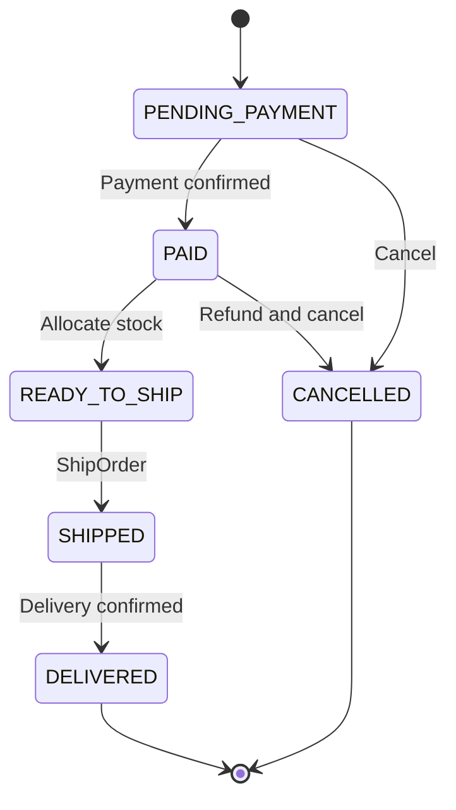
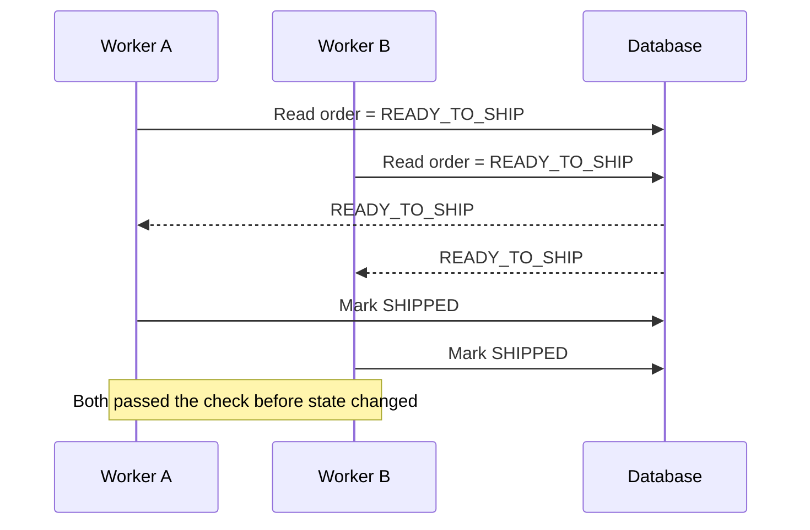

# FAILED_PRECONDITION

In gRPC, **`FAILED_PRECONDITION` is status code `9`**, indicating that an operation was rejected because the system or resource is not in the state required to execute it. The request may be syntactically valid, and the caller may be authenticated and authorized, yet current business conditions do not permit the action. For example, an order already exists, but has not been paid yet and therefore cannot transition to shipped.

In **SPRING_GRPC**, you should explicitly model resource states and state transitions, enforce preconditions in the application/domain service, and map business errors to gRPC statuses. `FAILED_PRECONDITION` tells the client that to proceed, state must change or a prior step must be completed. Resending the exact same request before the condition changes will usually just return the same error.

## 1. Meaning of FAILED_PRECONDITION

`FAILED_PRECONDITION` has the numeric value **9**. This status applies when an operation can execute only if a system condition is already satisfied, and that condition currently does not hold.

| Perspective | Meaning |
| --- | --- |
| Client | The operation cannot run yet; state must change or a prerequisite must be completed first |
| Server | Required domain state or precondition is not satisfied |
| gRPC runtime | Terminates the RPC with status `FAILED_PRECONDITION` |
| Business | Request is not structurally invalid, but current timing/state does not permit execution |

For example:

- Only a paid order can transition to `SHIPPED`.
- Only an account that has completed KYC can unlock transaction limits.
- A folder cannot be deleted while it still contains documents.
- A work session cannot be closed while mandatory tasks remain incomplete.
- An invoice cannot be issued when the order has not yet been confirmed.
- A device cannot transition to `ACTIVE` before a certificate is registered.

`FAILED_PRECONDITION` describes an unmet condition; it does not by itself tell the client what to do next. If the API needs machine-readable guidance, provide structured error details or a method to read current state/preconditions.

## 2. Preconditions differ from request validation

A precondition usually depends on the current state of the system or resource. Request validation checks the data sent by the client itself.

For example, with the `ShipOrder` method:

- `order_id` is blank or malformed: invalid request, usually `INVALID_ARGUMENT`.
- Valid `order_id`, but the order is unpaid: unmet precondition, usually `FAILED_PRECONDITION`.
- Order does not exist: `NOT_FOUND`.
- Caller lacks permission to ship the order: `PERMISSION_DENIED`.
- Order was just updated by another process and the current transaction conflicts: can be `ABORTED`, depending on API semantics.

| Condition category | Question | Example |
| --- | --- | --- |
| Request validation | Does the input satisfy the contract? | Is the ID well-formed, is quantity positive? |
| Authentication | Can the caller be verified? | Is the token valid? |
| Authorization | Does the caller have permission for the action? | Allowed to ship orders for this tenant? |
| Resource existence | Does the referenced resource exist? | Is there an order with that ID? |
| State precondition | Does current state allow the action? | Has the order been paid? |
| Concurrency control | Was data modified concurrently during the transaction? | Version no longer matches on commit |

Do not use `FAILED_PRECONDITION` as a catch-all bucket. Accurate classification tells the client whether to fix the request, log in, request permission, find the resource, or complete a prerequisite business step.

## 3. Distinguishing FAILED_PRECONDITION from nearby statuses

| Status | Meaning | Example |
| --- | --- | --- |
| `FAILED_PRECONDITION` | System/resource state does not meet conditions for the operation | Order is unpaid so it cannot ship yet |
| `INVALID_ARGUMENT` | Request argument is invalid regardless of system state | Syntactically invalid ID |
| `ABORTED` | Operation aborted due to a conflict to handle at transaction level | Optimistic locking conflict |
| `PERMISSION_DENIED` | Caller lacks permission to execute the operation | User is not permitted to ship orders |
| `UNAUTHENTICATED` | Caller identity cannot be verified | Expired token |
| `NOT_FOUND` | Target resource does not exist | No order with the sent ID |
| `ALREADY_EXISTS` | Resource to create already exists | Creating a reservation with an already-used key |
| `RESOURCE_EXHAUSTED` | Quota or resource limit is exhausted | Tenant ran out of export quota |

### 3.1. FAILED_PRECONDITION and INVALID_ARGUMENT

`INVALID_ARGUMENT` applies when the request is invalid regardless of what state the system is in. `FAILED_PRECONDITION` applies when the exact same request could be valid in a different state.

For example, `ActivateAccount(account_id)` may be a valid request. If the account has not completed identity verification, current state prevents activation so you can return `FAILED_PRECONDITION`. If `account_id` is malformed, that is `INVALID_ARGUMENT`.

### 3.2. FAILED_PRECONDITION and ABORTED

`FAILED_PRECONDITION` describes an unmet business condition. `ABORTED` typically describes an operation aborted due to a concurrency/transaction conflict where the caller may need to re-run a read-modify-write cycle.

For example:

- Order is in `PENDING_PAYMENT`, caller invokes `ShipOrder`: `FAILED_PRECONDITION`.
- Two workers update the order concurrently with optimistic locking; one transaction loses because the version changed: `ABORTED` may fit if the caller needs to re-read and decide again.

The exact boundary depends on the contract and how the system handles races. Do not pick a status merely by looking at a database exception name; express what the client needs to know.

### 3.3. FAILED_PRECONDITION and PERMISSION_DENIED

A caller may have full permissions while the resource is not ready; that is a precondition. Conversely, the resource may be ready while the caller lacks permission; that is authorization. Never use business state to hide a permission failure, and never use `PERMISSION_DENIED` for every action whose prerequisites are unmet.

## 4. Modeling state transitions before writing handlers

An API managing resource lifecycles should define:

- Valid states.
- Allowed state transitions.
- Preconditions required before each transition.
- Which roles may execute each transition.
- Terminal states that cannot be reversed.
- Behavior when duplicate requests arrive or two actors transition state concurrently.

Example order lifecycle:



If a client calls `ShipOrder` while the order is still `PENDING_PAYMENT`, the server returns `FAILED_PRECONDITION` explaining that payment must be confirmed first. Once the order is `READY_TO_SHIP`, the same method can succeed.

Do not merely check an enum state inside the gRPC handler while letting other layers mutate state freely. State transition rules should live in the domain/application service so all entry points share them.

## 5. Protobuf contract for preconditions

Example request to ship an order:

```protobuf
syntax = "proto3";

package commerce.order.v1;

service OrderService {
  rpc ShipOrder(ShipOrderRequest) returns (ShipOrderReply);
}

message ShipOrderRequest {
  string order_id = 1;
}

message ShipOrderReply {
  string order_id = 1;
  string state = 2;
  string shipment_id = 3;
}
```

The contract may specify:

- `order_id` must have a valid format.
- The order must exist in the caller's tenant.
- The caller must have permission to execute `ShipOrder`.
- The order must be in `READY_TO_SHIP`.
- Stock reservation and shipping data must be created according to the defined transaction/workflow.

These conditions belong to different layers. Do not lump all of them into a single generic exception and return `FAILED_PRECONDITION`. For instance, a missing order is still `NOT_FOUND`; an unauthorized caller is still `PERMISSION_DENIED`; only an invalid state is `FAILED_PRECONDITION`.

## 6. Checking preconditions in a Spring application service

A domain service can hold the state transition rules:

```java
public Order shipOrder(String orderId) {
    Order order = orderRepository.findById(orderId)
        .orElseThrow(OrderNotFoundException::new);

    if (order.getState() != OrderState.READY_TO_SHIP) {
        throw new OrderPreconditionException(
            orderId,
            order.getState(),
            OrderState.READY_TO_SHIP);
    }

    order.markShipped();
    return orderRepository.save(order).toDomain();
}
```

At the gRPC boundary, map the domain exception to a status:

```java
try {
    Order order = orderService.shipOrder(request.getOrderId());
    observer.onNext(toShipReply(order));
    observer.onCompleted();
} catch (OrderPreconditionException ex) {
    observer.onError(Status.FAILED_PRECONDITION
        .withDescription("Order is not in a shippable state")
        .asRuntimeException());
}
```

This example assumes the repository, enum, and exception are already defined. In a large application, centralize mapping into an exception mapper/interceptor suited to your gRPC stack to avoid repeating try/catch blocks. Descriptions returned to clients should be short and safe; detailed states can go into structured error details if required by the contract.

### 6.1. Place validation at the right boundaries

A typical processing sequence is:

1. Authenticate credentials and establish principal.
2. Check permission to invoke the method/action.
3. Validate request shape and IDs.
4. Locate the resource within the caller's allowed scope.
5. Check domain state preconditions.
6. Execute state transition and side effects via transaction/workflow.
7. Return response after outcomes satisfy contracted semantics.

Actual ordering can be adjusted to avoid disclosing resource existence. For example, a multi-tenant API may enforce visibility/authorization inside the query before returning `NOT_FOUND` or `PERMISSION_DENIED`.

## 7. Race conditions: precondition checks must accompany updates

A common bug is reading state, checking it, and updating it in two unprotected operations:



If two requests both pass the precondition check and both create a shipment, the system can produce duplicate side effects. Checking state in Java does not protect against concurrency on its own.

Common protections:

- Transactions with an appropriate isolation level.
- Optimistic locking using a version field.
- Pessimistic locking when operations must be serialized.
- Conditional updates that succeed only while state remains valid.
- Unique constraints/idempotency keys for side effects that must be unique.

Example conditional update:

```sql
UPDATE orders
SET state = 'SHIPPED', version = version + 1
WHERE id = :orderId
  AND state = 'READY_TO_SHIP';
```

If zero rows are updated, the state already changed or the order no longer satisfies the condition. The application must distinguish nonexistence from state conflicts using appropriate lookup/locking, then map the status per contract. Never assume every zero update count means `FAILED_PRECONDITION`.

### 7.1. Transactions do not automatically protect external side effects

A database transaction does not automatically roll back an operation already sent to a shipping carrier, email service, or payment provider. If a workflow spans multiple systems, consider a transactional outbox, saga/compensation, or intermediate operation states. Only report success when the contract defines clearly whether it means "completed" or "accepted for processing".

## 8. Error details for preconditions

Free-form descriptions may suffice for simple applications. For clients that need to know which condition failed, you can use the rich error model `google.rpc.PreconditionFailure`, consisting of violations with `type`, `subject`, and `description`.

Example of logical content:

```text
grpc-status: FAILED_PRECONDITION
grpc-message: Order cannot be shipped yet

PreconditionFailure:
  violations:
    - type: "ORDER_STATE"
      subject: "orders/{order_id}/state"
      description: "Order must be READY_TO_SHIP before ShipOrder"
```

This illustrates error detail representation, not standard metadata headers. In gRPC Java, richer details can be packed into `com.google.rpc.Status` and converted to an exception via `io.grpc.protobuf.StatusProto`.

Example building the status:

```java
PreconditionFailure detail = PreconditionFailure.newBuilder()
    .addViolations(PreconditionFailure.Violation.newBuilder()
        .setType("ORDER_STATE")
        .setSubject("orders/" + orderId + "/state")
        .setDescription("Order must be READY_TO_SHIP before ShipOrder"))
    .build();

com.google.rpc.Status rpcStatus = com.google.rpc.Status.newBuilder()
    .setCode(Status.Code.FAILED_PRECONDITION.value())
    .setMessage("Order cannot be shipped yet")
    .addDetails(Any.pack(detail))
    .build();

observer.onError(StatusProto.toStatusRuntimeException(rpcStatus));
```

This example requires the corresponding Google RPC error details Protobuf types and dependency. Do not put sensitive internal details into `subject` or `description`; provide only resources/states the caller is permitted to know. If a client does not support richer details, the status code alone must still suffice for general handling.

## 9. How clients read and recover from FAILED_PRECONDITION

When receiving `FAILED_PRECONDITION`, the client should identify which condition must change. Do not keep retrying the exact request while state remains unchanged.

A handling approach:

1. Read the status and structured details if present.
2. Identify the resource and violated precondition.
3. Call a status-reading method or reload the resource.
4. Guide the user to complete the prior step, such as payment or verification.
5. Re-invoke the action only after the precondition is satisfied.
6. If state might have been changed by another actor, process the fresh state instead of stale data.

Blocking stub example:

```java
try {
    ShipOrderReply reply = orderStub.shipOrder(request);
    // Update the UI according to the result.
} catch (StatusRuntimeException ex) {
    if (ex.getStatus().getCode() == Status.Code.FAILED_PRECONDITION) {
        // Reload the order and display the missing business step.
    } else {
        // Classify other statuses.
    }
}
```

If using richer details, the client can read them:

```java
com.google.rpc.Status rpcStatus = StatusProto.fromThrowable(ex);
if (rpcStatus != null) {
    for (Any detail : rpcStatus.getDetailsList()) {
        if (detail.is(PreconditionFailure.class)) {
            PreconditionFailure failure =
                detail.unpack(PreconditionFailure.class);
            // Map violation type/subject to UI actions.
        }
    }
}
```

Clients should not parse `grpc-message` prose to drive logic. Use the status code and stable structured details; messages are only for display or diagnostics.

## 10. Conditional retries, never blind retries

`FAILED_PRECONDITION` is normally not a status to retry automatically with backoff like `UNAVAILABLE`. Business conditions must change before retrying.

| Scenario | Handling |
| --- | --- |
| Order is unpaid | Wait for payment completion, reload order, then call `ShipOrder` |
| Account lacks KYC | Complete KYC; do not retry continuously |
| Resource is locked | Wait for unlock workflow or request intervention by an authorized user |
| Precondition changed by another actor | Re-read state and decide again |
| Optimistic lock conflict | May require `ABORTED`, re-read and re-run transaction |
| Invalid request ID | Fix request; this is `INVALID_ARGUMENT` |

For write operations, use an idempotency key if the client might not know how far a previous call got. `FAILED_PRECONDITION` tells you the server rejected the call under current conditions, yet if a workflow has out-of-transaction side effects or lost responses, clients still need a clear contract for operation status.

## 11. FAILED_PRECONDITION in streaming RPCs

In client-streaming or bidirectional streaming, preconditions may be evaluated per message or when the stream finishes. Define semantics:

- Does one message violating a precondition terminate the entire RPC?
- Were earlier messages already processed/committed?
- From which sequence/cursor can the client resume?
- If partial data was accepted, does the server return per-item results or a final status?

If the stream is a single logical transaction, the final status can reject the entire operation per contract. If each message is an independent command, message-level responses may be better suited to report per-item errors without terminating the entire stream. Do not let clients assume that a stream ending with `FAILED_PRECONDITION` means every preceding message rolled back.

## 12. Testing FAILED_PRECONDITION

Tests must verify statuses, state transitions, and concurrency:

| Scenario | What to verify |
| --- | --- |
| Calling `ShipOrder` on an order in `PENDING_PAYMENT` | `FAILED_PRECONDITION`; state remains unchanged |
| Calling `ShipOrder` on an order in `READY_TO_SHIP` | State transitions successfully per contract |
| Malformed order ID | `INVALID_ARGUMENT`, not mis-mapped |
| Order does not exist | `NOT_FOUND` |
| Caller lacks permission | `PERMISSION_DENIED` |
| Two workers transition state concurrently | Only one transition/side effect executes |
| Version changes between read and write | Conflict handled per semantics, possibly `ABORTED` |
| Structured details | Client reads the right violation type/subject |
| State changes after rejection | Client reloads and can execute action once condition holds |
| Streaming violates precondition | Termination/partial result behavior matches contract |

Unit tests for the domain service verify the state machine and transition rules. Integration tests over a gRPC client/server verify statuses and details are transmitted accurately. Concurrency tests should use an appropriate database to verify actual transitions and side effects rather than only mocking repositories.

## 13. Observability and auditing

`FAILED_PRECONDITION` can be a normal business outcome. However, an unusual spike can indicate clients calling workflow methods out of order, inconsistent state machines, or unclear contracts.

Monitor:

- Count/rate of the status by service and method.
- Normalized precondition violation categories, such as `ORDER_STATE`, `KYC_REQUIRED`.
- Rejected action types and source states in non-sensitive form.
- Client/SDK versions causing the errors.
- Success rate of actions after callers resolve preconditions.
- Trace/correlation IDs to link rejections with earlier workflow steps.
- Concurrency conflict rate separated from business preconditions.

Do not use resource IDs, user IDs, or free-form exception messages as high-cardinality metric labels. Audit logs need enough detail to explain decisions while avoiding unnecessary sensitive data or internal policies.

If `FAILED_PRECONDITION` increases after releasing a new client, check method call ordering and state assumptions in the client. If it increases on a server after a deploy, check state transitions, migrations, and existing data.

## 14. Common design mistakes

| Mistake | Consequence | Better practice |
| --- | --- | --- |
| Using `FAILED_PRECONDITION` for malformed fields | Client does not know to fix the request | Use `INVALID_ARGUMENT` |
| Using this status for missing permissions | Blurs authorization boundaries | Use `PERMISSION_DENIED` |
| Using this status for every transaction conflict | Client does not know to re-read-modify-write | Distinguish `ABORTED` |
| Only checking state in handler and updating later | Race conditions and duplicate side effects | Check/update atomically or use locking/versions |
| Retrying the same request while state is unchanged | Repeated errors and extra load | Read state, finish prerequisites, then call again |
| Returning free-form messages as a machine contract | Clients depend on fragile text | Use `PreconditionFailure` details or stable violation codes |
| Not defining stream partial results | Clients misinterpret what data was processed | Specify clear commit/resume semantics |
| Emitting success before transaction/workflow guarantee | Clients see success even when side effects fail | Return only per published semantics |

## 15. FAILED_PRECONDITION design checklist

Before publishing a method, determine:

1. **What is the specific precondition?** Which state or condition must hold?
2. **Does the condition belong to the request or system state?** Separate `INVALID_ARGUMENT` from `FAILED_PRECONDITION`.
3. **Does the resource exist and is the caller authorized?** Classify `NOT_FOUND`/`PERMISSION_DENIED`.
4. **What are the valid state transitions?** Model the state machine and actions.
5. **Are check and update atomic?** Handle races with transactions, versions, locks, or conditional updates.
6. **How are external system side effects managed?** Outbox, saga, compensation, or operation state.
7. **Does the client know how to recover?** Provide details/methods to read state and prerequisites.
8. **Are retries conditional?** Never retry while state is unchanged; consider idempotency.
9. **Are streaming partial result semantics clear?**
10. **Does telemetry separate business preconditions from concurrency conflicts?**

## 16. Takeaways

`FAILED_PRECONDITION` is gRPC status code `9`, used when an operation is rejected because the current state of the system or resource does not meet required conditions. It differs from `INVALID_ARGUMENT` (invalid request), `ABORTED` (transaction conflict), and `PERMISSION_DENIED` (caller lacks permission).

In Spring gRPC, model state transitions in the domain/application service, combine precondition checks with updates via transactions or concurrency control, and map business exceptions to `Status.FAILED_PRECONDITION`. If clients need to know which condition failed, use structured details such as `google.rpc.PreconditionFailure`; never force clients to parse message text. Clients should re-read state and complete prerequisites before calling again. Clear precondition design makes workflows understandable, prevents races, and avoids wasted retries.

### References

- [gRPC – Status codes](https://grpc.io/docs/guides/status-codes/)
- [gRPC – Error handling](https://grpc.io/docs/guides/error/)
- [Google API – Error model](https://cloud.google.com/apis/design/errors)
- [Google API – Resource-oriented design](https://cloud.google.com/apis/design/resources)
- [Spring Framework – Transaction management](https://docs.spring.io/spring-framework/reference/data-access/transaction.html)
